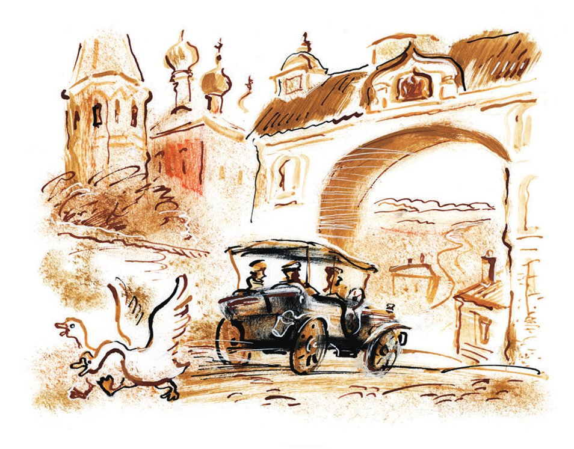
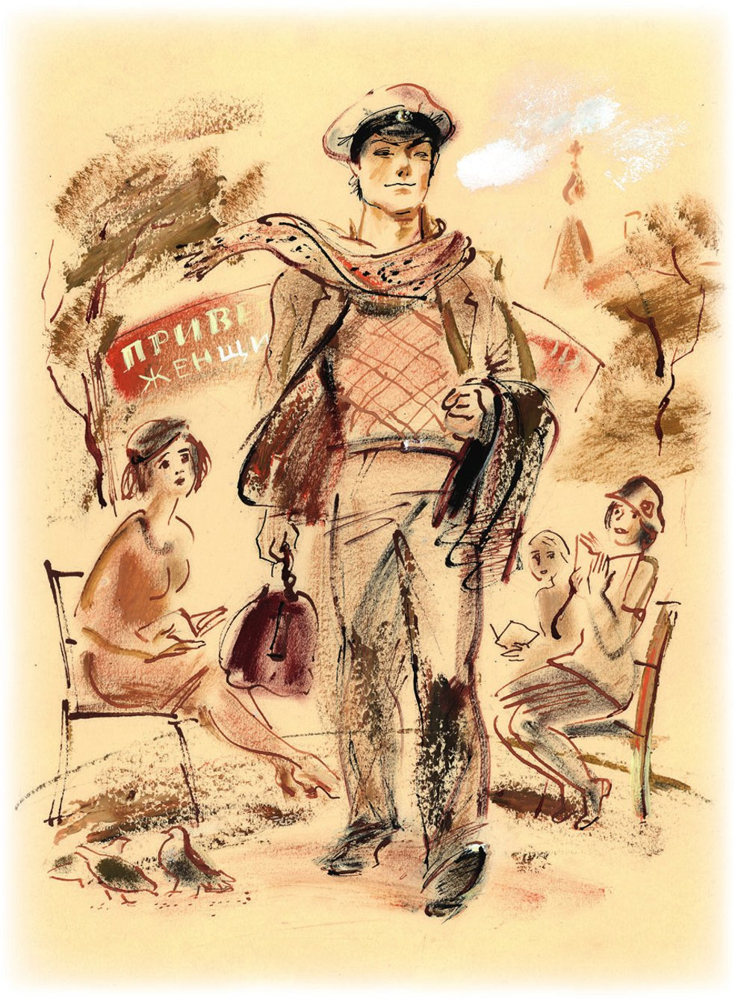
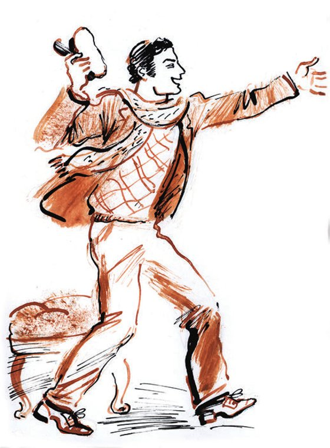
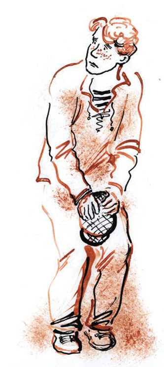

# Erster Teil: Die Besatzung der «Antilope»

*Wenn du über die Straße gehst, / sieh nach links und rechts. / Straßenverkehrsordnung*

## Kapitel 1: Wie Panikowski die Konvention gebrochen hat

<abbr title="der Fußgänger, die Fußgänger — пешеход">Fußgänger</abbr> muss man lieben. Die Fußgänger sind der größte Teil von der <abbr title="die Menschheit — человечество">Menschheit</abbr>. Und nicht nur das: Sie sind auch der beste Teil. Die Fußgänger haben die Welt <abbr title="schaffen (schuf, hat geschaffen) — создавать">geschaffen</abbr>. Sie haben die Städte gebaut, die hohen Häuser, die <abbr title="die Kanalisation — канализация">Kanalisation</abbr> und die <abbr title="die Wasserleitung, die Wasserleitungen — водопровод">Wasserleitung</abbr>. Sie haben die Straßen <abbr title="pflastern — мостить">gepflastert</abbr> und mit elektrischen Lampen hell gemacht. Sie haben die Kultur in die ganze Welt gebracht. Sie haben den <abbr title="der Buchdruck — книгопечатание">Buchdruck</abbr> erfunden und das <abbr title="das Schießpulver — порох">Schießpulver</abbr>. Sie haben <abbr title="die Brücke, die Brücken — мост">Brücken</abbr> über die Flüsse gebaut und die <abbr title="ägyptisch — египетский">ägyptischen</abbr> <abbr title="die Hieroglyphe, die Hieroglyphen — иероглиф">Hieroglyphen</abbr> gelesen. Sie haben den <abbr title="der Rasierapparat, die Rasierapparate — безопасная бритва">Rasierapparat</abbr> <abbr title="einführen — вводить">eingeführt</abbr>, den Handel mit <abbr title="der Sklave, die Sklaven — раб">Sklaven</abbr> <abbr title="abschaffen — уничтожить, отменить">abgeschafft</abbr> und <abbr title="feststellen — установить">festgestellt</abbr>: Aus <abbr title="die Sojabohne, die Sojabohnen — соевый боб">Sojabohnen</abbr> kann man 114 leckere und <abbr title="nahrhaft — питательный">nahrhafte</abbr> <abbr title="das Gericht, die Gerichte — блюдо">Gerichte</abbr> kochen.

Und als alles fertig war, als unser <abbr title="der Planet, die Planeten — планета">Planet</abbr> schon ganz <abbr title="gemütlich — уютный, благоустроенный">gemütlich</abbr> aussah, da kamen die Autofahrer.

Man muss sagen: Auch das Auto haben die Fußgänger erfunden. Aber die Autofahrer haben das sofort vergessen. Sie haben angefangen, die <abbr title="sanft — кроткий">sanften</abbr> und klugen Fußgänger zu <abbr title="überfahren (überfuhr, hat überfahren) — давить, переехать">überfahren</abbr>. Die Straßen, die die Fußgänger gebaut haben, gehören jetzt den Autofahrern. Die <abbr title="die Fahrbahn, die Fahrbahnen — мостовая, проезжая часть">Fahrbahn</abbr> ist doppelt so breit geworden. Der <abbr title="der Bürgersteig, die Bürgersteige — тротуар">Bürgersteig</abbr> ist so schmal wie eine <abbr title="die Banderole, die Banderolen — бандероль (табачная)">Banderole</abbr> auf einer Zigarettenschachtel. Und die Fußgänger drücken sich <abbr title="ängstlich — испуганно">ängstlich</abbr> an die Hauswände.

In einer großen Stadt führen die Fußgänger das Leben von <abbr title="der Märtyrer, die Märtyrer — мученик">Märtyrern</abbr>. Man hat für sie eine Art Verkehrs-<abbr title="das Ghetto, die Ghettos — гетто">Ghetto</abbr> gemacht. Sie dürfen nur an <abbr title="die Kreuzung, die Kreuzungen — перекрёсток">Kreuzungen</abbr> über die Straße gehen. Also genau dort, wo der Verkehr am stärksten ist. Dort, wo der dünne <abbr title="der Faden, die Fäden — нить, волосок">Faden</abbr>, an dem das Leben von einem Fußgänger hängt, am leichtesten <abbr title="reißen (riss, ist gerissen) — рваться">reißt</abbr>.

In unserem großen Land sollte das Auto eigentlich ganz <abbr title="friedlich — мирный">friedlich</abbr> Menschen und Waren <abbr title="transportieren — перевозить">transportieren</abbr>. So haben die Fußgänger es sich gedacht. Aber jetzt ist das Auto eine <abbr title="gefährlich — опасный">gefährliche</abbr> <abbr title="die Waffe, die Waffen — оружие, снаряд">Waffe</abbr> geworden. Es <abbr title="niedermähen — косить">mäht</abbr> ganze Reihen von <abbr title="das Gewerkschaftsmitglied, die Gewerkschaftsmitglieder — член профсоюза">Gewerkschaftsmitgliedern</abbr> und ihren Familien nieder.

Manchmal kann ein Fußgänger im letzten Moment unter der silbernen Nase von einem Auto <abbr title="wegflattern — выпорхнуть">wegflattern</abbr>. Dann bekommt er von der <abbr title="die Miliz — милиция">Miliz</abbr> eine <abbr title="die Strafe, die Strafen — штраф">Strafe</abbr>. Denn er hat gegen den <abbr title="der Katechismus — катехизис">Katechismus</abbr> der Straße <abbr title="verstoßen gegen + Akk. (verstieß, hat verstoßen) — нарушить">verstoßen</abbr>.

Überhaupt hat das <abbr title="das Ansehen — авторитет, престиж">Ansehen</abbr> von den Fußgängern sehr <abbr title="leiden (litt, hat gelitten) — страдать, пострадать">gelitten</abbr>. Sie haben der Welt so große Menschen gegeben wie Horaz, Boyle, Mariotte, Lobatschewski, Gutenberg, Meyerhold und Anatole France. Und jetzt müssen sie sich ganz <abbr title="albern — глупо, пошло">albern</abbr> <abbr title="sich benehmen (benahm, hat benommen) — вести себя">benehmen</abbr>. Denn sonst vergisst man, dass es sie gibt. Gott, o Gott, den es eigentlich gar nicht gibt! Wohin hast du, den es in Wirklichkeit gar nicht gibt, den Fußgänger gebracht!

Da geht er, von Wladiwostok nach Moskau, auf der großen <abbr title="die Landstraße, die Landstraßen — тракт">Landstraße</abbr> durch Sibirien. In einer Hand trägt er eine <abbr title="die Fahne, die Fahnen — знамя">Fahne</abbr>. Darauf steht: «Wir bauen den <abbr title="der Alltag — быт">Alltag</abbr> von den <abbr title="der Textilarbeiter, die Textilarbeiter — текстильщик">Textilarbeitern</abbr> um!» Über der <abbr title="die Schulter, die Schultern — плечо">Schulter</abbr> trägt er einen <abbr title="der Stock, die Stöcke — палка">Stock</abbr>. Am Ende vom Stock <abbr title="baumeln — болтаться">baumeln</abbr> <abbr title="die Reservesandale, die Reservesandalen — запасная сандалия">Reservesandalen</abbr> der Marke «Onkel Wanja» und ein <abbr title="der Teekessel, die Teekessel — чайник">Teekessel</abbr> aus <abbr title="das Blech — жесть">Blech</abbr> ohne <abbr title="der Deckel, die Deckel — крышка">Deckel</abbr>. Das ist ein sowjetischer Fußgänger und <abbr title="der Sportler, die Sportler — спортсмен, физкультурник">Sportler</abbr>. In Wladiwostok ist er als junger Mann <abbr title="losgehen (ging los, ist losgegangen) — отправиться">losgegangen</abbr>. Und als alter Mann, direkt vor dem Tor von Moskau, wird ihn ein schwerer <abbr title="der Lastwagen, die Lastwagen — грузовик">Lastwagen</abbr> überfahren. Und niemand wird die Nummer von dem Lastwagen sehen.

Oder ein anderer, ein europäischer <abbr title="der Mohikaner, die Mohikaner — могиканин">Mohikaner</abbr> der Fußgänger-<abbr title="die Bewegung, die Bewegungen — движение">Bewegung</abbr>. Er geht zu Fuß um die ganze Welt und <abbr title="rollen — катить">rollt</abbr> dabei ein <abbr title="das Fass, die Fässer — бочка">Fass</abbr> vor sich her. Er würde gern auch ohne Fass gehen. Aber dann merkt niemand, dass er ein echter <abbr title="die Langstrecke, die Langstrecken — дальняя дистанция">Langstrecken</abbr>-Fußgänger ist. Und dann schreiben die Zeitungen nichts über ihn. Deshalb muss er sein ganzes Leben lang dieses <abbr title="verflucht — проклятый">verfluchte</abbr> Fass <abbr title="schieben (schob, hat geschoben) — толкать">schieben</abbr>. Und auf dem Fass steht auch noch (o <abbr title="die Schande — позор">Schande</abbr>, o Schande!) in großen gelben <abbr title="der Buchstabe, die Buchstaben — буква">Buchstaben</abbr> <abbr title="die Werbung — реклама">Werbung</abbr> für das beste <abbr title="das Motoröl, die Motoröle — автомобильное масло">Motoröl</abbr> der Welt, das Öl «Fahrertraum».

So tief ist der Fußgänger <abbr title="sinken (sank, ist gesunken) — опуститься, пасть">gesunken</abbr>.

Nur in den kleinen russischen Städten <abbr title="respektieren — уважать">respektiert</abbr> und liebt man den Fußgänger noch. Dort ist er noch der Herr der Straßen. Er <abbr title="bummeln — бродить, гулять">bummelt</abbr> <abbr title="sorglos — беззаботно">sorglos</abbr> über die Fahrbahn und geht in jede Richtung über die Straße, wie er will, kreuz und quer.

Ein Bürger mit einer weißen <abbr title="die Schirmmütze, die Schirmmützen — фуражка">Schirmmütze</abbr> – so eine Mütze tragen meistens die <abbr title="der Direktor, die Direktoren — директор, администратор">Direktoren</abbr> von Sommergärten und die <abbr title="der Conférencier, die Conférenciers — конферансье">Conférenciers</abbr> – gehört ganz <abbr title="sicher — несомненно">sicher</abbr> zum größeren und besseren Teil von der Menschheit. Er geht zu Fuß durch die Straßen von der Stadt Arbatow. Er sieht sich mit <abbr title="herablassend — снисходительный">herablassender</abbr> <abbr title="die Neugier — любопытство">Neugier</abbr> um. In der Hand trägt er eine kleine <abbr title="die Arzttasche, die Arzttaschen — саквояж (акушерский)">Arzttasche</abbr>. Die Stadt <abbr title="beeindrucken — поразить, впечатлить">beeindruckt</abbr> den Fußgänger mit der <abbr title="die Künstlermütze, die Künstlermützen — артистическая фуражка">Künstlermütze</abbr> offenbar nicht.

Er sieht ungefähr fünfzehn blaue, <abbr title="blassgrün — бледно-зелёный, резедовый">blassgrüne</abbr> und weiß-rosa <abbr title="der Glockenturm, die Glockentürme — колокольня">Glockentürme</abbr>. Er bemerkt das <abbr title="abgeblättert — облезлый">abgeblätterte</abbr> amerikanische Gold auf den <abbr title="die Kuppel, die Kuppeln — купол">Kuppeln</abbr> von den Kirchen. Über einem <abbr title="das Amtsgebäude, die Amtsgebäude — официальное здание">Amtsgebäude</abbr> <abbr title="knattern — трещать">knattert</abbr> eine Fahne.

Am weißen Turmtor vom alten <abbr title="der Kreml — кремль">Kreml</abbr> stehen zwei strenge alte Frauen. Sie sprechen Französisch, <abbr title="sich beschweren über + Akk. — жаловаться">beschweren sich</abbr> über die Sowjetmacht und denken an ihre lieben Töchter. Aus dem <abbr title="der Keller, die Keller — подвал">Keller</abbr> von einer Kirche kommt kalte Luft und ein saurer Geruch nach Wein. Dort liegen offenbar Kartoffeln.

— Die Kirche zur Heiligen Kartoffel, — sagt der Fußgänger leise.

Er geht unter einem <abbr title="der Bogen, die Bögen — арка">Bogen</abbr> aus <abbr title="das Sperrholz — фанера">Sperrholz</abbr> durch. Auf dem Bogen steht ein frischer <abbr title="der Spruch, die Sprüche — лозунг">Spruch</abbr>: «Gruß an die 5. Bezirkskonferenz der Frauen und Mädchen». Jetzt steht er am Anfang von einer langen <abbr title="die Allee, die Alleen — аллея">Allee</abbr>. Sie heißt «Boulevard der Jungen Talente».

— Nein, — sagt er <abbr title="enttäuscht — огорчённо">enttäuscht</abbr>, — das ist nicht Rio de Janeiro. Das ist viel schlimmer.

Fast auf allen <abbr title="die Bank, die Bänke — скамья">Bänken</abbr> vom Boulevard der Jungen Talente sitzen junge Mädchen, jede allein, mit einem offenen Buch in der Hand. <abbr title="löchrig — дырявый">Löchrige</abbr> <abbr title="der Schatten, die Schatten — тень">Schatten</abbr> fallen auf die Seiten, auf die nackten <abbr title="der Ellbogen, die Ellbogen — локоть">Ellbogen</abbr>, auf die <abbr title="rührend — трогательный">rührenden</abbr> <abbr title="der Pony, die Ponys — чёлка">Ponys</abbr>. Der <abbr title="der Fremde, die Fremden — приезжий, чужак">Fremde</abbr> betritt die kühle Allee, und auf den Bänken <abbr title="sich regen — шевелиться">regt sich</abbr> etwas. Die Mädchen <abbr title="sich verstecken — прятаться">verstecken sich</abbr> hinter den Büchern von Gladkow, Eliza Orzeszkowa und Seifullina. <abbr title="schüchtern — робко">Schüchtern</abbr> sehen sie den Fremden an. Er geht mit <abbr title="feierlich — торжественный, парадный">feierlichen</abbr> Schritten an den <abbr title="aufgeregt — взволнованный">aufgeregten</abbr> Leserinnen vorbei. So kommt er zum <abbr title="das Exekutivkomitee, die Exekutivkomitees — исполком">Exekutivkomitee</abbr> von der Stadt. Das ist das Ziel von seinem <abbr title="der Spaziergang, die Spaziergänge — прогулка">Spaziergang</abbr>.

In diesem Moment kommt eine <abbr title="die Droschke, die Droschken — извозчичья пролётка">Droschke</abbr> um die Ecke. Neben ihr läuft schnell ein Mann in einem langen <abbr title="der Kittel, die Kittel — толстовка, блуза">Kittel</abbr>. Er hält sich am <abbr title="staubig — пыльный">staubigen</abbr> <abbr title="der Kotflügel, die Kotflügel — крыло (экипажа)">Kotflügel</abbr> fest. Mit der anderen Hand <abbr title="schwenken — размахивать">schwenkt</abbr> er eine dicke <abbr title="die Mappe, die Mappen — папка">Mappe</abbr>. Auf der Mappe steht in goldenen Buchstaben «Musique». Er erklärt dem <abbr title="der Fahrgast, die Fahrgäste — седок, пассажир">Fahrgast</abbr> <abbr title="heftig — горячо, бурно">heftig</abbr> etwas. Der Fahrgast ist ein älterer Mann mit einer Nase, die wie eine <abbr title="die Banane, die Bananen — банан">Banane</abbr> herunterhängt. Er hält einen <abbr title="der Koffer, die Koffer — чемодан">Koffer</abbr> zwischen den Beinen fest. Von Zeit zu Zeit zeigt er seinem <abbr title="der Gesprächspartner, die Gesprächspartner — собеседник">Gesprächspartner</abbr> eine <abbr title="die Feige, die Feigen — кукиш, фига">Feige</abbr>. Im <abbr title="der Eifer — пыл">Eifer</abbr> vom Streit ist seine <abbr title="die Ingenieursmütze, die Ingenieursmützen — инженерская фуражка">Ingenieursmütze</abbr> <abbr title="schief — набок, криво">schief</abbr> gerutscht. Das Band von der Mütze glänzt grün wie der <abbr title="der Plüsch — плюш">Plüsch</abbr> von einem alten Sofa. Beide Männer sagen oft und besonders laut das Wort «<abbr title="das Gehalt, die Gehälter — оклад, зарплата">Gehalt</abbr>».

Bald hört man auch die anderen Wörter.

— Dafür werden Sie <abbr title="sich verantworten — ответить (за что-то)">sich verantworten</abbr>, Genosse Talmudowski! — schreit der Mann im langen Kittel und schiebt die Feige von seinem Gesicht weg.

— Und ich sage Ihnen: Zu solchen <abbr title="die Bedingung, die Bedingungen — условие">Bedingungen</abbr> kommt kein <abbr title="anständig — приличный, порядочный">anständiger</abbr> <abbr title="der Fachmann, die Fachleute — специалист">Fachmann</abbr> zu Ihnen, — antwortet Talmudowski und versucht, die Feige wieder an ihren Platz zu bringen.

— Reden Sie schon wieder vom Gehalt? Dann müssen wir über Ihre <abbr title="die Geldgier — рвачество, жадность">Geldgier</abbr> sprechen.

— Ich <abbr title="pfeifen auf + Akk. (pfiff, hat gepfiffen) — плевать на">pfeife</abbr> auf das Gehalt! Ich arbeite auch <abbr title="umsonst — даром, бесплатно">umsonst</abbr>! — schreit der Ingenieur aufgeregt und malt mit der Feige alle möglichen <abbr title="die Kurve, die Kurven — кривая, линия">Kurven</abbr> in die Luft. — Wenn ich will, gehe ich einfach in <abbr title="die Rente — пенсия">Rente</abbr>. Hören Sie auf mit dieser <abbr title="die Leibeigenschaft — крепостное право">Leibeigenschaft</abbr>! Überall schreiben Sie selbst: «Freiheit, Gleichheit, Brüderlichkeit». Und mich wollen Sie zwingen, in diesem <abbr title="das Rattenloch, die Rattenlöcher — крысиная нора">Rattenloch</abbr> zu arbeiten!

Jetzt öffnet der Ingenieur Talmudowski schnell seine Feige und zählt an den Fingern:

— Die Wohnung ist ein <abbr title="der Schweinestall, die Schweineställe — свинарник">Schweinestall</abbr>, ein Theater gibt es nicht, das Gehalt … <abbr title="der Kutscher, die Kutscher — извозчик, кучер">Kutscher</abbr>! Zum Bahnhof!

— <abbr title="brrr! — тпру!">Brrr</abbr>! — <abbr title="kreischen — визжать">kreischt</abbr> der Mann im langen Kittel. Er läuft <abbr title="hektisch — суетливо">hektisch</abbr> nach vorn und packt das Pferd am <abbr title="der Zaum, die Zäume — узда">Zaum</abbr>. — Ich, als Sekretär von der <abbr title="die Sektion, die Sektionen — секция">Sektion</abbr> der Ingenieure und Techniker … Kondrat Iwanowitsch! Die Fabrik bleibt doch ohne Fachleute … <abbr title="Gott fürchten — побойтесь Бога">Fürchten Sie Gott</abbr> … Die <abbr title="die Öffentlichkeit — общественность">Öffentlichkeit</abbr> lässt das nicht zu, Ingenieur Talmudowski … Ich habe ein <abbr title="das Protokoll, die Protokolle — протокол">Protokoll</abbr> in der Mappe.

Der Sekretär von der Sektion stellt sich breitbeinig hin und <abbr title="aufknoten — развязывать">knotet</abbr> schnell die Bänder von seiner «Musique» auf.

Dieser Fehler entscheidet den Streit. Talmudowski sieht, dass der Weg frei ist. Er steht auf und schreit, so laut er kann:

— Zum Bahnhof!

— Wohin? Wohin? — <abbr title="stammeln — лепетать">stammelt</abbr> der Sekretär und läuft hinter der Droschke her. — Sie sind ein <abbr title="der Deserteur, die Deserteure — дезертир">Deserteur</abbr> von der <abbr title="die Arbeitsfront — трудовой фронт">Arbeitsfront</abbr>!

Aus der Mappe «Musique» fliegen dünne Blätter. Auf ihnen stehen in <abbr title="lila — лиловый">lila</abbr> Tinte die Wörter: «Gehört – beschlossen».

Der Fremde hat alles mit Interesse <abbr title="beobachten — наблюдать">beobachtet</abbr>. Eine Minute steht er noch auf dem leeren Platz. Dann sagt er <abbr title="überzeugt — убеждённо">überzeugt</abbr>:

— Nein, das ist nicht Rio de Janeiro.

Eine Minute später klopft er schon an die Tür vom <abbr title="der Vorsitzende, die Vorsitzenden — председатель">Vorsitzenden</abbr> des Exekutivkomitees.

— Zu wem wollen Sie? — fragt ihn der Sekretär. Er sitzt an einem Tisch neben der Tür. — Warum wollen Sie zum Vorsitzenden? In welcher <abbr title="die Angelegenheit, die Angelegenheiten — дело">Angelegenheit</abbr>?

Der Besucher kennt offenbar sehr gut das System, wie man mit Sekretären von <abbr title="die Behörde, die Behörden — учреждение, ведомство">Behörden</abbr>, Betrieben und <abbr title="die Organisation, die Organisationen — организация">Organisationen</abbr> spricht. Er sagt nicht, dass er in einer <abbr title="dringend — срочный">dringenden</abbr> <abbr title="dienstlich — служебный, казённый">dienstlichen</abbr> Angelegenheit kommt.

— <abbr title="privat — личный, частный">Privat</abbr>, — sagt er kurz. Er sieht den Sekretär gar nicht an und steckt den Kopf durch die <abbr title="der Türspalt, die Türspalte — дверная щель">Türspalte</abbr>.

— Darf ich?

Er wartet nicht auf eine Antwort und geht zum Schreibtisch.

— Guten Tag. Erkennen Sie mich nicht?

Der Vorsitzende hat schwarze Augen und einen großen Kopf. Er trägt eine blaue Jacke und eine blaue Hose. Die Hose steckt in Stiefeln mit hohen <abbr title="der Absatz, die Absätze — каблук">Absätzen</abbr> von der Fabrik «Skorochod». Er sieht den Besucher ziemlich <abbr title="zerstreut — рассеянно">zerstreut</abbr> an und sagt, dass er ihn nicht erkennt.

— Wirklich nicht? Dabei sagen viele Leute, dass ich meinem Vater <abbr title="unglaublich — поразительно, невероятно">unglaublich</abbr> <abbr title="jemandem ähnlich sehen — быть похожим на">ähnlich sehe</abbr>.

— Ich sehe meinem Vater auch ähnlich, — sagt der Vorsitzende <abbr title="ungeduldig — нетерпеливо">ungeduldig</abbr>. — Was wollen Sie, Genosse?

— Es kommt eben darauf an, wer der Vater ist, — sagt der Besucher traurig. — Ich bin der Sohn von Leutnant Schmidt.

Der Vorsitzende wird <abbr title="verlegen — смущённый">verlegen</abbr> und steht halb auf. Sofort sieht er das berühmte Bild von dem <abbr title="revolutionär — революционный">revolutionären</abbr> Leutnant vor sich: das <abbr title="blass — бледный">blasse</abbr> Gesicht, der schwarze <abbr title="der Umhang, die Umhänge — пелерина, накидка">Umhang</abbr> mit den <abbr title="die Löwenschnalle, die Löwenschnallen — застёжка в виде льва">Löwenschnallen</abbr> aus <abbr title="die Bronze — бронза">Bronze</abbr>. Der Vorsitzende sammelt seine <abbr title="der Gedanke, die Gedanken — мысль">Gedanken</abbr>. Er sucht eine <abbr title="passend — подходящий">passende</abbr> Frage für den Sohn von dem Helden vom Schwarzen Meer. <abbr title="inzwischen — тем временем">Inzwischen</abbr> sieht sich der Besucher die Möbel im Büro an. Er sieht sie an wie ein <abbr title="wählerisch — разборчивый">wählerischer</abbr> <abbr title="der Käufer, die Käufer — покупатель">Käufer</abbr>.

Früher, zur Zeit vom Zaren, hat man alle Ämter nach einem <abbr title="das Muster, die Muster — шаблон, трафарет">Muster</abbr> <abbr title="einrichten — обставлять">eingerichtet</abbr>. Es gab eine besondere <abbr title="die Rasse, die Rassen — порода">Rasse</abbr> von <abbr title="die Amtsmöbel (Pl.) — казённая мебель">Amtsmöbeln</abbr>: flache Schränke bis zur Decke, Holzsofas mit dicken, <abbr title="poliert — полированный">polierten</abbr> <abbr title="die Sitzfläche, die Sitzflächen — сиденье">Sitzflächen</abbr>, Tische mit Beinen wie bei einem <abbr title="der Billardtisch, die Billardtische — бильярдный стол">Billardtisch</abbr> und <abbr title="das Geländer, die Geländer — парапет, перила">Geländer</abbr> aus <abbr title="das Eichenholz — дуб (древесина)">Eichenholz</abbr>. Die Geländer haben das Amt von der <abbr title="unruhig — беспокойный">unruhigen</abbr> Welt draußen <abbr title="trennen — отделять">getrennt</abbr>. Während der Revolution ist diese Rasse von Möbeln fast <abbr title="aussterben (starb aus, ist ausgestorben) — вымереть">ausgestorben</abbr>. Niemand weiß mehr, wie man sie macht. Die Leute haben vergessen, wie man ein Büro für einen <abbr title="der Beamte, die Beamten — чиновник, должностное лицо">Beamten</abbr> einrichtet. Und jetzt stehen in den Büros Sachen, die eigentlich in eine private Wohnung gehören. In den Ämtern stehen jetzt <abbr title="gefedert — пружинный">gefederte</abbr> <abbr title="das Anwaltssofa, die Anwaltssofas — адвокатский диван">Anwaltssofas</abbr> mit einem kleinen Spiegelregal für sieben <abbr title="das Porzellan — фарфор">Porzellan</abbr>-<abbr title="der Elefant, die Elefanten — слон">Elefanten</abbr>. Die Elefanten sollen angeblich <abbr title="Glück bringen — приносить счастье">Glück bringen</abbr>. Es gibt <abbr title="der Geschirrschrank, die Geschirrschränke — горка для посуды">Geschirrschränke</abbr>, kleine Regale, <abbr title="der Ledersessel, die Ledersessel — кожаное кресло">Ledersessel</abbr> für Leute mit <abbr title="das Rheuma — ревматизм">Rheuma</abbr> und blaue japanische <abbr title="die Vase, die Vasen — ваза">Vasen</abbr>. Im Büro vom Vorsitzenden des Exekutivkomitees von Arbatow stehen außer dem normalen Schreibtisch noch zwei kleine <abbr title="der Hocker, die Hocker — пуф, табурет">Hocker</abbr> mit <abbr title="zerrissen — порванный, лопнувший">zerrissener</abbr> rosa Seide, ein <abbr title="gestreift — полосатый">gestreiftes</abbr> kleines Sofa, ein <abbr title="der Wandschirm, die Wandschirme — ширма, экран">Wandschirm</abbr> aus <abbr title="der Satin — атлас">Satin</abbr> mit dem Berg Fudschijama und einem <abbr title="blühen — цвести">blühenden</abbr> <abbr title="der Kirschbaum, die Kirschbäume — вишня (дерево)">Kirschbaum</abbr>, und ein <abbr title="grob — грубый">grober</abbr> slawischer Schrank mit Spiegel, vom Markt.

«Ein Schrank im Stil ‚Hei, Slawen!‘», denkt der Besucher. «Hier kann man nicht viel holen. Nein, das ist nicht Rio de Janeiro.»

— Sehr gut, dass Sie <abbr title="vorbeikommen (kam vorbei, ist vorbeigekommen) — зайти, заглянуть">vorbeigekommen sind</abbr>, — sagt der Vorsitzende endlich. — Sie kommen <abbr title="wahrscheinlich — вероятно">wahrscheinlich</abbr> aus Moskau?

— Ja, ich bin auf der <abbr title="die Durchreise — проездом">Durchreise</abbr>, — antwortet der Besucher. Er sieht sich das kleine Sofa an und ist immer mehr überzeugt: Das Exekutivkomitee hat wenig Geld. Er hat lieber Exekutivkomitees mit neuen schwedischen Möbeln vom Leningrader Holz-<abbr title="der Trust, die Trusts — трест">Trust</abbr>.

Der Vorsitzende will den Sohn vom Leutnant fragen, warum er nach Arbatow gekommen ist. Aber plötzlich lächelt er <abbr title="kläglich — жалобно">kläglich</abbr> und sagt etwas ganz anderes:

— Unsere Kirchen sind <abbr title="wunderbar — замечательный">wunderbar</abbr>. Aus Moskau sind schon Leute von der Hauptverwaltung für Wissenschaft gekommen. Sie wollen sie <abbr title="restaurieren — реставрировать">restaurieren</abbr>. Sagen Sie, erinnern Sie sich selbst noch an den <abbr title="der Aufstand, die Aufstände — восстание">Aufstand</abbr> auf dem <abbr title="der Panzerkreuzer, die Panzerkreuzer — броненосец, крейсер">Panzerkreuzer</abbr> «Otschakow»?

— <abbr title="undeutlich — смутно">Undeutlich</abbr>, undeutlich, — antwortet der Besucher. — In dieser <abbr title="heldenhaft — героический">heldenhaften</abbr> Zeit war ich noch sehr klein. Ich war ein Kind.

— Entschuldigung, wie heißen Sie?

— Nikolai … Nikolai Schmidt.

— Und der <abbr title="der Vatersname, die Vatersnamen — отчество">Vatersname</abbr>?

«Ach, wie <abbr title="dumm — глупо, нехорошо">dumm</abbr>», denkt der Besucher. Er weiß selbst nicht, wie sein Vater mit Vornamen heißt.

— Ja-a, — sagt er langsam. Er will nicht direkt antworten. — Heute kennen viele die Namen von den Helden nicht mehr. Der <abbr title="der Rausch — угар, опьянение">Rausch</abbr> von der NEP. Die alte Begeisterung ist weg. Ich bin eigentlich nur durch <abbr title="der Zufall, die Zufälle — случай">Zufall</abbr> in Ihre Stadt gekommen. Ein <abbr title="das Unglück — несчастье, неприятность">Unglück</abbr> auf der Reise. Jetzt habe ich keine <abbr title="die Kopeke, die Kopeken — копейка">Kopeke</abbr> mehr.

Der Vorsitzende ist sehr froh, dass das Thema jetzt ein anderes ist. Er <abbr title="sich schämen — стыдиться">schämt sich</abbr>, weil er den Namen von dem Helden der «Otschakow» vergessen hat.

«Wirklich», denkt er und sieht <abbr title="liebevoll — с любовью">liebevoll</abbr> in das <abbr title="begeistert — воодушевлённый">begeisterte</abbr> Gesicht von dem Helden. «Bei der Arbeit wird man hier ganz <abbr title="taub — глухой">taub</abbr>. Man vergisst die großen <abbr title="der Moment, die Momente — момент, веха">Momente</abbr> der Geschichte.»

— Wie sagen Sie? Keine Kopeke? Das ist interessant.

— Natürlich kann ich auch zu einem <abbr title="der Privatmann, die Privatleute — частное лицо">Privatmann</abbr> gehen, — sagt der Besucher. — Jeder gibt mir Geld. Aber, verstehen Sie, politisch ist das nicht ganz <abbr title="bequem — удобный">bequem</abbr>. Der Sohn von einem Revolutionär – und plötzlich bittet er einen Privathändler um Geld, einen <abbr title="der Nepman, die Nepmänner — нэпман">Nepman</abbr> …

Die letzten Wörter sagt der Sohn vom Leutnant mit zitternder Stimme. Der Vorsitzende hört <abbr title="besorgt — тревожно">besorgt</abbr> auf den neuen Ton in der Stimme von dem Besucher. «Und wenn er jetzt einen <abbr title="der Anfall, die Anfälle — припадок">Anfall</abbr> bekommt?», denkt er. «Dann habe ich viel <abbr title="der Ärger — хлопоты, неприятности">Ärger</abbr>.»

— Und es ist sehr gut, dass Sie nicht zu einem Privatmann gegangen sind, — sagt der Vorsitzende. Er ist jetzt ganz <abbr title="durcheinander — сбитый с толку">durcheinander</abbr>.

Dann kommt der Sohn von dem Helden vom Schwarzen Meer sanft, ohne <abbr title="der Druck — нажим">Druck</abbr>, zur Sache. Er bittet um fünfzig Rubel. Aber das <abbr title="das Budget, die Budgets — бюджет">Budget</abbr> von der Stadt ist klein. Deshalb kann der Vorsitzende nur acht Rubel geben. Dazu gibt er ihm drei <abbr title="die Essensmarke, die Essensmarken — талон на обед">Essensmarken</abbr> für die <abbr title="die Kantine, die Kantinen — столовая">Kantine</abbr> von der <abbr title="die Genossenschaft, die Genossenschaften — кооператив">Genossenschaft</abbr>. Die Kantine heißt «Ehemaliger Magenfreund».

Der Sohn von dem Helden steckt das Geld und die Essensmarken in die tiefe Tasche von seiner alten, grau <abbr title="gefleckt — в яблоках, пятнистый">gefleckten</abbr> Jacke. Er will gerade von dem rosa Hocker aufstehen. Da hört man hinter der Tür laute Schritte und einen Ruf vom Sekretär: Er will jemanden <abbr title="aufhalten (hielt auf, hat aufgehalten) — задержать, остановить">aufhalten</abbr>.

Die Tür geht schnell auf, und auf der <abbr title="die Schwelle, die Schwellen — порог">Schwelle</abbr> steht ein neuer Besucher.

— Wer ist hier der <abbr title="der Chef, die Chefs — главный, начальник">Chef</abbr>? — fragt er. Er atmet schwer, und seine Augen <abbr title="huschen — бегать, шнырять">huschen</abbr> unruhig hin und her.

— Na, ich, — sagt der Vorsitzende.

— Tag, Vorsitzender! — <abbr title="brüllen — гаркнуть, реветь">brüllt</abbr> der Neue und gibt ihm seine Hand. Sie ist breit wie eine <abbr title="die Schaufel, die Schaufeln — лопата">Schaufel</abbr>. — Freut mich. Ich bin der Sohn von Leutnant Schmidt.

— Wer? — fragt der Chef der Stadt und <abbr title="aufreißen (riss auf, hat aufgerissen) — вытаращить, распахнуть">reißt</abbr> die Augen auf.

— Der Sohn von dem großen, <abbr title="unvergesslich — незабвенный">unvergesslichen</abbr> Helden, Leutnant Schmidt, — sagt der Neue noch einmal.

— Aber hier sitzt doch schon ein Genosse – der Sohn von Genosse Schmidt, Nikolai Schmidt.

Der Vorsitzende ist ganz durcheinander und zeigt auf den ersten Besucher. Das Gesicht von dem ersten Besucher sieht plötzlich sehr <abbr title="schläfrig — сонный">schläfrig</abbr> aus.

Im Leben von den zwei <abbr title="der Gauner, die Gauner — жулик, мошенник">Gaunern</abbr> kommt ein <abbr title="heikel — щекотливый">heikler</abbr> Moment. Jeden Moment kann in den Händen von dem <abbr title="bescheiden — скромный">bescheidenen</abbr> und <abbr title="gutgläubig — доверчивый">gutgläubigen</abbr> Vorsitzenden das lange, unangenehme <abbr title="das Schwert, die Schwerter — меч">Schwert</abbr> von Nemesis <abbr title="aufblitzen — блеснуть">aufblitzen</abbr>. Das Schicksal gibt ihnen nur eine Sekunde Zeit für eine <abbr title="rettend — спасительный">rettende</abbr> <abbr title="die Kombination, die Kombinationen — комбинация">Kombination</abbr>. In den Augen von dem zweiten Sohn vom Leutnant Schmidt steht das <abbr title="das Entsetzen — ужас">Entsetzen</abbr>.

Er trägt ein Sommerhemd «Paraguay», eine Hose mit einer <abbr title="die Matrosenklappe, die Matrosenklappen — матросский клапан">Matrosenklappe</abbr> und hellblaue Schuhe aus <abbr title="das Segeltuch — парусина">Segeltuch</abbr>. Noch vor einer Minute war seine <abbr title="die Figur, die Figuren — фигура">Figur</abbr> <abbr title="scharf — резкий">scharf</abbr> und <abbr title="eckig — угловатый">eckig</abbr>. Jetzt wird sie <abbr title="weich — мягкий, расплывчатый">weich</abbr>. Sie verliert ihre <abbr title="drohend — грозный">drohende</abbr> Form und <abbr title="einflößen — внушать">flößt</abbr> <abbr title="überhaupt — вообще">überhaupt</abbr> keinen <abbr title="der Respekt — уважение">Respekt</abbr> mehr ein. Auf dem Gesicht vom Vorsitzenden erscheint ein <abbr title="hässlich — скверный, мерзкий">hässliches</abbr> Lächeln.

Der zweite Sohn vom Leutnant denkt schon: Alles ist verloren. Gleich fällt der schreckliche <abbr title="der Zorn — гнев">Zorn</abbr> vom Vorsitzenden auf seinen roten Kopf. Aber da kommt die <abbr title="die Rettung — спасение">Rettung</abbr> – von dem rosa Hocker.

— Wasja! — schreit der erste Sohn von Leutnant Schmidt und springt auf. — Lieber Bruder! Erkennst du deinen Bruder Kolja?

Und der erste Sohn <abbr title="umarmen — обнимать">umarmt</abbr> den zweiten Sohn.

— Ich erkenne dich! — ruft Wasja. Jetzt sieht er endlich <abbr title="klar — ясно">klar</abbr>. — Ich erkenne meinen Bruder Kolja!

Das glückliche <abbr title="das Wiedersehen — встреча, свидание">Wiedersehen</abbr> feiern sie mit so <abbr title="wild — сумбурный, дикий">wilden</abbr> <abbr title="die Zärtlichkeit, die Zärtlichkeiten — ласка, нежность">Zärtlichkeiten</abbr> und so starken <abbr title="die Umarmung, die Umarmungen — объятие">Umarmungen</abbr>, dass der zweite Sohn von dem Revolutionär vom Schwarzen Meer am Ende ganz blass vor <abbr title="der Schmerz, die Schmerzen — боль">Schmerz</abbr> ist. Bruder Kolja hat ihn vor Freude ziemlich stark <abbr title="drücken — жать, мять">gedrückt</abbr>.

Beim Umarmen sehen beide Brüder immer wieder <abbr title="heimlich — тайком, искоса">heimlich</abbr> zum Vorsitzenden hin. Sein Gesicht sieht immer noch aus wie <abbr title="der Essig — уксус">Essig</abbr>. Deshalb müssen sie die rettende Kombination sofort <abbr title="weiterentwickeln — развивать дальше">weiterentwickeln</abbr>. Sie füllen sie mit Details aus dem Familienleben. Und mit neuen Details vom <abbr title="der Matrosenaufstand, die Matrosenaufstände — восстание моряков">Matrosenaufstand</abbr> von 1905 – Details, die sogar die <abbr title="der Parteihistoriker, die Parteihistoriker — историк партии (Истпарт)">Parteihistoriker</abbr> nicht kennen. Die Brüder halten sich an den Händen und setzen sich auf das kleine Sofa. Sie sehen den Vorsitzenden mit <abbr title="schmeicheln — льстить">schmeichelnden</abbr> Augen an und <abbr title="versinken (versank, ist versunken) — погрузиться">versinken</abbr> in <abbr title="die Erinnerung, die Erinnerungen — воспоминание">Erinnerungen</abbr>.

— Was für ein <abbr title="erstaunlich — удивительный">erstaunliches</abbr> Wiedersehen! — ruft der erste Sohn <abbr title="falsch — фальшиво">falsch</abbr>. Mit den Augen lädt er den Vorsitzenden ein, mitzufeiern.

— Ja, — sagt der Vorsitzende mit <abbr title="eisig — ледяной">eisiger</abbr> Stimme. — Das gibt es, das gibt es.

Der erste Sohn sieht: Der Vorsitzende hängt immer noch in den <abbr title="die Kralle, die Krallen — лапа, коготь">Krallen</abbr> vom <abbr title="der Zweifel, die Zweifel — сомнение">Zweifel</abbr>. Da <abbr title="streicheln — гладить">streichelt</abbr> er seinem Bruder über die roten <abbr title="die Locke, die Locken — кудри, локон">Locken</abbr>. Sie sind rot wie bei einem <abbr title="der Setter, die Setter — сеттер">Setter</abbr>. Und er fragt <abbr title="zärtlich — ласково">zärtlich</abbr>:

— Wann bist du denn aus Mariupol gekommen? Du hast doch bei unserer Großmutter gewohnt, nicht wahr?

— Ja, da habe ich gewohnt, — <abbr title="murmeln — бормотать">murmelt</abbr> der zweite Sohn vom Leutnant. — Bei ihr.

— Warum hast du mir so selten geschrieben? Ich habe mir große <abbr title="die Sorge, die Sorgen — беспокойство, забота">Sorgen</abbr> gemacht.

— Ich hatte viel zu tun, — antwortet der Rothaarige <abbr title="finster — угрюмо">finster</abbr>.

Er hat Angst: Gleich fragt der <abbr title="unermüdlich — неугомонный">unermüdliche</abbr> Bruder, was er denn zu tun hatte. Und er hatte vor allem eins zu tun: Er saß in den <abbr title="die Besserungsanstalt, die Besserungsanstalten — исправительный дом">Besserungsanstalten</abbr> von verschiedenen <abbr title="autonom — автономный">autonomen</abbr> Republiken und Gebieten. Deshalb <abbr title="ergreifen (ergriff, hat ergriffen) — захватить">ergreift</abbr> der zweite Sohn von Leutnant Schmidt selbst die <abbr title="die Initiative — инициатива">Initiative</abbr> und fragt:

— Und warum hast du nicht geschrieben?

— Ich habe geschrieben, — antwortet das Brüderchen <abbr title="überraschend — неожиданно">überraschend</abbr>. Er fühlt sich plötzlich sehr fröhlich. — <abbr title="der Einschreibebrief, die Einschreibebriefe — заказное письмо">Einschreibebriefe</abbr> habe ich geschickt. Ich habe sogar die <abbr title="die Quittung, die Quittungen — квитанция">Quittungen</abbr> von der Post.

Und er greift in die Seitentasche. Er holt wirklich viele alte, <abbr title="zerknittert — мятый, лежалый">zerknitterte</abbr> Zettel heraus. Aber er zeigt sie nicht dem Bruder, sondern dem Vorsitzenden. Und auch das nur von weitem.

<abbr title="seltsamerweise — как ни странно">Seltsamerweise</abbr> beruhigen die Zettel den Vorsitzenden ein bisschen. Und die Erinnerungen von den Brüdern werden <abbr title="lebendig — живой">lebendiger</abbr>. Der Rothaarige fühlt sich jetzt ganz wohl. Er erzählt ziemlich gut, aber eintönig, den Inhalt von einer populären <abbr title="die Broschüre, die Broschüren — брошюра">Broschüre</abbr>: «Die <abbr title="die Meuterei, die Meutereien — мятеж, бунт">Meuterei</abbr> auf der Otschakow». Der Bruder <abbr title="ausschmücken — украшать">schmückt</abbr> die trockene Geschichte mit so <abbr title="farbig — красочный, живописный">farbigen</abbr> Details aus, dass der Vorsitzende wieder die Ohren <abbr title="die Ohren spitzen — навострить уши">spitzt</abbr>. Dabei hatte er sich doch schon fast beruhigt.

Trotzdem lässt er die Brüder <abbr title="in Frieden — с миром">in Frieden</abbr> gehen. Sie laufen auf die Straße und fühlen sich sehr <abbr title="erleichtert — с облегчением">erleichtert</abbr>.

Hinter der Ecke vom Haus des Exekutivkomitees bleiben sie stehen.

— <abbr title="apropos — кстати">Apropos</abbr> Kindheit, — sagt der erste Sohn. — Als Kind habe ich solche Leute wie Sie sofort <abbr title="erledigen — прикончить">erledigt</abbr>. Mit der <abbr title="die Steinschleuder, die Steinschleudern — рогатка">Steinschleuder</abbr>.

— Warum? — fragt der zweite Sohn von dem berühmten Vater fröhlich.

— So sind die harten <abbr title="das Gesetz, die Gesetze — закон">Gesetze</abbr> vom Leben. Oder, kürzer gesagt: Das Leben <abbr title="diktieren — диктовать">diktiert</abbr> uns seine harten Gesetze. Warum sind Sie ins Büro gegangen? Haben Sie nicht gesehen, dass der Vorsitzende nicht allein war?

— Ich habe gedacht …

— Ach, Sie haben gedacht? Sie denken also manchmal? Sie sind ein <abbr title="der Denker, die Denker — мыслитель">Denker</abbr>. Wie heißen Sie, Denker? Spinoza? Jean-Jacques Rousseau? Mark Aurel?

Der Rothaarige schweigt. Er ist von diesem <abbr title="gerecht — справедливый">gerechten</abbr> <abbr title="der Vorwurf, die Vorwürfe — упрёк, обвинение">Vorwurf</abbr> ganz <abbr title="niedergeschlagen — подавленный">niedergeschlagen</abbr>.

— Na gut, ich <abbr title="verzeihen (verzieh, hat verziehen) — прощать">verzeihe</abbr> Ihnen. Leben Sie. Und jetzt wollen wir uns <abbr title="sich bekannt machen — познакомиться">bekannt machen</abbr>. Immerhin sind wir Brüder, und <abbr title="die Verwandtschaft — родство">Verwandtschaft</abbr> <abbr title="verpflichten — обязывать">verpflichtet</abbr>. Ich heiße Ostap Bender. Darf ich auch Ihren ersten Nachnamen erfahren?

— Balaganow, — stellt sich der Rothaarige vor. — Schura Balaganow.

— Nach dem <abbr title="der Beruf, die Berufe — профессия">Beruf</abbr> frage ich nicht, — sagt Bender <abbr title="höflich — учтиво, вежливо">höflich</abbr>. — Aber ich kann ihn <abbr title="erraten (erriet, hat erraten) — догадаться">erraten</abbr>. Wahrscheinlich etwas <abbr title="intellektuell — интеллектуальный">Intellektuelles</abbr>? Wie viele <abbr title="die Vorstrafe, die Vorstrafen — судимость">Vorstrafen</abbr> haben Sie dieses Jahr?

— Zwei, — antwortet Balaganow ganz <abbr title="locker — свободно, непринуждённо">locker</abbr>.

— Das ist nicht gut. Warum verkaufen Sie Ihre <abbr title="unsterblich — бессмертный">unsterbliche</abbr> <abbr title="die Seele, die Seelen — душа">Seele</abbr>? Ein Mensch soll nicht vor Gericht stehen. Das ist eine <abbr title="ordinär — пошлый">ordinäre</abbr> <abbr title="die Beschäftigung, die Beschäftigungen — занятие">Beschäftigung</abbr>. Ich meine den <abbr title="der Diebstahl, die Diebstähle — кража">Diebstahl</abbr>. <abbr title="stehlen (stahl, hat gestohlen) — воровать">Stehlen</abbr> ist eine Sünde – Ihre Mama hat Ihnen diese <abbr title="die Lehre, die Lehren — учение, доктрина">Lehre</abbr> sicher schon als Kind erklärt. Aber es ist außerdem auch eine <abbr title="sinnlos — бессмысленный, бесцельный">sinnlose</abbr> <abbr title="die Verschwendung — трата, растрата">Verschwendung</abbr> von Kraft und Energie.

Ostap möchte noch lange über seine <abbr title="die Ansicht, die Ansichten — взгляд, мнение">Ansichten</abbr> vom Leben sprechen. Aber Balaganow <abbr title="unterbrechen (unterbrach, hat unterbrochen) — перебивать">unterbricht</abbr> ihn.

— Sehen Sie mal, — sagt er und zeigt in die grüne Tiefe vom Boulevard der Jungen Talente. — Sehen Sie dort den Mann mit dem <abbr title="der Strohhut, die Strohhüte — соломенная шляпа">Strohhut</abbr>?

— Ich sehe ihn, — sagt Ostap <abbr title="hochmütig — высокомерно">hochmütig</abbr>. — Und? Ist das der <abbr title="der Gouverneur, die Gouverneure — губернатор">Gouverneur</abbr> von der Insel Borneo?

— Das ist Panikowski, — sagt Schura. — Ein Sohn von Leutnant Schmidt.

Die Allee entlang, im Schatten von den <abbr title="erlaucht — августейший">erlauchten</abbr> August-<abbr title="die Linde, die Linden — липа">Linden</abbr>, geht ein nicht mehr junger Bürger. Er geht ein bisschen schief. Auf seinem Kopf sitzt seitlich ein harter Strohhut mit einem <abbr title="gerippt — рубчатый">gerippten</abbr> <abbr title="der Rand, die Ränder — край, поле (шляпы)">Rand</abbr>. Seine Hose ist so kurz, dass man die weißen Bänder von seiner <abbr title="die Unterhose, die Unterhosen — кальсоны">Unterhose</abbr> sieht. Unter seinem <abbr title="der Schnurrbart, die Schnurrbärte — усы">Schnurrbart</abbr> <abbr title="glühen — пылать, гореть">glüht</abbr> ein <abbr title="der Goldzahn, die Goldzähne — золотой зуб">Goldzahn</abbr> wie das kleine Feuer von einer Zigarette.

— Was, noch ein Sohn? — sagt Ostap. — Das wird ja <abbr title="lustig — забавный">lustig</abbr>.

Panikowski kommt zum Haus des Exekutivkomitees. <abbr title="nachdenklich — задумчиво">Nachdenklich</abbr> geht er vor dem Eingang eine <abbr title="die Acht — восьмёрка">Acht</abbr>. Dann nimmt er den Hut mit beiden Händen am Rand und setzt ihn richtig auf den Kopf. Er <abbr title="zurechtzupfen — одёрнуть">zupft</abbr> seine Jacke zurecht, <abbr title="seufzen — вздыхать">seufzt</abbr> schwer und geht hinein.

— Der Leutnant hatte drei Söhne, — sagt Bender. — Zwei waren klug, und der dritte war ein <abbr title="der Dummkopf, die Dummköpfe — дурак">Dummkopf</abbr>. Man muss ihn <abbr title="warnen — предостеречь">warnen</abbr>.

— Nicht nötig, — sagt Balaganow. — Soll er nächstes Mal wissen, dass man die <abbr title="die Konvention, die Konventionen — конвенция">Konvention</abbr> nicht <abbr title="brechen (brach, hat gebrochen) — нарушать">bricht</abbr>.

— Was ist denn das für eine Konvention?

— Warten Sie, das erkläre ich später. Er ist drin, er ist drin!

— Ich bin ein <abbr title="neidisch — завистливый">neidischer</abbr> Mensch, — <abbr title="gestehen (gestand, hat gestanden) — признаться">gesteht</abbr> Bender. — Aber hier gibt es nichts zu <abbr title="beneiden — завидовать">beneiden</abbr>. Haben Sie schon mal einen <abbr title="der Stierkampf, die Stierkämpfe — бой быков, коррида">Stierkampf</abbr> gesehen? Kommen Sie, wir sehen es uns an.

Die beiden Kinder von Leutnant Schmidt sind jetzt Freunde. Sie kommen hinter der Ecke hervor und gehen zum Fenster vom Büro des Vorsitzenden.

Hinter dem <abbr title="trüb — мутный">trüben</abbr>, <abbr title="ungewaschen — немытый">ungewaschenen</abbr> Glas sitzt der Vorsitzende. Er schreibt schnell. Wie bei allen Menschen, die schreiben, ist sein Gesicht <abbr title="traurig — скорбный">traurig</abbr>. Plötzlich hebt er den Kopf. Die Tür geht auf, und Panikowski <abbr title="schlüpfen — проскользнуть">schlüpft</abbr> ins Zimmer. Er drückt den Hut an seine <abbr title="speckig — засаленный">speckige</abbr> Jacke. Er bleibt am Tisch stehen und bewegt lange seine dicken <abbr title="die Lippe, die Lippen — губа">Lippen</abbr>. Danach <abbr title="hüpfen — подпрыгнуть">hüpft</abbr> der Vorsitzende auf seinem Stuhl hoch und macht den Mund weit auf. Die Freunde hören einen langen Schrei.

— Alle zurück! — sagt Ostap und zieht Balaganow mit sich. Sie laufen zum Boulevard und verstecken sich hinter einem Baum.

— Nehmen Sie die Hüte ab, — sagt Ostap. — <abbr title="entblößen — обнажить">Entblößen</abbr> Sie die Köpfe. Gleich trägt man den <abbr title="der Leichnam, die Leichname — тело (покойного)">Leichnam</abbr> hinaus.

Er hat recht. Die <abbr title="der Donnerschlag, die Donnerschläge — раскат грома">Donnerschläge</abbr> und <abbr title="der Triller, die Triller — трель, перелив">Triller</abbr> von der Stimme des Vorsitzenden sind noch nicht ganz <abbr title="verklingen (verklang, ist verklungen) — отзвучать, замолкнуть">verklungen</abbr>, da erscheinen im <abbr title="das Portal, die Portale — портал">Portal</abbr> vom Exekutivkomitee zwei <abbr title="kräftig — дюжий, сильный">kräftige</abbr> <abbr title="der Mitarbeiter, die Mitarbeiter — сотрудник">Mitarbeiter</abbr>. Sie tragen Panikowski. Einer hält ihn an den Händen, der andere an den Füßen.

— Die <abbr title="die sterblichen Reste — прах, останки">sterblichen Reste</abbr> von dem <abbr title="der Verstorbene, die Verstorbenen — покойный">Verstorbenen</abbr>, — <abbr title="kommentieren — комментировать">kommentiert</abbr> Ostap, — tragen <abbr title="der Angehörige, die Angehörigen — близкий, родственник">Angehörige</abbr> und Freunde auf den Händen hinaus.

Die Mitarbeiter tragen das dritte dumme Kind von Leutnant Schmidt auf die <abbr title="die Vortreppe, die Vortreppen — крыльцо">Vortreppe</abbr>. Dort fangen sie an, ihn langsam hin und her zu <abbr title="schaukeln — раскачивать">schaukeln</abbr>. Panikowski schweigt. Er sieht <abbr title="gehorsam — покорно">gehorsam</abbr> in den blauen Himmel.

— Nach einer kurzen <abbr title="weltlich — гражданский, светский">weltlichen</abbr> <abbr title="die Trauerfeier, die Trauerfeiern — панихида, траурная церемония">Trauerfeier</abbr> … — beginnt Ostap.

Genau in diesem Moment geben die Mitarbeiter dem Körper von Panikowski genug <abbr title="der Schwung — размах">Schwung</abbr>. Sie werfen ihn auf die Straße.

— … <abbr title="übergeben (übergab, hat übergeben) — предать, передать">übergibt</abbr> man den Körper der Erde, — <abbr title="beenden — закончить">beendet</abbr> Bender.

Panikowski <abbr title="plumpsen — шлёпнуться">plumpst</abbr> auf den Boden wie eine <abbr title="die Kröte, die Kröten — жаба">Kröte</abbr>. Schnell steht er auf. Er geht noch schiefer als vorher und rennt unglaublich schnell den Boulevard der Jungen Talente hinunter.

— So, jetzt erzählen Sie mal, — sagt Ostap. — Wie hat dieser <abbr title="der Mistkerl, die Mistkerle — гад, мерзавец">Mistkerl</abbr> die Konvention gebrochen? Und was war das für eine Konvention?

---

### Neue Wörter

- **der Fußgänger, die Fußgänger** — пешеход
- **die Menschheit** — человечество
- **schaffen (schuf, hat geschaffen)** — создавать
- **die Kanalisation** — канализация
- **die Wasserleitung, die Wasserleitungen** — водопровод
- **pflastern** — мостить
- **der Buchdruck** — книгопечатание
- **das Schießpulver** — порох
- **die Brücke, die Brücken** — мост
- **ägyptisch** — египетский
- **die Hieroglyphe, die Hieroglyphen** — иероглиф
- **der Rasierapparat, die Rasierapparate** — безопасная бритва
- **einführen** — вводить
- **der Sklave, die Sklaven** — раб
- **abschaffen** — уничтожить, отменить
- **feststellen** — установить
- **die Sojabohne, die Sojabohnen** — соевый боб
- **nahrhaft** — питательный
- **das Gericht, die Gerichte** — блюдо
- **der Planet, die Planeten** — планета
- **gemütlich** — уютный, благоустроенный
- **sanft** — кроткий
- **überfahren (überfuhr, hat überfahren)** — давить, переехать
- **die Fahrbahn, die Fahrbahnen** — мостовая, проезжая часть
- **der Bürgersteig, die Bürgersteige** — тротуар
- **die Banderole, die Banderolen** — бандероль (табачная)
- **ängstlich** — испуганно
- **der Märtyrer, die Märtyrer** — мученик
- **das Ghetto, die Ghettos** — гетто
- **die Kreuzung, die Kreuzungen** — перекрёсток
- **der Faden, die Fäden** — нить, волосок
- **reißen (riss, ist gerissen)** — рваться
- **friedlich** — мирный
- **transportieren** — перевозить
- **gefährlich** — опасный
- **die Waffe, die Waffen** — оружие, снаряд
- **niedermähen** — косить
- **das Gewerkschaftsmitglied, die Gewerkschaftsmitglieder** — член профсоюза
- **wegflattern** — выпорхнуть
- **die Miliz** — милиция
- **die Strafe, die Strafen** — штраф
- **der Katechismus** — катехизис
- **verstoßen gegen + Akk. (verstieß, hat verstoßen)** — нарушить
- **das Ansehen** — авторитет, престиж
- **leiden (litt, hat gelitten)** — страдать, пострадать
- **albern** — глупо, пошло
- **sich benehmen (benahm, hat benommen)** — вести себя
- **die Landstraße, die Landstraßen** — тракт
- **die Fahne, die Fahnen** — знамя
- **der Alltag** — быт
- **der Textilarbeiter, die Textilarbeiter** — текстильщик
- **die Schulter, die Schultern** — плечо
- **der Stock, die Stöcke** — палка
- **baumeln** — болтаться
- **die Reservesandale, die Reservesandalen** — запасная сандалия
- **der Teekessel, die Teekessel** — чайник
- **das Blech** — жесть
- **der Deckel, die Deckel** — крышка
- **der Sportler, die Sportler** — спортсмен, физкультурник
- **losgehen (ging los, ist losgegangen)** — отправиться
- **der Lastwagen, die Lastwagen** — грузовик
- **der Mohikaner, die Mohikaner** — могиканин
- **die Bewegung, die Bewegungen** — движение
- **rollen** — катить
- **das Fass, die Fässer** — бочка
- **die Langstrecke, die Langstrecken** — дальняя дистанция
- **verflucht** — проклятый
- **schieben (schob, hat geschoben)** — толкать
- **die Schande** — позор
- **der Buchstabe, die Buchstaben** — буква
- **die Werbung** — реклама
- **das Motoröl, die Motoröle** — автомобильное масло
- **sinken (sank, ist gesunken)** — опуститься, пасть
- **respektieren** — уважать
- **bummeln** — бродить, гулять
- **sorglos** — беззаботно
- **die Schirmmütze, die Schirmmützen** — фуражка
- **der Direktor, die Direktoren** — директор, администратор
- **der Conférencier, die Conférenciers** — конферансье
- **sicher** — несомненно
- **herablassend** — снисходительный
- **die Neugier** — любопытство
- **die Arzttasche, die Arzttaschen** — саквояж (акушерский)
- **beeindrucken** — поразить, впечатлить
- **die Künstlermütze, die Künstlermützen** — артистическая фуражка
- **blassgrün** — бледно-зелёный, резедовый
- **der Glockenturm, die Glockentürme** — колокольня
- **abgeblättert** — облезлый
- **die Kuppel, die Kuppeln** — купол
- **das Amtsgebäude, die Amtsgebäude** — официальное здание
- **knattern** — трещать
- **der Kreml** — кремль
- **sich beschweren über + Akk.** — жаловаться
- **der Keller, die Keller** — подвал
- **der Bogen, die Bögen** — арка
- **das Sperrholz** — фанера
- **der Spruch, die Sprüche** — лозунг
- **die Allee, die Alleen** — аллея
- **enttäuscht** — огорчённо
- **die Bank, die Bänke** — скамья
- **löchrig** — дырявый
- **der Schatten, die Schatten** — тень
- **der Ellbogen, die Ellbogen** — локоть
- **rührend** — трогательный
- **der Pony, die Ponys** — чёлка
- **der Fremde, die Fremden** — приезжий, чужак
- **sich regen** — шевелиться
- **sich verstecken** — прятаться
- **schüchtern** — робко
- **feierlich** — торжественный, парадный
- **aufgeregt** — взволнованный
- **das Exekutivkomitee, die Exekutivkomitees** — исполком
- **der Spaziergang, die Spaziergänge** — прогулка
- **die Droschke, die Droschken** — извозчичья пролётка
- **der Kittel, die Kittel** — толстовка, блуза
- **staubig** — пыльный
- **der Kotflügel, die Kotflügel** — крыло (экипажа)
- **schwenken** — размахивать
- **die Mappe, die Mappen** — папка
- **der Fahrgast, die Fahrgäste** — седок, пассажир
- **heftig** — горячо, бурно
- **die Banane, die Bananen** — банан
- **der Koffer, die Koffer** — чемодан
- **der Gesprächspartner, die Gesprächspartner** — собеседник
- **die Feige, die Feigen** — кукиш, фига
- **der Eifer** — пыл
- **die Ingenieursmütze, die Ingenieursmützen** — инженерская фуражка
- **schief** — набок, криво
- **der Plüsch** — плюш
- **das Gehalt, die Gehälter** — оклад, зарплата
- **sich verantworten** — ответить (за что-то)
- **die Bedingung, die Bedingungen** — условие
- **anständig** — приличный, порядочный
- **der Fachmann, die Fachleute** — специалист
- **die Geldgier** — рвачество, жадность
- **pfeifen auf + Akk. (pfiff, hat gepfiffen)** — плевать на
- **umsonst** — даром, бесплатно
- **die Kurve, die Kurven** — кривая, линия
- **die Rente** — пенсия
- **die Leibeigenschaft** — крепостное право
- **das Rattenloch, die Rattenlöcher** — крысиная нора
- **der Schweinestall, die Schweineställe** — свинарник
- **der Kutscher, die Kutscher** — извозчик, кучер
- **brrr!** — тпру!
- **kreischen** — визжать
- **hektisch** — суетливо
- **der Zaum, die Zäume** — узда
- **die Sektion, die Sektionen** — секция
- **Gott fürchten** — побойтесь Бога
- **die Öffentlichkeit** — общественность
- **das Protokoll, die Protokolle** — протокол
- **aufknoten** — развязывать
- **stammeln** — лепетать
- **der Deserteur, die Deserteure** — дезертир
- **die Arbeitsfront** — трудовой фронт
- **lila** — лиловый
- **beobachten** — наблюдать
- **überzeugt** — убеждённо
- **der Vorsitzende, die Vorsitzenden** — председатель
- **die Angelegenheit, die Angelegenheiten** — дело
- **die Behörde, die Behörden** — учреждение, ведомство
- **die Organisation, die Organisationen** — организация
- **dringend** — срочный
- **dienstlich** — служебный, казённый
- **privat** — личный, частный
- **der Türspalt, die Türspalte** — дверная щель
- **der Absatz, die Absätze** — каблук
- **zerstreut** — рассеянно
- **unglaublich** — поразительно, невероятно
- **jemandem ähnlich sehen** — быть похожим на
- **ungeduldig** — нетерпеливо
- **verlegen** — смущённый
- **revolutionär** — революционный
- **blass** — бледный
- **der Umhang, die Umhänge** — пелерина, накидка
- **die Löwenschnalle, die Löwenschnallen** — застёжка в виде льва
- **die Bronze** — бронза
- **der Gedanke, die Gedanken** — мысль
- **passend** — подходящий
- **inzwischen** — тем временем
- **wählerisch** — разборчивый
- **der Käufer, die Käufer** — покупатель
- **das Muster, die Muster** — шаблон, трафарет
- **einrichten** — обставлять
- **die Rasse, die Rassen** — порода
- **die Amtsmöbel (Pl.)** — казённая мебель
- **poliert** — полированный
- **die Sitzfläche, die Sitzflächen** — сиденье
- **der Billardtisch, die Billardtische** — бильярдный стол
- **das Geländer, die Geländer** — парапет, перила
- **das Eichenholz** — дуб (древесина)
- **unruhig** — беспокойный
- **trennen** — отделять
- **aussterben (starb aus, ist ausgestorben)** — вымереть
- **der Beamte, die Beamten** — чиновник, должностное лицо
- **gefedert** — пружинный
- **das Anwaltssofa, die Anwaltssofas** — адвокатский диван
- **das Porzellan** — фарфор
- **der Elefant, die Elefanten** — слон
- **Glück bringen** — приносить счастье
- **der Geschirrschrank, die Geschirrschränke** — горка для посуды
- **der Ledersessel, die Ledersessel** — кожаное кресло
- **das Rheuma** — ревматизм
- **die Vase, die Vasen** — ваза
- **der Hocker, die Hocker** — пуф, табурет
- **zerrissen** — порванный, лопнувший
- **gestreift** — полосатый
- **der Wandschirm, die Wandschirme** — ширма, экран
- **der Satin** — атлас
- **blühen** — цвести
- **der Kirschbaum, die Kirschbäume** — вишня (дерево)
- **grob** — грубый
- **vorbeikommen (kam vorbei, ist vorbeigekommen)** — зайти, заглянуть
- **wahrscheinlich** — вероятно
- **die Durchreise** — проездом
- **der Trust, die Trusts** — трест
- **kläglich** — жалобно
- **wunderbar** — замечательный
- **restaurieren** — реставрировать
- **der Aufstand, die Aufstände** — восстание
- **der Panzerkreuzer, die Panzerkreuzer** — броненосец, крейсер
- **undeutlich** — смутно
- **heldenhaft** — героический
- **der Vatersname, die Vatersnamen** — отчество
- **dumm** — глупо, нехорошо
- **der Rausch** — угар, опьянение
- **der Zufall, die Zufälle** — случай
- **das Unglück** — несчастье, неприятность
- **die Kopeke, die Kopeken** — копейка
- **sich schämen** — стыдиться
- **liebevoll** — с любовью
- **begeistert** — воодушевлённый
- **taub** — глухой
- **der Moment, die Momente** — момент, веха
- **der Privatmann, die Privatleute** — частное лицо
- **bequem** — удобный
- **der Nepman, die Nepmänner** — нэпман
- **besorgt** — тревожно
- **der Anfall, die Anfälle** — припадок
- **der Ärger** — хлопоты, неприятности
- **durcheinander** — сбитый с толку
- **der Druck** — нажим
- **das Budget, die Budgets** — бюджет
- **die Essensmarke, die Essensmarken** — талон на обед
- **die Kantine, die Kantinen** — столовая
- **die Genossenschaft, die Genossenschaften** — кооператив
- **gefleckt** — в яблоках, пятнистый
- **aufhalten (hielt auf, hat aufgehalten)** — задержать, остановить
- **die Schwelle, die Schwellen** — порог
- **der Chef, die Chefs** — главный, начальник
- **huschen** — бегать, шнырять
- **brüllen** — гаркнуть, реветь
- **die Schaufel, die Schaufeln** — лопата
- **aufreißen (riss auf, hat aufgerissen)** — вытаращить, распахнуть
- **unvergesslich** — незабвенный
- **schläfrig** — сонный
- **der Gauner, die Gauner** — жулик, мошенник
- **heikel** — щекотливый
- **bescheiden** — скромный
- **gutgläubig** — доверчивый
- **das Schwert, die Schwerter** — меч
- **aufblitzen** — блеснуть
- **rettend** — спасительный
- **die Kombination, die Kombinationen** — комбинация
- **das Entsetzen** — ужас
- **die Matrosenklappe, die Matrosenklappen** — матросский клапан
- **das Segeltuch** — парусина
- **die Figur, die Figuren** — фигура
- **scharf** — резкий
- **eckig** — угловатый
- **weich** — мягкий, расплывчатый
- **drohend** — грозный
- **einflößen** — внушать
- **überhaupt** — вообще
- **der Respekt** — уважение
- **hässlich** — скверный, мерзкий
- **der Zorn** — гнев
- **die Rettung** — спасение
- **umarmen** — обнимать
- **klar** — ясно
- **das Wiedersehen** — встреча, свидание
- **wild** — сумбурный, дикий
- **die Zärtlichkeit, die Zärtlichkeiten** — ласка, нежность
- **die Umarmung, die Umarmungen** — объятие
- **der Schmerz, die Schmerzen** — боль
- **drücken** — жать, мять
- **heimlich** — тайком, искоса
- **der Essig** — уксус
- **weiterentwickeln** — развивать дальше
- **der Matrosenaufstand, die Matrosenaufstände** — восстание моряков
- **der Parteihistoriker, die Parteihistoriker** — историк партии (Истпарт)
- **schmeicheln** — льстить
- **versinken (versank, ist versunken)** — погрузиться
- **die Erinnerung, die Erinnerungen** — воспоминание
- **erstaunlich** — удивительный
- **falsch** — фальшиво
- **eisig** — ледяной
- **die Kralle, die Krallen** — лапа, коготь
- **der Zweifel, die Zweifel** — сомнение
- **streicheln** — гладить
- **die Locke, die Locken** — кудри, локон
- **der Setter, die Setter** — сеттер
- **zärtlich** — ласково
- **murmeln** — бормотать
- **die Sorge, die Sorgen** — беспокойство, забота
- **finster** — угрюмо
- **unermüdlich** — неугомонный
- **die Besserungsanstalt, die Besserungsanstalten** — исправительный дом
- **autonom** — автономный
- **ergreifen (ergriff, hat ergriffen)** — захватить
- **die Initiative** — инициатива
- **überraschend** — неожиданно
- **der Einschreibebrief, die Einschreibebriefe** — заказное письмо
- **die Quittung, die Quittungen** — квитанция
- **zerknittert** — мятый, лежалый
- **seltsamerweise** — как ни странно
- **lebendig** — живой
- **die Broschüre, die Broschüren** — брошюра
- **die Meuterei, die Meutereien** — мятеж, бунт
- **ausschmücken** — украшать
- **farbig** — красочный, живописный
- **die Ohren spitzen** — навострить уши
- **in Frieden** — с миром
- **erleichtert** — с облегчением
- **apropos** — кстати
- **erledigen** — прикончить
- **die Steinschleuder, die Steinschleudern** — рогатка
- **das Gesetz, die Gesetze** — закон
- **diktieren** — диктовать
- **der Denker, die Denker** — мыслитель
- **gerecht** — справедливый
- **der Vorwurf, die Vorwürfe** — упрёк, обвинение
- **niedergeschlagen** — подавленный
- **verzeihen (verzieh, hat verziehen)** — прощать
- **sich bekannt machen** — познакомиться
- **die Verwandtschaft** — родство
- **verpflichten** — обязывать
- **der Beruf, die Berufe** — профессия
- **höflich** — учтиво, вежливо
- **erraten (erriet, hat erraten)** — догадаться
- **intellektuell** — интеллектуальный
- **die Vorstrafe, die Vorstrafen** — судимость
- **locker** — свободно, непринуждённо
- **unsterblich** — бессмертный
- **die Seele, die Seelen** — душа
- **ordinär** — пошлый
- **die Beschäftigung, die Beschäftigungen** — занятие
- **der Diebstahl, die Diebstähle** — кража
- **stehlen (stahl, hat gestohlen)** — воровать
- **die Lehre, die Lehren** — учение, доктрина
- **sinnlos** — бессмысленный, бесцельный
- **die Verschwendung** — трата, растрата
- **die Ansicht, die Ansichten** — взгляд, мнение
- **unterbrechen (unterbrach, hat unterbrochen)** — перебивать
- **der Strohhut, die Strohhüte** — соломенная шляпа
- **hochmütig** — высокомерно
- **der Gouverneur, die Gouverneure** — губернатор
- **erlaucht** — августейший
- **die Linde, die Linden** — липа
- **gerippt** — рубчатый
- **der Rand, die Ränder** — край, поле (шляпы)
- **die Unterhose, die Unterhosen** — кальсоны
- **der Schnurrbart, die Schnurrbärte** — усы
- **glühen** — пылать, гореть
- **der Goldzahn, die Goldzähne** — золотой зуб
- **lustig** — забавный
- **nachdenklich** — задумчиво
- **die Acht** — восьмёрка
- **zurechtzupfen** — одёрнуть
- **seufzen** — вздыхать
- **der Dummkopf, die Dummköpfe** — дурак
- **warnen** — предостеречь
- **die Konvention, die Konventionen** — конвенция
- **brechen (brach, hat gebrochen)** — нарушать
- **neidisch** — завистливый
- **gestehen (gestand, hat gestanden)** — признаться
- **beneiden** — завидовать
- **der Stierkampf, die Stierkämpfe** — бой быков, коррида
- **trüb** — мутный
- **ungewaschen** — немытый
- **traurig** — скорбный
- **schlüpfen** — проскользнуть
- **speckig** — засаленный
- **die Lippe, die Lippen** — губа
- **hüpfen** — подпрыгнуть
- **entblößen** — обнажить
- **der Leichnam, die Leichname** — тело (покойного)
- **der Donnerschlag, die Donnerschläge** — раскат грома
- **der Triller, die Triller** — трель, перелив
- **verklingen (verklang, ist verklungen)** — отзвучать, замолкнуть
- **das Portal, die Portale** — портал
- **kräftig** — дюжий, сильный
- **der Mitarbeiter, die Mitarbeiter** — сотрудник
- **die sterblichen Reste** — прах, останки
- **der Verstorbene, die Verstorbenen** — покойный
- **kommentieren** — комментировать
- **der Angehörige, die Angehörigen** — близкий, родственник
- **die Vortreppe, die Vortreppen** — крыльцо
- **schaukeln** — раскачивать
- **gehorsam** — покорно
- **weltlich** — гражданский, светский
- **die Trauerfeier, die Trauerfeiern** — панихида, траурная церемония
- **der Schwung** — размах
- **übergeben (übergab, hat übergeben)** — предать, передать
- **beenden** — закончить
- **plumpsen** — шлёпнуться
- **die Kröte, die Kröten** — жаба
- **der Mistkerl, die Mistkerle** — гад, мерзавец

[← Zurück](kapitel-01.md) · [Inhalt](README.md) · [Weiter →](kapitel-03.md)
