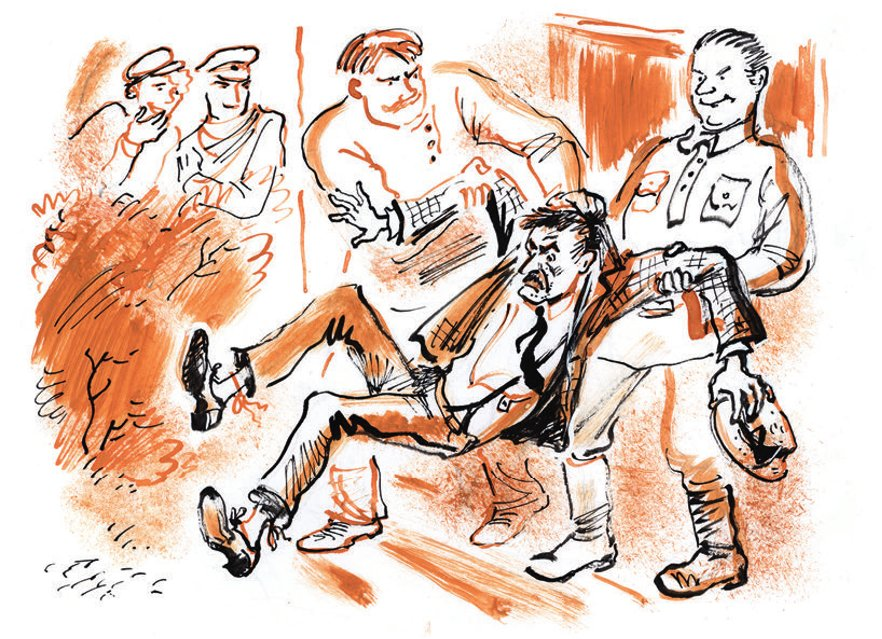
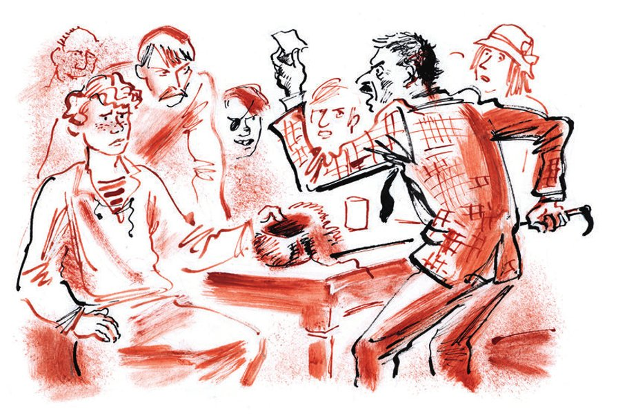
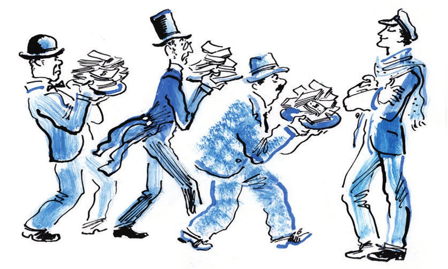

## Kapitel 2: Die dreißig Söhne von Leutnant Schmidt

Der hektische Morgen ist vorbei. Bender und Balaganow gehen schnell vom Exekutivkomitee weg. Sie haben sich nicht <abbr title="sich absprechen (sprach ab, hat abgesprochen) — договориться">abgesprochen</abbr>, aber sie gehen in dieselbe Richtung. Über die Hauptstraße fährt ein langer <abbr title="der Bauernwagen, die Bauernwagen — крестьянская телега">Bauernwagen</abbr>. Er transportiert eine lange blaue <abbr title="die Schiene, die Schienen — рельс">Schiene</abbr>. Die Schiene <abbr title="klingen (klang, hat geklungen) — звучать, звенеть">klingt</abbr> und singt so laut! Man denkt: Der <abbr title="der Fuhrmann, die Fuhrleute — возчик">Fuhrmann</abbr> in seinem <abbr title="der Arbeitsanzug, die Arbeitsanzüge — рабочая одежда, прозодежда">Arbeitsanzug</abbr> aus <abbr title="die Plane, die Planen — брезент">Plane</abbr> fährt keine Schiene, sondern einen riesigen, <abbr title="ohrenbetäubend — оглушительный">ohrenbetäubenden</abbr> <abbr title="der Ton, die Töne — звук, нота">Ton</abbr> aus der Musik. Die Sonne <abbr title="knallen — бить, палить">knallt</abbr> auf das Schaufenster von einem Geschäft für <abbr title="das Lehrmittel, die Lehrmittel — наглядное пособие">Lehrmittel</abbr>. Dort stehen <abbr title="der Globus, die Globusse — глобус">Globusse</abbr>, Totenköpfe und eine <abbr title="die Leber, die Lebern — печень">Leber</abbr> von einem <abbr title="der Säufer, die Säufer — пьяница">Säufer</abbr>, aus <abbr title="die Pappe — картон">Pappe</abbr> und fröhlich bunt <abbr title="bemalen — раскрашивать">bemalt</abbr>. Darüber umarmen sich zwei <abbr title="das Skelett, die Skelette — скелет">Skelette</abbr> wie gute Freunde. Im armen Fenster von einer Werkstatt für <abbr title="der Stempel, die Stempel — штемпель">Stempel</abbr> und <abbr title="das Siegel, die Siegel — печать">Siegel</abbr> hängen vor allem Schilder aus <abbr title="die Emaille — эмаль">Emaille</abbr>. Auf den Schildern steht: «Wegen Mittagspause geschlossen», «Mittagspause von 2 bis 3 Uhr», «Geschlossen zur Mittagspause», einfach «Geschlossen», «Das Geschäft ist geschlossen». Und ganz am Ende hängt ein schwarzes, <abbr title="gewaltig — громадный, фундаментальный">gewaltiges</abbr> Schild mit goldenen Buchstaben: «Geschlossen wegen <abbr title="die Inventur, die Inventuren — переучёт товаров, инвентаризация">Inventur</abbr>». Diese <abbr title="entschlossen — решительный">entschlossenen</abbr> Texte <abbr title="sich verkaufen — продаваться">verkaufen sich</abbr> in der Stadt Arbatow offenbar am besten. Für alle anderen Dinge im Leben hat die Werkstatt nur ein einziges blaues Schild: «<abbr title="die Kinderfrau, die Kinderfrauen — няня">Kinderfrau</abbr> vom Dienst».

Dann kommen nebeneinander drei Geschäfte für <abbr title="das Blasinstrument, die Blasinstrumente — духовой инструмент">Blasinstrumente</abbr>, <abbr title="die Mandoline, die Mandolinen — мандолина">Mandolinen</abbr> und <abbr title="die Bassbalalaika, die Bassbalalaikas — басовая балалайка">Bassbalalaikas</abbr>. Trompeten aus <abbr title="das Messing — медь, латунь">Messing</abbr> liegen <abbr title="schamlos — бесстыдно, развратно">schamlos</abbr> glänzend auf den <abbr title="die Stufe, die Stufen — ступенька">Stufen</abbr> im Schaufenster. Die Stufen sind mit rotem Stoff <abbr title="beziehen (bezog, hat bezogen) — обтягивать">bezogen</abbr>. Besonders schön ist das <abbr title="das Helikon, die Helikons — геликон (бас-труба)">Helikon</abbr>. Es ist so mächtig, und es liegt so faul wie ein <abbr title="der Ring, die Ringe — кольцо">Ring</abbr> in der Sonne! Eigentlich muss man es nicht im Schaufenster halten, sondern im Zoo von der Hauptstadt, irgendwo zwischen dem Elefanten und der <abbr title="die Riesenschlange, die Riesenschlangen — удав">Riesenschlange</abbr>. Am <abbr title="der Ruhetag, die Ruhetage — выходной день">Ruhetag</abbr> bringen die Eltern ihre Kinder hin und sagen: «Hier, mein Kind, das ist das Haus vom Helikon. Das Helikon schläft jetzt. Aber wenn es aufwacht, dann <abbr title="trompeten — трубить">trompetet</abbr> es ganz bestimmt.» Und die Kinder sehen die erstaunliche Trompete mit großen runden Augen an, so groß wie <abbr title="die Untertasse, die Untertassen — блюдце">Untertassen</abbr>.

An einem anderen Tag sieht sich Ostap Bender bestimmt alles genau an: die frisch <abbr title="zimmern — сколачивать, рубить">gezimmerten</abbr> Balalaikas, so groß wie eine Bauernhütte; die <abbr title="die Schallplatte, die Schallplatten — граммофонная пластинка">Schallplatten</abbr>, die sich in der <abbr title="die Hitze — жара">Hitze</abbr> <abbr title="sich verbiegen (verbog, hat verbogen) — покоробиться, изогнуться">verbogen</abbr> haben; und die <abbr title="die Trommel, die Trommeln — барабан">Trommeln</abbr> für die <abbr title="der Pionier, die Pioniere — пионер">Pioniere</abbr>. Die Trommeln sind so <abbr title="schneidig — молодцеватый, лихой">schneidig</abbr> bemalt, dass man sofort an den alten Spruch denkt: «Die Kugel ist dumm, das <abbr title="das Bajonett, die Bajonette — штык">Bajonett</abbr> ist ein Held.» Aber heute hat er dafür keine Zeit. Er hat Hunger.

— Sie stehen natürlich am Rand von einem finanziellen <abbr title="der Abgrund, die Abgründe — пропасть">Abgrund</abbr>? — fragt er Balaganow.

— Sie meinen Geld? — sagt Schura. — Ich habe schon eine ganze Woche kein Geld.

— Dann <abbr title="enden — кончить">enden</abbr> Sie <abbr title="böse enden — плохо кончить">böse</abbr>, junger Mann, — sagt Ostap <abbr title="belehrend — наставительно">belehrend</abbr>. — Der finanzielle Abgrund ist der tiefste von allen Abgründen. Man kann sein ganzes Leben lang hineinfallen. Na gut, seien Sie nicht traurig. Ich habe trotzdem drei Essensmarken in meinem <abbr title="der Schnabel, die Schnäbel — клюв">Schnabel</abbr> mitgenommen. Der Vorsitzende hat mich auf den ersten Blick geliebt.

Aber die Milchbrüder können die <abbr title="die Güte — доброта">Güte</abbr> von dem Chef der Stadt nicht <abbr title="nutzen — воспользоваться">nutzen</abbr>. An der Tür von der Kantine «Ehemaliger Magenfreund» hängt ein großes <abbr title="das Schloss, die Schlösser — замок (висячий)">Schloss</abbr>. Es ist mit <abbr title="der Rost — ржавчина">Rost</abbr> bedeckt. Oder mit <abbr title="der Buchweizenbrei — гречневая каша">Buchweizenbrei</abbr> – das sieht man nicht genau.

— Natürlich, — sagt Ostap <abbr title="bitter — с горечью">bitter</abbr>. — Wegen Inventur der <abbr title="das Schnitzel, die Schnitzel — шницель">Schnitzel</abbr> ist die Kantine für immer geschlossen. Jetzt müssen wir unseren Körper den <abbr title="der Privathändler, die Privathändler — частник">Privathändlern</abbr> <abbr title="opfern — отдать на растерзание, жертвовать">opfern</abbr>.

— Die Privathändler lieben <abbr title="das Bargeld — наличные деньги">Bargeld</abbr>, — sagt Balaganow <abbr title="dumpf — глухо">dumpf</abbr>.

— Na, na, ich will Sie nicht <abbr title="quälen — мучить">quälen</abbr>. Der Vorsitzende hat mich mit einem goldenen <abbr title="der Regen — дождь">Regen</abbr> <abbr title="überschütten — осыпать">überschüttet</abbr> – mit acht Rubeln. Aber merken Sie sich, lieber Schura: Umsonst <abbr title="füttern — кормить">füttere</abbr> ich Sie nicht. Für jedes <abbr title="das Vitamin, die Vitamine — витамин">Vitamin</abbr>, das ich Ihnen gebe, verlange ich ein paar kleine <abbr title="der Dienst, die Dienste — услуга">Dienste</abbr>.

Aber Privathändler gibt es in der Stadt keine. Deshalb essen die Brüder im Sommergarten von der Genossenschaft zu Mittag. Dort informieren besondere <abbr title="das Plakat, die Plakate — плакат">Plakate</abbr> die Bürger über die neueste <abbr title="die Neuerung, die Neuerungen — нововведение">Neuerung</abbr> in Arbatow auf dem Gebiet der <abbr title="die Volksernährung — народное питание">Volksernährung</abbr>:

«Bier gibt es nur für Gewerkschaftsmitglieder»

— Dann sind wir eben mit <abbr title="der Kwass — квас">Kwass</abbr> <abbr title="zufrieden — довольный">zufrieden</abbr>, — sagt Balaganow.

— Umso mehr, — sagt Ostap, — weil den Kwass hier eine Genossenschaft von Privathändlern macht. Und diese Privathändler <abbr title="sympathisieren mit + Dat. — сочувствовать">sympathisieren</abbr> mit der Sowjetmacht. So, und jetzt erzählen Sie: Was hat dieser <abbr title="der Halsabschneider, die Halsabschneider — головорез">Halsabschneider</abbr> Panikowski <abbr title="anstellen — натворить">angestellt</abbr>? Ich liebe Geschichten über kleine <abbr title="die Gaunerei, die Gaunereien — жульничество">Gaunereien</abbr>.

Balaganow ist jetzt satt. Er sieht seinen <abbr title="der Retter, die Retter — спаситель">Retter</abbr> <abbr title="dankbar — благодарно">dankbar</abbr> an und beginnt zu erzählen. Die Geschichte dauert ungefähr zwei Stunden, und sie ist sehr interessant.

In allen Bereichen vom menschlichen Leben gibt es besondere <abbr title="das Amt, die Ämter — орган, учреждение">Ämter</abbr>. Sie <abbr title="regeln — регулировать">regeln</abbr> das <abbr title="das Angebot — предложение">Angebot</abbr> von Arbeit und die <abbr title="die Nachfrage — спрос">Nachfrage</abbr>. Ein <abbr title="der Schauspieler, die Schauspieler — актёр">Schauspieler</abbr> fährt nur dann nach Omsk, wenn er ganz sicher weiß: Dort hat er keine <abbr title="die Konkurrenz — конкуренция">Konkurrenz</abbr>. Niemand anders will dort seine Rollen spielen – den kalten <abbr title="der Liebhaber, die Liebhaber — любовник">Liebhaber</abbr> oder den Diener, der nur sagt: «Das Essen ist <abbr title="servieren — подавать (на стол)">serviert</abbr>.» Um die <abbr title="der Eisenbahner, die Eisenbahner — железнодорожник">Eisenbahner</abbr> kümmern sich ihre lieben Gewerkschaftskomitees. Sie schreiben <abbr title="sorgfältig — заботливо, тщательно">sorgfältig</abbr> in die Zeitungen, zum Beispiel: «<abbr title="der Arbeitslose, die Arbeitslosen — безработный">Arbeitslose</abbr> <abbr title="der Gepäckträger, die Gepäckträger — багажный раздатчик, носильщик">Gepäckträger</abbr> bekommen keine Arbeit auf der Eisenbahnlinie Sysran–Wjasma.» Oder: «Die Mittelasiatische Eisenbahn braucht vier <abbr title="die Schrankenwärterin, die Schrankenwärterinnen — барьерная сторожиха">Schrankenwärterinnen</abbr>.» Ein <abbr title="der Warenprüfer, die Warenprüfer — эксперт-товаровед">Warenprüfer</abbr> gibt eine <abbr title="die Anzeige, die Anzeigen — объявление">Anzeige</abbr> in der Zeitung auf. Und das ganze Land weiß: Es gibt einen Warenprüfer mit zehn Jahren <abbr title="die Berufserfahrung — стаж">Berufserfahrung</abbr>. Aus familiären Gründen möchte er seine Stelle in Moskau gegen eine Arbeit in der <abbr title="die Provinz — провинция">Provinz</abbr> <abbr title="tauschen — менять">tauschen</abbr>.

Alles ist geregelt. Alles fließt in sauberen <abbr title="der Kanal, die Kanäle — русло, канал">Kanälen</abbr>, alles läuft genau nach dem Gesetz, und das Gesetz <abbr title="schützen — защищать">schützt</abbr> es.

Nur ein Markt ist im <abbr title="das Chaos — хаос">Chaos</abbr>: der Markt von einer besonderen Sorte von Gaunern. Sie nennen sich die Kinder von Leutnant Schmidt. Die <abbr title="die Anarchie — анархия">Anarchie</abbr> <abbr title="zerreißen (zerriss, hat zerrissen) — раздирать">zerreißt</abbr> die <abbr title="die Korporation, die Korporationen — корпорация">Korporation</abbr> der Kinder vom Leutnant. Sie können aus ihrem Beruf nicht den <abbr title="der Gewinn, die Gewinne — выгода, прибыль">Gewinn</abbr> holen, den er ganz sicher bringen kann.

Für <abbr title="der Hochstapler, die Hochstapler — самозванец, аферист">Hochstapler</abbr> aller Art gibt es keinen besseren Platz als unser großes Land. Denn es ist voll von Chefs, Wirtschaftsleuten und <abbr title="der Funktionär, die Funktionäre — функционер, общественник">Funktionären</abbr>, die entweder viel zu <abbr title="misstrauisch — подозрительный">misstrauisch</abbr> oder ganz furchtbar gutgläubig sind.

Durch das ganze Land reisen falsche <abbr title="der Enkel, die Enkel — внук">Enkel</abbr> von Karl Marx, <abbr title="der Neffe, die Neffen — племянник">Neffen</abbr> von Friedrich Engels, die es gar nicht gibt, Brüder von Lunatscharski, <abbr title="die Cousine, die Cousinen — кузина">Cousinen</abbr> von Clara Zetkin oder, im schlimmsten Fall, <abbr title="der Nachkomme, die Nachkommen — потомок">Nachkommen</abbr> von dem berühmten <abbr title="der Anarchist, die Anarchisten — анархист">Anarchisten</abbr> Fürst Kropotkin. Sie <abbr title="erpressen — вымогать">erpressen</abbr> und <abbr title="betteln — клянчить, попрошайничать">betteln</abbr>. Ganze <abbr title="die Truppe, die Truppen — отряд">Truppen</abbr> von <abbr title="erfunden — выдуманный, мифический">erfundenen</abbr> <abbr title="der Verwandte, die Verwandten — родственник">Verwandten</abbr> <abbr title="ausbeuten — эксплуатировать, разрабатывать">beuten</abbr> <abbr title="fleißig — усердно">fleißig</abbr> die <abbr title="die Bodenschätze (Pl.) — природные богатства">Bodenschätze</abbr> vom Land aus: die <abbr title="die Gutmütigkeit — добросердечие">Gutmütigkeit</abbr>, die Dummheit, die <abbr title="die Unterwürfigkeit — раболепство">Unterwürfigkeit</abbr> und das <abbr title="das Kriechen — низкопоклонство, пресмыкательство">Kriechen</abbr>.

Von Minsk bis zur <abbr title="die Beringstraße — Берингов пролив">Beringstraße</abbr> und von Nachitschewan am Araks bis zum Franz-Josef-Land gehen Verwandte von großen Menschen in Exekutivkomitees hinein. Sie steigen auf den <abbr title="der Bahnsteig, die Bahnsteige — перрон, платформа">Bahnsteigen</abbr> aus und fahren mit <abbr title="wichtig — озабоченный, важный">wichtigen</abbr> Gesichtern in Droschken durch die Städte. Sie haben es eilig. Sie haben viel zu tun.

Eine Zeit lang war das Angebot an Verwandten größer als die Nachfrage. Auf diesem <abbr title="seltsam — своеобразный, странный">seltsamen</abbr> Markt ist eine <abbr title="die Krise, die Krisen — депрессия, кризис">Krise</abbr> gekommen. Man hat <abbr title="die Reform, die Reformen — реформа">Reformen</abbr> gebraucht. Langsam haben die Enkel von Karl Marx, die Kropotkin-Leute, die Engels-Leute und alle anderen ihre Arbeit in Ordnung gebracht. Nur die wilde Korporation der Kinder von Leutnant Schmidt nicht. Bei ihnen war immer Anarchie, wie im polnischen <abbr title="das Parlament, die Parlamente — сейм, парламент">Parlament</abbr> früher. Die Kinder waren alle grob, <abbr title="gierig — жадный">gierig</abbr> und <abbr title="störrisch — строптивый">störrisch</abbr>. Sie haben sich gegenseitig gestört, wenn sie ihre <abbr title="die Ernte, die Ernten — урожай">Ernte</abbr> in die <abbr title="die Scheune, die Scheunen — житница, амбар">Scheunen</abbr> sammeln wollten.

Schura Balaganow hält sich für den ältesten Sohn vom Leutnant. Er hat sich wegen dieser <abbr title="die Lage, die Lagen — положение, конъюнктура">Lage</abbr> ernsthafte Sorgen gemacht. Immer öfter hat er Kollegen aus der Korporation <abbr title="treffen (traf, hat getroffen) — встретить">getroffen</abbr>. Sie haben die <abbr title="fruchtbar — плодородный">fruchtbaren</abbr> Felder der Ukraine und die <abbr title="der Kurort, die Kurorte — курорт">Kurorte</abbr> in den Bergen vom Kaukasus total <abbr title="verderben (verdarb, hat verdorben) — испортить, изгадить">verdorben</abbr>. Dort hat er früher immer gut verdient.

— Und Sie haben vor den <abbr title="wachsen (wuchs, ist gewachsen) — расти">wachsenden</abbr> <abbr title="die Schwierigkeit, die Schwierigkeiten — трудность">Schwierigkeiten</abbr> Angst bekommen? — fragt Ostap <abbr title="spöttisch — насмешливо">spöttisch</abbr>.

Aber Balaganow bemerkt die <abbr title="die Ironie — ирония">Ironie</abbr> nicht. Er trinkt seinen lila Kwass und erzählt weiter.

Aus dieser <abbr title="schwierig — трудный, напряжённый">schwierigen</abbr> Lage gab es nur einen <abbr title="der Ausweg, die Auswege — выход">Ausweg</abbr>: eine Konferenz. Den ganzen Winter hat Balaganow daran gearbeitet. Er hat mit den Konkurrenten, die er persönlich kannte, Briefe geschrieben. Den anderen hat er die <abbr title="die Einladung, die Einladungen — приглашение">Einladung</abbr> über Enkel von Marx geschickt, die er unterwegs getroffen hat. Und endlich, im frühen Frühling 1928, haben sich fast alle bekannten Kinder von Leutnant Schmidt in einem Moskauer <abbr title="das Wirtshaus, die Wirtshäuser — трактир">Wirtshaus</abbr> getroffen, beim Suchariewka-Turm. Es sind sehr viele gekommen. Leutnant Schmidt hatte offenbar dreißig Söhne zwischen 18 und 52 Jahren und vier Töchter: dumm, nicht mehr jung und nicht hübsch.

In einer kurzen <abbr title="die Rede, die Reden — речь">Rede</abbr> am Anfang hat Balaganow gesagt: Er hofft, dass die Brüder eine gemeinsame Sprache finden. Und dass sie endlich eine Konvention <abbr title="ausarbeiten — выработать">ausarbeiten</abbr>. Das Leben selbst diktiert, dass man sie braucht.

Nach dem Plan von Balaganow soll man die ganze Union der Republiken in vierunddreißig <abbr title="der Bezirk, die Bezirke — участок, район">Bezirke</abbr> für die Arbeit teilen, so viele, wie Leute gekommen sind. Jeder Bezirk gehört für lange Zeit einem Kind. Niemand aus der Korporation darf über die <abbr title="die Grenze, die Grenzen — граница">Grenze</abbr> gehen und auf fremdem <abbr title="das Gebiet, die Gebiete — территория">Gebiet</abbr> Geld verdienen.

Gegen die neuen Regeln hat niemand etwas gesagt. Nur Panikowski. Er hat schon damals gesagt, dass er auch ohne Konvention leben kann. Aber beim Teilen vom Land gab es hässliche <abbr title="die Szene, die Szenen — сцена">Szenen</abbr>. Die Hohen <abbr title="der Vertragspartner, die Vertragspartner — договаривающаяся сторона">Vertragspartner</abbr> haben sich schon in der ersten Minute <abbr title="sich zanken — ругаться, ссориться">gezankt</abbr>. Danach haben sie sich nur noch mit <abbr title="das Schimpfwort, die Schimpfwörter — ругательство, бранное слово">Schimpfwörtern</abbr> angesprochen.

Der ganze Streit ging um die Bezirke.

Niemand wollte die <abbr title="die Universitätsstadt, die Universitätsstädte — университетский центр">Universitätsstädte</abbr> nehmen. Niemand wollte das alte, <abbr title="erfahren — видавший виды, опытный">erfahrene</abbr> Moskau, Leningrad oder Charkow. Und alle zusammen wollten auf keinen Fall die Republik der <abbr title="der Wolgadeutsche, die Wolgadeutschen — немец Поволжья">Wolgadeutschen</abbr>.

— Warum, ist das so eine schlechte Republik? — hat Balaganow <abbr title="unschuldig — невинно">unschuldig</abbr> gefragt. — Das ist doch ein guter Ort, glaube ich. Die Deutschen sind kultivierte Menschen. Sie helfen bestimmt gern.

— Wissen wir, wissen wir! — haben die aufgeregten Kinder geschrien. — Von den Deutschen kriegt man was – na klar!

Offenbar haben schon mehrere von den Anwesenden bei den misstrauischen deutschen <abbr title="der Kolonist, die Kolonisten — колонист">Kolonisten</abbr> im <abbr title="das Gefängnis, die Gefängnisse — тюрьма">Gefängnis</abbr> gesessen.

Auch die fernen Gebiete im Osten, voll von <abbr title="der Sand — песок">Sand</abbr>, hatten einen sehr schlechten <abbr title="der Ruf — репутация">Ruf</abbr>. Man hat gesagt: Die Leute dort sind <abbr title="ungebildet — невежественный">ungebildet</abbr>, und sie kennen Leutnant Schmidt nicht.

— Ihr habt wohl Dumme gefunden! — hat Panikowski mit <abbr title="schrill — визгливый">schriller</abbr> Stimme geschrien. — Gebt mir die Mittelrussische <abbr title="die Platte, die Platten — возвышенность, плато">Platte</abbr>, dann <abbr title="unterschreiben (unterschrieb, hat unterschrieben) — подписать">unterschreibe</abbr> ich die Konvention.

— Was? Die ganze Platte? — hat Balaganow <abbr title="sticheln — язвить">gestichelt</abbr>. — Und vielleicht noch Melitopol <abbr title="dazu — в придачу">dazu</abbr>? Oder Bobruisk?

Beim Wort «Bobruisk» hat die ganze <abbr title="die Versammlung, die Versammlungen — собрание">Versammlung</abbr> schmerzlich <abbr title="stöhnen — стонать">gestöhnt</abbr>. Alle wollten sofort nach Bobruisk fahren. Bobruisk war ein wunderbarer, hochkultivierter Ort.

— Na gut, nicht die ganze Platte, — hat der gierige Panikowski <abbr title="beharren auf + Dat. — настаивать">beharrt</abbr>. — Aber <abbr title="wenigstens — хотя бы">wenigstens</abbr> die Hälfte. Ich bin doch ein <abbr title="der Familienvater, die Familienväter — семейный человек">Familienvater</abbr>. Ich habe zwei Familien.

Aber auch die Hälfte hat er nicht bekommen.

Nach langem <abbr title="das Geschrei — крики">Geschrei</abbr> haben sie beschlossen: Das Los entscheidet. Sie haben vierunddreißig Zettel geschnitten und auf jeden einen <abbr title="geografisch — географический">geografischen</abbr> Namen geschrieben. Das fruchtbare Kursk und das <abbr title="zweifelhaft — сомнительный">zweifelhafte</abbr> Cherson, das wenig <abbr title="erschlossen — освоенный, разработанный">erschlossene</abbr> Minussinsk und das fast <abbr title="hoffnungslos — безнадёжный">hoffnungslose</abbr> Aschchabad, Kiew, Petrosawodsk und Tschita – alle Republiken, alle Gebiete haben in einer <abbr title="die Hasenfellmütze, die Hasenfellmützen — заячья шапка">Hasenfellmütze</abbr> mit <abbr title="die Ohrenklappe, die Ohrenklappen — наушник (у шапки)">Ohrenklappen</abbr> gelegen und auf ihre <abbr title="der Besitzer, die Besitzer — хозяин, владелец">Besitzer</abbr> gewartet.

Bei der <abbr title="die Verlosung, die Verlosungen — жеребьёвка">Verlosung</abbr> gab es fröhliche Rufe, dumpfes Stöhnen und Schimpfwörter.

Der böse <abbr title="der Stern, die Sterne — звезда">Stern</abbr> von Panikowski hat auch hier seine Wirkung gehabt. Er hat die <abbr title="unfruchtbar — бесплодный">unfruchtbare</abbr> und <abbr title="rachsüchtig — мстительный">rachsüchtige</abbr> Republik der Wolgadeutschen bekommen. Er war ganz <abbr title="außer sich sein — быть вне себя">außer sich</abbr> vor <abbr title="die Wut — злость, ярость">Wut</abbr>, als er der Konvention <abbr title="beitreten (trat bei, ist beigetreten) — присоединиться">beigetreten ist</abbr>.

— Ich fahre hin, — hat er geschrien. — Aber ich warne euch: Wenn die Deutschen nicht nett zu mir sind, dann breche ich die Konvention. Dann gehe ich über die Grenze!

Balaganow hat den goldenen Bezirk Arbatow bekommen. Der liegt direkt neben der Republik der Deutschen. Deshalb hat er sich Sorgen gemacht und sofort gesagt: Er <abbr title="dulden — терпеть">duldet</abbr> keine Verstöße gegen die Regeln.

So oder so – die Sache war jetzt geregelt. Danach sind die dreißig Söhne und vier Töchter von Leutnant Schmidt in ihre Bezirke zur Arbeit gefahren.

— Und jetzt haben Sie selbst gesehen, Bender, wie dieser Mistkerl die Konvention gebrochen hat, — <abbr title="schließen (schloss, hat geschlossen) — закончить, завершить">schließt</abbr> Schura Balaganow seine Geschichte. — Er kriecht schon lange in meinem Bezirk herum. Nur konnte ich ihn bis jetzt nicht <abbr title="erwischen — поймать">erwischen</abbr>.

Der <abbr title="der Erzähler, die Erzähler — рассказчик">Erzähler</abbr> hat etwas anderes erwartet: Ostap <abbr title="verurteilen — осуждать">verurteilt</abbr> die schlechte Tat von Panikowski gar nicht. Bender <abbr title="sich lümmeln — развалиться">lümmelt sich</abbr> auf seinem Stuhl und sieht <abbr title="gleichgültig — равнодушно, небрежно">gleichgültig</abbr> vor sich hin.

Auf die hohe <abbr title="die Rückwand, die Rückwände — задняя стена">Rückwand</abbr> vom Restaurantgarten hat jemand Bäume gemalt. Sie haben dichte <abbr title="das Blatt, die Blätter — лист">Blätter</abbr> und sind ganz gerade, wie auf einem Bild im <abbr title="das Lesebuch, die Lesebücher — хрестоматия">Lesebuch</abbr>. Echte Bäume gibt es im Garten nicht. Aber die Wand wirft einen Schatten, und der Schatten ist <abbr title="angenehm — приятный">angenehm</abbr> kühl. Den Bürgern reicht das völlig. Die Bürger sind offenbar alle ohne <abbr title="die Ausnahme, die Ausnahmen — исключение">Ausnahme</abbr> Gewerkschaftsmitglieder. Denn sie trinken nur Bier und essen nicht einmal etwas dazu.

Zum Tor vom Garten fährt ein grünes Auto. Es <abbr title="ächzen — охать, кряхтеть">ächzt</abbr> und knallt ununterbrochen. Auf der Tür steht in einem weißen Bogen: «Hei, ich fahr dich!» Darunter stehen die <abbr title="der Preis, die Preise — цена">Preise</abbr> für eine Fahrt in dem fröhlichen Auto: eine Stunde – drei Rubel. Eine einfache Fahrt – <abbr title="nach Vereinbarung — по соглашению">nach Vereinbarung</abbr>. Fahrgäste sitzen nicht im Auto.

Die Gäste im Garten flüstern <abbr title="beunruhigt — встревоженно">beunruhigt</abbr>. Fünf Minuten lang sieht der Fahrer <abbr title="bittend — просительно">bittend</abbr> durch das <abbr title="das Gitter, die Gitter — решётка">Gitter</abbr> vom Garten. Dann hat er offenbar keine Hoffnung mehr auf einen Fahrgast. <abbr title="herausfordernd — вызывающе">Herausfordernd</abbr> ruft er:

— Taxi ist frei! Bitte einsteigen!

Aber kein Bürger will in das Auto «Hei, ich fahr dich!» einsteigen. Und die Einladung vom Fahrer hat eine seltsame Wirkung auf sie. Sie <abbr title="senken — опустить">senken</abbr> die Köpfe und versuchen, nicht zum Auto zu sehen. Der Fahrer schüttelt den Kopf und fährt langsam weg. Die Leute aus Arbatow sehen ihm traurig nach. Fünf Minuten später <abbr title="rasen — мчаться">rast</abbr> das grüne Auto wie verrückt in die andere Richtung am Garten vorbei. Der Fahrer hüpft auf seinem Sitz und schreit etwas, was man nicht versteht. Das Auto ist immer noch leer.

Ostap sieht ihm nach und sagt:

— Also, Balaganow, Sie sind ein <abbr title="der Schnösel, die Schnösel — пижон">Schnösel</abbr>. Seien Sie nicht <abbr title="beleidigt sein — обижаться">beleidigt</abbr>. Damit will ich nur genau zeigen, welchen Platz Sie unter der Sonne haben.

— <abbr title="sich zum Teufel scheren — идти к чёрту">Scheren Sie sich zum Teufel</abbr>! — sagt Balaganow grob.

— Sie sind also doch beleidigt? Sie meinen also, der Job als Sohn vom Leutnant ist keine <abbr title="die Schnöselei — пижонство">Schnöselei</abbr>?

— Aber Sie sind doch selbst ein Sohn von Leutnant Schmidt! — ruft Balaganow.

— Sie sind ein Schnösel, — sagt Ostap noch einmal. — Und der Sohn von einem Schnösel. Und Ihre Kinder werden auch Schnösel. Junge! Was heute Morgen passiert ist, das ist nicht einmal eine <abbr title="die Episode, die Episoden — эпизод">Episode</abbr>. Das ist ein reiner Zufall, eine <abbr title="die Laune, die Launen — каприз">Laune</abbr> von einem <abbr title="der Künstler, die Künstler — художник">Künstler</abbr>. Ein <abbr title="der Gentleman, die Gentlemen — джентльмен">Gentleman</abbr> sucht einen <abbr title="der Zehner, die Zehner — десятка">Zehner</abbr>. Auf so <abbr title="winzig — мизерный, крошечный">winzige</abbr> Chancen zu <abbr title="lauern auf + Akk. — ловить, подстерегать">lauern</abbr> – das ist nicht mein Charakter. Und was ist das überhaupt für ein Beruf, <abbr title="Gott verzeih mir — прости господи">Gott verzeih mir</abbr>! Sohn von Leutnant Schmidt! Na, noch ein Jahr, na, noch zwei. Und dann? Dann kennt jeder Ihre roten Locken, und man fängt einfach an, Sie zu <abbr title="verprügeln — избить, бить">verprügeln</abbr>.

— Was soll ich denn machen? — fragt Balaganow <abbr title="nervös — нервно, обеспокоенно">nervös</abbr>. — Wie soll ich mein <abbr title="das tägliche Brot — хлеб насущный">tägliches Brot</abbr> verdienen?

— Man muss denken, — sagt Ostap streng. — Mich zum Beispiel <abbr title="ernähren — кормить">ernähren</abbr> die Ideen. Ich <abbr title="ausstrecken — протягивать">strecke</abbr> meine <abbr title="die Pfote, die Pfoten — лапа">Pfote</abbr> nicht nach dem <abbr title="sauer — кислый">sauren</abbr> Rubel vom Exekutivkomitee aus. Meine Pläne sind größer. Sie lieben das Geld, das sehe ich, und zwar ganz <abbr title="selbstlos — бескорыстно">selbstlos</abbr>. Sagen Sie, welche <abbr title="die Summe, die Summen — сумма">Summe</abbr> gefällt Ihnen?

— Fünftausend, — antwortet Balaganow schnell.

— Im Monat?

— Im Jahr.

— Dann haben wir nicht denselben Weg. Ich brauche fünfhunderttausend. Und möglichst sofort, nicht in <abbr title="die Rate, die Raten — часть, взнос">Raten</abbr>.

— Vielleicht nehmen Sie es doch in Raten? — fragt Balaganow. Er will sich <abbr title="sich rächen — мстить">rächen</abbr>.

Ostap sieht seinen Gesprächspartner <abbr title="aufmerksam — внимательно">aufmerksam</abbr> an und antwortet ganz ernst:

— Ich nehme es auch gern in Raten. Aber ich brauche es sofort.

Balaganow will auch über diesen Satz einen <abbr title="der Witz, die Witze — шутка">Witz</abbr> machen. Aber er sieht Ostap an und <abbr title="verstummen — осечься, замолчать">verstummt</abbr> sofort. Vor ihm sitzt ein <abbr title="der Athlet, die Athleten — атлет">Athlet</abbr>. Sein Gesicht ist fein <abbr title="meißeln — высекать, чеканить">gemeißelt</abbr>, wie auf einer <abbr title="die Münze, die Münzen — монета">Münze</abbr>. Über seinen <abbr title="braungebrannt — смуглый, загорелый">braungebrannten</abbr> Hals läuft eine dünne weiße <abbr title="die Narbe, die Narben — шрам">Narbe</abbr>. Seine Augen <abbr title="funkeln — сверкать">funkeln</abbr> drohend und fröhlich.

Plötzlich hat Balaganow einen starken <abbr title="der Wunsch, die Wünsche — желание">Wunsch</abbr>: Er will <abbr title="strammstehen (stand stramm, hat strammgestanden) — стоять навытяжку, руки по швам">strammstehen</abbr>. Er möchte sogar <abbr title="sich räuspern — откашляться">sich räuspern</abbr>. So machen es mittlere Beamte, wenn sie mit einem höheren Genossen sprechen. Und wirklich: Er räuspert sich und fragt verlegen:

— Wozu brauchen Sie denn so viel Geld … und sofort?

— Eigentlich brauche ich mehr, — sagt Ostap. — Fünfhunderttausend sind mein <abbr title="das Minimum — минимум">Minimum</abbr>. Fünfhunderttausend volle, schwere Rubel. Ich will weg, Genosse Schura, ganz weit weg. Nach Rio de Janeiro.

— Haben Sie dort Verwandte? — fragt Balaganow.

— Was, sehe ich etwa aus wie ein Mensch, der Verwandte haben kann?

— Nein, aber ich …

— Ich habe keine Verwandten, Genosse Schura. Ich bin allein auf der ganzen Welt. Ich hatte einen Papa, einen türkischen Staatsbürger. Aber der ist schon lange tot, er ist unter schrecklichen <abbr title="der Krampf, die Krämpfe — судорога">Krämpfen</abbr> gestorben. Darum geht es nicht. Seit meiner Kindheit will ich nach Rio de Janeiro. Sie wissen natürlich nicht, dass es diese Stadt gibt.

Balaganow schüttelt traurig den Kopf. Von den großen <abbr title="das Zentrum, die Zentren — центр, очаг">Zentren</abbr> der Weltkultur kennt er außer Moskau nur Kiew, Melitopol und Schmerinka. Und überhaupt ist er überzeugt: Die Erde ist flach.

Ostap wirft ein Blatt auf den Tisch. Er hat es aus einem Buch <abbr title="herausreißen (riss heraus, hat herausgerissen) — вырвать">herausgerissen</abbr>.

— Das ist eine Seite aus der «Kleinen Sowjetischen <abbr title="die Enzyklopädie, die Enzyklopädien — энциклопедия">Enzyklopädie</abbr>». Hier steht über Rio de Janeiro: «1360 Tausend <abbr title="der Einwohner, die Einwohner — житель">Einwohner</abbr> …» So … «eine große Zahl von <abbr title="der Mulatte, die Mulatten — мулат">Mulatten</abbr> … an einer großen <abbr title="die Bucht, die Buchten — бухта">Bucht</abbr> vom Atlantischen Ozean …» Da, da! «Die Hauptstraßen der Stadt sind mit ihren reichen Geschäften und <abbr title="prächtig — великолепный">prächtigen</abbr> <abbr title="das Gebäude, die Gebäude — здание">Gebäuden</abbr> nicht schlechter als die ersten Städte der Welt.» Stellen Sie sich das vor, Schura! Nicht schlechter! Mulatten, eine Bucht, <abbr title="der Kaffeeexport — экспорт кофе">Kaffeeexport</abbr>, sozusagen Kaffee-<abbr title="das Dumping — демпинг">Dumping</abbr>, ein <abbr title="der Charleston — чарльстон">Charleston</abbr> mit dem Titel «Mein Mädchen hat ein kleines <abbr title="das Dingsda — штучка, штуковина">Dingsda</abbr>» und … was soll ich noch sagen! Sie sehen selbst, was da los ist. Anderthalb Millionen Menschen, und alle ohne Ausnahme in weißen Hosen. Ich will hier weg. Ich habe im letzten Jahr sehr ernste <abbr title="die Meinungsverschiedenheit, die Meinungsverschiedenheiten — разногласие">Meinungsverschiedenheiten</abbr> mit der Sowjetmacht bekommen. Sie will den Sozialismus aufbauen, und ich will nicht. Es ist mir zu langweilig, den Sozialismus aufzubauen. Bin ich etwa ein <abbr title="der Maurer, die Maurer — каменщик">Maurer</abbr>, ein Maurer mit weißer <abbr title="die Schürze, die Schürzen — фартук">Schürze</abbr>? Verstehen Sie jetzt, wozu ich so viel Geld brauche?

— Woher wollen Sie fünfhunderttausend nehmen? — fragt Balaganow leise.

— Egal woher, — antwortet Ostap. — Zeigen Sie mir nur einen reichen Menschen, und ich nehme ihm das Geld weg.

— Wie? <abbr title="der Mord, die Morde — убийство">Mord</abbr>? — fragt Balaganow noch leiser. Er sieht zu den Tischen nebenan. Dort <abbr title="heben (hob, hat gehoben) — поднимать">heben</abbr> Leute aus Arbatow ihre Gläser <abbr title="auf die Gesundheit — за здоровье">auf die Gesundheit</abbr>.

— Wissen Sie, — sagt Ostap, — diese sogenannte Suchariewka-Konvention war ein Fehler. Sie durften sie nicht unterschreiben.
Diese <abbr title="geistig — умственный">geistige</abbr> <abbr title="die Übung, die Übungen — упражнение">Übung</abbr> hat Sie offenbar sehr <abbr title="erschöpfen — истощить">erschöpft</abbr>. Sie werden ja direkt vor meinen Augen dümmer. Merken Sie sich: Ostap Bender hat noch nie jemanden <abbr title="umbringen (brachte um, hat umgebracht) — убить">umgebracht</abbr>. Man hat ihn umgebracht – das ja, das gab es. Aber er selbst ist vor dem Gesetz sauber. Ich bin natürlich kein <abbr title="der Engel, die Engel — херувим, ангел">Engel</abbr>. Ich habe keine <abbr title="der Flügel, die Flügel — крыло">Flügel</abbr>. Aber ich <abbr title="verehren — чтить, почитать">verehre</abbr> das <abbr title="das Strafgesetzbuch — Уголовный кодекс">Strafgesetzbuch</abbr>. Das ist meine <abbr title="die Schwäche, die Schwächen — слабость">Schwäche</abbr>.

— Wie wollen Sie denn das Geld wegnehmen?

— Wie ich es wegnehmen will? Das Wegnehmen oder <abbr title="entführen — уводить, похищать">Entführen</abbr> von Geld ist <abbr title="je nach + Dat. — в зависимости от">je nach</abbr> <abbr title="der Umstand, die Umstände — обстоятельство">Umständen</abbr> verschieden. Ich persönlich habe vierhundert relativ <abbr title="ehrlich — честный">ehrliche</abbr> Methoden, anderen das Geld abzunehmen. Aber es geht nicht um die Methoden. Es geht darum, dass es heute keine reichen Menschen gibt. Und das ist das Schreckliche an meiner Lage. Ein anderer <abbr title="überfallen (überfiel, hat überfallen) — напасть на">überfällt</abbr> vielleicht irgendein <abbr title="wehrlos — беззащитный">wehrloses</abbr> <abbr title="staatlich — государственный">staatliches</abbr> Amt. Aber das ist nicht mein Stil. Sie kennen meinen Respekt vor dem Strafgesetzbuch. Es <abbr title="sich lohnen — стоить, иметь смысл">lohnt sich</abbr> nicht, ein <abbr title="das Kollektiv, die Kollektive — коллектив">Kollektiv</abbr> <abbr title="ausrauben — грабить">auszurauben</abbr>. Geben Sie mir ein reiches <abbr title="das Individuum, die Individuen — индивид, личность">Individuum</abbr>. Aber dieses Individuum gibt es nicht.

— Aber nein! — ruft Balaganow. — Es gibt sehr reiche Leute.

— Und kennen Sie sie? — fragt Ostap sofort. — Können Sie mir den Namen und die genaue <abbr title="die Adresse, die Adressen — адрес">Adresse</abbr> von wenigstens einem sowjetischen <abbr title="der Millionär, die Millionäre — миллионер">Millionär</abbr> sagen? Und es gibt sie doch, es muss sie geben. Wenn im Land irgendwelches Geld <abbr title="herumlaufen (lief herum, ist herumgelaufen) — бродить, ходить">herumläuft</abbr>, dann muss es auch Leute geben, die viel davon haben. Aber wie findet man so einen <abbr title="der Schlaumeier, die Schlaumeier — ловкач">Schlaumeier</abbr>?

Ostap seufzt sogar. Die <abbr title="der Traum, die Träume — мечта, грёза">Träume</abbr> vom reichen Individuum <abbr title="beschäftigen — занимать, волновать">beschäftigen</abbr> ihn offenbar schon lange.

— Wie angenehm ist es, — sagt er nachdenklich, — mit einem <abbr title="legal — легальный">legalen</abbr> Millionär zu arbeiten, in einem gut organisierten <abbr title="bürgerlich — буржуазный">bürgerlichen</abbr> Staat mit alten <abbr title="kapitalistisch — капиталистический">kapitalistischen</abbr> <abbr title="die Tradition, die Traditionen — традиция">Traditionen</abbr>. Dort ist ein Millionär eine <abbr title="populär — популярный">populäre</abbr> Person. Jeder kennt seine Adresse. Er wohnt in einer <abbr title="die Villa, die Villen — особняк">Villa</abbr>, irgendwo in Rio de Janeiro. Man geht direkt zu ihm, und schon im <abbr title="das Vorzimmer, die Vorzimmer — передняя, приёмная">Vorzimmer</abbr>, nach den ersten <abbr title="der Gruß, die Grüße — приветствие">Grüßen</abbr>, nimmt man ihm das Geld weg. Und das alles, merken Sie sich, ganz freundlich und höflich: «Hallo, Sir, <abbr title="sich aufregen — волноваться">regen Sie sich nicht auf</abbr>. Ich muss Sie ein bisschen <abbr title="stören — беспокоить">stören</abbr>. All right. Fertig.» Und das ist alles. Kultur! Was kann einfacher sein? Ein Gentleman unter Gentlemen macht sein kleines <abbr title="das Business — бизнес">Business</abbr>. Nur muss man nicht auf den <abbr title="der Kronleuchter, die Kronleuchter — люстра">Kronleuchter</abbr> schießen, das ist <abbr title="überflüssig — лишний">überflüssig</abbr>. Aber bei uns … Gott, o Gott! In was für einem kalten Land leben wir! Bei uns ist alles <abbr title="verstecken — прятать, скрывать">versteckt</abbr>, alles im <abbr title="der Untergrund — подполье">Untergrund</abbr>. Den sowjetischen Millionär kann sogar das <abbr title="das Volkskommissariat, die Volkskommissariate — наркомат">Volkskommissariat</abbr> für Finanzen nicht finden, mit seinem gewaltigen <abbr title="der Steuerapparat — налоговый аппарат">Steuerapparat</abbr>. Und vielleicht sitzt der Millionär gerade jetzt in diesem sogenannten Sommergarten, am Tisch nebenan, und trinkt Bier «Tip-Top» für vierzig Kopeken. Das ist es, was mich <abbr title="kränken — обижать, огорчать">kränkt</abbr>!

— Sie meinen also, — fragt Balaganow nach einer Weile, — wenn man so einen <abbr title="geheim — тайный">geheimen</abbr> Millionär findet, dann …?

— Sprechen Sie nicht weiter. Ich weiß, was Sie sagen wollen. Nein, nicht das, gar nicht das. Ich will ihn nicht mit einem Kissen <abbr title="ersticken — душить">ersticken</abbr> oder ihm mit einem schwarzen <abbr title="der Revolver, die Revolver — револьвер, наган">Revolver</abbr> auf den Kopf schlagen. Und überhaupt gibt es nichts Dummes. Ach, wenn man nur das Individuum findet! Ich mache das schon so, dass er mir sein Geld selbst bringt – auf einer Untertasse mit blauem Rand.

— Das ist sehr gut. — Balaganow lächelt <abbr title="vertrauensvoll — доверчиво">vertrauensvoll</abbr>. — Fünfhunderttausend auf einer Untertasse mit blauem Rand.

Er steht auf und fängt an, um den Tisch herumzulaufen. Er <abbr title="schmatzen — причмокивать">schmatzt</abbr> kläglich mit der Zunge. Er bleibt stehen, macht sogar den Mund auf. Er will offenbar etwas sagen. Aber er sagt nichts, setzt sich und steht wieder auf. Ostap sieht den <abbr title="das Manöver, die Manöver — манёвр, эволюция">Manövern</abbr> von Balaganow gleichgültig zu.

— Er bringt es selbst? — fragt Balaganow plötzlich mit <abbr title="knarren — скрипеть">knarrender</abbr> Stimme. — Auf einer Untertasse? Und wenn er es nicht bringt? Und wo ist dieses Rio de Janeiro? Weit weg? Das kann nicht sein, dass alle in weißen Hosen herumlaufen. Lassen Sie das, Bender. Mit fünfhunderttausend kann man auch bei uns gut leben.

— <abbr title="zweifellos — бесспорно">Zweifellos</abbr>, zweifellos, — sagt Ostap fröhlich. — Leben kann man. Aber <abbr title="flattern — хлопать (крыльями), трепыхаться">flattern</abbr> Sie nicht ohne Grund mit den Flügeln. Sie haben ja keine fünfhunderttausend.

Auf der ruhigen Stirn von Balaganow – sie ist wie ein Feld, auf dem noch nie ein <abbr title="der Pflug, die Pflüge — плуг">Pflug</abbr> war – erscheint eine tiefe <abbr title="die Falte, die Falten — морщина, складка">Falte</abbr>. Er sieht Ostap unsicher an und sagt:

— Ich kenne so einen Millionär. Daraus kann ein Geschäft werden.

Sofort ist auf Benders Gesicht keine Freude mehr. Sein Gesicht wird hart und sieht wieder aus wie auf einer <abbr title="die Medaille, die Medaillen — медаль">Medaille</abbr>.

— Gehen Sie, gehen Sie, — sagt er. — <abbr title="das Almosen, die Almosen — милостыня">Almosen</abbr> gebe ich nur samstags. Erzählen Sie hier keine <abbr title="das Märchen, die Märchen — сказка">Märchen</abbr>.

— <abbr title="das Ehrenwort — честное слово">Ehrenwort</abbr>, Monsieur Bender …

— Hören Sie, Schura, wenn Sie schon ganz zum Französischen <abbr title="übergehen (ging über, ist übergegangen) — перейти">übergegangen</abbr> sind, dann nennen Sie mich nicht Monsieur, sondern Citoyen. Das heißt: Bürger. Übrigens, die Adresse von Ihrem Millionär?

— Er wohnt in Tschernomorsk.

— Na klar, das habe ich gewusst. Tschernomorsk! Dort hat man schon vor dem Krieg einen Menschen mit zehntausend Rubeln Millionär genannt. Und jetzt … das kann ich mir vorstellen! Nein, das ist <abbr title="der Unsinn — чепуха">Unsinn</abbr>!

— Aber nein, lassen Sie mich doch reden. Das ist ein echter Millionär. Verstehen Sie, Bender, ich habe vor kurzem dort im Gefängnis gesessen …

Zehn Minuten später <abbr title="verlassen (verließ, hat verlassen) — покидать">verlassen</abbr> die Milchbrüder den Sommergarten von der Genossenschaft, wo es Bier gibt. Der große Kombinator fühlt sich wie ein <abbr title="der Chirurg, die Chirurgen — хирург">Chirurg</abbr> vor einer sehr ernsten <abbr title="die Operation, die Operationen — операция">Operation</abbr>. Alles ist fertig. In kleinen elektrischen <abbr title="der Topf, die Töpfe — кастрюля">Töpfen</abbr> <abbr title="dampfen — париться">dampfen</abbr> die <abbr title="das Tuch, die Tücher — салфетка">Tücher</abbr> und die <abbr title="der Verband, die Verbände — бинт, повязка">Verbände</abbr>. Die <abbr title="die Krankenschwester, die Krankenschwestern — медсестра, сестра милосердия">Krankenschwester</abbr> in einer weißen <abbr title="die Toga, die Togen — тога">Toga</abbr> geht ganz leise über den <abbr title="der Fliesenboden, die Fliesenböden — кафельный пол">Fliesenboden</abbr>. Medizinisches Porzellan und <abbr title="das Nickel — никель">Nickel</abbr> glänzen. Der <abbr title="der Kranke, die Kranken — больной">Kranke</abbr> liegt auf einem Tisch aus Glas und <abbr title="verdrehen — закатить">verdreht</abbr> müde die Augen zur Decke. In der warmen Luft liegt der Geruch von deutschem <abbr title="der Kaugummi, die Kaugummis — жевательная резинка">Kaugummi</abbr>. Der Chirurg kommt mit <abbr title="spreizen — растопырить">gespreizten</abbr> Händen zum <abbr title="der Operationstisch, die Operationstische — операционный стол">Operationstisch</abbr>. Sein <abbr title="der Assistent, die Assistenten — ассистент">Assistent</abbr> gibt ihm ein <abbr title="steril — стерильный">steriles</abbr> <abbr title="das Finnenmesser, die Finnenmesser — финский нож, финка">Finnenmesser</abbr>. Und der Chirurg sagt trocken zum Kranken: «So, mein Herr – die Jacke her!»

— Bei mir ist es immer so, — sagt Bender mit glänzenden Augen. — Ein Millionengeschäft muss ich immer mit einem <abbr title="spürbar — ощутимый">spürbaren</abbr> <abbr title="der Mangel — нехватка">Mangel</abbr> an Geld anfangen. Mein ganzes <abbr title="das Kapital — капитал">Kapital</abbr> – das <abbr title="das Grundkapital — основной капитал">Grundkapital</abbr>, das <abbr title="das Betriebskapital — оборотный капитал">Betriebskapital</abbr> und die <abbr title="die Reserve, die Reserven — запас, резерв">Reserve</abbr> – sind fünf Rubel. Wie, sagen Sie, heißt der Untergrund-Millionär?

— Koreiko, — antwortet Balaganow.

— Ja, ja, Koreiko. Ein <abbr title="ausgezeichnet — прекрасный">ausgezeichneter</abbr> Name. Und Sie <abbr title="behaupten — утверждать">behaupten</abbr>, niemand weiß von seinen Millionen?

— Niemand, nur ich und Prushanski. Aber Prushanski sitzt noch ungefähr drei Jahre im Gefängnis, das habe ich Ihnen doch gesagt. Sie müssen sich das vorstellen: Wie er <abbr title="jammern — убиваться, причитать">gejammert</abbr> und geweint hat, als ich <abbr title="freikommen (kam frei, ist freigekommen) — выйти на волю">freigekommen</abbr> bin! Er hat offenbar gefühlt: Er durfte mir nichts von Koreiko erzählen.

— Dass er Ihnen sein <abbr title="das Geheimnis, die Geheimnisse — тайна">Geheimnis</abbr> verraten hat, das ist Unsinn. Deshalb hat er nicht gejammert und geweint. Er hat wahrscheinlich <abbr title="ahnen — предчувствовать">geahnt</abbr>, dass Sie die ganze Sache mir erzählen. Und das ist für den armen Prushanski wirklich ein direkter <abbr title="der Verlust, die Verluste — убыток">Verlust</abbr>. Wenn Prushanski aus dem Gefängnis kommt, dann <abbr title="sich trösten — утешаться">tröstet sich</abbr> Koreiko nur noch mit einem ordinären <abbr title="das Sprichwort, die Sprichwörter — пословица">Sprichwort</abbr>: «<abbr title="die Armut — бедность">Armut</abbr> ist keine Schande.»

Ostap nimmt seine Sommermütze ab, <abbr title="wedeln — махать">wedelt</abbr> damit in der Luft und fragt:

— Habe ich graue Haare?

Balaganow zieht den Bauch ein. Er stellt die Fußspitzen so weit <abbr title="auseinander — врозь, в стороны">auseinander</abbr> wie ein <abbr title="der Gewehrkolben, die Gewehrkolben — приклад ружья">Gewehrkolben</abbr> breit ist. Und mit der Stimme von einem <abbr title="der Soldat, die Soldaten — солдат">Soldaten</abbr> im ersten Glied antwortet er:

— Keine, zu Befehl!

— Dann bekomme ich welche. Wir haben große <abbr title="die Schlacht, die Schlachten — бой, сражение">Schlachten</abbr> vor uns. Auch Sie werden grau, Balaganow.

Plötzlich <abbr title="kichern — хихикать">kichert</abbr> Balaganow etwas dumm:

— Wie sagen Sie? Er bringt das Geld selbst, auf einer Untertasse mit blauem Rand?

— Mir auf der Untertasse, — sagt Ostap. — Und Ihnen auf dem Teller.

— Und was ist mit Rio de Janeiro? Ich will auch in weißen Hosen gehen.

— Rio de Janeiro ist der <abbr title="zerbrechlich — хрупкий">zerbrechliche</abbr> Traum aus meiner Kindheit, — antwortet der große Kombinator streng. — Fassen Sie ihn nicht mit Ihren Pfoten an. Zur Sache. Die <abbr title="die Linientruppe, die Linientruppen — линейные (войска)">Linientruppen</abbr> zu meiner <abbr title="die Verfügung — распоряжение">Verfügung</abbr> schicken! Alle <abbr title="die Einheit, die Einheiten — часть, подразделение">Einheiten</abbr> kommen so schnell wie möglich in die Stadt Tschernomorsk. Kleidung: <abbr title="die Wachuniform, die Wachuniformen — караульная форма">Wachuniform</abbr>. Na, blasen Sie den <abbr title="der Marsch, die Märsche — марш">Marsch</abbr>! Die Parade kommandiere ich!

---

### Neue Wörter

- **sich absprechen (sprach ab, hat abgesprochen)** — договориться
- **der Bauernwagen, die Bauernwagen** — крестьянская телега
- **die Schiene, die Schienen** — рельс
- **klingen (klang, hat geklungen)** — звучать, звенеть
- **der Fuhrmann, die Fuhrleute** — возчик
- **der Arbeitsanzug, die Arbeitsanzüge** — рабочая одежда, прозодежда
- **die Plane, die Planen** — брезент
- **ohrenbetäubend** — оглушительный
- **der Ton, die Töne** — звук, нота
- **knallen** — бить, палить
- **das Lehrmittel, die Lehrmittel** — наглядное пособие
- **der Globus, die Globusse** — глобус
- **die Leber, die Lebern** — печень
- **der Säufer, die Säufer** — пьяница
- **die Pappe** — картон
- **bemalen** — раскрашивать
- **das Skelett, die Skelette** — скелет
- **der Stempel, die Stempel** — штемпель
- **das Siegel, die Siegel** — печать
- **die Emaille** — эмаль
- **gewaltig** — громадный, фундаментальный
- **die Inventur, die Inventuren** — переучёт товаров, инвентаризация
- **entschlossen** — решительный
- **sich verkaufen** — продаваться
- **die Kinderfrau, die Kinderfrauen** — няня
- **das Blasinstrument, die Blasinstrumente** — духовой инструмент
- **die Mandoline, die Mandolinen** — мандолина
- **die Bassbalalaika, die Bassbalalaikas** — басовая балалайка
- **das Messing** — медь, латунь
- **schamlos** — бесстыдно, развратно
- **die Stufe, die Stufen** — ступенька
- **beziehen (bezog, hat bezogen)** — обтягивать
- **das Helikon, die Helikons** — геликон (бас-труба)
- **der Ring, die Ringe** — кольцо
- **die Riesenschlange, die Riesenschlangen** — удав
- **der Ruhetag, die Ruhetage** — выходной день
- **trompeten** — трубить
- **die Untertasse, die Untertassen** — блюдце
- **zimmern** — сколачивать, рубить
- **die Schallplatte, die Schallplatten** — граммофонная пластинка
- **die Hitze** — жара
- **sich verbiegen (verbog, hat verbogen)** — покоробиться, изогнуться
- **die Trommel, die Trommeln** — барабан
- **der Pionier, die Pioniere** — пионер
- **schneidig** — молодцеватый, лихой
- **das Bajonett, die Bajonette** — штык
- **der Abgrund, die Abgründe** — пропасть
- **enden** — кончить
- **böse enden** — плохо кончить
- **belehrend** — наставительно
- **der Schnabel, die Schnäbel** — клюв
- **die Güte** — доброта
- **nutzen** — воспользоваться
- **das Schloss, die Schlösser** — замок (висячий)
- **der Rost** — ржавчина
- **der Buchweizenbrei** — гречневая каша
- **bitter** — с горечью
- **das Schnitzel, die Schnitzel** — шницель
- **der Privathändler, die Privathändler** — частник
- **opfern** — отдать на растерзание, жертвовать
- **das Bargeld** — наличные деньги
- **dumpf** — глухо
- **quälen** — мучить
- **der Regen** — дождь
- **überschütten** — осыпать
- **füttern** — кормить
- **das Vitamin, die Vitamine** — витамин
- **der Dienst, die Dienste** — услуга
- **das Plakat, die Plakate** — плакат
- **die Neuerung, die Neuerungen** — нововведение
- **die Volksernährung** — народное питание
- **der Kwass** — квас
- **zufrieden** — довольный
- **sympathisieren mit + Dat.** — сочувствовать
- **der Halsabschneider, die Halsabschneider** — головорез
- **anstellen** — натворить
- **die Gaunerei, die Gaunereien** — жульничество
- **der Retter, die Retter** — спаситель
- **dankbar** — благодарно
- **das Amt, die Ämter** — орган, учреждение
- **regeln** — регулировать
- **das Angebot** — предложение
- **die Nachfrage** — спрос
- **der Schauspieler, die Schauspieler** — актёр
- **die Konkurrenz** — конкуренция
- **der Liebhaber, die Liebhaber** — любовник
- **servieren** — подавать (на стол)
- **der Eisenbahner, die Eisenbahner** — железнодорожник
- **sorgfältig** — заботливо, тщательно
- **der Arbeitslose, die Arbeitslosen** — безработный
- **der Gepäckträger, die Gepäckträger** — багажный раздатчик, носильщик
- **die Schrankenwärterin, die Schrankenwärterinnen** — барьерная сторожиха
- **der Warenprüfer, die Warenprüfer** — эксперт-товаровед
- **die Anzeige, die Anzeigen** — объявление
- **die Berufserfahrung** — стаж
- **die Provinz** — провинция
- **tauschen** — менять
- **der Kanal, die Kanäle** — русло, канал
- **schützen** — защищать
- **das Chaos** — хаос
- **die Anarchie** — анархия
- **zerreißen (zerriss, hat zerrissen)** — раздирать
- **die Korporation, die Korporationen** — корпорация
- **der Gewinn, die Gewinne** — выгода, прибыль
- **der Hochstapler, die Hochstapler** — самозванец, аферист
- **der Funktionär, die Funktionäre** — функционер, общественник
- **misstrauisch** — подозрительный
- **der Enkel, die Enkel** — внук
- **der Neffe, die Neffen** — племянник
- **die Cousine, die Cousinen** — кузина
- **der Nachkomme, die Nachkommen** — потомок
- **der Anarchist, die Anarchisten** — анархист
- **erpressen** — вымогать
- **betteln** — клянчить, попрошайничать
- **die Truppe, die Truppen** — отряд
- **erfunden** — выдуманный, мифический
- **der Verwandte, die Verwandten** — родственник
- **ausbeuten** — эксплуатировать, разрабатывать
- **fleißig** — усердно
- **die Bodenschätze (Pl.)** — природные богатства
- **die Gutmütigkeit** — добросердечие
- **die Unterwürfigkeit** — раболепство
- **das Kriechen** — низкопоклонство, пресмыкательство
- **die Beringstraße** — Берингов пролив
- **der Bahnsteig, die Bahnsteige** — перрон, платформа
- **wichtig** — озабоченный, важный
- **seltsam** — своеобразный, странный
- **die Krise, die Krisen** — депрессия, кризис
- **die Reform, die Reformen** — реформа
- **das Parlament, die Parlamente** — сейм, парламент
- **gierig** — жадный
- **störrisch** — строптивый
- **die Ernte, die Ernten** — урожай
- **die Scheune, die Scheunen** — житница, амбар
- **die Lage, die Lagen** — положение, конъюнктура
- **treffen (traf, hat getroffen)** — встретить
- **fruchtbar** — плодородный
- **der Kurort, die Kurorte** — курорт
- **verderben (verdarb, hat verdorben)** — испортить, изгадить
- **wachsen (wuchs, ist gewachsen)** — расти
- **die Schwierigkeit, die Schwierigkeiten** — трудность
- **spöttisch** — насмешливо
- **die Ironie** — ирония
- **schwierig** — трудный, напряжённый
- **der Ausweg, die Auswege** — выход
- **die Einladung, die Einladungen** — приглашение
- **das Wirtshaus, die Wirtshäuser** — трактир
- **die Rede, die Reden** — речь
- **ausarbeiten** — выработать
- **der Bezirk, die Bezirke** — участок, район
- **die Grenze, die Grenzen** — граница
- **das Gebiet, die Gebiete** — территория
- **die Szene, die Szenen** — сцена
- **der Vertragspartner, die Vertragspartner** — договаривающаяся сторона
- **sich zanken** — ругаться, ссориться
- **das Schimpfwort, die Schimpfwörter** — ругательство, бранное слово
- **die Universitätsstadt, die Universitätsstädte** — университетский центр
- **erfahren** — видавший виды, опытный
- **der Wolgadeutsche, die Wolgadeutschen** — немец Поволжья
- **unschuldig** — невинно
- **der Kolonist, die Kolonisten** — колонист
- **das Gefängnis, die Gefängnisse** — тюрьма
- **der Sand** — песок
- **der Ruf** — репутация
- **ungebildet** — невежественный
- **schrill** — визгливый
- **die Platte, die Platten** — возвышенность, плато
- **unterschreiben (unterschrieb, hat unterschrieben)** — подписать
- **sticheln** — язвить
- **dazu** — в придачу
- **die Versammlung, die Versammlungen** — собрание
- **stöhnen** — стонать
- **beharren auf + Dat.** — настаивать
- **wenigstens** — хотя бы
- **der Familienvater, die Familienväter** — семейный человек
- **das Geschrei** — крики
- **geografisch** — географический
- **zweifelhaft** — сомнительный
- **erschlossen** — освоенный, разработанный
- **hoffnungslos** — безнадёжный
- **die Hasenfellmütze, die Hasenfellmützen** — заячья шапка
- **die Ohrenklappe, die Ohrenklappen** — наушник (у шапки)
- **der Besitzer, die Besitzer** — хозяин, владелец
- **die Verlosung, die Verlosungen** — жеребьёвка
- **der Stern, die Sterne** — звезда
- **unfruchtbar** — бесплодный
- **rachsüchtig** — мстительный
- **außer sich sein** — быть вне себя
- **die Wut** — злость, ярость
- **beitreten (trat bei, ist beigetreten)** — присоединиться
- **dulden** — терпеть
- **schließen (schloss, hat geschlossen)** — закончить, завершить
- **erwischen** — поймать
- **der Erzähler, die Erzähler** — рассказчик
- **verurteilen** — осуждать
- **sich lümmeln** — развалиться
- **gleichgültig** — равнодушно, небрежно
- **die Rückwand, die Rückwände** — задняя стена
- **das Blatt, die Blätter** — лист
- **das Lesebuch, die Lesebücher** — хрестоматия
- **angenehm** — приятный
- **die Ausnahme, die Ausnahmen** — исключение
- **ächzen** — охать, кряхтеть
- **der Preis, die Preise** — цена
- **nach Vereinbarung** — по соглашению
- **beunruhigt** — встревоженно
- **bittend** — просительно
- **das Gitter, die Gitter** — решётка
- **herausfordernd** — вызывающе
- **senken** — опустить
- **rasen** — мчаться
- **der Schnösel, die Schnösel** — пижон
- **beleidigt sein** — обижаться
- **sich zum Teufel scheren** — идти к чёрту
- **die Schnöselei** — пижонство
- **die Episode, die Episoden** — эпизод
- **die Laune, die Launen** — каприз
- **der Künstler, die Künstler** — художник
- **der Gentleman, die Gentlemen** — джентльмен
- **der Zehner, die Zehner** — десятка
- **winzig** — мизерный, крошечный
- **lauern auf + Akk.** — ловить, подстерегать
- **Gott verzeih mir** — прости господи
- **verprügeln** — избить, бить
- **nervös** — нервно, обеспокоенно
- **das tägliche Brot** — хлеб насущный
- **ernähren** — кормить
- **ausstrecken** — протягивать
- **die Pfote, die Pfoten** — лапа
- **sauer** — кислый
- **selbstlos** — бескорыстно
- **die Summe, die Summen** — сумма
- **die Rate, die Raten** — часть, взнос
- **sich rächen** — мстить
- **aufmerksam** — внимательно
- **der Witz, die Witze** — шутка
- **verstummen** — осечься, замолчать
- **der Athlet, die Athleten** — атлет
- **meißeln** — высекать, чеканить
- **die Münze, die Münzen** — монета
- **braungebrannt** — смуглый, загорелый
- **die Narbe, die Narben** — шрам
- **funkeln** — сверкать
- **der Wunsch, die Wünsche** — желание
- **strammstehen (stand stramm, hat strammgestanden)** — стоять навытяжку, руки по швам
- **sich räuspern** — откашляться
- **das Minimum** — минимум
- **der Krampf, die Krämpfe** — судорога
- **das Zentrum, die Zentren** — центр, очаг
- **herausreißen (riss heraus, hat herausgerissen)** — вырвать
- **die Enzyklopädie, die Enzyklopädien** — энциклопедия
- **der Einwohner, die Einwohner** — житель
- **der Mulatte, die Mulatten** — мулат
- **die Bucht, die Buchten** — бухта
- **prächtig** — великолепный
- **das Gebäude, die Gebäude** — здание
- **der Kaffeeexport** — экспорт кофе
- **das Dumping** — демпинг
- **der Charleston** — чарльстон
- **das Dingsda** — штучка, штуковина
- **die Meinungsverschiedenheit, die Meinungsverschiedenheiten** — разногласие
- **der Maurer, die Maurer** — каменщик
- **die Schürze, die Schürzen** — фартук
- **der Mord, die Morde** — убийство
- **heben (hob, hat gehoben)** — поднимать
- **auf die Gesundheit** — за здоровье
- **geistig** — умственный
- **die Übung, die Übungen** — упражнение
- **erschöpfen** — истощить
- **umbringen (brachte um, hat umgebracht)** — убить
- **der Engel, die Engel** — херувим, ангел
- **der Flügel, die Flügel** — крыло
- **verehren** — чтить, почитать
- **das Strafgesetzbuch** — Уголовный кодекс
- **die Schwäche, die Schwächen** — слабость
- **entführen** — уводить, похищать
- **je nach + Dat.** — в зависимости от
- **der Umstand, die Umstände** — обстоятельство
- **ehrlich** — честный
- **überfallen (überfiel, hat überfallen)** — напасть на
- **wehrlos** — беззащитный
- **staatlich** — государственный
- **sich lohnen** — стоить, иметь смысл
- **das Kollektiv, die Kollektive** — коллектив
- **ausrauben** — грабить
- **das Individuum, die Individuen** — индивид, личность
- **die Adresse, die Adressen** — адрес
- **der Millionär, die Millionäre** — миллионер
- **herumlaufen (lief herum, ist herumgelaufen)** — бродить, ходить
- **der Schlaumeier, die Schlaumeier** — ловкач
- **der Traum, die Träume** — мечта, грёза
- **beschäftigen** — занимать, волновать
- **legal** — легальный
- **bürgerlich** — буржуазный
- **kapitalistisch** — капиталистический
- **die Tradition, die Traditionen** — традиция
- **populär** — популярный
- **die Villa, die Villen** — особняк
- **das Vorzimmer, die Vorzimmer** — передняя, приёмная
- **der Gruß, die Grüße** — приветствие
- **sich aufregen** — волноваться
- **stören** — беспокоить
- **das Business** — бизнес
- **der Kronleuchter, die Kronleuchter** — люстра
- **überflüssig** — лишний
- **verstecken** — прятать, скрывать
- **der Untergrund** — подполье
- **das Volkskommissariat, die Volkskommissariate** — наркомат
- **der Steuerapparat** — налоговый аппарат
- **kränken** — обижать, огорчать
- **geheim** — тайный
- **ersticken** — душить
- **der Revolver, die Revolver** — револьвер, наган
- **vertrauensvoll** — доверчиво
- **schmatzen** — причмокивать
- **das Manöver, die Manöver** — манёвр, эволюция
- **knarren** — скрипеть
- **zweifellos** — бесспорно
- **flattern** — хлопать (крыльями), трепыхаться
- **der Pflug, die Pflüge** — плуг
- **die Falte, die Falten** — морщина, складка
- **die Medaille, die Medaillen** — медаль
- **das Almosen, die Almosen** — милостыня
- **das Märchen, die Märchen** — сказка
- **das Ehrenwort** — честное слово
- **übergehen (ging über, ist übergegangen)** — перейти
- **der Unsinn** — чепуха
- **verlassen (verließ, hat verlassen)** — покидать
- **der Chirurg, die Chirurgen** — хирург
- **die Operation, die Operationen** — операция
- **der Topf, die Töpfe** — кастрюля
- **dampfen** — париться
- **das Tuch, die Tücher** — салфетка
- **der Verband, die Verbände** — бинт, повязка
- **die Krankenschwester, die Krankenschwestern** — медсестра, сестра милосердия
- **die Toga, die Togen** — тога
- **der Fliesenboden, die Fliesenböden** — кафельный пол
- **das Nickel** — никель
- **der Kranke, die Kranken** — больной
- **verdrehen** — закатить
- **der Kaugummi, die Kaugummis** — жевательная резинка
- **spreizen** — растопырить
- **der Operationstisch, die Operationstische** — операционный стол
- **der Assistent, die Assistenten** — ассистент
- **steril** — стерильный
- **das Finnenmesser, die Finnenmesser** — финский нож, финка
- **spürbar** — ощутимый
- **der Mangel** — нехватка
- **das Kapital** — капитал
- **das Grundkapital** — основной капитал
- **das Betriebskapital** — оборотный капитал
- **die Reserve, die Reserven** — запас, резерв
- **ausgezeichnet** — прекрасный
- **behaupten** — утверждать
- **jammern** — убиваться, причитать
- **freikommen (kam frei, ist freigekommen)** — выйти на волю
- **das Geheimnis, die Geheimnisse** — тайна
- **ahnen** — предчувствовать
- **der Verlust, die Verluste** — убыток
- **sich trösten** — утешаться
- **das Sprichwort, die Sprichwörter** — пословица
- **die Armut** — бедность
- **wedeln** — махать
- **auseinander** — врозь, в стороны
- **der Gewehrkolben, die Gewehrkolben** — приклад ружья
- **der Soldat, die Soldaten** — солдат
- **die Schlacht, die Schlachten** — бой, сражение
- **kichern** — хихикать
- **zerbrechlich** — хрупкий
- **die Linientruppe, die Linientruppen** — линейные (войска)
- **die Verfügung** — распоряжение
- **die Einheit, die Einheiten** — часть, подразделение
- **die Wachuniform, die Wachuniformen** — караульная форма
- **der Marsch, die Märsche** — марш

[← Zurück](kapitel-02.md) · [Inhalt](README.md) · [Weiter →](kapitel-04.md)
