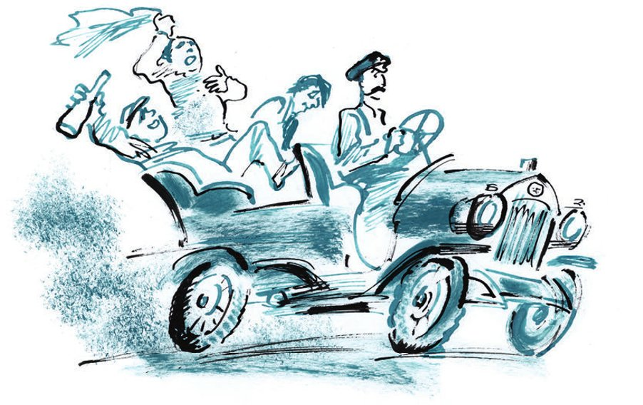
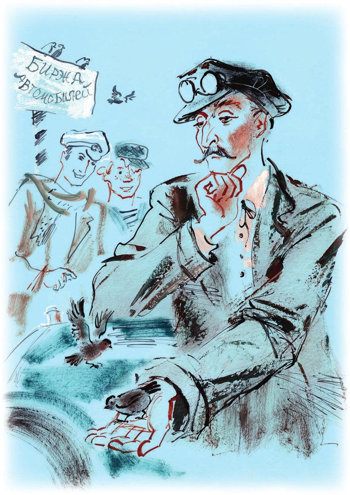
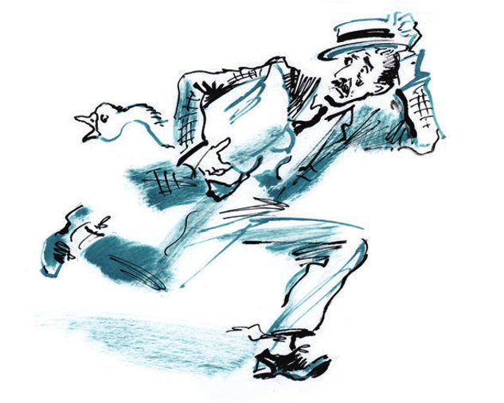

## Kapitel 3: Ihr Benzin – unsere Ideen

Ein Jahr bevor Panikowski die Konvention gebrochen hat und in einen fremden Bezirk <abbr title="eindringen (drang ein, ist eingedrungen) — проникнуть">eingedrungen ist</abbr>, ist in der Stadt Arbatow das erste Auto erschienen. Der <abbr title="der Gründer, die Gründer — основатель, основоположник">Gründer</abbr> vom Autowesen in Arbatow war ein Fahrer mit dem Namen Koslewitsch.

Ans <abbr title="das Lenkrad, die Lenkräder — руль">Lenkrad</abbr> hat ihn ein <abbr title="der Entschluss, die Entschlüsse — решение">Entschluss</abbr> gebracht: Er wollte ein neues Leben anfangen. Das alte Leben von Adam Koslewitsch war <abbr title="sündig — грешный">sündig</abbr>. Ohne Pause hat er gegen das Strafgesetzbuch der RSFSR verstoßen, und zwar gegen den Paragrafen 162. In diesem Paragrafen geht es um den heimlichen Diebstahl von fremdem <abbr title="das Eigentum — имущество, собственность">Eigentum</abbr>.

Der Paragraf hat viele Punkte. Aber der sündige Adam mochte Punkt «a» nicht: Diebstahl ohne irgendwelche technischen <abbr title="das Hilfsmittel, die Hilfsmittel — средство">Hilfsmittel</abbr>. Das war ihm zu <abbr title="primitiv — примитивный">primitiv</abbr>. Punkt «e» hat ihm auch nicht gepasst. Dafür bekommt man bis zu fünf Jahre Gefängnis, und er hat nicht gern lange im Gefängnis gesessen. Und weil er schon als Kind die Technik geliebt hat, hat er sich mit ganzer Seele dem Punkt «c» <abbr title="sich widmen — посвятить себя">gewidmet</abbr>: heimlicher Diebstahl von fremdem Eigentum mit technischen Hilfsmitteln, oder mehrmals, oder nach einer <abbr title="die Verabredung, die Verabredungen — сговор, договорённость">Verabredung</abbr> mit anderen Personen, auf Bahnhöfen, <abbr title="die Anlegestelle, die Anlegestellen — пристань">Anlegestellen</abbr>, <abbr title="der Dampfer, die Dampfer — пароход">Dampfern</abbr>, in <abbr title="der Waggon, die Waggons — вагон">Waggons</abbr> und Hotels.

Aber Koslewitsch hatte kein Glück. Man hat ihn <abbr title="schnappen — поймать, схватить">geschnappt</abbr>, wenn er seine <abbr title="geliebt — любимый">geliebten</abbr> technischen Hilfsmittel benutzt hat. Und man hat ihn geschnappt, wenn er ohne sie <abbr title="auskommen (kam aus, ist ausgekommen) — обходиться">ausgekommen ist</abbr>. Man hat ihn auf Bahnhöfen geschnappt, auf Anlegestellen, auf Dampfern und in Hotels. In Waggons hat man ihn auch geschnappt. Man hat ihn sogar geschnappt, als er in seiner <abbr title="die Verzweiflung — отчаяние">Verzweiflung</abbr> fremdes Eigentum nach Verabredung mit anderen Personen <abbr title="nehmen (nahm, hat genommen) — брать">genommen</abbr> hat.

Insgesamt hat Adam Koslewitsch ungefähr drei Jahre gesessen. Dann ist er auf einen Gedanken gekommen: Es ist viel bequemer, offen sein eigenes Eigentum zu <abbr title="sammeln — собирать, накапливать">sammeln</abbr>, als heimlich fremdes Eigentum zu stehlen. Dieser Gedanke hat seine <abbr title="rebellisch — мятежный">rebellische</abbr> Seele <abbr title="beruhigen — успокоить">beruhigt</abbr>. Er ist ein <abbr title="vorbildlich — примерный">vorbildlicher</abbr> <abbr title="der Häftling, die Häftlinge — заключённый">Häftling</abbr> geworden. Er hat <abbr title="entlarvend — разоблачительный">entlarvende</abbr> Gedichte für die Gefängniszeitung «Die Sonne geht auf und unter» geschrieben. Und er hat fleißig in der mechanischen Werkstatt von der Besserungsanstalt gearbeitet. Das <abbr title="das Strafsystem — пенитенциарная система">Strafsystem</abbr> hatte einen sehr guten <abbr title="der Einfluss, die Einflüsse — влияние">Einfluss</abbr> auf ihn. Koslewitsch, Adam Kasimirowitsch, 46 Jahre alt, aus einer Bauernfamilie aus dem früheren Kreis Tschenstochau, <abbr title="ledig — холостой">ledig</abbr>, mehrmals <abbr title="vorbestraft — судимый">vorbestraft</abbr>, ist als ehrlicher Mensch aus dem Gefängnis gekommen.

Dann hat er zwei Jahre in einer Moskauer <abbr title="die Garage, die Garagen — гараж">Garage</abbr> gearbeitet. Danach hat er <abbr title="günstig — по случаю, выгодно">günstig</abbr> ein Auto gekauft. Es war so alt, dass man nur eins denken konnte: Irgendwo hat man ein <abbr title="das Automuseum, die Automuseen — автомобильный музей">Automuseum</abbr> <abbr title="auflösen — ликвидировать">aufgelöst</abbr>. Koslewitsch hat das seltene <abbr title="das Ausstellungsstück, die Ausstellungsstücke — экспонат">Ausstellungsstück</abbr> für hundertneunzig Rubel bekommen. Aus irgendeinem Grund hat man das Auto nur zusammen mit einer <abbr title="künstlich — искусственный">künstlichen</abbr> <abbr title="die Palme, die Palmen — пальма">Palme</abbr> in einem grünen <abbr title="der Kübel, die Kübel — кадка">Kübel</abbr> verkauft. Er musste also auch die Palme kaufen. Mit der Palme war alles mehr oder weniger in Ordnung. Aber mit dem Auto hatte er lange Arbeit. Er musste auf den Märkten die fehlenden <abbr title="das Teil, die Teile — деталь, часть">Teile</abbr> suchen, die Sitze <abbr title="flicken — латать">flicken</abbr> und die ganze <abbr title="die Elektrik — электрика, электрохозяйство">Elektrik</abbr> neu machen. Am Ende hat er das Auto <abbr title="eidechsengrün — ящерично-зелёный">eidechsengrün</abbr> <abbr title="anstreichen (strich an, hat angestrichen) — покрасить">angestrichen</abbr>. Die Marke von dem Auto hat niemand gekannt. Aber Adam Kasimirowitsch hat behauptet: Das ist ein «Lorraine-Dietrich». Als <abbr title="der Beweis, die Beweise — доказательство">Beweis</abbr> hat er ein kleines <abbr title="das Kupferschild, die Kupferschilder — медная бляшка">Kupferschild</abbr> mit dem <abbr title="das Firmenzeichen, die Firmenzeichen — фабричная марка">Firmenzeichen</abbr> von Lorraine-Dietrich an den <abbr title="der Kühler, die Kühler — радиатор">Kühler</abbr> <abbr title="nageln — прибить">genagelt</abbr>. Jetzt musste er nur noch mit der privaten <abbr title="die Autovermietung — автопрокат">Autovermietung</abbr> anfangen. Davon hat Koslewitsch schon lange geträumt.

An dem Tag, an dem Adam Kasimirowitsch sein Kind zum ersten Mal zur <abbr title="die Autobörse, die Autobörsen — автомобильная биржа">Autobörse</abbr> bringen will, passiert etwas Trauriges für alle privaten Fahrer. In Moskau kommen hundertzwanzig kleine schwarze <abbr title="das Taxi, die Taxis — такси">Taxis</abbr> der Marke «Renault» an. Sie sehen aus wie <abbr title="die Pistole, die Pistolen — пистолет, браунинг">Pistolen</abbr>. Koslewitsch versucht gar nicht erst, mit ihnen zu <abbr title="konkurrieren — конкурировать">konkurrieren</abbr>. Die Palme gibt er im <abbr title="das Teehaus, die Teehäuser — чайная">Teehaus</abbr> für Kutscher «Versailles» zur <abbr title="die Aufbewahrung — хранение">Aufbewahrung</abbr> ab. Und er fährt zur Arbeit in die Provinz.

Arbatow hat keinen Autoverkehr. Das gefällt dem Fahrer, und er beschließt, für immer in der Stadt zu bleiben.

Adam Kasimirowitsch stellt sich vor, wie fleißig, fröhlich und vor allem ehrlich er auf dem <abbr title="der Acker, die Äcker — нива, поле">Acker</abbr> der Autovermietung arbeiten wird. Er stellt sich vor: An einem frühen, eisigen Morgen wartet er am Bahnhof auf den Zug aus Moskau. Er hat einen roten <abbr title="der Kuhfellmantel, die Kuhfellmäntel — доха из коровьей шкуры">Kuhfellmantel</abbr> an. Die <abbr title="die Fliegerbrille, die Fliegerbrillen — авиаторские очки">Fliegerbrille</abbr> hat er auf die Stirn geschoben. Freundlich gibt er den Gepäckträgern Zigaretten. Irgendwo hinten stehen die <abbr title="erfroren — обмёрзший">erfrorenen</abbr> Kutscher. Sie weinen vor Kälte und schütteln ihre dicken blauen <abbr title="der Mantel, die Mäntel — пальто, кафтан">Mäntel</abbr>. Aber da hört man die <abbr title="die Glocke, die Glocken — колокол">Glocke</abbr> vom Bahnhof. Das ist das <abbr title="das Signal, die Signale — сигнал">Signal</abbr>: Der Zug ist da. Die Fahrgäste kommen auf den <abbr title="der Bahnhofsplatz, die Bahnhofsplätze — привокзальная площадь">Bahnhofsplatz</abbr>. Mit zufriedenen Gesichtern bleiben sie vor dem Auto stehen. Sie haben nicht erwartet, dass die Idee der Autovermietung schon bis in das <abbr title="das Provinznest, die Provinznester — захолустье">Provinznest</abbr> Arbatow gekommen ist. Koslewitsch <abbr title="hupen — сигналить, гудеть">hupt</abbr> und <abbr title="sausen — мчаться">saust</abbr> mit den Fahrgästen zum «Haus vom Bauern».

Er hat den ganzen Tag Arbeit. Alle wollen gern mit dem <abbr title="mechanisch — механический">mechanischen</abbr> Wagen fahren. Koslewitsch und sein treuer «Lorraine-Dietrich» sind bei allen Hochzeiten, <abbr title="der Ausflug, die Ausflüge — экскурсия, прогулка">Ausflügen</abbr> und <abbr title="das Fest, die Feste — торжество, праздник">Festen</abbr> in der Stadt dabei. Aber die meiste Arbeit gibt es im Sommer. Am Sonntag fahren ganze Familien mit Koslewitsch aufs Land. Die Kinder lachen ohne Grund, der Wind <abbr title="zerren — дёргать">zerrt</abbr> an den <abbr title="der Schal, die Schals — шарф">Schals</abbr> und Bändern, die Frauen <abbr title="plappern — лопотать, болтать">plappern</abbr> fröhlich. Die Familienväter sehen den <abbr title="ledern — кожаный">ledernen</abbr> Rücken vom Fahrer mit Respekt an. Sie fragen ihn, wie es mit den Autos in den Vereinigten Staaten von Nordamerika steht. (Und zum Beispiel: Ist es wahr, dass Ford sich jeden Tag ein neues Auto kauft?)

So stellt sich Koslewitsch sein neues, wunderbares Leben in Arbatow vor. Aber die <abbr title="die Wirklichkeit — действительность">Wirklichkeit</abbr> <abbr title="zerstören — разрушать">zerstört</abbr> sehr schnell das <abbr title="das Luftschloss, die Luftschlösser — воздушный замок">Luftschloss</abbr> von Adam Kasimirowitsch – mit allen seinen <abbr title="das Türmchen, die Türmchen — башенка">Türmchen</abbr>, <abbr title="die Zugbrücke, die Zugbrücken — подъёмный мост">Zugbrücken</abbr>, <abbr title="die Wetterfahne, die Wetterfahnen — флюгер">Wetterfahnen</abbr> und der <abbr title="die Standarte, die Standarten — штандарт">Standarte</abbr>.

Zuerst <abbr title="enttäuschen — подвести, разочаровать">enttäuscht</abbr> ihn der <abbr title="der Fahrplan, die Fahrpläne — расписание, график">Fahrplan</abbr> der Eisenbahn. Die <abbr title="der Schnellzug, die Schnellzüge — скорый поезд">Schnellzüge</abbr> und <abbr title="der Kurierzug, die Kurierzüge — курьерский поезд">Kurierzüge</abbr> fahren ohne <abbr title="der Halt — остановка">Halt</abbr> durch den Bahnhof Arbatow. Sie werfen nur im Fahren die <abbr title="die Eilpost — спешная почта">Eilpost</abbr> hinaus. Die <abbr title="der Bummelzug, die Bummelzüge — смешанный, медленный поезд">Bummelzüge</abbr> kommen nur zweimal pro Woche. Sie bringen meistens kleine Leute: <abbr title="der Bittsteller, die Bittsteller — ходок, проситель">Bittsteller</abbr> und <abbr title="der Schuster, die Schuster — башмачник, сапожник">Schuster</abbr> mit <abbr title="das Bündel, die Bündel — котомка, узел">Bündeln</abbr>, <abbr title="der Leisten, die Leisten — сапожная колодка">Leisten</abbr> und <abbr title="die Bittschrift, die Bittschriften — прошение">Bittschriften</abbr>. In der Regel fahren diese Fahrgäste nicht mit dem Auto. Ausflüge und Feste gibt es nicht. Und zu Hochzeiten <abbr title="einladen (lud ein, hat eingeladen) — приглашать">lädt</abbr> man Koslewitsch nicht ein. In Arbatow nimmt man für die Hochzeit immer Kutscher. Die <abbr title="flechten (flocht, hat geflochten) — вплетать">flechten</abbr> dann Papierrosen und <abbr title="die Chrysantheme, die Chrysanthemen — хризантема">Chrysanthemen</abbr> in die <abbr title="die Mähne, die Mähnen — грива">Mähnen</abbr> von den Pferden. Das gefällt den Hochzeitsgästen sehr.

Fahrten aufs Land gibt es trotzdem viele. Aber sie sind ganz anders, als Adam Kasimirowitsch geträumt hat. Keine Kinder, keine flatternden Schals, kein fröhliches Plappern.

Schon am ersten Abend – die <abbr title="die Petroleumlampe, die Petroleumlampen — керосиновый фонарь">Petroleumlampen</abbr> geben nur wenig Licht – kommen vier Männer zu Adam Kasimirowitsch. Er hat den ganzen Tag ohne Erfolg auf dem Erlöser-Genossenschafts-Platz gestanden. Lange sehen sich die Männer schweigend das Auto an. Dann fragt einer von ihnen <abbr title="unsicher — неуверенно">unsicher</abbr>, ein <abbr title="der Bucklige, die Buckligen — горбун">Buckliger</abbr>:

— Darf jeder mitfahren?

— Jeder, — antwortet Koslewitsch. Er wundert sich, wie schüchtern die Bürger von Arbatow sind. — Fünf Rubel pro Stunde.

Die Männer flüstern. Der Fahrer hört seltsame <abbr title="der Seufzer, die Seufzer — вздох">Seufzer</abbr> und Wörter: «Fahren wir nach der Sitzung ein bisschen, Genossen? Aber geht das denn? Ein Rubel fünfundzwanzig pro Person ist nicht teuer. Warum soll das nicht gehen? …»

Und zum ersten Mal nimmt das <abbr title="geräumig — вместительный">geräumige</abbr> Auto Leute aus Arbatow in seinen <abbr title="der Schoß — лоно">Schoß</abbr> aus Stoff auf. Ein paar Minuten schweigen die Fahrgäste. Die <abbr title="die Geschwindigkeit, die Geschwindigkeiten — скорость">Geschwindigkeit</abbr>, der heiße Geruch von <abbr title="das Benzin — бензин">Benzin</abbr> und das <abbr title="das Pfeifen — свист">Pfeifen</abbr> vom Wind <abbr title="überwältigen — ошеломить, подавить">überwältigen</abbr> sie. Dann quält sie eine unklare <abbr title="die Vorahnung, die Vorahnungen — предчувствие">Vorahnung</abbr>, und sie fangen leise an zu singen: «Schnell wie die <abbr title="die Welle, die Wellen — волна">Wellen</abbr> sind die Tage von unserem Leben». Koslewitsch schaltet in den zweiten <abbr title="der Gang, die Gänge — скорость, передача">Gang</abbr>. Die düstere Form von einem <abbr title="geschlossen — закрытый">geschlossenen</abbr> Lebensmittelkiosk huscht vorbei, und das Auto springt hinaus aufs Feld, auf die Landstraße im Mondlicht.

«Mit jedem Tag wird kürzer unser Weg zum <abbr title="das Grab, die Gräber — могила">Grab</abbr>», singen die Fahrgäste <abbr title="sehnsüchtig — томно">sehnsüchtig</abbr>. Sie haben <abbr title="das Mitleid — жалость">Mitleid</abbr> mit sich selbst. Es tut ihnen leid, dass sie nie <abbr title="der Student, die Studenten — студент">Studenten</abbr> waren. Den <abbr title="der Refrain, die Refrains — припев">Refrain</abbr> singen sie laut:

Ein Gläschen, nur ein kleines, tirlim-bom-bom, tirlim-bom-bom.

— Halt! — schreit plötzlich der Bucklige. — Zurück! Meine Seele brennt.

In der Stadt holen die Fahrgäste viele weiße <abbr title="das Fläschchen, die Fläschchen — бутылочка">Fläschchen</abbr> in der Form von <abbr title="der Kegel, die Kegel — кегля">Kegeln</abbr> und eine Bürgerin mit breiten Schultern. Auf dem Feld machen sie ein <abbr title="das Lager, die Lager — бивак, лагерь">Lager</abbr>. Sie essen zu Abend, trinken Wodka dazu, und dann tanzen sie ohne Musik die Polka «Kokette».

Das nächtliche <abbr title="das Abenteuer, die Abenteuer — приключение">Abenteuer</abbr> hat Koslewitsch müde gemacht. Den ganzen Tag <abbr title="dösen — дремать">döst</abbr> er an seinem Platz am Lenkrad. Aber am Abend kommt die Gesellschaft von gestern wieder, schon etwas <abbr title="angetrunken — навеселе">angetrunken</abbr>. Sie setzen sich wieder ins Auto und rasen die ganze Nacht um die Stadt. Am dritten Tag passiert dasselbe. Die nächtlichen Feste der fröhlichen Gesellschaft mit dem Buckligen an der <abbr title="die Spitze, die Spitzen — голова, во главе">Spitze</abbr> gehen zwei Wochen lang ohne Pause weiter. Die Freuden der <abbr title="die Motorisierung — автомобилизация">Motorisierung</abbr> haben eine seltsame Wirkung auf die Kunden von Adam Kasimirowitsch: Ihre Gesichter sind <abbr title="geschwollen — опухший">geschwollen</abbr> und leuchten im Dunkeln weiß wie Kissen. Der Bucklige mit einem Stück <abbr title="die Wurst, die Würste — колбаса">Wurst</abbr> im Mund sieht aus wie ein <abbr title="der Vampir, die Vampire — вурдалак, вампир">Vampir</abbr>.

Sie werden hektisch, und mitten im <abbr title="der Spaß — веселье">Spaß</abbr> weinen sie manchmal. Einmal bringt der <abbr title="verwegen — бедовый, отчаянный">verwegene</abbr> Bucklige mit einer Droschke einen <abbr title="der Sack, die Säcke — мешок">Sack</abbr> Reis zum Auto. Am frühen Morgen fahren sie den Reis ins Dorf und tauschen ihn dort gegen <abbr title="der Selbstgebrannte — самогон">Selbstgebrannten</abbr>, den besten. An diesem Tag kommen sie gar nicht mehr in die Stadt zurück. Sie sitzen mit den Bauern auf den <abbr title="der Heuhaufen, die Heuhaufen — скирда, стог">Heuhaufen</abbr> und trinken <abbr title="Brüderschaft trinken — пить на брудершафт">Brüderschaft</abbr>. Und in der Nacht machen sie <abbr title="das Lagerfeuer, die Lagerfeuer — костёр">Lagerfeuer</abbr> und weinen besonders kläglich.

Am nächsten grauen Morgen schließt die Eisenbahner-Genossenschaft «Der Linienmann» wegen Inventur. Der Bucklige ist der Leiter von der Genossenschaft. Seine fröhlichen Freunde sind im <abbr title="der Vorstand, die Vorstände — правление">Vorstand</abbr> und in der Ladenkommission. Und wie bitter ist die <abbr title="die Überraschung, die Überraschungen — удивление, сюрприз">Überraschung</abbr> von den <abbr title="der Prüfer, die Prüfer — ревизор">Prüfern</abbr>! Im Laden gibt es kein <abbr title="das Mehl — мука">Mehl</abbr>, keinen <abbr title="der Pfeffer — перец">Pfeffer</abbr>, keine <abbr title="die Kernseife — хозяйственное мыло">Kernseife</abbr>, keine <abbr title="der Waschtrog, die Waschtröge — корыто">Waschtröge</abbr> für die Bauern, keine Stoffe und keinen Reis. Die Regale, die <abbr title="der Ladentisch, die Ladentische — прилавок">Ladentische</abbr>, die Kisten und die <abbr title="das Fässchen, die Fässchen — кадушка, бочонок">Fässchen</abbr> – alles ist leer. Nur in der Mitte vom Laden stehen auf dem Boden riesige <abbr title="der Jagdstiefel, die Jagdstiefel — охотничий сапог">Jagdstiefel</abbr>, Größe neunundvierzig, mit gelben <abbr title="die Sohle, die Sohlen — подошва">Sohlen</abbr> aus Pappe. Sie reichen fast bis zur Decke. Und in einem Glaskasten <abbr title="schimmern — мерцать">schimmert</abbr> trüb eine <abbr title="die Registrierkasse, die Registrierkassen — кассовый аппарат">Registrierkasse</abbr> der Marke «National». Sie hat die Form von einer <abbr title="die Damenbüste, die Damenbüsten — дамский бюст">Damenbüste</abbr> aus Nickel, und die Büste ist voll mit bunten <abbr title="der Knopf, die Knöpfe — кнопка">Knöpfen</abbr>. Koslewitsch bekommt nach Hause eine <abbr title="die Vorladung, die Vorladungen — повестка">Vorladung</abbr> vom <abbr title="der Untersuchungsrichter, die Untersuchungsrichter — следователь">Untersuchungsrichter</abbr>. Er soll als <abbr title="der Zeuge, die Zeugen — свидетель">Zeuge</abbr> im Fall der Genossenschaft «Der Linienmann» <abbr title="aussagen — давать показания">aussagen</abbr>.

Der Bucklige und seine Freunde kommen nicht mehr. Drei Tage steht das grüne Auto ohne Arbeit herum.

Die neuen Fahrgäste kommen, wie die ersten, im <abbr title="der Schutz — покров, защита">Schutz</abbr> der Dunkelheit. Auch sie beginnen mit einer <abbr title="harmlos — невинный, безобидный">harmlosen</abbr> Fahrt aufs Land. Aber schon nach dem ersten halben Kilometer denken sie an Wodka. Die Leute in Arbatow können sich offenbar nicht vorstellen, dass man <abbr title="nüchtern — трезвый">nüchtern</abbr> Auto fahren kann. Sie halten den Autowagen von Koslewitsch für ein <abbr title="das Nest, die Nester — гнездо">Nest</abbr> der Sünde. Dort muss man sich unbedingt wild benehmen, <abbr title="unanständig — непристойный">unanständige</abbr> Schreie <abbr title="ausstoßen (stieß aus, hat ausgestoßen) — издавать">ausstoßen</abbr> und überhaupt sein Leben <abbr title="verprassen — прожигать">verprassen</abbr>.

Erst jetzt versteht Koslewitsch, warum die Männer am Tag an seinem Platz vorbeigehen, sich <abbr title="zuzwinkern — подмигивать">zuzwinkern</abbr> und hässlich lächeln.

Alles kommt ganz anders, als Adam Kasimirowitsch gedacht hat. In der Nacht rast er mit <abbr title="einschalten — включить">eingeschalteten</abbr> <abbr title="der Scheinwerfer, die Scheinwerfer — фара">Scheinwerfern</abbr> an den <abbr title="das Wäldchen, die Wäldchen — роща">Wäldchen</abbr> vorbei. Hinter sich hört er den <abbr title="betrunken — пьяный">betrunkenen</abbr> <abbr title="der Lärm — шум, возня">Lärm</abbr> und das <abbr title="das Geheul — вопли">Geheul</abbr> von den Fahrgästen. Und am Tag sitzt er <abbr title="benommen — одуревший">benommen</abbr> vom <abbr title="der Schlafmangel — бессонница, недосып">Schlafmangel</abbr> bei den Untersuchungsrichtern und sagt als Zeuge aus. Die Leute von Arbatow verprassen ihr Leben aus irgendeinem Grund immer mit Geld, das dem Staat, der Gesellschaft und der Genossenschaft gehört. Und so fällt Koslewitsch gegen seinen Willen wieder in die <abbr title="die Tiefe, die Tiefen — пучина, глубина">Tiefe</abbr> vom Strafgesetzbuch. Diesmal in die Welt vom dritten Kapitel. Dort geht es <abbr title="lehrreich — назидательно">lehrreich</abbr> um <abbr title="das Amtsverbrechen, die Amtsverbrechen — должностное преступление">Amtsverbrechen</abbr>.

Die <abbr title="der Prozess, die Prozesse — судебный процесс">Prozesse</abbr> beginnen. Und in jedem Prozess ist Adam Kasimirowitsch der wichtigste Zeuge der <abbr title="die Anklage, die Anklagen — обвинение">Anklage</abbr>. Seine wahren Geschichten <abbr title="umhauen — сбить с ног">hauen</abbr> die <abbr title="der Angeklagte, die Angeklagten — подсудимый">Angeklagten</abbr> um. Sie ersticken an ihren Tränen und ihrem <abbr title="der Rotz — сопли">Rotz</abbr> und gestehen alles. Er <abbr title="ruinieren — погубить">ruiniert</abbr> sehr viele Ämter. Sein letztes <abbr title="das Opfer, die Opfer — жертва">Opfer</abbr> ist die <abbr title="die Filiale, die Filialen — филиал">Filiale</abbr> von der Filmorganisation des Gebiets. Sie dreht in Arbatow einen historischen Film: «Stenka Rasin und die Prinzessin». Die ganze Filiale kommt für sechs Jahre ins Gefängnis. Und der Film ist jetzt nur noch für das Gericht interessant. Man bringt ihn ins Museum der <abbr title="das Beweisstück, die Beweisstücke — вещественное доказательство">Beweisstücke</abbr>. Dort stehen schon die Jagdstiefel aus der Genossenschaft «Der Linienmann».

Danach kommt der <abbr title="der Zusammenbruch — крах">Zusammenbruch</abbr>. Alle haben vor dem grünen Auto Angst wie vor der <abbr title="die Pest — чума">Pest</abbr>. Die Bürger gehen in großem Bogen um den Erlöser-Genossenschafts-Platz herum. Dort hat Koslewitsch einen gestreiften <abbr title="der Pfahl, die Pfähle — столб">Pfahl</abbr> <abbr title="aufstellen — установить, водрузить">aufgestellt</abbr>, mit einem Schild: «Autobörse». Mehrere Monate verdient Adam keine Kopeke. Er lebt von dem Geld, das er bei den nächtlichen Fahrten <abbr title="sparen — копить, сберегать">gespart</abbr> hat.

Da bringt er <abbr title="ein Opfer bringen — пойти на жертвы">Opfer</abbr>. Auf die Tür vom Auto malt er in Weiß einen Spruch. Er findet ihn sehr <abbr title="verlockend — заманчивый">verlockend</abbr>: «Hei, ich fahr dich!» Und er senkt den Preis von fünf auf drei Rubel pro Stunde. Aber die Bürger ändern ihre <abbr title="die Taktik — тактика">Taktik</abbr> auch jetzt nicht. Der Fahrer fährt langsam durch die Stadt, hält vor den Ämtern und ruft in die Fenster:

— Was für eine Luft! Wollen wir eine Runde fahren?

Die Beamten <abbr title="sich hinauslehnen — высунуться">lehnen sich</abbr> aus den Fenstern hinaus. Hinter ihnen <abbr title="rattern — грохотать">rattern</abbr> die <abbr title="die Schreibmaschine, die Schreibmaschinen — пишущая машинка, ундервуд">Schreibmaschinen</abbr>. Sie antworten:

— Fahr doch selbst. Du <abbr title="der Mörder, die Mörder — душегуб, убийца">Mörder</abbr>!

— Warum denn Mörder? — fragt Koslewitsch und weint fast.

— Natürlich bist du ein Mörder, — antworten die <abbr title="der Angestellte, die Angestellten — служащий">Angestellten</abbr>. — Du bringst uns vor das <abbr title="das Reisegericht — выездная сессия суда">Reisegericht</abbr>.

— Dann fahrt doch mit eurem eigenen Geld! — ruft der Fahrer <abbr title="hitzig — запальчиво">hitzig</abbr>. — Mit eurem eigenen Geld!

Bei diesen Worten sehen sich die Beamten <abbr title="belustigt — юмористически, насмешливо">belustigt</abbr> an und schließen die Fenster. Mit dem eigenen Geld Auto fahren – das finden sie einfach dumm.

Der Besitzer von «Hei, ich fahr dich!» hat sich mit der ganzen Stadt <abbr title="sich verkrachen — рассориться">verkracht</abbr>. Er grüßt niemanden mehr. Er ist nervös und böse geworden. Wenn er einen <abbr title="der Sowjetangestellte, die Sowjetangestellten — совслужащий">Sowjetangestellten</abbr> in einem langen kaukasischen Hemd mit <abbr title="der Ballonärmel, die Ballonärmel — рукав-баллон">Ballonärmeln</abbr> sieht, dann fährt er von hinten an ihn heran und schreit mit bitterem Lachen:

— <abbr title="der Betrüger, die Betrüger — мошенник">Betrüger</abbr>! Gleich bringe ich euch vor ein <abbr title="das Schaugericht — показательный суд">Schaugericht</abbr>! Nach Paragraf hundertneun!

Der Sowjetangestellte <abbr title="zusammenzucken — вздрогнуть">zuckt zusammen</abbr>. Ganz gleichgültig <abbr title="zurechtrücken — поправить">rückt</abbr> er seinen <abbr title="der Gürtel, die Gürtel — пояс">Gürtel</abbr> mit dem Silberschmuck zurecht. So einen Schmuck haben sonst nur die <abbr title="das Pferdegeschirr, die Pferdegeschirre — сбруя">Pferdegeschirre</abbr> von <abbr title="das Lastpferd, die Lastpferde — ломовая лошадь">Lastpferden</abbr>. Er tut so, als ob die Schreie nicht ihm gelten, und geht schneller. Aber der rachsüchtige Koslewitsch fährt neben ihm her. Er <abbr title="ärgern — дразнить, злить">ärgert</abbr> seinen Feind und liest eintönig aus einem Strafgesetz-<abbr title="das Gebetbuch, die Gebetbücher — требник, молитвенник">Gebetbuch</abbr> für die Tasche vor:

— «Wenn ein Beamter Geld, <abbr title="die Wertsache, die Wertsachen — ценность">Wertsachen</abbr> oder anderes Eigentum <abbr title="unterschlagen (unterschlug, hat unterschlagen) — присвоить, растратить">unterschlägt</abbr>, das ihm wegen seiner <abbr title="die Stellung, die Stellungen — положение, должность">Stellung</abbr> <abbr title="anvertrauen — доверить">anvertraut</abbr> ist, dann bekommt er …»

Der Sowjetangestellte rennt feige weg. Dabei hebt er seinen <abbr title="der Hintern, die Hintern — зад">Hintern</abbr> hoch. Der Hintern ist ganz flach vom langen Sitzen auf dem Bürohocker.

— «… <abbr title="der Freiheitsentzug — лишение свободы">Freiheitsentzug</abbr>», — schreit Koslewitsch ihm nach, — «bis zu drei Jahren.»

Aber das alles bringt dem Fahrer nur eine <abbr title="moralisch — моральный">moralische</abbr> <abbr title="die Befriedigung — удовлетворение">Befriedigung</abbr>. Mit dem Geld sieht es schlecht aus. Seine <abbr title="die Ersparnisse (Pl.) — сбережения">Ersparnisse</abbr> sind fast zu Ende. Er muss eine <abbr title="die Entscheidung, die Entscheidungen — решение">Entscheidung</abbr> treffen. So kann es nicht weitergehen.

In diesem <abbr title="erhitzt — воспалённый, разгорячённый">erhitzten</abbr> Zustand sitzt Adam Kasimirowitsch eines Tages in seinem Auto. Mit <abbr title="der Ekel — отвращение">Ekel</abbr> sieht er den dummen, gestreiften Pfahl «Autobörse» an. Er versteht undeutlich: Das ehrliche Leben hat nicht geklappt. Der Auto-<abbr title="der Messias — мессия">Messias</abbr> ist zu früh gekommen, und die Bürger haben nicht an ihn geglaubt. Koslewitsch ist so tief in seine traurigen Gedanken versunken, dass er die zwei jungen Männer gar nicht bemerkt. Sie <abbr title="bewundern — любоваться, восхищаться">bewundern</abbr> schon ziemlich lange sein Auto.

— Eine <abbr title="originell — оригинальный">originelle</abbr> <abbr title="die Konstruktion, die Konstruktionen — конструкция">Konstruktion</abbr>, — sagt endlich einer von ihnen. — Die <abbr title="die Morgenröte — заря">Morgenröte</abbr> vom Automobil. Sehen Sie, Balaganow, was man aus einer einfachen <abbr title="die Nähmaschine, die Nähmaschinen — швейная машина">Nähmaschine</abbr> von Singer machen kann? Ein kleiner <abbr title="der Umbau, die Umbauten — приспособление, переделка">Umbau</abbr> – und fertig ist eine <abbr title="reizend — прелестный">reizende</abbr> <abbr title="die Garbenbindemaschine, die Garbenbindemaschinen — сноповязалка">Garbenbindemaschine</abbr> für die <abbr title="die Kolchose, die Kolchosen — колхоз">Kolchose</abbr>.

— Geh weg, — sagt Koslewitsch finster.

— Wie bitte, «geh weg»? Warum haben Sie dann auf Ihre <abbr title="die Dreschmaschine, die Dreschmaschinen — молотилка">Dreschmaschine</abbr> den Werbespruch «Hei, ich fahr dich!» geschrieben? Vielleicht möchten mein Freund und ich eine <abbr title="die Geschäftsreise, die Geschäftsreisen — деловая поездка">Geschäftsreise</abbr> machen? Vielleicht möchten wir genau so eine Hei-ich-fahr-dich-Fahrt machen.

Zum ersten Mal, seit er in Arbatow lebt, erscheint ein Lächeln auf dem Gesicht von diesem Märtyrer vom Autowesen. Er springt aus dem Auto und <abbr title="anwerfen (warf an, hat angeworfen) — завести (мотор)">wirft</abbr> <abbr title="flink — проворно">flink</abbr> den Motor an. Der Motor <abbr title="klopfen — стучать">klopft</abbr> schwer.

— Bitte sehr, — sagt er. — Wohin soll ich fahren?

— Diesmal nirgendwohin, — sagt Balaganow. — Wir haben kein Geld. Da kann man nichts machen, Genosse Mechaniker. Armut.

— Egal, steig ein! — schreit Koslewitsch verzweifelt. — Ich fahre euch umsonst. Ihr trinkt doch nicht? Ihr tanzt doch nicht nackt im Mondlicht? Hei! Ich fahr euch!

— Na gut, dann nehmen wir Ihre <abbr title="die Gastfreundschaft — гостеприимство">Gastfreundschaft</abbr> an, — sagt Ostap und setzt sich neben den Fahrer. — Sie haben einen guten Charakter, das sehe ich. Aber warum glauben Sie, dass wir nackt tanzen?

— Hier sind alle so, — antwortet der Fahrer und fährt auf die Hauptstraße. — <abbr title="der Staatsverbrecher, die Staatsverbrecher — государственный преступник">Staatsverbrecher</abbr>.

Er möchte so gern mit jemandem über sein <abbr title="das Leid — горе, страдание">Leid</abbr> sprechen. Am besten erzählt man so etwas natürlich seiner <abbr title="zart — нежный">zarten</abbr>, <abbr title="runzlig — морщинистый">runzligen</abbr> Mama. Sie hat bestimmt Mitleid. Aber Madame Koslewitsch ist schon lange tot. Sie ist vor <abbr title="der Kummer — горе">Kummer</abbr> gestorben, als sie gehört hat: Ihr Sohn Adam wird langsam als <abbr title="der Rückfalldieb, die Rückfalldiebe — вор-рецидивист">Rückfalldieb</abbr> bekannt. Deshalb erzählt der Fahrer den neuen Fahrgästen die ganze Geschichte vom <abbr title="der Untergang — падение, гибель">Untergang</abbr> der Stadt Arbatow. Unter ihren <abbr title="die Trümmer (Pl.) — развалины, обломки">Trümmern</abbr> <abbr title="zappeln — барахтаться">zappelt</abbr> jetzt sein grünes Auto.

— Wohin soll ich jetzt fahren? — schließt Koslewitsch traurig. — Wohin soll ich gehen?

Ostap wartet einen Moment. Er sieht seinen rothaarigen <abbr title="der Kompagnon, die Kompagnons — компаньон">Kompagnon</abbr> <abbr title="bedeutungsvoll — значительно">bedeutungsvoll</abbr> an und sagt:

— Ihr ganzes Unglück kommt daher, dass Sie die Wahrheit suchen. Sie sind einfach ein <abbr title="das Lämmchen, die Lämmchen — ягнёнок">Lämmchen</abbr>, ein <abbr title="gescheitert — неудавшийся">gescheiterter</abbr> Baptist. Es ist traurig, unter Fahrern so eine <abbr title="dekadent — упадочнический">dekadente</abbr> <abbr title="die Stimmung, die Stimmungen — настроение">Stimmung</abbr> zu sehen. Sie haben ein Auto – und Sie wissen nicht, wohin Sie fahren sollen. Uns geht es schlechter: Wir haben kein Auto. Und trotzdem wissen wir, wohin wir fahren. Wollen wir zusammen fahren?

— Wohin? — fragt der Fahrer.

— Nach Tschernomorsk, — sagt Ostap. — Wir haben dort eine kleine, <abbr title="intim — интимный, личный">intime</abbr> Angelegenheit. Und für Sie gibt es dort auch Arbeit. In Tschernomorsk <abbr title="schätzen — ценить">schätzt</abbr> man <abbr title="das Altertum, die Altertümer — предмет старины, древность">Altertümer</abbr>, und man fährt gern damit. Kommen Sie mit.

Zuerst lächelt Adam Kasimirowitsch nur, wie eine <abbr title="die Witwe, die Witwen — вдова">Witwe</abbr>, der nichts im Leben mehr Freude macht. Aber Bender <abbr title="sparen an + Dat. — жалеть, экономить">spart</abbr> nicht an Farben. Vor dem verlegenen Fahrer <abbr title="ausmalen — расписывать">malt</abbr> er wunderbare <abbr title="die Ferne, die Fernen — даль">Fernen</abbr> aus und färbt sie sofort hellblau und rosa.

— Und in Arbatow haben Sie nichts zu verlieren als Ihre <abbr title="die Schneekette, die Schneeketten — запасная цепь (для колёс)">Schneeketten</abbr>. Unterwegs müssen Sie nicht <abbr title="hungern — голодать">hungern</abbr>. Darum kümmere ich mich. Ihr Benzin – unsere Ideen.

Koslewitsch hält das Auto an. Er <abbr title="sich sträuben — упираться">sträubt sich</abbr> immer noch ein bisschen und sagt <abbr title="mürrisch — хмуро">mürrisch</abbr>:

— Das Benzin reicht nicht.

— Reicht es für fünfzig Kilometer?

— Es reicht für achtzig.

— Dann ist alles in Ordnung. Ich habe Ihnen ja schon gesagt: An Ideen und Gedanken habe ich keinen Mangel. Genau nach sechzig Kilometern wartet direkt auf der Straße ein großes <abbr title="eisern — железный">eisernes</abbr> Fass mit <abbr title="das Flugbenzin — авиационный бензин">Flugbenzin</abbr> auf Sie. Mögen Sie Flugbenzin?

— Ja, — antwortet Koslewitsch schüchtern.

Plötzlich ist das Leben für ihn leicht und fröhlich. Er möchte sofort nach Tschernomorsk fahren.

— Und dieses Fass, — schließt Ostap, — bekommen Sie ganz <abbr title="kostenlos — бесплатно">kostenlos</abbr>. Ich sage noch mehr: Man bittet Sie sogar, dieses Benzin <abbr title="annehmen (nahm an, hat angenommen) — принять">anzunehmen</abbr>.

— Was für Benzin? — flüstert Balaganow. — Was <abbr title="Quatsch erzählen — плести чушь">erzählen Sie da für einen Quatsch</abbr>?

Ostap sieht die orangen <abbr title="die Sommersprosse, die Sommersprossen — веснушка">Sommersprossen</abbr> auf dem Gesicht von seinem Milchbruder <abbr title="würdevoll — важно">würdevoll</abbr> an. Genauso leise antwortet er:

— Menschen, die keine Zeitung lesen, muss man moralisch sofort töten. Ihnen lasse ich das Leben nur, weil ich hoffe, dass ich Sie <abbr title="umerziehen (erzog um, hat umerzogen) — перевоспитать">umerziehen</abbr> kann.

Ostap erklärt nicht, was das Zeitunglesen mit einem großen Fass Benzin zu tun hat, das angeblich auf der Straße liegt.

— Ich <abbr title="erklären — объявлять">erkläre</abbr> die große Schnellfahrt Arbatow – Tschernomorsk für <abbr title="eröffnen — открыть">eröffnet</abbr>, — sagt Ostap feierlich. — Zum <abbr title="der Kommandeur, die Kommandeure — командор, командир">Kommandeur</abbr> der Fahrt <abbr title="ernennen (ernannte, hat ernannt) — назначать">ernenne</abbr> ich mich selbst. Fahrer vom Auto wird … wie heißen Sie? … Adam Koslewitsch. Bürger Balaganow wird <abbr title="der Bordmechaniker, die Bordmechaniker — бортмеханик">Bordmechaniker</abbr>. Er ist außerdem das <abbr title="das Mädchen für alles — прислуга за всё">Mädchen für alles</abbr>. Nur eins, Koslewitsch: Den Spruch «Hei, ich fahr dich!» müssen Sie sofort <abbr title="übermalen — закрасить">übermalen</abbr>. Wir brauchen keine besonderen <abbr title="das Kennzeichen, die Kennzeichen — примета">Kennzeichen</abbr>.

Zwei Stunden später rollt das Auto mit einem frischen dunkelgrünen <abbr title="der Fleck, die Flecken — пятно">Fleck</abbr> an der Seite langsam aus der Garage. Zum letzten Mal fährt es durch die Straßen von der Stadt Arbatow. In den Augen von Koslewitsch leuchtet Hoffnung. Neben ihm sitzt Balaganow. Er <abbr title="polieren — натирать, полировать">poliert</abbr> mit einem <abbr title="der Lappen, die Lappen — тряпка">Lappen</abbr> <abbr title="eifrig — ревностно">eifrig</abbr> die Teile aus Messing. Seine neue Arbeit als Bordmechaniker nimmt er sehr ernst. Der Kommandeur der Fahrt lümmelt sich auf dem rotbraunen Sitz. Zufrieden sieht er seine neuen <abbr title="der Untergebene, die Untergebenen — подчинённый">Untergebenen</abbr> an.

— Adam! — schreit er laut über das <abbr title="das Knirschen — скрежет">Knirschen</abbr> vom Motor. — Wie heißt Ihr <abbr title="der Karren, die Karren — тележка, колымага">Karren</abbr>?

— «Lorraine-Dietrich», — antwortet Koslewitsch.

— Was ist denn das für ein Name? Ein Auto muss wie ein <abbr title="das Kriegsschiff, die Kriegsschiffe — военный корабль">Kriegsschiff</abbr> einen eigenen Namen haben. Ihr «Lorraine-Dietrich» hat eine <abbr title="bemerkenswert — замечательный">bemerkenswerte</abbr> Geschwindigkeit und <abbr title="edel — благородный">edle</abbr>, schöne <abbr title="die Linie, die Linien — линия">Linien</abbr>. Deshalb <abbr title="vorschlagen (schlug vor, hat vorgeschlagen) — предлагать">schlage</abbr> ich vor: Das Auto bekommt den Namen «Antilope-Gnu». Wer ist dagegen? <abbr title="einstimmig — единогласно">Einstimmig</abbr>.

Die grüne «Antilope» <abbr title="quietschen — скрипеть">quietscht</abbr> mit allen ihren Teilen. Sie rast über die äußere Fahrbahn vom Boulevard der Jungen Talente und fliegt auf den Marktplatz.

Dort sieht die <abbr title="die Besatzung, die Besatzungen — экипаж">Besatzung</abbr> der «Antilope» ein seltsames Bild. Ein Mann rennt vom Platz zur <abbr title="die Chaussee, die Chausseen — шоссе">Chaussee</abbr>. Er ist <abbr title="gebückt — согнувшись">gebückt</abbr> und hat eine weiße <abbr title="die Gans, die Gänse — гусь">Gans</abbr> unter dem Arm. Mit der linken Hand hält er einen harten Strohhut auf dem Kopf fest. Hinter ihm läuft eine große <abbr title="die Menge, die Mengen — толпа">Menge</abbr> und schreit. Der Mann sieht sich oft um. Auf seinem <abbr title="würdig — благообразный, достойный">würdigen</abbr> Schauspielergesicht sieht man das Entsetzen.

— Panikowski rennt! — schreit Balaganow.

— Die zweite <abbr title="die Phase, die Phasen — стадия">Phase</abbr> vom Gänsediebstahl, — sagt Ostap kalt. — Die dritte Phase beginnt, wenn man den <abbr title="der Schuldige, die Schuldigen — виновный">Schuldigen</abbr> <abbr title="fangen (fing, hat gefangen) — ловить, поймать">fängt</abbr>. Dazu gehören <abbr title="empfindlich — чувствительный">empfindliche</abbr> <abbr title="die Prügel (Pl.) — побои">Prügel</abbr>.

Panikowski ahnt die dritte Phase offenbar, denn er rennt, so schnell er kann. Vor Angst lässt er die Gans nicht los. Und das macht seine <abbr title="der Verfolger, die Verfolger — преследователь">Verfolger</abbr> sehr <abbr title="wütend — злой, раздражённый">wütend</abbr>.

— Paragraf 116, — sagt Koslewitsch <abbr title="auswendig — наизусть">auswendig</abbr>. — Heimlicher oder auch offener Diebstahl von großem <abbr title="das Vieh — скот">Vieh</abbr> bei der arbeitenden Bevölkerung in <abbr title="die Landwirtschaft — земледелие, сельское хозяйство">Landwirtschaft</abbr> und <abbr title="die Viehzucht — скотоводство">Viehzucht</abbr>.

Balaganow lacht laut. Es freut ihn, dass der Konventionsbrecher seine gerechte Strafe bekommt.

Das Auto fährt durch die <abbr title="lärmend — галдящий">lärmende</abbr> Menge und kommt auf die Chaussee.

— Hilfe! — schreit Panikowski, als die «Antilope» neben ihm ist.

— Der liebe Gott gibt dir was, — antwortet Balaganow und <abbr title="sich beugen — наклоняться, свешиваться">beugt sich</abbr> aus dem Auto.

Das Auto <abbr title="einhüllen — окутать">hüllt</abbr> Panikowski in eine <abbr title="die Wolke, die Wolken — облако, клуб">Wolke</abbr> aus rotem Staub ein.

— Nehmen Sie mich mit, — <abbr title="heulen — вопить, выть">heult</abbr> Panikowski mit letzter Kraft. Er rennt neben dem Auto her. — Ich bin gut.

Die Stimmen von den Verfolgern werden zu einem <abbr title="feindlich — недоброжелательный, враждебный">feindlichen</abbr> <abbr title="das Brummen — гул">Brummen</abbr>.

— Sollen wir den Mistkerl mitnehmen? — fragt Ostap.

— Nein, — antwortet Balaganow <abbr title="grausam — жестоко">grausam</abbr>. — Soll er nächstes Mal wissen, dass man Konventionen nicht bricht.

Aber Ostap hat schon entschieden.

— Lass den Vogel los! — schreit er Panikowski zu. Und zum Fahrer sagt er: — Langsam fahren.

Panikowski <abbr title="gehorchen — повиноваться">gehorcht</abbr> sofort. Die Gans steht <abbr title="unzufrieden — недовольно">unzufrieden</abbr> vom Boden auf, <abbr title="sich kratzen — чесаться">kratzt sich</abbr> und geht zurück in die Stadt, als ob nichts passiert ist.

— Steigen Sie ein, — sagt Ostap. — Zum Teufel mit Ihnen! Aber <abbr title="sündigen — грешить">sündigen</abbr> Sie nicht mehr, sonst reiße ich Ihnen die Arme <abbr title="mit der Wurzel — с корнем">mit der Wurzel</abbr> aus.

Panikowski bewegt schnell die Beine und greift nach der <abbr title="die Karosserie, die Karosserien — кузов">Karosserie</abbr>. Dann legt er sich mit dem Bauch auf den Rand, rollt ins Auto wie ein Schwimmer in ein Boot und fällt auf den Boden. Seine <abbr title="die Manschette, die Manschetten — манжета">Manschetten</abbr> klappern.

— Volle Fahrt, — kommandiert Ostap. — Die Sitzung geht weiter.

Balaganow drückt auf die <abbr title="die Gummibirne, die Gummibirnen — резиновая груша">Gummibirne</abbr>. Aus der Hupe aus Messing kommen <abbr title="altmodisch — старомодный">altmodische</abbr>, fröhliche Töne, die plötzlich <abbr title="abbrechen (brach ab, ist abgebrochen) — обрываться">abbrechen</abbr>:

Matchiche ist ein reizender Tanz. Ta-ra-ta …

Matchiche ist ein reizender Tanz. Ta-ra-ta …

Und die «Antilope-Gnu» rast hinaus aufs wilde Feld, dem Fass mit Flugbenzin entgegen.

---

### Neue Wörter

- **eindringen (drang ein, ist eingedrungen)** — проникнуть
- **der Gründer, die Gründer** — основатель, основоположник
- **das Lenkrad, die Lenkräder** — руль
- **der Entschluss, die Entschlüsse** — решение
- **sündig** — грешный
- **das Eigentum** — имущество, собственность
- **das Hilfsmittel, die Hilfsmittel** — средство
- **primitiv** — примитивный
- **sich widmen** — посвятить себя
- **die Verabredung, die Verabredungen** — сговор, договорённость
- **die Anlegestelle, die Anlegestellen** — пристань
- **der Dampfer, die Dampfer** — пароход
- **der Waggon, die Waggons** — вагон
- **schnappen** — поймать, схватить
- **geliebt** — любимый
- **auskommen (kam aus, ist ausgekommen)** — обходиться
- **die Verzweiflung** — отчаяние
- **nehmen (nahm, hat genommen)** — брать
- **sammeln** — собирать, накапливать
- **rebellisch** — мятежный
- **beruhigen** — успокоить
- **vorbildlich** — примерный
- **der Häftling, die Häftlinge** — заключённый
- **entlarvend** — разоблачительный
- **das Strafsystem** — пенитенциарная система
- **der Einfluss, die Einflüsse** — влияние
- **ledig** — холостой
- **vorbestraft** — судимый
- **die Garage, die Garagen** — гараж
- **günstig** — по случаю, выгодно
- **das Automuseum, die Automuseen** — автомобильный музей
- **auflösen** — ликвидировать
- **das Ausstellungsstück, die Ausstellungsstücke** — экспонат
- **künstlich** — искусственный
- **die Palme, die Palmen** — пальма
- **der Kübel, die Kübel** — кадка
- **das Teil, die Teile** — деталь, часть
- **flicken** — латать
- **die Elektrik** — электрика, электрохозяйство
- **eidechsengrün** — ящерично-зелёный
- **anstreichen (strich an, hat angestrichen)** — покрасить
- **der Beweis, die Beweise** — доказательство
- **das Kupferschild, die Kupferschilder** — медная бляшка
- **das Firmenzeichen, die Firmenzeichen** — фабричная марка
- **der Kühler, die Kühler** — радиатор
- **nageln** — прибить
- **die Autovermietung** — автопрокат
- **die Autobörse, die Autobörsen** — автомобильная биржа
- **das Taxi, die Taxis** — такси
- **die Pistole, die Pistolen** — пистолет, браунинг
- **konkurrieren** — конкурировать
- **das Teehaus, die Teehäuser** — чайная
- **die Aufbewahrung** — хранение
- **der Acker, die Äcker** — нива, поле
- **der Kuhfellmantel, die Kuhfellmäntel** — доха из коровьей шкуры
- **die Fliegerbrille, die Fliegerbrillen** — авиаторские очки
- **erfroren** — обмёрзший
- **der Mantel, die Mäntel** — пальто, кафтан
- **die Glocke, die Glocken** — колокол
- **das Signal, die Signale** — сигнал
- **der Bahnhofsplatz, die Bahnhofsplätze** — привокзальная площадь
- **das Provinznest, die Provinznester** — захолустье
- **hupen** — сигналить, гудеть
- **sausen** — мчаться
- **mechanisch** — механический
- **der Ausflug, die Ausflüge** — экскурсия, прогулка
- **das Fest, die Feste** — торжество, праздник
- **zerren** — дёргать
- **der Schal, die Schals** — шарф
- **plappern** — лопотать, болтать
- **ledern** — кожаный
- **die Wirklichkeit** — действительность
- **zerstören** — разрушать
- **das Luftschloss, die Luftschlösser** — воздушный замок
- **das Türmchen, die Türmchen** — башенка
- **die Zugbrücke, die Zugbrücken** — подъёмный мост
- **die Wetterfahne, die Wetterfahnen** — флюгер
- **die Standarte, die Standarten** — штандарт
- **enttäuschen** — подвести, разочаровать
- **der Fahrplan, die Fahrpläne** — расписание, график
- **der Schnellzug, die Schnellzüge** — скорый поезд
- **der Kurierzug, die Kurierzüge** — курьерский поезд
- **der Halt** — остановка
- **die Eilpost** — спешная почта
- **der Bummelzug, die Bummelzüge** — смешанный, медленный поезд
- **der Bittsteller, die Bittsteller** — ходок, проситель
- **der Schuster, die Schuster** — башмачник, сапожник
- **das Bündel, die Bündel** — котомка, узел
- **der Leisten, die Leisten** — сапожная колодка
- **die Bittschrift, die Bittschriften** — прошение
- **einladen (lud ein, hat eingeladen)** — приглашать
- **flechten (flocht, hat geflochten)** — вплетать
- **die Chrysantheme, die Chrysanthemen** — хризантема
- **die Mähne, die Mähnen** — грива
- **die Petroleumlampe, die Petroleumlampen** — керосиновый фонарь
- **unsicher** — неуверенно
- **der Bucklige, die Buckligen** — горбун
- **der Seufzer, die Seufzer** — вздох
- **geräumig** — вместительный
- **der Schoß** — лоно
- **die Geschwindigkeit, die Geschwindigkeiten** — скорость
- **das Benzin** — бензин
- **das Pfeifen** — свист
- **überwältigen** — ошеломить, подавить
- **die Vorahnung, die Vorahnungen** — предчувствие
- **die Welle, die Wellen** — волна
- **der Gang, die Gänge** — скорость, передача
- **geschlossen** — закрытый
- **das Grab, die Gräber** — могила
- **sehnsüchtig** — томно
- **das Mitleid** — жалость
- **der Student, die Studenten** — студент
- **der Refrain, die Refrains** — припев
- **das Fläschchen, die Fläschchen** — бутылочка
- **der Kegel, die Kegel** — кегля
- **das Lager, die Lager** — бивак, лагерь
- **das Abenteuer, die Abenteuer** — приключение
- **dösen** — дремать
- **angetrunken** — навеселе
- **die Spitze, die Spitzen** — голова, во главе
- **die Motorisierung** — автомобилизация
- **geschwollen** — опухший
- **die Wurst, die Würste** — колбаса
- **der Vampir, die Vampire** — вурдалак, вампир
- **der Spaß** — веселье
- **verwegen** — бедовый, отчаянный
- **der Sack, die Säcke** — мешок
- **der Selbstgebrannte** — самогон
- **der Heuhaufen, die Heuhaufen** — скирда, стог
- **Brüderschaft trinken** — пить на брудершафт
- **das Lagerfeuer, die Lagerfeuer** — костёр
- **der Vorstand, die Vorstände** — правление
- **die Überraschung, die Überraschungen** — удивление, сюрприз
- **der Prüfer, die Prüfer** — ревизор
- **das Mehl** — мука
- **der Pfeffer** — перец
- **die Kernseife** — хозяйственное мыло
- **der Waschtrog, die Waschtröge** — корыто
- **der Ladentisch, die Ladentische** — прилавок
- **das Fässchen, die Fässchen** — кадушка, бочонок
- **der Jagdstiefel, die Jagdstiefel** — охотничий сапог
- **die Sohle, die Sohlen** — подошва
- **schimmern** — мерцать
- **die Registrierkasse, die Registrierkassen** — кассовый аппарат
- **die Damenbüste, die Damenbüsten** — дамский бюст
- **der Knopf, die Knöpfe** — кнопка
- **die Vorladung, die Vorladungen** — повестка
- **der Untersuchungsrichter, die Untersuchungsrichter** — следователь
- **der Zeuge, die Zeugen** — свидетель
- **aussagen** — давать показания
- **der Schutz** — покров, защита
- **harmlos** — невинный, безобидный
- **nüchtern** — трезвый
- **das Nest, die Nester** — гнездо
- **unanständig** — непристойный
- **ausstoßen (stieß aus, hat ausgestoßen)** — издавать
- **verprassen** — прожигать
- **zuzwinkern** — подмигивать
- **einschalten** — включить
- **der Scheinwerfer, die Scheinwerfer** — фара
- **das Wäldchen, die Wäldchen** — роща
- **betrunken** — пьяный
- **der Lärm** — шум, возня
- **das Geheul** — вопли
- **benommen** — одуревший
- **der Schlafmangel** — бессонница, недосып
- **die Tiefe, die Tiefen** — пучина, глубина
- **lehrreich** — назидательно
- **das Amtsverbrechen, die Amtsverbrechen** — должностное преступление
- **der Prozess, die Prozesse** — судебный процесс
- **die Anklage, die Anklagen** — обвинение
- **umhauen** — сбить с ног
- **der Angeklagte, die Angeklagten** — подсудимый
- **der Rotz** — сопли
- **ruinieren** — погубить
- **das Opfer, die Opfer** — жертва
- **die Filiale, die Filialen** — филиал
- **das Beweisstück, die Beweisstücke** — вещественное доказательство
- **der Zusammenbruch** — крах
- **die Pest** — чума
- **der Pfahl, die Pfähle** — столб
- **aufstellen** — установить, водрузить
- **sparen** — копить, сберегать
- **ein Opfer bringen** — пойти на жертвы
- **verlockend** — заманчивый
- **die Taktik** — тактика
- **sich hinauslehnen** — высунуться
- **rattern** — грохотать
- **die Schreibmaschine, die Schreibmaschinen** — пишущая машинка, ундервуд
- **der Mörder, die Mörder** — душегуб, убийца
- **der Angestellte, die Angestellten** — служащий
- **das Reisegericht** — выездная сессия суда
- **hitzig** — запальчиво
- **belustigt** — юмористически, насмешливо
- **sich verkrachen** — рассориться
- **der Sowjetangestellte, die Sowjetangestellten** — совслужащий
- **der Ballonärmel, die Ballonärmel** — рукав-баллон
- **der Betrüger, die Betrüger** — мошенник
- **das Schaugericht** — показательный суд
- **zusammenzucken** — вздрогнуть
- **zurechtrücken** — поправить
- **der Gürtel, die Gürtel** — пояс
- **das Pferdegeschirr, die Pferdegeschirre** — сбруя
- **das Lastpferd, die Lastpferde** — ломовая лошадь
- **ärgern** — дразнить, злить
- **das Gebetbuch, die Gebetbücher** — требник, молитвенник
- **die Wertsache, die Wertsachen** — ценность
- **unterschlagen (unterschlug, hat unterschlagen)** — присвоить, растратить
- **die Stellung, die Stellungen** — положение, должность
- **anvertrauen** — доверить
- **der Hintern, die Hintern** — зад
- **der Freiheitsentzug** — лишение свободы
- **moralisch** — моральный
- **die Befriedigung** — удовлетворение
- **die Ersparnisse (Pl.)** — сбережения
- **die Entscheidung, die Entscheidungen** — решение
- **erhitzt** — воспалённый, разгорячённый
- **der Ekel** — отвращение
- **der Messias** — мессия
- **bewundern** — любоваться, восхищаться
- **originell** — оригинальный
- **die Konstruktion, die Konstruktionen** — конструкция
- **die Morgenröte** — заря
- **die Nähmaschine, die Nähmaschinen** — швейная машина
- **der Umbau, die Umbauten** — приспособление, переделка
- **reizend** — прелестный
- **die Garbenbindemaschine, die Garbenbindemaschinen** — сноповязалка
- **die Kolchose, die Kolchosen** — колхоз
- **die Dreschmaschine, die Dreschmaschinen** — молотилка
- **die Geschäftsreise, die Geschäftsreisen** — деловая поездка
- **anwerfen (warf an, hat angeworfen)** — завести (мотор)
- **flink** — проворно
- **klopfen** — стучать
- **die Gastfreundschaft** — гостеприимство
- **der Staatsverbrecher, die Staatsverbrecher** — государственный преступник
- **das Leid** — горе, страдание
- **zart** — нежный
- **runzlig** — морщинистый
- **der Kummer** — горе
- **der Rückfalldieb, die Rückfalldiebe** — вор-рецидивист
- **der Untergang** — падение, гибель
- **die Trümmer (Pl.)** — развалины, обломки
- **zappeln** — барахтаться
- **der Kompagnon, die Kompagnons** — компаньон
- **bedeutungsvoll** — значительно
- **das Lämmchen, die Lämmchen** — ягнёнок
- **gescheitert** — неудавшийся
- **dekadent** — упадочнический
- **die Stimmung, die Stimmungen** — настроение
- **intim** — интимный, личный
- **schätzen** — ценить
- **das Altertum, die Altertümer** — предмет старины, древность
- **die Witwe, die Witwen** — вдова
- **sparen an + Dat.** — жалеть, экономить
- **ausmalen** — расписывать
- **die Ferne, die Fernen** — даль
- **die Schneekette, die Schneeketten** — запасная цепь (для колёс)
- **hungern** — голодать
- **sich sträuben** — упираться
- **mürrisch** — хмуро
- **eisern** — железный
- **das Flugbenzin** — авиационный бензин
- **kostenlos** — бесплатно
- **annehmen (nahm an, hat angenommen)** — принять
- **Quatsch erzählen** — плести чушь
- **die Sommersprosse, die Sommersprossen** — веснушка
- **würdevoll** — важно
- **umerziehen (erzog um, hat umerzogen)** — перевоспитать
- **erklären** — объявлять
- **eröffnen** — открыть
- **der Kommandeur, die Kommandeure** — командор, командир
- **ernennen (ernannte, hat ernannt)** — назначать
- **der Bordmechaniker, die Bordmechaniker** — бортмеханик
- **das Mädchen für alles** — прислуга за всё
- **übermalen** — закрасить
- **das Kennzeichen, die Kennzeichen** — примета
- **der Fleck, die Flecken** — пятно
- **polieren** — натирать, полировать
- **der Lappen, die Lappen** — тряпка
- **eifrig** — ревностно
- **der Untergebene, die Untergebenen** — подчинённый
- **das Knirschen** — скрежет
- **der Karren, die Karren** — тележка, колымага
- **das Kriegsschiff, die Kriegsschiffe** — военный корабль
- **bemerkenswert** — замечательный
- **edel** — благородный
- **die Linie, die Linien** — линия
- **vorschlagen (schlug vor, hat vorgeschlagen)** — предлагать
- **einstimmig** — единогласно
- **quietschen** — скрипеть
- **die Besatzung, die Besatzungen** — экипаж
- **die Chaussee, die Chausseen** — шоссе
- **gebückt** — согнувшись
- **die Gans, die Gänse** — гусь
- **die Menge, die Mengen** — толпа
- **würdig** — благообразный, достойный
- **die Phase, die Phasen** — стадия
- **der Schuldige, die Schuldigen** — виновный
- **fangen (fing, hat gefangen)** — ловить, поймать
- **empfindlich** — чувствительный
- **die Prügel (Pl.)** — побои
- **der Verfolger, die Verfolger** — преследователь
- **wütend** — злой, раздражённый
- **auswendig** — наизусть
- **das Vieh** — скот
- **die Landwirtschaft** — земледелие, сельское хозяйство
- **die Viehzucht** — скотоводство
- **lärmend** — галдящий
- **sich beugen** — наклоняться, свешиваться
- **einhüllen** — окутать
- **die Wolke, die Wolken** — облако, клуб
- **heulen** — вопить, выть
- **feindlich** — недоброжелательный, враждебный
- **das Brummen** — гул
- **grausam** — жестоко
- **gehorchen** — повиноваться
- **unzufrieden** — недовольно
- **sich kratzen** — чесаться
- **sündigen** — грешить
- **mit der Wurzel** — с корнем
- **die Karosserie, die Karosserien** — кузов
- **die Manschette, die Manschetten** — манжета
- **die Gummibirne, die Gummibirnen** — резиновая груша
- **altmodisch** — старомодный
- **abbrechen (brach ab, ist abgebrochen)** — обрываться

[← Zurück](kapitel-03.md) · [Inhalt](README.md) · [Weiter →](kapitel-05.md)
