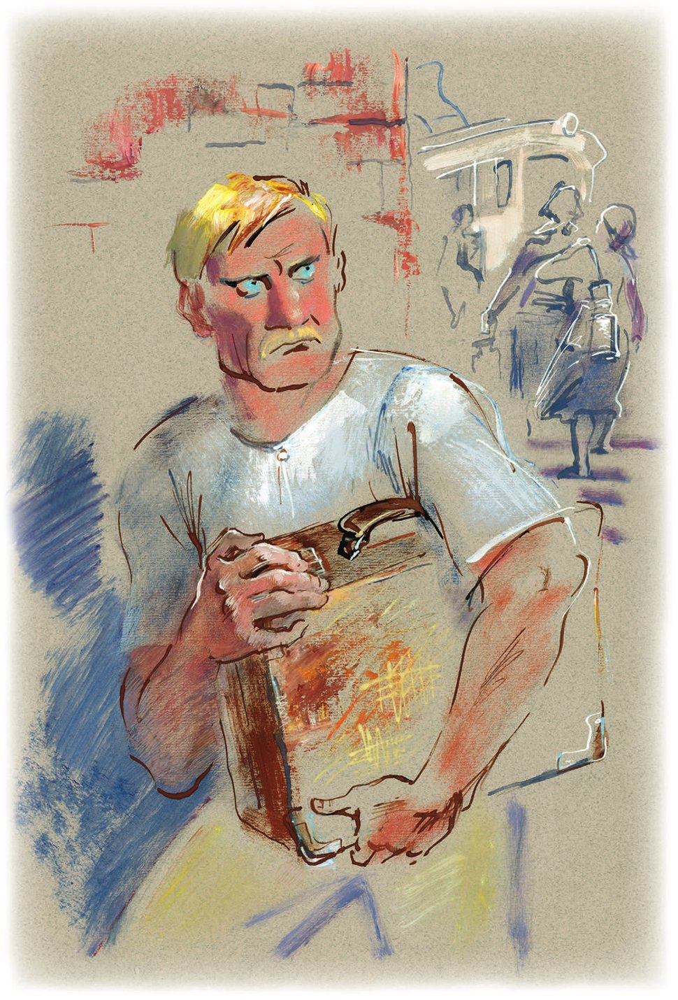

## Kapitel 4: Ein ganz gewöhnliches Köfferchen

Ein Mann kommt mit gesenktem Kopf aus der niedrigen <abbr title="die Pforte, die Pforten — калитка">Pforte</abbr> von Haus Nummer 16. Er hat keinen Hut. Er trägt eine graue Hose aus Segeltuch, <abbr title="die Ledersandale, die Ledersandalen — кожаная сандалия">Ledersandalen</abbr> an den nackten Füßen, wie ein <abbr title="der Mönch, die Mönche — монах">Mönch</abbr>, und ein weißes Hemd ohne <abbr title="der Kragen, die Kragen — воротник">Kragen</abbr>. Auf dem Bürgersteig aus bläulichen <abbr title="die Steinplatte, die Steinplatten — каменная плита">Steinplatten</abbr> bleibt er stehen und sagt leise:

— Heute ist Freitag. Also muss ich wieder zum Bahnhof.

Nach diesen Worten dreht sich der Mann in den Sandalen schnell um. Er hat das Gefühl: Hinter ihm steht ein Bürger mit dem Blechgesicht von einem <abbr title="der Spitzel, die Spitzel — соглядатай, шпик">Spitzel</abbr>. Aber die Kleine Tangentenstraße ist ganz leer.

Der Junimorgen fängt gerade erst an. Die <abbr title="die Akazie, die Akazien — акация">Akazien</abbr> zittern ein bisschen und lassen kalten, <abbr title="bleigrau — оловянный, свинцово-серый">bleigrauen</abbr> <abbr title="der Tau — роса">Tau</abbr> auf die flachen Steine fallen. Die kleinen Vögel auf der Straße <abbr title="zwitschern — щебетать">zwitschern</abbr> irgendeinen fröhlichen Unsinn. Am Ende der Straße, unten, hinter den Dächern, <abbr title="lodern — пылать">lodert</abbr> das schwere Meer, wie aus <abbr title="das Metall, die Metalle — металл">Metall</abbr> <abbr title="gießen (goss, hat gegossen) — лить, отливать">gegossen</abbr>. Junge Hunde sehen sich traurig um und klettern mit klappernden Krallen auf die <abbr title="die Mülltonne, die Mülltonnen — мусорный ящик">Mülltonnen</abbr>. Die Stunde der Hausmeister ist schon vorbei. Die Stunde der <abbr title="die Milchfrau, die Milchfrauen — молочница">Milchfrauen</abbr> hat noch nicht begonnen.

Es ist die Zeit zwischen fünf und sechs Uhr. Die Hausmeister haben genug mit ihren <abbr title="stachelig — колючий">stacheligen</abbr> <abbr title="der Besen, die Besen — метла">Besen</abbr> gekehrt und sind schon in ihre <abbr title="das Zelt, die Zelte — шатёр">Zelte</abbr> gegangen. In der Stadt ist es hell, sauber und ruhig wie in der <abbr title="die Staatsbank — государственный банк">Staatsbank</abbr>. In so einem Moment möchte man weinen und glauben, dass <abbr title="die Sauermilch — простокваша">Sauermilch</abbr> wirklich gesünder und leckerer ist als <abbr title="der Kornschnaps — хлебное вино, водка">Kornschnaps</abbr>. Aber schon hört man von weitem einen <abbr title="der Donner — гром">Donner</abbr>: Die Milchfrauen steigen mit ihren <abbr title="die Milchkanne, die Milchkannen — бидон">Milchkannen</abbr> aus den Vorortzügen. Gleich <abbr title="sich stürzen — броситься">stürzen</abbr> sie sich in die Stadt. Auf den <abbr title="die Hintertreppe, die Hintertreppen — чёрная лестница">Hintertreppen</abbr> fangen sie den <abbr title="üblich — обычный">üblichen</abbr> Streit mit den <abbr title="die Hausfrau, die Hausfrauen — домохозяйка">Hausfrauen</abbr> an. Einen Moment lang sieht man Arbeiter mit <abbr title="die Einkaufstasche, die Einkaufstaschen — кошёлка">Einkaufstaschen</abbr>. Dann verschwinden sie im Tor von der Fabrik. Aus den <abbr title="der Schornstein, die Schornsteine — труба (заводская)">Schornsteinen</abbr> <abbr title="donnern — грянуть">donnert</abbr> der Rauch. Und dann, auf den Nachttischen, springen <abbr title="die Myriade, die Myriaden — мириада">Myriaden</abbr> von <abbr title="der Wecker, die Wecker — будильник">Weckern</abbr> vor Wut in die Höhe und <abbr title="klingeln — звенеть">klingeln</abbr> los (die Wecker von der Firma «Pawel Bure» etwas leiser, die vom Trust für Feinmechanik etwas lauter). Die Sowjetangestellten <abbr title="muhen — мычать">muhen</abbr> <abbr title="verschlafen — спросонок, заспанный">verschlafen</abbr> und fallen aus ihren hohen Mädchenbetten. Die Stunde der Milchfrauen ist zu Ende, die Stunde der <abbr title="der Bürodiener, die Bürodiener — служилый люд, чиновник">Bürodiener</abbr> beginnt.

Aber es ist noch früh. Die Angestellten schlafen noch unter ihren <abbr title="der Gummibaum, die Gummibäume — фикус">Gummibäumen</abbr>. Der Mann in den Sandalen geht durch die ganze Stadt. Er trifft fast niemanden. Er geht unter den Akazien. In Tschernomorsk haben die Akazien <abbr title="gesellschaftlich — общественный">gesellschaftliche</abbr> <abbr title="die Aufgabe, die Aufgaben — функция, задача">Aufgaben</abbr>: An einigen hängen blaue <abbr title="der Briefkasten, die Briefkästen — почтовый ящик">Briefkästen</abbr> mit dem <abbr title="das Wappen, die Wappen — герб">Wappen</abbr> der Post (ein <abbr title="der Briefumschlag, die Briefumschläge — конверт">Briefumschlag</abbr> und ein <abbr title="der Blitz, die Blitze — молния">Blitz</abbr>). An anderen hängen an einer <abbr title="die Kette, die Ketten — цепь">Kette</abbr> kleine <abbr title="die Schüssel, die Schüsseln — миска, лоханка">Schüsseln</abbr> aus Blech mit Wasser für die Hunde.

Der Mann in den Sandalen kommt genau in dem Moment zum Hafenbahnhof, als die Milchfrauen herauskommen. Ein paar Mal <abbr title="stoßen (stieß, hat gestoßen) — удариться, толкнуть">stößt</abbr> er schmerzhaft an ihre eisernen Schultern. Dann geht er zur <abbr title="die Gepäckaufbewahrung — камера хранения">Gepäckaufbewahrung</abbr> und zeigt seine Quittung. Der <abbr title="der Gepäckwärter, die Gepäckwärter — багажный смотритель">Gepäckwärter</abbr> sieht die Quittung mit dieser <abbr title="unnatürlich — неестественный">unnatürlichen</abbr> <abbr title="die Strenge — строгость">Strenge</abbr> an, die es nur bei der Eisenbahn gibt. Dann wirft er dem Mann sofort seinen Koffer hin. Der Mann öffnet seinerseits ein kleines <abbr title="das Portemonnaie, die Portemonnaies — кошелёк">Portemonnaie</abbr> aus Leder. Er seufzt, nimmt eine Münze zu zehn Kopeken heraus und legt sie auf den Gepäcktisch. Der Tisch ist aus sechs alten Schienen gemacht. Die Ellbogen von den Leuten haben die Schienen ganz glatt poliert.

Auf dem Bahnhofsplatz stellt der Mann in den Sandalen den Koffer auf die Straße. Sorgfältig sieht er ihn von allen Seiten an. Er fasst sogar das weiße <abbr title="das Schlösschen, die Schlösschen — замочек">Schlösschen</abbr> an, so eins wie an einer <abbr title="die Aktentasche, die Aktentaschen — портфель">Aktentasche</abbr>. Es ist ein ganz gewöhnliches Köfferchen, aus Holz <abbr title="zusammenbasteln — состряпать, смастерить">zusammengebastelt</abbr> und mit künstlicher Pappe <abbr title="bekleben — оклеивать">beklebt</abbr>.

In solchen Köfferchen haben jüngere Fahrgäste <abbr title="die Socke, die Socken — носок">Socken</abbr> aus Baumwolle der Marke «Sketch», zweimal Wechselkittel, einen <abbr title="der Haarhalter, die Haarhalter — волосодержатель">Haarhalter</abbr>, eine kurze Unterhose, die Broschüre «Die Aufgaben vom <abbr title="der Komsomol — комсомол">Komsomol</abbr> im Dorf» und drei <abbr title="hartgekocht — сваренный вкрутую">hartgekochte</abbr>, <abbr title="zerdrückt — раздавленный">zerdrückte</abbr> Eier. Außerdem liegt in der Ecke immer ein Klumpen <abbr title="schmutzig — грязный">schmutzige</abbr> <abbr title="die Wäsche — бельё">Wäsche</abbr>, in die Zeitung «Das Wirtschaftsleben» <abbr title="einwickeln — заворачивать">eingewickelt</abbr>. Ältere Fahrgäste haben in so einem Koffer einen ganzen Anzug und extra dazu eine Hose aus <abbr title="kariert — клетчатый">kariertem</abbr> Stoff. Den Stoff nennt man «Hundert Jahre Odessa». Dazu <abbr title="der Hosenträger, die Hosenträger — подтяжки">Hosenträger</abbr> mit <abbr title="das Röllchen, die Röllchen — ролик">Röllchen</abbr>, <abbr title="der Hausschuh, die Hausschuhe — домашняя туфля">Hausschuhe</abbr> mit <abbr title="die Zunge, die Zungen — язычок">Zungen</abbr>, eine Flasche <abbr title="das Kölnischwasser — одеколон">Kölnischwasser</abbr> und eine weiße <abbr title="die Steppdecke, die Steppdecken — одеяло (марсельское)">Steppdecke</abbr> aus Marseille. Man muss sagen: Auch hier liegt in der Ecke etwas, in «Das Wirtschaftsleben» eingewickelt. Aber das ist keine schmutzige Wäsche, sondern ein blasses gekochtes <abbr title="das Huhn, die Hühner — курица">Huhn</abbr>.

Der Mann in den Sandalen ist mit der schnellen <abbr title="die Kontrolle, die Kontrollen — осмотр, проверка">Kontrolle</abbr> zufrieden. Er nimmt den Koffer und steigt in einen weißen, <abbr title="tropisch — тропический">tropischen</abbr> Wagen der <abbr title="die Straßenbahn, die Straßenbahnen — трамвай">Straßenbahn</abbr>. Die Straßenbahn bringt ihn ans andere Ende der Stadt, zum Ostbahnhof. Hier macht er genau das <abbr title="das Gegenteil — противоположность">Gegenteil</abbr> von dem, was er gerade am Hafenbahnhof gemacht hat. Er gibt seinen Koffer zur Aufbewahrung ab und bekommt eine Quittung von dem großen Gepäckwärter.

Nach diesen seltsamen Manövern verlässt der Besitzer vom Koffer den Bahnhof. Jetzt sind auf den Straßen schon die vorbildlichsten Angestellten. Er <abbr title="sich mischen unter + Akk. — смешаться с">mischt sich</abbr> unter ihre <abbr title="ungeordnet — нестройный">ungeordneten</abbr> <abbr title="die Kolonne, die Kolonnen — колонна">Kolonnen</abbr>, und sofort ist seine Kleidung gar nicht mehr <abbr title="besonders — особенный">besonders</abbr>. Der Mann in den Sandalen ist ein Angestellter. Und fast alle Angestellten in Tschernomorsk <abbr title="sich kleiden — одеваться">kleiden sich</abbr> nach einer <abbr title="ungeschrieben — неписаный">ungeschriebenen</abbr> <abbr title="die Mode, die Moden — мода">Mode</abbr>: ein <abbr title="das Nachthemd, die Nachthemden — ночная рубашка">Nachthemd</abbr> mit <abbr title="hochkrempeln — засучить, закатать">hochgekrempelten</abbr> <abbr title="der Ärmel, die Ärmel — рукав">Ärmeln</abbr>, eine leichte, armselige Hose, dieselben Sandalen oder Schuhe aus Segeltuch. Niemand trägt einen Hut oder eine <abbr title="die Mütze, die Mützen — картуз, шапка">Mütze</abbr>. Nur manchmal sieht man eine <abbr title="die Schiebermütze, die Schiebermützen — кепка">Schiebermütze</abbr>. Viel öfter sieht man schwarze, <abbr title="zottelig — косматый, лохматый">zottelige</abbr> Haare, die nach oben stehen. Und noch öfter schimmert eine braungebrannte <abbr title="die Glatze, die Glatzen — лысина">Glatze</abbr>, wie eine <abbr title="die Melone, die Melonen — дыня">Melone</abbr> auf dem Feld. Man möchte so gern mit einem <abbr title="der Tintenstift, die Tintenstifte — химический карандаш">Tintenstift</abbr> irgendein Wort darauf schreiben.

Das Amt, in dem der Mann in den Sandalen arbeitet, heißt «Herkules». Es ist in einem früheren Hotel. Eine <abbr title="die Drehtür, die Drehtüren — вращающаяся дверь">Drehtür</abbr> aus Glas mit <abbr title="die Haltestange, die Haltestangen — поручень">Haltestangen</abbr> aus Messing wie auf einem Dampfer schiebt ihn in eine große <abbr title="die Halle, die Hallen — вестибюль, зал">Halle</abbr> aus rosa <abbr title="der Marmor — мрамор">Marmor</abbr>. Im <abbr title="der Aufzug, die Aufzüge — лифт">Aufzug</abbr>, der nicht mehr fährt, ist jetzt das <abbr title="das Auskunftsbüro, die Auskunftsbüros — справочное бюро">Auskunftsbüro</abbr>. Von dort sieht schon ein lachendes Frauengesicht heraus. Der Mann läuft noch ein paar Schritte <abbr title="weiter — дальше">weiter</abbr>, dann bleibt er vor dem alten <abbr title="der Portier, die Portiers — швейцар">Portier</abbr> stehen. Der Portier trägt eine Mütze mit einem goldenen <abbr title="der Zickzack, die Zickzacke — зигзаг">Zickzack</abbr>. Mit <abbr title="forsch — молодецкий, бодрый">forscher</abbr> Stimme fragt der Mann:

— Na, Alter, ist es Zeit fürs <abbr title="das Krematorium, die Krematorien — крематорий">Krematorium</abbr>?

— Es ist Zeit, Väterchen, — antwortet der Portier und lächelt froh. — Zeit für unser sowjetisches <abbr title="das Kolumbarium, die Kolumbarien — колумбарий">Kolumbarium</abbr>.

Er wedelt sogar mit den Armen. Auf seinem guten Gesicht sieht man: Er ist bereit, sich sofort <abbr title="verbrennen (verbrannte, hat verbrannt) — сжечь">verbrennen</abbr> zu lassen.

In Tschernomorsk will man ein Krematorium bauen, mit einem passenden Raum für die <abbr title="die Urne, die Urnen — урна">Urnen</abbr>, also mit einem Kolumbarium. Und diese Neuerung von der Friedhofsabteilung macht den Bürgern aus irgendeinem Grund großen Spaß. Vielleicht finden sie die neuen Wörter lustig – Krematorium und Kolumbarium. Oder vielleicht amüsiert sie besonders der Gedanke, dass man einen Menschen wie ein <abbr title="das Holzscheit, die Holzscheite — полено">Holzscheit</abbr> verbrennen kann. Jedenfalls rufen sie allen alten Männern und alten Frauen in der Straßenbahn und auf der Straße zu: «Wohin <abbr title="drängeln — переть, протискиваться">drängelst</abbr> du dich, Oma? Hast du es eilig ins Krematorium?» Oder: «Lasst den Opa nach vorn, er muss ins Krematorium.» Und – erstaunlich! – den alten Leuten gefällt die Idee vom <abbr title="das Feuerbegräbnis, die Feuerbegräbnisse — огненное погребение">Feuerbegräbnis</abbr> sehr. Sie finden die fröhlichen Witze ganz in Ordnung. Überhaupt waren Gespräche über den Tod bis jetzt <abbr title="unpassend — неуместный">unpassend</abbr> und <abbr title="unhöflich — невежливый">unhöflich</abbr>. Aber jetzt sind sie in Tschernomorsk genauso beliebt wie Witze über das jüdische und das kaukasische Leben. Alle finden sie interessant.

Am Anfang der Treppe steht ein nacktes Mädchen aus Marmor. In der <abbr title="erhoben — поднятый">erhobenen</abbr> Hand hält es eine elektrische <abbr title="die Fackel, die Fackeln — факел">Fackel</abbr>. Der Angestellte geht um das Mädchen herum. <abbr title="unwillig — с неудовольствием">Unwillig</abbr> sieht er ein Plakat an: «Die <abbr title="die Säuberung, die Säuberungen — чистка">Säuberung</abbr> im „Herkules“ beginnt. Nieder mit dem <abbr title="das Komplott, die Komplotte — заговор">Komplott</abbr> vom Schweigen und mit der gegenseitigen <abbr title="die Deckung — покрывательство, круговая порука">Deckung</abbr>!» Dann geht er in den ersten Stock hinauf. Er arbeitet in der Abteilung für Finanzen und <abbr title="die Buchhaltung — бухгалтерия, счёт">Buchhaltung</abbr>. Die Arbeit beginnt erst in fünfzehn Minuten. Aber an ihren Tischen sitzen schon Sacharkow, Dreyfus, Tesoimenizki, Musykant, Tschewashewskaja, Kukuschkind, Borissochlebski und Lapidus junior. Vor der Säuberung haben sie überhaupt keine Angst. Das haben sie sich schon viele Male gegenseitig <abbr title="versichern — заверять">versichert</abbr>. Aber <abbr title="neuerdings — в последнее время">neuerdings</abbr> kommen sie aus irgendeinem Grund so früh wie möglich zur Arbeit. Sie nutzen die paar freien Minuten und reden laut miteinander. Ihre Stimmen <abbr title="dröhnen — гудеть">dröhnen</abbr> in dem riesigen Saal. Früher war hier das Restaurant vom Hotel. Daran <abbr title="erinnern an + Akk. — напоминать">erinnern</abbr> noch die Decke mit <abbr title="geschnitzt — резной">geschnitzten</abbr> <abbr title="die Kassette, die Kassetten — кессон">Kassetten</abbr> aus Eichenholz und die bemalten Wände. Auf den Wänden schlagen <abbr title="die Mänade, die Mänaden — менада">Mänaden</abbr>, <abbr title="die Najade, die Najaden — наяда">Najaden</abbr> und <abbr title="die Dryade, die Dryaden — дриада">Dryaden</abbr> mit schrecklichem Lächeln <abbr title="der Purzelbaum, die Purzelbäume — кувырок">Purzelbäume</abbr>.

— Haben Sie die <abbr title="die Neuigkeit, die Neuigkeiten — новость">Neuigkeit</abbr> gehört, Koreiko? — fragt Lapidus junior den Mann, der gerade hereinkommt. — Wirklich nicht? Na? Sie werden staunen.

— Was für eine Neuigkeit? … Guten Tag, Genossen! — sagt Koreiko. — Guten Tag, Anna Wassiljewna!

— Das können Sie sich gar nicht vorstellen! — sagt Lapidus junior <abbr title="genüsslich — с удовольствием">genüsslich</abbr>. — Der <abbr title="der Buchhalter, die Buchhalter — бухгалтер">Buchhalter</abbr> Berlaga ist im <abbr title="das Irrenhaus, die Irrenhäuser — сумасшедший дом">Irrenhaus</abbr>.

— Was sagen Sie da? Berlaga? Aber er ist doch ein ganz, ganz normaler Mensch!

— Bis gestern war er ganz, ganz normal. Aber seit heute ist er ganz, ganz unnormal, — sagt Borissochlebski. — Das ist eine <abbr title="die Tatsache, die Tatsachen — факт">Tatsache</abbr>. Sein <abbr title="der Schwager, die Schwäger — шурин">Schwager</abbr> hat mich angerufen. Berlaga hat eine sehr ernste <abbr title="psychisch — психический">psychische</abbr> Krankheit: eine Störung vom <abbr title="der Fersennerv, die Fersennerven — пяточный нерв">Fersennerv</abbr>.

— Man muss sich nur wundern, dass wir nicht alle schon eine Störung von diesem Nerv haben, — sagt der alte Kukuschkind <abbr title="düster — зловеще">düster</abbr>. Er sieht seine Kollegen durch seine <abbr title="oval — овальный">ovale</abbr> Nickelbrille an.

— <abbr title="unken — каркать, накликать беду">Unken</abbr> Sie nicht, — sagt die Tschewashewskaja. — Immer muss er alle traurig machen.

— Trotzdem tut mir Berlaga leid, — sagt Dreyfus. Er dreht sich auf seinem <abbr title="der Drehhocker, die Drehhocker — винтовой табурет">Drehhocker</abbr> zu den anderen.

Die anderen sind schweigend mit Dreyfus <abbr title="einverstanden sein — быть согласным">einverstanden</abbr>. Nur Lapidus junior lächelt <abbr title="geheimnisvoll — загадочно">geheimnisvoll</abbr>. Das Gespräch geht jetzt darum, wie sich <abbr title="der Geisteskranke, die Geisteskranken — душевнобольной">Geisteskranke</abbr> benehmen. Man spricht über <abbr title="der Wahnsinnige, die Wahnsinnigen — маньяк">Wahnsinnige</abbr>, und man erzählt ein paar Geschichten über berühmte <abbr title="der Verrückte, die Verrückten — сумасшедший">Verrückte</abbr>.

— Ich zum Beispiel, — ruft Sacharkow, — hatte einen verrückten <abbr title="der Onkel, die Onkel — дядя">Onkel</abbr>. Er hat geglaubt, er ist gleichzeitig Abraham, Isaak und Jakob. Können Sie sich vorstellen, was für einen Lärm er gemacht hat!

— Man muss sich nur wundern, — sagt der alte Kukuschkind mit <abbr title="blechern — жестяной">blecherner</abbr> Stimme und putzt langsam seine Brille mit dem Zipfel von seiner Jacke, — man muss sich nur wundern, dass wir nicht alle schon glauben, wir sind Abraham, — der Alte <abbr title="schnaufen — сопеть">schnauft</abbr>, — Isaak …

— Und Jakob? — fragt Sacharkow spöttisch.

— Ja! Und Jakob! — kreischt Kukuschkind plötzlich. — Und Jakob! Genau, Jakob! Man lebt in so einer nervösen Zeit … Als ich im <abbr title="das Bankhaus, die Bankhäuser — банкирская контора">Bankhaus</abbr> «Sikomorski und Zesarewitsch» gearbeitet habe, da gab es keine Säuberung.

Beim Wort «Säuberung» <abbr title="auffahren (fuhr auf, ist aufgefahren) — встрепенуться">fährt</abbr> Lapidus junior auf. Er nimmt Koreiko am Arm und führt ihn zu dem riesigen Fenster. Dort sieht man zwei <abbr title="gotisch — готический">gotische</abbr> <abbr title="der Ritter, die Ritter — рыцарь">Ritter</abbr> aus bunten Glasstückchen.

— Das Interessanteste über Berlaga wissen Sie noch nicht, — flüstert er. — Berlaga ist gesund wie ein <abbr title="der Stier, die Stiere — бык">Stier</abbr>.

— Wie? Dann ist er also nicht im Irrenhaus?

— Doch, er ist im Irrenhaus.

Lapidus lächelt fein.

— Das ist ja der ganze <abbr title="der Trick, die Tricks — трюк">Trick</abbr>. Er hat einfach Angst vor der Säuberung bekommen. Er will die gefährliche Zeit dort <abbr title="aussitzen (saß aus, hat ausgesessen) — пересидеть">aussitzen</abbr>. Er <abbr title="spielen — притворяться, изображать">spielt</abbr> den Verrückten. Jetzt brüllt er wahrscheinlich und lacht laut. So ein <abbr title="der Schlaukopf, die Schlauköpfe — ловкач">Schlaukopf</abbr>! Da wird man direkt neidisch!

— Was ist denn mit ihm? Sind seine Eltern nicht in Ordnung? Händler? Ein <abbr title="das fremde Element — чуждый элемент">fremdes Element</abbr>?

— Ja, die Eltern sind nicht in Ordnung, und er selbst hatte, unter uns gesagt, eine <abbr title="die Apotheke, die Apotheken — аптека">Apotheke</abbr>. Wer konnte denn wissen, dass eine Revolution kommt? Die Leute haben sich <abbr title="sich einrichten — устраиваться">eingerichtet</abbr>, wie sie konnten. Der eine hatte eine Apotheke, der andere sogar eine Fabrik. Ich persönlich finde daran nichts Schlechtes. Wer konnte das wissen?

— Man musste es wissen, — sagt Koreiko kalt.

— Genau das sage ich ja, — sagt Lapidus schnell. — Solche Leute haben in einem sowjetischen Amt nichts zu suchen.

Er sieht Koreiko mit großen Augen an und geht zurück an seinen Tisch.

Der Saal ist jetzt voll mit Angestellten. Aus den <abbr title="die Schublade, die Schubladen — ящик стола">Schubladen</abbr> holen sie <abbr title="biegsam — гибкий, эластичный">biegsame</abbr> <abbr title="das Lineal, die Lineale — линейка">Lineale</abbr> aus Metall. Die Lineale glänzen silbern wie <abbr title="der Hering, die Heringe — селёдка">Heringe</abbr>. Dazu kommen <abbr title="das Rechenbrett, die Rechenbretter — счёты">Rechenbretter</abbr> mit Kugeln aus Palmholz, dicke Bücher mit rosa und hellblauen Linien und viele andere kleine und große <abbr title="die Bürosachen (Pl.) — канцелярская утварь">Bürosachen</abbr>. Tesoimenizki reißt das Blatt von gestern vom <abbr title="der Kalender, die Kalender — календарь">Kalender</abbr> ab – ein neuer Tag hat begonnen. Und irgendein Angestellter <abbr title="beißen (biss, hat gebissen) — кусать, впиться">beißt</abbr> schon mit jungen Zähnen in ein langes <abbr title="das Butterbrot, die Butterbrote — бутерброд">Butterbrot</abbr> mit <abbr title="die Hammelpastete — бараний паштет">Hammelpastete</abbr>.

Auch Koreiko setzt sich an seinen Tisch. Er stellt die braungebrannten Ellbogen auf den Schreibtisch und beginnt, <abbr title="der Eintrag, die Einträge — запись">Einträge</abbr> in das <abbr title="das Kontokorrentbuch, die Kontokorrentbücher — контокоррентная книга">Kontokorrentbuch</abbr> zu schreiben.

Alexander Iwanowitsch Koreiko ist einer von den <abbr title="unbedeutend — ничтожный">unbedeutendsten</abbr> Angestellten im «Herkules». Er ist im letzten Anfall von Jugend: Er ist achtunddreißig Jahre alt. Sein Gesicht ist rot wie <abbr title="der Siegellack — сургуч">Siegellack</abbr>. Darauf sitzen gelbe <abbr title="die Augenbraue, die Augenbrauen — бровь">Augenbrauen</abbr>, gelb wie <abbr title="der Weizen — пшеница">Weizen</abbr>, und weiße Augen. Sein kleiner englischer Schnurrbart hat auch die Farbe von reifem <abbr title="das Getreide — злак, зерно">Getreide</abbr>. Sein Gesicht sieht ganz jung aus. Nur die groben Falten über den <abbr title="die Wange, die Wangen — щека">Wangen</abbr> und den Hals passen nicht dazu. Es sind Falten wie bei einem <abbr title="der Gefreite, die Gefreiten — ефрейтор">Gefreiten</abbr>. Bei der Arbeit benimmt sich Alexander Iwanowitsch wie ein Soldat, der freiwillig länger <abbr title="dienen — служить">dient</abbr>: Er <abbr title="diskutieren — рассуждать, спорить">diskutiert</abbr> nicht, er macht alles, was man ihm sagt, er ist fleißig, <abbr title="dienstfertig — угодливый, искательный">dienstfertig</abbr> und ein bisschen <abbr title="beschränkt — туповатый, ограниченный">beschränkt</abbr>.

— Er ist irgendwie schüchtern, — sagt sein Chef in der Finanzabteilung über ihn. — Irgendwie zu <abbr title="demütig — приниженный, смиренный">demütig</abbr>, irgendwie viel zu <abbr title="ergeben — преданный">ergeben</abbr>. Kaum gibt es eine <abbr title="die Staatsanleihe, die Staatsanleihen — государственный заём">Staatsanleihe</abbr> <abbr title="zeichnen (eine Anleihe) — подписаться (на заём)">zum Zeichnen</abbr>, schon kommt er mit seinem ganzen Monatsgehalt. Er zeichnet immer als Erster. Und sein ganzes Gehalt sind sechsundvierzig Rubel. Ich möchte gern wissen, wie er von diesem Geld lebt …

Alexander Iwanowitsch hat eine erstaunliche <abbr title="die Fähigkeit, die Fähigkeiten — способность, особенность">Fähigkeit</abbr>. Er kann große Zahlen mit drei und vier <abbr title="die Stelle, die Stellen — разряд, знак (числа)">Stellen</abbr> im Kopf <abbr title="multiplizieren — умножать">multiplizieren</abbr> und <abbr title="dividieren — делить">dividieren</abbr>, und zwar sofort. Aber trotzdem gilt Koreiko als ein etwas beschränkter Kerl.

— Hören Sie mal, Alexander Iwanowitsch, — fragt sein <abbr title="der Nachbar, die Nachbarn — сосед">Nachbar</abbr>, — wie viel ist achthundertsechsunddreißig mal vierhundertdreiundzwanzig?

— Dreihundertdreiundfünfzigtausendsechshundertachtundzwanzig, — antwortet Koreiko nach einer ganz kleinen Pause.

Und der Nachbar <abbr title="prüfen — проверять">prüft</abbr> das <abbr title="das Ergebnis, die Ergebnisse — результат">Ergebnis</abbr> nicht. Denn er weiß: Der beschränkte Koreiko macht nie einen Fehler.

— Ein anderer an seiner Stelle macht Karriere, — sagen Sacharkow und Dreyfus und Tesoimenizki und Musykant und die Tschewashewskaja und Borissochlebski und Lapidus junior und der alte Dummkopf Kukuschkind und sogar der Buchhalter Berlaga, der ins Irrenhaus <abbr title="fliehen (floh, ist geflohen) — бежать, сбежать">geflohen</abbr> ist. — Aber der da ist eine <abbr title="die Schlafmütze, die Schlafmützen — растяпа, «шляпа»">Schlafmütze</abbr>! Sein ganzes Leben lang sitzt er auf seinen sechsundvierzig Rubeln.

Die Kollegen von Alexander Iwanowitsch, der Chef der Finanzabteilung Genosse Arnikow und sogar Serna Michailowna, die <abbr title="persönlich — личный">persönliche</abbr> Sekretärin von Genosse Polychajew, dem Chef vom ganzen «Herkules» – kurz, alle wissen eins nicht. Der bescheidenste von allen <abbr title="die Bürokraft, die Bürokräfte — конторщик">Bürokräften</abbr>, Alexander Iwanowitsch Koreiko, hat vor einer Stunde aus irgendeinem Grund einen Koffer von einem Bahnhof zum anderen gebracht. Und in dem Koffer waren keine Hosen «Hundert Jahre Odessa», kein blasses Huhn und keine «Aufgaben vom Komsomol im Dorf». In dem Koffer waren zehn Millionen Rubel in <abbr title="ausländisch — иностранный">ausländischer</abbr> <abbr title="die Währung, die Währungen — валюта">Währung</abbr> und sowjetischem Geld. Wenn sie das erfahren, dann staunen sie bestimmt sehr.

Im Jahr 1915 war der <abbr title="der Kleinbürger, die Kleinbürger — мещанин">Kleinbürger</abbr> Sascha Koreiko ein dreiundzwanzigjähriger <abbr title="der Faulenzer, die Faulenzer — бездельник">Faulenzer</abbr>. Er war einer von den jungen Leuten, die man <abbr title="zu Recht — по справедливости">zu Recht</abbr> «Gymnasiasten im <abbr title="der Ruhestand — отставка">Ruhestand</abbr>» nennt. Die Realschule hat er nicht <abbr title="abschließen (schloss ab, hat abgeschlossen) — окончить">abgeschlossen</abbr>. Er hat nichts gearbeitet, ist über die Boulevards gebummelt und hat bei seinen Eltern gegessen. Vor dem <abbr title="der Militärdienst — военная служба">Militärdienst</abbr> hat ihn sein Onkel <abbr title="retten — спасти, избавить">gerettet</abbr>. Der Onkel war <abbr title="der Schreiber, die Schreiber — делопроизводитель, писарь">Schreiber</abbr> beim <abbr title="der Militärchef, die Militärchefs — воинский начальник">Militärchef</abbr>. Deshalb hatte Sascha keine Angst, als ein halb verrückter <abbr title="der Zeitungsverkäufer, die Zeitungsverkäufer — газетчик">Zeitungsverkäufer</abbr> geschrien hat:

— Die neuesten <abbr title="das Telegramm, die Telegramme — телеграмма">Telegramme</abbr>! Unsere Truppen <abbr title="angreifen (griff an, hat angegriffen) — наступать">greifen an</abbr>! Gott sei Dank! Viele Tote und <abbr title="der Verwundete, die Verwundeten — раненый">Verwundete</abbr>! Gott sei Dank!

Damals hat sich Sascha Koreiko seine <abbr title="die Zukunft — будущее">Zukunft</abbr> so vorgestellt: Er geht über die Straße. Und plötzlich, an einer <abbr title="die Regenrinne, die Regenrinnen — водосточный жёлоб">Regenrinne</abbr> mit Sternen aus <abbr title="das Zink — цинк">Zink</abbr>, direkt an der Wand, findet er eine kirschrote <abbr title="die Brieftasche, die Brieftaschen — бумажник">Brieftasche</abbr> aus Leder. Sie knarrt wie ein <abbr title="der Sattel, die Sättel — седло">Sattel</abbr>. In der Brieftasche ist sehr viel Geld, zweitausendfünfhundert Rubel … Und dann wird alles <abbr title="außerordentlich — чрезвычайно">außerordentlich</abbr> gut.

Er hat sich so oft vorgestellt, wie er das Geld findet, dass er sogar genau gewusst hat, wo das passiert. In der Straße des Sieges von Poltawa, in einer Ecke aus <abbr title="der Asphalt — асфальт">Asphalt</abbr>, wo ein Haus ein bisschen <abbr title="vorspringen (sprang vor, ist vorgesprungen) — выступать">vorspringt</abbr>, an der Regenrinne mit den Sternen. Dort liegt er, der lederne <abbr title="der Wohltäter, die Wohltäter — благодетель">Wohltäter</abbr>, ein bisschen mit trockenen Akazienblüten bedeckt, neben einer <abbr title="plattgedrückt — сплющенный">plattgedrückten</abbr> <abbr title="die Kippe, die Kippen — окурок">Kippe</abbr>. Sascha ist jeden Tag in die Straße des Sieges von Poltawa gegangen. Aber zu seiner größten Überraschung war die Brieftasche nie da. Er hat mit seinem <abbr title="das Spazierstöckchen, die Spazierstöckchen — стек, тросточка">Spazierstöckchen</abbr> im <abbr title="der Müll — мусор">Müll</abbr> <abbr title="stochern — ворошить, ковырять">gestochert</abbr>. Und er hat <abbr title="stumpf — тупо">stumpf</abbr> das Schild aus Emaille am Haupteingang angesehen: «<abbr title="der Steuerinspektor, die Steuerinspektoren — податной инспектор">Steuerinspektor</abbr> J. M. Solowejski». Ganz benommen ist Sascha dann nach Hause gegangen. Er hat sich auf das rote <abbr title="das Plüschsofa, die Plüschsofas — плюшевый диван">Plüschsofa</abbr> fallen lassen und vom <abbr title="der Reichtum — богатство">Reichtum</abbr> geträumt. Sein Herz und sein <abbr title="der Puls — пульс">Puls</abbr> haben laut <abbr title="schlagen (schlug, hat geschlagen) — биться, стучать">geschlagen</abbr>. Der Puls war klein, böse und ungeduldig.

Die Revolution von 1917 hat Koreiko vom Plüschsofa <abbr title="jagen — согнать, гнать">gejagt</abbr>. Er hat verstanden: Jetzt kann er der glückliche <abbr title="der Erbe, die Erben — наследник">Erbe</abbr> von reichen Leuten werden, die er gar nicht kennt. Er hat <abbr title="spüren — чуять, чувствовать">gespürt</abbr>: Im ganzen Land liegt jetzt eine riesige Menge <abbr title="herrenlos — беспризорный, бесхозный">herrenloses</abbr> Gold herum, <abbr title="der Schmuck — драгоценности">Schmuck</abbr>, wunderbare Möbel, Bilder und <abbr title="der Teppich, die Teppiche — ковёр">Teppiche</abbr>, <abbr title="der Pelz, die Pelze — шуба, мех">Pelze</abbr> und <abbr title="das Service, die Service — сервиз">Service</abbr>. Man darf nur den Moment nicht <abbr title="verpassen — упустить">verpassen</abbr>. Man muss den Reichtum schnell <abbr title="packen — схватить">packen</abbr>.

Aber damals war er noch dumm und jung. Er hat eine große Wohnung <abbr title="besetzen — захватить, занять">besetzt</abbr>. Der Besitzer war <abbr title="klugerweise — благоразумно">klugerweise</abbr> mit einem französischen Dampfer nach Konstantinopel gefahren. Und Sascha hat ganz offen in der Wohnung gelebt. Eine ganze Woche ist er in das fremde, reiche Leben von dem <abbr title="verschwinden (verschwand, ist verschwunden) — исчезнуть">verschwundenen</abbr> <abbr title="der Geschäftsmann, die Geschäftsleute — коммерсант">Geschäftsmann</abbr> <abbr title="hineinwachsen (wuchs hinein, ist hineingewachsen) — врастать">hineingewachsen</abbr>. Er hat den <abbr title="der Muskatwein — мускат (вино)">Muskatwein</abbr> aus dem <abbr title="das Büfett, die Büfetts — буфет">Büfett</abbr> getrunken und den Hering aus seiner <abbr title="die Lebensmittelration, die Lebensmittelrationen — паёк">Lebensmittelration</abbr> dazu gegessen. Er hat allerlei <abbr title="der Krimskrams — безделушки">Krimskrams</abbr> auf den Markt getragen. Und er hat sich sehr gewundert, als man ihn <abbr title="verhaften — арестовать">verhaftet</abbr> hat.

Nach fünf Monaten ist er aus dem Gefängnis gekommen. Seinen Plan, reich zu werden, hat er nicht <abbr title="aufgeben (gab auf, hat aufgegeben) — отказаться от">aufgegeben</abbr>. Aber er hat verstanden: Diese Sache braucht <abbr title="die Heimlichkeit — скрытность">Heimlichkeit</abbr>, Dunkelheit und <abbr title="die Geduld — постепенность, терпение">Geduld</abbr>. Er musste sich eine <abbr title="die Schutzhaut — защитная шкура">Schutzhaut</abbr> anziehen. Und die Schutzhaut ist zu Alexander Iwanowitsch gekommen: in Form von hohen orangen Stiefeln, <abbr title="bodenlos — бездонный">bodenlosen</abbr> blauen <abbr title="die Reithose, die Reithosen — бриджи">Reithosen</abbr> und einer langen <abbr title="die Uniformjacke, die Uniformjacken — френч">Uniformjacke</abbr> von einem Mitarbeiter in der <abbr title="die Lebensmittelversorgung — снабжение продовольствием">Lebensmittelversorgung</abbr>.

In dieser unruhigen Zeit hat alles, was Menschenhände gemacht haben, schlechter funktioniert als früher. Die Häuser haben nicht vor der Kälte geschützt. Vom Essen ist man nicht satt geworden. Das elektrische Licht ist nur angegangen, wenn es eine große <abbr title="die Razzia, die Razzien — облава">Razzia</abbr> gegen Deserteure und <abbr title="der Bandit, die Banditen — бандит">Banditen</abbr> gab. Die Wasserleitung hat nur bis zum ersten Stock Wasser gebracht, und die Straßenbahnen sind überhaupt nicht gefahren. Aber die <abbr title="die Naturgewalt, die Naturgewalten — стихийная сила">Naturgewalten</abbr> sind böser und gefährlicher geworden: Die Winter waren kälter als früher, der Wind war stärker. Eine <abbr title="die Erkältung, die Erkältungen — простуда">Erkältung</abbr> hat einen Menschen früher für drei Tage ins Bett gebracht. Jetzt hat sie ihn in denselben drei Tagen getötet. Und junge Leute ohne feste Arbeit sind in kleinen Gruppen durch die Straßen gezogen. <abbr title="übermütig — бесшабашно">Übermütig</abbr> haben sie ein Lied über das Geld gesungen, das keinen Wert mehr hatte:

Ich flieg ins Büfett hinein, / hab keine Kopeke, nein, / wechseln Sie mir zehn Millionen …

Alexander Iwanowitsch hat beunruhigt gesehen: Das Geld, das er mit großen Tricks verdient hat, wird zu nichts.

Der <abbr title="der Typhus — тиф">Typhus</abbr> hat Menschen zu Tausenden getötet. Sascha hat mit <abbr title="das Medikament, die Medikamente — медикамент, лекарство">Medikamenten</abbr> gehandelt, die aus einem Lager gestohlen waren. Am Typhus hat er fünfhundert Millionen verdient. Aber der <abbr title="der Kurs, die Kurse — курс (валюты)">Kurs</abbr> hat in einem Monat fünf Millionen daraus gemacht. Mit Zucker hat er eine <abbr title="die Milliarde, die Milliarden — миллиард">Milliarde</abbr> verdient. Der Kurs hat dieses Geld zu Staub gemacht.

In dieser Zeit war eins von seinen besten Geschäften der Diebstahl von einem ganzen <abbr title="der Güterzug, die Güterzüge — маршрутный поезд">Güterzug</abbr> mit Lebensmitteln. Der Zug sollte zur Wolga fahren. Koreiko war der <abbr title="der Kommandant, die Kommandanten — комендант">Kommandant</abbr> vom Zug. Der Zug ist von Poltawa nach Samara losgefahren. Aber in Samara ist er nicht angekommen, und nach Poltawa ist er auch nicht zurückgekommen. Er ist unterwegs <abbr title="spurlos — бесследно">spurlos</abbr> verschwunden. Und zusammen mit ihm ist Alexander Iwanowitsch verschwunden.

---

### Neue Wörter

- **die Pforte, die Pforten** — калитка
- **die Ledersandale, die Ledersandalen** — кожаная сандалия
- **der Mönch, die Mönche** — монах
- **der Kragen, die Kragen** — воротник
- **die Steinplatte, die Steinplatten** — каменная плита
- **der Spitzel, die Spitzel** — соглядатай, шпик
- **die Akazie, die Akazien** — акация
- **bleigrau** — оловянный, свинцово-серый
- **der Tau** — роса
- **zwitschern** — щебетать
- **lodern** — пылать
- **das Metall, die Metalle** — металл
- **gießen (goss, hat gegossen)** — лить, отливать
- **die Mülltonne, die Mülltonnen** — мусорный ящик
- **die Milchfrau, die Milchfrauen** — молочница
- **stachelig** — колючий
- **der Besen, die Besen** — метла
- **das Zelt, die Zelte** — шатёр
- **die Staatsbank** — государственный банк
- **die Sauermilch** — простокваша
- **der Kornschnaps** — хлебное вино, водка
- **der Donner** — гром
- **die Milchkanne, die Milchkannen** — бидон
- **sich stürzen** — броситься
- **die Hintertreppe, die Hintertreppen** — чёрная лестница
- **üblich** — обычный
- **die Hausfrau, die Hausfrauen** — домохозяйка
- **die Einkaufstasche, die Einkaufstaschen** — кошёлка
- **der Schornstein, die Schornsteine** — труба (заводская)
- **donnern** — грянуть
- **die Myriade, die Myriaden** — мириада
- **der Wecker, die Wecker** — будильник
- **klingeln** — звенеть
- **muhen** — мычать
- **verschlafen** — спросонок, заспанный
- **der Bürodiener, die Bürodiener** — служилый люд, чиновник
- **der Gummibaum, die Gummibäume** — фикус
- **gesellschaftlich** — общественный
- **die Aufgabe, die Aufgaben** — функция, задача
- **der Briefkasten, die Briefkästen** — почтовый ящик
- **das Wappen, die Wappen** — герб
- **der Briefumschlag, die Briefumschläge** — конверт
- **der Blitz, die Blitze** — молния
- **die Kette, die Ketten** — цепь
- **die Schüssel, die Schüsseln** — миска, лоханка
- **stoßen (stieß, hat gestoßen)** — удариться, толкнуть
- **die Gepäckaufbewahrung** — камера хранения
- **der Gepäckwärter, die Gepäckwärter** — багажный смотритель
- **unnatürlich** — неестественный
- **die Strenge** — строгость
- **das Portemonnaie, die Portemonnaies** — кошелёк
- **das Schlösschen, die Schlösschen** — замочек
- **die Aktentasche, die Aktentaschen** — портфель
- **zusammenbasteln** — состряпать, смастерить
- **bekleben** — оклеивать
- **die Socke, die Socken** — носок
- **der Haarhalter, die Haarhalter** — волосодержатель
- **der Komsomol** — комсомол
- **hartgekocht** — сваренный вкрутую
- **zerdrückt** — раздавленный
- **schmutzig** — грязный
- **die Wäsche** — бельё
- **einwickeln** — заворачивать
- **kariert** — клетчатый
- **der Hosenträger, die Hosenträger** — подтяжки
- **das Röllchen, die Röllchen** — ролик
- **der Hausschuh, die Hausschuhe** — домашняя туфля
- **die Zunge, die Zungen** — язычок
- **das Kölnischwasser** — одеколон
- **die Steppdecke, die Steppdecken** — одеяло (марсельское)
- **das Huhn, die Hühner** — курица
- **die Kontrolle, die Kontrollen** — осмотр, проверка
- **tropisch** — тропический
- **die Straßenbahn, die Straßenbahnen** — трамвай
- **das Gegenteil** — противоположность
- **sich mischen unter + Akk.** — смешаться с
- **ungeordnet** — нестройный
- **die Kolonne, die Kolonnen** — колонна
- **besonders** — особенный
- **sich kleiden** — одеваться
- **ungeschrieben** — неписаный
- **die Mode, die Moden** — мода
- **das Nachthemd, die Nachthemden** — ночная рубашка
- **hochkrempeln** — засучить, закатать
- **der Ärmel, die Ärmel** — рукав
- **die Mütze, die Mützen** — картуз, шапка
- **die Schiebermütze, die Schiebermützen** — кепка
- **zottelig** — косматый, лохматый
- **die Glatze, die Glatzen** — лысина
- **die Melone, die Melonen** — дыня
- **der Tintenstift, die Tintenstifte** — химический карандаш
- **die Drehtür, die Drehtüren** — вращающаяся дверь
- **die Haltestange, die Haltestangen** — поручень
- **die Halle, die Hallen** — вестибюль, зал
- **der Marmor** — мрамор
- **der Aufzug, die Aufzüge** — лифт
- **das Auskunftsbüro, die Auskunftsbüros** — справочное бюро
- **weiter** — дальше
- **der Portier, die Portiers** — швейцар
- **der Zickzack, die Zickzacke** — зигзаг
- **forsch** — молодецкий, бодрый
- **das Krematorium, die Krematorien** — крематорий
- **das Kolumbarium, die Kolumbarien** — колумбарий
- **verbrennen (verbrannte, hat verbrannt)** — сжечь
- **die Urne, die Urnen** — урна
- **das Holzscheit, die Holzscheite** — полено
- **drängeln** — переть, протискиваться
- **das Feuerbegräbnis, die Feuerbegräbnisse** — огненное погребение
- **unpassend** — неуместный
- **unhöflich** — невежливый
- **erhoben** — поднятый
- **die Fackel, die Fackeln** — факел
- **unwillig** — с неудовольствием
- **die Säuberung, die Säuberungen** — чистка
- **das Komplott, die Komplotte** — заговор
- **die Deckung** — покрывательство, круговая порука
- **die Buchhaltung** — бухгалтерия, счёт
- **versichern** — заверять
- **neuerdings** — в последнее время
- **dröhnen** — гудеть
- **erinnern an + Akk.** — напоминать
- **geschnitzt** — резной
- **die Kassette, die Kassetten** — кессон
- **die Mänade, die Mänaden** — менада
- **die Najade, die Najaden** — наяда
- **die Dryade, die Dryaden** — дриада
- **der Purzelbaum, die Purzelbäume** — кувырок
- **die Neuigkeit, die Neuigkeiten** — новость
- **genüsslich** — с удовольствием
- **der Buchhalter, die Buchhalter** — бухгалтер
- **das Irrenhaus, die Irrenhäuser** — сумасшедший дом
- **die Tatsache, die Tatsachen** — факт
- **der Schwager, die Schwäger** — шурин
- **psychisch** — психический
- **der Fersennerv, die Fersennerven** — пяточный нерв
- **düster** — зловеще
- **oval** — овальный
- **unken** — каркать, накликать беду
- **der Drehhocker, die Drehhocker** — винтовой табурет
- **einverstanden sein** — быть согласным
- **geheimnisvoll** — загадочно
- **der Geisteskranke, die Geisteskranken** — душевнобольной
- **der Wahnsinnige, die Wahnsinnigen** — маньяк
- **der Verrückte, die Verrückten** — сумасшедший
- **der Onkel, die Onkel** — дядя
- **blechern** — жестяной
- **schnaufen** — сопеть
- **das Bankhaus, die Bankhäuser** — банкирская контора
- **auffahren (fuhr auf, ist aufgefahren)** — встрепенуться
- **gotisch** — готический
- **der Ritter, die Ritter** — рыцарь
- **der Stier, die Stiere** — бык
- **der Trick, die Tricks** — трюк
- **aussitzen (saß aus, hat ausgesessen)** — пересидеть
- **spielen** — притворяться, изображать
- **der Schlaukopf, die Schlauköpfe** — ловкач
- **das fremde Element** — чуждый элемент
- **die Apotheke, die Apotheken** — аптека
- **sich einrichten** — устраиваться
- **die Schublade, die Schubladen** — ящик стола
- **biegsam** — гибкий, эластичный
- **das Lineal, die Lineale** — линейка
- **der Hering, die Heringe** — селёдка
- **das Rechenbrett, die Rechenbretter** — счёты
- **die Bürosachen (Pl.)** — канцелярская утварь
- **der Kalender, die Kalender** — календарь
- **beißen (biss, hat gebissen)** — кусать, впиться
- **das Butterbrot, die Butterbrote** — бутерброд
- **die Hammelpastete** — бараний паштет
- **der Eintrag, die Einträge** — запись
- **das Kontokorrentbuch, die Kontokorrentbücher** — контокоррентная книга
- **unbedeutend** — ничтожный
- **der Siegellack** — сургуч
- **die Augenbraue, die Augenbrauen** — бровь
- **der Weizen** — пшеница
- **das Getreide** — злак, зерно
- **die Wange, die Wangen** — щека
- **der Gefreite, die Gefreiten** — ефрейтор
- **dienen** — служить
- **diskutieren** — рассуждать, спорить
- **dienstfertig** — угодливый, искательный
- **beschränkt** — туповатый, ограниченный
- **demütig** — приниженный, смиренный
- **ergeben** — преданный
- **die Staatsanleihe, die Staatsanleihen** — государственный заём
- **zeichnen (eine Anleihe)** — подписаться (на заём)
- **die Fähigkeit, die Fähigkeiten** — способность, особенность
- **die Stelle, die Stellen** — разряд, знак (числа)
- **multiplizieren** — умножать
- **dividieren** — делить
- **der Nachbar, die Nachbarn** — сосед
- **prüfen** — проверять
- **das Ergebnis, die Ergebnisse** — результат
- **fliehen (floh, ist geflohen)** — бежать, сбежать
- **die Schlafmütze, die Schlafmützen** — растяпа, «шляпа»
- **persönlich** — личный
- **die Bürokraft, die Bürokräfte** — конторщик
- **ausländisch** — иностранный
- **die Währung, die Währungen** — валюта
- **der Kleinbürger, die Kleinbürger** — мещанин
- **der Faulenzer, die Faulenzer** — бездельник
- **zu Recht** — по справедливости
- **der Ruhestand** — отставка
- **abschließen (schloss ab, hat abgeschlossen)** — окончить
- **der Militärdienst** — военная служба
- **retten** — спасти, избавить
- **der Schreiber, die Schreiber** — делопроизводитель, писарь
- **der Militärchef, die Militärchefs** — воинский начальник
- **der Zeitungsverkäufer, die Zeitungsverkäufer** — газетчик
- **das Telegramm, die Telegramme** — телеграмма
- **angreifen (griff an, hat angegriffen)** — наступать
- **der Verwundete, die Verwundeten** — раненый
- **die Zukunft** — будущее
- **die Regenrinne, die Regenrinnen** — водосточный жёлоб
- **das Zink** — цинк
- **die Brieftasche, die Brieftaschen** — бумажник
- **der Sattel, die Sättel** — седло
- **außerordentlich** — чрезвычайно
- **der Asphalt** — асфальт
- **vorspringen (sprang vor, ist vorgesprungen)** — выступать
- **der Wohltäter, die Wohltäter** — благодетель
- **plattgedrückt** — сплющенный
- **die Kippe, die Kippen** — окурок
- **das Spazierstöckchen, die Spazierstöckchen** — стек, тросточка
- **der Müll** — мусор
- **stochern** — ворошить, ковырять
- **stumpf** — тупо
- **der Steuerinspektor, die Steuerinspektoren** — податной инспектор
- **das Plüschsofa, die Plüschsofas** — плюшевый диван
- **der Reichtum** — богатство
- **der Puls** — пульс
- **schlagen (schlug, hat geschlagen)** — биться, стучать
- **jagen** — согнать, гнать
- **der Erbe, die Erben** — наследник
- **spüren** — чуять, чувствовать
- **herrenlos** — беспризорный, бесхозный
- **der Schmuck** — драгоценности
- **der Teppich, die Teppiche** — ковёр
- **der Pelz, die Pelze** — шуба, мех
- **das Service, die Service** — сервиз
- **verpassen** — упустить
- **packen** — схватить
- **besetzen** — захватить, занять
- **klugerweise** — благоразумно
- **verschwinden (verschwand, ist verschwunden)** — исчезнуть
- **der Geschäftsmann, die Geschäftsleute** — коммерсант
- **hineinwachsen (wuchs hinein, ist hineingewachsen)** — врастать
- **der Muskatwein** — мускат (вино)
- **das Büfett, die Büfetts** — буфет
- **die Lebensmittelration, die Lebensmittelrationen** — паёк
- **der Krimskrams** — безделушки
- **verhaften** — арестовать
- **aufgeben (gab auf, hat aufgegeben)** — отказаться от
- **die Heimlichkeit** — скрытность
- **die Geduld** — постепенность, терпение
- **die Schutzhaut** — защитная шкура
- **bodenlos** — бездонный
- **die Reithose, die Reithosen** — бриджи
- **die Uniformjacke, die Uniformjacken** — френч
- **die Lebensmittelversorgung** — снабжение продовольствием
- **die Razzia, die Razzien** — облава
- **der Bandit, die Banditen** — бандит
- **die Naturgewalt, die Naturgewalten** — стихийная сила
- **die Erkältung, die Erkältungen** — простуда
- **übermütig** — бесшабашно
- **der Typhus** — тиф
- **das Medikament, die Medikamente** — медикамент, лекарство
- **der Kurs, die Kurse** — курс (валюты)
- **die Milliarde, die Milliarden** — миллиард
- **der Güterzug, die Güterzüge** — маршрутный поезд
- **der Kommandant, die Kommandanten** — комендант
- **spurlos** — бесследно

[← Zurück](kapitel-04.md) · [Inhalt](README.md) · [Weiter →](kapitel-06.md)
