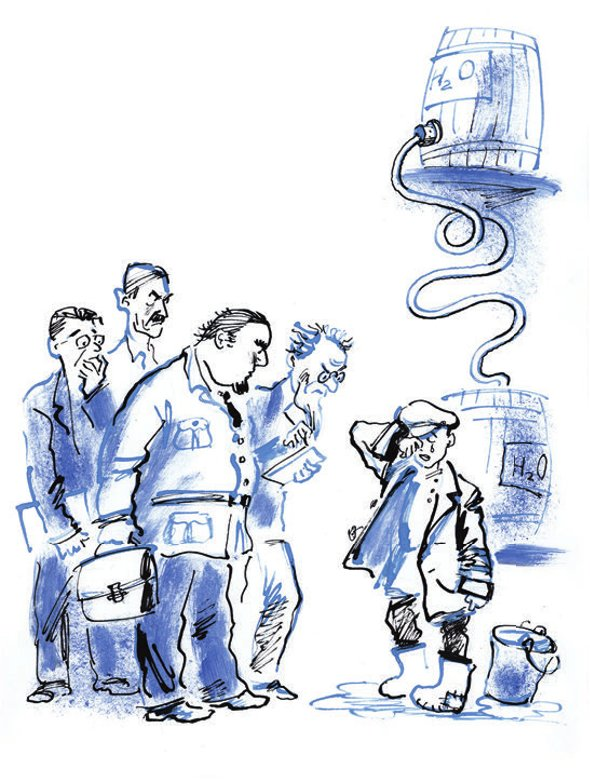

## Kapitel 5: Das unterirdische Reich

Ende 1922 <abbr title="auftauchen — вынырнуть, появиться">tauchen</abbr> die orangen Stiefel in Moskau auf. Über den Stiefeln <abbr title="herrschen — царить, господствовать">herrscht</abbr> ein grünlicher <abbr title="der Pelzmantel, die Pelzmäntel — бекеша, шуба">Pelzmantel</abbr> mit goldenem <abbr title="das Fuchsfell, die Fuchsfelle — лисий мех">Fuchsfell</abbr>. Der Mantel hat einen hohen <abbr title="der Lammfellkragen, die Lammfellkragen — барашковый воротник">Lammfellkragen</abbr>. Von innen sieht er aus wie eine Steppdecke. Er schützt vor dem <abbr title="der Frost — мороз">Frost</abbr> eine schneidige <abbr title="die Visage, die Visagen — харя, рожа">Visage</abbr> mit <abbr title="die Koteletten (Pl.) — бакенбарды, полубаки">Koteletten</abbr> im Stil von Sewastopol. Auf dem Kopf von Alexander Iwanowitsch sitzt eine reizende, lockige <abbr title="die Pelzmütze, die Pelzmützen — папаха">Pelzmütze</abbr>.

Aber in Moskau fahren zu dieser Zeit schon neue Autos mit <abbr title="das Kristall — хрусталь">Kristall</abbr>-Lampen. Durch die Straßen gehen <abbr title="der Neureiche, die Neureichen — нувориш, скоробогач">Neureiche</abbr> mit kleinen <abbr title="das Käppchen, die Käppchen — ермолка, шапочка">Käppchen</abbr> aus <abbr title="das Robbenfell — котиковый мех">Robbenfell</abbr> und mit Pelzen, die mit Lyra-Fell gefüttert sind. <abbr title="modern — модный">Modern</abbr> werden <abbr title="spitz — остроносый">spitze</abbr>, gotische <abbr title="der Halbschuh, die Halbschuhe — штиблет, ботинок">Halbschuhe</abbr> und Aktentaschen mit <abbr title="der Riemen, die Riemen — ремень">Riemen</abbr> und <abbr title="der Griff, die Griffe — ручка">Griffen</abbr> wie bei einem Koffer. Das Wort «Bürger» <abbr title="verdrängen — теснить, вытеснять">verdrängt</abbr> langsam das <abbr title="gewohnt — привычный">gewohnte</abbr> Wort «Genosse». Und ein paar junge Leute haben schnell verstanden, wo die Freude am Leben liegt. Sie tanzen in den Restaurants schon den Onestep «Dixie» und sogar den <abbr title="der Foxtrott — фокстрот">Foxtrott</abbr> «Sonnenblume». Über der Stadt <abbr title="schallen — разноситься, звучать">schallen</abbr> die Schreie von den schnellen Kutschern. Und im großen Haus vom Volkskommissariat für Äußeres <abbr title="nähen — шить, строчить">näht</abbr> der Schneider Shurkewitsch Tag und Nacht <abbr title="der Frack, die Fracks — фрак">Fracks</abbr> für die sowjetischen <abbr title="der Diplomat, die Diplomaten — дипломат">Diplomaten</abbr>, die ins Ausland fahren.

Alexander Iwanowitsch sieht <abbr title="verwundert — с удивлением">verwundert</abbr>: In der Provinz ist seine Kleidung ein <abbr title="das Zeichen, die Zeichen — признак">Zeichen</abbr> von <abbr title="die Männlichkeit — мужественность">Männlichkeit</abbr> und Reichtum. Aber hier, in Moskau, ist sie ein <abbr title="das Überbleibsel, die Überbleibsel — пережиток">Überbleibsel</abbr> aus alten Zeiten. Sie wirft einen <abbr title="ungünstig — невыгодный">ungünstigen</abbr> Schatten auf ihren Besitzer.

Zwei Monate später eröffnet auf dem Sretenski-Boulevard ein neues <abbr title="das Unternehmen, die Unternehmen — предприятие, заведение">Unternehmen</abbr>. Auf dem Schild steht: «<abbr title="die Gewerbegenossenschaft, die Gewerbegenossenschaften — промысловая артель">Gewerbegenossenschaft</abbr> für chemische Produkte „Revanche“». Die Genossenschaft hat zwei Zimmer. Im ersten hängt ein <abbr title="das Porträt, die Porträts — портрет">Porträt</abbr> vom Gründer des Sozialismus, Friedrich Engels. Unter dem Porträt sitzt Koreiko selbst und lächelt unschuldig. Er trägt einen grauen englischen <abbr title="der Anzug, die Anzüge — костюм">Anzug</abbr> mit einem roten Seidenfaden. Die orangen Stiefel und die groben Koteletten sind verschwunden. Die Wangen von Alexander Iwanowitsch sind gut <abbr title="rasieren — брить">rasiert</abbr>. Im hinteren Zimmer ist die <abbr title="die Produktion — производство">Produktion</abbr>. Dort stehen zwei Fässer aus Eichenholz mit <abbr title="das Manometer, die Manometer — манометр">Manometern</abbr> und <abbr title="das Wasserstandsglas, die Wasserstandsgläser — водомерное стекло">Wasserstandsgläsern</abbr>. Ein Fass steht auf dem Boden, das andere oben auf einem <abbr title="der Zwischenboden, die Zwischenböden — антресоли">Zwischenboden</abbr>. Die Fässer sind mit einem dünnen <abbr title="der Klistierschlauch, die Klistierschläuche — клистирная трубка">Klistierschlauch</abbr> verbunden. Durch den Schlauch läuft eine <abbr title="die Flüssigkeit, die Flüssigkeiten — жидкость">Flüssigkeit</abbr> und <abbr title="plätschern — журчать">plätschert</abbr> <abbr title="geschäftig — деловито">geschäftig</abbr>. Wenn die ganze Flüssigkeit aus dem oberen <abbr title="der Behälter, die Behälter — сосуд, резервуар">Behälter</abbr> im unteren ist, kommt ein Junge in <abbr title="der Filzstiefel, die Filzstiefel — валенок">Filzstiefeln</abbr> in den <abbr title="der Produktionsraum, die Produktionsräume — производственное помещение">Produktionsraum</abbr>. Er seufzt gar nicht wie ein Kind. Mit einem <abbr title="der Eimer, die Eimer — ведро">Eimer</abbr> <abbr title="schöpfen — черпать">schöpft</abbr> er die Flüssigkeit aus dem unteren Fass. Er <abbr title="schleppen — тащить">schleppt</abbr> sie auf den Zwischenboden und gießt sie in das obere Fass. Nach diesem <abbr title="kompliziert — сложный">komplizierten</abbr> <abbr title="der Produktionsprozess, die Produktionsprozesse — производственный процесс">Produktionsprozess</abbr> geht der Junge ins Büro und wärmt sich. Und aus dem Klistierschlauch hört man wieder ein <abbr title="das Schluchzen — всхлипывание">Schluchzen</abbr>: Die Flüssigkeit macht ihren gewohnten Weg, aus dem oberen Behälter in den unteren.

Alexander Iwanowitsch weiß selbst nicht genau, was für <abbr title="die Chemikalie, die Chemikalien — химикалии">Chemikalien</abbr> die Genossenschaft «Revanche» <abbr title="herstellen — производить, вырабатывать">herstellt</abbr>. Für Chemikalien hat er keine Zeit. Sein Arbeitstag ist auch so schon voll. Er fährt von Bank zu Bank und <abbr title="sich bemühen um + Akk. — хлопотать о">bemüht sich</abbr> um <abbr title="der Kredit, die Kredite — ссуда, кредит">Kredite</abbr>, weil er angeblich die Produktion <abbr title="erweitern — расширять">erweitern</abbr> will. Mit den Trusts schließt er <abbr title="der Vertrag, die Verträge — договор">Verträge</abbr> über die <abbr title="die Lieferung, die Lieferungen — поставка">Lieferung</abbr> von chemischen Produkten ab. Dafür bekommt er <abbr title="der Rohstoff, die Rohstoffe — сырьё">Rohstoffe</abbr> zu festen Preisen. Die Kredite bekommt er auch. Sehr viel Zeit kostet es, die Rohstoffe an staatliche Fabriken <abbr title="weiterverkaufen — перепродавать">weiterzuverkaufen</abbr>, zum zehnfachen Preis. Und sehr viel Energie kosten die <abbr title="das Devisengeschäft, die Devisengeschäfte — валютная сделка">Devisengeschäfte</abbr> auf der <abbr title="die Schwarzbörse — чёрная биржа">Schwarzbörse</abbr>, unten am <abbr title="das Denkmal, die Denkmäler — памятник">Denkmal</abbr> für die Helden von Plewna.

Nach einem Jahr möchten die Banken und Trusts gern wissen: Hat die Hilfe mit Geld und Rohstoffen der Gewerbegenossenschaft «Revanche» gutgetan? Und braucht der gesunde Privatunternehmer vielleicht noch mehr <abbr title="die Unterstützung — содействие, поддержка">Unterstützung</abbr>? Eine <abbr title="die Kommission, die Kommissionen — комиссия">Kommission</abbr> voll mit gelehrten <abbr title="der Bart, die Bärte — борода">Bärten</abbr> fährt mit drei kleinen Droschken zur Genossenschaft «Revanche». Im leeren Büro sieht der Vorsitzende der Kommission lange in das gleichgültige Gesicht von Engels. Mit seinem Stock klopft er auf den Ladentisch aus <abbr title="das Fichtenholz — ель (древесина)">Fichtenholz</abbr>. Er ruft die Leiter und die Mitglieder von der Genossenschaft. Endlich geht die Tür vom Produktionsraum auf. Vor der Kommission steht ein <abbr title="verweint — заплаканный">verweinter</abbr> Junge mit einem Eimer in der Hand.

Im Gespräch mit dem jungen <abbr title="der Vertreter, die Vertreter — представитель">Vertreter</abbr> der «Revanche» stellt sich heraus: Die Produktion läuft auf vollen Touren. Und der Chef ist schon seit einer Woche nicht mehr gekommen. Die Kommission bleibt nicht lange im Produktionsraum. Die Flüssigkeit, die so geschäftig im Klistierschlauch plätschert, ist im <abbr title="der Geschmack — вкус">Geschmack</abbr>, in der Farbe und in der chemischen <abbr title="die Zusammensetzung — состав">Zusammensetzung</abbr> wie normales Wasser. Und genau das ist sie auch. Der Vorsitzende der Kommission stellt diese unglaubliche Tatsache fest und sagt: «Hm.» Er sieht die Mitglieder an, und sie sagen auch: «Hm.» Dann sieht der Vorsitzende den Jungen mit einem schrecklichen Lächeln an und fragt:

— Na, wie alt bist du denn, Kleiner?

— Elf bin ich schon vorbei, — antwortet der Junge. Und er fängt so laut an zu schluchzen, dass die Mitglieder der Kommission sich gegenseitig <abbr title="schubsen — толкать">schubsen</abbr> und auf die Straße laufen. Sie setzen sich in ihre Droschken und fahren ganz verlegen weg. Und alle Geschäfte von der Genossenschaft «Revanche» schreibt man in den Büchern von den Banken und Trusts auf das <abbr title="das Konto, die Konten — счёт">Konto</abbr> «Gewinn und Verlust». Und zwar in den Teil, wo kein Wort über Gewinne steht. Dieser Teil ist ganz den Verlusten <abbr title="widmen — посвящать">gewidmet</abbr>.

An genau diesem Tag, als die Kommission im Büro der «Revanche» das <abbr title="vielsagend — многозначительный">vielsagende</abbr> Gespräch mit dem Jungen führt, steigt Alexander Iwanowitsch Koreiko aus einem <abbr title="der Schlafwagen, die Schlafwagen — спальный вагон">Schlafwagen</abbr>. Er ist in einer kleinen Republik voll mit <abbr title="der Weinberg, die Weinberge — виноградник">Weinbergen</abbr>, dreitausend Kilometer von Moskau entfernt.

Er macht im Hotelzimmer das Fenster auf. Er sieht eine kleine Stadt in einer <abbr title="die Oase, die Oasen — оазис">Oase</abbr>, mit einer Wasserleitung aus <abbr title="der Bambus — бамбук">Bambus</abbr> und einer <abbr title="schäbig — дрянной, жалкий">schäbigen</abbr> <abbr title="die Festung, die Festungen — крепость">Festung</abbr> aus <abbr title="der Lehm — глина">Lehm</abbr>. Eine Reihe <abbr title="die Pappel, die Pappeln — тополь">Pappeln</abbr> trennt die kleine Stadt von der <abbr title="die Wüste, die Wüsten — пустыня, пески">Wüste</abbr>. Die Stadt ist voll von asiatischem Lärm.

Schon am nächsten Tag erfährt er: Die Republik hat angefangen, ein <abbr title="das Elektrizitätswerk, die Elektrizitätswerke — электростанция">Elektrizitätswerk</abbr> zu bauen. Er erfährt auch: Das Geld reicht nie. Und der Bau, von dem die Zukunft der Republik <abbr title="abhängen von + Dat. — зависеть от">abhängt</abbr>, muss vielleicht bald <abbr title="stoppen — остановиться">stoppen</abbr>.

Und der gesunde Privatunternehmer beschließt, der Republik zu helfen. Er steigt wieder in die orangen Stiefel, setzt eine <abbr title="die Tjubeteika, die Tjubeteikas — тюбетейка">Tjubeteika</abbr> auf, nimmt eine <abbr title="dick — пузатый">dicke</abbr> Aktentasche und geht zur <abbr title="die Bauleitung — управление строительством">Bauleitung</abbr>.

Man <abbr title="empfangen (empfing, hat empfangen) — встречать, принимать">empfängt</abbr> ihn nicht besonders freundlich. Aber er benimmt sich sehr würdig. Für sich selbst will er nichts. Er sagt vor allem immer wieder: Die Idee von der <abbr title="die Elektrifizierung — электрификация">Elektrifizierung</abbr> von <abbr title="rückständig — отсталый">rückständigen</abbr> <abbr title="das Randgebiet, die Randgebiete — окраина">Randgebieten</abbr> liegt ihm sehr am Herzen.

— Ihrem Bau, — sagt er, — fehlt das Geld. Ich <abbr title="besorgen — достать, раздобыть">besorge</abbr> es.

Und er schlägt vor: Beim Bau vom Elektrizitätswerk soll man einen <abbr title="der Nebenbetrieb, die Nebenbetriebe — подсобное предприятие">Nebenbetrieb</abbr> <abbr title="gründen — основать, организовать">gründen</abbr>, der Geld bringt.

— Was kann einfacher sein! Wir verkaufen <abbr title="die Postkarte, die Postkarten — открытка">Postkarten</abbr> mit Bildern von der <abbr title="die Baustelle, die Baustellen — стройка">Baustelle</abbr>. Und das bringt genau das Geld, das der Bau so dringend braucht. Merken Sie sich: Sie geben nichts, Sie bekommen nur.

Alexander Iwanowitsch <abbr title="hacken — рубить">hackt</abbr> mit der Hand entschlossen durch die Luft. Seine Worte klingen <abbr title="überzeugend — убедительный">überzeugend</abbr>. Der Plan ist sicher und bringt <abbr title="der Profit — выгода, прибыль">Profit</abbr>. Koreiko bekommt einen Vertrag: Ein Viertel von allem Gewinn aus dem Postkartengeschäft gehört ihm. Dann beginnt er zu arbeiten.

Zuerst braucht man <abbr title="die Betriebsmittel (Pl.) — оборотные средства">Betriebsmittel</abbr>. Die muss man aus dem Geld nehmen, das für den Bau vom Werk gedacht ist. Anderes Geld gibt es in der Republik nicht.

— Macht nichts, — <abbr title="trösten — утешать">tröstet</abbr> er die <abbr title="der Bauarbeiter, die Bauarbeiter — строитель">Bauarbeiter</abbr>. — Merken Sie sich: Von jetzt an bekommen Sie nur.

Alexander Iwanowitsch <abbr title="reiten (ritt, ist geritten) — ехать верхом">reitet</abbr> auf einem Pferd durch die <abbr title="die Schlucht, die Schluchten — ущелье">Schlucht</abbr> und <abbr title="inspizieren — инспектировать">inspiziert</abbr> alles. Dort stehen schon die <abbr title="der Quader, die Quader — параллелепипед">Quader</abbr> aus <abbr title="der Beton — бетон">Beton</abbr> von dem zukünftigen Werk. Mit einem Blick <abbr title="einschätzen — оценить">schätzt</abbr> er die <abbr title="malerisch — живописный">malerischen</abbr> <abbr title="der Fels, die Felsen — скала">Felsen</abbr> aus <abbr title="der Porphyr — порфир">Porphyr</abbr> ein. Hinter ihm kommen in einem Wagen die <abbr title="der Fotograf, die Fotografen — фотограф">Fotografen</abbr> in die Schlucht. Sie stellen rund um die Baustelle ihre <abbr title="das Stativ, die Stative — штатив">Stative</abbr> auf – mit vielen <abbr title="das Gelenk, die Gelenke — сустав">Gelenken</abbr> und langen Beinen. Sie verstecken sich unter schwarzen Tüchern und klicken lange mit den <abbr title="der Verschluss, die Verschlüsse — затвор">Verschlüssen</abbr>. Als alles fotografiert ist, nimmt einer von den Fotografen das Tuch herunter und sagt <abbr title="vernünftig — рассудительно">vernünftig</abbr>:

— Besser baut man dieses Werk natürlich weiter links, vor den <abbr title="die Ruine, die Ruinen — руины">Ruinen</abbr> vom Kloster. Dort ist es viel malerischer.

Für den Druck von den Postkarten beschließt man, so schnell wie möglich eine eigene <abbr title="die Druckerei, die Druckereien — типография">Druckerei</abbr> zu bauen. Das Geld nimmt man wieder aus dem Geld für den Bau. Deshalb muss man beim Elektrizitätswerk einige Arbeiten <abbr title="einstellen — прекратить, свернуть">einstellen</abbr>. Aber alle trösten sich: Mit den Gewinnen aus dem neuen Unternehmen holt man die <abbr title="verloren — упущенный, потерянный">verlorene</abbr> Zeit schnell <abbr title="aufholen — наверстать">auf</abbr>.

Die Druckerei baut man in derselben Schlucht, gegenüber vom Werk. Und bald stehen nicht weit von den Betonquadern des Werks die Betonquader der Druckerei. Langsam <abbr title="wandern — кочевать, перемещаться">wandern</abbr> die Fässer mit <abbr title="der Zement — цемент">Zement</abbr>, die <abbr title="die Eisenstange, die Eisenstangen — железный прут">Eisenstangen</abbr>, die <abbr title="der Ziegel, die Ziegel — кирпич">Ziegel</abbr> und der <abbr title="der Kies — гравий">Kies</abbr> von einem Ende der Schlucht ans andere. Dann gehen auch die Arbeiter bequem über die Schlucht. Denn auf der neuen Baustelle <abbr title="zahlen — платить">zahlt</abbr> man mehr.

Nach einem halben Jahr stehen auf allen Bahnhöfen <abbr title="der Verkäufer, die Verkäufer — агент-распространитель, продавец">Verkäufer</abbr> in gestreiften Hosen. Sie verkaufen Postkarten mit den Felsen von der Weinbergrepublik. Zwischen den Felsen sieht man <abbr title="grandios — грандиозный">grandiose</abbr> Arbeiten. In den Sommergärten, Theatern und Kinos, auf den Dampfern und in den Kurorten drehen junge <abbr title="das Fräulein, die Fräulein — барышня">Fräulein</abbr> gläserne Trommeln für eine <abbr title="die Wohltätigkeitslotterie, die Wohltätigkeitslotterien — благотворительная лотерея">Wohltätigkeitslotterie</abbr>. Bei der Lotterie <abbr title="verlieren (verlor, hat verloren) — проигрывать">verliert</abbr> man nie: Jeder Gewinn ist eine Postkarte mit einem Bild von der elektrischen Schlucht.

Die Worte von Koreiko werden wahr: Von allen Seiten fließt Geld herein. Aber Alexander Iwanowitsch lässt es nicht aus den Händen. Ein Viertel nimmt er nach dem Vertrag für sich. Noch einmal so viel <abbr title="einstecken — прикарманить, присвоить">steckt</abbr> er ein. Er sagt, dass noch nicht alle <abbr title="die Karawane, die Karawanen — караван">Karawanen</abbr> von Verkäufern ihre <abbr title="die Abrechnung, die Abrechnungen — отчётность">Abrechnung</abbr> geschickt haben. Und das übrige Geld braucht er für die Erweiterung vom Wohltätigkeits-<abbr title="das Kombinat, die Kombinate — комбинат">Kombinat</abbr>.

— Man muss ein guter <abbr title="der Wirt, die Wirte — хозяин">Wirt</abbr> sein, — sagt er leise. — Zuerst bringen wir die Sache richtig in Ordnung. Dann kommen auch die echten Gewinne.

Inzwischen hat man den <abbr title="der Bagger, die Bagger — экскаватор">Bagger</abbr> «Marion» vom Elektrizitätswerk weggeholt. Er gräbt eine tiefe <abbr title="die Baugrube, die Baugruben — котлован">Baugrube</abbr> für das neue Gebäude der Druckerei. Die Arbeit am Elektrizitätswerk ist gestoppt. Auf der Baustelle ist niemand mehr. Nur die Fotografen arbeiten noch dort, und ihre schwarzen Tücher huschen hin und her.

Das Geschäft blüht. Auf dem Gesicht von Alexander Iwanowitsch ist immer ein ehrliches sowjetisches Lächeln. Jetzt fängt er an, Postkarten mit Porträts von <abbr title="der Filmstar, die Filmstars — киноартист">Filmstars</abbr> zu drucken.

Wie es so ist, kommt eines Abends in einem <abbr title="wackelig — тряский">wackeligen</abbr> Auto eine Kommission mit allen <abbr title="die Vollmacht, die Vollmachten — полномочие">Vollmachten</abbr>. Alexander Iwanowitsch <abbr title="zögern — мешкать, медлить">zögert</abbr> nicht. Er wirft einen letzten Blick auf das <abbr title="rissig — потрескавшийся">rissige</abbr> <abbr title="das Fundament, die Fundamente — фундамент">Fundament</abbr> vom Elektrizitätswerk, auf das grandiose Gebäude vom Nebenbetrieb voller Licht – und <abbr title="sich aus dem Staub machen — дать стрекача, смыться">macht sich aus dem Staub</abbr>.

— Hm! — sagt der Vorsitzende und stochert mit seinem Stock in den <abbr title="der Riss, die Risse — трещина">Rissen</abbr> vom Fundament. — Wo ist denn das Elektrizitätswerk?

Er sieht die Mitglieder der Kommission an. Die sagen ihrerseits: «Hm.» Ein Elektrizitätswerk gibt es nicht.

Dafür ist in der Druckerei die Arbeit <abbr title="in vollem Gang sein — быть в полном разгаре">in vollem Gang</abbr>. Lila Lampen strahlen, und die flachen <abbr title="die Druckmaschine, die Druckmaschinen — печатная машина">Druckmaschinen</abbr> schlagen eifrig mit den Flügeln. Drei von ihnen <abbr title="backen (backte, hat gebacken) — печь, выпекать">backen</abbr> die Schlucht in einer Farbe. Und aus der vierten, einer <abbr title="die Mehrfarbenmaschine, die Mehrfarbenmaschinen — многокрасочная машина">Mehrfarbenmaschine</abbr>, fliegen Postkarten heraus, wie Karten aus dem Ärmel von einem <abbr title="der Falschspieler, die Falschspieler — шулер">Falschspieler</abbr>. Auf den Karten sind Douglas Fairbanks mit einer schwarzen <abbr title="die Halbmaske, die Halbmasken — полумаска">Halbmaske</abbr> auf seinem dicken Gesicht, rund wie ein <abbr title="der Samowar, die Samoware — самовар">Samowar</abbr>, die <abbr title="bezaubernd — очаровательный">bezaubernde</abbr> Lya de Putti und ein <abbr title="nett — славный">netter</abbr> <abbr title="der Kerl, die Kerle — малый, парень">Kerl</abbr> mit <abbr title="hervorquellend — вытаращенный">hervorquellenden</abbr> Augen, den man unter dem Namen Monty Banks kennt.

Und noch lange nach diesem <abbr title="denkwürdig — памятный">denkwürdigen</abbr> Abend gibt es in der Schlucht unter freiem Himmel <abbr title="der Schauprozess, die Schauprozesse — показательный процесс">Schauprozesse</abbr>. Und Alexander Iwanowitsch hat sein Kapital um eine halbe Million Rubel <abbr title="vergrößern — увеличить">vergrößert</abbr>.

Sein kleiner, böser Puls schlägt immer noch ungeduldig. Er fühlt: Gerade jetzt kann man ein riesiges <abbr title="das Vermögen, die Vermögen — состояние, богатство">Vermögen</abbr> machen. Denn das alte <abbr title="das Wirtschaftssystem, die Wirtschaftssysteme — хозяйственная система">Wirtschaftssystem</abbr> ist <abbr title="untergehen (ging unter, ist untergegangen) — сгинуть, погибнуть">untergegangen</abbr>, und das neue fängt gerade erst an zu leben. Aber er weiß schon: Im Sowjetland kann man nicht offen für den Reichtum kämpfen. Und mit einem <abbr title="überlegen — превосходящий, высокомерный">überlegenen</abbr> Lächeln sieht er die armen Reste von den Nepmännern an. Sie <abbr title="verfaulen — догнивать">verfaulen</abbr> langsam unter ihren Schildern:

Handel mit Waren vom Kammgarn-Trust B. A. Leibedew

Brokat und <abbr title="das Gerät, die Geräte — утварь">Gerät</abbr> für Kirchen und <abbr title="der Klub, die Klubs — клуб">Klubs</abbr>

oder

<abbr title="die Kolonialwaren (Pl.) — бакалея">Kolonialwaren</abbr> H. Robinson und M. Freitag

Unter dem Druck von der staatlichen <abbr title="die Presse, die Pressen — пресс">Presse</abbr> <abbr title="krachen — трещать">kracht</abbr> die finanzielle <abbr title="die Basis — база">Basis</abbr> von Leibedew, von Freitag und von den Besitzern der falschen Musikgenossenschaft «Da klingt das <abbr title="das Tamburin, die Tamburine — бубен">Tamburin</abbr>».

Koreiko versteht: Jetzt ist nur ein unterirdischer Handel möglich, mit strengster <abbr title="die Geheimhaltung — тайна, секретность">Geheimhaltung</abbr>. Alle Krisen, die die junge Wirtschaft <abbr title="schütteln — трясти">schütteln</abbr>, sind für ihn <abbr title="nützlich — полезный">nützlich</abbr>. Überall, wo der Staat etwas verliert, verdient er. In jede <abbr title="die Lücke, die Lücken — брешь, пробел">Lücke</abbr> im Warenangebot <abbr title="einbrechen (brach ein, ist eingebrochen) — прорываться">bricht</abbr> er ein und holt sich dort seine hunderttausend. Er handelt mit Getreide, mit Tuch, mit Zucker, mit Stoffen – mit allem. Und er ist allein, ganz allein mit seinen Millionen. In verschiedenen Teilen vom Land arbeiten große und kleine Gauner für ihn. Aber sie wissen nicht, für wen sie arbeiten. Koreiko arbeitet nur über <abbr title="der Strohmann, die Strohmänner — подставное лицо">Strohmänner</abbr>. Nur er allein weiß, wie lang die Kette ist, über die das Geld zu ihm kommt.

Genau um zwölf Uhr schiebt Alexander Iwanowitsch das Kontokorrentbuch <abbr title="zur Seite — в сторону">zur Seite</abbr> und beginnt mit dem Frühstück. Er nimmt aus der Schublade eine rohe <abbr title="die Rübe, die Rüben — репа, репка">Rübe</abbr>. Er hat sie schon vorher <abbr title="schälen — чистить (овощи)">geschält</abbr>. <abbr title="ordentlich — чинно, аккуратно">Ordentlich</abbr> sieht er geradeaus und isst sie. Dann <abbr title="schlucken — глотать">schluckt</abbr> er ein kaltes, <abbr title="weichgekocht — сваренный всмятку">weichgekochtes</abbr> Ei. Kalte, weichgekochte Eier schmecken sehr schlecht. Ein guter, fröhlicher Mensch isst so etwas nie. Aber Alexander Iwanowitsch isst nicht, er <abbr title="sich ernähren — питаться">ernährt sich</abbr>. Er frühstückt nicht. Er macht einen <abbr title="physiologisch — физиологический">physiologischen</abbr> Prozess: Er bringt die richtige Menge von <abbr title="das Fett, die Fette — жир">Fetten</abbr>, <abbr title="das Kohlenhydrat, die Kohlenhydrate — углевод">Kohlenhydraten</abbr> und Vitaminen in seinen <abbr title="der Organismus, die Organismen — организм">Organismus</abbr>.

Alle im «Herkules» beenden ihr Frühstück mit Tee. Alexander Iwanowitsch trinkt ein Glas heißes Wasser und beißt dazu ein Stück Zucker ab. Tee <abbr title="anregen — возбуждать">regt</abbr> das Herz zu stark an, und Koreiko <abbr title="achten auf + Akk. — беречь, следить за">achtet auf</abbr> seine Gesundheit.

Der Besitzer von zehn Millionen ist wie ein <abbr title="der Boxer, die Boxer — боксёр">Boxer</abbr>, der <abbr title="berechnend — расчётливо">berechnend</abbr> seinen <abbr title="der Triumph, die Triumphe — триумф">Triumph</abbr> vorbereitet. So ein Boxer lebt nach einem besonderen <abbr title="der Plan, die Pläne — режим, план">Plan</abbr>. Er trinkt nicht und raucht nicht. Er versucht, sich nicht aufzuregen. Er trainiert und geht früh ins Bett. Alles nur für einen Tag: An diesem Tag will er als glücklicher <abbr title="der Sieger, die Sieger — победитель">Sieger</abbr> in den strahlenden Ring springen. Alexander Iwanowitsch will jung und frisch sein an dem Tag, wenn alles wieder wie früher wird. Dann kann er aus dem Untergrund kommen und ohne Angst sein gewöhnliches Köfferchen öffnen. Dass die alten Zeiten zurückkommen, daran <abbr title="zweifeln an + Dat. — сомневаться в">zweifelt</abbr> Koreiko nie. Er <abbr title="sich aufsparen — беречь себя">spart sich</abbr> für den <abbr title="der Kapitalismus — капитализм">Kapitalismus</abbr> auf.

Und niemand soll sein zweites, sein wichtigstes Leben erraten. Deshalb lebt er wie ein <abbr title="der Bettler, die Bettler — нищий">Bettler</abbr>. Er versucht, nie mehr als sein Gehalt von sechsundvierzig Rubeln auszugeben. Dieses Gehalt bekommt er für eine <abbr title="elend — жалкий">elende</abbr>, langweilige Arbeit in der Abteilung für Finanzen und Buchhaltung – in dem Saal mit den Mänaden, Dryaden und Najaden an den Wänden.

---

### Neue Wörter

- **auftauchen** — вынырнуть, появиться
- **herrschen** — царить, господствовать
- **der Pelzmantel, die Pelzmäntel** — бекеша, шуба
- **das Fuchsfell, die Fuchsfelle** — лисий мех
- **der Lammfellkragen, die Lammfellkragen** — барашковый воротник
- **der Frost** — мороз
- **die Visage, die Visagen** — харя, рожа
- **die Koteletten (Pl.)** — бакенбарды, полубаки
- **die Pelzmütze, die Pelzmützen** — папаха
- **das Kristall** — хрусталь
- **der Neureiche, die Neureichen** — нувориш, скоробогач
- **das Käppchen, die Käppchen** — ермолка, шапочка
- **das Robbenfell** — котиковый мех
- **modern** — модный
- **spitz** — остроносый
- **der Halbschuh, die Halbschuhe** — штиблет, ботинок
- **der Riemen, die Riemen** — ремень
- **der Griff, die Griffe** — ручка
- **verdrängen** — теснить, вытеснять
- **gewohnt** — привычный
- **der Foxtrott** — фокстрот
- **schallen** — разноситься, звучать
- **nähen** — шить, строчить
- **der Frack, die Fracks** — фрак
- **der Diplomat, die Diplomaten** — дипломат
- **verwundert** — с удивлением
- **das Zeichen, die Zeichen** — признак
- **die Männlichkeit** — мужественность
- **das Überbleibsel, die Überbleibsel** — пережиток
- **ungünstig** — невыгодный
- **das Unternehmen, die Unternehmen** — предприятие, заведение
- **die Gewerbegenossenschaft, die Gewerbegenossenschaften** — промысловая артель
- **das Porträt, die Porträts** — портрет
- **der Anzug, die Anzüge** — костюм
- **rasieren** — брить
- **die Produktion** — производство
- **das Manometer, die Manometer** — манометр
- **das Wasserstandsglas, die Wasserstandsgläser** — водомерное стекло
- **der Zwischenboden, die Zwischenböden** — антресоли
- **der Klistierschlauch, die Klistierschläuche** — клистирная трубка
- **die Flüssigkeit, die Flüssigkeiten** — жидкость
- **plätschern** — журчать
- **geschäftig** — деловито
- **der Behälter, die Behälter** — сосуд, резервуар
- **der Filzstiefel, die Filzstiefel** — валенок
- **der Produktionsraum, die Produktionsräume** — производственное помещение
- **der Eimer, die Eimer** — ведро
- **schöpfen** — черпать
- **schleppen** — тащить
- **kompliziert** — сложный
- **der Produktionsprozess, die Produktionsprozesse** — производственный процесс
- **das Schluchzen** — всхлипывание
- **die Chemikalie, die Chemikalien** — химикалии
- **herstellen** — производить, вырабатывать
- **sich bemühen um + Akk.** — хлопотать о
- **der Kredit, die Kredite** — ссуда, кредит
- **erweitern** — расширять
- **der Vertrag, die Verträge** — договор
- **die Lieferung, die Lieferungen** — поставка
- **der Rohstoff, die Rohstoffe** — сырьё
- **weiterverkaufen** — перепродавать
- **das Devisengeschäft, die Devisengeschäfte** — валютная сделка
- **die Schwarzbörse** — чёрная биржа
- **das Denkmal, die Denkmäler** — памятник
- **die Unterstützung** — содействие, поддержка
- **die Kommission, die Kommissionen** — комиссия
- **der Bart, die Bärte** — борода
- **das Fichtenholz** — ель (древесина)
- **verweint** — заплаканный
- **der Vertreter, die Vertreter** — представитель
- **der Geschmack** — вкус
- **die Zusammensetzung** — состав
- **schubsen** — толкать
- **das Konto, die Konten** — счёт
- **widmen** — посвящать
- **vielsagend** — многозначительный
- **der Schlafwagen, die Schlafwagen** — спальный вагон
- **der Weinberg, die Weinberge** — виноградник
- **die Oase, die Oasen** — оазис
- **der Bambus** — бамбук
- **schäbig** — дрянной, жалкий
- **die Festung, die Festungen** — крепость
- **der Lehm** — глина
- **die Pappel, die Pappeln** — тополь
- **die Wüste, die Wüsten** — пустыня, пески
- **das Elektrizitätswerk, die Elektrizitätswerke** — электростанция
- **abhängen von + Dat.** — зависеть от
- **stoppen** — остановиться
- **die Tjubeteika, die Tjubeteikas** — тюбетейка
- **dick** — пузатый
- **die Bauleitung** — управление строительством
- **empfangen (empfing, hat empfangen)** — встречать, принимать
- **die Elektrifizierung** — электрификация
- **rückständig** — отсталый
- **das Randgebiet, die Randgebiete** — окраина
- **besorgen** — достать, раздобыть
- **der Nebenbetrieb, die Nebenbetriebe** — подсобное предприятие
- **gründen** — основать, организовать
- **die Postkarte, die Postkarten** — открытка
- **die Baustelle, die Baustellen** — стройка
- **hacken** — рубить
- **überzeugend** — убедительный
- **der Profit** — выгода, прибыль
- **die Betriebsmittel (Pl.)** — оборотные средства
- **trösten** — утешать
- **der Bauarbeiter, die Bauarbeiter** — строитель
- **reiten (ritt, ist geritten)** — ехать верхом
- **die Schlucht, die Schluchten** — ущелье
- **inspizieren** — инспектировать
- **der Quader, die Quader** — параллелепипед
- **der Beton** — бетон
- **einschätzen** — оценить
- **malerisch** — живописный
- **der Fels, die Felsen** — скала
- **der Porphyr** — порфир
- **der Fotograf, die Fotografen** — фотограф
- **das Stativ, die Stative** — штатив
- **das Gelenk, die Gelenke** — сустав
- **der Verschluss, die Verschlüsse** — затвор
- **vernünftig** — рассудительно
- **die Ruine, die Ruinen** — руины
- **die Druckerei, die Druckereien** — типография
- **einstellen** — прекратить, свернуть
- **verloren** — упущенный, потерянный
- **aufholen** — наверстать
- **wandern** — кочевать, перемещаться
- **der Zement** — цемент
- **die Eisenstange, die Eisenstangen** — железный прут
- **der Ziegel, die Ziegel** — кирпич
- **der Kies** — гравий
- **zahlen** — платить
- **der Verkäufer, die Verkäufer** — агент-распространитель, продавец
- **grandios** — грандиозный
- **das Fräulein, die Fräulein** — барышня
- **die Wohltätigkeitslotterie, die Wohltätigkeitslotterien** — благотворительная лотерея
- **verlieren (verlor, hat verloren)** — проигрывать
- **einstecken** — прикарманить, присвоить
- **die Karawane, die Karawanen** — караван
- **die Abrechnung, die Abrechnungen** — отчётность
- **das Kombinat, die Kombinate** — комбинат
- **der Wirt, die Wirte** — хозяин
- **der Bagger, die Bagger** — экскаватор
- **die Baugrube, die Baugruben** — котлован
- **der Filmstar, die Filmstars** — киноартист
- **wackelig** — тряский
- **die Vollmacht, die Vollmachten** — полномочие
- **zögern** — мешкать, медлить
- **rissig** — потрескавшийся
- **das Fundament, die Fundamente** — фундамент
- **sich aus dem Staub machen** — дать стрекача, смыться
- **der Riss, die Risse** — трещина
- **in vollem Gang sein** — быть в полном разгаре
- **die Druckmaschine, die Druckmaschinen** — печатная машина
- **backen (backte, hat gebacken)** — печь, выпекать
- **die Mehrfarbenmaschine, die Mehrfarbenmaschinen** — многокрасочная машина
- **der Falschspieler, die Falschspieler** — шулер
- **die Halbmaske, die Halbmasken** — полумаска
- **der Samowar, die Samoware** — самовар
- **bezaubernd** — очаровательный
- **nett** — славный
- **der Kerl, die Kerle** — малый, парень
- **hervorquellend** — вытаращенный
- **denkwürdig** — памятный
- **der Schauprozess, die Schauprozesse** — показательный процесс
- **vergrößern** — увеличить
- **das Vermögen, die Vermögen** — состояние, богатство
- **das Wirtschaftssystem, die Wirtschaftssysteme** — хозяйственная система
- **untergehen (ging unter, ist untergegangen)** — сгинуть, погибнуть
- **überlegen** — превосходящий, высокомерный
- **verfaulen** — догнивать
- **das Gerät, die Geräte** — утварь
- **der Klub, die Klubs** — клуб
- **die Kolonialwaren (Pl.)** — бакалея
- **die Presse, die Pressen** — пресс
- **krachen** — трещать
- **die Basis** — база
- **das Tamburin, die Tamburine** — бубен
- **die Geheimhaltung** — тайна, секретность
- **schütteln** — трясти
- **nützlich** — полезный
- **die Lücke, die Lücken** — брешь, пробел
- **einbrechen (brach ein, ist eingebrochen)** — прорываться
- **der Strohmann, die Strohmänner** — подставное лицо
- **zur Seite** — в сторону
- **die Rübe, die Rüben** — репа, репка
- **schälen** — чистить (овощи)
- **ordentlich** — чинно, аккуратно
- **schlucken** — глотать
- **weichgekocht** — сваренный всмятку
- **sich ernähren** — питаться
- **physiologisch** — физиологический
- **das Fett, die Fette** — жир
- **das Kohlenhydrat, die Kohlenhydrate** — углевод
- **der Organismus, die Organismen** — организм
- **anregen** — возбуждать
- **achten auf + Akk.** — беречь, следить за
- **der Boxer, die Boxer** — боксёр
- **berechnend** — расчётливо
- **der Triumph, die Triumphe** — триумф
- **der Plan, die Pläne** — режим, план
- **der Sieger, die Sieger** — победитель
- **zweifeln an + Dat.** — сомневаться в
- **sich aufsparen** — беречь себя
- **der Kapitalismus** — капитализм
- **der Bettler, die Bettler** — нищий
- **elend** — жалкий

[← Zurück](kapitel-05.md) · [Inhalt](README.md) · [Weiter →](kapitel-07.md)
