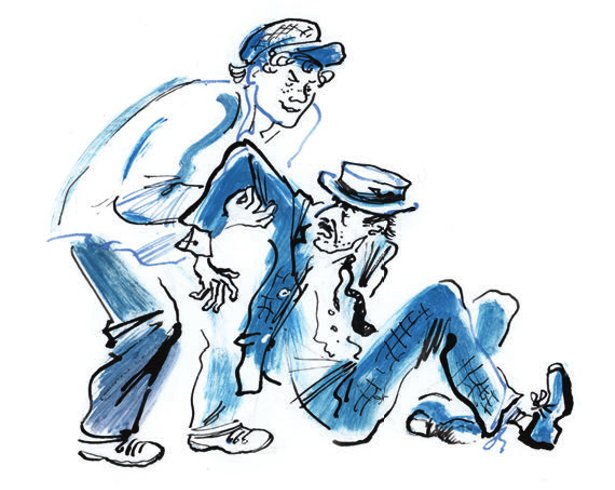
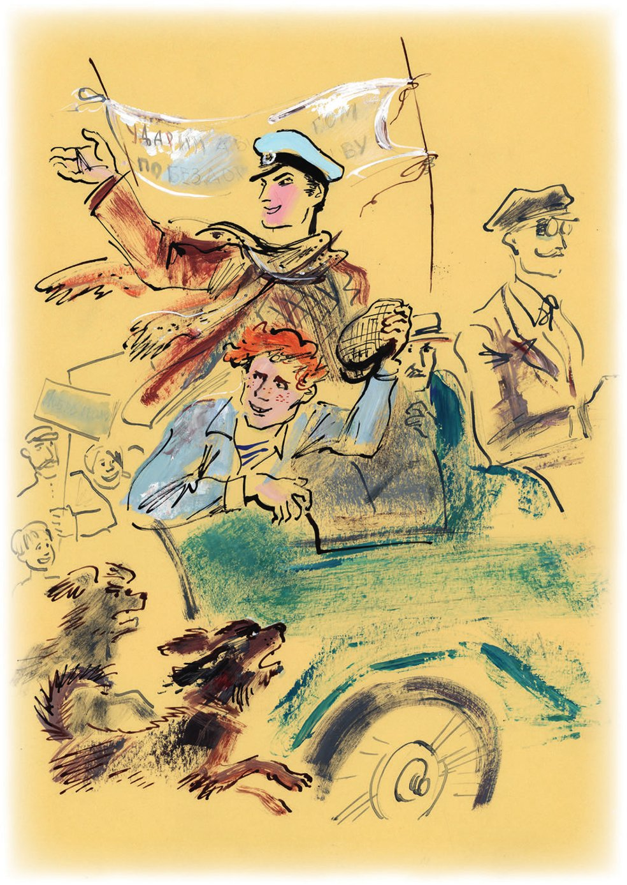
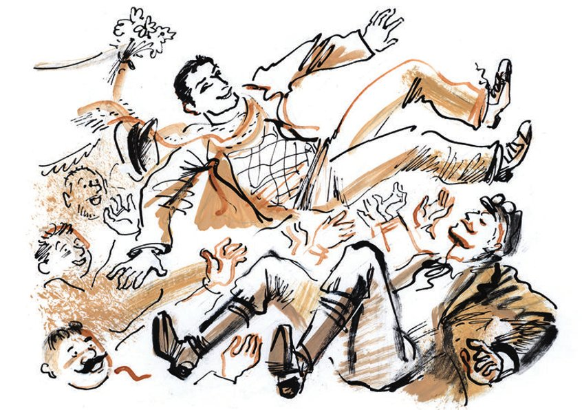

## Kapitel 6: Die «Antilope-Gnu»

Der grüne Kasten mit vier Gaunern <abbr title="springen (sprang, ist gesprungen) — прыгать, скакать">springt</abbr> über die staubige Straße.

Dem Auto geht es wie einem <abbr title="der Schwimmer, die Schwimmer — пловец">Schwimmer</abbr>, der bei <abbr title="der Sturm, die Stürme — буря, шторм">Sturm</abbr> im Meer badet. Plötzlich <abbr title="werfen (warf, hat geworfen) — бросать">wirft</abbr> es ein <abbr title="das Schlagloch, die Schlaglöcher — выбоина, ухаб">Schlagloch</abbr> zur Seite. Dann fällt es in eine <abbr title="die Grube, die Gruben — яма">Grube</abbr>. Es schaukelt nach links und nach rechts, und der rote Staub vom <abbr title="der Sonnenuntergang, die Sonnenuntergänge — закат">Sonnenuntergang</abbr> fliegt über das Auto.

— Hören Sie, Student, — sagt Ostap zu dem neuen Fahrgast. Der neue Fahrgast hat sich von dem <abbr title="der Schreck — испуг, потрясение">Schreck</abbr> schon <abbr title="sich erholen — оправиться, прийти в себя">erholt</abbr>. Er sitzt jetzt ganz ruhig neben dem Kommandeur. — Wie konnten Sie die Suchariewka-Konvention brechen? Das ist ein <abbr title="ehrwürdig — почтенный">ehrwürdiger</abbr> Vertrag! Das Gericht vom <abbr title="der Völkerbund — Лига Наций">Völkerbund</abbr> hat ihn <abbr title="bestätigen — утверждать">bestätigt</abbr>!

Panikowski tut so, als ob er nichts hört. Er dreht sogar den Kopf zur Seite.

— Und überhaupt, — sagt Ostap weiter, — Sie arbeiten nicht sauber. Gerade haben wir eine <abbr title="ekelhaft — отвратительный">ekelhafte</abbr> Szene gesehen. Die Leute von Arbatow sind hinter Ihnen hergelaufen. Sie haben ihnen eine Gans geklaut.

— <abbr title="erbärmlich — жалкий">Erbärmliche</abbr>, <abbr title="nichtig — ничтожный">nichtige</abbr> Menschen! — murmelt Panikowski böse.

— Ach so! — sagt Ostap. — Und Sie selbst? Halten Sie sich für einen Wohltäter? Für einen Gentleman? Dann passen Sie auf: Wenn Sie als echter Gentleman einmal etwas auf Ihre Manschetten schreiben möchten, dann müssen Sie mit <abbr title="die Kreide — мел">Kreide</abbr> schreiben.

— Warum? — fragt der neue Fahrgast <abbr title="gereizt — раздражённо">gereizt</abbr>.

— Weil Ihre Manschetten ganz schwarz sind. Ist das vielleicht <abbr title="der Dreck — грязь">Dreck</abbr>?

— Sie sind ein erbärmlicher, nichtiger Mensch! — sagt Panikowski schnell.

— Und das sagen Sie zu mir, zu Ihrem Retter? — fragt Ostap sanft. — Adam Kasimirowitsch, halten Sie bitte kurz an. Danke. Schura, mein Lieber, stellen Sie bitte den Status quo wieder her.

Balaganow weiß nicht, was «Status quo» bedeutet. Aber er hört den <abbr title="der Tonfall — интонация">Tonfall</abbr>. Und der Tonfall sagt ihm alles. Er lächelt <abbr title="angeekelt — брезгливо">angeekelt</abbr>, nimmt Panikowski unter die Arme, trägt ihn aus dem Auto und setzt ihn auf die Straße.

— Student, gehen Sie zurück nach Arbatow, — sagt Ostap <abbr title="trocken — сухо">trocken</abbr>. — Dort warten die Besitzer von der Gans schon ungeduldig auf Sie. Wir brauchen keine <abbr title="der Grobian, die Grobiane — грубиян">Grobiane</abbr>. Grobiane sind wir selbst. Fahren wir.

— Ich mache es nie wieder! — <abbr title="flehen — умолять">fleht</abbr> Panikowski. — Ich bin nervös!

— <abbr title="niederknien — встать на колени">Knien Sie nieder</abbr>, — sagt Ostap.

Panikowski fällt so schnell auf die <abbr title="das Knie, die Knie — колено">Knie</abbr>, als ob ihm jemand die Beine <abbr title="abhacken — отрубить">abhackt</abbr>.

— Gut! — sagt Ostap. — Ihre <abbr title="die Pose, die Posen — поза">Pose</abbr> <abbr title="gefallen (gefiel, hat gefallen) — нравиться">gefällt mir</abbr>. Sie sind <abbr title="auf Probe — условно, с испытательным сроком">auf Probe</abbr> <abbr title="aufnehmen (nahm auf, hat aufgenommen) — принимать">aufgenommen</abbr>, bis zur ersten <abbr title="die Verletzung, die Verletzungen — нарушение">Verletzung</abbr> der <abbr title="die Disziplin — дисциплина">Disziplin</abbr>. Ihre Aufgabe: Mädchen für alles.

Die «Antilope-Gnu» nimmt den <abbr title="zähmen — укрощать">gezähmten</abbr> Grobian auf und rollt weiter. Sie schaukelt wie ein <abbr title="der Leichenwagen, die Leichenwagen — погребальная колесница, катафалк">Leichenwagen</abbr>.

Eine halbe Stunde später <abbr title="abbiegen (bog ab, ist abgebogen) — сворачивать">biegt</abbr> das Auto auf die große Landstraße nach Nowosaizewo ab. Ohne <abbr title="langsam — медленный">langsamer</abbr> zu werden, fährt es in ein Dorf. Vor einem <abbr title="das Holzhaus, die Holzhäuser — бревенчатый дом">Holzhaus</abbr> stehen viele Leute. Auf dem Dach wächst ein <abbr title="krumm — кривой">krummer</abbr> <abbr title="der Radiomast, die Radiomasten — радиомачта">Radiomast</abbr> voller <abbr title="der Ast, die Äste — сук, ветка">Äste</abbr>. Ein Mann ohne Bart tritt entschlossen aus der Menge. In der Hand hält er ein Blatt Papier.

— Genossen, — ruft er böse, — ich erkläre die feierliche <abbr title="die Sitzung, die Sitzungen — заседание">Sitzung</abbr> für eröffnet! Erlauben Sie mir, Genossen, diesen <abbr title="der Beifall — аплодисменты">Beifall</abbr> als …

Er hat <abbr title="offenbar — очевидно">offenbar</abbr> eine Rede vorbereitet und sieht schon auf sein Papier. Aber er merkt: Das Auto hält nicht an. Deshalb macht er es kurz.

— Alle in den Autodor! — ruft er schnell und sieht Ostap an. (Der Autodor ist ein <abbr title="der Verein, die Vereine — общество, союз">Verein</abbr> für Autos und Straßen.) — Wir starten die <abbr title="die Serienproduktion — серийное производство">Serienproduktion</abbr> von sowjetischen Autos! Das eiserne Pferd <abbr title="ersetzen — заменять">ersetzt</abbr> das Bauernpferdchen!

Das Auto fährt schon weiter. Die Menge ruft laut ihre <abbr title="der Glückwunsch, die Glückwünsche — поздравление">Glückwünsche</abbr>. Aber der Mann ohne Bart schreit noch seine letzte <abbr title="die Losung, die Losungen — лозунг">Losung</abbr> hinterher:

— Das Auto ist kein <abbr title="der Luxus — роскошь">Luxus</abbr>, sondern ein <abbr title="das Verkehrsmittel, die Verkehrsmittel — средство передвижения">Verkehrsmittel</abbr>!

Nur Ostap bleibt ruhig. Alle anderen <abbr title="die Antilopen-Leute (Pl.) — «антилоповцы», экипаж «Антилопы»">Antilopen-Leute</abbr> sind ein bisschen beunruhigt von diesem feierlichen <abbr title="der Empfang, die Empfänge — приём, встреча">Empfang</abbr>. Sie verstehen nichts und drehen sich im Auto hin und her wie kleine <abbr title="der Spatz, die Spatzen — воробей">Spatzen</abbr> im Nest. Panikowski mag es überhaupt nicht, wenn viele ehrliche Menschen an einem Ort sind. Er <abbr title="sich hinhocken — присесть на корточки">hockt sich</abbr> vorsichtig hin. Die Bauern sehen von ihm nur noch das schmutzige <abbr title="das Strohdach, die Strohdächer — соломенная крыша">Strohdach</abbr> von seinem Hut. Aber Ostap ist überhaupt nicht verlegen. Er nimmt seine Schirmmütze mit dem weißen Deckel ab. Stolz <abbr title="nicken — кивать">nickt</abbr> er nach rechts und nach links.

— <abbr title="verbessern — улучшать">Verbessert</abbr> die Straßen! — ruft er zum <abbr title="der Abschied, die Abschiede — прощание">Abschied</abbr>. — Merci für den Empfang!

Und schon ist das Auto wieder auf der weißen Straße, mitten in einem großen, stillen Feld.

— <abbr title="verfolgen — преследовать">Verfolgen</abbr> die uns nicht? — fragt Panikowski besorgt. — Warum so viele Leute? Was ist passiert?

— Die Leute haben einfach noch nie ein Auto gesehen, — sagt Balaganow.

— Der <abbr title="der Meinungsaustausch — обмен мнениями">Meinungsaustausch</abbr> geht weiter, — sagt Bender. — Jetzt hat der Fahrer das Wort. Ihre Meinung, Adam Kasimirowitsch?

Der Fahrer denkt nach. Ein dummer Hund läuft auf die Straße. Koslewitsch <abbr title="erschrecken — пугать">erschreckt</abbr> ihn mit der <abbr title="die Hupe, die Hupen — клаксон, гудок">Hupe</abbr>, die einen <abbr title="der Matchiche — матчиш (танец)">Matchiche</abbr> spielt. Dann sagt er: Vielleicht <abbr title="feiern — праздновать">feiern</abbr> die Leute ein <abbr title="das Kirchenfest, die Kirchenfeste — престольный праздник">Kirchenfest</abbr>.

— Solche Feste, — erklärt der Fahrer von der «Antilope», — haben die Bauern oft.

— Ja, — sagt Ostap. — Jetzt sehe ich klar: Ich bin unter <abbr title="unkultiviert — некультурный">unkultivierte</abbr> Menschen geraten. Das heißt, unter <abbr title="der Landstreicher, die Landstreicher — босяк, бродяга">Landstreicher</abbr> ohne <abbr title="die Hochschulbildung — высшее образование">Hochschulbildung</abbr>. Ach, Kinder, liebe Kinder von Leutnant Schmidt, warum lest ihr keine Zeitungen? Man muss Zeitungen lesen. Sie <abbr title="säen — сеять">säen</abbr> oft das Kluge, das Gute, das <abbr title="ewig — вечный">Ewige</abbr>.

Ostap nimmt die «Iswestija» aus der Tasche. Laut liest er der Besatzung von der «Antilope» einen kurzen <abbr title="der Artikel, die Artikel — статья, заметка">Artikel</abbr> vor. Der Artikel ist über die Autorallye Moskau – Charkow – Moskau.

— Jetzt, — sagt er <abbr title="selbstzufrieden — самодовольно">selbstzufrieden</abbr>, — sind wir auf der <abbr title="die Strecke, die Strecken — трасса, маршрут">Strecke</abbr> von der Autorallye. Ungefähr hundertfünfzig Kilometer vor dem ersten Wagen. Sie haben sicher schon erraten, was ich meine?

Die <abbr title="der Rang, die Ränge — чин; нижние чины — рядовые">einfachen Ränge</abbr> von der «Antilope» schweigen. Panikowski <abbr title="aufknöpfen — расстёгивать">knöpft</abbr> seine Jacke auf und kratzt sich die nackte Brust unter der schmutzigen <abbr title="die Seidenkrawatte, die Seidenkrawatten — шёлковый галстук">Seidenkrawatte</abbr>.

— Sie verstehen es also nicht? Manchmal helfen offenbar nicht einmal Zeitungen. Na gut, ich erkläre es genauer. Das ist sonst nicht meine Art. Erstens: Die Bauern haben die «Antilope» für den ersten Wagen von der Autorallye gehalten. Zweitens: Wir sagen nicht nein zu diesem <abbr title="der Titel, die Titel — звание, титул">Titel</abbr>. Im Gegenteil! Wir gehen zu allen Behörden und zu allen Leuten und bitten um Unterstützung. Und wir sagen immer: Wir sind der erste Wagen! Drittens … Ach was, zwei Punkte <abbr title="reichen — хватать">reichen</abbr> für Sie. Es ist ganz klar: Eine Zeit lang fahren wir vor der Autorallye her. Und wir <abbr title="abschöpfen — снимать (сливки)">schöpfen</abbr> von diesem hochkulturellen Unternehmen den <abbr title="der Rahm — сливки">Rahm</abbr> ab, die <abbr title="die Sahne — сливки">Sahne</abbr> und überhaupt alles Fette.

Die Rede vom großen Kombinator macht einen riesigen <abbr title="der Eindruck, die Eindrücke — впечатление">Eindruck</abbr>. Koslewitsch sieht den Kommandeur <abbr title="treu — преданно">treu</abbr> an. Balaganow reibt sich mit den Händen die roten <abbr title="das Haarbüschel, die Haarbüschel — вихор">Haarbüschel</abbr> und lacht laut. Panikowski <abbr title="denken an + Akk. (dachte, hat gedacht) — думать о">denkt schon an</abbr> einen sicheren Gewinn und ruft «Hurra!».

— So, genug <abbr title="das Gefühl, die Gefühle — чувство, эмоция">Gefühle</abbr>, — sagt Ostap. — Es wird dunkel. Ich erkläre den Abend für eröffnet. Stopp!

Das Auto hält, und die <abbr title="müde — усталый">müden</abbr> Antilopen-Leute steigen aus. Im <abbr title="reif — спелый">reifen</abbr> Getreide <abbr title="schmieden — ковать">schmieden</abbr> die <abbr title="die Grille, die Grillen — кузнечик, сверчок">Grillen</abbr> ihr kleines Glück. Die Fahrgäste sitzen schon im Kreis an der Straße. Aber die alte «Antilope» <abbr title="kochen — кипеть">kocht</abbr> immer noch. Manchmal <abbr title="knacken — трещать">knackt</abbr> die Karosserie ganz von allein. Manchmal <abbr title="klappern — бренчать, стучать">klappert</abbr> kurz etwas im Motor.

Panikowski hat keine <abbr title="die Erfahrung, die Erfahrungen — опыт">Erfahrung</abbr>. Er macht ein so großes Lagerfeuer, dass es aussieht wie ein ganzes brennendes Dorf. Das Feuer schnauft und springt nach allen Seiten. Die Reisenden kämpfen mit der <abbr title="die Feuersäule, die Feuersäulen — огненный столб">Feuersäule</abbr>. In dieser Zeit läuft Panikowski gebückt ins Feld. Er kommt mit einer warmen, krummen <abbr title="die Gurke, die Gurken — огурец">Gurke</abbr> in der Hand zurück. Ostap reißt sie ihm schnell aus der Hand und sagt:

— Machen Sie aus dem Essen keinen <abbr title="der Kult, die Kulte — культ">Kult</abbr>.

Danach isst er die Gurke selbst. Zum Abendessen gibt es Wurst. Der <abbr title="sparsam — хозяйственный, бережливый">sparsame</abbr> Koslewitsch hat sie von zu Hause mitgenommen. Dann schlafen alle unter den Sternen ein.

— Nun, — sagt Ostap am frühen Morgen zu Koslewitsch, — machen Sie sich gut bereit. So einen Tag wie heute hat Ihr mechanischer <abbr title="der Trog, die Tröge — корыто">Trog</abbr> noch nie erlebt. Und er wird so einen Tag nie wieder erleben.

Balaganow nimmt einen runden Eimer mit der <abbr title="die Aufschrift, die Aufschriften — надпись">Aufschrift</abbr>: «<abbr title="das Entbindungsheim, die Entbindungsheime — родильный дом">Entbindungsheim</abbr> Arbatow». Er läuft zum Fluss und holt Wasser.

Adam Kasimirowitsch hebt die <abbr title="die Motorhaube, die Motorhauben — капот">Motorhaube</abbr>. Er pfeift leise, steckt die Hände in den Motor und <abbr title="wühlen — копаться, рыться">wühlt</abbr> in seinen kupfernen <abbr title="der Darm, die Därme — кишка">Därmen</abbr>.

Panikowski <abbr title="lehnen — прислоняться">lehnt</abbr> mit dem Rücken an einem Rad. Er ist traurig. Ohne mit den Augen zu <abbr title="zwinkern — моргать, мигать">zwinkern</abbr>, sieht er auf das <abbr title="preiselbeerrot — клюквенный">preiselbeerrote</abbr> Stück Sonne über dem <abbr title="der Horizont — горизонт">Horizont</abbr>. Erst jetzt sieht man das Gesicht von Panikowski richtig. Es ist <abbr title="faltig — морщинистый">faltig</abbr> und voller kleiner Altersdinge: <abbr title="der Tränensack, die Tränensäcke — мешок под глазами">Tränensäcke</abbr>, <abbr title="pochen — пульсировать, стучать">pochende</abbr> <abbr title="das Äderchen, die Äderchen — жилка">Äderchen</abbr>, <abbr title="erdbeerrot — клубничный">erdbeerrote</abbr> Flecken auf den Wangen. So ein Gesicht hat ein Mann, der ein langes, anständiges Leben gelebt hat. Er hat erwachsene Kinder. Am Morgen trinkt er gesunden <abbr title="der Eichelkaffee — желудёвый кофе">Eichelkaffee</abbr> der Marke «Eichelin». Und in der <abbr title="die Wandzeitung, die Wandzeitungen — стенгазета">Wandzeitung</abbr> von seinem Büro schreibt er manchmal kleine Artikel. Er unterschreibt sie mit «Antichrist».

— Soll ich Ihnen erzählen, Panikowski, wie Sie sterben werden? — sagt Ostap plötzlich.

Der alte Mann zuckt zusammen und dreht sich um.

— Sie sterben so. Eines Tages kommen Sie in ein leeres, kaltes <abbr title="das Hotelzimmer, die Hotelzimmer — гостиничный номер">Hotelzimmer</abbr> zurück. Das Hotel heißt «Marseille». Es steht in irgendeiner <abbr title="die Kreisstadt, die Kreisstädte — уездный город">Kreisstadt</abbr>, denn Ihr Beruf bringt Sie dorthin. Sie fühlen sich schlecht. Ihr Bein wird <abbr title="gelähmt — парализованный">gelähmt</abbr>. <abbr title="hungrig — голодный">Hungrig</abbr> und <abbr title="unrasiert — небритый">unrasiert</abbr> liegen Sie auf einer <abbr title="die Holzpritsche, die Holzpritschen — деревянный топчан">Holzpritsche</abbr>. Niemand kommt zu Ihnen, Panikowski. Niemand hat Mitleid mit Ihnen. Kinder haben Sie keine – aus <abbr title="die Sparsamkeit — экономия, бережливость">Sparsamkeit</abbr>. Und Ihre Frauen haben Sie alle verlassen. Sie <abbr title="sich quälen — мучиться">quälen sich</abbr> eine ganze Woche. Ihr <abbr title="der Todeskampf — агония">Todeskampf</abbr> ist <abbr title="schrecklich — ужасный">schrecklich</abbr>. Sie sterben sehr lange, und das <abbr title="langweilen — надоедать, наскучить">langweilt</abbr> alle. Sie sind noch nicht ganz tot, aber der Hotelchef, ein <abbr title="der Bürokrat, die Bürokraten — бюрократ">Bürokrat</abbr>, schreibt schon einen <abbr title="der Antrag, die Anträge — заявление, ходатайство">Antrag</abbr> an das <abbr title="das Kommunalamt, die Kommunalämter — отдел коммунального хозяйства">Kommunalamt</abbr>. Er bittet um einen kostenlosen <abbr title="der Sarg, die Särge — гроб">Sarg</abbr> … Wie ist Ihr Vorname und Vatersname?

— Michail Samuelewitsch, — antwortet Panikowski <abbr title="erschüttert — потрясённый">erschüttert</abbr>.

— … einen kostenlosen Sarg für den Bürger M. S. Panikowski. Aber keine <abbr title="die Träne, die Tränen — слеза">Tränen</abbr> bitte. Zwei Jährchen <abbr title="durchhalten (hielt durch, hat durchgehalten) — протянуть, продержаться">halten</abbr> Sie noch durch. Und jetzt zur Sache. Wir müssen an die Kultur und an die <abbr title="die Agitation — агитация">Agitation</abbr> auf unserer Reise denken.

Ostap holt seine Arzttasche aus dem Auto und legt sie ins Gras.

— Meine rechte Hand, — sagt der große Kombinator und klopft auf die dicke Seite von der Tasche. Sie sieht aus wie eine Wurst. — Hier ist alles, was ein <abbr title="elegant — элегантный">eleganter</abbr> Bürger in meinem Alter und mit meinem <abbr title="das Format — размах">Format</abbr> brauchen kann.

Bender hockt sich über die Tasche wie ein <abbr title="chinesisch — китайский">chinesischer</abbr> <abbr title="der Zauberkünstler, die Zauberkünstler — фокусник">Zauberkünstler</abbr> über seinen <abbr title="der Zaubersack, die Zaubersäcke — волшебный мешок">Zaubersack</abbr>. Er holt ein Ding nach dem anderen heraus. Zuerst eine rote <abbr title="die Armbinde, die Armbinden — нарукавная повязка">Armbinde</abbr>. Auf der Armbinde steht in Gold: «<abbr title="der Festordner, die Festordner — распорядитель">Festordner</abbr>». Dann liegen im Gras: eine <abbr title="die Polizeimütze, die Polizeimützen — милицейская фуражка">Polizeimütze</abbr> mit dem Wappen von der Stadt Kiew, vier <abbr title="das Kartenspiel, die Kartenspiele — колода карт">Kartenspiele</abbr> mit <abbr title="gleich — одинаковый">gleicher</abbr> <abbr title="die Rückseite, die Rückseiten — рубашка (карты), оборотная сторона">Rückseite</abbr> und ein Stapel <abbr title="das Dokument, die Dokumente — документ">Dokumente</abbr> mit runden, lila Stempeln.

Die ganze Besatzung von der «Antilope-Gnu» sieht die Tasche mit Respekt an. Und aus der Tasche kommen immer neue Dinge.

— Sie sind <abbr title="das Täubchen, die Täubchen — голубь, голубчик">Täubchen</abbr>, — sagt Ostap. — Sie verstehen das natürlich nie: Ein ehrlicher sowjetischer <abbr title="der Pilger, die Pilger — паломник, пилигрим">Pilger</abbr> wie ich braucht einen <abbr title="der Arztkittel, die Arztkittel — докторский халат">Arztkittel</abbr>.

Neben dem Kittel ist in der Tasche auch ein <abbr title="das Stethoskop, die Stethoskope — стетоскоп">Stethoskop</abbr>.

— Ich bin kein Chirurg, — sagt Ostap. — Ich bin <abbr title="der Nervenarzt, die Nervenärzte — невропатолог">Nervenarzt</abbr>, ich bin <abbr title="der Psychiater, die Psychiater — психиатр">Psychiater</abbr>. Ich <abbr title="erforschen — изучать, исследовать">erforsche</abbr> die Seelen von meinen <abbr title="der Patient, die Patienten — пациент">Patienten</abbr>. Und ich weiß nicht, warum, aber ich bekomme immer sehr dumme Seelen.

Dann kommen ans Licht: ein <abbr title="das Alphabet, die Alphabete — азбука">Alphabet</abbr> für <abbr title="der/die Taubstumme, die Taubstummen — глухонемой">Taubstumme</abbr>, <abbr title="die Wohltätigkeitskarte, die Wohltätigkeitskarten — благотворительная открытка">Wohltätigkeitskarten</abbr>, <abbr title="das Abzeichen, die Abzeichen — нагрудный знак, значок">Abzeichen</abbr> aus Emaille und ein Plakat. Auf dem Plakat ist Bender selbst, in <abbr title="die Pluderhose, die Pluderhosen — шаровары">Pluderhosen</abbr> und mit <abbr title="der Turban, die Turbane — чалма">Turban</abbr>. Auf dem Plakat steht:

DER PRIESTER IST DA!

(Der berühmte <abbr title="der Brahmane, die Brahmanen — брамин">Brahmane</abbr> und Yogi aus Bombay)

– Sohn vom <abbr title="das Rennpferd, die Rennpferde — скаковая лошадь, рысак">Rennpferd</abbr> Krepysch –

<abbr title="der Liebling, die Lieblinge — любимец">Liebling</abbr> von Rabindranath Tagore

JOKANAAN MARUSIDSE

(<abbr title="verdienter Künstler — заслуженный артист">Verdienter Künstler</abbr> der <abbr title="die Unionsrepublik, die Unionsrepubliken — союзная республика">Unionsrepubliken</abbr>)

Nummern nach Sherlock Holmes. Der indische <abbr title="der Fakir, die Fakire — факир">Fakir</abbr>. Das <abbr title="unsichtbar — невидимый">unsichtbare</abbr> Hühnchen. Kerzen aus Atlantis. Das <abbr title="das Höllenzelt — адская палатка">Höllenzelt</abbr>. Der <abbr title="der Prophet, die Propheten — пророк">Prophet</abbr> Samuel beantwortet Fragen aus dem <abbr title="das Publikum — публика">Publikum</abbr>. <abbr title="die Materialisierung — материализация">Materialisierung</abbr> von <abbr title="der Geist, die Geister — дух">Geistern</abbr> und <abbr title="die Verteilung — раздача">Verteilung</abbr> von Elefanten.

<abbr title="der Eintritt — вход, входная плата">Eintritt</abbr> von 50 Kopeken bis 2 Rubel.

Nach dem Plakat kommt ein schmutziger Turban. Viele Hände haben ihn schon <abbr title="anfassen — трогать, хватать">angefasst</abbr>.

— Diesen Spaß mache ich nur sehr selten, — sagt Ostap. — Stellen Sie sich vor: Wer <abbr title="hereinfallen auf + Akk. (fiel herein, ist hereingefallen) — попадаться на (удочку)">fällt</abbr> am meisten auf den Priester herein? <abbr title="fortschrittlich — передовой, прогрессивный">Fortschrittliche</abbr> Menschen, zum Beispiel die Leiter von <abbr title="der Eisenbahnerklub, die Eisenbahnerklubs — железнодорожный клуб">Eisenbahnerklubs</abbr>. Die Arbeit ist leicht, aber <abbr title="widerlich — противный">widerlich</abbr>. Ich persönlich mag es gar nicht, der Liebling von Rabindranath Tagore zu sein. Und den Propheten Samuel fragen alle immer dasselbe: «Warum gibt es im Laden keine Butter?» Oder: «Sind Sie Jude?»

Endlich findet Ostap, was er sucht: eine <abbr title="lackiert — лакированный">lackierte</abbr> <abbr title="die Blechdose, die Blechdosen — жестяная коробка">Blechdose</abbr> mit <abbr title="die Honigfarbe, die Honigfarben — медовые краски">Honigfarben</abbr> in kleinen <abbr title="das Porzellanschälchen, die Porzellanschälchen — фарфоровая ванночка">Porzellanschälchen</abbr> und zwei <abbr title="der Pinsel, die Pinsel — кисточка">Pinsel</abbr>.

— Der Wagen an der Spitze von der Rallye braucht wenigstens eine Losung, — sagt Ostap.

Aus derselben Tasche holt er einen langen Streifen gelblichen <abbr title="der Baumwollstoff — бязь, хлопчатобумажная ткань">Baumwollstoff</abbr>. Darauf malt er mit <abbr title="der Druckbuchstabe, die Druckbuchstaben — печатная буква">Druckbuchstaben</abbr> in Braun:

MIT DER AUTORALLYE GEGEN WEGELOSIGKEIT UND SCHLAMPEREI!

Sie <abbr title="befestigen — укреплять, прикреплять">befestigen</abbr> das Plakat an zwei dünnen Stöcken über dem Auto. Das Auto fährt los. Sofort <abbr title="sich biegen (bog, hat gebogen) — выгибаться">biegt sich</abbr> das Plakat im Wind. Es sieht jetzt so verwegen aus! Niemand zweifelt mehr: Man muss mit der Autorallye gegen Wegelosigkeit und Schlamperei kämpfen. Und vielleicht auch gleich gegen die Bürokratie. Die Fahrgäste von der «Antilope» sitzen jetzt <abbr title="gerade — прямо">gerade</abbr> und stolz. Balaganow setzt sich seine Schiebermütze auf den roten Kopf. Er trägt sie sonst immer in der Tasche. Panikowski dreht seine Manschetten auf die andere Seite um. Jetzt sieht man sie zwei Zentimeter unter den Ärmeln. Koslewitsch denkt mehr an das Auto als an sich selbst. Vor der Abfahrt hat er es mit Wasser gewaschen. Jetzt spielt die Sonne auf den <abbr title="uneben — неровный">unebenen</abbr> Seiten von der «Antilope». Der Kommandeur selbst <abbr title="blinzeln — щуриться, моргать">blinzelt</abbr> fröhlich und <abbr title="necken — дразнить, задирать">neckt</abbr> seine <abbr title="der Gefährte, die Gefährten — спутник, товарищ">Gefährten</abbr>.

— Backbord ein Dorf! — ruft Balaganow. Er hält die Hand über die Augen wie ein kleines Dach. — Halten wir an?

— Hinter uns, — sagt Ostap, — fahren fünf <abbr title="erstklassig — первоклассный">erstklassige</abbr> Autos. Ein Treffen mit ihnen ist nicht in unserem Plan. Wir müssen schnell den Rahm abschöpfen. Deshalb halten wir erst in der Stadt Udojew. Dort wartet übrigens ein Fass <abbr title="der Treibstoff — горючее">Treibstoff</abbr> auf uns. Gas geben, Kasimirowitsch!

— Sollen wir <abbr title="zurückgrüßen — отвечать на приветствие">zurückgrüßen</abbr>? — fragt Balaganow besorgt.

— Grüßen Sie mit <abbr title="die Verbeugung, die Verbeugungen — поклон">Verbeugungen</abbr> und mit Lächeln. Aber bitte nicht den Mund aufmachen. Sonst reden Sie Gott weiß was.

Das Dorf <abbr title="begrüßen — приветствовать, встречать">begrüßt</abbr> den ersten Wagen freundlich. Aber die Gastfreundschaft ist hier ziemlich seltsam. Offenbar weiß das Dorf: Jemand kommt hier vorbei. Aber wer kommt und warum – das weiß niemand. Deshalb haben die Leute <abbr title="sicherheitshalber — на всякий случай">sicherheitshalber</abbr> alle Sprüche und Losungen von den letzten Jahren herausgeholt. An der Straße stehen Schulkinder mit alten Plakaten in allen Größen: «Gruß an die Liga der Zeit und ihren Gründer, den lieben Genossen Kerschenzew!», «Den Bürgern zum <abbr title="der Hohn — насмешка">Hohn</abbr>: unsere Antwort an Lord Curzon!», «Sind die Kinder krank und klein – richtet bitte <abbr title="die Krippe, die Krippen — ясли">Krippen</abbr> ein!»

Außerdem gibt es viele Plakate mit demselben Gruß: «Herzlich willkommen!» Sie sind meistens in alter <abbr title="die Kirchenschrift — церковнославянский шрифт">Kirchenschrift</abbr> geschrieben.

Das alles <abbr title="fliegen (flog, ist geflogen) — лететь, проноситься">fliegt</abbr> schnell an den Reisenden vorbei. Diesmal schwenken sie sicher ihre Hüte. Panikowski kann es nicht lassen. Es ist <abbr title="verbieten (verbot, hat verboten) — запрещать">verboten</abbr>, aber er springt auf und ruft einen <abbr title="unverständlich — невнятный">unverständlichen</abbr>, politisch ganz falschen Gruß. Aber der Motor und die Menge sind so laut, dass niemand etwas versteht.

— Hipp, hipp, hurra! — ruft Ostap. Koslewitsch öffnet den <abbr title="der Auspuff, die Auspuffe — глушитель, выхлопная труба">Auspuff</abbr>, und aus dem Auto kommt eine lange Wolke blauer Rauch. Die Hunde, die hinter dem Auto herlaufen, müssen <abbr title="niesen — чихать">niesen</abbr>.

— Wie steht es mit dem Benzin? — fragt Ostap. — Reicht es bis Udojew? Es sind nur dreißig Kilometer. Und dort nehmen wir uns alles.

— Es reicht wahrscheinlich, — antwortet Koslewitsch <abbr title="zweifelnd — с сомнением">zweifelnd</abbr>.

— Merken Sie sich, — sagt Ostap und sieht streng auf seine Truppe, — <abbr title="die Plünderei, die Plündereien — мародёрство, грабёж">Plünderei</abbr> <abbr title="erlauben — разрешать, допускать">erlaube</abbr> ich nicht. Wir verstoßen gegen kein Gesetz. Die Parade kommandiere ich!

Panikowski und Balaganow sind verlegen.

— Alles, was wir brauchen, geben uns die Leute in Udojew selbst. Sie werden es gleich sehen. Machen Sie Platz für Brot und Salz.

Für die dreißig Kilometer braucht die «Antilope» anderthalb Stunden. Auf dem letzten Kilometer ist Koslewitsch sehr aufgeregt. Er gibt Gas und schüttelt traurig den Kopf. Aber alles hilft nichts, auch nicht die Schreie von Balaganow: «Los! Los!» Adam Kasimirowitsch hat ein <abbr title="glänzend — блестящий">glänzendes</abbr> <abbr title="das Finale — финиш, финал">Finale</abbr> geplant. Aber das Benzin ist alle. Das Auto bleibt <abbr title="schmählich — позорно">schmählich</abbr> mitten auf der Straße stehen. Bis zur <abbr title="die Tribüne, die Tribünen — трибуна, кафедра">Tribüne</abbr> sind es noch hundert Meter. Die Tribüne ist mit <abbr title="die Tannengirlande, die Tannengirlanden — хвойная гирлянда">Tannengirlanden</abbr> <abbr title="schmücken — украшать">geschmückt</abbr>, zu Ehren der <abbr title="mutig — отважный">mutigen</abbr> Autofahrer.

Die Leute schreien laut und laufen dem «Lorraine-Dietrich» entgegen. Der kommt direkt aus dem <abbr title="der Nebel — туман, мгла">Nebel</abbr> der <abbr title="das Jahrhundert, die Jahrhunderte — век, столетие">Jahrhunderte</abbr>. Sofort <abbr title="stechen (stach, hat gestochen) — колоть, впиваться">stechen</abbr> die <abbr title="der Dorn, die Dornen — шип, терние">Dornen</abbr> des <abbr title="der Ruhm — слава">Ruhms</abbr> in die edlen Stirnen der Reisenden. Man zieht sie grob aus dem Auto. Dann werfen die Leute sie in die Luft, so wild, als ob die Reisenden <abbr title="der/die Ertrunkene, die Ertrunkenen — утопленник">Ertrunkene</abbr> sind und man sie <abbr title="unbedingt — непременно, во что бы то ни стало">unbedingt</abbr> wieder lebendig machen muss.

Koslewitsch bleibt beim Auto. Alle anderen bringt man zur Tribüne. Dort soll nach dem Plan eine kurze <abbr title="die Kundgebung, die Kundgebungen — митинг">Kundgebung</abbr> stattfinden – drei Stunden lang. Ein junger Mann drängt sich zu Ostap durch. Er sieht aus wie ein Fahrer.

— Wo sind die anderen Autos?

— <abbr title="zurückbleiben (blieb zurück, ist zurückgeblieben) — отставать">Zurückgeblieben</abbr>, — antwortet Ostap gleichgültig. — <abbr title="die Reifenpanne, die Reifenpannen — прокол шины">Reifenpannen</abbr>, <abbr title="der Defekt, die Defekte — поломка">Defekte</abbr>, die Begeisterung von der Bevölkerung. Das alles hält auf.

— Sie sind im Wagen vom Kommandeur? — fragt der <abbr title="der Hobbyfahrer, die Hobbyfahrer — шофёр-любитель">Hobbyfahrer</abbr> weiter. — Ist Kleptunow bei Ihnen?

— Kleptunow habe ich aus der Rallye geworfen, — sagt Ostap unzufrieden.

— Und Professor Dwuptich? Im «Packard»?

— Im «Packard».

— Und die <abbr title="die Schriftstellerin, die Schriftstellerinnen — писательница">Schriftstellerin</abbr> Vera Kruz? — fragt der halbe Fahrer <abbr title="neugierig — любопытно">neugierig</abbr>. — Die möchte ich so gern sehen! Sie und den Genossen Neschinski. Ist er auch bei Ihnen?

— Wissen Sie, — sagt Ostap, — die Rallye hat mich sehr <abbr title="ermüden — утомлять">ermüdet</abbr>.

— Und Sie fahren einen «Studebaker»?

— Sie können unser Auto gern für einen «Studebaker» halten, — sagt Ostap wütend. — Aber bis jetzt hat es «Lorraine-Dietrich» geheißen. Sind Sie zufrieden?

Aber der Hobbyfahrer ist nicht zufrieden.

— Moment mal, — ruft er mit jugendlicher <abbr title="die Aufdringlichkeit — назойливость">Aufdringlichkeit</abbr>. — In der Rallye gibt es doch gar keinen «Lorraine-Dietrich»! Ich habe in der Zeitung gelesen: Es fahren zwei «Packards», zwei «Fiats» und ein «Studebaker».

— Gehen Sie zum Teufel mit Ihrem «Studebaker»! — brüllt Ostap. — Wer ist dieser Studebaker? Ist das Ihr <abbr title="der/die Verwandte, die Verwandten — родственник">Verwandter</abbr>, der Studebaker? Ist Ihr Papa ein Studebaker? Warum <abbr title="kleben an + Dat. — прилипать, липнуть">kleben</abbr> Sie an einem Menschen? Man sagt Ihnen doch auf gut Russisch: Man hat den «Studebaker» im letzten Moment durch einen «Lorraine-Dietrich» ersetzt! Und er <abbr title="nerven — морочить голову, действовать на нервы">nervt</abbr> und nervt! «Studebaker»!

Die Festordner haben den jungen Mann schon lange <abbr title="wegdrängen — оттеснять">weggedrängt</abbr>. Aber Ostap <abbr title="fuchteln mit + Dat. — размахивать (руками)">fuchtelt</abbr> noch lange mit den Armen und murmelt:

— <abbr title="der Kenner, die Kenner — знаток">Kenner</abbr>! Solche Kenner muss man umbringen! Einen «Studebaker» will er!

Das macht er mit <abbr title="die Absicht, die Absichten — намерение, умысел">Absicht</abbr>. So will er <abbr title="ein für alle Mal — раз и навсегда">ein für alle Mal</abbr> die gefährlichen Fragen <abbr title="loswerden (wurde los, ist losgeworden) — избавиться">loswerden</abbr>.

Der <abbr title="der/die Vorsitzende, die Vorsitzenden — председатель">Vorsitzende</abbr> vom <abbr title="das Empfangskomitee, die Empfangskomitees — комиссия по встрече">Empfangskomitee</abbr> hält eine <abbr title="die Begrüßungsrede, die Begrüßungsreden — приветственная речь">Begrüßungsrede</abbr>. Er baut eine so lange Kette von <abbr title="der Nebensatz, die Nebensätze — придаточное предложение">Nebensätzen</abbr>, dass er eine halbe Stunde lang nicht mehr <abbr title="herausfinden (fand heraus, hat herausgefunden) — выбраться, найти выход">herausfindet</abbr>. Die ganze Zeit ist der Kommandeur der Rallye sehr unruhig. Von oben, von der Tribüne, beobachtet er Balaganow und Panikowski. Die beiden <abbr title="schleichen (schlich, ist geschlichen) — шнырять, красться">schleichen</abbr> viel zu eifrig durch die Menge. Das ist <abbr title="verdächtig — подозрительный">verdächtig</abbr>. Bender macht schreckliche Augen. Endlich <abbr title="festnageln — пригвоздить">nagelt</abbr> er mit seinen Signalen die Kinder von Leutnant Schmidt an einem Platz fest.

— Ich freue mich, Genossen, — sagt Ostap in seiner <abbr title="die Antwortrede, die Antwortreden — ответная речь">Antwortrede</abbr>, — dass ich mit meiner <abbr title="die Autosirene, die Autosirenen — автомобильная сирена">Autosirene</abbr> die <abbr title="altväterlich — патриархальный, старозаветный">altväterliche</abbr> Ruhe von der Stadt Udojew stören darf. Das Auto, Genossen, ist kein Luxus, sondern ein Verkehrsmittel. Das eiserne Pferd ersetzt das Bauernpferdchen. Wir starten die Serienproduktion von sowjetischen Autos. Mit der Autorallye gegen Wegelosigkeit und Schlamperei! Ich komme zum Schluss, Genossen. Zuerst essen wir eine Kleinigkeit, und dann setzen wir unsere weite Reise fort.

Die Menge steht <abbr title="bewegungslos — неподвижно">bewegungslos</abbr> um die Tribüne und hört dem Kommandeur zu. In dieser Zeit ist Koslewitsch sehr fleißig. Er füllt den <abbr title="der Tank, die Tanks — бак">Tank</abbr> mit Benzin. Das Benzin ist wirklich von der besten <abbr title="die Sorte, die Sorten — сорт">Sorte</abbr>, genau wie Ostap gesagt hat. Ganz <abbr title="ungeniert — беззастенчиво">ungeniert</abbr> nimmt Koslewitsch noch drei große <abbr title="der Kanister, die Kanister — бидон, канистра">Kanister</abbr> Treibstoff mit. Er wechselt an allen vier Rädern die <abbr title="der Schlauch, die Schläuche — камера (шины)">Schläuche</abbr> und die <abbr title="der Reifen, die Reifen — покрышка, шина">Reifen</abbr>. Er nimmt eine <abbr title="die Pumpe, die Pumpen — насос">Pumpe</abbr> mit und sogar einen <abbr title="der Wagenheber, die Wagenheber — домкрат">Wagenheber</abbr>. So macht er das <abbr title="das Hauptlager, die Hauptlager — базисный склад">Hauptlager</abbr> und auch das <abbr title="das Nebenlager, die Nebenlager — операционный склад">Nebenlager</abbr> vom Autodor in Udojew ganz leer.

Jetzt haben sie alles für den Weg bis Tschernomorsk. Nur Geld haben sie nicht. Aber das stört den Kommandeur nicht. In Udojew essen die Reisenden prächtig zu Mittag.

— An <abbr title="das Taschengeld — карманные деньги">Taschengeld</abbr> müssen wir nicht denken, — sagt Ostap. — Das liegt auf der Straße herum. Wir <abbr title="aufheben (hob auf, hat aufgehoben) — подбирать, поднимать">heben</abbr> es einfach auf, wenn wir es brauchen.

Man hat das alte Udojew im Jahr 794 gegründet. Tschernomorsk hat man im Jahr 1794 gegründet. Zwischen den beiden Städten liegen tausend Jahre und tausend Kilometer <abbr title="der Feldweg, die Feldwege — грунтовая дорога, просёлок">Feldweg</abbr> und Chaussee.

In diesen tausend Jahren sind viele verschiedene <abbr title="die Gestalt, die Gestalten — фигура">Gestalten</abbr> über die <abbr title="die Hauptstraße, die Hauptstraßen — магистраль">Hauptstraße</abbr> Udojew – Schwarzes Meer gezogen.

<abbr title="der/die Handelsreisende, die Handelsreisenden — разъездной приказчик">Handelsreisende</abbr> sind hier mit Waren von <abbr title="byzantinisch — византийский">byzantinischen</abbr> Firmen gefahren. Aus dem <abbr title="rauschen — шуметь, гудеть">rauschenden</abbr> Wald kam ihnen der Räuber Nachtigall entgegen. Er war ein grober Mann mit einer Pelzmütze aus <abbr title="der Karakul — каракуль">Karakul</abbr>. Die Waren hat er ihnen <abbr title="wegnehmen (nahm weg, hat weggenommen) — отнимать">weggenommen</abbr>, und die Handelsreisenden hat er erledigt. Auf dieser Straße zogen <abbr title="der Eroberer, die Eroberer — завоеватель">Eroberer</abbr> mit ihren <abbr title="der Krieger, die Krieger — воин, дружинник">Kriegern</abbr>. Hier fuhren Bauern, und hier wanderten Pilger und sangen Lieder.

Mit jedem Jahrhundert <abbr title="sich verändern — меняться">veränderte sich</abbr> das Leben im Land. Die Kleidung wurde anders, die Waffen wurden besser. Man hat die <abbr title="der Kartoffelaufstand, die Kartoffelaufstände — картофельный бунт">Kartoffelaufstände</abbr> <abbr title="niederschlagen (schlug nieder, hat niedergeschlagen) — подавлять">niedergeschlagen</abbr>. Die Menschen haben gelernt, sich den Bart zu rasieren. Der erste <abbr title="der Ballon, die Ballons — воздушный шар">Ballon</abbr> ist geflogen. Man hat die eisernen <abbr title="der Zwilling, die Zwillinge — близнец">Zwillinge</abbr> erfunden: das <abbr title="das Dampfschiff, die Dampfschiffe — пароход">Dampfschiff</abbr> und die <abbr title="die Lokomotive, die Lokomotiven — паровоз">Lokomotive</abbr>. Die Autos haben angefangen zu hupen.

Aber die Straße ist genau so geblieben wie zur Zeit vom Räuber Nachtigall.

Sie ist <abbr title="bucklig — горбатый">bucklig</abbr>. Sie ist voll von <abbr title="vulkanisch — вулканический">vulkanischem</abbr> <abbr title="der Schlamm — грязь">Schlamm</abbr>, oder voll von Staub. Der Staub ist <abbr title="giftig — ядовитый">giftig</abbr> wie Pulver gegen <abbr title="die Wanze, die Wanzen — клоп">Wanzen</abbr>. So zieht sich die <abbr title="heimatlich — отечественный, родной">heimatliche</abbr> Straße an Dörfern, Städtchen, Fabriken und Kolchosen vorbei. Sie ist eine tausend <abbr title="die Werst, die Werst — верста">Werst</abbr> lange <abbr title="die Falle, die Fallen — западня, ловушка">Falle</abbr>. Links und rechts, im gelben, <abbr title="schänden — осквернять">geschändeten</abbr> Gras, liegen die Skelette von <abbr title="das Fuhrwerk, die Fuhrwerke — телега, повозка">Fuhrwerken</abbr> und gequälte, <abbr title="sterben (starb, ist gestorben) — умирать, издыхать">sterbende</abbr> Autos.

Vielleicht lebt irgendwo in Paris ein <abbr title="der Emigrant, die Emigranten — эмигрант">Emigrant</abbr>. Er verkauft dort zwischen den <abbr title="das Asphaltfeld, die Asphaltfelder — асфальтовое поле">Asphaltfeldern</abbr> Zeitungen und ist davon ganz verrückt geworden. Vielleicht <abbr title="sich erinnern an + Akk. — вспоминать">erinnert</abbr> er sich an die russische Landstraße, an ein reizendes Detail von seiner Heimat: In einer kleinen <abbr title="die Pfütze, die Pfützen — лужа">Pfütze</abbr> sitzt der Mond, die <abbr title="das Heimchen, die Heimchen — сверчок">Heimchen</abbr> beten laut, und an einem Bauernwagen <abbr title="klirren — звенеть, позванивать">klirrt</abbr> ein leerer Eimer.

Aber das Mondlicht hat schon eine andere Aufgabe. Der Mond kann wunderbar auf <abbr title="die Teerstraße, die Teerstraßen — гудронное шоссе">Teerstraßen</abbr> scheinen. Die <abbr title="die Sirene, die Sirenen — сирена">Sirenen</abbr> und Hupen von den Autos ersetzen bald das <abbr title="sinfonisch — симфонический">sinfonische</abbr> Klingen vom Bauerneimer. Und die Heimchen kann man dann in speziellen <abbr title="das Naturschutzgebiet, die Naturschutzgebiete — заповедник">Naturschutzgebieten</abbr> hören. Dort baut man Tribünen. Ein grauhaariger <abbr title="der Heimchenforscher, die Heimchenforscher — сверчковед">Heimchenforscher</abbr> hält eine kurze <abbr title="die Einführung, die Einführungen — вступительное слово">Einführung</abbr>. Danach können die Bürger den Gesang von ihren <abbr title="das Lieblingsinsekt, die Lieblingsinsekten — любимое насекомое">Lieblingsinsekten</abbr> <abbr title="genießen (genoss, hat genossen) — наслаждаться">genießen</abbr>, so lange sie wollen.

---

### Neue Wörter

- **springen (sprang, ist gesprungen)** — прыгать, скакать
- **der Schwimmer, die Schwimmer** — пловец
- **der Sturm, die Stürme** — буря, шторм
- **werfen (warf, hat geworfen)** — бросать
- **das Schlagloch, die Schlaglöcher** — выбоина, ухаб
- **die Grube, die Gruben** — яма
- **der Sonnenuntergang, die Sonnenuntergänge** — закат
- **der Schreck** — испуг, потрясение
- **sich erholen** — оправиться, прийти в себя
- **ehrwürdig** — почтенный
- **der Völkerbund** — Лига Наций
- **bestätigen** — утверждать
- **ekelhaft** — отвратительный
- **erbärmlich** — жалкий
- **nichtig** — ничтожный
- **die Kreide** — мел
- **gereizt** — раздражённо
- **der Dreck** — грязь
- **der Tonfall** — интонация
- **angeekelt** — брезгливо
- **trocken** — сухо
- **der Grobian, die Grobiane** — грубиян
- **flehen** — умолять
- **niederknien** — встать на колени
- **das Knie, die Knie** — колено
- **abhacken** — отрубить
- **die Pose, die Posen** — поза
- **gefallen (gefiel, hat gefallen)** — нравиться
- **auf Probe** — условно, с испытательным сроком
- **aufnehmen (nahm auf, hat aufgenommen)** — принимать
- **die Verletzung, die Verletzungen** — нарушение
- **die Disziplin** — дисциплина
- **zähmen** — укрощать
- **der Leichenwagen, die Leichenwagen** — погребальная колесница, катафалк
- **abbiegen (bog ab, ist abgebogen)** — сворачивать
- **langsam** — медленный
- **das Holzhaus, die Holzhäuser** — бревенчатый дом
- **krumm** — кривой
- **der Radiomast, die Radiomasten** — радиомачта
- **der Ast, die Äste** — сук, ветка
- **die Sitzung, die Sitzungen** — заседание
- **der Beifall** — аплодисменты
- **offenbar** — очевидно
- **der Verein, die Vereine** — общество, союз
- **die Serienproduktion** — серийное производство
- **ersetzen** — заменять
- **der Glückwunsch, die Glückwünsche** — поздравление
- **die Losung, die Losungen** — лозунг
- **der Luxus** — роскошь
- **das Verkehrsmittel, die Verkehrsmittel** — средство передвижения
- **die Antilopen-Leute (Pl.)** — «антилоповцы», экипаж «Антилопы»
- **der Empfang, die Empfänge** — приём, встреча
- **der Spatz, die Spatzen** — воробей
- **sich hinhocken** — присесть на корточки
- **das Strohdach, die Strohdächer** — соломенная крыша
- **nicken** — кивать
- **verbessern** — улучшать
- **der Abschied, die Abschiede** — прощание
- **verfolgen** — преследовать
- **der Meinungsaustausch** — обмен мнениями
- **erschrecken** — пугать
- **die Hupe, die Hupen** — клаксон, гудок
- **der Matchiche** — матчиш (танец)
- **feiern** — праздновать
- **das Kirchenfest, die Kirchenfeste** — престольный праздник
- **unkultiviert** — некультурный
- **der Landstreicher, die Landstreicher** — босяк, бродяга
- **die Hochschulbildung** — высшее образование
- **säen** — сеять
- **ewig** — вечный
- **der Artikel, die Artikel** — статья, заметка
- **selbstzufrieden** — самодовольно
- **die Strecke, die Strecken** — трасса, маршрут
- **der Rang, die Ränge** — чин; нижние чины — рядовые
- **aufknöpfen** — расстёгивать
- **die Seidenkrawatte, die Seidenkrawatten** — шёлковый галстук
- **der Titel, die Titel** — звание, титул
- **reichen** — хватать
- **abschöpfen** — снимать (сливки)
- **der Rahm** — сливки
- **die Sahne** — сливки
- **der Eindruck, die Eindrücke** — впечатление
- **treu** — преданно
- **das Haarbüschel, die Haarbüschel** — вихор
- **denken an + Akk. (dachte, hat gedacht)** — думать о
- **das Gefühl, die Gefühle** — чувство, эмоция
- **müde** — усталый
- **reif** — спелый
- **schmieden** — ковать
- **die Grille, die Grillen** — кузнечик, сверчок
- **kochen** — кипеть
- **knacken** — трещать
- **klappern** — бренчать, стучать
- **die Erfahrung, die Erfahrungen** — опыт
- **die Feuersäule, die Feuersäulen** — огненный столб
- **die Gurke, die Gurken** — огурец
- **der Kult, die Kulte** — культ
- **sparsam** — хозяйственный, бережливый
- **der Trog, die Tröge** — корыто
- **die Aufschrift, die Aufschriften** — надпись
- **das Entbindungsheim, die Entbindungsheime** — родильный дом
- **die Motorhaube, die Motorhauben** — капот
- **wühlen** — копаться, рыться
- **der Darm, die Därme** — кишка
- **lehnen** — прислоняться
- **zwinkern** — моргать, мигать
- **preiselbeerrot** — клюквенный
- **der Horizont** — горизонт
- **faltig** — морщинистый
- **der Tränensack, die Tränensäcke** — мешок под глазами
- **pochen** — пульсировать, стучать
- **das Äderchen, die Äderchen** — жилка
- **erdbeerrot** — клубничный
- **der Eichelkaffee** — желудёвый кофе
- **die Wandzeitung, die Wandzeitungen** — стенгазета
- **das Hotelzimmer, die Hotelzimmer** — гостиничный номер
- **die Kreisstadt, die Kreisstädte** — уездный город
- **gelähmt** — парализованный
- **hungrig** — голодный
- **unrasiert** — небритый
- **die Holzpritsche, die Holzpritschen** — деревянный топчан
- **die Sparsamkeit** — экономия, бережливость
- **sich quälen** — мучиться
- **der Todeskampf** — агония
- **schrecklich** — ужасный
- **langweilen** — надоедать, наскучить
- **der Bürokrat, die Bürokraten** — бюрократ
- **der Antrag, die Anträge** — заявление, ходатайство
- **das Kommunalamt, die Kommunalämter** — отдел коммунального хозяйства
- **der Sarg, die Särge** — гроб
- **erschüttert** — потрясённый
- **die Träne, die Tränen** — слеза
- **durchhalten (hielt durch, hat durchgehalten)** — протянуть, продержаться
- **die Agitation** — агитация
- **elegant** — элегантный
- **das Format** — размах
- **chinesisch** — китайский
- **der Zauberkünstler, die Zauberkünstler** — фокусник
- **der Zaubersack, die Zaubersäcke** — волшебный мешок
- **die Armbinde, die Armbinden** — нарукавная повязка
- **der Festordner, die Festordner** — распорядитель
- **die Polizeimütze, die Polizeimützen** — милицейская фуражка
- **das Kartenspiel, die Kartenspiele** — колода карт
- **gleich** — одинаковый
- **die Rückseite, die Rückseiten** — рубашка (карты), оборотная сторона
- **das Dokument, die Dokumente** — документ
- **das Täubchen, die Täubchen** — голубь, голубчик
- **der Pilger, die Pilger** — паломник, пилигрим
- **der Arztkittel, die Arztkittel** — докторский халат
- **das Stethoskop, die Stethoskope** — стетоскоп
- **der Nervenarzt, die Nervenärzte** — невропатолог
- **der Psychiater, die Psychiater** — психиатр
- **erforschen** — изучать, исследовать
- **der Patient, die Patienten** — пациент
- **das Alphabet, die Alphabete** — азбука
- **der/die Taubstumme, die Taubstummen** — глухонемой
- **die Wohltätigkeitskarte, die Wohltätigkeitskarten** — благотворительная открытка
- **das Abzeichen, die Abzeichen** — нагрудный знак, значок
- **die Pluderhose, die Pluderhosen** — шаровары
- **der Turban, die Turbane** — чалма
- **der Brahmane, die Brahmanen** — брамин
- **das Rennpferd, die Rennpferde** — скаковая лошадь, рысак
- **der Liebling, die Lieblinge** — любимец
- **verdienter Künstler** — заслуженный артист
- **die Unionsrepublik, die Unionsrepubliken** — союзная республика
- **der Fakir, die Fakire** — факир
- **unsichtbar** — невидимый
- **das Höllenzelt** — адская палатка
- **der Prophet, die Propheten** — пророк
- **das Publikum** — публика
- **die Materialisierung** — материализация
- **der Geist, die Geister** — дух
- **die Verteilung** — раздача
- **der Eintritt** — вход, входная плата
- **anfassen** — трогать, хватать
- **hereinfallen auf + Akk. (fiel herein, ist hereingefallen)** — попадаться на (удочку)
- **fortschrittlich** — передовой, прогрессивный
- **der Eisenbahnerklub, die Eisenbahnerklubs** — железнодорожный клуб
- **widerlich** — противный
- **lackiert** — лакированный
- **die Blechdose, die Blechdosen** — жестяная коробка
- **die Honigfarbe, die Honigfarben** — медовые краски
- **das Porzellanschälchen, die Porzellanschälchen** — фарфоровая ванночка
- **der Pinsel, die Pinsel** — кисточка
- **der Baumwollstoff** — бязь, хлопчатобумажная ткань
- **der Druckbuchstabe, die Druckbuchstaben** — печатная буква
- **befestigen** — укреплять, прикреплять
- **sich biegen (bog, hat gebogen)** — выгибаться
- **gerade** — прямо
- **uneben** — неровный
- **blinzeln** — щуриться, моргать
- **necken** — дразнить, задирать
- **der Gefährte, die Gefährten** — спутник, товарищ
- **erstklassig** — первоклассный
- **der Treibstoff** — горючее
- **zurückgrüßen** — отвечать на приветствие
- **die Verbeugung, die Verbeugungen** — поклон
- **begrüßen** — приветствовать, встречать
- **sicherheitshalber** — на всякий случай
- **der Hohn** — насмешка
- **die Krippe, die Krippen** — ясли
- **die Kirchenschrift** — церковнославянский шрифт
- **fliegen (flog, ist geflogen)** — лететь, проноситься
- **verbieten (verbot, hat verboten)** — запрещать
- **unverständlich** — невнятный
- **der Auspuff, die Auspuffe** — глушитель, выхлопная труба
- **niesen** — чихать
- **zweifelnd** — с сомнением
- **die Plünderei, die Plündereien** — мародёрство, грабёж
- **erlauben** — разрешать, допускать
- **glänzend** — блестящий
- **das Finale** — финиш, финал
- **schmählich** — позорно
- **die Tribüne, die Tribünen** — трибуна, кафедра
- **die Tannengirlande, die Tannengirlanden** — хвойная гирлянда
- **schmücken** — украшать
- **mutig** — отважный
- **der Nebel** — туман, мгла
- **das Jahrhundert, die Jahrhunderte** — век, столетие
- **stechen (stach, hat gestochen)** — колоть, впиваться
- **der Dorn, die Dornen** — шип, терние
- **der Ruhm** — слава
- **der/die Ertrunkene, die Ertrunkenen** — утопленник
- **unbedingt** — непременно, во что бы то ни стало
- **die Kundgebung, die Kundgebungen** — митинг
- **zurückbleiben (blieb zurück, ist zurückgeblieben)** — отставать
- **die Reifenpanne, die Reifenpannen** — прокол шины
- **der Defekt, die Defekte** — поломка
- **der Hobbyfahrer, die Hobbyfahrer** — шофёр-любитель
- **die Schriftstellerin, die Schriftstellerinnen** — писательница
- **neugierig** — любопытно
- **ermüden** — утомлять
- **die Aufdringlichkeit** — назойливость
- **der/die Verwandte, die Verwandten** — родственник
- **kleben an + Dat.** — прилипать, липнуть
- **nerven** — морочить голову, действовать на нервы
- **wegdrängen** — оттеснять
- **fuchteln mit + Dat.** — размахивать (руками)
- **der Kenner, die Kenner** — знаток
- **die Absicht, die Absichten** — намерение, умысел
- **ein für alle Mal** — раз и навсегда
- **loswerden (wurde los, ist losgeworden)** — избавиться
- **der/die Vorsitzende, die Vorsitzenden** — председатель
- **das Empfangskomitee, die Empfangskomitees** — комиссия по встрече
- **die Begrüßungsrede, die Begrüßungsreden** — приветственная речь
- **der Nebensatz, die Nebensätze** — придаточное предложение
- **herausfinden (fand heraus, hat herausgefunden)** — выбраться, найти выход
- **schleichen (schlich, ist geschlichen)** — шнырять, красться
- **verdächtig** — подозрительный
- **festnageln** — пригвоздить
- **die Antwortrede, die Antwortreden** — ответная речь
- **die Autosirene, die Autosirenen** — автомобильная сирена
- **altväterlich** — патриархальный, старозаветный
- **bewegungslos** — неподвижно
- **der Tank, die Tanks** — бак
- **die Sorte, die Sorten** — сорт
- **ungeniert** — беззастенчиво
- **der Kanister, die Kanister** — бидон, канистра
- **der Schlauch, die Schläuche** — камера (шины)
- **der Reifen, die Reifen** — покрышка, шина
- **die Pumpe, die Pumpen** — насос
- **der Wagenheber, die Wagenheber** — домкрат
- **das Hauptlager, die Hauptlager** — базисный склад
- **das Nebenlager, die Nebenlager** — операционный склад
- **das Taschengeld** — карманные деньги
- **aufheben (hob auf, hat aufgehoben)** — подбирать, поднимать
- **der Feldweg, die Feldwege** — грунтовая дорога, просёлок
- **die Gestalt, die Gestalten** — фигура
- **die Hauptstraße, die Hauptstraßen** — магистраль
- **der/die Handelsreisende, die Handelsreisenden** — разъездной приказчик
- **byzantinisch** — византийский
- **rauschen** — шуметь, гудеть
- **der Karakul** — каракуль
- **wegnehmen (nahm weg, hat weggenommen)** — отнимать
- **der Eroberer, die Eroberer** — завоеватель
- **der Krieger, die Krieger** — воин, дружинник
- **sich verändern** — меняться
- **der Kartoffelaufstand, die Kartoffelaufstände** — картофельный бунт
- **niederschlagen (schlug nieder, hat niedergeschlagen)** — подавлять
- **der Ballon, die Ballons** — воздушный шар
- **der Zwilling, die Zwillinge** — близнец
- **das Dampfschiff, die Dampfschiffe** — пароход
- **die Lokomotive, die Lokomotiven** — паровоз
- **bucklig** — горбатый
- **vulkanisch** — вулканический
- **der Schlamm** — грязь
- **giftig** — ядовитый
- **die Wanze, die Wanzen** — клоп
- **heimatlich** — отечественный, родной
- **die Werst, die Werst** — верста
- **die Falle, die Fallen** — западня, ловушка
- **schänden** — осквернять
- **das Fuhrwerk, die Fuhrwerke** — телега, повозка
- **sterben (starb, ist gestorben)** — умирать, издыхать
- **der Emigrant, die Emigranten** — эмигрант
- **das Asphaltfeld, die Asphaltfelder** — асфальтовое поле
- **sich erinnern an + Akk.** — вспоминать
- **die Pfütze, die Pfützen** — лужа
- **das Heimchen, die Heimchen** — сверчок
- **klirren** — звенеть, позванивать
- **die Teerstraße, die Teerstraßen** — гудронное шоссе
- **die Sirene, die Sirenen** — сирена
- **sinfonisch** — симфонический
- **das Naturschutzgebiet, die Naturschutzgebiete** — заповедник
- **der Heimchenforscher, die Heimchenforscher** — сверчковед
- **die Einführung, die Einführungen** — вступительное слово
- **das Lieblingsinsekt, die Lieblingsinsekten** — любимое насекомое
- **genießen (genoss, hat genossen)** — наслаждаться

[← Zurück](kapitel-06.md) · [Inhalt](README.md) · [Weiter →](kapitel-08.md)
