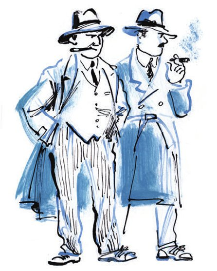
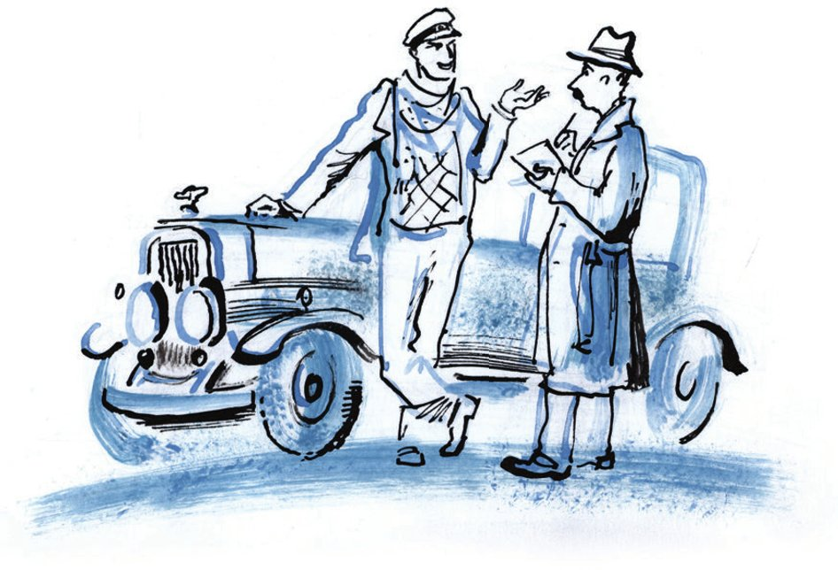
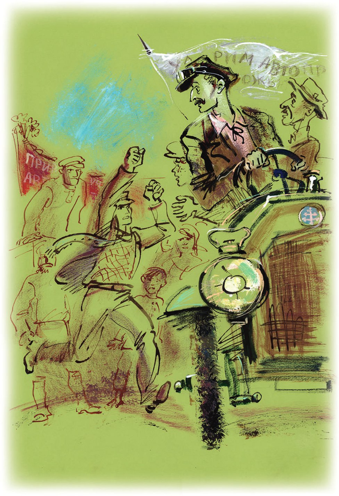

## Kapitel 7: Die süße Last des Ruhms

Der Kommandeur der Rallye, der Fahrer, der Bordmechaniker und das Mädchen für alles fühlen sich prächtig.

Der Morgen ist <abbr title="kühl — прохладный">kühl</abbr>. Am <abbr title="perlgrau — жемчужный">perlgrauen</abbr> Himmel <abbr title="sich verirren — заблудиться, путаться">verirrt sich</abbr> eine blasse Sonne. Im Gras schreit kleines <abbr title="das Vogelgesindel — птичий сброд, мелкие птахи">Vogelgesindel</abbr>.

Kleine Vögel, die <abbr title="die Bachstelze, die Bachstelzen — трясогузка, «пастушка»">Bachstelzen</abbr>, gehen langsam über die Straße, direkt vor den Rädern. Die <abbr title="die Steppe, die Steppen — степь">Steppe</abbr> riecht so frisch und <abbr title="munter — бодрый">munter</abbr>! Stellen wir uns vor: An der Stelle von Ostap sitzt ein <abbr title="mittelmäßig — посредственный, «середнячок»">mittelmäßiger</abbr> Bauernschriftsteller von der Gruppe «Das stählerne <abbr title="das Euter, die Euter — вымя">Euter</abbr>». Er hält es nicht aus. Er steigt aus, setzt sich ins Gras und schreibt sofort in sein <abbr title="das Notizbuch, die Notizbücher — блокнот">Notizbuch</abbr> eine neue <abbr title="die Erzählung, die Erzählungen — повесть, рассказ">Erzählung</abbr>. Sie beginnt so: «Gar sehr dampfeten die Wintersaaten. Das Sönnelein hat sich aufgeschnüret und hat seine Strählelein übers weiße Weltelein gestrülpet. Der alte Romualdytsch hat an seinem <abbr title="der Fußlappen, die Fußlappen — портянка">Fußlappen</abbr> geschnuppert und war gar sehr verzaubert …»

Aber Ostap und seine Gefährten haben keine Zeit für <abbr title="die Poesie — поэзия">Poesie</abbr>. Schon einen ganzen Tag rasen sie vor der Autorallye her. Überall empfängt man sie mit Musik und Reden. Kinder schlagen für sie die Trommel. Die Erwachsenen geben ihnen Mittagessen und Abendessen. Sie geben ihnen auch <abbr title="das Ersatzteil, die Ersatzteile — запчасть">Ersatzteile</abbr> für das Auto. Die haben sie schon vorher <abbr title="bereitlegen — заготовить">bereitgelegt</abbr>. In einem Dorf hat man ihnen Brot und Salz auf einer geschnitzten Platte aus Eichenholz gebracht. Darunter lag ein Handtuch mit <abbr title="der Kreuzstich — вышивка крестиком">Kreuzstich</abbr>. Das Brot liegt jetzt unten im Auto, zwischen den Füßen von Panikowski. Die ganze Zeit <abbr title="zupfen — щипать, отщипывать">zupft</abbr> er kleine Stückchen von dem <abbr title="der Laib, die Laibe — каравай">Laib</abbr>. Am Ende hat das Brot ein Loch wie von einer Maus. Da wirft der wählerische Ostap das Brot und das Salz auf die Straße. Die Nacht verbringen die Antilopen-Leute in einem kleinen Dorf. Die <abbr title="der Aktivist, die Aktivisten — активист">Aktivisten</abbr> vom Dorf <abbr title="sich kümmern um + Akk. — заботиться о">kümmern sich</abbr> um sie. Am Morgen nehmen sie einen großen <abbr title="der Krug, die Krüge — кувшин">Krug</abbr> <abbr title="die gebackene Milch — топлёное молоко">gebackene Milch</abbr> mit. Und eine süße Erinnerung an das <abbr title="das Heu — сено">Heu</abbr>, auf dem sie geschlafen haben. Es hat wie Kölnischwasser gerochen.

— Milch und Heu, — sagt Ostap, als die «Antilope» am frühen Morgen das Dorf verlässt. — Was gibt es Besseres! Man denkt immer: «Das schaffe ich noch. In meinem Leben gibt es noch viel Milch und Heu.» Aber in Wirklichkeit kommt das nie wieder. Merken Sie sich: Das war die beste Nacht in unserem Leben, meine armen Freunde. Und Sie haben es nicht einmal <abbr title="bemerken — замечать">bemerkt</abbr>.

Die Gefährten von Bender sehen ihn mit Respekt an. Das leichte Leben <abbr title="begeistern — восхищать, приводить в восторг">begeistert</abbr> sie.

— Schön ist das Leben auf der Welt! — sagt Balaganow. — Wir fahren, wir sind <abbr title="satt — сытый">satt</abbr>. Vielleicht wartet auf uns das Glück …

— Sind Sie da ganz sicher? — fragt Ostap. — Das Glück wartet auf uns an der Straße? Und flattert vielleicht noch vor Ungeduld mit den kleinen Flügeln? «Wo ist denn der <abbr title="der Admiral, die Admirale — адмирал">Admiral</abbr> Balaganow? — sagt es. — Warum kommt er so lange nicht?» Sie sind verrückt, Balaganow! Das Glück wartet auf niemanden. Es wandert in langen weißen Kleidern durch das Land und singt ein Kinderlied: «Ach, Amerika ist ein Land, da trinkt man Schnaps und isst nichts dazu.» Aber dieses <abbr title="naiv — наивный">naive</abbr> Kind muss man fangen. Man muss ihm gefallen, man muss ihm den Hof machen. Und Sie, Balaganow, haben bei diesem Kind keine Chance. Sie sind ein <abbr title="der Lump, die Lumpen — оборванец">Lump</abbr>. Sehen Sie nur, wie Sie aussehen! Ein Mensch in Ihrem Anzug findet nie das Glück. Und überhaupt ist die ganze Besatzung von der «Antilope» <abbr title="scheußlich — отвратительно">scheußlich</abbr> <abbr title="angezogen — одетый">angezogen</abbr>. Ich wundere mich, dass man uns immer noch für die Autorallye hält!

Ostap sieht seine Gefährten traurig an und spricht weiter:

— Der Hut von Panikowski stört mich sehr. Überhaupt ist er viel zu <abbr title="protzig — вызывающе роскошно">protzig</abbr> angezogen. Dieser <abbr title="kostbar — драгоценный">kostbare</abbr> Goldzahn, diese Bänder von der Unterhose, diese <abbr title="haarig — волосатый">haarige</abbr> Brust unter der Krawatte … Sie müssen sich einfacher anziehen, Panikowski! Sie sind ein ehrwürdiger alter Mann. Sie brauchen einen schwarzen <abbr title="der Gehrock, die Gehröcke — сюртук">Gehrock</abbr> und einen <abbr title="der Filzhut, die Filzhüte — касторовая (фетровая) шляпа">Filzhut</abbr>. Für Balaganow passen ein kariertes <abbr title="das Cowboyhemd, die Cowboyhemden — ковбойская рубашка">Cowboyhemd</abbr> und <abbr title="die Ledergamasche, die Ledergamaschen — кожаные краги">Ledergamaschen</abbr>. Dann sieht er sofort aus wie ein Student, der viel Sport macht. Jetzt sieht er aus wie ein <abbr title="der Matrose, die Matrosen — матрос">Matrose</abbr> von der <abbr title="die Handelsflotte — торговый флот">Handelsflotte</abbr>, den man wegen <abbr title="die Trunkenheit — пьянство">Trunkenheit</abbr> entlassen hat. Über unseren <abbr title="verehrt — уважаемый">verehrten</abbr> Fahrer sage ich nichts. Das Schicksal hat ihm schwere <abbr title="die Prüfung, die Prüfungen — испытание">Prüfungen</abbr> geschickt. Deshalb konnte er sich nicht so anziehen, wie es zu seinem Rang passt. Sehen Sie nicht, wie gut ein <abbr title="der Overall, die Overalls — комбинезон">Overall</abbr> aus Leder und eine schwarze Mütze aus <abbr title="das Chromleder — хром (кожа)">Chromleder</abbr> zu seinem <abbr title="vergeistigt — одухотворённый">vergeistigten</abbr> Gesicht passen? Das Gesicht ist zwar ein bisschen <abbr title="ölverschmiert — испачканный маслом">ölverschmiert</abbr>, aber trotzdem! Ja, Kinderchen, Sie brauchen eine neue <abbr title="die Ausrüstung, die Ausrüstungen — экипировка, снаряжение">Ausrüstung</abbr>.

— Wir haben kein Geld, — sagt Koslewitsch und dreht sich um.

— Der Fahrer hat recht, — antwortet Ostap <abbr title="liebenswürdig — любезно">liebenswürdig</abbr>. — Geld haben wir wirklich nicht. Wir haben keine von diesen kleinen <abbr title="das Metallscheibchen, die Metallscheibchen — металлический кружочек">Metallscheibchen</abbr>, die ich so sehr liebe.

Die «Antilope-Gnu» <abbr title="rutschen — скользить">rutscht</abbr> einen kleinen <abbr title="der Hügel, die Hügel — холм, пригорок">Hügel</abbr> hinunter. Rechts und links <abbr title="sich drehen — вращаться">drehen sich</abbr> langsam die Felder. Direkt an der Straße sitzt eine große rotbraune <abbr title="die Eule, die Eulen — сова">Eule</abbr>. Sie hält den Kopf schief und <abbr title="glotzen — таращиться">glotzt</abbr> dumm mit ihren gelben, <abbr title="blind — незрячий">blinden</abbr> Augen. Das Quietschen von der «Antilope» stört den Vogel. Die Eule <abbr title="ausbreiten — расправлять">breitet</abbr> die Flügel aus, fliegt über das Auto und fliegt bald weg, zu ihren langweiligen Eulen-Geschäften. Sonst passiert auf der Straße nichts Bemerkenswertes.

— Sehen Sie! — ruft Balaganow plötzlich. — Ein Auto!

Ostap <abbr title="befehlen (befahl, hat befohlen) — приказывать">befiehlt</abbr> sicherheitshalber: Das Plakat muss weg, das Plakat gegen Schlamperei. Während Panikowski den <abbr title="der Befehl, die Befehle — приказ">Befehl</abbr> <abbr title="ausführen — выполнять">ausführt</abbr>, kommt die «Antilope» an das andere Auto heran.

Am <abbr title="der Straßenrand, die Straßenränder — обочина, край дороги">Straßenrand</abbr> steht ein geschlossener grauer «Cadillac». Er steht ein bisschen schief. In seinen dicken, polierten Fenstern <abbr title="sich spiegeln — отражаться">spiegelt sich</abbr> die russische Natur. Darin sieht sie sauberer und schöner aus als in Wirklichkeit. Ein Fahrer kniet am Boden und nimmt den Reifen vom <abbr title="das Vorderrad, die Vorderräder — переднее колесо">Vorderrad</abbr> ab. Neben ihm stehen drei Gestalten in sandfarbenen <abbr title="der Reisemantel, die Reisemäntel — дорожное пальто">Reisemänteln</abbr>. Sie warten und <abbr title="sich langweilen — скучать, томиться">langweilen sich</abbr>.

— Haben Sie eine <abbr title="die Panne, die Pannen — авария, поломка; «терпите бедствие?»">Panne</abbr>? — fragt Ostap und hebt höflich seine Mütze.

Der Fahrer hebt sein <abbr title="angespannt — напряжённый">angespanntes</abbr> Gesicht. Er antwortet nichts und arbeitet weiter.

Die Antilopen-Leute steigen aus ihrer grünen <abbr title="die Kutsche, die Kutschen — тарантас, повозка">Kutsche</abbr>. Koslewitsch geht ein paar Mal um das wunderbare Auto herum. Er seufzt neidisch, hockt sich neben den Fahrer und beginnt bald ein <abbr title="das Fachgespräch, die Fachgespräche — профессиональный разговор">Fachgespräch</abbr> mit ihm. Panikowski und Balaganow sehen mit kindlicher Neugier die Fahrgäste an. Zwei von ihnen sehen sehr hochmütig und ausländisch aus. Der dritte <abbr title="stinken (stank, hat gestunken) — вонять">stinkt</abbr> nach <abbr title="der Gummi — резина">Gummi</abbr>, denn er trägt einen sowjetischen <abbr title="der Regenmantel, die Regenmäntel — плащ">Regenmantel</abbr> aus Gummi. Er ist also ein <abbr title="der Landsmann, die Landsleute — соотечественник">Landsmann</abbr>.

— Haben Sie eine Panne? — fragt Ostap noch einmal. Er berührt vorsichtig die Gummischulter vom Landsmann. Aber dabei sieht er nachdenklich auf die <abbr title="der Ausländer, die Ausländer — иностранец">Ausländer</abbr>.

Der Landsmann erzählt gereizt etwas von einem <abbr title="platzen — лопнуть">geplatzten</abbr> Reifen. Aber Ostap hört nicht zu. Auf der großen Landstraße, hundertdreißig Kilometer von der nächsten <abbr title="die Bezirksstadt, die Bezirksstädte — окружной центр">Bezirksstadt</abbr>, mitten im europäischen Russland, gehen zwei dicke ausländische <abbr title="das Küken, die Küken — цыплёнок">Küken</abbr> um ihr Auto spazieren. Das <abbr title="aufregen — волновать">regt</abbr> den großen Kombinator auf.

— Sagen Sie, — unterbricht er, — sind die beiden vielleicht aus Rio de Janeiro?

— Nein, — antwortet der Landsmann, — sie sind aus Chicago. Und ich bin <abbr title="der Dolmetscher, die Dolmetscher — переводчик (устный)">Dolmetscher</abbr> von «Intourist».

— Und was machen sie hier, an der <abbr title="die Wegkreuzung, die Wegkreuzungen — распутье, перекрёсток">Wegkreuzung</abbr>, auf dem wilden alten Feld? So weit weg von Moskau, vom <abbr title="das Ballett, die Ballette — балет">Ballett</abbr> «Der rote Mohn», von den <abbr title="der Antiquitätenladen, die Antiquitätenläden — антикварный магазин">Antiquitätenläden</abbr> und vom berühmten <abbr title="das Gemälde, die Gemälde — картина">Gemälde</abbr> von Repin «Iwan der Schreckliche tötet seinen Sohn»? Das verstehe ich nicht! Warum haben Sie sie hierher gebracht?

— Ach, zum Teufel mit ihnen! — sagt der Dolmetscher <abbr title="kummervoll — скорбно">kummervoll</abbr>. — Schon den dritten Tag rasen wir wie verrückt durch die Dörfer. Sie machen mich ganz <abbr title="fertig machen — замучить, доконать">fertig</abbr>. Ich habe schon viel mit Ausländern gearbeitet, aber solche habe ich noch nie gesehen. — Er <abbr title="winken — махать">winkt</abbr> zu seinen <abbr title="rotwangig — румяный">rotwangigen</abbr> Begleitern hin. — Alle Touristen sind normale Touristen. Sie laufen durch Moskau und kaufen in den <abbr title="der Volkskunstladen, die Volkskunstläden — кустарный магазин">Volkskunstläden</abbr> Holzschalen. Aber diese zwei sind <abbr title="ausbrechen (brach aus, ist ausgebrochen) — отбиться, вырваться">ausgebrochen</abbr>. Sie wollen nur noch durch die Dörfer fahren.

— Das ist <abbr title="lobenswert — похвальный">lobenswert</abbr>, — sagt Ostap. — Die breiten Massen der Milliardäre lernen das Leben im neuen, sowjetischen Dorf kennen.

Die Bürger von Chicago sehen würdevoll zu, wie man ihr Auto <abbr title="reparieren — чинить">repariert</abbr>. Sie tragen silberne Hüte, <abbr title="steif — жёсткий">steife</abbr>, <abbr title="gestärkt — накрахмаленный">gestärkte</abbr> Kragen, wie gefroren, und rote, <abbr title="matt — матовый">matte</abbr> Schuhe.

Der Dolmetscher sieht Ostap <abbr title="empört — возмущённо">empört</abbr> an und ruft:

— Ja, genau! Das neue Dorf interessiert die doch gar nicht! Den Selbstgebrannten vom Dorf wollen sie, nicht das Dorf!

Bei dem Wort «Selbstgebrannter» – der Dolmetscher sagt es sehr laut – drehen sich die Herren unruhig um. Sie kommen näher.

— Sehen Sie! — sagt der Dolmetscher. — Dieses Wort können sie nicht ruhig hören.

— Ja. Hier gibt es ein Geheimnis, — sagt Ostap. — Oder einen <abbr title="pervers — извращённый">perversen</abbr> Geschmack. Ich verstehe nicht, wie man Selbstgebrannten lieben kann. In unserem <abbr title="das Vaterland — отечество">Vaterland</abbr> gibt es doch so viele edle, starke <abbr title="das Getränk, die Getränke — напиток">Getränke</abbr>!

— Es ist alles viel einfacher, als Sie denken, — sagt der Dolmetscher. — Sie suchen ein <abbr title="das Rezept, die Rezepte — рецепт">Rezept</abbr> für guten Selbstgebrannten.

— Natürlich! — ruft Ostap. — Bei ihnen gibt es doch die <abbr title="die Prohibition — «сухой закон»">Prohibition</abbr>. Jetzt ist alles klar … Haben sie ein Rezept bekommen? … Ach, nicht? Na klar. Sie sind ja fast mit drei Autos gekommen! Natürlich halten Sie die Leute für <abbr title="der/die Vorgesetzte, die Vorgesetzten — начальство">Vorgesetzte</abbr>. Sie bekommen nie ein Rezept, das versichere ich Ihnen.

Der Dolmetscher <abbr title="sich beklagen über + Akk. — жаловаться на">beklagt sich</abbr> über die Ausländer:

— Glauben Sie mir, sie <abbr title="sich stürzen auf + Akk. — бросаться на">stürzen sich</abbr> auf mich: Erzähl uns das Geheimnis vom Selbstgebrannten, erzähl! Aber ich bin kein <abbr title="der Schnapsbrenner, die Schnapsbrenner — самогонщик">Schnapsbrenner</abbr>. Ich bin Mitglied in der <abbr title="die Gewerkschaft, die Gewerkschaften — профсоюз">Gewerkschaft</abbr> der <abbr title="der Bildungsarbeiter, die Bildungsarbeiter — работник просвещения">Bildungsarbeiter</abbr>. Ich habe in Moskau eine alte Mama.

— Und Sie möchten sehr gern zurück nach Moskau? Zu Mama?

Der Dolmetscher seufzt kläglich.

— Dann geht die Sitzung weiter, — sagt Bender. — Wie viel bezahlen Ihre Chefs für das Rezept? Hundertfünfzig?

— Sie bezahlen zweihundert, — flüstert der Dolmetscher. — Haben Sie wirklich ein Rezept?

— Ich diktiere es Ihnen sofort. Das heißt, sofort, wenn ich das Geld habe. Welches Sie wollen: aus Kartoffeln, aus Weizen, aus <abbr title="die Aprikose, die Aprikosen — абрикос">Aprikosen</abbr>, aus <abbr title="die Gerste — ячмень">Gerste</abbr>, aus <abbr title="die Maulbeere, die Maulbeeren — тутовая ягода">Maulbeeren</abbr>, aus Buchweizenbrei. Man kann sogar aus einem ganz normalen Hocker Schnaps <abbr title="brennen (brannte, hat gebrannt) — гнать (самогон)">brennen</abbr>. Manche Leute mögen Hockerschnaps sehr. Oder einfachen <abbr title="der Rosinenschnaps — изюмная водка, «кишмишовка»">Rosinenschnaps</abbr> oder <abbr title="der Pflaumenschnaps — сливянка">Pflaumenschnaps</abbr>. Kurz: jeden von hundertfünfzig Selbstgebrannten. Ich kenne alle Rezepte.

Man <abbr title="vorstellen — представлять (знакомить)">stellt</abbr> Ostap den Amerikanern vor. Lange schweben höflich gehobene Hüte in der Luft. Dann kommen sie zur Sache.

Die Amerikaner wählen den Selbstgebrannten aus Weizen. Er ist so einfach zu machen, das gefällt ihnen. Lange schreiben sie das Rezept in ihre Notizbücher. Als <abbr title="die Gratiszugabe, die Gratiszugaben — бесплатная премия">Gratiszugabe</abbr> erklärt Ostap den amerikanischen Bittstellern noch die beste <abbr title="die Bauweise, die Bauweisen — конструкция">Bauweise</abbr> für eine <abbr title="die Schnapsbrennerei, die Schnapsbrennereien — самогонный аппарат">Schnapsbrennerei</abbr> fürs <abbr title="das Arbeitszimmer, die Arbeitszimmer — кабинет">Arbeitszimmer</abbr>. Man kann sie leicht im Schreibtisch verstecken. Die Bittsteller versichern: Mit amerikanischer <abbr title="die Technik — техника">Technik</abbr> ist so ein <abbr title="der Apparat, die Apparate — аппарат">Apparat</abbr> gar kein Problem. Ostap versichert seinerseits: Sein Apparat macht jeden Tag einen Eimer <abbr title="herrlich — прелестный, чудесный">herrlichen</abbr>, <abbr title="duftend — ароматный">duftenden</abbr> Pervatsch. (So nennt man den ersten und stärksten Schnaps.)

— Oh! — rufen die Amerikaner. Dieses Wort kennen sie schon. Sie haben es in einer ehrwürdigen Familie in Chicago gehört. Dort hat man ihnen nur Gutes über den «pervatsch» erzählt. Der Vater von dieser Familie war früher mit den amerikanischen <abbr title="die Besatzungstruppen (Pl.) — оккупационный корпус">Besatzungstruppen</abbr> in Archangelsk. Dort hat er «pervatsch» getrunken. Seitdem kann er dieses wunderbare Gefühl nicht vergessen.

Aus dem Mund von den <abbr title="entspannt — разомлевший">entspannten</abbr> Touristen klingt das grobe Wort «Pervatsch» zärtlich und verlockend.

Die Amerikaner geben ohne Probleme zweihundert Rubel und schütteln Bender lange die Hand. Auch Panikowski und Balaganow dürfen den Bürgern von der <abbr title="transatlantisch — заатлантический">transatlantischen</abbr> Republik die Hand geben. Die Prohibition hat diese Bürger ganz erschöpft. Der Dolmetscher ist so froh, dass er Ostap auf die harte Wange küsst. Ostap soll ihn bitte <abbr title="besuchen — навещать">besuchen</abbr>, sagt er, die alte Mama freut sich sehr. Aber seine Adresse gibt er ihm aus irgendeinem Grund nicht.

Die neuen Freunde steigen in ihre Autos. Koslewitsch spielt zum Abschied den Matchiche. Zu der fröhlichen Musik fahren die Autos in <abbr title="entgegengesetzt — противоположный">entgegengesetzte</abbr> Richtungen.

— Sehen Sie, — sagt Ostap, als das amerikanische Auto im Staub verschwindet, — alles ist so passiert, wie ich gesagt habe. Wir sind gefahren. Auf der Straße lag Geld. Ich habe es aufgehoben. Sehen Sie, es ist nicht einmal staubig geworden.

Und er <abbr title="rascheln mit + Dat. — шелестеть">raschelt</abbr> mit dem Bündel <abbr title="der Geldschein, die Geldscheine — кредитка, купюра">Geldscheine</abbr>.

— Eigentlich muss ich nicht <abbr title="angeben (gab an, hat angegeben) — хвастаться">angeben</abbr>. Die Kombination war ganz einfach. Aber sauber und ehrlich – das ist es, was zählt. Zweihundert Rubel. In fünf Minuten. Und ich habe kein Gesetz gebrochen. Ich habe sogar allen eine Freude gemacht. Die Besatzung von der «Antilope» hat jetzt Geld. Die alte Mama hat ihren Sohn, den Dolmetscher, zurück. Und ich habe den geistigen <abbr title="der Durst — жажда">Durst</abbr> von den Bürgern <abbr title="stillen — утолять">gestillt</abbr>. Sie kommen aus einem Land, mit dem wir immerhin <abbr title="die Handelsbeziehung, die Handelsbeziehungen — торговые связи">Handelsbeziehungen</abbr> haben.

Es ist bald Zeit für das Mittagessen. Ostap studiert die Karte von der Rallye. Er hat sie aus einer <abbr title="die Autozeitschrift, die Autozeitschriften — автомобильный журнал">Autozeitschrift</abbr> herausgerissen. Dann <abbr title="verkünden — возвещать, объявлять">verkündet</abbr> er: Bald kommt die Stadt Lutschansk.

— Die Stadt ist sehr klein, — sagt Bender. — Das ist schlecht. Je kleiner die Stadt, desto länger die Begrüßungsreden. Deshalb bitten wir die <abbr title="freundlich — любезный">freundlichen</abbr> <abbr title="der Gastgeber, die Gastgeber — хозяин (принимающий)">Gastgeber</abbr> um das Mittagessen als ersten Gang und um die Reden als zweiten Gang. In der <abbr title="die Pause, die Pausen — перерыв, антракт">Pause</abbr> gebe ich Ihnen neue Kleider. Panikowski! Sie vergessen langsam Ihre <abbr title="die Pflicht, die Pflichten — обязанность">Pflichten</abbr>. Hängen Sie das Plakat wieder an seinen Platz.

Koslewitsch hat jetzt Erfahrung mit feierlichen Ankünften. Er stoppt das Auto schneidig direkt vor der Tribüne. Hier begrüßt Bender die Leute nur kurz. Man <abbr title="verschieben (verschob, hat verschoben) — переносить, откладывать">verschiebt</abbr> die Kundgebung um zwei Stunden. Die Autofahrer essen kostenlos zu Mittag. Dann gehen sie in bester Laune zum <abbr title="das Bekleidungsgeschäft, die Bekleidungsgeschäfte — магазин готового платья">Bekleidungsgeschäft</abbr>. <abbr title="der/die Neugierige, die Neugierigen — любопытный, зевака">Neugierige</abbr> <abbr title="umringen — окружать">umringen</abbr> sie. Mit <abbr title="die Würde — достоинство">Würde</abbr> tragen die Antilopen-Leute die süße <abbr title="die Last, die Lasten — бремя, груз">Last</abbr> des Ruhms. Sie gehen mitten auf der Straße, halten sich an den Händen und schaukeln hin und her, wie Matrosen in einem <abbr title="fremd — чужой, чужеземный">fremden</abbr> Hafen. Der rothaarige Balaganow sieht wirklich aus wie ein junger <abbr title="der Bootsmann, die Bootsleute — боцман">Bootsmann</abbr>. Er <abbr title="anstimmen — затянуть (песню)">stimmt</abbr> ein <abbr title="das Seemannslied, die Seemannslieder — морская песня">Seemannslied</abbr> an.

Über dem Geschäft «Kleidung für Herren, Damen und Kinder» hängt ein riesiges <abbr title="das Schild, die Schilder — вывеска">Schild</abbr>. Es ist so groß wie das ganze Haus mit zwei <abbr title="das Stockwerk, die Stockwerke — этаж">Stockwerken</abbr>. Auf dem Schild sind viele Figuren <abbr title="malen — рисовать, малевать">gemalt</abbr>: Männer mit gelben Gesichtern und dünnen <abbr title="das Schnurrbärtchen, die Schnurrbärtchen — усики">Schnurrbärtchen</abbr>, in Pelzen mit <abbr title="das Iltisfell — хорьковый мех">Iltisfell</abbr> nach außen. Damen mit <abbr title="der Muff, die Muffs — муфта">Muffs</abbr> in den Händen. Kinder mit kurzen Beinen in <abbr title="der Matrosenanzug, die Matrosenanzüge — матросский костюмчик">Matrosenanzügen</abbr>. <abbr title="die Komsomolzin, die Komsomolzinnen — комсомолка">Komsomolzinnen</abbr> mit roten <abbr title="das Kopftuch, die Kopftücher — косынка, платок">Kopftüchern</abbr>. Und finstere <abbr title="der Wirtschaftsleiter, die Wirtschaftsleiter — хозяйственник">Wirtschaftsleiter</abbr>, die bis zu den <abbr title="die Hüfte, die Hüften — бедро">Hüften</abbr> in Filzstiefeln stecken.

Aber diese ganze <abbr title="die Pracht — великолепие">Pracht</abbr> <abbr title="zerbrechen an + Dat. (zerbrach, ist zerbrochen) — разбиваться о">zerbricht</abbr> an einem kleinen Zettel an der Tür:

KEINE HOSEN

— Pfui, wie grob, — sagt Ostap und geht hinein. — Man sieht sofort: Provinz. In Moskau schreibt man: «<abbr title="das Beinkleid, die Beinkleider — брюки (вежливо), панталоны">Beinkleider</abbr> <abbr title="ausverkauft — распроданный">ausverkauft</abbr>». Das ist anständig und <abbr title="vornehm — благородно">vornehm</abbr>. Und die Bürger gehen zufrieden nach Hause.

Lange bleiben die Autofahrer nicht im Geschäft. Für Balaganow finden sie ein Cowboyhemd mit großen <abbr title="kanariengelb — канареечный">kanariengelben</abbr> <abbr title="das Karo, die Karos — клетка (узор)">Karos</abbr> und einen <abbr title="der Stetson-Hut, die Stetson-Hüte — стетсоновская шляпа">Stetson-Hut</abbr> mit kleinen Löchern. Koslewitsch bekommt die <abbr title="versprechen (versprach, hat versprochen) — обещать">versprochene</abbr> Mütze aus Chromleder und eine <abbr title="die Jacke, die Jacken — куртка, тужурка">Jacke</abbr> aus demselben Leder. Sie glänzt wie <abbr title="gepresst — прессованный">gepresster</abbr> <abbr title="der Kaviar — икра">Kaviar</abbr>. Mit Panikowski <abbr title="sich plagen mit + Dat. — возиться с">plagen sie sich</abbr> lange. Bender hat geplant: Ein langer <abbr title="der Pastorenrock, die Pastorenröcke — пасторский сюртук">Pastorenrock</abbr> und ein weicher Hut machen den <abbr title="der Konventionsbrecher, die Konventionsbrecher — нарушитель конвенции">Konventionsbrecher</abbr> vornehmer. Aber das <abbr title="wegfallen (fiel weg, ist weggefallen) — отпадать">fällt</abbr> schon in der ersten Minute weg. Das Geschäft hat nur eine <abbr title="die Feuerwehruniform, die Feuerwehruniformen — костюм пожарного">Feuerwehruniform</abbr>: eine Jacke mit goldenen Pumpen auf den <abbr title="der Kragenspiegel, die Kragenspiegel — петлица">Kragenspiegeln</abbr>, haarige Hosen aus <abbr title="die Halbwolle — полушерсть">Halbwolle</abbr> und eine Mütze mit blauem Rand. Panikowski springt lange vor einem <abbr title="wellig — волнистый">welligen</abbr> <abbr title="der Spiegel, die Spiegel — зеркало">Spiegel</abbr> hin und her.

— Ich verstehe nicht, — sagt Ostap, — was Ihnen an der Feuerwehruniform nicht gefällt. Sie ist immer noch besser als der Anzug von einem König im <abbr title="das Exil — изгнание">Exil</abbr>, den Sie jetzt tragen. Na, dreh dich mal um, Söhnchen! Ausgezeichnet! Ich sage es Ihnen offen: Das steht Ihnen besser als mein <abbr title="der Entwurf, die Entwürfe — проект">Entwurf</abbr> mit Gehrock und Hut.

In den neuen Kleidern gehen sie auf die Straße.

— Ich brauche einen <abbr title="der Smoking, die Smokings — смокинг">Smoking</abbr>, — sagt Ostap, — aber hier gibt es keinen. Wir warten auf bessere Zeiten.

Ostap eröffnet die Kundgebung in bester Laune. Er ahnt nicht, was für ein <abbr title="das Gewitter, die Gewitter — гроза">Gewitter</abbr> auf die Fahrgäste von der «Antilope» zukommt. Er macht Witze, erzählt lustige <abbr title="das Reiseabenteuer, die Reiseabenteuer — дорожное приключение">Reiseabenteuer</abbr> und jüdische Witze. Das Publikum mag ihn sehr. Am Ende von seiner Rede spricht er über das <abbr title="das Autoproblem, die Autoprobleme — автопроблема">Autoproblem</abbr>. Darüber muss man schon lange sprechen.

— Das Auto, — ruft er mit einer Stimme wie eine Trompete, — ist kein Luxus, sondern …

In diesem Moment sieht er: Ein Junge kommt gelaufen und gibt dem Vorsitzenden vom Empfangskomitee ein Telegramm. Ostap sagt noch: «… kein Luxus, sondern ein Verkehrsmittel.» Dabei beugt er sich nach links und sieht über die Schulter vom Vorsitzenden auf das <abbr title="das Telegrammformular, die Telegrammformulare — телеграфный бланк">Telegrammformular</abbr>. Was er liest, <abbr title="erschüttern — поражать, потрясать">erschüttert</abbr> ihn. Er hat gedacht, er hat noch einen ganzen Tag Zeit. In einer Sekunde sieht er vor sich die vielen Dörfer und Städte, wo die «Antilope» fremdes Material und fremdes Geld <abbr title="benutzen — использовать">benutzt</abbr> hat.

Der Vorsitzende bewegt noch seinen Schnurrbart und versucht, das Telegramm zu verstehen. Aber Ostap ist schon mitten im Wort von der Tribüne gesprungen und drängt sich durch die Menge. Die grüne «Antilope» steht an der Kreuzung. Zum Glück sitzen die Fahrgäste auf ihren Plätzen. Sie langweilen sich und warten: Gleich befiehlt Ostap, die <abbr title="das Geschenk, die Geschenke — подарок, дар">Geschenke</abbr> von der Stadt ins Auto zu tragen. Das passiert sonst immer nach der Kundgebung.

Endlich versteht der Vorsitzende das Telegramm.

Er hebt die Augen und sieht den Kommandeur weglaufen.

— Das sind Gauner! — schreit er <abbr title="gequält — страдальчески">gequält</abbr>.

Er hat die ganze Nacht an seiner Begrüßungsrede gearbeitet. Jetzt ist er als <abbr title="der Autor, die Autoren — автор">Autor</abbr> tief gekränkt.

— Packt sie, Jungs!

Der Schrei vom Vorsitzenden kommt bis zu den Antilopen-Leuten. Sie werden nervös und zappeln. Koslewitsch startet den Motor und springt mit einem Satz auf seinen Sitz. Das Auto springt nach vorn, ohne auf Ostap zu warten. In der <abbr title="die Eile — спешка">Eile</abbr> merken die Antilopen-Leute gar nicht, dass sie ihren Kommandeur in Gefahr <abbr title="zurücklassen (ließ zurück, hat zurückgelassen) — оставлять">zurücklassen</abbr>.

— Halt! — schreit Ostap und macht <abbr title="riesig — гигантский">riesige</abbr> <abbr title="der Sprung, die Sprünge — прыжок">Sprünge</abbr>. — Wenn ich euch kriege, <abbr title="entlassen (entließ, hat entlassen) — увольнять">entlasse</abbr> ich euch alle!

— Halt! — schreit der Vorsitzende.

— Halt, du <abbr title="der Idiot, die Idioten — дурак, идиот">Idiot</abbr>! — schreit Balaganow zu Koslewitsch. — Siehst du nicht? Wir haben den Chef verloren!

Adam Kasimirowitsch tritt auf die <abbr title="das Pedal, die Pedale — педаль">Pedale</abbr>. Die «Antilope» knirscht und bleibt stehen. Der Kommandeur fällt mit einem <abbr title="verzweifelt — отчаянный">verzweifelten</abbr> Schrei ins Auto: «Volle Fahrt!» Er ist ein <abbr title="vielseitig — разносторонний">vielseitiger</abbr>, <abbr title="kaltblütig — хладнокровный">kaltblütiger</abbr> Mensch. Aber Prügel kann er überhaupt nicht leiden. Koslewitsch ist ganz <abbr title="durcheinander sein — быть в смятении">durcheinander</abbr>. Er schaltet in den dritten Gang, das Auto reißt nach vorn – und durch die offene Tür fällt Balaganow hinaus. Das alles passiert in einer Sekunde. Koslewitsch <abbr title="bremsen — тормозить">bremst</abbr> wieder. Aber schon fällt der Schatten von der laufenden Menge auf Balaganow. Schon strecken sich riesige <abbr title="die Pranke, die Pranken — лапища, ручища">Pranken</abbr> nach ihm aus. Da kommt die «Antilope» im <abbr title="der Rückwärtsgang — задний ход">Rückwärtsgang</abbr> zu ihm zurück. Die eiserne Hand vom Kommandeur packt ihn am Cowboyhemd.

— Ganz volle Fahrt! — brüllt Ostap.

Und jetzt verstehen die Leute von Lutschansk zum ersten Mal: Das mechanische Verkehrsmittel ist besser als das Pferd. Das Auto <abbr title="scheppern — бренчать, дребезжать">scheppert</abbr> mit allen Teilen und rast schnell davon. Vier <abbr title="der Gesetzesbrecher, die Gesetzesbrecher — правонарушитель">Gesetzesbrecher</abbr> <abbr title="entkommen (entkam, ist entkommen) — ускользнуть, избежать">entkommen</abbr> ihrer gerechten Strafe.

Auf dem ersten Kilometer atmen die Gauner schwer. Balaganow ist sehr stolz auf seine Schönheit. Er sieht in einen <abbr title="der Taschenspiegel, die Taschenspiegel — карманное зеркальце">Taschenspiegel</abbr>. Beim Fallen hat er sich das Gesicht <abbr title="zerkratzen — исцарапать">zerkratzt</abbr>. Die <abbr title="der Kratzer, die Kratzer — царапина">Kratzer</abbr> sind <abbr title="himbeerrot — малиновый">himbeerrot</abbr>. Panikowski zittert in seiner Feuerwehruniform. Er hat Angst vor der <abbr title="die Rache — месть">Rache</abbr> vom Kommandeur. Und die Rache kommt sofort.

— Sind Sie losgefahren, bevor ich im Auto war? — fragt der Kommandeur drohend.

— <abbr title="bei Gott — ей-богу">Bei Gott</abbr> … — beginnt Panikowski.

— Nein, nein, <abbr title="leugnen — отпираться, отрицать">leugnen</abbr> Sie nicht! Das sind Ihre Tricks. Sie sind also auch noch ein <abbr title="der Feigling, die Feiglinge — трус">Feigling</abbr>? Ich bin in einer <abbr title="die Gesellschaft, die Gesellschaften — компания, общество">Gesellschaft</abbr> mit einem Dieb und einem Feigling? Gut! Ich <abbr title="degradieren — разжаловать">degradiere</abbr> Sie. Bis jetzt waren Sie für mich ein <abbr title="der Brandmeister, die Brandmeister — брандмейстер">Brandmeister</abbr>. Ab heute sind Sie nur ein einfacher <abbr title="der Axtmann, die Axtmänner — топорник (рядовой пожарный)">Axtmann</abbr>.

Und feierlich <abbr title="abreißen (riss ab, hat abgerissen) — срывать">reißt</abbr> Ostap die goldenen Pumpen von den roten Kragenspiegeln von Panikowski ab.

Danach liest Ostap seinen Gefährten das Telegramm vor.

— Es steht schlecht. Im Telegramm steht: Man soll das grüne Auto vor der Autorallye <abbr title="festhalten (hielt fest, hat festgehalten) — задерживать">festhalten</abbr>. Wir müssen sofort irgendwo zur Seite abbiegen. Genug von Triumphen, <abbr title="der Palmzweig, die Palmzweige — пальмовая ветвь">Palmzweigen</abbr> und kostenlosem Mittagessen mit <abbr title="das Sonnenblumenöl — постное масло">Sonnenblumenöl</abbr>. Die Idee hat sich <abbr title="sich überleben — изжить себя">überlebt</abbr>. Abbiegen können wir nur auf die Chaussee nach Grjashsk. Aber bis dahin sind es noch drei Stunden. Ich bin sicher: In allen Orten in der Nähe wartet auf uns ein heißer Empfang. Dieser verfluchte <abbr title="der Telegraf — телеграф">Telegraf</abbr> hat überall seine <abbr title="der Mast, die Masten — столб, мачта">Masten</abbr> mit <abbr title="der Draht, die Drähte — провод, проволока">Drähten</abbr> hingestellt.

Der Kommandeur hat recht.

Auf dem Weg liegt ein Städtchen. Seinen Namen haben die Antilopen-Leute nie erfahren. Dabei möchten sie ihn so gern wissen – sie möchten bei Gelegenheit etwas Böses über dieses Städtchen sagen. Direkt am <abbr title="der Eingang, die Eingänge — вход, въезд">Eingang</abbr> von der Stadt liegt ein schwerer <abbr title="der Baumstamm, die Baumstämme — бревно">Baumstamm</abbr> quer über der Straße. Die «Antilope» dreht um. Wie ein blinder <abbr title="der Welpe, die Welpen — щенок">Welpe</abbr> stößt sie nach rechts und nach links und sucht einen anderen Weg. Aber es gibt keinen.

— Zurück! — sagt Ostap. Er ist jetzt sehr ernst.

Und da hören die Gauner ein sehr fernes <abbr title="summen — жужжать">Summen</abbr> von Motoren, wie von <abbr title="die Mücke, die Mücken — комар">Mücken</abbr>. Offenbar kommen die Autos von der echten Rallye. Zurück können sie nicht. Und die Antilopen-Leute <abbr title="stürzen — бросаться, кидаться">stürzen</abbr> wieder nach vorn.

Koslewitsch <abbr title="die Stirn runzeln — хмуриться">runzelt die Stirn</abbr>. Er fährt schnell bis zum Baumstamm. Die Bürger an der Straße springen <abbr title="erschrocken — испуганно">erschrocken</abbr> zur Seite. Sie erwarten eine <abbr title="die Katastrophe, die Katastrophen — катастрофа">Katastrophe</abbr>. Aber plötzlich fährt Koslewitsch langsamer und rollt langsam über das <abbr title="das Hindernis, die Hindernisse — препятствие">Hindernis</abbr>. Die «Antilope» fährt durch die Stadt. Die <abbr title="der Passant, die Passanten — прохожий">Passanten</abbr> <abbr title="schimpfen — ругаться, ругать">schimpfen</abbr> <abbr title="zänkisch — сварливо">zänkisch</abbr> hinter ihnen her. Aber Ostap antwortet nicht einmal.

Die «Antilope» kommt zur Chaussee nach Grjashsk. Das Dröhnen von den Autos, die sie noch nicht sehen, wird immer lauter. Die Antilopen-Leute biegen gerade noch von der verfluchten Hauptstraße ab. Es ist schon dunkel. Sie verstecken das Auto hinter einem Hügel. Da hört man schon <abbr title="die Explosion, die Explosionen — взрыв">Explosionen</abbr> und das Knallen von Motoren. Im Licht von den Scheinwerfern kommt das erste Auto. Die Gauner verstecken sich im Gras direkt an der Straße. Plötzlich ist ihre normale <abbr title="die Frechheit — наглость">Frechheit</abbr> weg. Schweigend sehen sie die Kolonne vorbeifahren.

Breite Streifen von <abbr title="blendend — ослепительный">blendendem</abbr> Licht flattern auf der Straße. Weich quietschen die Autos an den <abbr title="besiegt — поверженный">besiegten</abbr> Antilopen-Leuten vorbei. Staub fliegt unter den Rädern hervor. Lang heulen die Hupen. Der Wind <abbr title="wehen — дуть, метаться">weht</abbr> nach allen Seiten. In einer Minute ist alles verschwunden. Nur das <abbr title="rubinrot — рубиновый">rubinrote</abbr> <abbr title="das Lämpchen, die Lämpchen — фонарик">Lämpchen</abbr> vom letzten Auto <abbr title="tanzen — плясать, прыгать">tanzt</abbr> noch lange in der Dunkelheit.

Das echte Leben ist vorbeigeflogen. Es hat fröhlich getrompetet, und seine lackierten Kotflügel haben geglänzt.

Den <abbr title="der Abenteurer, die Abenteurer — искатель приключений, авантюрист">Abenteurern</abbr> bleibt nur der Benzingeruch. Noch lange sitzen sie im Gras, niesen und <abbr title="abklopfen — отряхивать">klopfen</abbr> sich den Staub ab.

— Ja, — sagt Ostap, — jetzt sehe ich es selbst: Das Auto ist kein Luxus, sondern ein Verkehrsmittel. Sind Sie nicht neidisch, Balaganow? Ich bin neidisch.

---

### Neue Wörter

- **kühl** — прохладный
- **perlgrau** — жемчужный
- **sich verirren** — заблудиться, путаться
- **das Vogelgesindel** — птичий сброд, мелкие птахи
- **die Bachstelze, die Bachstelzen** — трясогузка, «пастушка»
- **die Steppe, die Steppen** — степь
- **munter** — бодрый
- **mittelmäßig** — посредственный, «середнячок»
- **das Euter, die Euter** — вымя
- **das Notizbuch, die Notizbücher** — блокнот
- **die Erzählung, die Erzählungen** — повесть, рассказ
- **der Fußlappen, die Fußlappen** — портянка
- **die Poesie** — поэзия
- **das Ersatzteil, die Ersatzteile** — запчасть
- **bereitlegen** — заготовить
- **der Kreuzstich** — вышивка крестиком
- **zupfen** — щипать, отщипывать
- **der Laib, die Laibe** — каравай
- **der Aktivist, die Aktivisten** — активист
- **sich kümmern um + Akk.** — заботиться о
- **der Krug, die Krüge** — кувшин
- **die gebackene Milch** — топлёное молоко
- **das Heu** — сено
- **bemerken** — замечать
- **begeistern** — восхищать, приводить в восторг
- **satt** — сытый
- **der Admiral, die Admirale** — адмирал
- **naiv** — наивный
- **der Lump, die Lumpen** — оборванец
- **scheußlich** — отвратительно
- **angezogen** — одетый
- **protzig** — вызывающе роскошно
- **kostbar** — драгоценный
- **haarig** — волосатый
- **der Gehrock, die Gehröcke** — сюртук
- **der Filzhut, die Filzhüte** — касторовая (фетровая) шляпа
- **das Cowboyhemd, die Cowboyhemden** — ковбойская рубашка
- **die Ledergamasche, die Ledergamaschen** — кожаные краги
- **der Matrose, die Matrosen** — матрос
- **die Handelsflotte** — торговый флот
- **die Trunkenheit** — пьянство
- **verehrt** — уважаемый
- **die Prüfung, die Prüfungen** — испытание
- **der Overall, die Overalls** — комбинезон
- **das Chromleder** — хром (кожа)
- **vergeistigt** — одухотворённый
- **ölverschmiert** — испачканный маслом
- **die Ausrüstung, die Ausrüstungen** — экипировка, снаряжение
- **liebenswürdig** — любезно
- **das Metallscheibchen, die Metallscheibchen** — металлический кружочек
- **rutschen** — скользить
- **der Hügel, die Hügel** — холм, пригорок
- **sich drehen** — вращаться
- **die Eule, die Eulen** — сова
- **glotzen** — таращиться
- **blind** — незрячий
- **ausbreiten** — расправлять
- **befehlen (befahl, hat befohlen)** — приказывать
- **der Befehl, die Befehle** — приказ
- **ausführen** — выполнять
- **der Straßenrand, die Straßenränder** — обочина, край дороги
- **sich spiegeln** — отражаться
- **das Vorderrad, die Vorderräder** — переднее колесо
- **der Reisemantel, die Reisemäntel** — дорожное пальто
- **sich langweilen** — скучать, томиться
- **die Panne, die Pannen** — авария, поломка; «терпите бедствие?»
- **angespannt** — напряжённый
- **die Kutsche, die Kutschen** — тарантас, повозка
- **das Fachgespräch, die Fachgespräche** — профессиональный разговор
- **stinken (stank, hat gestunken)** — вонять
- **der Gummi** — резина
- **der Regenmantel, die Regenmäntel** — плащ
- **der Landsmann, die Landsleute** — соотечественник
- **der Ausländer, die Ausländer** — иностранец
- **platzen** — лопнуть
- **die Bezirksstadt, die Bezirksstädte** — окружной центр
- **das Küken, die Küken** — цыплёнок
- **aufregen** — волновать
- **der Dolmetscher, die Dolmetscher** — переводчик (устный)
- **die Wegkreuzung, die Wegkreuzungen** — распутье, перекрёсток
- **das Ballett, die Ballette** — балет
- **der Antiquitätenladen, die Antiquitätenläden** — антикварный магазин
- **das Gemälde, die Gemälde** — картина
- **kummervoll** — скорбно
- **fertig machen** — замучить, доконать
- **winken** — махать
- **rotwangig** — румяный
- **der Volkskunstladen, die Volkskunstläden** — кустарный магазин
- **ausbrechen (brach aus, ist ausgebrochen)** — отбиться, вырваться
- **lobenswert** — похвальный
- **reparieren** — чинить
- **steif** — жёсткий
- **gestärkt** — накрахмаленный
- **matt** — матовый
- **empört** — возмущённо
- **pervers** — извращённый
- **das Vaterland** — отечество
- **das Getränk, die Getränke** — напиток
- **das Rezept, die Rezepte** — рецепт
- **die Prohibition** — «сухой закон»
- **der/die Vorgesetzte, die Vorgesetzten** — начальство
- **sich beklagen über + Akk.** — жаловаться на
- **sich stürzen auf + Akk.** — бросаться на
- **der Schnapsbrenner, die Schnapsbrenner** — самогонщик
- **die Gewerkschaft, die Gewerkschaften** — профсоюз
- **der Bildungsarbeiter, die Bildungsarbeiter** — работник просвещения
- **die Aprikose, die Aprikosen** — абрикос
- **die Gerste** — ячмень
- **die Maulbeere, die Maulbeeren** — тутовая ягода
- **brennen (brannte, hat gebrannt)** — гнать (самогон)
- **der Rosinenschnaps** — изюмная водка, «кишмишовка»
- **der Pflaumenschnaps** — сливянка
- **vorstellen** — представлять (знакомить)
- **die Gratiszugabe, die Gratiszugaben** — бесплатная премия
- **die Bauweise, die Bauweisen** — конструкция
- **die Schnapsbrennerei, die Schnapsbrennereien** — самогонный аппарат
- **das Arbeitszimmer, die Arbeitszimmer** — кабинет
- **die Technik** — техника
- **der Apparat, die Apparate** — аппарат
- **herrlich** — прелестный, чудесный
- **duftend** — ароматный
- **die Besatzungstruppen (Pl.)** — оккупационный корпус
- **entspannt** — разомлевший
- **transatlantisch** — заатлантический
- **besuchen** — навещать
- **entgegengesetzt** — противоположный
- **rascheln mit + Dat.** — шелестеть
- **der Geldschein, die Geldscheine** — кредитка, купюра
- **angeben (gab an, hat angegeben)** — хвастаться
- **der Durst** — жажда
- **stillen** — утолять
- **die Handelsbeziehung, die Handelsbeziehungen** — торговые связи
- **die Autozeitschrift, die Autozeitschriften** — автомобильный журнал
- **verkünden** — возвещать, объявлять
- **freundlich** — любезный
- **der Gastgeber, die Gastgeber** — хозяин (принимающий)
- **die Pause, die Pausen** — перерыв, антракт
- **die Pflicht, die Pflichten** — обязанность
- **verschieben (verschob, hat verschoben)** — переносить, откладывать
- **das Bekleidungsgeschäft, die Bekleidungsgeschäfte** — магазин готового платья
- **der/die Neugierige, die Neugierigen** — любопытный, зевака
- **umringen** — окружать
- **die Würde** — достоинство
- **die Last, die Lasten** — бремя, груз
- **fremd** — чужой, чужеземный
- **der Bootsmann, die Bootsleute** — боцман
- **anstimmen** — затянуть (песню)
- **das Seemannslied, die Seemannslieder** — морская песня
- **das Schild, die Schilder** — вывеска
- **das Stockwerk, die Stockwerke** — этаж
- **malen** — рисовать, малевать
- **das Schnurrbärtchen, die Schnurrbärtchen** — усики
- **das Iltisfell** — хорьковый мех
- **der Muff, die Muffs** — муфта
- **der Matrosenanzug, die Matrosenanzüge** — матросский костюмчик
- **die Komsomolzin, die Komsomolzinnen** — комсомолка
- **das Kopftuch, die Kopftücher** — косынка, платок
- **der Wirtschaftsleiter, die Wirtschaftsleiter** — хозяйственник
- **die Hüfte, die Hüften** — бедро
- **die Pracht** — великолепие
- **zerbrechen an + Dat. (zerbrach, ist zerbrochen)** — разбиваться о
- **das Beinkleid, die Beinkleider** — брюки (вежливо), панталоны
- **ausverkauft** — распроданный
- **vornehm** — благородно
- **kanariengelb** — канареечный
- **das Karo, die Karos** — клетка (узор)
- **der Stetson-Hut, die Stetson-Hüte** — стетсоновская шляпа
- **versprechen (versprach, hat versprochen)** — обещать
- **die Jacke, die Jacken** — куртка, тужурка
- **gepresst** — прессованный
- **der Kaviar** — икра
- **sich plagen mit + Dat.** — возиться с
- **der Pastorenrock, die Pastorenröcke** — пасторский сюртук
- **der Konventionsbrecher, die Konventionsbrecher** — нарушитель конвенции
- **wegfallen (fiel weg, ist weggefallen)** — отпадать
- **die Feuerwehruniform, die Feuerwehruniformen** — костюм пожарного
- **der Kragenspiegel, die Kragenspiegel** — петлица
- **die Halbwolle** — полушерсть
- **wellig** — волнистый
- **der Spiegel, die Spiegel** — зеркало
- **das Exil** — изгнание
- **der Entwurf, die Entwürfe** — проект
- **der Smoking, die Smokings** — смокинг
- **das Gewitter, die Gewitter** — гроза
- **das Reiseabenteuer, die Reiseabenteuer** — дорожное приключение
- **das Autoproblem, die Autoprobleme** — автопроблема
- **das Telegrammformular, die Telegrammformulare** — телеграфный бланк
- **erschüttern** — поражать, потрясать
- **benutzen** — использовать
- **das Geschenk, die Geschenke** — подарок, дар
- **gequält** — страдальчески
- **der Autor, die Autoren** — автор
- **die Eile** — спешка
- **zurücklassen (ließ zurück, hat zurückgelassen)** — оставлять
- **riesig** — гигантский
- **der Sprung, die Sprünge** — прыжок
- **entlassen (entließ, hat entlassen)** — увольнять
- **der Idiot, die Idioten** — дурак, идиот
- **das Pedal, die Pedale** — педаль
- **verzweifelt** — отчаянный
- **vielseitig** — разносторонний
- **kaltblütig** — хладнокровный
- **durcheinander sein** — быть в смятении
- **bremsen** — тормозить
- **die Pranke, die Pranken** — лапища, ручища
- **der Rückwärtsgang** — задний ход
- **scheppern** — бренчать, дребезжать
- **der Gesetzesbrecher, die Gesetzesbrecher** — правонарушитель
- **entkommen (entkam, ist entkommen)** — ускользнуть, избежать
- **der Taschenspiegel, die Taschenspiegel** — карманное зеркальце
- **zerkratzen** — исцарапать
- **der Kratzer, die Kratzer** — царапина
- **himbeerrot** — малиновый
- **die Rache** — месть
- **bei Gott** — ей-богу
- **leugnen** — отпираться, отрицать
- **der Feigling, die Feiglinge** — трус
- **die Gesellschaft, die Gesellschaften** — компания, общество
- **degradieren** — разжаловать
- **der Brandmeister, die Brandmeister** — брандмейстер
- **der Axtmann, die Axtmänner** — топорник (рядовой пожарный)
- **abreißen (riss ab, hat abgerissen)** — срывать
- **festhalten (hielt fest, hat festgehalten)** — задерживать
- **der Palmzweig, die Palmzweige** — пальмовая ветвь
- **das Sonnenblumenöl** — постное масло
- **sich überleben** — изжить себя
- **der Telegraf** — телеграф
- **der Mast, die Masten** — столб, мачта
- **der Draht, die Drähte** — провод, проволока
- **der Eingang, die Eingänge** — вход, въезд
- **der Baumstamm, die Baumstämme** — бревно
- **der Welpe, die Welpen** — щенок
- **summen** — жужжать
- **die Mücke, die Mücken** — комар
- **stürzen** — бросаться, кидаться
- **die Stirn runzeln** — хмуриться
- **erschrocken** — испуганно
- **die Katastrophe, die Katastrophen** — катастрофа
- **das Hindernis, die Hindernisse** — препятствие
- **der Passant, die Passanten** — прохожий
- **schimpfen** — ругаться, ругать
- **zänkisch** — сварливо
- **die Explosion, die Explosionen** — взрыв
- **die Frechheit** — наглость
- **blendend** — ослепительный
- **besiegt** — поверженный
- **wehen** — дуть, метаться
- **rubinrot** — рубиновый
- **das Lämpchen, die Lämpchen** — фонарик
- **tanzen** — плясать, прыгать
- **der Abenteurer, die Abenteurer** — искатель приключений, авантюрист
- **abklopfen** — отряхивать

[← Zurück](kapitel-07.md) · [Inhalt](README.md) · [Weiter →](kapitel-09.md)
