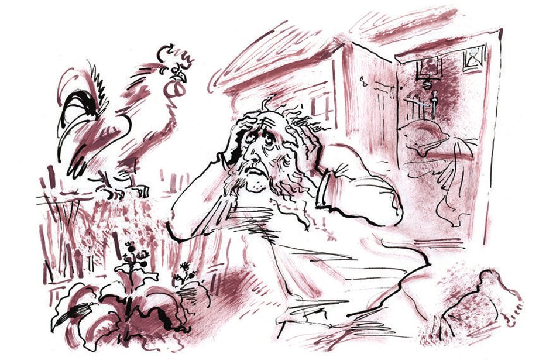
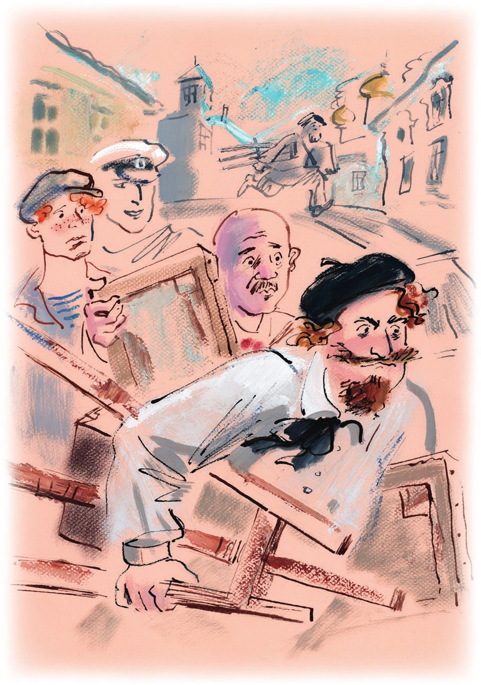
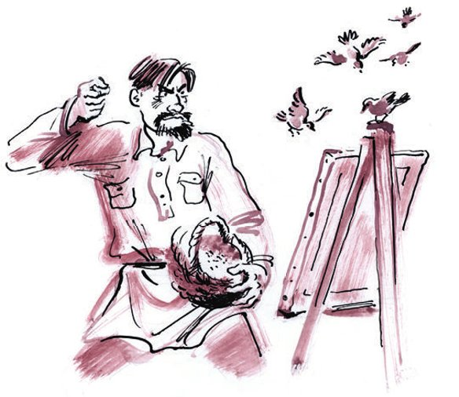

## Kapitel 8: Die Krise des Genres

Es ist nach drei Uhr nachts. Die <abbr title="gehetzt — затравленный">gehetzte</abbr> «Antilope» hält über einem <abbr title="der Abhang, die Abhänge — обрыв, склон">Abhang</abbr>. Unten liegt eine fremde Stadt, wie auf einem kleinen <abbr title="der Teller, die Teller — тарелка">Teller</abbr>. Sie ist ordentlich <abbr title="schneiden (schnitt, hat geschnitten) — резать">geschnitten</abbr> wie eine <abbr title="die Torte, die Torten — торт">Torte</abbr>. Bunte <abbr title="der Morgennebel, die Morgennebel — утренний туман, пары">Morgennebel</abbr> fliegen über ihr. Die Antilopen-Leute sind ausgestiegen. Sie hören ein ganz leises <abbr title="knistern — потрескивать">Knistern</abbr> und ein feines Pfeifen. Offenbar <abbr title="schnarchen — храпеть">schnarchen</abbr> die Bürger. Ein <abbr title="zackig — зубчатый">zackiger</abbr> Wald kommt bis an die Stadt heran. Die Straße fällt in <abbr title="die Schleife, die Schleifen — петля">Schleifen</abbr> den Abhang hinunter.

— Ein <abbr title="das Paradiestal — райская долина">Paradiestal</abbr>, — sagt Ostap. — Solche Städte <abbr title="plündern — грабить">plündert</abbr> man am besten früh am Morgen, wenn die Sonne noch nicht so brennt. Dann wird man nicht so müde.

— Jetzt ist ja gerade früher Morgen, — sagt Panikowski und sieht dem Kommandeur <abbr title="schmeichlerisch — льстиво">schmeichlerisch</abbr> in die Augen.

— Ruhe, <abbr title="die goldene Kompanie — «золотая рота», сброд">goldene Kompanie</abbr>! — schreit Ostap. — Was für ein unruhiger Alter! Er versteht keine Witze.

— Was machen wir mit der «Antilope»? — fragt Koslewitsch.

— Ja, — sagt Ostap, — mit diesem grünen <abbr title="der Waschzuber, die Waschzuber — лохань">Waschzuber</abbr> können wir jetzt nicht in die Stadt fahren. Man verhaftet uns sofort. Wir müssen es machen wie die fortschrittlichsten Länder. In Rio de Janeiro zum Beispiel <abbr title="streichen (strich, hat gestrichen) — красить">streicht</abbr> man <abbr title="gestohlen — краденый">gestohlene</abbr> Autos in einer anderen Farbe <abbr title="neu anstreichen — перекрашивать">neu an</abbr>. Das macht man aus ganz <abbr title="menschlich — гуманный">menschlichen</abbr> Gründen. Der alte Besitzer soll nicht traurig sein, wenn er sieht: In seinem Auto fährt ein fremder Mensch herum. Die «Antilope» hat jetzt einen sauren Ruhm. Wir müssen sie neu anstreichen.

Sie beschließen: Sie gehen zu Fuß in die Stadt und besorgen Farbe. Und für das Auto suchen sie ein sicheres <abbr title="das Versteck, die Verstecke — убежище, укрытие">Versteck</abbr> außerhalb von der Stadt.

Ostap geht schnell die Straße am Abhang entlang. Bald sieht er ein kleines, schiefes Holzhaus. Seine kleinen Fenster glänzen blau wie ein Fluss. Hinter dem Haus steht ein <abbr title="der Schuppen, die Schuppen — сарай">Schuppen</abbr>. Der Schuppen ist gerade richtig, um die «Antilope» zu verstecken.

Der große Kombinator denkt nach: Wie kommt er am besten in das Haus? Wie kann er sich mit den <abbr title="der Bewohner, die Bewohner — житель, обитатель">Bewohnern</abbr> <abbr title="sich anfreunden mit + Dat. — подружиться с">anfreunden</abbr>? Da geht die Tür auf. Ein würdiger Herr läuft auf die Vortreppe. Er trägt <abbr title="die Soldatenunterhose, die Soldatenunterhosen — солдатские подштанники">Soldatenunterhosen</abbr> mit schwarzen <abbr title="der Blechknopf, die Blechknöpfe — жестяная пуговица">Blechknöpfen</abbr>. Auf seinen blassen Wangen, weiß wie <abbr title="das Paraffin — парафин">Paraffin</abbr>, wachsen anständige graue Koteletten. Am Ende vom letzten Jahrhundert war so ein Gesicht ganz normal. Damals trugen fast alle Männer solche <abbr title="staatstreu — верноподданный">staatstreuen</abbr> <abbr title="der Haarapparat, die Haarapparate — волосяной прибор">Haarapparate</abbr> im Gesicht. Aber unter diesen Koteletten gibt es heute keine blaue <abbr title="die Beamtenuniform, die Beamtenuniformen — вицмундир">Beamtenuniform</abbr> mehr, keinen kleinen <abbr title="der Orden, die Orden — орден">Orden</abbr> mit einem <abbr title="das Seidenband, die Seidenbänder — муаровая ленточка">Seidenband</abbr> und keine goldenen Sterne von einem <abbr title="der Geheimrat, die Geheimräte — тайный советник">Geheimrat</abbr>. Deshalb sieht dieses Gesicht heute <abbr title="unecht — ненатуральный">unecht</abbr> aus.

— O Herr, — <abbr title="nuscheln — шамкать">nuschelt</abbr> der Bewohner vom Holzhaus und streckt die Arme zur <abbr title="aufgehen (ging auf, ist aufgegangen) — восходить">aufgehenden</abbr> Sonne aus. — Gott, o Gott! Immer dieselben Träume! Genau dieselben Träume!

Nach dieser <abbr title="die Klage, die Klagen — жалоба">Klage</abbr> <abbr title="weinen — плакать">weint</abbr> der alte Mann. Er <abbr title="schlurfen — шаркать">schlurft</abbr> mit den Füßen und läuft auf einem kleinen <abbr title="der Pfad, die Pfade — тропинка">Pfad</abbr> um das Haus herum. Ein ganz normaler <abbr title="der Hahn, die Hähne — петух">Hahn</abbr> steht gerade mitten im Hof. Er will zum dritten Mal <abbr title="krähen — кукарекать">krähen</abbr>. Jetzt flieht er. In der Eile macht er ein paar schnelle Schritte und verliert sogar eine <abbr title="die Feder, die Federn — перо">Feder</abbr>. Aber bald <abbr title="sich beruhigen — успокаиваться, опомниться">beruhigt</abbr> er sich. Er <abbr title="klettern — лезть, карабкаться">klettert</abbr> auf den <abbr title="der Flechtzaun, die Flechtzäune — плетень">Flechtzaun</abbr> und sagt der Welt von diesem sicheren Platz: Es ist Morgen. Aber in seiner Stimme hört man <abbr title="die Aufregung — волнение">Aufregung</abbr>. Das <abbr title="unwürdig — недостойный">unwürdige</abbr> <abbr title="das Benehmen — поведение">Benehmen</abbr> von dem Hausbesitzer hat ihn aufgeregt.

— Ich träume sie, die verfluchten Dinger, — hört Ostap die Stimme vom alten Mann.

Bender <abbr title="betrachten — рассматривать">betrachtet</abbr> verwundert den seltsamen Mann. Solche Koteletten sieht man heute nur noch im Gesicht vom Portier im <abbr title="das Konservatorium, die Konservatorien — консерватория">Konservatorium</abbr>. Das Gesicht sieht aus wie das von einem <abbr title="der Minister, die Minister — министр">Minister</abbr>.

«Was ist das für ein <abbr title="der Einsiedlerkrebs, die Einsiedlerkrebse — рак-отшельник">Einsiedlerkrebs</abbr>?» denkt Ostap.

Inzwischen hat der <abbr title="ungewöhnlich — необыкновенный">ungewöhnliche</abbr> Herr seine Runde beendet. Er ist wieder an der Vortreppe. Hier zögert er kurz. Dann sagt er: «Ich gehe und versuche es noch einmal», und verschwindet hinter der Tür.

— Ich liebe alte Leute, — flüstert Ostap. — Mit ihnen wird es nie langweilig. Wir müssen auf das Ergebnis von diesem geheimnisvollen <abbr title="der Versuch, die Versuche — попытка, проба">Versuch</abbr> warten.

Ostap muss nicht lange warten. Bald hört man aus dem Haus ein <abbr title="jämmerlich — жалобный, плачевный">jämmerliches</abbr> Heulen. Der alte Mann kommt <abbr title="rückwärts — задом, задом наперёд">rückwärts</abbr> auf die Vortreppe, wie Boris Godunow im letzten <abbr title="der Akt, die Akte — акт, действие">Akt</abbr> von der <abbr title="die Oper, die Opern — опера">Oper</abbr> von Mussorgski.

— <abbr title="weichen (wich, ist gewichen) — отступать; «чур меня»">Weiche</abbr> von mir, weiche! — ruft er mit der Stimme von Schaljapin. — Immer derselbe Traum! A-a-a!

Er dreht sich um, <abbr title="stolpern über + Akk. — спотыкаться о">stolpert</abbr> über die eigenen Füße und geht direkt auf Ostap zu. Der große Kombinator denkt: Jetzt ist die Zeit zum <abbr title="handeln — действовать">Handeln</abbr>. Er tritt hinter dem Baum hervor und nimmt den Herrn mit den Koteletten in seine starken Arme.

— Was? Wer? Was ist los? — schreit der unruhige Alte. — Was?

Ostap öffnet vorsichtig die Arme, nimmt die Hand vom alten Mann und schüttelt sie herzlich.

— Ich <abbr title="mitfühlen mit + Dat. — сочувствовать">fühle mit</abbr> Ihnen mit! — ruft er.

— Wirklich? — fragt der Hausbesitzer und <abbr title="sich schmiegen an + Akk. — прижиматься к">schmiegt sich</abbr> an die Schulter von Bender.

— Natürlich wirklich, — antwortet Ostap. — Ich habe selbst oft Träume.

— Und was träumen Sie?

— Verschiedenes.

— Aber was genau? — fragt der alte Mann <abbr title="hartnäckig — настойчиво">hartnäckig</abbr>.

— Na, Verschiedenes. Eine <abbr title="die Mischung, die Mischungen — смесь">Mischung</abbr>. So wie in der Zeitung: «Von überall über alles» oder «Die Weltleinwand». Vorgestern zum Beispiel habe ich von der <abbr title="die Beerdigung, die Beerdigungen — похороны">Beerdigung</abbr> vom <abbr title="der Mikado — микадо (японский император)">Mikado</abbr> geträumt. Und gestern vom <abbr title="das Jubiläum, die Jubiläen — юбилей">Jubiläum</abbr> von der <abbr title="die Feuerwache, die Feuerwachen — пожарная часть">Feuerwache</abbr> in der Suschtschowskaja.

— Gott! — sagt der alte Mann. — Gott! Was für ein glücklicher Mensch Sie sind! So glücklich! Sagen Sie, haben Sie nie von einem <abbr title="der Generalgouverneur, die Generalgouverneure — генерал-губернатор">Generalgouverneur</abbr> geträumt? Oder … sogar von einem Minister?

Bender ist nicht <abbr title="stur — упрямый">stur</abbr>.

— Doch, — sagt er fröhlich. — Natürlich. Von einem Generalgouverneur. Letzten Freitag. Die ganze Nacht. Und ich erinnere mich: Neben ihm stand noch der <abbr title="der Polizeichef, die Polizeichefs — полицмейстер">Polizeichef</abbr>, in Pluderhosen mit Mustern.

— Ach, wie schön, — sagt der alte Mann. — Und haben Sie nicht vielleicht davon geträumt, wie seine Majestät, der <abbr title="der Zar, die Zaren — царь">Zar</abbr>, in die Stadt Kostroma kommt?

— Nach Kostroma? Ja, so einen Traum hatte ich. Moment, wann war das? … Ach ja, am dritten Februar dieses Jahres. Seine Majestät, der Zar, und neben ihm, ich erinnere mich, stand noch Graf Fredericks, wissen Sie, der Minister vom <abbr title="der Hof, die Höfe — двор (царский)">Hof</abbr>.

— Ach, du lieber Gott! — sagt der alte Mann ganz aufgeregt. — Warum stehen wir hier herum? Kommen Sie doch herein! <abbr title="die Verzeihung — прощение; простите">Verzeihung</abbr>, Sie sind nicht <abbr title="der Sozialist, die Sozialisten — социалист">Sozialist</abbr>? Nicht in der <abbr title="die Partei, die Parteien — партия">Partei</abbr>?

— Aber nicht doch! — sagt Ostap <abbr title="gutmütig — добродушно">gutmütig</abbr>. — Ich und in der Partei? Ich bin <abbr title="parteilos — беспартийный">parteiloser</abbr> <abbr title="der Monarchist, die Monarchisten — монархист">Monarchist</abbr>. Diener dem Zaren, Vater den Soldaten. Und überhaupt: Fliegt auf, ihr <abbr title="der Falke, die Falken — сокол">Falken</abbr>, wie die <abbr title="der Adler, die Adler — орёл">Adler</abbr>, genug mit Kummer und Leid …

— Ein Tässchen Tee? Möchten Sie ein Tässchen Tee? — murmelt der alte Mann und schiebt Bender zur Tür.

Im Haus gibt es nur ein Zimmer und einen kleinen <abbr title="der Flur, die Flure — сени, прихожая">Flur</abbr>. An den Wänden hängen Porträts von Herren in <abbr title="der Dienstrock, die Dienströcke — форменный сюртук">Dienströcken</abbr>. Man sieht es an den Kragenspiegeln: Diese Herren haben früher im <abbr title="das Ministerium, die Ministerien — министерство">Ministerium</abbr> für <abbr title="die Volksbildung — народное просвещение">Volksbildung</abbr> gearbeitet. Das Bett ist ganz <abbr title="unordentlich — беспорядочный">unordentlich</abbr>. Man sieht: Auf diesem Bett hat der Hausbesitzer die unruhigsten Stunden von seinem Leben verbracht.

— Leben Sie schon lange so wie ein <abbr title="der Eremit, die Eremiten — отшельник, анахорет">Eremit</abbr>? — fragt Ostap.

— Seit dem Frühling, — antwortet der alte Mann. — Mein Name ist Chworobjew. Ich dachte: Hier beginnt ein neues Leben. Und was ist daraus geworden? Verstehen Sie doch …

Fjodor Nikititsch Chworobjew war Monarchist und <abbr title="hassen — ненавидеть">hasste</abbr> die Sowjetmacht. Diese Macht war ihm <abbr title="zuwider sein — быть противным">zuwider</abbr>. Früher war er <abbr title="der Kurator, die Kuratoren — попечитель">Kurator</abbr> von einem ganzen <abbr title="der Schulbezirk, die Schulbezirke — учебный округ">Schulbezirk</abbr>. Aber dann musste er als Leiter vom <abbr title="methodologisch-pädagogisch — методологическо-педагогический">methodologisch-pädagogischen</abbr> <abbr title="der Sektor, die Sektoren — сектор">Sektor</abbr> im Proletkult arbeiten. (Der Proletkult war ein Verein für proletarische Kultur.) Das <abbr title="anekeln — вызывать отвращение">ekelte</abbr> ihn an.

Bis zum Ende von seinem Dienst wusste er nicht, was das Wort «Proletkult» eigentlich bedeutet. Deshalb <abbr title="verachten — презирать">verachtete</abbr> er es noch mehr. Die Mitglieder vom <abbr title="das Betriebskomitee, die Betriebskomitees — местком">Betriebskomitee</abbr>, die Kollegen und die Besucher vom methodologisch-pädagogischen Sektor – er musste sie nur sehen, und schon zitterte er vor Ekel. Er hasste das Wort «Sektor». Oh, dieser Sektor! Fjodor Nikititsch liebte alles Schöne, auch die <abbr title="die Geometrie — геометрия">Geometrie</abbr>. Nie hat er gedacht: Dieser wunderbare <abbr title="mathematisch — математический">mathematische</abbr> <abbr title="der Begriff, die Begriffe — понятие">Begriff</abbr> – ein Teil von einer runden Fläche – wird einmal so <abbr title="gemein — пошлый, низкий">gemein</abbr> und <abbr title="banal — банальный">banal</abbr>.

Bei der Arbeit ärgerte Chworobjew vieles: die Sitzungen, die Wandzeitungen, die Staatsanleihen. Aber auch zu Hause fand seine stolze Seele keine Ruhe. Auch zu Hause gab es Wandzeitungen, Anleihen und Sitzungen. Seine Bekannten sprachen nur über ordinäre Dinge – so fand jedenfalls Chworobjew. Über das Gehalt, das sie «Lohn» nannten. Über den <abbr title="der Hilfsmonat, die Hilfsmonate — месячник помощи">Hilfsmonat</abbr> für Kinder. Und über die gesellschaftliche <abbr title="die Bedeutung, die Bedeutungen — значение, значимость">Bedeutung</abbr> vom Theaterstück «<abbr title="der Panzerzug, die Panzerzüge — бронепоезд">Panzerzug</abbr>».

Nirgends konnte man vor der Sowjetordnung <abbr title="flüchten vor + Dat. — убегать от">flüchten</abbr>. Der traurige Chworobjew ging allein in der Stadt spazieren. Aber auch hier flogen aus der Menge <abbr title="verhasst — постылый, ненавистный">verhasste</abbr> Sätze:

— … Dann haben wir beschlossen, ihn aus dem Vorstand <abbr title="ausschließen (schloss aus, hat ausgeschlossen) — исключать">auszuschließen</abbr> …

— … Und ich habe gesagt: Gegen eure RKK gibt es die <abbr title="die Schlichtungskammer, die Schlichtungskammern — примирительная камера">Schlichtungskammer</abbr>, jawohl, die Schlichtungskammer!

Chworobjew sah sehnsüchtig auf die Plakate. Auf den Plakaten stand: Die Bürger sollen den <abbr title="der Fünfjahresplan, die Fünfjahrespläne — пятилетка">Fünfjahresplan</abbr> in vier Jahren <abbr title="erfüllen — выполнять">erfüllen</abbr>. Und gereizt wiederholte er:

— Ausschließen! Aus dem Vorstand! Schlichtungskammer! In vier Jahren! <abbr title="die Pöbelherrschaft — хамская власть">Pöbelherrschaft</abbr>!

Dann <abbr title="wechseln — переходить, менять">wechselte</abbr> der methodologisch-pädagogische Sektor zur <abbr title="durchgehend — непрерывный">durchgehenden</abbr> Woche. (Bei der durchgehenden Woche gab es keinen Sonntag mehr, sondern jeder hatte an einem anderen Tag frei.) Statt dem guten, reinen Sonntag hatte Chworobjew jetzt irgendwelche <abbr title="violett — фиолетовый">violetten</abbr> <abbr title="der Fünfte — пятое число">Fünften</abbr> frei. Da besorgte er sich mit Ekel eine Rente und zog weit vor die Stadt. Er wollte <abbr title="weg sein von + Dat. — уйти от">weg</abbr> von der neuen Macht. Sie hatte sein Leben <abbr title="erobern — завладеть, завоевать">erobert</abbr> und ihm die Ruhe genommen.

Ganze Tage saß der einsame Monarchist am Abhang. Er sah auf die Stadt und wollte an angenehme Dinge denken: an <abbr title="der Gottesdienst, die Gottesdienste — молебен">Gottesdienste</abbr> zum <abbr title="der Namenstag, die Namenstage — тезоименитство, именины">Namenstag</abbr> von irgendeiner <abbr title="die Hoheit, die Hoheiten — высочество, особа">Hoheit</abbr>, an die Prüfungen im <abbr title="das Gymnasium, die Gymnasien — гимназия">Gymnasium</abbr> und an seine Verwandten, die im Ministerium für Volksbildung gearbeitet haben. Aber seltsamerweise sprangen seine Gedanken sofort zu sowjetischen, unangenehmen Dingen.

«Was passiert jetzt wohl in diesem verfluchten Proletkult?» dachte er.

Nach dem Proletkult kamen ihm ganz <abbr title="empörend — возмутительный">empörende</abbr> Erinnerungen: die <abbr title="die Demonstration, die Demonstrationen — демонстрация">Demonstrationen</abbr> am Ersten Mai und im Oktober, die Familienabende im Klub mit <abbr title="der Vortrag, die Vorträge — лекция, доклад">Vorträgen</abbr> und Bier, der <abbr title="der Halbjahreshaushalt — полугодовая смета">Halbjahreshaushalt</abbr> vom methodologischen Sektor.

«Alles hat mir die Sowjetmacht genommen, — dachte der frühere Kurator vom Schulbezirk, — meinen Rang, meine Orden, meine Ehre und mein Geld auf der Bank. Sie hat sogar meine Gedanken <abbr title="vertauschen — подменить">vertauscht</abbr>. Aber es gibt einen Ort, wo die <abbr title="der Bolschewik, die Bolschewiken — большевик">Bolschewiken</abbr> nie hineinkommen. Das sind die Träume. Die schickt Gott den Menschen. Die Nacht bringt mir Ruhe. In meinen Träumen sehe ich das, was ich gern sehen möchte.»

Gleich in der ersten Nacht danach schickte Gott Fjodor Nikititsch einen schrecklichen Traum. Er sitzt in einem <abbr title="der Behördenflur, die Behördenflure — учрежденческий коридор">Behördenflur</abbr>. Nur eine kleine Petroleumlampe gibt Licht. Er sitzt da und weiß: Jeden Moment schließt man ihn aus dem Vorstand aus. Plötzlich geht eine eiserne Tür auf. Viele <abbr title="der/die Angestellte, die Angestellten — служащий">Angestellte</abbr> laufen heraus und rufen: «Wir müssen Chworobjew <abbr title="die gesellschaftliche Arbeit — общественная нагрузка">gesellschaftliche Arbeit</abbr> <abbr title="aufladen (lud auf, hat aufgeladen) — нагрузить">aufladen</abbr>!» Er will weglaufen, aber er kann nicht.

Fjodor Nikititsch wachte mitten in der Nacht auf. Er betete zu Gott. Er sagte Gott: Offenbar ist hier ein ärgerlicher <abbr title="der Fehler, die Fehler — ошибка, неувязка">Fehler</abbr> passiert. Dieser Traum war bestimmt für einen <abbr title="verantwortlich — ответственный">verantwortlichen</abbr> Genossen, vielleicht sogar für ein Parteimitglied. Er ist an die falsche Adresse gegangen. Er, Chworobjew, möchte für den Anfang gern sehen, wie der Zar aus der <abbr title="die Mariä-Entschlafens-Kathedrale — Успенский собор">Mariä-Entschlafens-Kathedrale</abbr> kommt.

Jetzt war er ruhiger und schlief wieder ein. Aber statt dem Gesicht vom <abbr title="anbeten — обожать, боготворить">angebeteten</abbr> <abbr title="der Monarch, die Monarchen — монарх">Monarchen</abbr> sah er sofort den Vorsitzenden vom Betriebskomitee, den Genossen Surschikow.

Und von da an kamen jede Nacht dieselben sowjetischen Träume zu Fjodor Nikititsch. Sie kamen mit <abbr title="unbegreiflich — непостижимый">unbegreiflicher</abbr> <abbr title="die Regelmäßigkeit — методичность, регулярность">Regelmäßigkeit</abbr>, und sie waren politisch ganz <abbr title="korrekt — правильный, выдержанный">korrekt</abbr>. Er sah <abbr title="der Mitgliedsbeitrag, die Mitgliedsbeiträge — членский взнос">Mitgliedsbeiträge</abbr>, Wandzeitungen, die <abbr title="die Sowchose, die Sowchosen — совхоз">Sowchose</abbr> «Gigant», die feierliche Eröffnung von der ersten <abbr title="die Großküche, die Großküchen — фабрика-кухня">Großküche</abbr>, den Vorsitzenden von der Gesellschaft der Freunde der <abbr title="die Feuerbestattung — кремация">Feuerbestattung</abbr> und große sowjetische <abbr title="der Langstreckenflug, die Langstreckenflüge — дальний перелёт">Langstreckenflüge</abbr>.

Der Monarchist brüllte im Schlaf. Er wollte keine Freunde der Feuerbestattung sehen. Er wollte Purischkewitsch sehen, den <abbr title="recht — правый (политически)">rechtesten</abbr> <abbr title="der/die Abgeordnete, die Abgeordneten — депутат">Abgeordneten</abbr> von der <abbr title="die Staatsduma — Государственная дума">Staatsduma</abbr>. Oder den <abbr title="der Patriarch, die Patriarchen — патриарх">Patriarchen</abbr> Tichon. Oder den <abbr title="der Stadthauptmann, die Stadthauptmänner — градоначальник">Stadthauptmann</abbr> von Jalta, Dumbadse. Oder wenigstens irgendeinen ganz einfachen <abbr title="der Schulinspektor, die Schulinspektoren — инспектор училищ">Schulinspektor</abbr>. Aber nichts davon kam. Die Sowjetordnung ist sogar in die Träume vom Monarchisten eingebrochen.

— Immer dieselben Träume! — sagt Chworobjew am Ende mit <abbr title="weinerlich — плачущий">weinerlicher</abbr> Stimme. — Verfluchte Träume!

— Es steht schlecht um Sie, — sagt Ostap <abbr title="mitfühlend — сочувственно">mitfühlend</abbr>. — Wie man so sagt: Das <abbr title="das Sein — бытие">Sein</abbr> bestimmt das <abbr title="das Bewusstsein — сознание">Bewusstsein</abbr>. Sie leben in einem sowjetischen Land. Also müssen auch Ihre Träume sowjetisch sein.

— Keine Minute Ruhe, — klagt Chworobjew. — Ich möchte doch nur irgendetwas sehen! Ich bin schon mit allem <abbr title="einverstanden sein mit + Dat. — быть согласным">einverstanden</abbr>. Meinetwegen nicht Purischkewitsch. Meinetwegen Miljukow. Er hat wenigstens eine Hochschulbildung und ist im Herzen Monarchist. Aber nein! Immer nur diese sowjetischen Antichristen.

— Ich helfe Ihnen, — sagt Ostap. — Ich habe schon Freunde und Bekannte nach Freud <abbr title="behandeln — лечить">behandelt</abbr>. Ein Traum ist eine <abbr title="die Kleinigkeit, die Kleinigkeiten — пустяк">Kleinigkeit</abbr>. Das Wichtigste ist, die <abbr title="die Ursache, die Ursachen — причина">Ursache</abbr> von dem Traum zu <abbr title="beseitigen — устранять">beseitigen</abbr>. Die <abbr title="die Hauptursache, die Hauptursachen — основная причина">Hauptursache</abbr> ist die <abbr title="die Existenz — существование">Existenz</abbr> von der Sowjetmacht. Aber im Moment kann ich sie nicht beseitigen. Ich habe einfach keine Zeit. Ich bin nämlich <abbr title="der Sporttourist, die Sporttouristen — турист-спортсмен">Sporttourist</abbr>. Jetzt muss ich mein Auto ein bisschen reparieren. Darf ich es bei Ihnen in den Schuppen stellen? Und wegen der Ursache – keine Sorge. Die beseitige ich auf dem <abbr title="der Rückweg, die Rückwege — обратный путь">Rückweg</abbr>. Lassen Sie mich nur erst die Rallye beenden.

Die schweren Träume haben den Monarchisten ganz benommen gemacht. Gern erlaubt er dem netten, <abbr title="hilfsbereit — отзывчивый">hilfsbereiten</abbr> jungen Mann, den Schuppen zu benutzen. Er wirft einen Mantel über sein Nachthemd, zieht <abbr title="der Gummischuh, die Gummischuhe — калоша">Gummischuhe</abbr> an die nackten Füße und geht hinter Bender in den Hof.

— Ich darf also hoffen? — fragt er und <abbr title="trippeln — семенить">trippelt</abbr> hinter seinem frühen Gast her.

— Keine Zweifel, — antwortet der Kommandeur <abbr title="lässig — небрежно">lässig</abbr>. — Sobald es keine Sowjetmacht mehr gibt, wird es Ihnen gleich irgendwie leichter. Sie werden sehen!

Eine halbe Stunde später ist die «Antilope» bei Chworobjew versteckt. Koslewitsch und Panikowski bleiben bei ihr und passen auf. Bender und Balaganow gehen in die Stadt. Sie wollen Farbe kaufen.

Die <abbr title="der Milchbruder, die Milchbrüder — молочный брат">Milchbrüder</abbr> gehen der Sonne entgegen, in Richtung <abbr title="das Stadtzentrum, die Stadtzentren — центр города">Stadtzentrum</abbr>. Auf den <abbr title="der Dachsims, die Dachsimse — карниз">Dachsimsen</abbr> spazieren graue <abbr title="die Taube, die Tauben — голубь">Tauben</abbr>. Die <abbr title="der Gehweg, die Gehwege — тротуар">Gehwege</abbr> aus Holz sind mit Wasser <abbr title="bespritzen — спрыснуть, обрызгать">bespritzt</abbr>. Sie sind sauber und kühl.

An so einem Morgen ist es angenehm für einen Menschen mit einem reinen <abbr title="das Gewissen — совесть">Gewissen</abbr>: Er geht aus dem Haus und bleibt eine Minute am <abbr title="das Tor, die Tore — ворота">Tor</abbr> stehen. Er nimmt eine <abbr title="die Streichholzschachtel, die Streichholzschachteln — спичечный коробок">Streichholzschachtel</abbr> aus der Tasche. Darauf ist ein Flugzeug <abbr title="abbilden — изображать">abgebildet</abbr>. Statt einem <abbr title="der Propeller, die Propeller — пропеллер">Propeller</abbr> hat es eine Feige – eine Faust mit dem Daumen zwischen den Fingern. Darunter steht: «Antwort an Curzon». Er bewundert seine frische Packung <abbr title="die Papirossa, die Papirossy — папироса">Papirossy</abbr> und raucht. Mit dem Rauch, wie mit <abbr title="der Weihrauch — ладан">Weihrauch</abbr>, <abbr title="verscheuchen — спугнуть">verscheucht</abbr> er eine <abbr title="die Biene, die Bienen — пчела">Biene</abbr> mit goldenen <abbr title="die Tresse, die Tressen — позумент, галун">Tressen</abbr> auf dem Bauch.

Auch Bender und Balaganow spüren den Morgen, die sauberen Straßen und die selbstlosen Tauben. Für eine Weile glauben sie: Ihr Gewissen ist rein. Alle lieben sie. Sie sind <abbr title="der Bräutigam, die Bräutigame — жених">Bräutigame</abbr> und gehen zu ihren <abbr title="die Braut, die Bräute — невеста">Bräuten</abbr>, die <abbr title="luftig — воздушный, лёгкий">luftige</abbr> Kleider tragen.

Plötzlich steht ein Mann vor den Brüdern. Er hat eine <abbr title="zusammenklappbar — складной">zusammenklappbare</abbr> <abbr title="die Staffelei, die Staffeleien — мольберт">Staffelei</abbr> und einen polierten <abbr title="der Farbkasten, die Farbkästen — ящик для красок">Farbkasten</abbr> in den Händen. Er sieht so aufgeregt aus, als ob er gerade aus einem brennenden Haus kommt. Aus dem Feuer hat er nur die Staffelei und den Kasten gerettet.

— Entschuldigung, — sagt er mit heller Stimme. — Hier ist gerade der Genosse Plotski-Pozelujew vorbeigegangen, oder? Haben Sie ihn gesehen? Ist er hier vorbeigekommen?

— Solche Leute sehen wir nie, — sagt Balaganow grob.

Der Maler stößt Bender gegen die Brust, sagt «Pardon» und läuft weiter.

— Plotski-Pozelujew? — brummt der große Kombinator. Er hat noch nicht gefrühstückt. — Ich kannte selbst eine <abbr title="die Hebamme, die Hebammen — акушерка">Hebamme</abbr> mit dem Namen Medusa-Gorgoner. Und ich habe deshalb keinen Lärm gemacht. Ich bin nicht durch die Straßen gelaufen und habe gerufen: «Haben Sie <abbr title="zufällig — случайно">zufällig</abbr> die Bürgerin Medusa-Gorgoner gesehen? Sie geht hier <abbr title="angeblich — якобы, дескать">angeblich</abbr> spazieren.» Na und! Plotski-Pozelujew!

Bender ist mit seiner <abbr title="die Tirade, die Tiraden — тирада">Tirade</abbr> noch nicht fertig, da springen schon zwei Männer direkt auf ihn zu. Sie haben schwarze Staffeleien und polierte <abbr title="der Malkasten, die Malkästen — этюдник">Malkästen</abbr>. Die beiden sind ganz verschiedene Menschen. Der eine denkt offenbar: Ein Künstler muss viele Haare haben. Er hat so viele Haare im Gesicht, dass er der <abbr title="der Stellvertreter, die Stellvertreter — заместитель">Stellvertreter</abbr> von Heinrich von Navarra in der UdSSR sein kann. Schnurrbart, Locken und <abbr title="der Spitzbart, die Spitzbärte — бородка">Spitzbart</abbr> machen sein flaches Gesicht viel lebendiger. Der andere ist einfach <abbr title="kahl — лысый">kahl</abbr>. Sein Kopf ist <abbr title="glatt — гладкий, скользкий">glatt</abbr> wie ein <abbr title="der Lampenschirm, die Lampenschirme — абажур">Lampenschirm</abbr> aus Glas.

— Den Genossen Plotski … — sagt der Stellvertreter von Heinrich von Navarra <abbr title="atemlos — задыхаясь">atemlos</abbr>.

— … -Pozelujew, — sagt der Lampenschirm.

— Haben Sie ihn gesehen? — schreit der Navarrer.

— Er soll hier spazieren gehen, — erklärt der Lampenschirm.

Balaganow hat schon den Mund für ein Schimpfwort geöffnet. Aber Bender schiebt ihn zur Seite und sagt mit <abbr title="beleidigend — оскорбительный">beleidigender</abbr> Höflichkeit:

— Den Genossen Plotski, <abbr title="geboren — урождённый">geborenen</abbr> Pozelujew, haben wir nicht gesehen. Aber wenn Sie dieser Genosse wirklich interessiert, dann beeilen Sie sich. Ein <abbr title="der/die Werktätige, die Werktätigen — трудящийся">Werktätiger</abbr> sucht ihn schon. Er sieht aus wie ein <abbr title="der Maler-Kanonier, die Maler-Kanoniere — художник-пушкарь">Maler-Kanonier</abbr>.

Die Maler <abbr title="sich verhaken — сцепляться">verhaken sich</abbr> mit ihren Staffeleien, schubsen sich und laufen weiter. Da kommt um die Ecke eine Droschke gefahren. Darin sitzt ein dicker Mann. Er trägt eine blaue <abbr title="die Russenbluse, die Russenblusen — толстовка">Russenbluse</abbr>, und man ahnt unter ihren Falten einen <abbr title="verschwitzt — потный">verschwitzten</abbr> <abbr title="der Wanst, die Wänste — брюхо, пузо">Wanst</abbr>. Wenn man ihn sieht, denkt man an eine alte <abbr title="die Reklame, die Reklamen — реклама">Reklame</abbr> für eine <abbr title="die Salbe, die Salben — мазь">Salbe</abbr>. Sie begann so: «Ein nackter Körper voller Haare macht einen <abbr title="abstoßend — отталкивающий">abstoßenden</abbr> Eindruck.» Was der Dicke von Beruf ist, ist leicht zu erraten. Mit der Hand hält er eine große, schwere Staffelei fest. Zu den Füßen vom Kutscher liegt ein polierter Kasten. Da sind bestimmt Farben drin.

— Hallo! — ruft Ostap. — Suchen Sie Plotski-Pozelujew?

— <abbr title="jawohl — так точно">Jawohl</abbr>, — sagt der dicke Maler und sieht Ostap kläglich an.

— Schnell! Schnell! Schnell! — ruft Ostap. — Drei Maler haben Sie schon <abbr title="überholen — обгонять">überholt</abbr>. Was ist hier los? Was ist passiert?

Aber das Pferd klappert schon mit den <abbr title="das Hufeisen, die Hufeisen — подкова">Hufeisen</abbr> über das wilde <abbr title="das Kopfsteinpflaster — булыжная мостовая">Kopfsteinpflaster</abbr> und trägt den vierten Vertreter der <abbr title="die bildende Kunst — изобразительное искусство">bildenden Kunst</abbr> davon.

— Was für eine kulturelle Stadt! — sagt Ostap. — Sie haben bestimmt gemerkt, Balaganow: Wir haben vier Bürger getroffen, und alle vier sind Maler. <abbr title="interessant — любопытно">Interessant</abbr>.

Die Milchbrüder bleiben vor einem <abbr title="das Farbengeschäft, die Farbengeschäfte — москательная лавка">Farbengeschäft</abbr> stehen. Da flüstert Balaganow zu Ostap:

— Schämen Sie sich nicht?

— Wofür? — fragt Ostap.

— Dass Sie für die Farbe mit echtem Geld bezahlen wollen?

— Ach, das meinen Sie, — sagt Ostap. — Ich gebe zu, ich schäme mich ein bisschen. Es ist eine dumme Lage, natürlich. Aber was soll man machen? Wir können doch nicht ins Exekutivkomitee laufen und dort um Farbe für den «Tag der <abbr title="die Lerche, die Lerchen — жаворонок">Lerche</abbr>» bitten. Sie geben uns die Farbe bestimmt. Aber dann verlieren wir einen ganzen Tag.

Im Geschäft stehen trockene Farben in Dosen, in Glaszylindern, in Säcken, in kleinen Fässern und in zerrissenen <abbr title="die Papiertüte, die Papiertüten — бумажный пакет">Papiertüten</abbr>. Sie haben verlockende <abbr title="die Zirkusfarbe, die Zirkusfarben — цирковой цвет">Zirkusfarben</abbr>. Das Geschäft sieht ganz <abbr title="festlich — праздничный">festlich</abbr> aus.

Der Kommandeur und der Bordmechaniker suchen <abbr title="pingelig — придирчиво">pingelig</abbr> die Farben aus.

— Schwarz ist zu traurig, — sagt Ostap. — Grün passt auch nicht. Das ist die Farbe von der <abbr title="zerbrochen — рухнувший, разбитый">zerbrochenen</abbr> Hoffnung. Lila – nein. In einem lila Auto soll der Chef von der <abbr title="die Kriminalpolizei — уголовный розыск">Kriminalpolizei</abbr> herumfahren. Rosa ist <abbr title="kitschig — пошлый">kitschig</abbr>, Hellblau ist banal, Rot ist zu <abbr title="untertänig — верноподданный">untertänig</abbr>. Wir müssen die «Antilope» gelb anstreichen. Das ist ein bisschen <abbr title="grell — яркий, кричащий">grell</abbr>, aber schön.

— Und wer sind Sie? Maler? — fragt der Verkäufer. Sein Kinn ist ein bisschen <abbr title="bestäubt — запорошённый">bestäubt</abbr> mit <abbr title="das Zinnoberrot — киноварь">Zinnoberrot</abbr>.

— Maler, — antwortet Bender. — <abbr title="der Schlachtenmaler, die Schlachtenmaler — баталист">Schlachtenmaler</abbr> und <abbr title="der Marinemaler, die Marinemaler — маринист">Marinemaler</abbr>.

— Dann sind Sie hier falsch, — sagt der Verkäufer und nimmt die Tüten und Dosen wieder von der <abbr title="die Theke, die Theken — прилавок">Theke</abbr>.

— Wieso falsch? — ruft Ostap. — Wohin denn sonst?

— Gegenüber.

Der Verkäufer bringt die Freunde zur Tür und zeigt auf ein Schild auf der anderen Straßenseite. Darauf ist ein brauner Pferdekopf gemalt. Und in schwarzen Buchstaben auf hellblauem <abbr title="der Grund — фон">Grund</abbr> steht: «Hafer und Heu».

— Alles richtig, — sagt Ostap. — Hartes und weiches <abbr title="das Futter — корм">Futter</abbr> für das Vieh. Aber was hat das mit uns zu tun, mit uns Malern? Ich sehe keinen <abbr title="der Zusammenhang, die Zusammenhänge — связь">Zusammenhang</abbr>.

Aber einen Zusammenhang gibt es, und einen sehr wichtigen. Ostap <abbr title="entdecken — обнаруживать">entdeckt</abbr> ihn schon am Anfang von der <abbr title="die Erklärung, die Erklärungen — объяснение">Erklärung</abbr> vom Verkäufer.

Die Stadt hat die <abbr title="die Malerei — живопись">Malerei</abbr> schon immer geliebt. Vier Maler leben schon lange hier. Sie haben die Gruppe «Der dialektische <abbr title="der Staffeleimaler, die Staffeleimaler — станковист">Staffeleimaler</abbr>» gegründet. Sie malen Porträts von verantwortlichen Funktionären und verkaufen sie an das <abbr title="das Gemäldemuseum, die Gemäldemuseen — музей живописи">Gemäldemuseum</abbr> von der Stadt.

Mit der Zeit gibt es immer weniger Funktionäre, die noch kein <abbr title="gemalt — нарисованный">gemaltes</abbr> Porträt haben. So verdienen die dialektischen Staffeleimaler immer weniger. Aber das war noch <abbr title="erträglich — терпимый">erträglich</abbr>. Die Jahre voller Leiden beginnen erst, als ein neuer Maler in die Stadt kommt: Feofan Marmeladow.

Sein erstes Werk macht in der Stadt viel Lärm. Es ist ein Porträt vom Leiter vom <abbr title="der Hoteltrust, die Hoteltrusts — гостиничный трест">Hoteltrust</abbr>. Feofan Marmeladow <abbr title="hinter sich lassen (ließ, hat gelassen) — оставлять позади">lässt</abbr> die Staffeleimaler weit hinter sich. Er malt den Leiter vom Hoteltrust nicht mit <abbr title="die Ölfarbe, die Ölfarben — масляная краска">Ölfarben</abbr>, nicht mit <abbr title="das Aquarell, die Aquarelle — акварель">Aquarell</abbr>, nicht mit <abbr title="die Kohle — уголь">Kohle</abbr>, nicht mit <abbr title="die Tempera — темпера">Tempera</abbr>, nicht mit <abbr title="das Pastell — пастель">Pastell</abbr>, nicht mit <abbr title="die Gouache — гуашь">Gouache</abbr> und nicht mit dem <abbr title="der Bleistift, die Bleistifte — карандаш">Bleistift</abbr>. Er macht ihn aus <abbr title="der Hafer — овёс">Hafer</abbr>. Marmeladow bringt das Bild mit der Droschke ins Museum. Und das Pferd dreht sich die ganze Zeit unruhig um und <abbr title="wiehern — ржать">wiehert</abbr>.

Mit der Zeit nimmt Marmeladow auch anderes Getreide.

Seine Porträts aus <abbr title="die Hirse — просо, пшено">Hirse</abbr>, Weizen und <abbr title="der Mohn — мак">Mohn</abbr> haben <abbr title="donnernd — громовой">donnernden</abbr> <abbr title="der Erfolg, die Erfolge — успех">Erfolg</abbr>. Genauso seine <abbr title="kühn — смелый">kühnen</abbr> <abbr title="die Skizze, die Skizzen — набросок">Skizzen</abbr> aus <abbr title="der Mais — кукуруза">Mais</abbr> und <abbr title="der Buchweizen — гречка, ядрица">Buchweizen</abbr>, seine <abbr title="die Landschaft, die Landschaften — пейзаж">Landschaften</abbr> aus <abbr title="der Reis — рис">Reis</abbr> und seine <abbr title="das Stillleben, die Stillleben — натюрморт">Stillleben</abbr> aus Hirse. Jetzt arbeitet er an einem <abbr title="das Gruppenbild, die Gruppenbilder — групповой портрет">Gruppenbild</abbr>. Die große <abbr title="die Leinwand, die Leinwände — полотно, холст">Leinwand</abbr> zeigt eine Sitzung von der <abbr title="die Bezirksplanungskommission — окрплан">Bezirksplanungskommission</abbr>. Dieses Bild macht Feofan aus <abbr title="die Bohne, die Bohnen — фасоль, боб">Bohnen</abbr> und <abbr title="die Erbse, die Erbsen — горох">Erbsen</abbr>. Aber tief in seinem Herzen bleibt er dem Hafer treu. Der Hafer hat ihm die <abbr title="die Karriere, die Karrieren — карьера">Karriere</abbr> gemacht. Mit dem Hafer hat er die dialektischen Staffeleimaler <abbr title="besiegen — побеждать">besiegt</abbr>.

— Mit Hafer geht es natürlich besser! — ruft Ostap. — Und Rubens und Raffael waren Dummköpfe. Sie haben sich mit Öl <abbr title="sich abmühen — стараться, трудиться">abgemüht</abbr>. Wir sind auch Dummköpfe, so wie Leonardo da Vinci. Geben Sie uns gelbe <abbr title="die Emaillefarbe, die Emaillefarben — эмалевая краска">Emaillefarbe</abbr>.

Ostap bezahlt bei dem <abbr title="gesprächig — разговорчивый">gesprächigen</abbr> Verkäufer. Dabei fragt er:

— Ach ja, übrigens, wer ist denn dieser Plotski-Pozelujew? Wir sind nämlich nicht von hier, wissen Sie. Wir kennen uns nicht aus.

— Genosse Pozelujew ist ein bekannter Funktionär aus der <abbr title="die Hauptstadt, die Hauptstädte — столица, центр">Hauptstadt</abbr>. Er kommt aus unserer Stadt. Jetzt ist er aus Moskau hier im <abbr title="der Urlaub, die Urlaube — отпуск">Urlaub</abbr>.

— Alles klar, — sagt Ostap. — Danke für die <abbr title="die Information, die Informationen — информация">Information</abbr>. Auf Wiedersehen!

Auf der Straße sehen die Milchbrüder die dialektischen Staffeleimaler. Alle vier stehen an einer Kreuzung. Ihre Gesichter sind traurig und <abbr title="schmachtend — томный">schmachtend</abbr> wie bei <abbr title="der Zigeuner, die Zigeuner — цыган">Zigeunern</abbr>. Neben ihnen stehen die Staffeleien, aufgestellt wie eine <abbr title="die Gewehrpyramide, die Gewehrpyramiden — ружейная пирамида (ружья в козлы)">Gewehrpyramide</abbr>.

— Na, Soldaten, schlecht gelaufen? — fragt Ostap. — Plotski-Pozelujew verpasst?

— Verpasst, — stöhnen die Maler. — Er ist uns aus den Händen <abbr title="entwischen — ускользнуть">entwischt</abbr>.

— Hat Feofan ihn <abbr title="abfangen (fing ab, hat abgefangen) — перехватить">abgefangen</abbr>? — fragt Ostap. Man merkt: Er kennt sich schon aus.

— Er malt schon, der <abbr title="der Pfuscher, die Pfuscher — халтурщик">Pfuscher</abbr>, — antwortet der Stellvertreter von Heinrich von Navarra. — Mit Hafer. «Ich gehe zurück zum alten <abbr title="der Stil, die Stile — стиль, манера">Stil</abbr>», sagt er. Und er jammert über die Krise des Genres, dieser <abbr title="der Krämer, die Krämer — лабазник, торгаш">Krämer</abbr>.

— Und wo ist das <abbr title="das Atelier, die Ateliers — ателье, мастерская">Atelier</abbr> von diesem <abbr title="der Geschäftemacher, die Geschäftemacher — делец, деляга">Geschäftemacher</abbr>? — fragt Ostap neugierig. — Ich möchte einen Blick darauf werfen.

Die Maler haben viel freie Zeit. Gern bringen sie Ostap und Balaganow zu Feofan Marmeladow. Feofan arbeitet in seinem kleinen Garten, an der frischen Luft. Vor ihm sitzt auf einem Hocker der Genosse Plotski-Pozelujew. Offenbar ist er ein schüchterner Mensch. Er <abbr title="wagen — сметь, решаться">wagt</abbr> kaum zu atmen und sieht den Maler an. Der Maler sieht aus wie der <abbr title="der Sämann, die Sämänner — сеятель">Sämann</abbr> auf dem Geldschein für drei Tscherwonzen. Er nimmt Hafer mit den Händen aus einem <abbr title="der Korb, die Körbe — корзина, лукошко">Korb</abbr> und wirft ihn auf die Leinwand. Marmeladow runzelt die Stirn. Die Spatzen stören ihn. Sie fliegen <abbr title="frech — дерзко, нагло">frech</abbr> zum Bild und <abbr title="picken — клевать">picken</abbr> einzelne Details heraus.

— Wie viel bekommen Sie für dieses Bild? — fragt Pozelujew schüchtern.

Feofan hört kurz mit dem Säen auf. Er sieht <abbr title="kritisch — критически">kritisch</abbr> auf sein Werk und antwortet nachdenklich:

— Na ja! Zweihundertfünfzig Rubel gibt das Museum bestimmt dafür.

— Das ist aber teuer.

— Der Hafer heutzutage, — sagt Marmeladow <abbr title="singen (sang, hat gesungen) — петь; певуче">singend</abbr>, — den kann man ja kaum bezahlen. Teuer ist er, der Hafer!

— Na, wie geht es mit der <abbr title="die Sommersaat — яровой клин, яровые">Sommersaat</abbr>? — fragt Ostap und steckt den Kopf durch das Gitter vom Garten. — Die <abbr title="die Aussaatkampagne — посевкампания">Aussaatkampagne</abbr> geht gut, sehe ich. Hundert Prozent! Aber das ist alles Unsinn <abbr title="im Vergleich zu + Dat. — по сравнению с">im Vergleich</abbr> zu dem, was ich in Moskau gesehen habe. Dort hat ein Maler ein Bild aus <abbr title="das Haar, die Haare — волос">Haaren</abbr> gemacht. Ein großes Bild mit vielen Figuren, und <abbr title="ideologisch — идеологически">ideologisch</abbr> ganz korrekt! Auch wenn der Maler die Haare von Parteilosen genommen hat – ja, das ist leider passiert. Aber ideologisch, wie gesagt, war das Bild ausgezeichnet. Es hieß «Großvater Pachom und der Traktor auf der <abbr title="die Nachtweide — ночное (пастьба лошадей)">Nachtweide</abbr>». Es war ein so <abbr title="eigensinnig — строптивый">eigensinniges</abbr> Bild, dass niemand wusste, was man damit machen soll. Manchmal haben sich die Haare auf dem Bild gesträubt. Und eines schönen Tages ist das Bild ganz <abbr title="grau — седой">grau</abbr> geworden. Von Großvater Pachom und seinem Traktor ist keine <abbr title="die Spur, die Spuren — след">Spur</abbr> geblieben. Aber der Maler hat für die Idee schon anderthalbtausend <abbr title="kassieren — отхватить, получить">kassiert</abbr>. Also freuen Sie sich nicht zu früh, Genosse Marmeladow! Plötzlich <abbr title="keimen — прорастать">keimt</abbr> der Hafer, auf Ihren Bildern wachsen <abbr title="die Ähre, die Ähren — колос">Ähren</abbr> – und Sie können nie wieder <abbr title="ernten — собирать урожай">ernten</abbr>.

Die dialektischen Staffeleimaler lachen mitfühlend. Aber Feofan ist nicht verlegen.

— Das klingt nach einem <abbr title="das Paradox, die Paradoxe — парадокс">Paradox</abbr>, — sagt er und sät weiter.

— Gut, — sagt Ostap zum Abschied. — Säen Sie das Kluge, das Gute, das Ewige, und dann sehen wir weiter! Auf Wiedersehen auch Ihnen, Soldaten. Lassen Sie Ihre Ölfarben. Machen Sie <abbr title="das Mosaik, die Mosaike — мозаика">Mosaike</abbr> aus <abbr title="die Schraubenmutter, die Schraubenmuttern — гайка">Schraubenmuttern</abbr>, <abbr title="der Nagel, die Nägel — гвоздь, костыль">Nägeln</abbr> und <abbr title="das Schräubchen, die Schräubchen — винтик">Schräubchen</abbr>. Ein Porträt aus Schraubenmuttern! Eine wunderbare Idee!

Den ganzen Tag streichen die Antilopen-Leute ihr Auto an. Am Abend kann man es nicht mehr <abbr title="wiedererkennen (erkannte wieder, hat wiedererkannt) — узнавать">wiedererkennen</abbr>. Es glänzt in allen Tönen von <abbr title="das Eigelb — яичный желток">Eigelb</abbr>.

Früh am nächsten Morgen verlässt die <abbr title="verwandeln — превращать, преображать">verwandelte</abbr> «Antilope» den <abbr title="gastfreundlich — гостеприимный">gastfreundlichen</abbr> Schuppen und fährt nach Süden.

— Schade, dass wir uns nicht vom Hausbesitzer <abbr title="sich verabschieden von + Dat. — прощаться с">verabschiedet</abbr> haben. Aber er hat so süß geschlafen, ich wollte ihn nicht wecken. Vielleicht hat er jetzt endlich den Traum, auf den er so lange wartet: Der <abbr title="der Metropolit, die Metropoliten — митрополит">Metropolit</abbr> Dwulogi <abbr title="segnen — благословлять">segnet</abbr> die Beamten vom Ministerium für Volksbildung, am dreihundertsten Jubiläum vom Haus Romanow.

Und in derselben Minute hört man hinten, aus dem Holzhaus, ein Heulen. Ostap kennt es schon.

— Immer derselbe Traum! — jammert der alte Chworobjew. — Gott, o Gott!

— Ich habe mich <abbr title="sich irren — ошибаться">geirrt</abbr>, — sagt Ostap. — Er hat wohl nicht vom Metropoliten Dwulogi geträumt, sondern von einer großen <abbr title="die Vollversammlung, die Vollversammlungen — пленум">Vollversammlung</abbr> von der <abbr title="die Literaturgruppe, die Literaturgruppen — литературная группа">Literaturgruppe</abbr> «Schmiede und Gutshof». Aber zum Teufel mit ihm! Die Geschäfte rufen uns nach Tschernomorsk.

---

### Neue Wörter

- **gehetzt** — затравленный
- **der Abhang, die Abhänge** — обрыв, склон
- **der Teller, die Teller** — тарелка
- **schneiden (schnitt, hat geschnitten)** — резать
- **die Torte, die Torten** — торт
- **der Morgennebel, die Morgennebel** — утренний туман, пары
- **knistern** — потрескивать
- **schnarchen** — храпеть
- **zackig** — зубчатый
- **die Schleife, die Schleifen** — петля
- **das Paradiestal** — райская долина
- **plündern** — грабить
- **schmeichlerisch** — льстиво
- **die goldene Kompanie** — «золотая рота», сброд
- **der Waschzuber, die Waschzuber** — лохань
- **streichen (strich, hat gestrichen)** — красить
- **gestohlen** — краденый
- **neu anstreichen** — перекрашивать
- **menschlich** — гуманный
- **das Versteck, die Verstecke** — убежище, укрытие
- **der Schuppen, die Schuppen** — сарай
- **der Bewohner, die Bewohner** — житель, обитатель
- **sich anfreunden mit + Dat.** — подружиться с
- **die Soldatenunterhose, die Soldatenunterhosen** — солдатские подштанники
- **der Blechknopf, die Blechknöpfe** — жестяная пуговица
- **das Paraffin** — парафин
- **staatstreu** — верноподданный
- **der Haarapparat, die Haarapparate** — волосяной прибор
- **die Beamtenuniform, die Beamtenuniformen** — вицмундир
- **der Orden, die Orden** — орден
- **das Seidenband, die Seidenbänder** — муаровая ленточка
- **der Geheimrat, die Geheimräte** — тайный советник
- **unecht** — ненатуральный
- **nuscheln** — шамкать
- **aufgehen (ging auf, ist aufgegangen)** — восходить
- **die Klage, die Klagen** — жалоба
- **weinen** — плакать
- **schlurfen** — шаркать
- **der Pfad, die Pfade** — тропинка
- **der Hahn, die Hähne** — петух
- **krähen** — кукарекать
- **die Feder, die Federn** — перо
- **sich beruhigen** — успокаиваться, опомниться
- **klettern** — лезть, карабкаться
- **der Flechtzaun, die Flechtzäune** — плетень
- **die Aufregung** — волнение
- **unwürdig** — недостойный
- **das Benehmen** — поведение
- **betrachten** — рассматривать
- **das Konservatorium, die Konservatorien** — консерватория
- **der Minister, die Minister** — министр
- **der Einsiedlerkrebs, die Einsiedlerkrebse** — рак-отшельник
- **ungewöhnlich** — необыкновенный
- **der Versuch, die Versuche** — попытка, проба
- **jämmerlich** — жалобный, плачевный
- **rückwärts** — задом, задом наперёд
- **der Akt, die Akte** — акт, действие
- **die Oper, die Opern** — опера
- **weichen (wich, ist gewichen)** — отступать; «чур меня»
- **stolpern über + Akk.** — спотыкаться о
- **handeln** — действовать
- **mitfühlen mit + Dat.** — сочувствовать
- **sich schmiegen an + Akk.** — прижиматься к
- **hartnäckig** — настойчиво
- **die Mischung, die Mischungen** — смесь
- **die Beerdigung, die Beerdigungen** — похороны
- **der Mikado** — микадо (японский император)
- **das Jubiläum, die Jubiläen** — юбилей
- **die Feuerwache, die Feuerwachen** — пожарная часть
- **der Generalgouverneur, die Generalgouverneure** — генерал-губернатор
- **stur** — упрямый
- **der Polizeichef, die Polizeichefs** — полицмейстер
- **der Zar, die Zaren** — царь
- **der Hof, die Höfe** — двор (царский)
- **die Verzeihung** — прощение; простите
- **der Sozialist, die Sozialisten** — социалист
- **die Partei, die Parteien** — партия
- **gutmütig** — добродушно
- **parteilos** — беспартийный
- **der Monarchist, die Monarchisten** — монархист
- **der Falke, die Falken** — сокол
- **der Adler, die Adler** — орёл
- **der Flur, die Flure** — сени, прихожая
- **der Dienstrock, die Dienströcke** — форменный сюртук
- **das Ministerium, die Ministerien** — министерство
- **die Volksbildung** — народное просвещение
- **unordentlich** — беспорядочный
- **der Eremit, die Eremiten** — отшельник, анахорет
- **hassen** — ненавидеть
- **zuwider sein** — быть противным
- **der Kurator, die Kuratoren** — попечитель
- **der Schulbezirk, die Schulbezirke** — учебный округ
- **methodologisch-pädagogisch** — методологическо-педагогический
- **der Sektor, die Sektoren** — сектор
- **anekeln** — вызывать отвращение
- **verachten** — презирать
- **das Betriebskomitee, die Betriebskomitees** — местком
- **die Geometrie** — геометрия
- **mathematisch** — математический
- **der Begriff, die Begriffe** — понятие
- **gemein** — пошлый, низкий
- **banal** — банальный
- **der Hilfsmonat, die Hilfsmonate** — месячник помощи
- **die Bedeutung, die Bedeutungen** — значение, значимость
- **der Panzerzug, die Panzerzüge** — бронепоезд
- **flüchten vor + Dat.** — убегать от
- **verhasst** — постылый, ненавистный
- **ausschließen (schloss aus, hat ausgeschlossen)** — исключать
- **die Schlichtungskammer, die Schlichtungskammern** — примирительная камера
- **der Fünfjahresplan, die Fünfjahrespläne** — пятилетка
- **erfüllen** — выполнять
- **die Pöbelherrschaft** — хамская власть
- **wechseln** — переходить, менять
- **durchgehend** — непрерывный
- **violett** — фиолетовый
- **der Fünfte** — пятое число
- **weg sein von + Dat.** — уйти от
- **erobern** — завладеть, завоевать
- **der Gottesdienst, die Gottesdienste** — молебен
- **der Namenstag, die Namenstage** — тезоименитство, именины
- **die Hoheit, die Hoheiten** — высочество, особа
- **das Gymnasium, die Gymnasien** — гимназия
- **empörend** — возмутительный
- **die Demonstration, die Demonstrationen** — демонстрация
- **der Vortrag, die Vorträge** — лекция, доклад
- **der Halbjahreshaushalt** — полугодовая смета
- **vertauschen** — подменить
- **der Bolschewik, die Bolschewiken** — большевик
- **der Behördenflur, die Behördenflure** — учрежденческий коридор
- **der/die Angestellte, die Angestellten** — служащий
- **die gesellschaftliche Arbeit** — общественная нагрузка
- **aufladen (lud auf, hat aufgeladen)** — нагрузить
- **der Fehler, die Fehler** — ошибка, неувязка
- **verantwortlich** — ответственный
- **die Mariä-Entschlafens-Kathedrale** — Успенский собор
- **anbeten** — обожать, боготворить
- **der Monarch, die Monarchen** — монарх
- **unbegreiflich** — непостижимый
- **die Regelmäßigkeit** — методичность, регулярность
- **korrekt** — правильный, выдержанный
- **der Mitgliedsbeitrag, die Mitgliedsbeiträge** — членский взнос
- **die Sowchose, die Sowchosen** — совхоз
- **die Großküche, die Großküchen** — фабрика-кухня
- **die Feuerbestattung** — кремация
- **der Langstreckenflug, die Langstreckenflüge** — дальний перелёт
- **recht** — правый (политически)
- **der/die Abgeordnete, die Abgeordneten** — депутат
- **die Staatsduma** — Государственная дума
- **der Patriarch, die Patriarchen** — патриарх
- **der Stadthauptmann, die Stadthauptmänner** — градоначальник
- **der Schulinspektor, die Schulinspektoren** — инспектор училищ
- **weinerlich** — плачущий
- **mitfühlend** — сочувственно
- **das Sein** — бытие
- **das Bewusstsein** — сознание
- **einverstanden sein mit + Dat.** — быть согласным
- **behandeln** — лечить
- **die Kleinigkeit, die Kleinigkeiten** — пустяк
- **die Ursache, die Ursachen** — причина
- **beseitigen** — устранять
- **die Hauptursache, die Hauptursachen** — основная причина
- **die Existenz** — существование
- **der Sporttourist, die Sporttouristen** — турист-спортсмен
- **der Rückweg, die Rückwege** — обратный путь
- **hilfsbereit** — отзывчивый
- **der Gummischuh, die Gummischuhe** — калоша
- **trippeln** — семенить
- **lässig** — небрежно
- **der Milchbruder, die Milchbrüder** — молочный брат
- **das Stadtzentrum, die Stadtzentren** — центр города
- **der Dachsims, die Dachsimse** — карниз
- **die Taube, die Tauben** — голубь
- **der Gehweg, die Gehwege** — тротуар
- **bespritzen** — спрыснуть, обрызгать
- **das Gewissen** — совесть
- **das Tor, die Tore** — ворота
- **die Streichholzschachtel, die Streichholzschachteln** — спичечный коробок
- **abbilden** — изображать
- **der Propeller, die Propeller** — пропеллер
- **die Papirossa, die Papirossy** — папироса
- **der Weihrauch** — ладан
- **verscheuchen** — спугнуть
- **die Biene, die Bienen** — пчела
- **die Tresse, die Tressen** — позумент, галун
- **der Bräutigam, die Bräutigame** — жених
- **die Braut, die Bräute** — невеста
- **luftig** — воздушный, лёгкий
- **zusammenklappbar** — складной
- **die Staffelei, die Staffeleien** — мольберт
- **der Farbkasten, die Farbkästen** — ящик для красок
- **die Hebamme, die Hebammen** — акушерка
- **zufällig** — случайно
- **angeblich** — якобы, дескать
- **die Tirade, die Tiraden** — тирада
- **der Malkasten, die Malkästen** — этюдник
- **der Stellvertreter, die Stellvertreter** — заместитель
- **der Spitzbart, die Spitzbärte** — бородка
- **kahl** — лысый
- **glatt** — гладкий, скользкий
- **der Lampenschirm, die Lampenschirme** — абажур
- **atemlos** — задыхаясь
- **beleidigend** — оскорбительный
- **geboren** — урождённый
- **der/die Werktätige, die Werktätigen** — трудящийся
- **der Maler-Kanonier, die Maler-Kanoniere** — художник-пушкарь
- **sich verhaken** — сцепляться
- **die Russenbluse, die Russenblusen** — толстовка
- **verschwitzt** — потный
- **der Wanst, die Wänste** — брюхо, пузо
- **die Reklame, die Reklamen** — реклама
- **die Salbe, die Salben** — мазь
- **abstoßend** — отталкивающий
- **jawohl** — так точно
- **überholen** — обгонять
- **das Hufeisen, die Hufeisen** — подкова
- **das Kopfsteinpflaster** — булыжная мостовая
- **die bildende Kunst** — изобразительное искусство
- **interessant** — любопытно
- **das Farbengeschäft, die Farbengeschäfte** — москательная лавка
- **die Lerche, die Lerchen** — жаворонок
- **die Papiertüte, die Papiertüten** — бумажный пакет
- **die Zirkusfarbe, die Zirkusfarben** — цирковой цвет
- **festlich** — праздничный
- **pingelig** — придирчиво
- **zerbrochen** — рухнувший, разбитый
- **die Kriminalpolizei** — уголовный розыск
- **kitschig** — пошлый
- **untertänig** — верноподданный
- **grell** — яркий, кричащий
- **bestäubt** — запорошённый
- **das Zinnoberrot** — киноварь
- **der Schlachtenmaler, die Schlachtenmaler** — баталист
- **der Marinemaler, die Marinemaler** — маринист
- **die Theke, die Theken** — прилавок
- **der Grund** — фон
- **das Futter** — корм
- **der Zusammenhang, die Zusammenhänge** — связь
- **entdecken** — обнаруживать
- **die Erklärung, die Erklärungen** — объяснение
- **die Malerei** — живопись
- **der Staffeleimaler, die Staffeleimaler** — станковист
- **das Gemäldemuseum, die Gemäldemuseen** — музей живописи
- **gemalt** — нарисованный
- **erträglich** — терпимый
- **der Hoteltrust, die Hoteltrusts** — гостиничный трест
- **hinter sich lassen (ließ, hat gelassen)** — оставлять позади
- **die Ölfarbe, die Ölfarben** — масляная краска
- **das Aquarell, die Aquarelle** — акварель
- **die Kohle** — уголь
- **die Tempera** — темпера
- **das Pastell** — пастель
- **die Gouache** — гуашь
- **der Bleistift, die Bleistifte** — карандаш
- **der Hafer** — овёс
- **wiehern** — ржать
- **die Hirse** — просо, пшено
- **der Mohn** — мак
- **donnernd** — громовой
- **der Erfolg, die Erfolge** — успех
- **kühn** — смелый
- **die Skizze, die Skizzen** — набросок
- **der Mais** — кукуруза
- **der Buchweizen** — гречка, ядрица
- **die Landschaft, die Landschaften** — пейзаж
- **der Reis** — рис
- **das Stillleben, die Stillleben** — натюрморт
- **das Gruppenbild, die Gruppenbilder** — групповой портрет
- **die Leinwand, die Leinwände** — полотно, холст
- **die Bezirksplanungskommission** — окрплан
- **die Bohne, die Bohnen** — фасоль, боб
- **die Erbse, die Erbsen** — горох
- **die Karriere, die Karrieren** — карьера
- **besiegen** — побеждать
- **sich abmühen** — стараться, трудиться
- **die Emaillefarbe, die Emaillefarben** — эмалевая краска
- **gesprächig** — разговорчивый
- **die Hauptstadt, die Hauptstädte** — столица, центр
- **der Urlaub, die Urlaube** — отпуск
- **die Information, die Informationen** — информация
- **schmachtend** — томный
- **der Zigeuner, die Zigeuner** — цыган
- **die Gewehrpyramide, die Gewehrpyramiden** — ружейная пирамида (ружья в козлы)
- **entwischen** — ускользнуть
- **abfangen (fing ab, hat abgefangen)** — перехватить
- **der Pfuscher, die Pfuscher** — халтурщик
- **der Stil, die Stile** — стиль, манера
- **der Krämer, die Krämer** — лабазник, торгаш
- **das Atelier, die Ateliers** — ателье, мастерская
- **der Geschäftemacher, die Geschäftemacher** — делец, деляга
- **wagen** — сметь, решаться
- **der Sämann, die Sämänner** — сеятель
- **der Korb, die Körbe** — корзина, лукошко
- **frech** — дерзко, нагло
- **picken** — клевать
- **kritisch** — критически
- **singen (sang, hat gesungen)** — петь; певуче
- **die Sommersaat** — яровой клин, яровые
- **die Aussaatkampagne** — посевкампания
- **im Vergleich zu + Dat.** — по сравнению с
- **das Haar, die Haare** — волос
- **ideologisch** — идеологически
- **die Nachtweide** — ночное (пастьба лошадей)
- **eigensinnig** — строптивый
- **grau** — седой
- **die Spur, die Spuren** — след
- **kassieren** — отхватить, получить
- **keimen** — прорастать
- **die Ähre, die Ähren** — колос
- **ernten** — собирать урожай
- **das Paradox, die Paradoxe** — парадокс
- **das Mosaik, die Mosaike** — мозаика
- **die Schraubenmutter, die Schraubenmuttern** — гайка
- **der Nagel, die Nägel** — гвоздь, костыль
- **das Schräubchen, die Schräubchen** — винтик
- **wiedererkennen (erkannte wieder, hat wiedererkannt)** — узнавать
- **das Eigelb** — яичный желток
- **verwandeln** — превращать, преображать
- **gastfreundlich** — гостеприимный
- **sich verabschieden von + Dat.** — прощаться с
- **der Metropolit, die Metropoliten** — митрополит
- **segnen** — благословлять
- **sich irren** — ошибаться
- **die Vollversammlung, die Vollversammlungen** — пленум
- **die Literaturgruppe, die Literaturgruppen** — литературная группа

[← Zurück](kapitel-08.md) · [Inhalt](README.md) · [Weiter →](kapitel-10.md)
