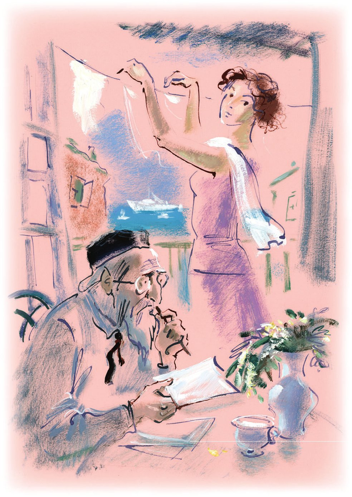
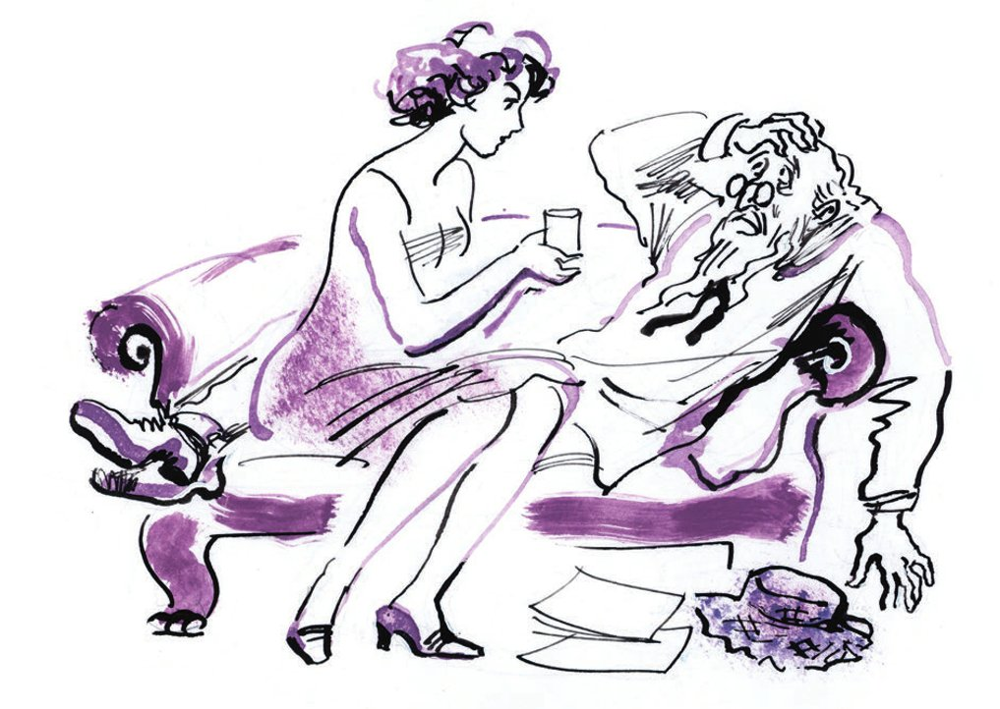
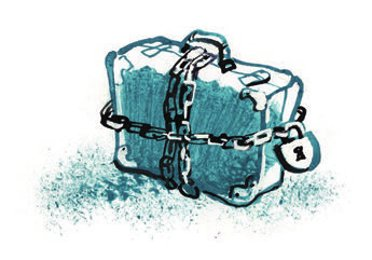

## Kapitel 9: Wieder die Krise des Genres

Was die Menschen nicht alles machen!

<abbr title="neben + Dat. — рядом с, параллельно с">Neben</abbr> der großen Welt mit großen Menschen und großen Dingen gibt es eine kleine Welt mit kleinen Menschen und kleinen Dingen. In der großen Welt hat man den <abbr title="der Dieselmotor, die Dieselmotoren — дизельный мотор">Dieselmotor</abbr> erfunden, «Die toten Seelen» geschrieben, das <abbr title="das Wasserkraftwerk, die Wasserkraftwerke — гидростанция">Wasserkraftwerk</abbr> am Dnjepr gebaut und die Welt im Flugzeug <abbr title="umrunden — облететь">umrundet</abbr>. In der kleinen Welt hat man den <abbr title="der Quietschballon, die Quietschballons — пищащий шарик">Quietschballon</abbr> «Hau ab, hau ab!» erfunden, das Liedchen «Ziegelsteinchen» geschrieben und Hosen im <abbr title="der Schnitt, die Schnitte — фасон, покрой">Schnitt</abbr> «Botschafter» gemacht. In der großen Welt <abbr title="treiben (trieb, hat getrieben) — двигать, гнать">treibt</abbr> die Menschen der Wunsch, der Menschheit Gutes zu tun. Die kleine Welt ist weit weg von so hohen Dingen. Ihre Bewohner haben nur einen Wunsch: irgendwie leben und keinen Hunger haben.

Die kleinen Menschen laufen den großen hinterher. Sie verstehen: Sie müssen zur <abbr title="die Epoche, die Epochen — эпоха">Epoche</abbr> passen. Nur dann können sie ihre kleinen Waren verkaufen. In der Sowjetzeit baut die große Welt ideologische Festungen. Und in der kleinen Welt wird es sehr <abbr title="lebhaft — оживлённый">lebhaft</abbr>. Unter jede kleine <abbr title="die Erfindung, die Erfindungen — изобретение">Erfindung</abbr> von der <abbr title="die Ameisenwelt — муравьиный мир">Ameisenwelt</abbr> legt man ein Fundament aus <abbr title="der Granit — гранит">Granit</abbr>: die kommunistische <abbr title="die Ideologie, die Ideologien — идеология">Ideologie</abbr>. Auf den Quietschballon «Hau ab, hau ab!» malt man jetzt Chamberlain. Er sieht genau so aus wie in den Zeichnungen in der «Iswestija». In einem <abbr title="beliebt — популярный">beliebten</abbr> Lied will ein kluger <abbr title="der Schlosser, die Schlosser — слесарь">Schlosser</abbr> die Liebe von einer Komsomolzin <abbr title="gewinnen (gewann, hat gewonnen) — завоевать">gewinnen</abbr>. Dafür erfüllt er in drei Refrains den <abbr title="der Produktionsplan, die Produktionspläne — промфинплан">Produktionsplan</abbr> und <abbr title="übererfüllen — перевыполнять">übererfüllt</abbr> ihn sogar. In der großen Welt gibt es noch eine wilde <abbr title="die Diskussion, die Diskussionen — дискуссия">Diskussion</abbr>: Wie soll das neue Leben aussehen? Aber in der kleinen Welt ist schon alles fertig. Es gibt die Krawatte «Stoßarbeitertraum», die Tolstoi-Bluse heißt jetzt Gladkow-Bluse, es gibt die <abbr title="die Gipsfigur, die Gipsfiguren — гипсовая статуэтка">Gipsfigur</abbr> «Badende Kolchosbäuerin» und <abbr title="das Achselpolster, die Achselpolster — подмышник">Achselpolster</abbr> aus <abbr title="der Kork — пробка">Kork</abbr> für Damen: «Die Liebe der <abbr title="die Arbeitsbiene, die Arbeitsbienen — рабочая (трудовая) пчела">Arbeitsbienen</abbr>».

Auch bei den <abbr title="das Bilderrätsel, die Bilderrätsel — ребус">Bilderrätseln</abbr>, <abbr title="das Silbenrätsel, die Silbenrätsel — шарада">Silbenrätseln</abbr>, <abbr title="das Buchstabenrätsel, die Buchstabenrätsel — логогриф">Buchstabenrätseln</abbr> und <abbr title="das Suchbild, die Suchbilder — загадочная картинка">Suchbildern</abbr> weht ein neuer Wind. Wer altmodisch arbeitet, hat keine Chance mehr. Die Redakteure von den <abbr title="die Rubrik, die Rubriken — рубрика, отдел">Rubriken</abbr> «In der Freizeit» oder «Beweg deine <abbr title="die Hirnwindung, die Hirnwindungen — мозговая извилина">Hirnwindung</abbr>!» nehmen keine Ware ohne Ideologie mehr. Das große Land <abbr title="lärmen — шуметь">lärmt</abbr>. Man baut <abbr title="das Traktorenwerk, die Traktorenwerke — тракторный завод">Traktorenwerke</abbr> und <abbr title="gigantisch — грандиозный">gigantische</abbr> <abbr title="die Getreidefabrik, die Getreidefabriken — зерновая фабрика">Getreidefabriken</abbr>. Und in dieser Zeit sitzt der alte Sinizki in seinem Zimmer. Er ist von Beruf <abbr title="der Rätselmacher, die Rätselmacher — ребусник">Rätselmacher</abbr>. Mit <abbr title="glasig — остекленевший">glasigen</abbr> Augen starrt er an die Decke und macht ein Silbenrätsel zu dem <abbr title="modisch — модный">modischen</abbr> Wort «Industrialisierung».

Sinizki sieht aus wie ein <abbr title="der Zwerg, die Zwerge — гном">Zwerg</abbr>. Solche Zwerge malt man oft auf die Schilder von <abbr title="das Schirmgeschäft, die Schirmgeschäfte — зонтичный магазин">Schirmgeschäften</abbr>. Die Zwerge auf den Schildern tragen rote <abbr title="die Zipfelmütze, die Zipfelmützen — колпак">Zipfelmützen</abbr> und zwinkern den Passanten freundlich zu. Sie laden sie sozusagen ein: Kauft schnell einen Seidenschirm oder einen <abbr title="der Spazierstock, die Spazierstöcke — трость">Spazierstock</abbr> mit einem silbernen <abbr title="der Knauf, die Knäufe — набалдашник">Knauf</abbr> in der Form von einem Hundekopf. Der lange, gelbliche Bart von Sinizki hängt bis unter den Tisch, direkt in den <abbr title="der Papierkorb, die Papierkörbe — корзина для бумаг">Papierkorb</abbr>.

— Industrialisierung, — flüstert er kummervoll und bewegt seine alten Lippen. Sie sind blass wie rohe <abbr title="die Frikadelle, die Frikadellen — котлета">Frikadellen</abbr>.

Und wie immer teilt er das Wort in Rätselteile:

— Indus. Tri. Ali. Sie. Rung.

Alles ist <abbr title="prima — прекрасно">prima</abbr>. Sinizki sieht schon ein prächtiges Silbenrätsel vor sich: mit wichtigem <abbr title="der Inhalt, die Inhalte — содержание">Inhalt</abbr>, leicht zu lesen und schwer zu <abbr title="lösen — отгадывать, решать">lösen</abbr>. Nur der letzte Teil macht ihm Sorgen: «rung».

— Was ist denn das für ein «rung»? — <abbr title="grübeln — ломать голову">grübelt</abbr> der Alte. — Ja, wenn es «Sprung» ist! Dann geht es wunderbar: Industrialisiesprung.

Eine halbe Stunde quält er sich. Aber er weiß nicht, was er mit dem <abbr title="launisch — капризный">launischen</abbr> Ende machen soll. Da beschließt Sinizki: Das Ende kommt schon von allein. Und er beginnt mit der Arbeit.

Er schreibt sein <abbr title="das Gedicht, die Gedichte — стихотворение, поэма">Gedicht</abbr> auf ein Blatt aus einem <abbr title="das Rechnungsbuch, die Rechnungsbücher — бухгалтерская книга">Rechnungsbuch</abbr>. Oben auf dem Blatt steht «<abbr title="das Soll — дебет">Soll</abbr>».

Durch die weiße Glastür vom <abbr title="der Balkon, die Balkone — балкон">Balkon</abbr> sieht man blühende Akazien, <abbr title="geflickt — латаный">geflickte</abbr> Dächer und den scharfen blauen <abbr title="der Strich, die Striche — черта, линия">Strich</abbr> vom Meer am Horizont. Der Mittag von Tschernomorsk <abbr title="überfluten — заливать">überflutet</abbr> die Stadt mit einer Hitze, dick wie <abbr title="der Pudding, die Puddings — кисель, пудинг">Pudding</abbr>.

Der Alte denkt nach und schreibt die ersten <abbr title="die Zeile, die Zeilen — строка">Zeilen</abbr> auf das Papier:

Mein Erstes fließt im Morgenland,

im Osten muss es immer sein.

— Im Osten muss es immer sein, — sagt der Alte zufrieden.

Was er geschrieben hat, gefällt ihm. Schwer ist nur der <abbr title="der Reim, die Reime — рифма">Reim</abbr> auf «Morgenland» und «sein». Der Rätselmacher geht im Zimmer hin und her und fasst sich an den Bart. Plötzlich hat er eine <abbr title="die Eingebung, die Eingebungen — озарение">Eingebung</abbr>:

Mein Zweites ist mir gut bekannt,

mit einer Zahl verbunden, fein.

Auch mit «Ali» und «Sie» wird er leicht fertig:

Im Turban sitzt mein drittes Stück,

im Osten lebt es auch, ganz klar.

Das Vierte zeigt mit Gottes Glück

ein <abbr title="das Fürwort, die Fürwörter — местоимение">Fürwort</abbr> uns, das ist doch wahr.

Diese letzte <abbr title="die Anstrengung, die Anstrengungen — усилие">Anstrengung</abbr> hat Sinizki müde gemacht. Er lehnt sich im Stuhl zurück und schließt die Augen. Er ist schon siebzig Jahre alt. Fünfzig davon hat er Bilderrätsel, Silbenrätsel, Suchbilder und andere Rätsel gemacht. Aber noch nie war die Arbeit für den ehrwürdigen Rätselmacher so schwer wie jetzt. Er ist <abbr title="hinter der Zeit zurück sein — отстать от жизни">hinter der Zeit zurück</abbr>, er versteht nichts von Politik. Die jungen <abbr title="der Konkurrent, die Konkurrenten — конкурент">Konkurrenten</abbr> schlagen ihn leicht. Sie bringen den Redaktionen Rätsel mit so einer wunderbaren ideologischen Linie, dass der Alte vor Neid weint, wenn er sie liest. Wie soll er zum Beispiel mit so einer Aufgabe <abbr title="mithalten (hielt mit, hat mitgehalten) — угнаться, тягаться">mithalten</abbr>:

ZAHLENRÄTSEL-ARITHMOMOID

Auf drei <abbr title="der Bahnhof, die Bahnhöfe — станция, вокзал">Bahnhöfen</abbr> – Spatzendorf, Krähendorf und Drosseldorf – arbeiten gleich viele Angestellte. In Drosseldorf gibt es sechsmal weniger <abbr title="der Komsomolze, die Komsomolzen — комсомолец">Komsomolzen</abbr> als auf den zwei anderen Bahnhöfen zusammen. In Spatzendorf gibt es 12 Parteimitglieder mehr als in Krähendorf. Aber in Krähendorf gibt es 6 Parteilose mehr als auf den beiden ersten Bahnhöfen. Wie viele Angestellte arbeiten auf jedem Bahnhof, und wie groß ist dort der <abbr title="der Anteil, die Anteile — доля, прослойка">Anteil</abbr> von Parteimitgliedern und Komsomolzen?

Endlich <abbr title="erwachen — очнуться">erwacht</abbr> der Alte aus seinen traurigen Gedanken. Er nimmt wieder das Blatt mit dem Wort «Soll». Aber da kommt ein Mädchen ins Zimmer. Sie hat nasse, kurze Haare, und über der Schulter trägt sie einen schwarzen <abbr title="der Badeanzug, die Badeanzüge — купальный костюм">Badeanzug</abbr>.

Ohne ein Wort geht sie auf den Balkon. Sie hängt den nassen Badeanzug über das abgeblätterte Geländer und sieht nach unten. Das Mädchen sieht den armen Hof, den sie schon so viele Jahre sieht. Einen elenden Hof. Dort liegen kaputte Kisten herum, Katzen voller <abbr title="der Kohlenstaub — угольная пыль">Kohlenstaub</abbr> <abbr title="streunen — бродить, шататься">streunen</abbr> herum, und ein <abbr title="der Klempner, die Klempner — жестянщик">Klempner</abbr> repariert mit großem Lärm einen Eimer. Im <abbr title="das Erdgeschoss, die Erdgeschosse — нижний этаж">Erdgeschoss</abbr> sprechen die Hausfrauen über ihr schweres Leben.

Auch diese Gespräche hört das Mädchen nicht zum ersten Mal. Die Katzen kennt sie alle mit Namen. Und der Klempner repariert offenbar schon viele Jahre lang immer denselben Eimer. Sossja Sinizkaja geht zurück ins Zimmer.

— Die Ideologie macht mich fertig, — hört sie den Großvater murmeln. — Aber was für eine Ideologie kann es bei Rätseln geben? Die Rätselei …

Sossja sieht auf das <abbr title="das Gekritzel — каракули">Gekritzel</abbr> vom Alten und ruft sofort:

— Was hast du da geschrieben? Was ist das? «Das Vierte zeigt mit Gottes Glück ein Fürwort uns …» Warum Gott? Du hast doch selbst gesagt: Die Redaktionen nehmen keine Rätsel mit <abbr title="kirchlich — церковный">kirchlichen</abbr> <abbr title="der Ausdruck, die Ausdrücke — выражение">Ausdrücken</abbr> mehr.

Sinizki <abbr title="aufstöhnen — ахнуть">stöhnt</abbr> auf. Er ruft: «Wo ist Gott, wo? Da ist kein Gott!» Mit zitternden Händen zieht er seine Brille mit dem weißen Rahmen auf die Nase und packt das Blatt.

— Doch, da ist Gott, — sagt er traurig. — Er hat sich <abbr title="sich einschleichen (schlich sich ein, hat sich eingeschlichen) — вкрасться, затесаться">eingeschlichen</abbr> … Wieder <abbr title="danebengreifen (griff daneben, hat danebengegriffen) — дать маху, промахнуться">danebengegriffen</abbr>! Ach, wie schade! Und der gute Reim ist auch weg.

— Dann schreib statt «Gottes» doch «Schicksals», — sagt Sossja.

Aber der erschrockene Sinizki will kein «Schicksal».

— Das ist auch <abbr title="die Mystik — мистика">Mystik</abbr>. Das weiß ich. Ach, wieder danebengegriffen! Was soll jetzt werden, Sossjenka?

Sossja sieht den Großvater gleichgültig an. Er soll ein neues Silbenrätsel machen, sagt sie.

— Es ist sowieso egal, — sagt sie. — Wörter auf «-ung» schaffst du nie. Weißt du noch, wie du dich mit dem Wort «<abbr title="die Kohlenförderung — добыча угля">Kohlenförderung</abbr>» gequält hast?

— Und ob! — sagt der Alte und wird lebhaft. — Ich habe als erstes Stück «Kohn» genommen und geschrieben: «Das Erste kennt, wer Muße hat, als Judennamen in der Stadt.» Sie haben dieses Rätsel nicht genommen. Sie haben gesagt: «<abbr title="schwach — слабо">Schwach</abbr>. Passt nicht.» Danebengegriffen!

Der Alte setzt sich an seinen Tisch. Er beginnt ein großes, ideologisch korrektes Bilderrätsel. Zuerst zeichnet er mit dem Bleistift eine Gans. Im Schnabel hält die Gans den Buchstaben «G». Er ist groß und schwer wie ein <abbr title="der Galgen, die Galgen — виселица">Galgen</abbr>. Die Arbeit geht gut voran.

Sossja deckt den Tisch für das Mittagessen. Sie geht vom Büfett mit den runden Spiegelfenstern zum Tisch und holt das <abbr title="das Geschirr — посуда">Geschirr</abbr> heraus. Da erscheinen: eine <abbr title="die Suppenschüssel, die Suppenschüsseln — суповая миска">Suppenschüssel</abbr> aus <abbr title="das Steingut — фаянс">Steingut</abbr> mit <abbr title="abgebrochen — отбитый">abgebrochenen</abbr> <abbr title="der Henkel, die Henkel — ручка (посуды)">Henkeln</abbr>, Teller mit Blümchen und ohne Blümchen, gelb gewordene <abbr title="die Gabel, die Gabeln — вилка">Gabeln</abbr> und sogar eine <abbr title="die Kompottschale, die Kompottschalen — компотница">Kompottschale</abbr>. Dabei gibt es zum Mittagessen gar kein <abbr title="das Kompott, die Kompotte — компот">Kompott</abbr> gibt.

Überhaupt geht es den Sinizkis schlecht. Die Rätsel bringen mehr Aufregung ins Haus als Geld. Der alte Rätselmacher gibt auch Mittagessen für Bekannte. Sie bezahlen dafür, und das ist das wichtigste <abbr title="das Einkommen, die Einkommen — доход">Einkommen</abbr> von der Familie. Aber auch damit läuft es schlecht. Podwyssozki und Bomse sind in den Urlaub gefahren. Stuljan hat eine Griechin geheiratet und isst jetzt zu Hause. Und Pobiruchin hat man bei einer Säuberung aus seinem Büro geworfen, nach der zweiten <abbr title="die Kategorie, die Kategorien — категория">Kategorie</abbr>. Vor Aufregung hat er keinen <abbr title="der Appetit — аппетит">Appetit</abbr> mehr und kommt nicht mehr zum Essen. Jetzt geht er durch die Stadt, hält Bekannte an und sagt immer denselben Satz, voller <abbr title="versteckt — скрытый">versteckter</abbr> Ironie: «Haben Sie schon gehört? Man hat mich nach der zweiten Kategorie <abbr title="säubern — вычистить">gesäubert</abbr>.» Manche Bekannte antworten mitfühlend: «Was haben diese Banditen Marx und Engels da nur <abbr title="anrichten — натворить">angerichtet</abbr>!» Andere sagen gar nichts. Sie sehen Pobiruchin mit <abbr title="feurig — огненный">feurigem</abbr> Blick von der Seite an und laufen vorbei. Dabei schwenken sie ihre Aktentaschen. Am Ende ist von allen <abbr title="der Kostgänger, die Kostgänger — нахлебник, столовник">Kostgängern</abbr> nur einer übrig. Und auch der bezahlt schon eine Woche nicht. Er sagt, sein Gehalt kommt zu spät.

Sossja zuckt unzufrieden mit den Schultern und geht in die Küche. Als sie zurückkommt, sitzt am Esstisch der letzte Kostgänger: Alexander Iwanowitsch Koreiko.

Hier, nicht im Büro, sieht Alexander Iwanowitsch nicht ängstlich und <abbr title="unterwürfig — приниженный">unterwürfig</abbr> aus. Aber sein Gesicht ist trotzdem keine Minute ohne <abbr title="die Vorsicht — настороженность, осторожность">Vorsicht</abbr>. Jetzt betrachtet er aufmerksam das neue Bilderrätsel von Sinizki. Zwischen anderen geheimnisvollen Bildern ist dort ein Sack gemalt. Aus dem Sack fallen viele Buchstaben «T». Dann eine <abbr title="die Tanne, die Tannen — ель">Tanne</abbr>, hinter der die Sonne aufgeht. Und ein Spatz, der auf einer <abbr title="die Notenlinie, die Notenlinien — нотная линейка">Notenlinie</abbr> sitzt. Am Ende vom Rätsel steht ein <abbr title="umgedreht — перевёрнутый">umgedrehtes</abbr> <abbr title="das Komma, die Kommas — запятая">Komma</abbr>.

— Dieses Bilderrätsel ist schwer zu lösen, — sagt Sinizki und geht um den Kostgänger herum. — Da müssen Sie lange sitzen!

— Ja, ja, das muss ich, — antwortet Koreiko und <abbr title="grinsen — усмехаться">grinst</abbr>. — Nur die Gans <abbr title="verwirren — смущать, сбивать с толку">verwirrt</abbr> mich. Wozu ist diese Gans? A-a-ah! Ich hab’s! Fertig! «Im Kampf <abbr title="erringen (errang, hat errungen) — добиваться, обретать">erringst</abbr> du dein Recht»?

— Ja, — sagt der Alte enttäuscht. — Wie haben Sie das so schnell erraten? Sie sind sehr <abbr title="begabt — способный, одарённый">begabt</abbr>. Man sieht sofort: ein Buchhalter erster Klasse.

— Zweiter Klasse, — <abbr title="korrigieren — поправлять">korrigiert</abbr> Koreiko. — Und wofür haben Sie dieses Rätsel gemacht? Für die Zeitung?

— Für die Zeitung.

— Das können Sie <abbr title="vergessen (vergaß, hat vergessen) — забыть">vergessen</abbr>, — sagt Koreiko. Er sieht neugierig auf den <abbr title="der Borschtsch — борщ">Borschtsch</abbr>. Darin schwimmen goldene Medaillen aus Fett. Dieser Borschtsch hat etwas <abbr title="verdient — заслуженный">Verdientes</abbr>, etwas von einem <abbr title="der Unteroffizier, die Unteroffiziere — унтер-офицер">Unteroffizier</abbr>. — «Im Kampf erringst du dein Recht» – das ist eine Losung von den <abbr title="der Sozialrevolutionär, die Sozialrevolutionäre — эсер">Sozialrevolutionären</abbr>. Für die Zeitung geht das nicht.

— Ach, du lieber Gott! — stöhnt der Alte. — <abbr title="die Himmelskönigin — Царица небесная">Himmelskönigin</abbr>! Wieder danebengegriffen. Hörst du, Sossjenka? Danebengegriffen. Was mache ich jetzt?

Alle beruhigen den Alten. Er isst schnell irgendwie zu Mittag. Dann steht er sofort auf und nimmt die Rätsel, die er in dieser Woche gemacht hat. Er setzt seinen kaputten Hut auf. Der Hut sieht aus wie ein Pferdehut. Dann sagt er:

— So, Sossjenka, ich gehe zu den «Jugend-Nachrichten». Ich mache mir ein bisschen Sorgen wegen dem <abbr title="das Algebroid, die Algebroide — алгеброид (задача)">Algebroid</abbr>. Aber <abbr title="im Großen und Ganzen — в общем и целом">im Großen und Ganzen</abbr> bekomme ich dort bestimmt Geld.

Die «Jugend-Nachrichten» sind eine Zeitschrift vom Komsomol. Dort <abbr title="ablehnen — отклонять, браковать">lehnt</abbr> man die Rätsel vom Alten oft ab. Man <abbr title="vorwerfen (warf vor, hat vorgeworfen) — упрекать, корить">wirft</abbr> ihm vor, dass er altmodisch ist. Aber man kränkt ihn nicht. Und nur von dieser Zeitschrift kommt noch ein dünnes <abbr title="das Bächlein, die Bächlein — ручеёк">Bächlein</abbr> Geld zu ihm. Sinizki nimmt ein Silbenrätsel mit, das so beginnt: «Mein Erstes liegt am Meeresgrund». Außerdem zwei Kolchos-Buchstabenrätsel und ein Algebroid. Darin <abbr title="beweisen (bewies, hat bewiesen) — доказывать">beweist</abbr> er mit sehr schwierigem Multiplizieren und Dividieren: Die Sowjetmacht ist besser als alle anderen Mächte.

Der Rätselmacher ist weg. Alexander Iwanowitsch sieht Sossja finster an. Zuerst ist Alexander Iwanowitsch zu den Sinizkis zum Essen gekommen, weil das Essen dort <abbr title="billig — дешёвый">billig</abbr> und lecker ist. Außerdem hat er eine wichtige <abbr title="die Regel, die Regeln — правило">Regel</abbr>: Er vergisst nie, auch keine Minute, dass er ein kleiner Angestellter ist. Er spricht gern darüber, wie schwer das Leben in einer großen Stadt mit einem winzigen Gehalt ist. Aber seit einiger Zeit sind Preis und Geschmack vom Essen für ihn nicht mehr wichtig. Jetzt ist er bereit, für ein Mittagessen nicht sechzig Kopeken zu bezahlen, sondern drei oder sogar fünf <abbr title="tausend — тысяча">Tausend</abbr> Rubel. Wenn man es nur verlangt, und wenn er es nur offen tun kann.

Alexander Iwanowitsch ist ein <abbr title="der Asket, die Asketen — подвижник, аскет">Asket</abbr>. Er quält sich <abbr title="absichtlich — сознательно, намеренно">absichtlich</abbr> mit finanziellen Ketten. Er hat sich verboten, etwas anzufassen, das mehr als fünfzig Kopeken kostet. Und gleichzeitig ärgert es ihn: Er hat Angst, seine Millionen zu verlieren, deshalb kann er nicht einmal hundert Rubel offen <abbr title="ausgeben (gab aus, hat ausgegeben) — тратить">ausgeben</abbr>. Dieser Mann hat sich jetzt <abbr title="sich verlieben in + Akk. — влюбиться в">verliebt</abbr>. Er hat sich so entschlossen verliebt, wie es nur ein starker, strenger Mensch kann. Ein Mensch, den das endlose Warten ganz böse gemacht hat.

Heute will er Sossja endlich seine Gefühle gestehen. Er will ihr seine Hand <abbr title="anbieten (bot an, hat angeboten) — предлагать">anbieten</abbr> – in dieser Hand schlägt ein kleiner, böser Puls, wie ein <abbr title="der Iltis, die Iltisse — хорёк">Iltis</abbr>. Und sein Herz, das Reifen wie aus einem Märchen <abbr title="zusammenpressen — стягивать, сжимать">zusammenpressen</abbr>.

— Ja, — sagt er, — so ist das eben, Sossja Viktorowna.

Nach dieser <abbr title="die Mitteilung, die Mitteilungen — сообщение">Mitteilung</abbr> nimmt der Bürger Koreiko einen <abbr title="der Aschenbecher, die Aschenbecher — пепельница">Aschenbecher</abbr> vom Tisch. Auf dem Aschenbecher steht eine Losung aus der Zeit vor der Revolution: «Mann, ärgere deine Frau nicht.» Koreiko sieht ihn sehr aufmerksam an.

Hier muss man etwas erklären: Kein Mädchen auf der Welt weiß es nicht mindestens eine Woche vorher, wenn ein Mann ihr seine Liebe gestehen will. Deshalb seufzt Sossja Viktorowna besorgt und bleibt vor dem Spiegel stehen. Sie sieht <abbr title="sportlich — спортивный">sportlich</abbr> aus, so wie alle schönen Mädchen in den letzten Jahren. Sie prüft das kurz. Dann setzt sie sich Alexander Iwanowitsch gegenüber und wartet. Aber Alexander Iwanowitsch sagt nichts. Er kennt nur zwei <abbr title="die Rolle, die Rollen — роль">Rollen</abbr>: den Angestellten und den Untergrund-Millionär. Eine dritte Rolle kennt er nicht.

— Haben Sie schon gehört? — fragt Sossja. — Pobiruchin hat man gesäubert.

— Bei uns hat auch eine Säuberung angefangen, — antwortet Koreiko. — Viele werden fliegen. Zum Beispiel Lapidus junior. Und Lapidus senior ist auch nicht viel besser …

Da merkt Koreiko: Er geht schon wieder auf dem Pfad vom armen Angestellten. Wieder wird er schwer und nachdenklich wie <abbr title="das Blei — свинец">Blei</abbr>.

— Ja, ja, — sagt er. — So lebt man <abbr title="allein — одиноко">allein</abbr>, ohne <abbr title="der Genuss, die Genüsse — наслаждение">Genüsse</abbr>.

— Ohne was, ohne was? — fragt Sossja lebhaft.

— Ohne die <abbr title="die Zuneigung — привязанность">Zuneigung</abbr> von einer Frau, — sagt Koreiko mit gepresster Stimme.

Sossja hilft ihm überhaupt nicht. Also spricht er weiter.

Er ist schon alt. Das heißt, nicht direkt alt, aber auch nicht jung. Und nicht direkt nicht jung, sondern die Zeit vergeht eben, die Jahre gehen vorbei. Die Jahre gehen. Und diese Bewegung von der Zeit bringt ihn auf verschiedene Gedanken. Auf die Ehe zum Beispiel. Man soll nicht denken, dass er irgendwie so einer ist. Er ist eigentlich gut. Ein ganz harmloser Mensch. Man muss Mitleid mit ihm haben. Und er glaubt sogar, dass man ihn lieben kann. Er ist kein <abbr title="der Geck, die Gecken — пижон, фат">Geck</abbr> wie andere. Er redet nicht <abbr title="in den Wind reden — бросать слова на ветер">in den Wind</abbr>. Warum soll ein gewisses Mädchen ihn nicht heiraten?

So schüchtern sagt Alexander Iwanowitsch seine Gefühle. Dann sieht er Sossja böse an.

— Und Lapidus junior, kann man den wirklich säubern? — fragt die Enkelin vom Rätselmacher.

Sie wartet nicht auf eine Antwort, sondern kommt zur Sache.

Sie versteht alles sehr gut. Die Zeit vergeht wirklich schrecklich schnell. Gerade war sie noch neunzehn Jahre alt, und jetzt ist sie schon zwanzig. Und in einem Jahr ist sie einundzwanzig. Sie hat nie gedacht, dass Alexander Iwanowitsch irgendwie so einer ist. Im Gegenteil, sie war immer sicher: Er ist gut. Besser als viele andere. Und natürlich <abbr title="verdienen — заслуживать">verdient</abbr> er alles. Aber gerade jetzt <abbr title="suchen — искать">sucht</abbr> sie etwas. Was sie sucht, weiß sie selbst noch nicht. Kurz: Im Moment kann sie nicht heiraten. Und was für ein Leben können sie zusammen haben? Sie sucht etwas. Und er hat, ehrlich und offen gesagt, nur sechsundvierzig Rubel im Monat. Und dann liebt sie ihn auch noch nicht. Das ist, <abbr title="im Allgemeinen — вообще говоря">im Allgemeinen</abbr>, sehr wichtig.

— Was heißt hier sechsundvierzig Rubel! — sagt Alexander Iwanowitsch plötzlich mit <abbr title="furchtbar — страшный">furchtbarer</abbr> Stimme und steht in seiner vollen Größe auf. — Ich habe … Mir …

Mehr sagt er nicht. Er bekommt Angst. Gerade hat die Rolle vom Millionär angefangen, und das kann nur mit seinem Untergang enden. Seine Angst ist so groß, dass er sogar etwas murmelt, so in der Art: Geld macht nicht glücklich. Aber da hört man hinter der Tür jemanden schnaufen. Sossja läuft in den Flur. Dort steht der Großvater mit seinem großen Hut. Der Hut glänzt mit <abbr title="der Strohkristall, die Strohkristalle — соломенный кристалл">Strohkristallen</abbr>. Der Großvater <abbr title="sich trauen — решаться, осмеливаться">traut sich</abbr> nicht herein. Vor Kummer steht sein Bart nach allen Seiten ab wie ein Besen.

— Warum bist du so früh zurück? — ruft Sossja. — Was ist passiert?

Der Alte hebt die Augen. Sie sind voller Tränen.

Sossja bekommt Angst. Sie fasst den Alten an den <abbr title="knochig — колючий, костлявый">knochigen</abbr> Schultern und zieht ihn schnell ins Zimmer. Eine halbe Stunde liegt Sinizki auf dem <abbr title="das Sofa, die Sofas — диван">Sofa</abbr> und zittert.

Endlich, nach langem <abbr title="das Zureden — уговоры">Zureden</abbr>, beginnt der Großvater zu erzählen.

Alles war wunderbar. Ohne Abenteuer ist er bis zur Redaktion von den «Jugend-Nachrichten» gekommen. Der Leiter von der Rubrik «Denksport» hat den Rätselmacher außerordentlich höflich empfangen.

— Er hat mir die Hand gegeben, Sossjenka, — seufzt der Alte. — «Setzen Sie sich», sagt er, «Genosse Sinizki.» Und dann hat er mich <abbr title="überrumpeln — огорошить, ошеломить">überrumpelt</abbr>. «Unsere Rubrik», sagt er, «schließt man jetzt. Ein neuer <abbr title="der Chefredakteur, die Chefredakteure — главный редактор">Chefredakteur</abbr> ist gekommen. Er sagt: Unsere Leser brauchen keinen Denksport. Sie brauchen», Sossjenka, «eine spezielle Rubrik für das <abbr title="das Damespiel — шашки">Damespiel</abbr>.» Was wird jetzt, frage ich. «Nichts», sagt der Leiter, «Ihr Material kommt nicht mehr, das ist alles.» Aber mein Silbenrätsel hat er sehr gelobt. «Das sind <abbr title="geradezu — прямо, просто">geradezu</abbr> Zeilen wie von Puschkin», sagt er. «Besonders die Stelle: ‹Mein Erstes liegt am Meeresgrund, am Meeresgrund mein Zweites auch.›»

Noch lange zittert der alte Rätselmacher auf dem Sofa. Er klagt über die <abbr title="die Übermacht — засилье">Übermacht</abbr> von der sowjetischen Ideologie.

— Schon wieder ein <abbr title="das Drama, die Dramen — драма">Drama</abbr>! — ruft Sossja.

Sie setzt sich ein Hütchen auf und geht zur Tür. Alexander Iwanowitsch geht hinter ihr her. Dabei weiß er: Er soll lieber nicht mitgehen.

Auf der Straße nimmt Sossja Koreiko am Arm:

— Wir bleiben trotzdem Freunde. Ja?

— Besser ist es, Sie heiraten mich, — brummt Koreiko offen.

Die <abbr title="die Trinkhalle, die Trinkhallen — киоск, буфет с водами">Trinkhallen</abbr> für künstliches <abbr title="das Mineralwasser — минеральная вода">Mineralwasser</abbr> stehen weit offen. Davor stehen viele junge Leute ohne Hüte, in weißen Hemden. Die Ärmel haben sie bis über die Ellbogen hochgekrempelt. Blaue <abbr title="der Siphon, die Siphons — сифон">Siphons</abbr> mit Hähnen aus Metall stehen in den <abbr title="das Regal, die Regale — полка">Regalen</abbr>. Lange Glaszylinder mit <abbr title="der Sirup — сироп">Sirup</abbr> drehen sich auf einem <abbr title="der Ständer, die Ständer — подставка">Ständer</abbr> und schimmern wie in einer Apotheke. Perser mit traurigen Gesichtern <abbr title="rösten — жарить, калить">rösten</abbr> <abbr title="die Nuss, die Nüsse — орех">Nüsse</abbr> auf <abbr title="das Kohlenbecken, die Kohlenbecken — жаровня">Kohlenbecken</abbr>. Der <abbr title="beißend — едкий, угарный">beißende</abbr> Rauch <abbr title="locken — манить">lockt</abbr> die Spaziergänger.

— Ich will ins Kino, — sagt Sossja launisch. — Ich will Nüsse, ich will <abbr title="das Selterswasser — сельтерская вода">Selterswasser</abbr> mit Sirup.

Für Sossja ist Koreiko zu allem bereit. Er ist sogar bereit, seine <abbr title="die Tarnung — конспирация, маскировка">Tarnung</abbr> ein bisschen zu <abbr title="verletzen — нарушать">verletzen</abbr> und fünf Rubel für ein kleines Fest auszugeben. In seiner Tasche liegt jetzt eine flache <abbr title="die Blechschachtel, die Blechschachteln — жестяная коробка">Blechschachtel</abbr> von den Papirossy «Kaukasus». Darin sind zehntausend Rubel – in Scheinen zu je fünfundzwanzig Tscherwonzen. Aber auch wenn er verrückt wird und einen einzigen Schein zeigt – kein Kino kann ihm so einen Schein wechseln.

— Das Gehalt kommt zu spät, — sagt er ganz verzweifelt. — Sie zahlen sehr <abbr title="unpünktlich — неаккуратно, непунктуально">unpünktlich</abbr>.

In diesem Moment kommt aus der Menge ein junger Mann in wunderbaren <abbr title="die Sandale, die Sandalen — сандалия">Sandalen</abbr>, ohne Socken. Er <abbr title="salutieren — салютовать">salutiert</abbr> vor Sossja und hebt die Hand.

— Hallo, hallo, — sagt er. — Ich habe zwei <abbr title="die Freikarte, die Freikarten — контрамарка, бесплатный билет">Freikarten</abbr> fürs Kino. Wollen Sie? Aber sofort.

Und der junge Mann in den wunderbaren Sandalen nimmt Sossja mit. Sie gehen unter das trübe Schild vom Kino «Wohin gehst du», früher «Quo vadis».

In dieser Nacht schläft der Büro-Millionär nicht zu Hause. Bis zum Morgen bummelt er durch die Stadt. Stumpf sieht er in den Schaufenstern von den Fotografen die Fotos von nackten <abbr title="der Säugling, die Säuglinge — младенец">Säuglingen</abbr> an. Er tritt mit den Füßen in den Kies auf dem <abbr title="der Boulevard, die Boulevards — бульвар">Boulevard</abbr>. Er sieht in den dunklen Abgrund vom Hafen. Dort sprechen unsichtbare Dampfschiffe miteinander, man hört <abbr title="der Pfiff, die Pfiffe — свисток">Pfiffe</abbr> von der Miliz, und das rote Licht vom <abbr title="der Leuchtturm, die Leuchttürme — маяк">Leuchtturm</abbr> dreht sich.

«Verfluchtes Land! — murmelt Koreiko. — Ein Land, in dem ein Millionär seine Braut nicht ins Kino ausführen kann.»

Jetzt ist Sossja für ihn schon eine Braut.

Am Morgen ist Alexander Iwanowitsch ganz weiß von der <abbr title="schlaflos — бессонный">schlaflosen</abbr> Nacht. Er kommt an den <abbr title="der Stadtrand, die Stadtränder — окраина">Stadtrand</abbr>. In der Bessarabischen Straße hört er plötzlich die Töne von einem Matchiche. Er wundert sich und bleibt stehen.

Von oben kommt ihm ein gelbes Auto entgegen. Am <abbr title="das Steuer — руль">Steuer</abbr> sitzt gebückt ein müder Fahrer in einer Jacke aus Chromleder. Neben ihm döst ein Bursche mit breiten Schultern. Sein Kopf mit dem Stetson-Hut mit den kleinen Löchern hängt zur Seite. Auf dem <abbr title="der Rücksitz, die Rücksitze — заднее сиденье">Rücksitz</abbr> sitzen bequem noch zwei Fahrgäste: ein Feuerwehrmann in voller <abbr title="die Paradeuniform, die Paradeuniformen — парадная форма">Paradeuniform</abbr> und ein <abbr title="athletisch — атлетический">athletischer</abbr> Mann mit einer <abbr title="die Kapitänsmütze, die Kapitänsmützen — морская фуражка">Kapitänsmütze</abbr> mit weißem Deckel.

— Gruß an den ersten Tschernomorsker! — ruft Ostap, als das Auto mit dem Lärm von einem Traktor an Koreiko vorbeirast. — Gibt es noch die warmen <abbr title="das Meeresbad, die Meeresbäder — морская ванна">Meeresbäder</abbr>? <abbr title="funktionieren — функционировать, работать">Funktioniert</abbr> das Stadttheater? Hat man Tschernomorsk schon zur <abbr title="die freie Stadt — вольный город">freien Stadt</abbr> erklärt?

Aber Ostap bekommt keine Antwort. Koslewitsch öffnet den Auspuff, und die «Antilope» <abbr title="ertränken — утопить">ertränkt</abbr> den ersten Tschernomorsker in einer Wolke von blauem Rauch.

— Nun, — sagt Ostap zu Balaganow, der gerade <abbr title="aufwachen — просыпаться">aufwacht</abbr>, — die Sitzung geht weiter. Her mit Ihrem Untergrund-Rockefeller. Gleich ziehe ich ihn aus. Ach, diese Prinzen und Bettelknaben!

---

### Neue Wörter

- **neben + Dat.** — рядом с, параллельно с
- **der Dieselmotor, die Dieselmotoren** — дизельный мотор
- **das Wasserkraftwerk, die Wasserkraftwerke** — гидростанция
- **umrunden** — облететь
- **der Quietschballon, die Quietschballons** — пищащий шарик
- **der Schnitt, die Schnitte** — фасон, покрой
- **treiben (trieb, hat getrieben)** — двигать, гнать
- **die Epoche, die Epochen** — эпоха
- **lebhaft** — оживлённый
- **die Erfindung, die Erfindungen** — изобретение
- **die Ameisenwelt** — муравьиный мир
- **der Granit** — гранит
- **die Ideologie, die Ideologien** — идеология
- **beliebt** — популярный
- **der Schlosser, die Schlosser** — слесарь
- **gewinnen (gewann, hat gewonnen)** — завоевать
- **der Produktionsplan, die Produktionspläne** — промфинплан
- **übererfüllen** — перевыполнять
- **die Diskussion, die Diskussionen** — дискуссия
- **die Gipsfigur, die Gipsfiguren** — гипсовая статуэтка
- **das Achselpolster, die Achselpolster** — подмышник
- **der Kork** — пробка
- **die Arbeitsbiene, die Arbeitsbienen** — рабочая (трудовая) пчела
- **das Bilderrätsel, die Bilderrätsel** — ребус
- **das Silbenrätsel, die Silbenrätsel** — шарада
- **das Buchstabenrätsel, die Buchstabenrätsel** — логогриф
- **das Suchbild, die Suchbilder** — загадочная картинка
- **die Rubrik, die Rubriken** — рубрика, отдел
- **die Hirnwindung, die Hirnwindungen** — мозговая извилина
- **lärmen** — шуметь
- **das Traktorenwerk, die Traktorenwerke** — тракторный завод
- **gigantisch** — грандиозный
- **die Getreidefabrik, die Getreidefabriken** — зерновая фабрика
- **der Rätselmacher, die Rätselmacher** — ребусник
- **glasig** — остекленевший
- **modisch** — модный
- **der Zwerg, die Zwerge** — гном
- **das Schirmgeschäft, die Schirmgeschäfte** — зонтичный магазин
- **die Zipfelmütze, die Zipfelmützen** — колпак
- **der Spazierstock, die Spazierstöcke** — трость
- **der Knauf, die Knäufe** — набалдашник
- **der Papierkorb, die Papierkörbe** — корзина для бумаг
- **die Frikadelle, die Frikadellen** — котлета
- **prima** — прекрасно
- **der Inhalt, die Inhalte** — содержание
- **lösen** — отгадывать, решать
- **grübeln** — ломать голову
- **launisch** — капризный
- **das Gedicht, die Gedichte** — стихотворение, поэма
- **das Rechnungsbuch, die Rechnungsbücher** — бухгалтерская книга
- **das Soll** — дебет
- **der Balkon, die Balkone** — балкон
- **geflickt** — латаный
- **der Strich, die Striche** — черта, линия
- **überfluten** — заливать
- **der Pudding, die Puddings** — кисель, пудинг
- **die Zeile, die Zeilen** — строка
- **der Reim, die Reime** — рифма
- **die Eingebung, die Eingebungen** — озарение
- **das Fürwort, die Fürwörter** — местоимение
- **die Anstrengung, die Anstrengungen** — усилие
- **hinter der Zeit zurück sein** — отстать от жизни
- **der Konkurrent, die Konkurrenten** — конкурент
- **mithalten (hielt mit, hat mitgehalten)** — угнаться, тягаться
- **der Bahnhof, die Bahnhöfe** — станция, вокзал
- **der Komsomolze, die Komsomolzen** — комсомолец
- **der Anteil, die Anteile** — доля, прослойка
- **erwachen** — очнуться
- **der Badeanzug, die Badeanzüge** — купальный костюм
- **der Kohlenstaub** — угольная пыль
- **streunen** — бродить, шататься
- **der Klempner, die Klempner** — жестянщик
- **das Erdgeschoss, die Erdgeschosse** — нижний этаж
- **das Gekritzel** — каракули
- **kirchlich** — церковный
- **der Ausdruck, die Ausdrücke** — выражение
- **aufstöhnen** — ахнуть
- **sich einschleichen (schlich sich ein, hat sich eingeschlichen)** — вкрасться, затесаться
- **danebengreifen (griff daneben, hat danebengegriffen)** — дать маху, промахнуться
- **die Mystik** — мистика
- **die Kohlenförderung** — добыча угля
- **schwach** — слабо
- **der Galgen, die Galgen** — виселица
- **das Geschirr** — посуда
- **die Suppenschüssel, die Suppenschüsseln** — суповая миска
- **das Steingut** — фаянс
- **abgebrochen** — отбитый
- **der Henkel, die Henkel** — ручка (посуды)
- **die Gabel, die Gabeln** — вилка
- **die Kompottschale, die Kompottschalen** — компотница
- **das Kompott, die Kompotte** — компот
- **das Einkommen, die Einkommen** — доход
- **die Kategorie, die Kategorien** — категория
- **der Appetit** — аппетит
- **versteckt** — скрытый
- **säubern** — вычистить
- **anrichten** — натворить
- **feurig** — огненный
- **der Kostgänger, die Kostgänger** — нахлебник, столовник
- **unterwürfig** — приниженный
- **die Vorsicht** — настороженность, осторожность
- **die Tanne, die Tannen** — ель
- **die Notenlinie, die Notenlinien** — нотная линейка
- **umgedreht** — перевёрнутый
- **das Komma, die Kommas** — запятая
- **grinsen** — усмехаться
- **verwirren** — смущать, сбивать с толку
- **erringen (errang, hat errungen)** — добиваться, обретать
- **begabt** — способный, одарённый
- **korrigieren** — поправлять
- **vergessen (vergaß, hat vergessen)** — забыть
- **der Borschtsch** — борщ
- **verdient** — заслуженный
- **der Unteroffizier, die Unteroffiziere** — унтер-офицер
- **der Sozialrevolutionär, die Sozialrevolutionäre** — эсер
- **die Himmelskönigin** — Царица небесная
- **das Algebroid, die Algebroide** — алгеброид (задача)
- **im Großen und Ganzen** — в общем и целом
- **ablehnen** — отклонять, браковать
- **vorwerfen (warf vor, hat vorgeworfen)** — упрекать, корить
- **das Bächlein, die Bächlein** — ручеёк
- **beweisen (bewies, hat bewiesen)** — доказывать
- **billig** — дешёвый
- **die Regel, die Regeln** — правило
- **tausend** — тысяча
- **der Asket, die Asketen** — подвижник, аскет
- **absichtlich** — сознательно, намеренно
- **ausgeben (gab aus, hat ausgegeben)** — тратить
- **sich verlieben in + Akk.** — влюбиться в
- **anbieten (bot an, hat angeboten)** — предлагать
- **der Iltis, die Iltisse** — хорёк
- **zusammenpressen** — стягивать, сжимать
- **die Mitteilung, die Mitteilungen** — сообщение
- **der Aschenbecher, die Aschenbecher** — пепельница
- **sportlich** — спортивный
- **die Rolle, die Rollen** — роль
- **das Blei** — свинец
- **allein** — одиноко
- **der Genuss, die Genüsse** — наслаждение
- **die Zuneigung** — привязанность
- **der Geck, die Gecken** — пижон, фат
- **in den Wind reden** — бросать слова на ветер
- **verdienen** — заслуживать
- **suchen** — искать
- **im Allgemeinen** — вообще говоря
- **furchtbar** — страшный
- **der Strohkristall, die Strohkristalle** — соломенный кристалл
- **sich trauen** — решаться, осмеливаться
- **knochig** — колючий, костлявый
- **das Sofa, die Sofas** — диван
- **das Zureden** — уговоры
- **überrumpeln** — огорошить, ошеломить
- **der Chefredakteur, die Chefredakteure** — главный редактор
- **das Damespiel** — шашки
- **geradezu** — прямо, просто
- **die Übermacht** — засилье
- **das Drama, die Dramen** — драма
- **die Trinkhalle, die Trinkhallen** — киоск, буфет с водами
- **das Mineralwasser** — минеральная вода
- **der Siphon, die Siphons** — сифон
- **das Regal, die Regale** — полка
- **der Sirup** — сироп
- **der Ständer, die Ständer** — подставка
- **rösten** — жарить, калить
- **die Nuss, die Nüsse** — орех
- **das Kohlenbecken, die Kohlenbecken** — жаровня
- **beißend** — едкий, угарный
- **locken** — манить
- **das Selterswasser** — сельтерская вода
- **die Tarnung** — конспирация, маскировка
- **verletzen** — нарушать
- **die Blechschachtel, die Blechschachteln** — жестяная коробка
- **unpünktlich** — неаккуратно, непунктуально
- **die Sandale, die Sandalen** — сандалия
- **salutieren** — салютовать
- **die Freikarte, die Freikarten** — контрамарка, бесплатный билет
- **der Säugling, die Säuglinge** — младенец
- **der Boulevard, die Boulevards** — бульвар
- **der Pfiff, die Pfiffe** — свисток
- **der Leuchtturm, die Leuchttürme** — маяк
- **schlaflos** — бессонный
- **der Stadtrand, die Stadtränder** — окраина
- **das Steuer** — руль
- **der Rücksitz, die Rücksitze** — заднее сиденье
- **die Paradeuniform, die Paradeuniformen** — парадная форма
- **athletisch** — атлетический
- **die Kapitänsmütze, die Kapitänsmützen** — морская фуражка
- **das Meeresbad, die Meeresbäder** — морская ванна
- **funktionieren** — функционировать, работать
- **die freie Stadt** — вольный город
- **ertränken** — утопить
- **aufwachen** — просыпаться

[← Zurück](kapitel-09.md) · [Inhalt](README.md) · [Weiter →](kapitel-11.md)
