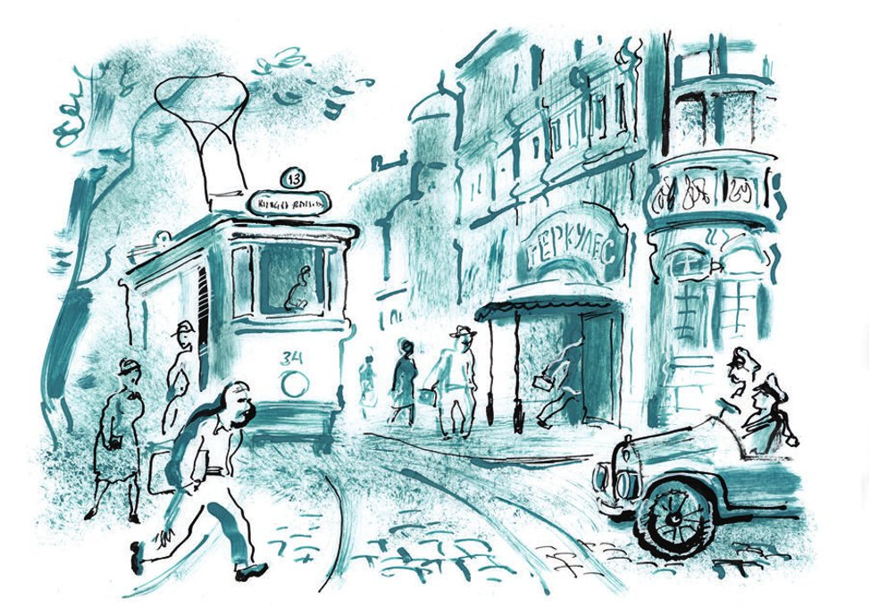

# Zweiter Teil: Zwei Kombinatoren

## Kapitel 10: Ein Telegramm von den Brüdern Karamasow

Seit einiger Zeit spürte der Untergrund-Millionär, dass jemand ihn unermüdlich beobachtete. Zuerst war da nichts Bestimmtes. Nur das gewohnte, ruhige Gefühl der <abbr title="die Einsamkeit — одиночество">Einsamkeit</abbr> war verschwunden. Dann zeigten sich <abbr title="das Anzeichen, die Anzeichen — признак">Anzeichen</abbr>, die schon mehr <abbr title="Angst machen — пугать">Angst machten</abbr>.

Eines Tages ging Koreiko mit seinen <abbr title="gleichmäßig — размеренный, равномерный">gleichmäßigen</abbr> Schritten zur Arbeit. Direkt vor dem «Herkules» hielt ihn ein frecher Bettler mit einem Goldzahn an. Hinter dem Bettler <abbr title="schleifen — волочиться, тащиться">schleiften</abbr> die Bänder seiner Unterhose über den Boden, und er trat selbst darauf. Er packte Alexander Iwanowitsch am Arm und murmelte schnell:

— Gib eine Million, gib eine Million, gib eine Million!

Dann <abbr title="herausstrecken — высовывать">streckte</abbr> der Bettler seine dicke, schmutzige Zunge heraus und redete nur noch Unsinn. Es war ein ganz gewöhnlicher, halb verrückter Bettler, wie man sie oft in den Städten im Süden trifft. <abbr title="trotzdem — тем не менее">Trotzdem</abbr> ging Koreiko mit <abbr title="verwirrt — смущённый, растерянный">verwirrter</abbr> Seele hinauf in seinen Saal, in die Finanz- und <abbr title="die Rechnungsabteilung, die Rechnungsabteilungen — счётный отдел">Rechnungsabteilung</abbr>.

Genau mit dieser <abbr title="die Begegnung, die Begegnungen — встреча">Begegnung</abbr> begann der <abbr title="der Spuk — чертовщина, наваждение">Spuk</abbr>.

Um drei Uhr in der Nacht <abbr title="wecken — будить">weckte</abbr> man Alexander Iwanowitsch. Ein Telegramm war gekommen. Der Millionär klapperte in der Morgenkälte mit den Zähnen. Er riss das Papier auf und las: «GRÄFIN MIT VERÄNDERTEM GESICHT LÄUFT TEICH».

— Was für eine <abbr title="die Gräfin, die Gräfinnen — графиня">Gräfin</abbr>? — <abbr title="flüstern — шептать">flüsterte</abbr> Koreiko <abbr title="fassungslos — ошалело, растерянно">fassungslos</abbr>. Er stand <abbr title="barfuß — босиком">barfuß</abbr> im Flur.

Aber niemand antwortete ihm. Der <abbr title="der Briefträger, die Briefträger — почтальон">Briefträger</abbr> war schon weg. Im kleinen Garten im Hof <abbr title="gurren — ворковать">gurrten</abbr> <abbr title="leidenschaftlich — страстно">leidenschaftlich</abbr> die Tauben. Die <abbr title="der Mieter, die Mieter — жилец">Mieter</abbr> schliefen. Alexander Iwanowitsch drehte das graue <abbr title="das Formular, die Formulare — бланк">Formular</abbr> in den Händen. Die Adresse war richtig. Der Name auch.

«MALAJA KASSATELNAJA 16 ALEXANDER KOREIKO GRÄFIN MIT VERÄNDERTEM GESICHT LÄUFT TEICH».

Alexander Iwanowitsch verstand gar nichts. Aber er regte sich so sehr auf, dass er das Telegramm an einer Kerze verbrannte.

Um 17 Uhr 35 am selben Tag kam die zweite <abbr title="die Depesche, die Depeschen — депеша">Depesche</abbr>: «DIE SITZUNG GEHT WEITER KOMMA EINE MILLION KÜSSE».

Alexander Iwanowitsch wurde blass vor Wut und riss das Telegramm in <abbr title="der Fetzen, die Fetzen — клочок, лоскут">Fetzen</abbr>. Aber in derselben Nacht brachte man noch zwei <abbr title="das Blitztelegramm, die Blitztelegramme — телеграмма-молния">Blitztelegramme</abbr>. Das erste: «VERLADET APFELSINEN FÄSSERN GEBRÜDER KARAMASOW».

Und das zweite: «DAS EIS IST GEBROCHEN PUNKT DIE PARADE KOMMANDIERE ICH».

Danach <abbr title="passieren — случаться">passierte</abbr> Alexander Iwanowitsch bei der Arbeit ein <abbr title="peinlich — неловкий, обидный">peinlicher</abbr> Fehler. Die Tschewaschewskaja bat ihn, 985 mal 13 im Kopf zu rechnen. Er irrte sich und nannte ein falsches Ergebnis. So etwas war ihm noch nie im Leben passiert. Aber jetzt hatte er keinen Kopf für <abbr title="die Rechenübung, die Rechenübungen — арифметическое упражнение">Rechenübungen</abbr>. Die verrückten Telegramme gingen ihm nicht aus dem Kopf.

— Fässern, — flüsterte er und sah den alten Kukuschkind <abbr title="starr — неподвижно, пристально">starr</abbr> an. — Gebrüder Karamasow. Das ist einfach eine <abbr title="die Schweinerei, die Schweinereien — свинство">Schweinerei</abbr>.

Er versuchte sich zu beruhigen: Vielleicht waren das nur nette <abbr title="der Scherz, die Scherze — шутка">Scherze</abbr> von irgendwelchen Freunden? Aber diese Idee musste er schnell aufgeben. Er hatte keine Freunde. Und seine <abbr title="der Kollege, die Kollegen — сослуживец, коллега">Kollegen</abbr> waren ernste Leute. Sie <abbr title="scherzen — шутить">scherzten</abbr> nur einmal im Jahr, am ersten April. Und selbst an diesem Tag der fröhlichen <abbr title="der Streich, die Streiche — проделка, розыгрыш">Streiche</abbr> kannten sie nur einen einzigen, traurigen Witz. Sie tippten auf der Schreibmaschine einen falschen Befehl: Kukuschkind ist entlassen. Diesen Befehl legten sie ihm auf den Tisch. Und jedes Mal, schon sieben Jahre lang, griff sich der Alte ans Herz. Darüber <abbr title="sich amüsieren — забавляться, потешаться">amüsierten sich</abbr> alle sehr. <abbr title="außerdem — кроме того">Außerdem</abbr> waren die Kollegen nicht so reich, dass sie Geld für Depeschen ausgaben.

Im letzten Telegramm hatte ein <abbr title="unbekannt — неизвестный">unbekannter</abbr> Bürger <abbr title="mitteilen — сообщать, уведомлять">mitgeteilt</abbr>, dass gerade er die Parade kommandieren wollte und niemand anderer. Danach wurde es ruhig. Drei Tage lang ließ man Alexander Iwanowitsch in Ruhe. Er gewöhnte sich schon an den Gedanken, dass die ganze Sache ihn gar nichts <abbr title="angehen (ging an, hat angegangen) — касаться">anging</abbr>. Da kam ein dickes <abbr title="das Einschreiben, die Einschreiben — заказное отправление">Einschreiben</abbr>. Darin lag ein Buch mit dem Titel «Die kapitalistischen <abbr title="der Hai, die Haie — акула">Haie</abbr>» und dem <abbr title="der Untertitel, die Untertitel — подзаголовок">Untertitel</abbr>: «Biografien amerikanischer Millionäre».

Zu einer anderen Zeit hätte Koreiko so ein <abbr title="unterhaltsam — занятный, занимательный">unterhaltsames</abbr> Büchlein selbst gekauft. Aber jetzt <abbr title="das Gesicht verziehen (verzog, hat verzogen) — кривиться, морщиться">verzog</abbr> er sogar vor Entsetzen das Gesicht. Der erste Satz war mit blauem Bleistift <abbr title="unterstreichen (unterstrich, hat unterstrichen) — подчёркивать, очерчивать">unterstrichen</abbr>. Er lautete: «Alle großen Vermögen unserer Zeit sind auf die <abbr title="unehrlich — бесчестный, нечестный">unehrlichste</abbr> Weise <abbr title="erwerben (erwarb, hat erworben) — приобретать, наживать">erworben</abbr>.»

Für alle Fälle beschloss Alexander Iwanowitsch, vorläufig nicht zum Bahnhof zu gehen, wo sein kostbarer Koffer stand. Er war in sehr unruhiger Stimmung.

— Das Wichtigste, — sagte Ostap und ging in dem geräumigen Zimmer vom Hotel «Karlsbad» auf und ab, — das Wichtigste ist, <abbr title="die Verwirrung — смятение, замешательство">Verwirrung</abbr> ins Lager des <abbr title="der Gegner, die Gegner — противник">Gegners</abbr> zu bringen. Der Feind muss sein <abbr title="das seelische Gleichgewicht — душевное равновесие">seelisches Gleichgewicht</abbr> verlieren. Das ist nicht so schwer. <abbr title="schließlich — в конце концов">Schließlich</abbr> haben die Menschen am meisten Angst vor dem, was sie nicht verstehen. Ich war selbst einmal ein einsamer <abbr title="der Mystiker, die Mystiker — мистик">Mystiker</abbr>. Damals war ich so weit, dass man mich mit einem einfachen Finnenmesser erschrecken konnte. Ja, ja. Mehr Unverständliches! Ich bin <abbr title="überzeugt sein — быть убеждённым">überzeugt</abbr>, dass mein letztes Telegramm, «IN GEDANKEN VEREINT», auf unseren Vertragspartner einen gewaltigen Eindruck gemacht hat. Das alles ist <abbr title="das Superphosphat — суперфосфат">Superphosphat</abbr>, <abbr title="der Dünger — удобрение">Dünger</abbr>. Soll er sich ruhig aufregen. Der Kunde muss sich an den Gedanken gewöhnen, dass er das Geld <abbr title="hergeben (gab her, hat hergegeben) — отдавать">hergeben</abbr> muss. Man muss ihn moralisch <abbr title="entwaffnen — разоружать">entwaffnen</abbr>. Man muss seine <abbr title="reaktionär — реакционный">reaktionären</abbr> <abbr title="der Besitzinstinkt, die Besitzinstinkte — собственнический инстинкт">Besitzinstinkte</abbr> <abbr title="unterdrücken — подавлять">unterdrücken</abbr>.

Nach dieser Rede sah Bender seine Untergebenen streng an. Balaganow, Panikowski und Koslewitsch saßen <abbr title="brav — чинно, послушно">brav</abbr> in roten <abbr title="der Plüschsessel, die Plüschsessel — плюшевое кресло">Plüschsesseln</abbr> mit <abbr title="die Franse, die Fransen — бахрома">Fransen</abbr> und <abbr title="die Quaste, die Quasten — кисть (украшение)">Quasten</abbr>. Sie waren verlegen. Das <abbr title="großzügig — широкий, щедрый">großzügige</abbr> Leben ihres Kommandeurs machte sie schüchtern. Sie <abbr title="sich genieren — стесняться">genierten sich</abbr> vor den <abbr title="vergoldet — позолоченный">vergoldeten</abbr> <abbr title="der Vorhang, die Vorhänge — занавес, ламбрекен">Vorhängen</abbr>, vor den Teppichen in grellen chemischen Farben und vor dem <abbr title="der Kupferstich, die Kupferstiche — гравюра">Kupferstich</abbr> «Die <abbr title="die Erscheinung, die Erscheinungen — явление">Erscheinung</abbr> Christi vor dem Volke». Sie selbst wohnten mit der «Antilope» in einem einfachen <abbr title="der Gasthof, die Gasthöfe — постоялый двор">Gasthof</abbr>. Ins Hotel kamen sie nur, um ihre <abbr title="die Anweisung, die Anweisungen — инструкция, указание">Anweisungen</abbr> abzuholen.

— Panikowski, — sagte Ostap, — Sie hatten den <abbr title="der Auftrag, die Aufträge — поручение, задание">Auftrag</abbr>, heute unseren <abbr title="der Mandant, die Mandanten — подзащитный, клиент">Mandanten</abbr> zu treffen. Sie sollten ihn ein zweites Mal um eine Million bitten und dabei <abbr title="idiotisch — идиотский">idiotisch</abbr> lachen. Richtig?

— Sobald er mich sah, ging er auf den anderen Bürgersteig, — antwortete Panikowski selbstzufrieden.

— Gut. Alles läuft richtig. Der Kunde wird nervös. Gerade geht er von der dummen <abbr title="die Verwunderung — недоумение, удивление">Verwunderung</abbr> zur <abbr title="grundlos — беспричинный">grundlosen</abbr> Angst über. Ich <abbr title="zweifeln — сомневаться">zweifle</abbr> nicht daran, dass er nachts im Bett <abbr title="hochfahren (fuhr hoch, ist hochgefahren) — вскакивать">hochfährt</abbr> und kläglich stammelt: «Mama, Mama.» Noch ein bisschen, eine Kleinigkeit, der letzte <abbr title="der Pinselstrich, die Pinselstriche — удар кисти, мазок">Pinselstrich</abbr> – und er ist ganz reif. Weinend wird er zum Büfett gehen und ein <abbr title="das Tellerchen, die Tellerchen — тарелочка">Tellerchen</abbr> mit blauem Rand herausholen …

Ostap zwinkerte Balaganow zu. Balaganow zwinkerte Panikowski zu, Panikowski zwinkerte Koslewitsch zu. Der ehrliche Koslewitsch verstand <abbr title="überhaupt nicht — совершенно не">überhaupt</abbr> nichts. Trotzdem blinzelte er jetzt auch, und zwar mit beiden Augen.

Noch lange ging im Zimmer vom Hotel «Karlsbad» das freundliche Zwinkern hin und her. Dazu gab es Kichern, <abbr title="das Zungenschnalzen — цоканье языком">Zungenschnalzen</abbr> und sogar <abbr title="aufspringen (sprang auf, ist aufgesprungen) — вскакивать">Aufspringen</abbr> aus den roten Plüschsesseln.

— Schluss mit der <abbr title="die Heiterkeit — веселье">Heiterkeit</abbr>! — sagte Ostap. — Vorläufig ist das Tellerchen mit dem Geld noch in Koreikos Händen. Wenn es dieses <abbr title="das Zaubertellerchen — волшебная тарелочка">Zaubertellerchen</abbr> überhaupt gibt.

Dann schickte Bender Panikowski und Koslewitsch in den Gasthof zurück. Sie sollten die «Antilope» <abbr title="bereithalten (hielt bereit, hat bereitgehalten) — держать наготове">bereithalten</abbr>.

— Nun, Schura, — sagte er, als er mit Balaganow allein war, — keine Telegramme mehr. Die <abbr title="die Vorbereitung, die Vorbereitungen — подготовка">Vorbereitung</abbr> ist abgeschlossen. Jetzt beginnt der <abbr title="aktiv — активный">aktive</abbr> Kampf. Wir gehen uns jetzt unser <abbr title="teuer — дорогой, драгоценный">teures</abbr> Kälbchen ansehen – bei der <abbr title="die Erfüllung — исполнение">Erfüllung</abbr> seiner <abbr title="die Dienstpflicht, die Dienstpflichten — служебная обязанность">Dienstpflichten</abbr>.

Die Milchbrüder gingen im <abbr title="durchsichtig — прозрачный">durchsichtigen</abbr> Schatten der Akazien durch den <abbr title="der Stadtpark, die Stadtparks — городской сад">Stadtpark</abbr>. Dort lief der dicke <abbr title="der Strahl, die Strahlen — струя">Strahl</abbr> des <abbr title="der Springbrunnen, die Springbrunnen — фонтан">Springbrunnens</abbr> herunter wie das <abbr title="das Wachs — воск">Wachs</abbr> einer Kerze. Sie kamen an ein paar <abbr title="die Bierbar, die Bierbars — пивной бар">Bierbars</abbr> mit Spiegeln vorbei und blieben an der Ecke der Mehringstraße stehen. <abbr title="die Blumenverkäuferin, die Blumenverkäuferinnen — цветочница">Blumenverkäuferinnen</abbr> mit roten <abbr title="das Matrosengesicht, die Matrosengesichter — матросское лицо">Matrosengesichtern</abbr> <abbr title="baden — купать">badeten</abbr> ihre zarte <abbr title="die Ware, die Waren — товар">Ware</abbr> in <abbr title="emailliert — эмалированный">emaillierten</abbr> Schüsseln. Der Asphalt war heiß von der Sonne und <abbr title="zischen — шипеть">zischte</abbr> unter den Füßen. Aus einer blau <abbr title="gekachelt — облицованный кафелем">gekachelten</abbr> <abbr title="die Milchhalle, die Milchhallen — молочная (кафе)">Milchhalle</abbr> kamen Bürger und <abbr title="wischen — вытирать">wischten</abbr> sich im Gehen die Lippen ab. Die Lippen waren voll <abbr title="der Kefir — кефир">Kefir</abbr>.

Dicke Buchstaben aus <abbr title="das Holzgold — деревянное золото (позолота)">Holzgold</abbr>, wie <abbr title="die Makkaroni (Pl.) — макароны">Makkaroni</abbr>, bildeten das Wort «Herkules». Sie <abbr title="leuchten — светиться">leuchteten</abbr> verlockend. Die Sonne sprang über die riesigen Scheiben der Drehtür. Ostap und Balaganow gingen in die <abbr title="die Eingangshalle, die Eingangshallen — вестибюль">Eingangshalle</abbr> und mischten sich unter die vielen <abbr title="die Geschäftsleute (Pl.) — деловые люди">Geschäftsleute</abbr>.

---

### Neue Wörter

- **die Einsamkeit** — одиночество
- **das Anzeichen, die Anzeichen** — признак
- **Angst machen** — пугать
- **gleichmäßig** — размеренный, равномерный
- **schleifen** — волочиться, тащиться
- **herausstrecken** — высовывать
- **trotzdem** — тем не менее
- **verwirrt** — смущённый, растерянный
- **die Rechnungsabteilung, die Rechnungsabteilungen** — счётный отдел
- **die Begegnung, die Begegnungen** — встреча
- **der Spuk** — чертовщина, наваждение
- **wecken** — будить
- **die Gräfin, die Gräfinnen** — графиня
- **flüstern** — шептать
- **fassungslos** — ошалело, растерянно
- **barfuß** — босиком
- **der Briefträger, die Briefträger** — почтальон
- **gurren** — ворковать
- **leidenschaftlich** — страстно
- **der Mieter, die Mieter** — жилец
- **das Formular, die Formulare** — бланк
- **die Depesche, die Depeschen** — депеша
- **der Fetzen, die Fetzen** — клочок, лоскут
- **das Blitztelegramm, die Blitztelegramme** — телеграмма-молния
- **passieren** — случаться
- **peinlich** — неловкий, обидный
- **die Rechenübung, die Rechenübungen** — арифметическое упражнение
- **starr** — неподвижно, пристально
- **die Schweinerei, die Schweinereien** — свинство
- **der Scherz, die Scherze** — шутка
- **der Kollege, die Kollegen** — сослуживец, коллега
- **scherzen** — шутить
- **der Streich, die Streiche** — проделка, розыгрыш
- **sich amüsieren** — забавляться, потешаться
- **außerdem** — кроме того
- **unbekannt** — неизвестный
- **mitteilen** — сообщать, уведомлять
- **angehen (ging an, hat angegangen)** — касаться
- **das Einschreiben, die Einschreiben** — заказное отправление
- **der Hai, die Haie** — акула
- **der Untertitel, die Untertitel** — подзаголовок
- **unterhaltsam** — занятный, занимательный
- **das Gesicht verziehen (verzog, hat verzogen)** — кривиться, морщиться
- **unterstreichen (unterstrich, hat unterstrichen)** — подчёркивать, очерчивать
- **unehrlich** — бесчестный, нечестный
- **erwerben (erwarb, hat erworben)** — приобретать, наживать
- **die Verwirrung** — смятение, замешательство
- **der Gegner, die Gegner** — противник
- **das seelische Gleichgewicht** — душевное равновесие
- **schließlich** — в конце концов
- **der Mystiker, die Mystiker** — мистик
- **überzeugt sein** — быть убеждённым
- **das Superphosphat** — суперфосфат
- **der Dünger** — удобрение
- **hergeben (gab her, hat hergegeben)** — отдавать
- **entwaffnen** — разоружать
- **reaktionär** — реакционный
- **der Besitzinstinkt, die Besitzinstinkte** — собственнический инстинкт
- **unterdrücken** — подавлять
- **brav** — чинно, послушно
- **der Plüschsessel, die Plüschsessel** — плюшевое кресло
- **die Franse, die Fransen** — бахрома
- **die Quaste, die Quasten** — кисть (украшение)
- **großzügig** — широкий, щедрый
- **sich genieren** — стесняться
- **vergoldet** — позолоченный
- **der Vorhang, die Vorhänge** — занавес, ламбрекен
- **der Kupferstich, die Kupferstiche** — гравюра
- **die Erscheinung, die Erscheinungen** — явление
- **der Gasthof, die Gasthöfe** — постоялый двор
- **die Anweisung, die Anweisungen** — инструкция, указание
- **der Auftrag, die Aufträge** — поручение, задание
- **der Mandant, die Mandanten** — подзащитный, клиент
- **idiotisch** — идиотский
- **die Verwunderung** — недоумение, удивление
- **grundlos** — беспричинный
- **zweifeln** — сомневаться
- **hochfahren (fuhr hoch, ist hochgefahren)** — вскакивать
- **der Pinselstrich, die Pinselstriche** — удар кисти, мазок
- **das Tellerchen, die Tellerchen** — тарелочка
- **überhaupt nicht** — совершенно не
- **das Zungenschnalzen** — цоканье языком
- **aufspringen (sprang auf, ist aufgesprungen)** — вскакивать
- **die Heiterkeit** — веселье
- **das Zaubertellerchen** — волшебная тарелочка
- **bereithalten (hielt bereit, hat bereitgehalten)** — держать наготове
- **die Vorbereitung, die Vorbereitungen** — подготовка
- **aktiv** — активный
- **teuer** — дорогой, драгоценный
- **die Erfüllung** — исполнение
- **die Dienstpflicht, die Dienstpflichten** — служебная обязанность
- **durchsichtig** — прозрачный
- **der Stadtpark, die Stadtparks** — городской сад
- **der Strahl, die Strahlen** — струя
- **der Springbrunnen, die Springbrunnen** — фонтан
- **das Wachs** — воск
- **die Bierbar, die Bierbars** — пивной бар
- **die Blumenverkäuferin, die Blumenverkäuferinnen** — цветочница
- **das Matrosengesicht, die Matrosengesichter** — матросское лицо
- **baden** — купать
- **die Ware, die Waren** — товар
- **emailliert** — эмалированный
- **zischen** — шипеть
- **gekachelt** — облицованный кафелем
- **die Milchhalle, die Milchhallen** — молочная (кафе)
- **wischen** — вытирать
- **der Kefir** — кефир
- **das Holzgold** — деревянное золото (позолота)
- **die Makkaroni (Pl.)** — макароны
- **leuchten** — светиться
- **die Eingangshalle, die Eingangshallen** — вестибюль
- **die Geschäftsleute (Pl.)** — деловые люди

[← Zurück](kapitel-10.md) · [Inhalt](README.md) · [Weiter →](kapitel-12.md)
