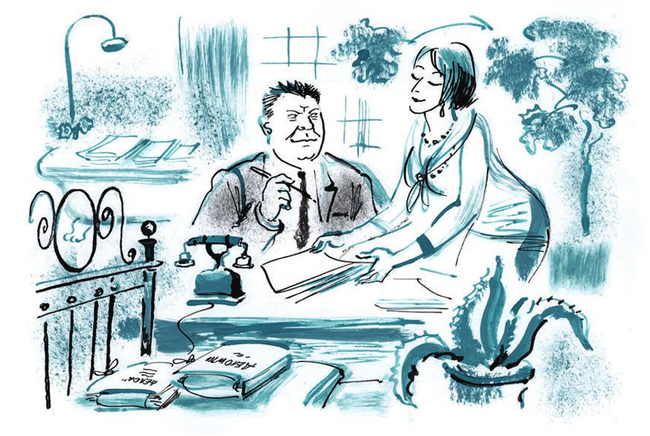
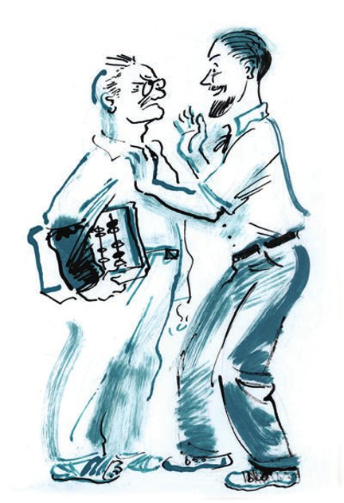

## Kapitel 11: Die Herkulesianer

Die Chefs im «Herkules» wechselten oft. Und alle versuchten, den Hotelgeist aus dem Haus zu <abbr title="vertreiben (vertrieb, hat vertrieben) — изгонять">vertreiben</abbr>. Aber das ist keinem von ihnen gelungen. Die <abbr title="der Hausverwalter, die Hausverwalter — завхоз, управляющий">Hausverwalter</abbr> übermalten die alten Aufschriften, aber diese <abbr title="schauen — выглядывать, смотреть">schauten</abbr> trotzdem überall hervor. Mal sprang in der <abbr title="die Handelsabteilung, die Handelsabteilungen — торговый отдел">Handelsabteilung</abbr> das Wort «Séparées» heraus. Mal sah man plötzlich an der <abbr title="die Milchglastür, die Milchglastüren — дверь с матовым стеклом">Milchglastür</abbr> vom <abbr title="das Schreibbüro, die Schreibbüros — машинное бюро">Schreibbüro</abbr> das <abbr title="das Wasserzeichen, die Wasserzeichen — водяной знак">Wasserzeichen</abbr> «Diensthabendes <abbr title="das Zimmermädchen, die Zimmermädchen — горничная">Zimmermädchen</abbr>». Mal fand man an den Wänden goldene <abbr title="der Zeigefinger, die Zeigefinger — указательный палец">Zeigefinger</abbr> mit dem französischen Text «Pour les dames». Das Hotel <abbr title="drängen — рваться, напирать">drängte</abbr> mit Gewalt nach außen.

Die kleineren Angestellten arbeiteten im vierten Stock, in den Zimmern für einen Rubel. Dort hatten früher die <abbr title="der Kirchenbeamte, die Kirchenbeamten — церковный (консисторский) чиновник">Kirchenbeamten</abbr> gewohnt, wenn sie zu den <abbr title="die Bistumsversammlung, die Bistumsversammlungen — епархиальный съезд">Bistumsversammlungen</abbr> kamen. Oder kleine <abbr title="der Handelsreisende, die Handelsreisenden — коммивояжёр">Handelsreisende</abbr> mit Warschauer Schnurrbärtchen. Es roch dort noch nach <abbr title="die Achselhöhle, die Achselhöhlen — подмышка">Achselhöhlen</abbr>, und es standen noch rosa <abbr title="das Waschbecken, die Waschbecken — умывальник">Waschbecken</abbr> aus Eisen herum. In den besseren Zimmern hatten früher die <abbr title="der Billardkönig, die Billardkönige — бильярдный король">Billardkönige</abbr> und die <abbr title="der Provinzschauspieler, die Provinzschauspieler — провинциальный актёр">Provinzschauspieler</abbr> gewohnt. Hier saßen jetzt die <abbr title="der Abteilungsleiter, die Abteilungsleiter — заведующий отделом (секцией)">Abteilungsleiter</abbr>, ihre Stellvertreter und der Hausverwalter. Hier war es schon etwas besser: Es gab <abbr title="der Kleiderschrank, die Kleiderschränke — платяной шкаф">Kleiderschränke</abbr> mit Spiegeln, und der Boden war mit <abbr title="rotbraun — рыжий">rotbraunem</abbr> <abbr title="das Linoleum — линолеум">Linoleum</abbr> <abbr title="belegen — покрывать, обшивать">belegt</abbr>. In den <abbr title="luxuriös — роскошный">luxuriösen</abbr> Zimmern mit Badewanne und <abbr title="der Alkoven, die Alkoven — альков">Alkoven</abbr> <abbr title="nisten — гнездиться">nistete</abbr> die <abbr title="die Obrigkeit — начальство">Obrigkeit</abbr>. In den weißen Badewannen lagen <abbr title="die Akte, die Akten — дело, папка с делом">Akten</abbr>. In den <abbr title="halbdunkel — полутёмный">halbdunklen</abbr> Alkoven hingen <abbr title="das Diagramm, die Diagramme — диаграмма">Diagramme</abbr> und <abbr title="das Schema, die Schemata — схема">Schemata</abbr>. Sie zeigten <abbr title="anschaulich — наглядно">anschaulich</abbr> die <abbr title="die Struktur, die Strukturen — структура">Struktur</abbr> des «Herkules» und seine <abbr title="die Verbindung, die Verbindungen — связь">Verbindung</abbr> mit der Provinz. Hier gab es noch die dummen vergoldeten Sofas, die Teppiche und die <abbr title="das Nachttischchen, die Nachttischchen — ночной столик">Nachttischchen</abbr> mit <abbr title="die Marmorplatte, die Marmorplatten — мраморная доска">Marmorplatten</abbr>. In manchen Alkoven standen sogar <abbr title="vernickelt — никелированный">vernickelte</abbr> Betten mit <abbr title="die Sprungfeder, die Sprungfedern — пружина">Sprungfedern</abbr> und <abbr title="die Kugel, die Kugeln — шарик">Kugeln</abbr>. Auch auf diesen Betten lagen Akten und allerlei wichtige <abbr title="die Korrespondenz — переписка">Korrespondenz</abbr>. Das war <abbr title="äußerst — чрезвычайно">äußerst</abbr> bequem, denn so waren die Papiere immer <abbr title="zur Hand sein — быть под рукой">zur Hand</abbr>.

In einem von diesen Zimmern, in Nummer fünf, hatte im Jahr 1911 der berühmte <abbr title="der Schriftsteller, die Schriftsteller — писатель">Schriftsteller</abbr> Leonid Andrejew gewohnt. Alle Herkulesianer wussten das. Und aus irgendeinem Grund hatte die Nummer fünf in der Behörde einen schlechten Ruf.

Jeder verantwortliche Mitarbeiter, der hier sein Arbeitszimmer einrichtete, hatte unbedingt irgendein Unglück. Kaum hatte Nummer fünf sich richtig <abbr title="sich einarbeiten — войти в курс дела">eingearbeitet</abbr>, schon wurde er <abbr title="absetzen — снимать (с должности)">abgesetzt</abbr> und auf eine andere Stelle geworfen. Gut, wenn es ohne <abbr title="der Verweis, die Verweise — выговор">Verweis</abbr> ging. Aber manchmal gab es auch einen Verweis. Manchmal stand es sogar in der Zeitung. Und manchmal war es noch schlimmer – so schlimm, dass man nicht einmal darüber sprechen möchte.

— Ein verfluchtes Zimmer! — sagten die Opfer alle einstimmig. — Wer konnte das denn ahnen?

Und auf den Kopf des Schriftstellers, des Autors der schrecklichen «Erzählung von den sieben <abbr title="der Gehenkte, die Gehenkten — повешенный">Gehenkten</abbr>», fielen furchtbare Vorwürfe. Er sollte schuld daran sein, dass Genosse Lapschin sechs leibliche Brüder eingestellt hatte, alle stark wie <abbr title="der Recke, die Recken — богатырь">Recken</abbr>. Er sollte schuld sein, dass Genosse Sprawtschenko beim Sammeln von <abbr title="die Baumrinde — древесная кора">Baumrinde</abbr> alles einfach <abbr title="laufen lassen — пускать на самотёк">laufen ließ</abbr> und so die ganze Sache <abbr title="vermasseln — проваливать, портить">vermasselte</abbr>. Und schließlich sollte er schuld sein, dass Genosse Indokitaiski beim polnischen Kartenspiel 7384 Rubel und 3 Kopeken <abbr title="das Staatsgeld — казённые деньги">Staatsgeld</abbr> <abbr title="verspielen — проигрывать">verspielte</abbr>. Indokitaiski <abbr title="sich winden (wand sich, hat sich gewunden) — изворачиваться, вертеться">wand sich</abbr>, wie er konnte. Er bewies bei allen <abbr title="zuständig — соответствующий, компетентный">zuständigen</abbr> <abbr title="die Instanz, die Instanzen — инстанция">Instanzen</abbr>, dass er die 3 Kopeken für den Staat ausgegeben hatte. Er konnte für diese Summe sogar <abbr title="der Beleg, die Belege — оправдательный документ, квитанция">Belege</abbr> zeigen. Aber nichts half. Der Schatten des <abbr title="verstorben — покойный">verstorbenen</abbr> Schriftstellers war <abbr title="unerbittlich — неумолимый">unerbittlich</abbr>. An einem Herbstabend führte man Indokitaiski ins Gefängnis. Ja, dieses Zimmer Nummer fünf war wirklich nicht gut.

Der Chef des ganzen «Herkules», Genosse Polychajew, saß im früheren <abbr title="der Wintergarten, die Wintergärten — зимний сад">Wintergarten</abbr>. Seine <abbr title="die Sekretärin, die Sekretärinnen — секретарша">Sekretärin</abbr> Serna Michailowna huschte ständig zwischen den <abbr title="übrig bleiben — уцелеть, остаться">übrig gebliebenen</abbr> Palmen und <abbr title="die Sykomore, die Sykomoren — сикомора">Sykomoren</abbr> hin und her. Dort stand auch ein Tisch, so lang wie ein Bahnsteig, mit einem himbeerroten Tuch. An diesem Tisch fanden die häufigen und langen <abbr title="die Vorstandssitzung, die Vorstandssitzungen — заседание правления">Vorstandssitzungen</abbr> statt. Und seit kurzer Zeit saß im Zimmer Nr. 262, wo früher eine kleine <abbr title="die Anrichte, die Anrichten — буфетная">Anrichte</abbr> war, die <abbr title="die Säuberungskommission, die Säuberungskommissionen — комиссия по чистке">Säuberungskommission</abbr>. Das waren acht Genossen mit grauen Äuglein, die <abbr title="äußerlich — с виду, внешне">äußerlich</abbr> durch nichts <abbr title="auffallen (fiel auf, ist aufgefallen) — выделяться, бросаться в глаза">auffielen</abbr>. Sie kamen jeden Tag <abbr title="pünktlich — аккуратно, пунктуально">pünktlich</abbr> und lasen immer irgendwelche dienstlichen <abbr title="das Papierchen, die Papierchen — бумажонка">Papierchen</abbr>.

Als Ostap und Balaganow die Treppe hinaufgingen, <abbr title="schrillen — резко звенеть">schrillte</abbr> eine <abbr title="die Alarmglocke, die Alarmglocken — тревожный звонок">Alarmglocke</abbr>. Sofort sprangen aus allen Zimmern die Angestellten heraus. Das ging so schnell wie bei einem <abbr title="der Alarm, die Alarme — аврал, тревога">Alarm</abbr> auf einem Schiff.

Aber es war kein Alarm, sondern die <abbr title="die Frühstückspause, die Frühstückspausen — перерыв на завтрак">Frühstückspause</abbr>. Manche Angestellte liefen zum Büfett, um noch Butterbrote mit rotem Kaviar zu bekommen. Andere <abbr title="spazieren — прогуливаться">spazierten</abbr> durch die Flure und aßen im Gehen.

Aus der <abbr title="die Planungsabteilung, die Planungsabteilungen — плановый отдел">Planungsabteilung</abbr> kam ein Angestellter von edelstem <abbr title="das Aussehen — внешность, наружность">Aussehen</abbr>. Ein junger, runder Bart hing an seinem blassen, freundlichen Gesicht. In der Hand hielt er ein kaltes <abbr title="das Kotelett, die Koteletts — котлета">Kotelett</abbr>. Immer wieder führte er es zum Mund, aber jedes Mal betrachtete er es vorher genau.

Bei dieser Beschäftigung störte ihn fast Balaganow. Er wollte wissen, in welchem Stock die Finanz- und Rechnungsabteilung war.

— Sehen Sie denn nicht, Genosse, dass ich gerade esse? — sagte der Angestellte und <abbr title="sich abwenden (wandte sich ab, hat sich abgewandt) — отворачиваться">wandte sich</abbr> empört von Balaganow ab.

Er <abbr title="beachten — обращать внимание">beachtete</abbr> die Milchbrüder nicht mehr und <abbr title="sich vertiefen in + Akk. — погружаться в">vertiefte sich</abbr> in das letzte Stückchen Kotelett. Er <abbr title="untersuchen — осматривать, исследовать">untersuchte</abbr> es <abbr title="gründlich — тщательно">gründlich</abbr> von allen Seiten und <abbr title="riechen (roch, hat gerochen) — нюхать">roch</abbr> zum Abschied sogar daran. Dann schob er es in den Mund, streckte die Brust heraus, klopfte sich die <abbr title="der Krümel, die Krümel — крошка">Krümel</abbr> vom <abbr title="das Jackett, die Jacketts — пиджак">Jackett</abbr> ab und ging langsam zu einem anderen Angestellten. Der stand an der Tür seiner Abteilung.

— Na, — fragte er und <abbr title="sich umschauen — оглядываться">schaute sich um</abbr>, — wie geht's, wie steht's?

— Fragen Sie lieber nicht, Genosse Bomse, — antwortete der andere. Auch er schaute sich um und <abbr title="hinzufügen — добавлять">fügte hinzu</abbr>: — Ist das ein Leben? Es gibt keinen Raum für die <abbr title="die Individualität — индивидуальность">Individualität</abbr>. Immer dasselbe: der Fünfjahresplan in vier Jahren, der Fünfjahresplan in drei Jahren.

— Ja, ja, — flüsterte Bomse, — einfach furchtbar! Ich bin ganz Ihrer Meinung. <abbr title="genau — именно, точно">Genau</abbr>: kein Raum für die Individualität, keine <abbr title="der Anreiz, die Anreize — стимул">Anreize</abbr>, keine persönlichen <abbr title="die Perspektive, die Perspektiven — перспектива">Perspektiven</abbr>. Meine Frau – Sie verstehen, sie ist nur Hausfrau – sogar sie sagt: Es gibt keine Anreize, es gibt keine persönlichen Perspektiven.

Bomse seufzte schwer und ging einem anderen Angestellten <abbr title="entgegengehen (ging entgegen, ist entgegengegangen) — идти навстречу">entgegen</abbr>.

— Na, — fragte er und lächelte schon im Voraus traurig, — wie geht's, wie steht's?

— Ach, — sagte der Gesprächspartner, — ich bin heute Morgen von einer <abbr title="die Dienstreise, die Dienstreisen — командировка">Dienstreise</abbr> zurückgekommen. Ich habe eine Sowchose gesehen. Grandios! Eine Getreidefabrik! Sie können sich nicht vorstellen, mein Lieber, was ein Fünfjahresplan ist, was der <abbr title="der Wille — воля">Wille</abbr> des Kollektivs ist!

— Na, genau dasselbe habe ich gerade eben gesagt! — rief Bomse eifrig. — Genau: der Wille des Kollektivs! Der Fünfjahresplan in vier Jahren, sogar in drei – das ist ein Anreiz, der … Nehmen Sie doch nur meine Frau. Eine Hausfrau – und sogar sie erkennt die <abbr title="die Industrialisierung — индустриализация">Industrialisierung</abbr> an. <abbr title="zum Teufel! — чёрт возьми!">Zum Teufel</abbr>, vor unseren Augen wächst ein neues Leben!

Er ging zur Seite und schüttelte froh den Kopf. Eine Minute später hielt er schon den sanften Borissochlebski am Ärmel fest und sagte:

— Sie haben recht, das denke ich auch. Wozu Magnitogorsks bauen, Sowchosen, allerlei <abbr title="der Mähdrescher, die Mähdrescher — комбайн">Mähdrescher</abbr>, wenn es kein <abbr title="das Privatleben — личная жизнь">Privatleben</abbr> gibt? Wenn die Individualität unterdrückt wird?

Und noch eine Minute später <abbr title="gluckern — булькать">gluckerte</abbr> seine etwas dumpfe Stimme schon auf dem <abbr title="der Treppenabsatz, die Treppenabsätze — лестничная площадка">Treppenabsatz</abbr>:

— Na, genau dasselbe habe ich gerade zu Genosse Borissochlebski gesagt. Warum um die Individualität weinen, um das Privatleben, wenn vor unseren Augen Getreidefabriken wachsen, Magnitogorsks, allerlei Mähdrescher, <abbr title="der Betonmischer, die Betonmischer — бетономешалка">Betonmischer</abbr> – wenn das Kollektiv …

Bomse liebte den geistigen <abbr title="der Austausch — общение, обмен">Austausch</abbr>. In der Pause <abbr title="plaudern — болтать, калякать">plauderte</abbr> er mit zehn Kollegen. Das Thema jedes Gesprächs konnte man an seinem Gesicht <abbr title="ablesen (las ab, hat abgelesen) — прочитывать, определять">ablesen</abbr>. Die <abbr title="die Bitterkeit — горечь">Bitterkeit</abbr> über die unterdrückte Individualität wurde darauf schnell zum hellen Lächeln eines <abbr title="der Enthusiast, die Enthusiasten — энтузиаст">Enthusiasten</abbr>. Aber was Bomse auch fühlte, sein Gesicht verlor nie den Ausdruck <abbr title="angeboren — врождённый">angeborener</abbr> <abbr title="die Vornehmheit — благородство">Vornehmheit</abbr>. Alle hielten Bomse für einen ehrlichen und vor allem <abbr title="prinzipientreu — принципиальный">prinzipientreuen</abbr> Menschen – von den <abbr title="besonnen — выдержанный, рассудительный">besonnenen</abbr> Genossen aus dem Betriebskomitee bis zum politisch <abbr title="unreif — незрелый">unreifen</abbr> Kukuschkind. Übrigens war Bomse selbst derselben Meinung über sich.

Eine neue Glocke verkündete das Ende des Alarms, und die Angestellten kehrten in ihre Zimmer zurück. Die Arbeit ging weiter.

Eigentlich hatten die Worte «Die Arbeit ging weiter» nichts mit der echten <abbr title="die Tätigkeit, die Tätigkeiten — деятельность">Tätigkeit</abbr> des «Herkules» zu tun. Laut <abbr title="die Satzung, die Satzungen — устав">Satzung</abbr> <abbr title="bestehen in + Dat. (bestand, hat bestanden) — заключаться в">bestand</abbr> diese in verschiedenen <abbr title="das Handelsgeschäft, die Handelsgeschäfte — торговая операция">Handelsgeschäften</abbr> mit Holz und <abbr title="das Schnittholz — пиломатериалы">Schnittholz</abbr>. Aber im letzten Jahr hatten die Herkulesianer jeden Gedanken an langweilige Baumstämme, <abbr title="die Sperrholzplatte, die Sperrholzplatten — лист фанеры">Sperrholzplatten</abbr>, <abbr title="die Exportzeder, die Exportzedern — экспортный кедр">Exportzedern</abbr> und andere uninteressante Dinge aufgegeben. Sie hatten sich einer äußerst <abbr title="spannend — увлекательный">spannenden</abbr> Beschäftigung <abbr title="sich hingeben (gab sich hin, hat sich hingegeben) — предаваться">hingegeben</abbr>: Sie kämpften um ihr Gebäude, um ihr geliebtes Hotel.

Alles begann mit einem kleinen Papier. Ein fauler <abbr title="der Bote, die Boten — курьер, скороход">Bote</abbr> von der <abbr title="die Kommunalabteilung — коммунотдел">Kommunalabteilung</abbr> brachte es in seinem <abbr title="das Botenbuch, die Botenbücher — разносная книга">Botenbuch</abbr> aus Segeltuch.

«<abbr title="nach Erhalt (+ Gen.) — по получении">Nach Erhalt</abbr> dieses Schreibens», stand auf dem Papier, «wird Ihnen vorgeschlagen, innerhalb einer Woche die <abbr title="der Raum, die Räume — помещение">Räume</abbr> des ehem. Hotels „Kairo“ zu <abbr title="räumen — освобождать">räumen</abbr>. Diese sind mit dem gesamten ehem. Hotelinventar der Hotel-<abbr title="die Treuhand — трест">Treuhand</abbr> zu übergeben. Ihnen werden die Räume der ehem. <abbr title="die Aktiengesellschaft, die Aktiengesellschaften — акционерное общество">Aktiengesellschaft</abbr> „Blech und Speck“ <abbr title="zur Verfügung stellen — предоставлять">zur Verfügung gestellt</abbr>. <abbr title="die Grundlage, die Grundlagen — основание">Grundlage</abbr>: <abbr title="der Beschluss, die Beschlüsse — постановление">Beschluss</abbr> des <abbr title="der Stadtsowjet — горсовет">Stadtsowjets</abbr> vom 12/1929.»

Am Abend legte man dieses Papier auf den Tisch, direkt vor Genosse Polychajew. Er saß im elektrischen Schatten der Palmen und Sykomoren.

— Was! — schrie der Chef des «Herkules» nervös. — Sie schreiben mir: «Es wird vorgeschlagen»! Mir! Ich <abbr title="unterstehen (unterstand, hat unterstanden) + Dat. — подчиняться">unterstehe</abbr> direkt der <abbr title="die Zentrale — центр">Zentrale</abbr>! Sind die dort <abbr title="verrückt werden — сойти с ума">verrückt geworden</abbr>? Was?

— Fehlte nur noch, dass sie «Es wird <abbr title="anordnen — предписывать">angeordnet</abbr>» schreiben, — <abbr title="Öl ins Feuer gießen (goss, hat gegossen) — подливать масла в огонь">goss</abbr> Serna Michailowna Öl ins Feuer. — <abbr title="der Bauernlümmel, die Bauernlümmel — мужлан">Bauernlümmel</abbr>!

— Das ist einfach ein Witz, — sagte Polychajew und lächelte finster.

Sofort diktierte er eine äußerst entschlossene Antwort. Der Chef des «Herkules» <abbr title="sich weigern — отказываться">weigerte sich</abbr> <abbr title="rundweg — наотрез">rundweg</abbr>, die Räume freizumachen.

— Nächstes Mal werden sie wissen, dass ich nicht ihr <abbr title="der Nachtwächter, die Nachtwächter — ночной сторож">Nachtwächter</abbr> bin. So ein «Es wird vorgeschlagen» darf man mir nicht schreiben, — murmelte Genosse Polychajew. Er nahm aus der Tasche seinen <abbr title="der Gummistempel, die Gummistempel — резиновая печать">Gummistempel</abbr> mit seiner <abbr title="die Unterschrift, die Unterschriften — подпись">Unterschrift</abbr> und drückte ihn vor Aufregung <abbr title="verkehrt herum — вверх ногами">verkehrt herum</abbr> auf das Papier.

Und wieder <abbr title="sich schleppen — тащиться">schleppte sich</abbr> ein fauler Bote durch die sonnigen Straßen, diesmal einer vom «Herkules». Er blieb an jeder <abbr title="die Kwasbude, die Kwasbuden — квасная будка">Kwasbude</abbr> stehen, <abbr title="sich einmischen in + Akk. — вмешиваться в">mischte sich</abbr> in jeden <abbr title="der Straßenstreit, die Straßenstreite — уличный скандал">Straßenstreit</abbr> <abbr title="sich einmischen — вмешиваться">ein</abbr> und schwenkte verzweifelt sein Botenbuch.

Eine ganze Woche lang <abbr title="besprechen (besprach, hat besprochen) — обсуждать">besprachen</abbr> die Herkulesianer danach die Lage. Die Angestellten waren sich einig: Polychajew würde sich so einen Angriff auf seine <abbr title="die Autorität — авторитет">Autorität</abbr> nicht <abbr title="sich etwas gefallen lassen — терпеть, мириться">gefallen lassen</abbr>.

— Sie kennen unseren Polychajew noch nicht, — sagten die <abbr title="der Bursche, die Burschen — молодец, парень">Burschen</abbr> aus der Finanzabteilung. — Der ist <abbr title="mit allen Wassern gewaschen sein — тёртый калач, мытый-перемытый">mit allen Wassern gewaschen</abbr>. Mit einem nackten Beschluss kriegt man den nicht.

Bald danach kam Genosse Bomse aus dem Zimmer des Chefs. In der Hand hielt er eine kleine <abbr title="die Liste, die Listen — список">Liste</abbr> mit <abbr title="ausgewählt — избранный">ausgewählten</abbr> Mitarbeitern. Er ging von Abteilung zu Abteilung, <abbr title="sich beugen über + Akk. — наклоняться над">beugte sich</abbr> über die Person auf der Liste und flüsterte geheimnisvoll:

— Eine kleine Feier. Drei Rubel pro Kopf. Abschied von Polychajew.

— Was? — erschraken die ausgewählten Mitarbeiter. — Geht Polychajew etwa weg? Wird er abgesetzt?

— Aber nein. Er fährt für eine Woche in die Zentrale. Er will sich um die Räume kümmern. Also, kommen Sie nicht zu spät. Punkt acht bei mir.

Der Abschied war sehr lustig. Die Mitarbeiter sahen treu auf Polychajew. Er saß da mit einem <abbr title="das Schnapsgläschen, die Schnapsgläschen — лафитничек, рюмочка">Schnapsgläschen</abbr> in der Hand. Sie klatschten <abbr title="im Takt — в такт, ритмично">im Takt</abbr> in die Hände und sangen:

— Ex und hopp, ex und hopp, exundhopp, ex und hopp, ex und hopp, exundhopp!

Sie sangen so lange, bis der geliebte Chef eine ordentliche Menge Schnapsgläschen und hohe <abbr title="Sewastopoler — севастопольский">Sewastopoler</abbr> <abbr title="das Stamperl, die Stamperl — стопка">Stamperl</abbr> <abbr title="leeren — осушать">geleert</abbr> hatte. Danach begann er selbst mit <abbr title="schwankend — колеблющийся, нетвёрдый">schwankender</abbr> Stimme ein Lied: «Auf der alten Straße nach Kaluga, an der neunundvierzigsten Werst …» Aber niemand erfuhr, was an dieser Werst passiert war. Denn Polychajew wechselte für alle überraschend zu einem anderen Lied:

Fuhr die Straßenbahn Nummer neun,  
auf dem Trittbrett starb so'n Kerl, o nein,  
ziehn und zerrn sie an dem Toten,  
Lamza-driza. Za-za.

Nachdem Polychajew <abbr title="abreisen — уезжать">abgereist</abbr> war, sank die <abbr title="die Arbeitsproduktivität — производительность труда">Arbeitsproduktivität</abbr> im «Herkules» ein wenig. Es wäre ja auch lächerlich gewesen, mit voller Kraft zu arbeiten. Man wusste ja nicht: Bleibt man in diesem Haus? Oder muss man mit allem <abbr title="das Büromaterial — канцпринадлежности">Büromaterial</abbr> zu «Blech und Speck» ziehen? Aber noch lächerlicher wäre es gewesen, mit voller Kraft zu arbeiten, nachdem Polychajew zurückgekommen war. Er kam zurück, wie Bomse sich ausdrückte, «auf dem Schild». Das Gebäude blieb beim «Herkules», und die Mitarbeiter <abbr title="verbringen (verbrachte, hat verbracht) — проводить (время)">verbrachten</abbr> ihre Arbeitsstunden damit, sich über die Kommunalabteilung <abbr title="sich lustig machen über + Akk. — насмехаться над">lustig zu machen</abbr>.

Die besiegte Behörde bat, man solle ihr wenigstens die Waschbecken und die <abbr title="das Federbett, die Federbetten — панцирная кровать">Federbetten</abbr> geben. Aber Polychajew war vom Erfolg <abbr title="berauscht — опьянённый">berauscht</abbr> und antwortete nicht einmal. Da begann der Kampf von Neuem und mit neuer Kraft. <abbr title="die Beschwerde, die Beschwerden — жалоба">Beschwerden</abbr> flogen in die Zentrale. Polychajew fuhr persönlich hin, um sie zu <abbr title="widerlegen — опровергать">widerlegen</abbr>. Immer öfter hörte man in Bomses Wohnung das <abbr title="siegreich — победный">siegreiche</abbr> «exundhopp». Und immer mehr Mitarbeiter wurden in den Kampf um das Gebäude <abbr title="hineinziehen (zog hinein, hat hineingezogen) — втягивать">hineingezogen</abbr>. <abbr title="allmählich — постепенно">Allmählich</abbr> vergaß man das Holz und das Schnittholz. Manchmal fand Polychajew auf seinem Tisch ein Papier über Exportzedern oder Sperrholzplatten. Dann <abbr title="staunen — изумляться, поражаться">staunte</abbr> er so sehr, dass er eine Zeit lang nicht einmal verstand, was man von ihm wollte. Jetzt war er mit einer äußerst wichtigen Aufgabe beschäftigt: Er wollte zwei besonders gefährliche Leute aus der Kommunalabteilung zu sich <abbr title="herüberlocken — переманивать">herüberlocken</abbr> – mit einem höheren Gehalt.

— Sie haben Glück, — sagte Ostap zu seinem <abbr title="der Begleiter, die Begleiter — спутник">Begleiter</abbr>. — Sie sind bei einem <abbr title="komisch — смешной">komischen</abbr> Ereignis dabei: Ostap Bender ist auf einer heißen Spur. Lernen Sie! Ein kleiner <abbr title="der Kriminelle, die Kriminellen — уголовник">Krimineller</abbr> wie Panikowski würde Koreiko einen Brief schreiben: «Legen Sie 600 Rubel im Hof unter die Mülltonne, sonst geht es Ihnen schlecht.» Und unten würde er ein Kreuz, einen Totenkopf und eine Kerze malen. Sonja Goldhändchen – ich will ihre <abbr title="das Verdienst, die Verdienste — заслуга, достоинство">Verdienste</abbr> keineswegs kleiner machen – würde am Ende den gewöhnlichen «Hipes» machen, den Trick mit der Dame und dem <abbr title="nichtsahnend — ничего не подозревающий">nichtsahnenden</abbr> Herrn. Das brächte ihr vielleicht anderthalbtausend. Eben Frauensache. Oder nehmen wir den <abbr title="der Kornett, die Kornetts — корнет">Kornett</abbr> Sawin. Ein <abbr title="hervorragend — выдающийся">hervorragender</abbr> Hochstapler. Wie man so sagt: <abbr title="abgebrüht — прожжённый">abgebrüht</abbr> bis auf die Knochen. Und was hätte er gemacht? Er wäre als bulgarischer Zar <abbr title="sich verkleiden als — переодеваться, рядиться">verkleidet</abbr> in Koreikos Wohnung gekommen. Er hätte in der <abbr title="die Hausverwaltung — домоуправление">Hausverwaltung</abbr> einen <abbr title="der Skandal, die Skandale — скандал">Skandal</abbr> gemacht und alles verdorben. Ich dagegen habe es, wie Sie sehen, nicht <abbr title="es eilig haben — торопиться">eilig</abbr>. Wir sitzen schon eine Woche in Tschernomorsk, und erst heute gehe ich zum ersten <abbr title="das Rendezvous — свидание">Rendezvous</abbr> … Aha, da ist ja die Finanzabteilung! Nun, Bordmechaniker, zeigen Sie mir den Patienten. Sie sind doch der <abbr title="der Spezialist, die Spezialisten — специалист">Spezialist</abbr> für Koreiko.

Sie gingen in den Saal. Er war voll von <abbr title="der Besucher, die Besucher — посетитель">Besuchern</abbr>, und alle lärmten. Balaganow führte Bender in eine Ecke. Dort saßen hinter einer gelben <abbr title="die Trennwand, die Trennwände — перегородка">Trennwand</abbr> die Tschewaschewskaja, Koreiko, Kukuschkind und Dreyfus. Balaganow hob schon die Hand, um auf den Millionär zu zeigen. Da flüsterte Ostap wütend:

— Schreien Sie doch gleich <abbr title="aus vollem Hals — во всю глотку">aus vollem Hals</abbr>: «Da ist er, der <abbr title="der Reiche, die Reichen — богач">Reiche</abbr>! Haltet ihn fest!» Ruhe. Ich errate es selbst. Welcher von den vieren ist es?

Ostap setzte sich auf das kühle <abbr title="das Fensterbrett, die Fensterbretter — подоконник">Fensterbrett</abbr> aus Marmor. Er baumelte wie ein Kind mit den Beinen und begann zu überlegen:

— Das Mädchen zählt nicht. Bleiben drei: ein <abbr title="rotgesichtig — краснорожий">rotgesichtiger</abbr> <abbr title="der Speichellecker, die Speichellecker — подхалим">Speichellecker</abbr> mit weißen Augen, ein altes <abbr title="das Pilzmännchen, die Pilzmännchen — старичок-боровичок">Pilzmännchen</abbr> mit <abbr title="die Eisenbrille, die Eisenbrillen — железные очки">Eisenbrille</abbr> und ein dicker <abbr title="der Kettenhund, die Kettenhunde — барбос">Kettenhund</abbr>, der äußerst ernst aussieht. Das Pilzmännchen <abbr title="zurückweisen (wies zurück, hat zurückgewiesen) — отметать, отвергать">weise</abbr> ich empört zurück. Außer der <abbr title="die Watte — вата">Watte</abbr>, mit der er seine haarigen Ohren <abbr title="verstopfen — затыкать">verstopft</abbr> hat, besitzt er keine <abbr title="die Wertsachen (Pl.) — ценности">Wertsachen</abbr>. Bleiben zwei: der Kettenhund und der weißäugige Speichellecker. Wer von ihnen ist Koreiko? Man muss nachdenken.

Ostap <abbr title="recken — вытягивать">reckte</abbr> den Hals und begann die <abbr title="der Kandidat, die Kandidaten — кандидат">Kandidaten</abbr> zu <abbr title="vergleichen (verglich, hat verglichen) — сравнивать">vergleichen</abbr>. Er drehte den Kopf so schnell hin und her, als ob er ein <abbr title="das Tennisspiel, die Tennisspiele — игра в теннис">Tennisspiel</abbr> verfolgte und jedem Ball mit dem Blick folgte.

— Wissen Sie, Bordmechaniker, — sagte er schließlich, — der dicke Kettenhund passt besser zur Rolle eines Untergrund-Millionärs als der weißäugige Speichellecker. Achten Sie auf das unruhige Funkeln in den Augen des Kettenhunds. Er kann nicht ruhig sitzen. Er kann es nicht <abbr title="erwarten — дождаться">erwarten</abbr>. Er will schnell nach Hause laufen und seine Pfoten in die Päckchen mit <abbr title="der Tscherwonez, die Tscherwonzen — червонец">Tscherwonzen</abbr> stecken. <abbr title="natürlich — конечно">Natürlich</abbr> ist er der <abbr title="der Sammler, die Sammler — собиратель">Sammler</abbr> von <abbr title="das Karat, die Karat — карат">Karat</abbr> und Dollars. Sehen Sie denn nicht, dass diese dicke <abbr title="die Fratze, die Fratzen — харя">Fratze</abbr> nichts anderes ist als eine <abbr title="demokratisch — демократический">demokratische</abbr> Mischung aus den Gesichtern von Shylock, dem Geizigen Ritter und Harpagon? Und der andere, der Weißäugige, ist einfach eine <abbr title="die Null, die Nullen — ничтожество">Null</abbr>, ein sowjetisches <abbr title="das Mäuschen, die Mäuschen — мышонок">Mäuschen</abbr>. Natürlich hat er auch ein Vermögen: zwölf Rubel auf der <abbr title="die Sparkasse, die Sparkassen — сберкасса">Sparkasse</abbr>. Seine kühnsten Träume in der Nacht: ein haariger Mantel mit <abbr title="der Kalbfellkragen, die Kalbfellkragen — воротник из телячьей кожи">Kalbfellkragen</abbr>. Das ist nicht Koreiko. Das ist eine Maus, die …

Aber da wurde die glänzende Rede des großen Kombinators unterbrochen. Aus der Tiefe des Saales kam ein <abbr title="männlich — мужественный">männlicher</abbr> Schrei. Ohne Zweifel <abbr title="gehören + Dat. — принадлежать">gehörte</abbr> er einem Mitarbeiter, der das Recht hatte zu schreien.

— Genosse Koreiko! Wo sind denn die <abbr title="die Zahl, die Zahlen — цифра, число">Zahlen</abbr> über die <abbr title="die Schulden (Pl.) — задолженность, долги">Schulden</abbr> der Kommunalabteilung bei uns? Genosse Polychajew braucht sie dringend!

Ostap stieß Balaganow mit dem Fuß an. Aber der Kettenhund <abbr title="kratzen — скрипеть, царапать">kratzte</abbr> ruhig weiter mit der Feder. Sein Gesicht mit den typischen <abbr title="der Zug, die Züge — черта (лица)">Zügen</abbr> von Shylock, Harpagon und dem Geizigen Ritter veränderte sich nicht. Dafür wurde der rotgesichtige Blonde mit den weißen Augen ungewöhnlich lebhaft – diese Null, dieses sowjetische Mäuschen, das von einem Mantel mit Kalbfellkragen träumte. Geschäftig klapperte er mit den Schubladen, packte irgendein Papierchen und lief schnell auf den Ruf hin.

Der große Kombinator räusperte sich und sah Balaganow <abbr title="prüfend — испытующе">prüfend</abbr> an. Schura hatte noch nicht gelernt, sich zu <abbr title="sich beherrschen — владеть собой">beherrschen</abbr>. Er lachte.

— Ja, — sagte Ostap nach einer Weile. — Der bringt das Geld nicht auf einem Tellerchen. Höchstens, wenn ich ihn sehr schön bitte. Ein <abbr title="das Objekt, die Objekte — объект">Objekt</abbr>, das Respekt verdient. Jetzt aber schnell an die frische Luft. In meinem <abbr title="das Gehirn, die Gehirne — мозг">Gehirn</abbr> ist eine lustige Kombination geboren. Heute Abend werden wir, <abbr title="so Gott will — с божьей помощью">so Gott will</abbr>, Herrn Koreiko zum ersten Mal am Euter anfassen. Anfassen werden Sie, Schura.

---

### Neue Wörter

- **vertreiben (vertrieb, hat vertrieben)** — изгонять
- **der Hausverwalter, die Hausverwalter** — завхоз, управляющий
- **schauen** — выглядывать, смотреть
- **die Handelsabteilung, die Handelsabteilungen** — торговый отдел
- **die Milchglastür, die Milchglastüren** — дверь с матовым стеклом
- **das Schreibbüro, die Schreibbüros** — машинное бюро
- **das Wasserzeichen, die Wasserzeichen** — водяной знак
- **das Zimmermädchen, die Zimmermädchen** — горничная
- **der Zeigefinger, die Zeigefinger** — указательный палец
- **drängen** — рваться, напирать
- **der Kirchenbeamte, die Kirchenbeamten** — церковный (консисторский) чиновник
- **die Bistumsversammlung, die Bistumsversammlungen** — епархиальный съезд
- **der Handelsreisende, die Handelsreisenden** — коммивояжёр
- **die Achselhöhle, die Achselhöhlen** — подмышка
- **das Waschbecken, die Waschbecken** — умывальник
- **der Billardkönig, die Billardkönige** — бильярдный король
- **der Provinzschauspieler, die Provinzschauspieler** — провинциальный актёр
- **der Abteilungsleiter, die Abteilungsleiter** — заведующий отделом (секцией)
- **der Kleiderschrank, die Kleiderschränke** — платяной шкаф
- **rotbraun** — рыжий
- **das Linoleum** — линолеум
- **belegen** — покрывать, обшивать
- **luxuriös** — роскошный
- **der Alkoven, die Alkoven** — альков
- **nisten** — гнездиться
- **die Obrigkeit** — начальство
- **die Akte, die Akten** — дело, папка с делом
- **halbdunkel** — полутёмный
- **das Diagramm, die Diagramme** — диаграмма
- **das Schema, die Schemata** — схема
- **anschaulich** — наглядно
- **die Struktur, die Strukturen** — структура
- **die Verbindung, die Verbindungen** — связь
- **das Nachttischchen, die Nachttischchen** — ночной столик
- **die Marmorplatte, die Marmorplatten** — мраморная доска
- **vernickelt** — никелированный
- **die Sprungfeder, die Sprungfedern** — пружина
- **die Kugel, die Kugeln** — шарик
- **die Korrespondenz** — переписка
- **äußerst** — чрезвычайно
- **zur Hand sein** — быть под рукой
- **der Schriftsteller, die Schriftsteller** — писатель
- **sich einarbeiten** — войти в курс дела
- **absetzen** — снимать (с должности)
- **der Verweis, die Verweise** — выговор
- **der Gehenkte, die Gehenkten** — повешенный
- **der Recke, die Recken** — богатырь
- **die Baumrinde** — древесная кора
- **laufen lassen** — пускать на самотёк
- **vermasseln** — проваливать, портить
- **das Staatsgeld** — казённые деньги
- **verspielen** — проигрывать
- **sich winden (wand sich, hat sich gewunden)** — изворачиваться, вертеться
- **zuständig** — соответствующий, компетентный
- **die Instanz, die Instanzen** — инстанция
- **der Beleg, die Belege** — оправдательный документ, квитанция
- **verstorben** — покойный
- **unerbittlich** — неумолимый
- **der Wintergarten, die Wintergärten** — зимний сад
- **die Sekretärin, die Sekretärinnen** — секретарша
- **übrig bleiben** — уцелеть, остаться
- **die Sykomore, die Sykomoren** — сикомора
- **die Vorstandssitzung, die Vorstandssitzungen** — заседание правления
- **die Anrichte, die Anrichten** — буфетная
- **die Säuberungskommission, die Säuberungskommissionen** — комиссия по чистке
- **äußerlich** — с виду, внешне
- **auffallen (fiel auf, ist aufgefallen)** — выделяться, бросаться в глаза
- **pünktlich** — аккуратно, пунктуально
- **das Papierchen, die Papierchen** — бумажонка
- **schrillen** — резко звенеть
- **die Alarmglocke, die Alarmglocken** — тревожный звонок
- **der Alarm, die Alarme** — аврал, тревога
- **die Frühstückspause, die Frühstückspausen** — перерыв на завтрак
- **spazieren** — прогуливаться
- **die Planungsabteilung, die Planungsabteilungen** — плановый отдел
- **das Aussehen** — внешность, наружность
- **das Kotelett, die Koteletts** — котлета
- **sich abwenden (wandte sich ab, hat sich abgewandt)** — отворачиваться
- **beachten** — обращать внимание
- **sich vertiefen in + Akk.** — погружаться в
- **untersuchen** — осматривать, исследовать
- **gründlich** — тщательно
- **riechen (roch, hat gerochen)** — нюхать
- **der Krümel, die Krümel** — крошка
- **das Jackett, die Jacketts** — пиджак
- **sich umschauen** — оглядываться
- **hinzufügen** — добавлять
- **die Individualität** — индивидуальность
- **genau** — именно, точно
- **der Anreiz, die Anreize** — стимул
- **die Perspektive, die Perspektiven** — перспектива
- **entgegengehen (ging entgegen, ist entgegengegangen)** — идти навстречу
- **die Dienstreise, die Dienstreisen** — командировка
- **der Wille** — воля
- **die Industrialisierung** — индустриализация
- **zum Teufel!** — чёрт возьми!
- **der Mähdrescher, die Mähdrescher** — комбайн
- **das Privatleben** — личная жизнь
- **gluckern** — булькать
- **der Treppenabsatz, die Treppenabsätze** — лестничная площадка
- **der Betonmischer, die Betonmischer** — бетономешалка
- **der Austausch** — общение, обмен
- **plaudern** — болтать, калякать
- **ablesen (las ab, hat abgelesen)** — прочитывать, определять
- **die Bitterkeit** — горечь
- **der Enthusiast, die Enthusiasten** — энтузиаст
- **angeboren** — врождённый
- **die Vornehmheit** — благородство
- **prinzipientreu** — принципиальный
- **besonnen** — выдержанный, рассудительный
- **unreif** — незрелый
- **die Tätigkeit, die Tätigkeiten** — деятельность
- **die Satzung, die Satzungen** — устав
- **bestehen in + Dat. (bestand, hat bestanden)** — заключаться в
- **das Handelsgeschäft, die Handelsgeschäfte** — торговая операция
- **das Schnittholz** — пиломатериалы
- **die Sperrholzplatte, die Sperrholzplatten** — лист фанеры
- **die Exportzeder, die Exportzedern** — экспортный кедр
- **spannend** — увлекательный
- **sich hingeben (gab sich hin, hat sich hingegeben)** — предаваться
- **der Bote, die Boten** — курьер, скороход
- **die Kommunalabteilung** — коммунотдел
- **das Botenbuch, die Botenbücher** — разносная книга
- **nach Erhalt (+ Gen.)** — по получении
- **der Raum, die Räume** — помещение
- **räumen** — освобождать
- **die Treuhand** — трест
- **die Aktiengesellschaft, die Aktiengesellschaften** — акционерное общество
- **zur Verfügung stellen** — предоставлять
- **die Grundlage, die Grundlagen** — основание
- **der Beschluss, die Beschlüsse** — постановление
- **der Stadtsowjet** — горсовет
- **unterstehen (unterstand, hat unterstanden) + Dat.** — подчиняться
- **die Zentrale** — центр
- **verrückt werden** — сойти с ума
- **anordnen** — предписывать
- **Öl ins Feuer gießen (goss, hat gegossen)** — подливать масла в огонь
- **der Bauernlümmel, die Bauernlümmel** — мужлан
- **sich weigern** — отказываться
- **rundweg** — наотрез
- **der Nachtwächter, die Nachtwächter** — ночной сторож
- **der Gummistempel, die Gummistempel** — резиновая печать
- **die Unterschrift, die Unterschriften** — подпись
- **verkehrt herum** — вверх ногами
- **sich schleppen** — тащиться
- **die Kwasbude, die Kwasbuden** — квасная будка
- **sich einmischen in + Akk.** — вмешиваться в
- **der Straßenstreit, die Straßenstreite** — уличный скандал
- **sich einmischen** — вмешиваться
- **besprechen (besprach, hat besprochen)** — обсуждать
- **die Autorität** — авторитет
- **sich etwas gefallen lassen** — терпеть, мириться
- **der Bursche, die Burschen** — молодец, парень
- **mit allen Wassern gewaschen sein** — тёртый калач, мытый-перемытый
- **die Liste, die Listen** — список
- **ausgewählt** — избранный
- **sich beugen über + Akk.** — наклоняться над
- **das Schnapsgläschen, die Schnapsgläschen** — лафитничек, рюмочка
- **im Takt** — в такт, ритмично
- **Sewastopoler** — севастопольский
- **das Stamperl, die Stamperl** — стопка
- **leeren** — осушать
- **schwankend** — колеблющийся, нетвёрдый
- **abreisen** — уезжать
- **die Arbeitsproduktivität** — производительность труда
- **das Büromaterial** — канцпринадлежности
- **verbringen (verbrachte, hat verbracht)** — проводить (время)
- **sich lustig machen über + Akk.** — насмехаться над
- **das Federbett, die Federbetten** — панцирная кровать
- **berauscht** — опьянённый
- **die Beschwerde, die Beschwerden** — жалоба
- **widerlegen** — опровергать
- **siegreich** — победный
- **hineinziehen (zog hinein, hat hineingezogen)** — втягивать
- **allmählich** — постепенно
- **staunen** — изумляться, поражаться
- **herüberlocken** — переманивать
- **der Begleiter, die Begleiter** — спутник
- **komisch** — смешной
- **der Kriminelle, die Kriminellen** — уголовник
- **das Verdienst, die Verdienste** — заслуга, достоинство
- **nichtsahnend** — ничего не подозревающий
- **der Kornett, die Kornetts** — корнет
- **hervorragend** — выдающийся
- **abgebrüht** — прожжённый
- **sich verkleiden als** — переодеваться, рядиться
- **die Hausverwaltung** — домоуправление
- **der Skandal, die Skandale** — скандал
- **es eilig haben** — торопиться
- **das Rendezvous** — свидание
- **der Spezialist, die Spezialisten** — специалист
- **der Besucher, die Besucher** — посетитель
- **die Trennwand, die Trennwände** — перегородка
- **aus vollem Hals** — во всю глотку
- **der Reiche, die Reichen** — богач
- **das Fensterbrett, die Fensterbretter** — подоконник
- **rotgesichtig** — краснорожий
- **der Speichellecker, die Speichellecker** — подхалим
- **das Pilzmännchen, die Pilzmännchen** — старичок-боровичок
- **die Eisenbrille, die Eisenbrillen** — железные очки
- **der Kettenhund, die Kettenhunde** — барбос
- **zurückweisen (wies zurück, hat zurückgewiesen)** — отметать, отвергать
- **die Watte** — вата
- **verstopfen** — затыкать
- **die Wertsachen (Pl.)** — ценности
- **recken** — вытягивать
- **der Kandidat, die Kandidaten** — кандидат
- **vergleichen (verglich, hat verglichen)** — сравнивать
- **das Tennisspiel, die Tennisspiele** — игра в теннис
- **erwarten** — дождаться
- **der Tscherwonez, die Tscherwonzen** — червонец
- **natürlich** — конечно
- **der Sammler, die Sammler** — собиратель
- **das Karat, die Karat** — карат
- **die Fratze, die Fratzen** — харя
- **demokratisch** — демократический
- **die Null, die Nullen** — ничтожество
- **das Mäuschen, die Mäuschen** — мышонок
- **die Sparkasse, die Sparkassen** — сберкасса
- **der Kalbfellkragen, die Kalbfellkragen** — воротник из телячьей кожи
- **männlich** — мужественный
- **gehören + Dat.** — принадлежать
- **die Zahl, die Zahlen** — цифра, число
- **die Schulden (Pl.)** — задолженность, долги
- **kratzen** — скрипеть, царапать
- **der Zug, die Züge** — черта (лица)
- **prüfend** — испытующе
- **sich beherrschen** — владеть собой
- **das Objekt, die Objekte** — объект
- **das Gehirn, die Gehirne** — мозг
- **so Gott will** — с божьей помощью

[← Zurück](kapitel-11.md) · [Inhalt](README.md) · [Weiter →](kapitel-13.md)
