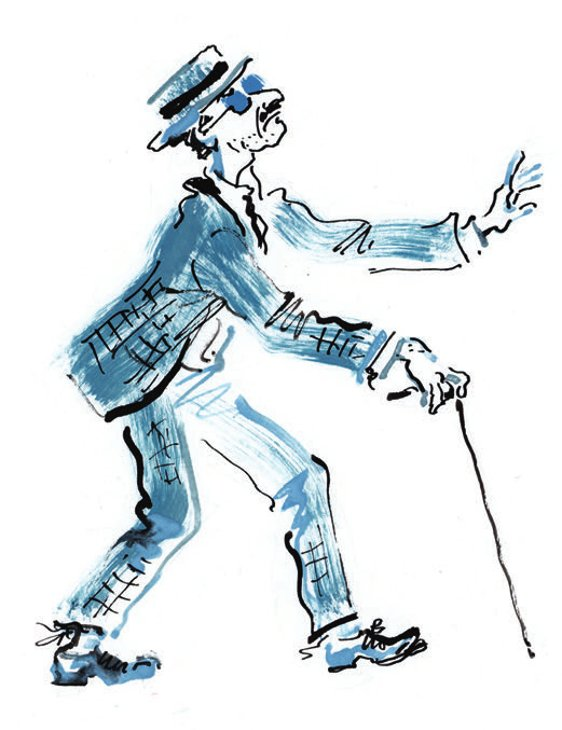
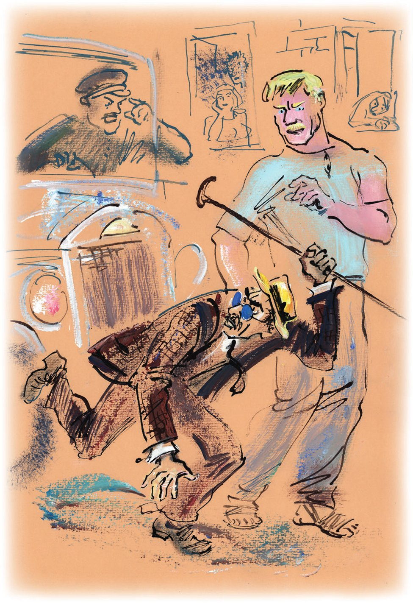

## Kapitel 12: Homer, Milton und Panikowski

Die Anweisung war ganz einfach:

1. Den Bürger Koreiko zufällig auf der Straße treffen.

2. Ihn <abbr title="auf keinen Fall — ни в коем случае, ни под каким видом">auf keinen Fall</abbr> schlagen und überhaupt keine <abbr title="körperlich — физический">körperliche</abbr> <abbr title="die Gewalt — насилие, сила">Gewalt</abbr> <abbr title="anwenden — применять">anwenden</abbr>.

3. Alles wegnehmen, was man in den Taschen des <abbr title="genannt — поименованный, названный">genannten</abbr> Bürgers findet.

4. Über die <abbr title="die Ausführung — исполнение">Ausführung</abbr> <abbr title="Meldung machen — доносить, докладывать">Meldung machen</abbr>.

Die Anweisungen des großen Kombinators waren außergewöhnlich einfach und klar. Trotzdem begannen Balaganow und Panikowski einen heftigen Streit. Die Söhne des Leutnants saßen auf einer grünen Bank im Stadtpark und warfen bedeutungsvolle Blicke auf den Eingang des «Herkules». Sie zankten sich und merkten nicht einmal, dass der Wind den Strahl des Springbrunnens <abbr title="biegen (bog, hat gebogen) — сгибать">bog</abbr> und feines Wasser auf sie <abbr title="sprühen — брызгать">sprühte</abbr>. Sie <abbr title="zucken — дёргаться">zuckten</abbr> nur mit den Köpfen, sahen sinnlos in den klaren Himmel und stritten weiter.

Wegen der Hitze hatte Panikowski seine dicke <abbr title="die Feuerwehrjacke, die Feuerwehrjacken — куртка пожарного (топорника)">Feuerwehrjacke</abbr> gegen ein <abbr title="das Kattunhemdchen, die Kattunhemdchen — ситцевая рубашонка">Kattunhemdchen</abbr> mit <abbr title="der Umlegekragen, die Umlegekragen — отложной воротник">Umlegekragen</abbr> getauscht. Er war sehr hochmütig. Er war sehr stolz auf den Auftrag, den man ihm gegeben hatte.

— Nur Diebstahl, — sagte er.

— Nur <abbr title="der Raub — грабёж, ограбление">Raub</abbr>, — widersprach Balaganow. Er war auch stolz auf das <abbr title="das Vertrauen — доверие">Vertrauen</abbr> des Kommandeurs.

— Sie sind eine elende, nichtige Person, — erklärte Panikowski und sah seinen Gesprächspartner mit Ekel an.

— Und Sie sind ein <abbr title="der Krüppel, die Krüppel — калека">Krüppel</abbr>, — bemerkte Balaganow. — Jetzt bin ich der Chef!

— Wer ist der Chef?

— Ich bin der Chef. Man hat es mir <abbr title="auftragen (trug auf, hat aufgetragen) — поручать">aufgetragen</abbr>.

— Ihnen?

— Mir.

— Dir?

— Wem denn sonst? Etwa dir?

Und das Gespräch ging in ein Gebiet über, das mit der Anweisung nichts mehr zu tun hatte. Die Gauner <abbr title="in Hitze geraten (geriet, ist geraten) — разгорячиться">gerieten</abbr> so in Hitze, dass sie sich sogar leicht mit den <abbr title="die Handfläche, die Handflächen — ладонь">Handflächen</abbr> schubsten. Sie riefen <abbr title="um die Wette — наперебой">um die Wette</abbr>: «Und wer bist du überhaupt?» So etwas kommt gewöhnlich vor einer großen <abbr title="die Prügelei, die Prügeleien — драка">Prügelei</abbr>. Dabei werfen die Gegner ihre Mützen auf die Erde, rufen die Passanten als Zeugen und <abbr title="verschmieren — размазывать">verschmieren</abbr> Kindertränen auf ihren <abbr title="stoppelig — щетинистый">stoppeligen</abbr> Visagen.

Aber zu einer Prügelei kam es nicht. Als der beste <abbr title="der Augenblick, die Augenblicke — момент, миг">Augenblick</abbr> für die erste <abbr title="die Ohrfeige, die Ohrfeigen — пощёчина">Ohrfeige</abbr> gekommen war, nahm Panikowski plötzlich die Hände weg. Er war einverstanden, Balaganow als seinen direkten <abbr title="der Vorgesetzte, die Vorgesetzten — начальник">Vorgesetzten</abbr> anzuerkennen.

Wahrscheinlich erinnerte er sich, dass ihn oft einzelne Personen und ganze Kollektive geschlagen hatten. Und dass es dabei immer sehr wehgetan hatte. Als Balaganow die Macht in seinen Händen hatte, wurde er sofort <abbr title="mild — мягкий">milder</abbr>.

— Warum nicht ausrauben? — sagte er, nicht mehr so hartnäckig. — Ist das so schwer? Koreiko geht am Abend auf der Straße. Es ist dunkel. Ich komme von links. Sie kommen von rechts. Ich stoße ihn in die linke Seite, Sie stoßen ihn in die rechte. Der Dummkopf bleibt stehen und sagt: «<abbr title="der Rowdy, die Rowdys — хулиган">Rowdy</abbr>!» Zu mir. «Wer ist ein Rowdy?», frage ich. Und Sie fragen auch, wer ein Rowdy ist, und drücken von rechts. Und dann gebe ich ihm eins in die Fres… Nein, schlagen darf man nicht!

— Das ist es ja eben: Schlagen darf man nicht, — seufzte Panikowski <abbr title="heuchlerisch — лицемерно">heuchlerisch</abbr>. — Bender erlaubt es nicht.

— Das weiß ich selbst … Kurz, ich packe ihn an den Händen, und Sie sehen nach, ob er nicht etwas Überflüssiges in den Taschen hat. Er schreit natürlich wie immer «Miliz!», und da gebe ich ihm … Ach, zum Teufel, schlagen darf man ja nicht. Kurz, wir gehen nach Hause. Na, wie finden Sie den Plan?

Aber Panikowski <abbr title="ausweichen (wich aus, ist ausgewichen) — уклоняться">wich</abbr> einer direkten Antwort aus. Er nahm Balaganow das geschnitzte <abbr title="das Kurstöckchen, die Kurstöckchen — курортная тросточка">Kurstöckchen</abbr> aus der Hand. Es hatte statt eines Griffs eine <abbr title="die Astgabel, die Astgabeln — рогатка">Astgabel</abbr>. Panikowski zeichnete eine gerade Linie in den Sand und sagte:

— Sehen Sie. <abbr title="erstens — во-первых">Erstens</abbr>: Wir müssen bis zum Abend warten. Zweitens …

Und Panikowski zog vom rechten Ende der Linie eine wellige <abbr title="die Senkrechte, die Senkrechten — перпендикуляр">Senkrechte</abbr> nach oben.

— Zweitens geht er heute Abend vielleicht gar nicht auf die Straße. Und selbst wenn er geht, dann …

Da <abbr title="verbinden (verband, hat verbunden) — соединять">verband</abbr> Panikowski die beiden Linien mit einer dritten. Im Sand entstand etwas wie ein <abbr title="das Dreieck, die Dreiecke — треугольник">Dreieck</abbr>. Er schloss:

— Wer weiß? Vielleicht spaziert er in großer Gesellschaft. Was sagen Sie dazu?

Balaganow sah das Dreieck mit Respekt an. Panikowskis <abbr title="das Argument, die Argumente — довод, аргумент">Argumente</abbr> fand er nicht besonders überzeugend. Aber in dem Dreieck lag so eine ehrliche <abbr title="die Hoffnungslosigkeit — безнадёжность">Hoffnungslosigkeit</abbr>, dass Balaganow unsicher wurde. Panikowski merkte das und zögerte nicht lange.

— Fahren Sie nach Kiew! — sagte er <abbr title="unerwartet — неожиданно">unerwartet</abbr>. — Dann werden Sie verstehen, dass ich recht habe. Fahren Sie unbedingt nach Kiew!

— Was für ein Kiew! — murmelte Schura. — Warum?

— Fahren Sie nach Kiew und fragen Sie dort, was Panikowski vor der Revolution gemacht hat. Fragen Sie unbedingt!

— Was <abbr title="belästigen — приставать, докучать">belästigen</abbr> Sie mich? — sagte Balaganow mürrisch.

— Nein, fragen Sie! — <abbr title="verlangen — требовать">verlangte</abbr> Panikowski. — Fahren Sie hin und fragen Sie! Man wird Ihnen sagen: Vor der Revolution war Panikowski blind. Wäre ich ohne die Revolution etwa ein Kind von Leutnant Schmidt geworden, was meinen Sie? Ich war doch ein reicher Mann! Ich hatte eine Familie und auf dem Tisch einen vernickelten Samowar. Und wovon lebte ich? Von einer blauen Brille und einem <abbr title="das Stöckchen, die Stöckchen — палочка">Stöckchen</abbr>.

Er nahm aus der Tasche ein <abbr title="das Etui, die Etuis — футляр">Etui</abbr> aus Pappe. Es war mit schwarzem Papier beklebt, mit matten silbernen Sternchen darauf. Er zeigte die blaue Brille.

— Von dieser Brille, — sagte er und seufzte, — habe ich viele Jahre gelebt. Ich ging mit Brille und Stöckchen auf den Kreschtschatik. Dort bat ich einen feineren Herrn, einem armen <abbr title="der Blinde, die Blinden — слепой">Blinden</abbr> über die Straße zu helfen. Der Herr nahm mich am Arm und führte mich. Auf dem anderen Bürgersteig <abbr title="fehlen — недоставать, не хватать">fehlte</abbr> ihm dann schon die Uhr – wenn er eine Uhr hatte. Oder die Brieftasche. Manche hatten eine Brieftasche dabei.

— Und warum haben Sie diese Sache aufgegeben? — fragte Balaganow neugierig.

— Die Revolution, — antwortete der <abbr title="ehemalig — бывший">ehemalige</abbr> Blinde. — Früher habe ich dem <abbr title="der Schutzmann, die Schutzleute — городовой">Schutzmann</abbr> an der Ecke Kreschtschatik und Proresnaja fünf Rubel im Monat bezahlt. Und niemand hat mich angefasst. Der Schutzmann hat sogar <abbr title="aufpassen — следить, присматривать">aufgepasst</abbr>, dass mich niemand <abbr title="beleidigen — обижать">beleidigt</abbr>. Ein guter Mensch war das! Er hieß Nebaba, Semjon Wassiljewitsch. Ich habe ihn <abbr title="neulich — недавно">neulich</abbr> getroffen. Jetzt ist er <abbr title="der Musikkritiker, die Musikkritiker — музыкальный критик">Musikkritiker</abbr>.

Und heute? Kann man sich etwa mit der Miliz <abbr title="sich einlassen mit (ließ sich ein, hat sich eingelassen) — связываться с">einlassen</abbr>? Ein schlimmeres Volk habe ich nie gesehen. Die sind irgendwie <abbr title="idealistisch — идейный">idealistisch</abbr> geworden, so richtige <abbr title="der Kulturträger, die Kulturträger — культуртрегер">Kulturträger</abbr>. Und so musste ich auf meine alten Tage ein Hochstapler werden. Aber für so eine dringende Sache kann man meine alte Brille wieder <abbr title="einsetzen — пускать в ход">einsetzen</abbr>.

Das ist viel sicherer als ein Raub.

Fünf Minuten später kam aus der öffentlichen <abbr title="die Toilette, die Toiletten — уборная">Toilette</abbr>, rund um die Tabak und <abbr title="die Minze — мята">Minze</abbr> wuchsen, ein Blinder mit blauer Brille. Er reckte das <abbr title="das Kinn, die Kinne — подбородок">Kinn</abbr> zum Himmel, klopfte mit dem Kurstöckchen in kleinen Schlägen vor sich her und ging zum <abbr title="der Ausgang, die Ausgänge — выход">Ausgang</abbr> des Parks.

Hinter ihm ging Balaganow. Panikowski war nicht wiederzuerkennen. Er hielt die Schultern nach hinten und setzte die Füße <abbr title="vorsichtig — осторожно">vorsichtig</abbr> auf den Bürgersteig. Er ging ganz dicht an den Häusern entlang und klopfte mit dem Stöckchen an die Geländer der <abbr title="das Schaufenster, die Schaufenster — витрина">Schaufenster</abbr>. Er <abbr title="stoßen auf + Akk. (stieß, ist gestoßen) — наталкиваться">stieß</abbr> <abbr title="stoßen auf — наталкиваться">auf</abbr> Passanten, sah durch sie hindurch und <abbr title="schreiten (schritt, ist geschritten) — шествовать">schritt</abbr> weiter. Er arbeitete so <abbr title="gewissenhaft — добросовестно">gewissenhaft</abbr>, dass er sogar eine lange <abbr title="die Schlange, die Schlangen — очередь">Schlange</abbr> <abbr title="durcheinanderbringen (brachte durcheinander, hat durcheinandergebracht) — смешивать, сминать">durcheinanderbrachte</abbr>. Ihr Kopf stand an einem <abbr title="der Pfosten, die Pfosten — столбик">Pfosten</abbr> mit dem Schild «Bushaltestelle». Balaganow staunte nur über den flinken Blinden.

Panikowski trieb sein <abbr title="sein Unwesen treiben — бесчинствовать, злодействовать">Unwesen</abbr>, bis Koreiko aus dem Eingang des «Herkules» kam. Balaganow wurde hektisch. Zuerst sprang er zu nah an den <abbr title="der Tatort, die Tatorte — место действия (преступления)">Tatort</abbr>, dann lief er zu weit weg. Erst danach nahm er an einem <abbr title="der Obstkiosk, die Obstkioske — фруктовый киоск">Obstkiosk</abbr> eine gute <abbr title="die Position, die Positionen — позиция">Position</abbr> zum Beobachten ein. Im Mund hatte er aus irgendeinem Grund einen <abbr title="eklig — противный">ekligen</abbr> Geschmack, als ob er eine halbe Stunde an einer <abbr title="die Türklinke, die Türklinken — дверная ручка">Türklinke</abbr> aus Messing <abbr title="lutschen — сосать">gelutscht</abbr> hätte. Aber als er sah, was Panikowski tat, beruhigte er sich.

Balaganow sah: Der Blinde drehte sich mit der Front zum Millionär, <abbr title="einhaken — зацеплять">hakte</abbr> ihn mit dem Stöckchen am Bein ein und stieß ihn mit der Schulter. Danach wechselten sie offenbar ein paar Worte. Dann lächelte Koreiko, nahm den Blinden am Arm und half ihm auf die Fahrbahn. Damit es <abbr title="glaubwürdig — правдоподобный">glaubwürdiger</abbr> aussah, schlug Panikowski mit aller Kraft mit dem Stock auf das Kopfsteinpflaster. Er hielt den Kopf hoch wie ein Pferd mit <abbr title="das Zaumzeug — узда">Zaumzeug</abbr>. Was der Blinde dann tat, war so <abbr title="sauber — чистый">sauber</abbr> und <abbr title="präzise — точный">präzise</abbr>, dass Balaganow sogar <abbr title="der Neid — зависть">Neid</abbr> fühlte. Panikowski legte den Arm um die <abbr title="die Taille, die Taillen — талия">Taille</abbr> seines Begleiters. Seine Hand <abbr title="gleiten (glitt, ist geglitten) — скользить">glitt</abbr> über Koreikos linke Seite. Für einen Bruchteil einer Sekunde blieb sie über der <abbr title="die Segeltuchtasche, die Segeltuchtaschen — парусиновый карман">Segeltuchtasche</abbr> des Millionärs und Büroangestellten stehen.

— Na, na, — flüsterte Balaganow. — Los, Alter, los!

Aber im selben Augenblick <abbr title="blitzen — блеснуть, сверкать">blitzten</abbr> Scheiben auf. Eine Hupe brüllte <abbr title="alarmierend — тревожно">alarmierend</abbr>, die Erde <abbr title="beben — дрожать, трястись">bebte</abbr>. Ein großer weißer Bus blieb mitten auf der Fahrbahn so scharf stehen, dass er fast umfiel. Gleichzeitig hörte man zwei Schreie.

— Idiot! Sieht den Bus nicht! — kreischte Panikowski. Er sprang unter dem Rad hervor und <abbr title="drohen + Dat. — грозить">drohte</abbr> seinem Führer mit der Brille, die er sich von der Nase gerissen hatte.

— Er ist gar nicht blind! — rief Koreiko <abbr title="verblüfft — удивлённо, ошеломлённо">verblüfft</abbr>. — Gauner! Dieb!

Alles war in blauen <abbr title="der Rauch — дым">Rauch</abbr> gehüllt. Der Bus fuhr weiter. Als der <abbr title="der Benzinvorhang — бензиновая завеса">Benzinvorhang</abbr> zerriss, sah Balaganow: Panikowski stand in einer kleinen <abbr title="die Menschenmenge, die Menschenmengen — толпа">Menschenmenge</abbr>. Um den falschen Blinden herum gab es irgendein <abbr title="das Gerangel — возня">Gerangel</abbr>. Balaganow lief näher heran. Über Panikowskis Gesicht wanderte ein hässliches Lächeln. Er war seltsam gleichgültig gegen alles, was passierte. Dabei war eines seiner Ohren so rubinrot, dass es wahrscheinlich im Dunkeln leuchtete. In seinem Licht hätte man sogar <abbr title="die Fotoplatte, die Fotoplatten — фотопластинка">Fotoplatten</abbr> <abbr title="entwickeln — проявлять (фото)">entwickeln</abbr> können.

Balaganow stieß die Bürger zur Seite, die von überall herbeiliefen, und stürzte ins Hotel «Karlsbad».

Der große Kombinator saß an einem <abbr title="das Bambustischchen, die Bambustischchen — бамбуковый столик">Bambustischchen</abbr> und schrieb.

— Panikowski wird verprügelt! — schrie Balaganow und erschien wie auf einem Bild in der Tür.

— Schon? — fragte Bender <abbr title="sachlich — деловито">sachlich</abbr>. — Das ging aber schnell.

— Panikowski wird verprügelt! — wiederholte der rothaarige Schura verzweifelt. — Beim «Herkules».

— Warum brüllen Sie wie ein <abbr title="der Eisbär, die Eisbären — белый медведь">Eisbär</abbr> bei warmem Wetter? — sagte Ostap streng. — Seit wann wird er verprügelt?

— Seit fünf Minuten.

— Hätten Sie das gleich gesagt. So ein <abbr title="streitsüchtig — вздорный">streitsüchtiger</abbr> Alter! Na, gehen wir es uns ansehen. Unterwegs erzählen Sie.

Als der große Kombinator am <abbr title="der Unfallort, die Unfallorte — место происшествия">Unfallort</abbr> ankam, war Koreiko schon weg. Aber um Panikowski <abbr title="wogen — колыхаться, волноваться">wogte</abbr> eine riesige Menge. Sie <abbr title="versperren — перегораживать">versperrte</abbr> die ganze Straße. Die Autos <abbr title="quaken — крякать">quakten</abbr> ungeduldig, weil die Menschenmasse sie aufhielt. Aus den Fenstern der <abbr title="die Ambulanz, die Ambulanzen — амбулатория">Ambulanz</abbr> sahen Krankenschwestern in weißen Kitteln. Hunde liefen herum, die <abbr title="der Schwanz, die Schwänze — хвост">Schwänze</abbr> gebogen wie <abbr title="der Säbel, die Säbel — сабля">Säbel</abbr>. Im Stadtpark hörte der Springbrunnen auf zu <abbr title="sprudeln — бить (о фонтане)">sprudeln</abbr>. Bender seufzte entschlossen und <abbr title="sich drängen — протискиваться">drängte sich</abbr> in die Menge.

— Pardon, — sagte er, — noch einmal pardon! <abbr title="die Entschuldigung — извинение">Entschuldigung</abbr>, Madame, haben nicht Sie an der Ecke eine <abbr title="die Marmeladenmarke, die Marmeladenmarken — талон на повидло">Marmeladenmarke</abbr> verloren? Laufen Sie schnell, sie liegt noch da. Lassen Sie die <abbr title="der Experte, die Experten — эксперт">Experten</abbr> durch, Sie Männer da! Lass durch, sag ich dir, du <abbr title="der Entrechtete, die Entrechteten — лишенец">Entrechteter</abbr>!

So verfolgte Ostap die <abbr title="die Politik — политика">Politik</abbr> von <abbr title="Zuckerbrot und Peitsche — кнут и пряник">Zuckerbrot und Peitsche</abbr> und kam bis in die Mitte. Dort litt Panikowski. Inzwischen hätte man auch im Licht des anderen Ohres vom Konventionsbrecher verschiedene <abbr title="die Fotoarbeit, die Fotoarbeiten — фоторабота">Fotoarbeiten</abbr> machen können. Als Panikowski den Kommandeur sah, ließ er kläglich den Kopf hängen.

— Ist es der hier? — fragte Ostap trocken und stieß Panikowski in den Rücken.

— Genau der! — bestätigten froh die vielen <abbr title="der Wahrheitsliebende, die Wahrheitsliebenden — правдолюбец">Wahrheitsliebenden</abbr>. — Wir haben es mit eigenen Augen gesehen.

Ostap bat die Bürger um Ruhe. Er nahm ein Notizbuch aus der Tasche, sah Panikowski an und sagte mit <abbr title="herrisch — властный">herrischer</abbr> Stimme:

— Ich bitte die Zeugen um Namen und Adressen. Zeugen, <abbr title="sich eintragen (trug sich ein, hat sich eingetragen) — записываться">tragen Sie sich ein</abbr>!

Man sollte denken, dass die Bürger, die bei der <abbr title="die Festnahme, die Festnahmen — поимка, задержание">Festnahme</abbr> von Panikowski so aktiv waren, den <abbr title="der Verbrecher, die Verbrecher — преступник">Verbrecher</abbr> jetzt schnell mit ihren <abbr title="die Aussage, die Aussagen — показание">Aussagen</abbr> <abbr title="überführen — уличать">überführten</abbr>. In Wirklichkeit aber wurden alle Wahrheitsliebenden bei dem Wort «Zeugen» plötzlich <abbr title="trübsinnig — скучный, унылый">trübsinnig</abbr>. Sie liefen dumm hin und her und <abbr title="zurückweichen (wich zurück, ist zurückgewichen) — пятиться">wichen</abbr> zurück. In der Menge entstanden <abbr title="das Loch, die Löcher — дыра, промоина">Löcher</abbr> und <abbr title="der Strudel, die Strudel — воронка, водоворот">Strudel</abbr>. Sie <abbr title="zerfallen (zerfiel, ist zerfallen) — распадаться">zerfiel</abbr> vor den Augen.

— Wo sind denn die Zeugen? — wiederholte Ostap.

Es begann eine <abbr title="die Panik — паника">Panik</abbr>. Die Zeugen arbeiteten mit den Ellbogen und drängten sich hinaus. In einer Minute sah die Straße wieder ganz normal aus. Die Autos fuhren los, die Fenster der Ambulanz wurden <abbr title="zuschlagen (schlug zu, hat zugeschlagen) — захлопывать">zugeschlagen</abbr>. Die Hunde begannen, die <abbr title="der Prellstein, die Prellsteine — тротуарная тумба">Prellsteine</abbr> am Bürgersteig aufmerksam zu <abbr title="beschnuppern — обнюхивать">beschnuppern</abbr>. Und im Stadtpark stieg mit dem Zischen von Mineralwasser wieder der Strahl des Springbrunnens hoch.

Der große Kombinator sah: Die Straße war leer, und Panikowski war nicht mehr in Gefahr. Da sagte er <abbr title="brummig — ворчливо">brummig</abbr>:

— <abbr title="unbegabt — бездарный">Unbegabter</abbr> Alter! Ein <abbr title="talentlos — неталантливый">talentloser</abbr> Verrückter! Da hat sich noch ein großer Blinder gefunden – Panikowski! Homer, Milton und Panikowski! Eine nette Gesellschaft! Und Balaganow? Auch so ein Matrose von einem <abbr title="das Schiffswrack, die Schiffswracks — разбитый корабль">Schiffswrack</abbr>. «Panikowski wird verprügelt, Panikowski wird verprügelt!» Und selbst … Gehen wir in den Stadtpark. Ich mache Ihnen eine Szene am Springbrunnen.

Am Springbrunnen <abbr title="die Schuld schieben auf (schob, hat geschoben) — сваливать вину на">schob</abbr> Balaganow sofort die ganze <abbr title="die Schuld — вина">Schuld</abbr> auf Panikowski. Der <abbr title="blamiert — опозорившийся">blamierte</abbr> Blinde zeigte auf seine Nerven: In den <abbr title="die Jahre der Not — годы лихолетья">Jahren der Not</abbr> seien sie ganz <abbr title="zerrüttet — расшатанный">zerrüttet</abbr>. Und übrigens erklärte er, dass an allem Balaganow schuld war – eine Person, die bekanntlich elend und nichtig ist. Sofort begannen die Brüder, sich mit den Handflächen zu schubsen. Schon hörte man die eintönigen Rufe: «Und wer bist du überhaupt?» Schon <abbr title="quellen (quoll, ist gequollen) — выкатиться, литься">quoll</abbr> aus Panikowskis Augen eine dicke Träne, die <abbr title="die Vorbotin, die Vorbotinnen — предвестница">Vorbotin</abbr> einer großen Prügelei. Da sagte der große Kombinator «Break!» und trennte die Gegner wie ein <abbr title="der Ringrichter, die Ringrichter — судья на ринге">Ringrichter</abbr>.

— Boxen können Sie an den <abbr title="der freie Tag, die freien Tage — выходной день">freien Tagen</abbr>, — sagte er. — Ein reizendes Paar: Balaganow im <abbr title="das Bantamgewicht — легчайший («петушиный») вес">Bantamgewicht</abbr>, Panikowski im <abbr title="das Suppenhuhngewicht — «куриный» вес (шутка)">Suppenhuhngewicht</abbr>! Aber, meine Herren <abbr title="der Meister, die Meister — чемпион, мастер">Meister</abbr>, als Arbeiter taugen Sie so viel wie ein <abbr title="der Hundeschwanz, die Hundeschwänze — собачий хвост">Hundeschwanz</abbr> als <abbr title="das Sieb, die Siebe — сито">Sieb</abbr>. Das wird böse enden. Ich werde Sie entlassen, umso mehr, als Sie nichts gesellschaftlich <abbr title="wertvoll — ценный">Wertvolles</abbr> <abbr title="darstellen — представлять собой">darstellen</abbr>.

Panikowski und Balaganow vergaßen ihren Streit. Sie <abbr title="schwören (schwor, hat geschworen) — божиться, клясться">schworen</abbr> und versicherten, dass sie Koreiko noch heute Abend <abbr title="um jeden Preis — во что бы то ни стало">um jeden Preis</abbr> <abbr title="durchsuchen — обыскивать">durchsuchen</abbr> würden. Bender grinste nur.

— Sie werden sehen, — <abbr title="prahlen — хорохориться, хвастаться">prahlte</abbr> Balaganow. — Ein <abbr title="der Überfall, die Überfälle — нападение">Überfall</abbr> auf der Straße. Im Schutz der nächtlichen Dunkelheit. Stimmt's, Michail Samuelewitsch?

— Ehrlich, Ehrenwort! — <abbr title="unterstützen — поддерживать">unterstützte</abbr> ihn Panikowski. — Schura und ich … Keine Sorge! Sie haben es mit Panikowski zu tun.

— Genau das macht mich traurig, — sagte Bender. — Aber bitte … Wie sagen Sie? Im Schutz der nächtlichen Dunkelheit? Machen Sie es sich im Schutz <abbr title="es sich bequem machen — устраиваться удобно">bequem</abbr>. Die Idee ist natürlich <abbr title="dünn — жиденький">dünn</abbr>. Und die Ausführung wird wahrscheinlich auch <abbr title="armselig — убогий">armselig</abbr> sein.

Nach einigen Stunden <abbr title="die Wache — дежурство, караул">Wache</abbr> auf der Straße war endlich alles da, was man brauchte: der Schutz der nächtlichen Dunkelheit und der Patient selbst. Er kam mit einem Mädchen aus dem Haus, in dem der alte Rätselmacher wohnte. Das Mädchen passte nicht in den Plan. <abbr title="vorläufig — пока что">Vorläufig</abbr> mussten sie den beiden einfach folgen. Die Spaziergänger gingen in Richtung Meer.

Ein <abbr title="brennend — горящий">brennendes</abbr> Stück Mond hing tief über dem Ufer, das langsam <abbr title="abkühlen — остывать">abkühlte</abbr>. Auf den Felsen saßen Liebespaare, schwarz wie <abbr title="der Basalt — базальт">Basalt</abbr>, für immer umarmt. Das Meer <abbr title="tuscheln — шушукаться">tuschelte</abbr> von Liebe bis zum Grab, von Glück, das nicht <abbr title="wiederkehren — возвращаться">wiederkehrt</abbr>, von <abbr title="die Herzensqual, die Herzensqualen — муки сердца">Herzensqualen</abbr> und ähnlichen <abbr title="unaktuell — неактуальный">unaktuellen</abbr> Kleinigkeiten. Ein Stern sprach mit dem anderen im <abbr title="das Morsealphabet — азбука Морзе">Morsealphabet</abbr>, er ging an und aus. Der <abbr title="der Lichttunnel — световой туннель">Lichttunnel</abbr> eines Scheinwerfers verband die Ufer der Bucht. Als er verschwand, stand an seiner Stelle noch lange eine schwarze <abbr title="die Säule, die Säulen — столб, колонна">Säule</abbr>.

— Ich bin müde, — jammerte Panikowski. Er <abbr title="stolpern — спотыкаться">stolperte</abbr> hinter Alexander Iwanowitsch und seiner Dame über die <abbr title="der Steilhang, die Steilhänge — обрыв, круча">Steilhänge</abbr>. — Ich bin alt. Es ist schwer für mich.

Er stolperte über <abbr title="der Zieselbau, die Zieselbaue — нора суслика">Zieselbauten</abbr> und fiel hin. Dabei griff er mit den Händen in trockene <abbr title="der Kuhfladen, die Kuhfladen — коровья лепёшка">Kuhfladen</abbr>. Er wollte in den Gasthof, zum <abbr title="häuslich — домовитый">häuslichen</abbr> Koslewitsch. Mit ihm konnte man so schön Tee trinken und über dies und das plaudern.

Panikowski hatte schon fest beschlossen, nach Hause zu gehen. Balaganow sollte die Sache allein zu Ende bringen. Genau in diesem Moment sagte jemand vorne:

— Wie warm es ist! Baden Sie nicht in der Nacht, Alexander Iwanowitsch? Na, dann warten Sie hier. Ich <abbr title="untertauchen — окунаться">tauche</abbr> nur kurz unter und komme zurück.

Man hörte kleine Steine den Steilhang hinunter <abbr title="rieseln — сыпаться">rieseln</abbr>. Das weiße Kleid verschwand, und Koreiko war allein.

— Schnell! — flüsterte Balaganow und zog Panikowski am Arm. — Also, ich komme von links, und Sie von rechts. Nur schneller!

— Ich komme von links, — sagte der Konventionsbrecher feige.

— Gut, gut, Sie von links. Ich stoße ihn in die linke Seite, nein, in die rechte, und Sie drücken von links.

— Warum von links?

— Na so was! Also, von rechts. Er sagt: «Rowdy!», und Sie antworten: «Wer ist ein Rowdy?»

— Nein, Sie antworten zuerst.

— Gut. Ich sage alles Bender. Los, los. Also, Sie von links …

Und die <abbr title="tapfer — доблестный, храбрый">tapferen</abbr> Söhne des Leutnants hatten schreckliche Angst und gingen auf Alexander Iwanowitsch zu.

Der Plan <abbr title="scheitern — срываться, проваливаться">scheiterte</abbr> schon ganz am Anfang. Laut <abbr title="der Schlachtplan, die Schlachtpläne — диспозиция">Schlachtplan</abbr> sollte Balaganow von rechts kommen und den Millionär in die rechte Seite stoßen. Stattdessen <abbr title="auf der Stelle treten (trat, hat getreten) — топтаться на месте">trat</abbr> er auf der Stelle und sagte plötzlich:

— <abbr title="Feuer haben — прикурить">Darf ich mal Feuer haben</abbr>?

— Ich rauche nicht, — antwortete Koreiko kalt.

— So, — sagte Schura dumm und schaute sich nach Panikowski um. — Und wie spät ist es, wissen Sie das?

— Etwa zwölf.

— Zwölf, — wiederholte Balaganow. — Hm … Hatte keine Ahnung.

— Ein warmer Abend, — sagte Panikowski <abbr title="einschmeichelnd — заискивающе">einschmeichelnd</abbr>.

Es gab eine Pause. Die Grillen <abbr title="toben — бушевать, неистовствовать">tobten</abbr>. Der Mond wurde weiß, und in seinem Licht konnte man die kräftigen Schultern von Alexander Iwanowitsch sehen. Panikowski hielt die <abbr title="die Spannung — напряжение">Spannung</abbr> nicht aus. Er ging hinter Koreikos Rücken und schrie mit schriller Stimme:

— Hände hoch!

— Was? — fragte Koreiko erstaunt.

— Hände hoch, — wiederholte Panikowski <abbr title="kleinlaut — упавшим голосом, робко">kleinlaut</abbr>.

Sofort bekam er einen kurzen, sehr <abbr title="schmerzhaft — болезненный">schmerzhaften</abbr> Schlag auf die Schulter und fiel auf die Erde. Als er aufstand, <abbr title="ringen (rang, hat gerungen) — бороться, сцепиться">rang</abbr> Koreiko schon mit Balaganow. Beide <abbr title="keuchen — тяжело дышать, пыхтеть">keuchten</abbr>, als ob sie ein <abbr title="das Klavier, die Klaviere — рояль">Klavier</abbr> trügen. Von unten hörte man das Lachen einer <abbr title="die Nixe, die Nixen — русалка">Nixe</abbr> und Plätschern.

— Warum schlagen Sie mich denn? — schrie Balaganow. — Ich habe doch nur gefragt, wie spät es ist!

— Ich zeig dir, wie spät es ist! — zischte Koreiko. In seine Schläge legte er den <abbr title="uralt — вековой">uralten</abbr> <abbr title="der Hass — ненависть">Hass</abbr> des Reichen auf den <abbr title="der Räuber, die Räuber — грабитель">Räuber</abbr>.

Panikowski kroch <abbr title="auf allen vieren — на четвереньках">auf allen vieren</abbr> zum <abbr title="der Kampfplatz — место побоища">Kampfplatz</abbr>. Von hinten steckte er beide Hände in die Taschen des Herkulesianers. Koreiko trat mit dem Fuß nach ihm, aber es war schon zu spät. Eine eiserne <abbr title="die Zigarettendose, die Zigarettendosen — коробка от папирос">Zigarettendose</abbr> der Marke «Kaukasus» wanderte aus der linken Tasche in Panikowskis Hände. Aus der anderen Tasche fielen Papierchen und <abbr title="das Mitgliedsbuch, die Mitgliedsbücher — членская книжка">Mitgliedsbücher</abbr> auf die Erde.

— Weg hier! — schrie Panikowski irgendwo aus der Dunkelheit.

Den letzten Schlag bekam Balaganow in den Rücken.

Ein paar Minuten später sah Alexander Iwanowitsch, zerknittert und aufgeregt, hoch über sich zwei blaue Gestalten im Mondlicht. Sie liefen über den <abbr title="der Kamm, die Kämme — гребень">Kamm</abbr> des Berges in Richtung Stadt.

Sossja kam zurück, frisch und mit dem <abbr title="der Geruch — запах">Geruch</abbr> von <abbr title="das Jod — йод">Jod</abbr>. Sie fand Alexander Iwanowitsch bei einer seltsamen Beschäftigung. Er kniete im Gras und <abbr title="anzünden — зажигать">zündete</abbr> mit zitternden Fingern <abbr title="das Streichholz, die Streichhölzer — спичка">Streichhölzer</abbr> an. So suchte er die Papierchen zusammen. Aber noch bevor Sossja fragen konnte, was los war, hatte er schon die Quittung gefunden. Es war die Quittung für ein kleines Köfferchen. Es lag in der Gepäckaufbewahrung, zwischen einem <abbr title="der Schilfkorb, die Schilfkörbe — камышовая корзинка">Schilfkorb</abbr> mit <abbr title="die Kirsche, die Kirschen — черешня, вишня">Kirschen</abbr> und einer <abbr title="die Reisedecke, die Reisedecken — портплед">Reisedecke</abbr> aus <abbr title="der Flanell — байка, фланель">Flanell</abbr>.

— Ist mir zufällig <abbr title="herunterfallen (fiel herunter, ist heruntergefallen) — выронить, упасть">heruntergefallen</abbr>, — sagte er mit einem <abbr title="angestrengt — напряжённый">angestrengten</abbr> Lächeln und versteckte die Quittung sorgfältig.

An die Zigarettendose «Kaukasus» mit zehntausend Rubel dachte er erst, als sie in die Stadt kamen. Er hatte keine Zeit gehabt, das Geld in den Koffer zu legen.

Während am Meeresufer der <abbr title="titanisch — титанический">titanische</abbr> Kampf tobte, hatte Ostap Bender einen Entschluss gefasst. Im Hotel wohnte er vor den Augen der ganzen Stadt. Das <abbr title="sprengen — выходить за (рамки)">sprengte</abbr> den <abbr title="der Rahmen — рамки">Rahmen</abbr> der geplanten Sache und gab ihr einen <abbr title="unnötig — ненужный">unnötigen</abbr> offiziellen Anstrich. In der Tschernomorsker <abbr title="die Abendzeitung, die Abendzeitungen — вечерняя газета">Abendzeitung</abbr> las er eine Anzeige: «Verm. schö. Zi. m. all. Komf. u. Meerbl. an allst. intell. Jungg.» Sofort verstand er, was das bedeutete: «Vermiete schönes Zimmer mit allem <abbr title="der Komfort — удобства, комфорт">Komfort</abbr> und <abbr title="der Meerblick — вид на море">Meerblick</abbr> an <abbr title="alleinstehend — одинокий">alleinstehenden</abbr>, <abbr title="intelligent — интеллигентный">intelligenten</abbr> <abbr title="der Junggeselle, die Junggesellen — холостяк">Junggesellen</abbr>». Ostap dachte: «Jetzt bin ich, glaube ich, ledig. Erst neulich hat mir das Standesamt in Stargorod eine Mitteilung geschickt. Meine <abbr title="die Ehe, die Ehen — брак">Ehe</abbr> mit der Bürgerin Grizazujewa ist auf ihren Antrag <abbr title="scheiden (schied, hat geschieden) — расторгать (брак)">geschieden</abbr>. Und ich bekomme meinen <abbr title="der Mädchenname — добрачная фамилия">Mädchennamen</abbr> zurück: O. Bender. Nun, dann muss ich eben ein Leben wie vor der Ehe führen. Ich bin ledig, alleinstehend und intelligent. Das Zimmer <abbr title="gehören — принадлежать">gehört</abbr> <abbr title="ohne Zweifel — безусловно">ohne Zweifel</abbr> mir.»

Er zog seine kühle weiße Hose an, und der große Kombinator machte sich auf den Weg zu der Adresse aus der Anzeige.

---

### Neue Wörter

- **auf keinen Fall** — ни в коем случае, ни под каким видом
- **körperlich** — физический
- **die Gewalt** — насилие, сила
- **anwenden** — применять
- **genannt** — поименованный, названный
- **die Ausführung** — исполнение
- **Meldung machen** — доносить, докладывать
- **biegen (bog, hat gebogen)** — сгибать
- **sprühen** — брызгать
- **zucken** — дёргаться
- **die Feuerwehrjacke, die Feuerwehrjacken** — куртка пожарного (топорника)
- **das Kattunhemdchen, die Kattunhemdchen** — ситцевая рубашонка
- **der Umlegekragen, die Umlegekragen** — отложной воротник
- **der Raub** — грабёж, ограбление
- **das Vertrauen** — доверие
- **der Krüppel, die Krüppel** — калека
- **auftragen (trug auf, hat aufgetragen)** — поручать
- **in Hitze geraten (geriet, ist geraten)** — разгорячиться
- **die Handfläche, die Handflächen** — ладонь
- **um die Wette** — наперебой
- **die Prügelei, die Prügeleien** — драка
- **verschmieren** — размазывать
- **stoppelig** — щетинистый
- **der Augenblick, die Augenblicke** — момент, миг
- **die Ohrfeige, die Ohrfeigen** — пощёчина
- **der Vorgesetzte, die Vorgesetzten** — начальник
- **mild** — мягкий
- **der Rowdy, die Rowdys** — хулиган
- **heuchlerisch** — лицемерно
- **ausweichen (wich aus, ist ausgewichen)** — уклоняться
- **das Kurstöckchen, die Kurstöckchen** — курортная тросточка
- **die Astgabel, die Astgabeln** — рогатка
- **erstens** — во-первых
- **die Senkrechte, die Senkrechten** — перпендикуляр
- **verbinden (verband, hat verbunden)** — соединять
- **das Dreieck, die Dreiecke** — треугольник
- **das Argument, die Argumente** — довод, аргумент
- **die Hoffnungslosigkeit** — безнадёжность
- **unerwartet** — неожиданно
- **belästigen** — приставать, докучать
- **verlangen** — требовать
- **das Stöckchen, die Stöckchen** — палочка
- **das Etui, die Etuis** — футляр
- **der Blinde, die Blinden** — слепой
- **fehlen** — недоставать, не хватать
- **ehemalig** — бывший
- **der Schutzmann, die Schutzleute** — городовой
- **aufpassen** — следить, присматривать
- **beleidigen** — обижать
- **neulich** — недавно
- **der Musikkritiker, die Musikkritiker** — музыкальный критик
- **sich einlassen mit (ließ sich ein, hat sich eingelassen)** — связываться с
- **idealistisch** — идейный
- **der Kulturträger, die Kulturträger** — культуртрегер
- **einsetzen** — пускать в ход
- **die Toilette, die Toiletten** — уборная
- **die Minze** — мята
- **das Kinn, die Kinne** — подбородок
- **der Ausgang, die Ausgänge** — выход
- **vorsichtig** — осторожно
- **das Schaufenster, die Schaufenster** — витрина
- **stoßen auf + Akk. (stieß, ist gestoßen)** — наталкиваться
- **stoßen auf** — наталкиваться
- **schreiten (schritt, ist geschritten)** — шествовать
- **gewissenhaft** — добросовестно
- **die Schlange, die Schlangen** — очередь
- **durcheinanderbringen (brachte durcheinander, hat durcheinandergebracht)** — смешивать, сминать
- **der Pfosten, die Pfosten** — столбик
- **sein Unwesen treiben** — бесчинствовать, злодействовать
- **der Tatort, die Tatorte** — место действия (преступления)
- **der Obstkiosk, die Obstkioske** — фруктовый киоск
- **die Position, die Positionen** — позиция
- **eklig** — противный
- **die Türklinke, die Türklinken** — дверная ручка
- **lutschen** — сосать
- **einhaken** — зацеплять
- **glaubwürdig** — правдоподобный
- **das Zaumzeug** — узда
- **sauber** — чистый
- **präzise** — точный
- **der Neid** — зависть
- **die Taille, die Taillen** — талия
- **gleiten (glitt, ist geglitten)** — скользить
- **die Segeltuchtasche, die Segeltuchtaschen** — парусиновый карман
- **blitzen** — блеснуть, сверкать
- **alarmierend** — тревожно
- **beben** — дрожать, трястись
- **drohen + Dat.** — грозить
- **verblüfft** — удивлённо, ошеломлённо
- **der Rauch** — дым
- **der Benzinvorhang** — бензиновая завеса
- **die Menschenmenge, die Menschenmengen** — толпа
- **das Gerangel** — возня
- **die Fotoplatte, die Fotoplatten** — фотопластинка
- **entwickeln** — проявлять (фото)
- **das Bambustischchen, die Bambustischchen** — бамбуковый столик
- **sachlich** — деловито
- **der Eisbär, die Eisbären** — белый медведь
- **streitsüchtig** — вздорный
- **der Unfallort, die Unfallorte** — место происшествия
- **wogen** — колыхаться, волноваться
- **versperren** — перегораживать
- **quaken** — крякать
- **die Ambulanz, die Ambulanzen** — амбулатория
- **der Schwanz, die Schwänze** — хвост
- **der Säbel, die Säbel** — сабля
- **sprudeln** — бить (о фонтане)
- **sich drängen** — протискиваться
- **die Entschuldigung** — извинение
- **die Marmeladenmarke, die Marmeladenmarken** — талон на повидло
- **der Experte, die Experten** — эксперт
- **der Entrechtete, die Entrechteten** — лишенец
- **die Politik** — политика
- **Zuckerbrot und Peitsche** — кнут и пряник
- **die Fotoarbeit, die Fotoarbeiten** — фоторабота
- **der Wahrheitsliebende, die Wahrheitsliebenden** — правдолюбец
- **herrisch** — властный
- **sich eintragen (trug sich ein, hat sich eingetragen)** — записываться
- **die Festnahme, die Festnahmen** — поимка, задержание
- **der Verbrecher, die Verbrecher** — преступник
- **die Aussage, die Aussagen** — показание
- **überführen** — уличать
- **trübsinnig** — скучный, унылый
- **zurückweichen (wich zurück, ist zurückgewichen)** — пятиться
- **das Loch, die Löcher** — дыра, промоина
- **der Strudel, die Strudel** — воронка, водоворот
- **zerfallen (zerfiel, ist zerfallen)** — распадаться
- **die Panik** — паника
- **zuschlagen (schlug zu, hat zugeschlagen)** — захлопывать
- **der Prellstein, die Prellsteine** — тротуарная тумба
- **beschnuppern** — обнюхивать
- **brummig** — ворчливо
- **unbegabt** — бездарный
- **talentlos** — неталантливый
- **das Schiffswrack, die Schiffswracks** — разбитый корабль
- **die Schuld schieben auf (schob, hat geschoben)** — сваливать вину на
- **die Schuld** — вина
- **blamiert** — опозорившийся
- **die Jahre der Not** — годы лихолетья
- **zerrüttet** — расшатанный
- **quellen (quoll, ist gequollen)** — выкатиться, литься
- **die Vorbotin, die Vorbotinnen** — предвестница
- **der Ringrichter, die Ringrichter** — судья на ринге
- **der freie Tag, die freien Tage** — выходной день
- **das Bantamgewicht** — легчайший («петушиный») вес
- **das Suppenhuhngewicht** — «куриный» вес (шутка)
- **der Meister, die Meister** — чемпион, мастер
- **der Hundeschwanz, die Hundeschwänze** — собачий хвост
- **das Sieb, die Siebe** — сито
- **wertvoll** — ценный
- **darstellen** — представлять собой
- **schwören (schwor, hat geschworen)** — божиться, клясться
- **um jeden Preis** — во что бы то ни стало
- **durchsuchen** — обыскивать
- **prahlen** — хорохориться, хвастаться
- **der Überfall, die Überfälle** — нападение
- **unterstützen** — поддерживать
- **es sich bequem machen** — устраиваться удобно
- **dünn** — жиденький
- **armselig** — убогий
- **die Wache** — дежурство, караул
- **vorläufig** — пока что
- **brennend** — горящий
- **abkühlen** — остывать
- **der Basalt** — базальт
- **tuscheln** — шушукаться
- **wiederkehren** — возвращаться
- **die Herzensqual, die Herzensqualen** — муки сердца
- **unaktuell** — неактуальный
- **das Morsealphabet** — азбука Морзе
- **der Lichttunnel** — световой туннель
- **die Säule, die Säulen** — столб, колонна
- **stolpern** — спотыкаться
- **der Steilhang, die Steilhänge** — обрыв, круча
- **der Zieselbau, die Zieselbaue** — нора суслика
- **der Kuhfladen, die Kuhfladen** — коровья лепёшка
- **häuslich** — домовитый
- **untertauchen** — окунаться
- **rieseln** — сыпаться
- **tapfer** — доблестный, храбрый
- **scheitern** — срываться, проваливаться
- **der Schlachtplan, die Schlachtpläne** — диспозиция
- **auf der Stelle treten (trat, hat getreten)** — топтаться на месте
- **Feuer haben** — прикурить
- **einschmeichelnd** — заискивающе
- **toben** — бушевать, неистовствовать
- **die Spannung** — напряжение
- **kleinlaut** — упавшим голосом, робко
- **schmerzhaft** — болезненный
- **ringen (rang, hat gerungen)** — бороться, сцепиться
- **keuchen** — тяжело дышать, пыхтеть
- **das Klavier, die Klaviere** — рояль
- **die Nixe, die Nixen** — русалка
- **uralt** — вековой
- **der Hass** — ненависть
- **der Räuber, die Räuber** — грабитель
- **auf allen vieren** — на четвереньках
- **der Kampfplatz** — место побоища
- **die Zigarettendose, die Zigarettendosen** — коробка от папирос
- **das Mitgliedsbuch, die Mitgliedsbücher** — членская книжка
- **der Kamm, die Kämme** — гребень
- **der Geruch** — запах
- **das Jod** — йод
- **anzünden** — зажигать
- **das Streichholz, die Streichhölzer** — спичка
- **der Schilfkorb, die Schilfkörbe** — камышовая корзинка
- **die Kirsche, die Kirschen** — черешня, вишня
- **die Reisedecke, die Reisedecken** — портплед
- **der Flanell** — байка, фланель
- **herunterfallen (fiel herunter, ist heruntergefallen)** — выронить, упасть
- **angestrengt** — напряжённый
- **titanisch** — титанический
- **sprengen** — выходить за (рамки)
- **der Rahmen** — рамки
- **unnötig** — ненужный
- **die Abendzeitung, die Abendzeitungen** — вечерняя газета
- **der Komfort** — удобства, комфорт
- **der Meerblick** — вид на море
- **alleinstehend** — одинокий
- **intelligent** — интеллигентный
- **der Junggeselle, die Junggesellen** — холостяк
- **die Ehe, die Ehen** — брак
- **scheiden (schied, hat geschieden)** — расторгать (брак)
- **der Mädchenname** — добрачная фамилия
- **gehören** — принадлежать
- **ohne Zweifel** — безусловно

[← Zurück](kapitel-12.md) · [Inhalt](README.md) · [Weiter →](kapitel-14.md)
