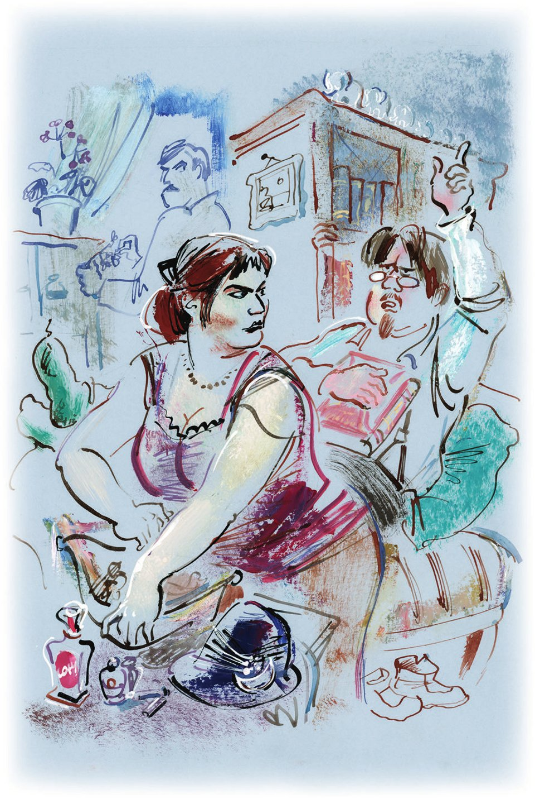
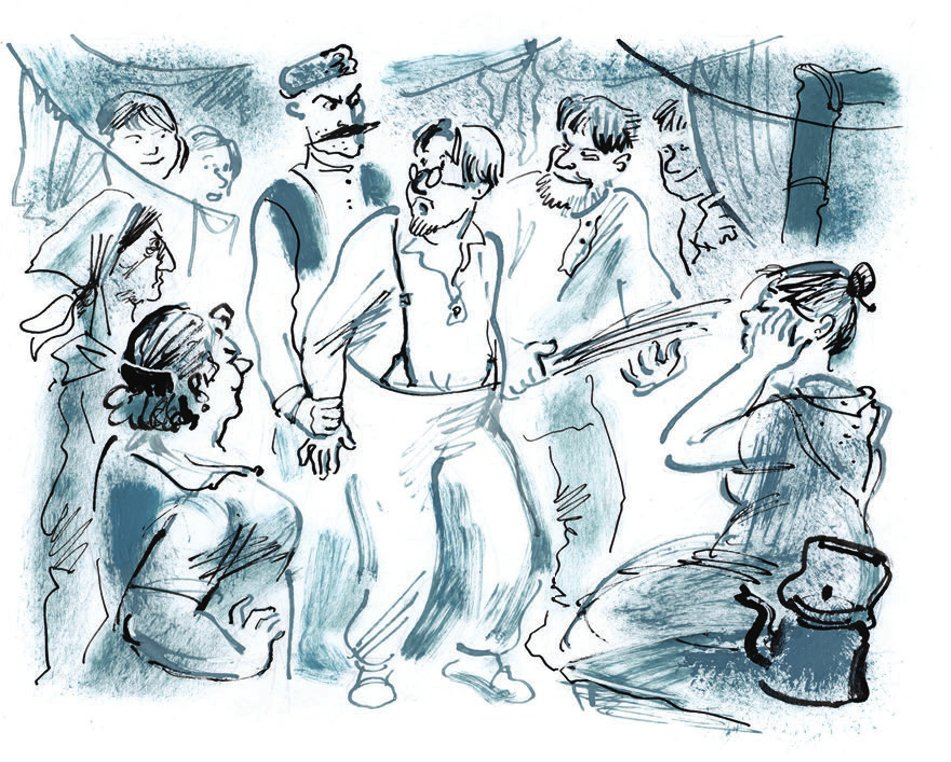

## Kapitel 13: Wassissuali Lochankin und seine Rolle in der russischen Revolution

Genau um 16 Uhr 40 trat Wassissuali Lochankin in den <abbr title="der Hungerstreik, die Hungerstreiks — голодовка">Hungerstreik</abbr>.

Er lag auf einem <abbr title="das Wachstuchsofa, die Wachstuchsofas — клеёнчатый диван">Wachstuchsofa</abbr>. Er hatte sich von der ganzen Welt abgewandt, das Gesicht zur <abbr title="gewölbt — выпуклый">gewölbten</abbr> <abbr title="die Rückenlehne, die Rückenlehnen — спинка (дивана)">Rückenlehne</abbr>. Er lag da in Hosenträgern und grünen Socken. In Tschernomorsk nennt man solche Socken auch «Karpetki».

So hungerte Lochankin etwa zwanzig Minuten. Dann stöhnte er, drehte sich auf die andere Seite und sah seine Frau an. Dabei <abbr title="beschreiben (beschrieb, hat beschrieben) — описывать">beschrieben</abbr> die grünen Karpetki einen kleinen Bogen in der Luft. Die Frau warf ihre <abbr title="die Habseligkeiten (Pl.) — пожитки, добро">Habseligkeiten</abbr> in einen gefärbten <abbr title="der Reisesack, die Reisesäcke — дорожный мешок">Reisesack</abbr>: Fläschchen in <abbr title="verschnörkelt — фигурный, затейливый">verschnörkelten</abbr> Formen, eine <abbr title="die Massagerolle, die Massagerollen — валик для массажа">Massagerolle</abbr> aus Gummi, zwei Kleider mit <abbr title="die Schleppe, die Schleppen — шлейф, хвост">Schleppe</abbr> und ein altes ohne Schleppe, einen <abbr title="der Tschako, die Tschakos — кивер">Tschako</abbr> aus <abbr title="der Filz — фетр">Filz</abbr> mit einem gläsernen <abbr title="der Halbmond — полумесяц">Halbmond</abbr>, <abbr title="der Lippenstift, die Lippenstifte — губная помада">Lippenstifte</abbr> in <abbr title="die Messinghülse, die Messinghülsen — медный патрон">Messinghülsen</abbr> und eine <abbr title="gestrickt — трикотажный, вязаный">gestrickte</abbr> Reithose.

— Warwara! — sagte Lochankin durch die Nase.

Die Frau schwieg und atmete laut.

— Warwara! — wiederholte er. — Gehst du wirklich von mir weg, zu Ptiburdukow?

— Ja, — antwortete die Frau. — Ich gehe. Es muss so sein.

— Aber warum denn, warum? — sagte Lochankin mit der <abbr title="die Leidenschaft, die Leidenschaften — страсть">Leidenschaft</abbr> einer Kuh.

Seine ohnehin großen <abbr title="das Nasenloch, die Nasenlöcher — ноздря">Nasenlöcher</abbr> <abbr title="sich blähen — раздуваться">blähten sich</abbr> kummervoll. Sein <abbr title="das Pharaonenbärtchen — фараонская бородка">Pharaonenbärtchen</abbr> zitterte.

— Weil ich ihn liebe.

— Und ich?

— Wassissuali! Ich habe es dir schon gestern mitgeteilt. Ich liebe dich nicht mehr.

— Aber ich! Ich liebe dich doch, Warwara!

— Das ist deine <abbr title="die Privatsache, die Privatsachen — частное дело">Privatsache</abbr>, Wassissuali. Ich gehe zu Ptiburdukow. Es muss so sein.

— Nein! — rief Lochankin. — Es muss nicht so sein! Ein Mensch kann nicht weggehen, wenn ein anderer ihn liebt!

— Doch, er kann, — sagte Warwara gereizt und sah in ihren Taschenspiegel. — Und überhaupt, hör auf mit dem <abbr title="der Unfug — дурачество, глупости">Unfug</abbr>, Wassissuali.

— <abbr title="in diesem Fall — в таком случае">In diesem Fall</abbr> setze ich den Hungerstreik fort! — schrie der <abbr title="unglücklich — несчастный">unglückliche</abbr> Ehemann. — Ich werde hungern, bis du zurückkommst. Einen Tag. Eine Woche. Ein Jahr werde ich hungern!

Lochankin drehte sich wieder um und <abbr title="bohren — утыкать, вонзать">bohrte</abbr> seine dicke Nase in das glatte, kalte <abbr title="das Wachstuch — клеёнка">Wachstuch</abbr>.

— So werde ich hier liegen, in Hosenträgern, — kam es vom Sofa, — bis ich sterbe. Und schuld an allem wirst du sein, du und der Ingenieur Ptiburdukow.

Die Frau dachte nach. Sie schob den <abbr title="herunterrutschen — соскользнуть, свалиться">heruntergerutschten</abbr> <abbr title="der Träger, die Träger — бретелька">Träger</abbr> wieder auf ihre weiße Schulter. Plötzlich heulte sie los:

— Du wagst es nicht, so über Ptiburdukow zu sprechen! Er steht höher als du!

Das <abbr title="ertragen (ertrug, hat ertragen) — выносить, терпеть">ertrug</abbr> Lochankin nicht. Er zuckte zusammen, als ob ein <abbr title="der Stromschlag, die Stromschläge — электрический разряд">Stromschlag</abbr> ihn der ganzen Länge nach <abbr title="durchfahren (durchfuhr, hat durchfahren) — пронзать">durchfuhr</abbr>, von den Hosenträgern bis zu den grünen Karpetki.

— Du bist ein <abbr title="das Weibchen, die Weibchen — самка">Weibchen</abbr>, Warwara, — jammerte er <abbr title="gedehnt — тягуче">gedehnt</abbr>. — Du bist eine <abbr title="die Dirne, die Dirnen — публичная девка">Dirne</abbr>!

— Wassissuali, du bist ein Dummkopf! — antwortete die Frau ruhig.

— Du Wölfin, du, — fuhr Lochankin im selben gedehnten Ton fort. — Ich kann dich nur verachten.  
Zum <abbr title="der Buhle, die Buhlen — любовник (устар.)">Buhlen</abbr> gehst du fort, du gehst von mir.  
Zu Ptiburdukow gehst du fort von mir.  
Zum nicht'gen Ptiburdukow gehst du, du <abbr title="schnöde — мерзкий, подлый">Schnöde</abbr>, heut von mir!  
So also ist's, zu wem du von mir gehst!  
Der <abbr title="die Wollust — похоть, сладострастие">Wollust</abbr> willst du <abbr title="frönen + Dat. — предаваться">frönen</abbr> nun mit ihm.  
Du alte <abbr title="die Wölfin, die Wölfinnen — волчица">Wölfin</abbr>, schnöde obendrein!

Lochankin <abbr title="schwelgen in + Dat. — упиваться">schwelgte</abbr> in seinem Kummer. Er merkte nicht einmal, dass er im fünffüßigen <abbr title="der Jambus, die Jamben — ямб">Jambus</abbr> sprach. Dabei hatte er nie Gedichte geschrieben und las sie auch nicht gern.

— Wassissuali! Hör auf, den <abbr title="der Hanswurst — шут, паяц">Hanswurst</abbr> zu spielen, — sagte die Wölfin und machte den Sack zu. — Sieh mal, wie du aussiehst. Du könntest dich wenigstens waschen. Ich gehe. <abbr title="leb wohl! — прощай!">Leb wohl</abbr>, Wassissuali! Deine <abbr title="die Brotkarte, die Brotkarten — хлебная карточка">Brotkarte</abbr> lasse ich auf dem Tisch.

Warwara <abbr title="greifen (griff, hat gegriffen) — хватать, брать">griff</abbr> den Sack und ging zur Tür. Lochankin sah, dass seine <abbr title="die Beschwörung, die Beschwörungen — заклинание">Beschwörungen</abbr> nicht geholfen hatten. Da sprang er schnell vom Sofa auf, lief zum Tisch, schrie «Rettet mich!» und zerriss die Karte. Warwara erschrak. Sie sah ihren Mann vor sich: <abbr title="ausgetrocknet — иссохший">ausgetrocknet</abbr> vom Hunger, mit <abbr title="still — затихший">stillem</abbr> Puls und kalten <abbr title="das Glied, die Glieder — конечность">Gliedern</abbr>.

— Was hast du getan? — sagte sie. — Du darfst nicht hungern!

— Ich werde! — erklärte Lochankin <abbr title="trotzig — упрямо">trotzig</abbr>.

— Das ist dumm, Wassissuali. Das ist eine <abbr title="die Rebellion — бунт">Rebellion</abbr> der Individualität.

— Und darauf bin ich stolz, — antwortete Lochankin in einem Ton, der verdächtig nach Jambus klang. — Du <abbr title="unterschätzen — недооценивать">unterschätzt</abbr> die Bedeutung der Individualität und überhaupt der <abbr title="die Intelligenzija — интеллигенция">Intelligenzija</abbr>.

— Aber die Öffentlichkeit wird dich verurteilen.

— Soll sie mich verurteilen, — sagte Wassissuali entschlossen und fiel wieder aufs Sofa.

Warwara warf schweigend den Sack auf den Boden. Schnell zog sie den Strohhut vom Kopf. Sie murmelte: «<abbr title="tollwütig — взбесившийся">Tollwütiges</abbr> <abbr title="das Männchen, die Männchen — самец">Männchen</abbr>», «<abbr title="der Tyrann, die Tyrannen — тиран">Tyrann</abbr>», «<abbr title="der Besitzmensch — собственник">Besitzmensch</abbr>» und machte <abbr title="hastig — торопливо">hastig</abbr> ein Butterbrot mit <abbr title="der Auberginenkaviar — баклажанная икра">Auberginenkaviar</abbr>.

— Iss! — sagte sie und hielt das Essen an die <abbr title="purpurrot — пунцовый">purpurroten</abbr> Lippen ihres Mannes. — Hörst du, Lochankin? Iss sofort. Na los!

— Lass mich, — sagte er und schob die Hand seiner Frau weg. In diesem Moment war der Mund des Hungernden kurz offen. Das nutzte Warwara aus. <abbr title="geschickt — ловко">Geschickt</abbr> <abbr title="stopfen — запихивать">stopfte</abbr> sie das Butterbrot in die <abbr title="die Öffnung, die Öffnungen — отверстие">Öffnung</abbr> zwischen dem Pharaonenbärtchen und dem <abbr title="ausrasiert — подбритый">ausrasierten</abbr> Moskauer Schnurrbärtchen. Aber der Hungernde stieß das Essen mit einem kräftigen Schlag der Zunge wieder hinaus.

— Iss, du <abbr title="der Schuft, die Schufte — негодяй">Schuft</abbr>! — schrie Warwara verzweifelt und stieß mit dem Butterbrot zu. — Du <abbr title="der Intellektuelle, die Intellektuellen — интеллигент">Intellektueller</abbr>!

Aber Lochankin drehte das Gesicht weg und brummte «Nein». Nach einigen Minuten gab Warwara auf. Sie war erhitzt und mit grünem Kaviar <abbr title="beschmieren — вымазать">beschmiert</abbr>. Sie setzte sich auf ihren Sack und weinte eisige Tränen.

Lochankin wischte die Krümel aus dem Bart, die sich dort verirrt hatten. Er warf seiner Frau einen vorsichtigen Blick <abbr title="von der Seite — косо, искоса">von der Seite</abbr> zu und wurde still auf seinem Sofa. Er wollte sich wirklich nicht von Warwara <abbr title="sich trennen von — расставаться с">trennen</abbr>. Warwara hatte viele Mängel, aber auch zwei <abbr title="wesentlich — существенный">wesentliche</abbr> <abbr title="der Vorzug, die Vorzüge — достоинство, преимущество">Vorzüge</abbr>: einen großen weißen <abbr title="der Busen — грудь, бюст">Busen</abbr> und eine Stelle. Wassissuali selbst hatte nie und nirgends gearbeitet. Eine Stelle hätte ihn beim Nachdenken über die Bedeutung der russischen Intelligenzija gestört. Zu dieser <abbr title="sozial — социальный">sozialen</abbr> <abbr title="die Schicht, die Schichten — прослойка, слой">Schicht</abbr> <abbr title="zählen zu — причислять к">zählte</abbr> er auch sich selbst. So kamen Lochankins lange <abbr title="die Grübelei, die Grübeleien — дума, раздумье">Grübeleien</abbr> immer zu einem angenehmen und nahen Thema: «Wassissuali Lochankin und seine Bedeutung», «Lochankin und die <abbr title="die Tragödie, die Tragödien — трагедия">Tragödie</abbr> des russischen <abbr title="der Liberalismus — либерализм">Liberalismus</abbr>», «Lochankin und seine Rolle in der russischen Revolution». Über all das konnte man leicht und ruhig nachdenken. Dabei ging er in <abbr title="das Filzstiefelchen, die Filzstiefelchen — фетровый сапожок">Filzstiefelchen</abbr> durchs Zimmer, die er von Warwaras Geld gekauft hatte. Und er sah auf seinen geliebten Schrank. Dort schimmerten in kirchlichem Gold die <abbr title="der Buchrücken, die Buchrücken — корешок (книги)">Buchrücken</abbr> des <abbr title="das Konversationslexikon, die Konversationslexika — энциклопедический словарь">Konversationslexikons</abbr> von Brockhaus. Lange stand Wassissuali oft vor dem Schrank, und sein Blick wanderte von Buchrücken zu Buchrücken. Dort standen <abbr title="der Größe nach — по ранжиру">der Größe nach</abbr> wunderbare Muster der <abbr title="die Buchbinderkunst — переплётное искусство">Buchbinderkunst</abbr>: die «Große medizinische Enzyklopädie», «Brehms Tierleben», ein <abbr title="zentnerschwer — пудовый">zentnerschwerer</abbr> Band «Mann und Weib» und «Die Erde und die Menschen» von Élisée Reclus.

«Neben dieser <abbr title="die Schatzkammer, die Schatzkammern — сокровищница">Schatzkammer</abbr> der Gedanken», dachte Wassissuali ohne Eile, «wird man reiner. Man wächst irgendwie geistig.»

Nach diesem <abbr title="der Schluss — вывод, заключение">Schluss</abbr> seufzte er froh. Er zog unter dem Schrank die «Rodina» von 1899 hervor, in einem <abbr title="der Einband, die Einbände — переплёт">Einband</abbr> in der Farbe der Meereswellen, mit <abbr title="der Schaum — пена">Schaum</abbr> und <abbr title="der Spritzer, die Spritzer — брызги">Spritzern</abbr>. Er sah sich die Bilder vom <abbr title="der Burenkrieg — англо-бурская война">Burenkrieg</abbr> an, die Anzeige einer unbekannten Dame mit dem Titel «So habe ich meine <abbr title="die Büste, die Büsten — бюст">Büste</abbr> um sechs <abbr title="der Zoll, die Zoll — дюйм">Zoll</abbr> vergrößert» und andere interessante Sachen.

Wenn Warwara wegging, verschwand auch die <abbr title="materiell — материальный">materielle</abbr> Basis. Auf ihr <abbr title="ruhen — покоиться">ruhte</abbr> der <abbr title="der Wohlstand — благополучие">Wohlstand</abbr> dieses würdigsten Vertreters der denkenden Menschheit.

Am Abend kam Ptiburdukow. Lange traute er sich nicht in die Zimmer der Lochankins. Er <abbr title="irren — бродить, мыкаться">irrte</abbr> in der Küche herum, zwischen <abbr title="der Primuskocher, die Primuskocher — примус">Primuskochern</abbr> mit langen Flammen und <abbr title="die Wäscheleine, die Wäscheleinen — бельевая верёвка">Wäscheleinen</abbr>, die <abbr title="kreuz und quer — крест-накрест, вдоль и поперёк">kreuz und quer</abbr> gespannt waren. Darauf hing trockene Wäsche, steif wie <abbr title="der Gips — гипс">Gips</abbr>, mit Flecken von <abbr title="das Wäscheblau — синька">Wäscheblau</abbr>. Die Wohnung wurde lebendig. Türen knallten, Schatten huschten vorbei, die Augen der Mieter funkelten, und irgendwo seufzte jemand leidenschaftlich: Ein Mann ist gekommen!

Ptiburdukow nahm seine Schirmmütze ab, zog an seinem Ingenieursschnurrbart und <abbr title="sich ein Herz fassen — решиться">fasste</abbr> sich endlich ein Herz.

— Warja, — sagte er <abbr title="flehend — умоляюще">flehend</abbr> und kam ins Zimmer, — wir haben doch <abbr title="vereinbaren — договариваться">vereinbart</abbr> …

— Sieh ihn dir an, Saschuk! — schrie Warwara. Sie packte ihn an der Hand und schob ihn zum Sofa. — Da ist er! Da liegt er! Das Männchen! Der gemeine Besitzmensch! Verstehst du, dieser <abbr title="der Leibeigenenhalter, die Leibeigenenhalter — крепостник">Leibeigenenhalter</abbr> ist in den Hungerstreik getreten, weil ich ihn verlassen will.

Als der Hungernde Ptiburdukow sah, <abbr title="greifen zu (griff, hat gegriffen) — прибегать к, хвататься за">griff</abbr> er sofort zum fünffüßigen Jambus.

— Ptiburdukow, dich kann ich nur verachten, — <abbr title="greinen — ныть, хныкать">greinte</abbr> er. —  
Mein <abbr title="das Weib, die Weiber — жена (устар.)">Weib</abbr> zu <abbr title="rühren — трогать, касаться">rühren</abbr>, wage du es nicht!  
Du <abbr title="der Flegel, die Flegel — хам">Flegel</abbr>, Ptiburdukow, du <abbr title="der Schurke, die Schurken — мерзавец, негодяй">Schurke</abbr>!  
Wohin entführst du mir mein <abbr title="das Eheweib — супруга">Eheweib</abbr>?

— Genosse Lochankin, — sagte Ptiburdukow <abbr title="verdattert — ошеломлённо">verdattert</abbr> und griff sich an den Schnurrbart.

— Geh fort, geh fort, ich hasse dich von Herzen, — fuhr Wassissuali fort. Er schaukelte hin und her wie ein alter Jude beim <abbr title="das Gebet, die Gebete — молитва">Gebet</abbr>. —  
Du bist 'ne <abbr title="die Laus, die Läuse — вошь, гнида">Laus</abbr>, erbärmlich, schnöde obendrein.  
Kein Ingenieur bist du – ein Flegel, Schurke, Lump,  
<abbr title="das Gewürm — гад, черви">Gewürm</abbr>, das kriecht, und <abbr title="der Kuppler, die Kuppler — сутенёр, сводник">Kuppler</abbr> obendrein!

— Schämen Sie sich nicht, Wassissuali Andrejitsch? — sagte Ptiburdukow, dem es schon langweilig wurde. — Das ist ja einfach nur dumm. Denken Sie doch nach, was Sie da tun! Im zweiten Jahr des Fünfjahresplans …

— Er wagte mir zu sagen, das sei dumm!  
Er, er, der mir die <abbr title="die Gattin, die Gattinnen — супруга">Gattin</abbr> hat <abbr title="rauben — красть, похищать">geraubt</abbr>!  
Geh, Ptiburdukow, sonst geb ich dir eins aufs <abbr title="das Haupt, die Häupter — глава (устар.), голова">Haupt</abbr>,  
auf den Kopf, will sagen – Ihnen geb ich eins.

— Ein kranker Mensch, — sagte Ptiburdukow. Er versuchte, im Rahmen des <abbr title="der Anstand — приличие">Anstands</abbr> zu bleiben.

Aber für Warwara war dieser Rahmen zu eng. Sie nahm das schon <abbr title="vertrocknet — засохший">vertrocknete</abbr> grüne Butterbrot vom Tisch und ging auf den Hungernden los. Lochankin <abbr title="sich wehren — защищаться, сопротивляться">wehrte sich</abbr> so verzweifelt, als ob man ihn <abbr title="kastrieren — кастрировать">kastrieren</abbr> wollte. Ptiburdukow drehte sich weg und sah aus dem Fenster auf eine <abbr title="die Rosskastanie, die Rosskastanien — конский каштан">Rosskastanie</abbr>, die mit weißen Kerzen blühte. Hinter sich hörte er das widerliche <abbr title="das Gebrumm — мычание">Gebrumm</abbr> von Lochankin und Warwaras Schreie: «Iss, du gemeiner Mensch! Iss, du Leibeigenenhalter!»

Am nächsten Tag ging Warwara nicht zur Arbeit. Das unerwartete Hindernis hatte sie <abbr title="aus der Fassung bringen — расстраивать, выбивать из колеи">aus der Fassung gebracht</abbr>. Dem Hungernden ging es schlechter.

— Jetzt haben schon die <abbr title="der Magenkrampf, die Magenkrämpfe — рези в желудке">Magenkrämpfe</abbr> angefangen, — <abbr title="berichten — сообщать">berichtete</abbr> er zufrieden. — Dann kommt <abbr title="der Skorbut — цинга">Skorbut</abbr> wegen <abbr title="die Unterernährung — недоедание">Unterernährung</abbr>, dann fallen die Haare und die Zähne aus.

Ptiburdukow brachte seinen Bruder mit, einen <abbr title="der Militärarzt, die Militärärzte — военный врач">Militärarzt</abbr>. Ptiburdukow der Zweite legte lange sein Ohr an Lochankins <abbr title="der Rumpf, die Rümpfe — туловище">Rumpf</abbr>. Er <abbr title="lauschen — прислушиваться">lauschte</abbr> auf die Arbeit seiner <abbr title="das Organ, die Organe — орган">Organe</abbr> so aufmerksam, wie eine Katze auf eine Maus lauscht, die in die Zuckerdose gekrochen ist. Während der <abbr title="die Untersuchung, die Untersuchungen — осмотр">Untersuchung</abbr> sah Wassissuali mit Tränen in den Augen auf seine Brust. Sie war so haarig wie ein <abbr title="der Übergangsmantel, die Übergangsmäntel — демисезонное пальто">Übergangsmantel</abbr>. Er hatte großes Mitleid mit sich selbst. Ptiburdukow der Zweite sah Ptiburdukow den Ersten an und erklärte: Der Kranke muss keine <abbr title="die Diät, die Diäten — диета">Diät</abbr> halten. Er darf alles essen. Zum Beispiel Suppe, Koteletts, Kompott. Er darf auch Brot, Gemüse und Obst essen. Fisch ist nicht ausgeschlossen. Rauchen darf er natürlich, aber mit <abbr title="das Maß — мера">Maß</abbr>. Trinken <abbr title="empfehlen (empfahl, hat empfohlen) — советовать, рекомендовать">empfiehlt</abbr> er nicht. Aber für den Appetit wäre es nicht schlecht, dem Organismus ein Gläschen guten <abbr title="der Portwein — портвейн">Portwein</abbr> <abbr title="zuführen — вводить, подводить">zuzuführen</abbr>. Kurz, der Doktor hatte das seelische Drama der Lochankins schlecht verstanden. Würdevoll schnaufend und mit <abbr title="stampfen — топать">stampfenden</abbr> Stiefeln ging er weg. Zum Abschied sagte er noch, dass der Kranke auch im Meer baden und Fahrrad fahren darf.

Aber der Kranke dachte gar nicht daran, seinem Organismus Kompott, Fisch, Koteletts oder andere <abbr title="der Leckerbissen, die Leckerbissen — разносолы, лакомство">Leckerbissen</abbr> zuzuführen. Er ging nicht zum Baden ans Meer. Er lag weiter auf dem Sofa und <abbr title="überschütten mit — осыпать">überschüttete</abbr> alle um sich herum mit zänkischen Jamben. Warwara bekam Mitleid mit ihm. «Wegen mir hungert er», dachte sie stolz. «Was für eine Leidenschaft! Wäre Saschuk zu so einem hohen Gefühl <abbr title="fähig sein zu — быть способным на">fähig</abbr>?» Und sie warf besorgte Blicke auf den satten Saschuk. Man sah ihm an, dass seine Liebesgefühle ihn nicht daran hinderten, seinem Organismus <abbr title="regelmäßig — регулярно">regelmäßig</abbr> Mittag- und Abendessen zuzuführen. Einmal, als Ptiburdukow aus dem Zimmer gegangen war, nannte sie Wassissuali sogar «mein Armer». Dabei erschien vor dem Mund des Hungernden wieder ein Butterbrot. Und wieder wurde es abgelehnt. «Noch ein bisschen <abbr title="das Durchhaltevermögen — выдержка">Durchhaltevermögen</abbr>», dachte Lochankin, «und Ptiburdukow sieht meine Warwara nie wieder.»

Mit <abbr title="das Vergnügen — удовольствие">Vergnügen</abbr> lauschte er auf die Stimmen aus dem Nachbarzimmer.

— Er stirbt ohne mich, — sagte Warwara. — Wir müssen warten. Du siehst doch, dass ich jetzt nicht gehen kann.

In der Nacht hatte Warwara einen schrecklichen Traum. Wassissuali, ausgetrocknet von seinem hohen Gefühl, <abbr title="nagen an + Dat. — глодать">nagte</abbr> an den weißen <abbr title="der Sporn, die Sporen — шпора">Sporen</abbr> an den Stiefeln des Militärarztes. Das war furchtbar. Der Arzt hatte einen ergebenen Ausdruck im Gesicht, wie eine Kuh, die ein Dorfdieb <abbr title="melken — доить">melkt</abbr>. Die Sporen klirrten, die Zähne klapperten. Voller Angst wachte Warwara auf.

Eine gelbe japanische Sonne schien <abbr title="direkt — прямо, в упор">direkt</abbr> ins Zimmer. Sie gab ihre ganze Kraft, um eine Kleinigkeit zu <abbr title="beleuchten — освещать">beleuchten</abbr>: den <abbr title="geschliffen — гранёный">geschliffenen</abbr> <abbr title="der Stöpsel, die Stöpsel — пробка">Stöpsel</abbr> eines Fläschchens mit dem Kölnischwasser «Turandot». Das Wachstuchsofa war leer. Warwara ließ die Augen wandern und sah Wassissuali. Er stand mit dem Rücken zum Bett an der offenen Tür des Büfetts und schmatzte laut. Vor Ungeduld und <abbr title="die Gier — жадность">Gier</abbr> <abbr title="sich bücken — наклоняться">bückte er sich</abbr>, stampfte mit dem Fuß in der grünen Socke und machte mit der Nase <abbr title="pfeifend — свистящий">pfeifende</abbr> und <abbr title="schlürfend — хлюпающий">schlürfende</abbr> Geräusche. Er leerte eine hohe <abbr title="die Konservendose, die Konservendosen — консервная банка">Konservendose</abbr>. Dann nahm er vorsichtig den Deckel vom <abbr title="der Kochtopf, die Kochtöpfe — кастрюля">Kochtopf</abbr>, <abbr title="tauchen — погружать">tauchte</abbr> die Finger in den kalten Borschtsch und holte ein Stück Fleisch heraus. Selbst in den besten Zeiten ihrer Ehe wäre es Wassissuali <abbr title="jemandem ergeht es schlecht — кому-то приходится худо">schlecht ergangen</abbr>, wenn Warwara ihn bei so etwas erwischt hätte. Jetzt aber war sein Schicksal <abbr title="besiegeln — решать, скреплять печатью">besiegelt</abbr>.

— Lochankin! — sagte sie mit einer furchtbaren Stimme.

Vor Schreck ließ der Hungernde das Fleisch los. Es <abbr title="platschen — шлёпнуться">platschte</abbr> zurück in den Topf, und ein kleiner Springbrunnen aus <abbr title="der Kohl — капуста">Kohl</abbr> und <abbr title="das Möhrensternchen, die Möhrensternchen — морковная звёздочка">Möhrensternchen</abbr> sprang hoch. Mit einem kläglichen Geheul stürzte Wassissuali zum Sofa. Warwara zog sich schweigend und schnell an.

— Warwara! — sagte er durch die Nase. — Gehst du wirklich von mir weg, zu Ptiburdukow?

Es kam keine Antwort.

— Du Wölfin, du, — erklärte Lochankin unsicher, — ich kann dich nur verachten, zu Ptiburdukow gehst du fort von mir …

Aber es war schon zu spät. <abbr title="vergeblich — напрасно">Vergeblich</abbr> jammerte Wassissuali von Liebe und vom <abbr title="der Hungertod — голодная смерть">Hungertod</abbr>. Warwara ging für immer. Sie schleppte den Reisesack hinter sich her, mit der bunten Reithose, dem Filzhut, den verschnörkelten Fläschchen und anderen <abbr title="der Gegenstand, die Gegenstände — предмет">Gegenständen</abbr> für den <abbr title="der Damenbedarf — дамский обиход">Damenbedarf</abbr>.

Und im Leben von Wassissuali Andrejewitsch begann eine Zeit <abbr title="qualvoll — мучительный">qualvoller</abbr> Gedanken und moralischer Leiden. Es gibt Menschen, die nicht leiden können. Es klappt bei ihnen irgendwie nicht. Und wenn sie doch leiden, dann versuchen sie es möglichst schnell zu tun, und so, dass die anderen es nicht merken. Lochankin dagegen litt offen und <abbr title="majestätisch — величаво">majestätisch</abbr>. Er trank seinen Kummer in <abbr title="das Teeglas, die Teegläser — чайный стакан">Teegläsern</abbr>, er schwelgte darin. Die große <abbr title="die Trauer — скорбь">Trauer</abbr> gab ihm noch einmal die <abbr title="die Gelegenheit, die Gelegenheiten — возможность, случай">Gelegenheit</abbr>, über die Bedeutung der russischen Intelligenzija nachzudenken. Und ebenso über die Tragödie des russischen Liberalismus.

«Vielleicht muss es so sein», dachte er. «Vielleicht ist das eine <abbr title="die Sühne — искупление">Sühne</abbr>, und ich komme <abbr title="geläutert — очищенный">geläutert</abbr> daraus hervor? Ist das nicht das Schicksal aller Menschen von feiner <abbr title="die Konstitution — конституция, телосложение">Konstitution</abbr>, die über der <abbr title="die Masse, die Massen — толпа, масса">Masse</abbr> stehen? Galilei, Miljukow, A. F. Koni. Ja, ja, Warwara hat recht, es muss so sein!»

Die seelische <abbr title="die Depression, die Depressionen — депрессия">Depression</abbr> hinderte ihn <abbr title="allerdings — однако, впрочем">allerdings</abbr> nicht daran, eine Anzeige in die Zeitung zu setzen: Er wollte sein zweites Zimmer <abbr title="vermieten — сдавать внаём">vermieten</abbr>.

«Das hilft mir <abbr title="immerhin — всё-таки">immerhin</abbr> am Anfang finanziell», beschloss Wassissuali. Und wieder <abbr title="versinken in + Dat. (versank, ist versunken) — погружаться">versank</abbr> er in <abbr title="nebelhaft — туманный">nebelhafte</abbr> <abbr title="die Überlegung, die Überlegungen — соображение, размышление">Überlegungen</abbr> über die Leiden des <abbr title="das Fleisch — плоть, мясо">Fleisches</abbr> und die Bedeutung der Seele als <abbr title="die Quelle, die Quellen — источник">Quelle</abbr> des Schönen.

Davon konnten ihn nicht einmal die dringenden <abbr title="der Hinweis, die Hinweise — указание">Hinweise</abbr> der Nachbarn <abbr title="ablenken — отвлекать">ablenken</abbr>: Man müsse in der Toilette hinter sich das Licht <abbr title="ausmachen — гасить, выключать">ausmachen</abbr>. Weil seine Gefühle so zerrüttet waren, vergaß Lochankin das immer. Das <abbr title="empören — возмущать">empörte</abbr> die sparsamen Mieter sehr.

Die Bewohner der großen <abbr title="die Gemeinschaftswohnung, die Gemeinschaftswohnungen — коммунальная квартира">Gemeinschaftswohnung</abbr> Nummer drei, in der Lochankin lebte, galten nämlich als eigensinnige Leute. Das ganze Haus kannte sie wegen ihrer häufigen Skandale und <abbr title="böse — злой, тяжёлый">bösen</abbr> <abbr title="die Zänkerei, die Zänkereien — склока">Zänkereien</abbr>. Man nannte die Wohnung Nummer drei sogar das «Krähenviertel». Das lange gemeinsame Leben hatte diese Menschen <abbr title="abhärten — закалять">abgehärtet</abbr>, und sie kannten keine Angst. Das <abbr title="das Gleichgewicht — равновесие">Gleichgewicht</abbr> in der Wohnung hielten <abbr title="das Bündnis, die Bündnisse — блок, союз">Bündnisse</abbr> zwischen einzelnen Mietern. Manchmal <abbr title="sich verbünden — объединяться">verbündeten sich</abbr> alle Bewohner des «Krähenviertels» gegen einen einzigen Mieter. Dann ging es diesem Mieter schlecht. Die <abbr title="die Zentripetalkraft — центростремительная сила">Zentripetalkraft</abbr> der <abbr title="die Prozesssucht — сутяжничество">Prozesssucht</abbr> packte ihn. Sie zog ihn in die <abbr title="die Kanzlei, die Kanzleien — канцелярия">Kanzleien</abbr> der <abbr title="der Rechtsberater, die Rechtsberater — юрисконсульт">Rechtsberater</abbr>, trug ihn wie ein <abbr title="der Wirbelsturm, die Wirbelstürme — вихрь">Wirbelsturm</abbr> durch <abbr title="verraucht — прокуренный">verrauchte</abbr> <abbr title="der Gerichtsflur, die Gerichtsflure — судебный коридор">Gerichtsflure</abbr> und stieß ihn in die Säle der <abbr title="das Kameradschaftsgericht, die Kameradschaftsgerichte — товарищеский суд">Kameradschaftsgerichte</abbr> und <abbr title="das Volksgericht, die Volksgerichte — народный суд">Volksgerichte</abbr>. Und noch lange <abbr title="umherirren — скитаться">irrte</abbr> der <abbr title="widerspenstig — непокорный">widerspenstige</abbr> Mieter umher. Auf der Suche nach der <abbr title="die Gerechtigkeit — правда, справедливость">Gerechtigkeit</abbr> kam er bis zum <abbr title="der Dorfälteste, die Dorfältesten — староста">Dorfältesten</abbr> der ganzen Union, Genosse Kalinin. Und bis zu seinem Tod wird dieser Mieter mit <abbr title="juristisch — юридический">juristischen</abbr> <abbr title="das Wörtchen, die Wörtchen — словечко">Wörtchen</abbr> um sich werfen, die er in verschiedenen <abbr title="die Amtsstube, die Amtsstuben — присутственное место">Amtsstuben</abbr> aufgeschnappt hat. Er wird nicht «wird bestraft» sagen, sondern «wird <abbr title="ahnden — карать, наказывать">geahndet</abbr>». Nicht «Tat», sondern «<abbr title="das Delikt, die Delikte — деяние">Delikt</abbr>». Sich selbst wird er nicht «Genosse Schukow» nennen, wie es ihm seit seiner Geburt zusteht, sondern «die <abbr title="geschädigt — потерпевший">geschädigte</abbr> Partei». Aber am häufigsten und mit besonderem Genuss wird er sagen: «eine Klage <abbr title="eine Klage anhängig machen — вчинить иск">anhängig machen</abbr>». Und sein Leben, in dem auch früher nicht gerade Milch und Honig <abbr title="fließen (floss, ist geflossen) — течь">flossen</abbr>, wird ganz und gar <abbr title="mies — дрянной, паршивый">mies</abbr>.

Lange vor dem Familiendrama der Lochankins flog der <abbr title="der Flieger, die Flieger — лётчик">Flieger</abbr> Sewrjugow, der zu seinem <abbr title="zu seinem Unglück — к своему несчастью">Unglück</abbr> in der Wohnung Nummer drei wohnte, auf eine dringende Dienstreise von Osoawiachim (das war die Gesellschaft für Luftfahrt und Verteidigung) über den <abbr title="der Polarkreis — полярный круг">Polarkreis</abbr>. Die ganze Welt verfolgte <abbr title="gespannt — взволнованно, напряжённо">gespannt</abbr> Sewrjugows Flug. Eine ausländische <abbr title="die Expedition, die Expeditionen — экспедиция">Expedition</abbr> war auf dem Weg zum <abbr title="der Pol, die Pole — полюс">Pol</abbr> <abbr title="verschollen — пропавший без вести">verschollen</abbr>, und Sewrjugow sollte sie finden. Die Welt lebte in der Hoffnung, dass der Flieger Erfolg hatte. <abbr title="die Funkstation, die Funkstationen — радиостанция">Funkstationen</abbr> auf allen <abbr title="der Kontinent, die Kontinente — материк, континент">Kontinenten</abbr> sprachen miteinander. <abbr title="der Meteorologe, die Meteorologen — метеоролог">Meteorologen</abbr> <abbr title="warnen vor + Dat. — предостерегать от">warnten</abbr> den kühnen Sewrjugow vor <abbr title="magnetisch — магнитный">magnetischen</abbr> Stürmen. <abbr title="der Kurzwellenfunker, die Kurzwellenfunker — коротковолновик">Kurzwellenfunker</abbr> füllten den <abbr title="der Äther — эфир">Äther</abbr> mit Pfeifen. Und die polnische Zeitung «Kurier Poranny», die dem <abbr title="das Außenministerium — министерство иностранных дел">Außenministerium</abbr> nahestand, forderte schon die <abbr title="die Erweiterung — расширение">Erweiterung</abbr> Polens bis zur Grenze von 1772. Einen ganzen Monat lang flog der Mieter aus Wohnung Nummer drei über die <abbr title="die Eiswüste, die Eiswüsten — ледяная пустыня">Eiswüste</abbr>, und das Dröhnen seiner Motoren hörte man in der ganzen Welt.

Schließlich tat Sewrjugow etwas, das die Zeitung des polnischen Außenministeriums ganz durcheinanderbrachte. Er fand die Expedition, die sich zwischen den <abbr title="der Packeisberg, die Packeisberge — торос">Packeisbergen</abbr> verloren hatte. Er konnte noch ihren genauen <abbr title="der Standort, die Standorte — местонахождение">Standort</abbr> <abbr title="melden — сообщать">melden</abbr>. Aber danach verschwand er plötzlich selbst. Bei dieser Nachricht war die <abbr title="die Erdkugel — земной шар">Erdkugel</abbr> voll von Schreien. Den Namen Sewrjugow sprach man in dreihundertzwanzig Sprachen und <abbr title="der Dialekt, die Dialekte — наречие, диалект">Dialekten</abbr> aus, die Sprache der <abbr title="der Schwarzfußindianer, die Schwarzfußindianer — индейцы-черноногие">Schwarzfußindianer</abbr> <abbr title="einschließen — включать">eingeschlossen</abbr>. Porträts von Sewrjugow in <abbr title="das Tierfell, die Tierfelle — звериная шкура">Tierfellen</abbr> erschienen auf jedem freien Blatt Papier. In einem Gespräch mit der Presse erklärte Gabriele D'Annunzio, er habe gerade einen neuen Roman beendet und fliege sofort los, um den kühnen Russen zu suchen. Es erschien ein Charleston: «Mir ist warm mit meiner Kleinen am Pol». Und die alten Moskauer <abbr title="der Schreiberling, die Schreiberlinge — халтурщик, писака">Schreiberlinge</abbr> Uslyschkin-Werther, Leonid Trepetowski und Boris Ammiakow schrieben schon an einer <abbr title="die Revue, die Revuen — обозрение, ревю">Revue</abbr> mit dem Titel «Ist Ihnen nicht kalt?». Diese drei <abbr title="betreiben (betrieb, hat betrieben) — практиковать, заниматься">betrieben</abbr> seit Langem literarisches Dumping und warfen ihre Produktion zu <abbr title="der Schleuderpreis, die Schleuderpreise — бросовая цена">Schleuderpreisen</abbr> auf den Markt. Kurz, unser Planet erlebte eine große <abbr title="die Sensation, die Sensationen — сенсация">Sensation</abbr>.

Aber eine noch größere Sensation <abbr title="auslösen — вызывать">löste</abbr> diese Nachricht in der Wohnung Nummer drei aus. Sie lag im Haus Nummer acht in der Zitronengasse und war besser bekannt unter dem Namen «Krähenviertel».

— Unser Mieter ist verschwunden, — sagte froh der <abbr title="pensioniert — отставной">pensionierte</abbr> Hausmeister Nikita Prjachin. Er trocknete einen Filzstiefel über dem Primuskocher. — Verschwunden ist er, der <abbr title="der Gute — миленький">Gute</abbr>. Hätte er nicht fliegen sollen, nicht fliegen! Der Mensch muss gehen, nicht fliegen. Gehen muss er, gehen.

Und er drehte den Filzstiefel über dem stöhnenden Feuer um.

— Ausgeflogen hat er sich, der <abbr title="gelbäugig — желтоглазый">Gelbäugige</abbr>, — murmelte die Großmutter. Niemand kannte ihren Vor- oder Nachnamen. Sie wohnte auf dem Zwischenboden über der Küche. Die ganze Wohnung hatte elektrisches Licht, aber die Großmutter brannte oben eine Petroleumlampe mit <abbr title="der Reflektor, die Reflektoren — рефлектор">Reflektor</abbr>. Der Elektrizität <abbr title="trauen + Dat. — доверять">traute</abbr> sie nicht. — Jetzt ist ein Zimmer frei geworden. <abbr title="die Wohnfläche — жилплощадь, площадь">Wohnfläche</abbr>!

Die Großmutter sprach als Erste das Wort aus, das schon lange schwer auf den Herzen der Bewohner des «Krähenviertels» lag. Alle begannen über das Zimmer des verschollenen Fliegers zu reden. Der Bürger Gigienischwili, früher ein <abbr title="der Fürst, die Fürsten — князь">Fürst</abbr> aus den Bergen, jetzt ein <abbr title="der Werktätige, die Werktätigen — трудящийся">Werktätiger</abbr> des Ostens. Dunja, die in Tante Paschas Zimmer ein Bett <abbr title="mieten — снимать, арендовать">gemietet</abbr> hatte. Tante Pascha selbst, <abbr title="die Händlerin, die Händlerinnen — торговка">Händlerin</abbr> und <abbr title="schlimm — горький (о пьянице)">schlimme</abbr> <abbr title="die Säuferin, die Säuferinnen — пьяница">Säuferin</abbr>. Alexander Dmitrijewitsch Suchowejko, früher <abbr title="der Kammerherr, die Kammerherren — камергер">Kammerherr</abbr> am Hof Seiner <abbr title="kaiserlich — императорский">Kaiserlichen</abbr> <abbr title="die Majestät — величество">Majestät</abbr>, den man in der Wohnung einfach Mitritsch nannte. Und die übrigen kleinen <abbr title="der Fisch, die Fische — сошка, мелкая рыбёшка">Fische</abbr> der Wohnung, mit der <abbr title="die Hauptmieterin, die Hauptmieterinnen — ответственная съёмщица">Hauptmieterin</abbr> Luzija Franzewna Pferd an der Spitze.

— Nun, — sagte Mitritsch und rückte seine goldene Brille zurecht, als die Küche voll von Mietern war, — wenn der Genosse verschwunden ist, muss man teilen. Ich zum Beispiel habe schon lange ein Recht auf <abbr title="zusätzlich — дополнительный">zusätzliche</abbr> Wohnfläche.

— Warum soll ein Mann die Fläche bekommen? — widersprach Dunja, die <abbr title="die Bettmieterin, die Bettmieterinnen — коечница">Bettmieterin</abbr>. — Eine Frau braucht sie. Vielleicht kommt so eine Gelegenheit nie wieder in meinem Leben, dass ein Mann plötzlich verschwindet.

Noch lange drängte sie sich zwischen den <abbr title="der Versammelte, die Versammelten — собравшийся">Versammelten</abbr> herum. Sie nannte verschiedene Argumente für sich und sagte dabei oft das Wort «Mann».

<abbr title="jedenfalls — во всяком случае">Jedenfalls</abbr> waren sich die Mieter einig: Man musste das Zimmer sofort <abbr title="an sich nehmen — забирать">an sich nehmen</abbr>.

Am selben Tag <abbr title="erbeben — задрожать">erbebte</abbr> die Welt von einer neuen Sensation. Der kühne Sewrjugow war gefunden! Nischni Nowgorod, Québec und Reykjavík hörten Sewrjugows <abbr title="das Rufzeichen, die Rufzeichen — позывные">Rufzeichen</abbr>. Er saß mit <abbr title="eingedrückt — подмятый">eingedrücktem</abbr> <abbr title="das Fahrwerk — шасси">Fahrwerk</abbr> auf dem 84. <abbr title="der Breitengrad, die Breitengrade — параллель">Breitengrad</abbr>. Der Äther bebte von Meldungen: «Kühner Russe fühlt sich ausgezeichnet», «Sewrjugow schickt <abbr title="der Rapport, die Rapporte — рапорт">Rapport</abbr> an das <abbr title="das Präsidium — президиум">Präsidium</abbr> von Osoawiachim», «Charles Lindbergh hält Sewrjugow für den besten Flieger der Welt», «Sieben <abbr title="der Eisbrecher, die Eisbrecher — ледокол">Eisbrecher</abbr> unterwegs, um Sewrjugow und der gefundenen Expedition zu helfen». <abbr title="zwischen — между">Zwischen</abbr> diesen Meldungen druckten die Zeitungen nur Fotos von irgendwelchen <abbr title="die Eiskante, die Eiskanten — ледяная кромка">Eiskanten</abbr> und Ufern. <abbr title="endlos — без конца">Endlos</abbr> hörte man die Worte: «Sewrjugow, Nordkap, Breitengrad, Sewrjugow, Franz-Josef-Land, Spitzbergen, Kingsbay, <abbr title="der Pelzstiefel, die Pelzstiefel — пимы">Pelzstiefel</abbr>, Treibstoff, Sewrjugow».

Die <abbr title="die Niedergeschlagenheit — уныние">Niedergeschlagenheit</abbr>, die das «Krähenviertel» bei dieser Nachricht packte, wurde bald zu ruhiger <abbr title="die Zuversicht — уверенность">Zuversicht</abbr>. Die Eisbrecher kamen langsam voran. Nur mit Mühe <abbr title="zerbrechen (zerbrach, hat zerbrochen) — разбивать">zerbrachen</abbr> sie die <abbr title="das Eisfeld, die Eisfelder — ледяное поле">Eisfelder</abbr>.

— Das Zimmer wegnehmen, und fertig, — sagte Nikita Prjachin. — Er sitzt da schön auf dem Eis, und hier hat zum Beispiel Dunja alle Rechte. <abbr title="zumal — тем более что">Zumal</abbr> ein Mieter nach dem Gesetz nicht länger als zwei Monate <abbr title="abwesend sein — отсутствовать">abwesend</abbr> sein darf.

— Schämen Sie sich nicht, Bürger Prjachin? — widersprach Warwara, damals noch Lochankina, und schwenkte die «Iswestija». — Er ist doch ein <abbr title="der Held, die Helden — герой">Held</abbr>! Er ist doch jetzt auf dem vierundachtzigsten Breitengrad!

— Was soll das denn für ein Breitengrad sein, — antwortete Mitritsch <abbr title="unbestimmt — смутно, неопределённо">unbestimmt</abbr>. — Vielleicht gibt es so einen Breitengrad überhaupt nicht. Das wissen wir nicht. Wir haben kein Gymnasium besucht.

Mitritsch sagte die reine Wahrheit. Ein Gymnasium hatte er nicht besucht. Er hatte das <abbr title="das Pagenkorps — Пажеский корпус">Pagenkorps</abbr> <abbr title="absolvieren — оканчивать">absolviert</abbr>.

— Verstehen Sie doch, — <abbr title="sich ereifern — кипятиться, горячиться">ereiferte sich</abbr> Warwara und hielt dem Kammerherrn die Zeitung an die Nase. — Hier ist ein Artikel. Sehen Sie? «Zwischen Packeis und <abbr title="der Eisberg, die Eisberge — айсберг">Eisbergen</abbr>».

— Eisberge! — sagte Mitritsch spöttisch. — Das können wir verstehen. Seit zehn Jahren gibt es kein Leben mehr. Lauter Eisbergs, Weißbergs, Eisenbergs, allerlei Rabinowitschs. Prjachin hat recht. Wegnehmen, und fertig. Zumal Luzija Franzewna das mit dem Gesetz bestätigt.

— Und seine Sachen auf die Treppe werfen, <abbr title="zum Teufel noch mal! — к чертям собачьим!">zum Teufel noch mal</abbr>! — rief mit tiefer Bruststimme der frühere Fürst, jetzt ein Werktätiger des Ostens, der Bürger Gigienischwili.

Die anderen <abbr title="auf jemandem herumhacken — заклевать, нападать">hackten</abbr> schnell auf Warwara <abbr title="herumhacken — заклевать">herum</abbr>, und sie lief zu ihrem Mann, um sich zu <abbr title="sich beschweren — жаловаться">beschweren</abbr>.

— Vielleicht muss es so sein, — antwortete der Mann und hob sein Pharaonenbärtchen. — Vielleicht spricht aus dem Mund des einfachen <abbr title="der Bauer, die Bauern — мужик, крестьянин">Bauern</abbr> Mitritsch die große, <abbr title="hausgesponnen — домотканый, сермяжный">hausgesponnene</abbr> Wahrheit. Denk doch nur an die Rolle der russischen Intelligenzija, an ihre Bedeutung.

An dem großen Tag, an dem die Eisbrecher endlich Sewrjugows Zelt erreichten, <abbr title="aufbrechen (brach auf, hat aufgebrochen) — взламывать">brach</abbr> der Bürger Gigienischwili das Schloss an Sewrjugows Tür auf. Er warf das ganze Eigentum des Helden in den Flur, auch den roten Propeller, der an der Wand hing. In das Zimmer zog Dunja ein. Sofort ließ sie gegen Geld sechs Bettmieter herein. Auf der eroberten Fläche dauerte das <abbr title="das Festmahl — пир">Festmahl</abbr> die ganze Nacht. Nikita Prjachin spielte auf der <abbr title="die Ziehharmonika, die Ziehharmonikas — гармонь">Ziehharmonika</abbr>, und der Kammerherr Mitritsch tanzte mit der betrunkenen Tante Pascha den «Russischen».

Wäre Sewrjugows Ruhm nur ein bisschen kleiner gewesen als der Weltruhm, den er mit seinen bemerkenswerten Flügen über die <abbr title="die Arktis — Арктика">Arktis</abbr> bekommen hatte – er hätte sein Zimmer nie wiedergesehen. Die Zentripetalkraft der Prozesssucht hätte ihn <abbr title="verschlingen (verschlang, hat verschlungen) — засасывать, поглощать">verschlungen</abbr>. Und bis zu seinem Tod hätte er sich nicht «der kühne Sewrjugow» oder «der Held des Eises» genannt, sondern «die geschädigte Partei». Aber diesmal bekam das «Krähenviertel» gründlich eins auf die Finger. Das Zimmer wurde zurückgegeben (Sewrjugow zog bald in ein neues Haus). Und der <abbr title="wacker — бравый">wackere</abbr> Gigienischwili saß wegen <abbr title="die Eigenmächtigkeit — самоуправство">Eigenmächtigkeit</abbr> vier Monate im Gefängnis. Er kam <abbr title="wütend wie der Teufel — злой как чёрт">wütend wie der Teufel</abbr> zurück.

Gerade er war es, der den <abbr title="verwaist — осиротевший">verwaisten</abbr> Lochankin als Erster <abbr title="ermahnen — делать замечание, увещевать">ermahnte</abbr>: Wer die Toilette verlässt, muss regelmäßig das Licht ausmachen. Dabei hatte er wirklich <abbr title="teuflisch — дьявольский">teuflische</abbr> Augen. Der zerstreute Lochankin schätzte die Wichtigkeit dieses <abbr title="der Schritt, die Schritte — шаг, демарш">Schrittes</abbr> nicht richtig ein. So verpasste er den Anfang eines <abbr title="der Konflikt, die Konflikte — конфликт">Konflikts</abbr>. Dieser Konflikt führte bald zu einem <abbr title="entsetzlich — ужасающий">entsetzlichen</abbr> Ereignis, wie es selbst in der Geschichte der Wohnungsstreitigkeiten noch nie <abbr title="vorkommen (kam vor, ist vorgekommen) — случаться, бывать">vorgekommen</abbr> war.

So kam es dazu. Wassissuali Andrejewitsch vergaß weiter, im Raum für den <abbr title="der gemeinsame Gebrauch — общее пользование">gemeinsamen Gebrauch</abbr> das Licht auszumachen. Und wie konnte er auch an solche Kleinigkeiten des Alltags denken? Seine Frau war weg, er hatte keine Kopeke, und die ganze <abbr title="vielfältig — многообразный">vielfältige</abbr> Bedeutung der russischen Intelligenzija war noch nicht genau <abbr title="klären — выяснять">geklärt</abbr>. Konnte er denn ahnen, dass das armselige, bronzefarbene <abbr title="das Lichtlein — светишко">Lichtlein</abbr> einer Glühbirne mit acht Kerzen bei den Nachbarn so ein großes Gefühl wecken würde? Zuerst warnte man ihn mehrmals am Tag. Dann schickte man ihm einen Brief. Mitritsch hatte ihn <abbr title="verfassen — составлять">verfasst</abbr>, und alle Mieter hatten ihn unterschrieben. Und schließlich hörte man auf, ihn zu warnen, und schickte auch keine Briefe mehr. Lochankin <abbr title="begreifen (begriff, hat begriffen) — постигать, понимать">begriff</abbr> noch nicht, wie wichtig das alles war. Aber er hatte schon das <abbr title="dunkel — смутный">dunkle</abbr> Gefühl, dass sich ein Ring um ihn schließen wollte.

Am Dienstagabend kam Tante Paschas kleines Mädchen gelaufen und meldete in einem <abbr title="in einem Atemzug — одним духом">Atemzug</abbr>:

— Die sagen zum letzten Mal, Sie sollen das Licht ausmachen.

Aber irgendwie <abbr title="sich vergessen — забыться">vergaß sich</abbr> Wassissuali Andrejewitsch wieder, und die Glühbirne schien weiter <abbr title="verbrecherisch — преступно">verbrecherisch</abbr> durch <abbr title="die Spinnwebe, die Spinnweben — паутина">Spinnweben</abbr> und Schmutz. Die Wohnung seufzte. Eine Minute später erschien in der Tür von Lochankins Zimmer der Bürger Gigienischwili. Er trug blaue Stiefel aus <abbr title="das Leinen — полотно">Leinen</abbr> und eine flache Mütze aus braunem <abbr title="das Lammfell — барашек (мех)">Lammfell</abbr>.

— Komm, — sagte er und winkte Wassissuali mit dem Finger.

Er nahm ihn fest an der Hand und führte ihn durch den dunklen Flur. Dort wurde Wassissuali aus irgendeinem Grund <abbr title="schwermütig — тоскливый">schwermütig</abbr> und begann sogar, leicht <abbr title="um sich treten — брыкаться, лягаться">um sich zu treten</abbr>. Mit einem Stoß in den Rücken schob ihn Gigienischwili in die Mitte der Küche. Lochankin <abbr title="sich klammern an + Akk. — цепляться за">klammerte sich</abbr> an die Wäscheleinen, <abbr title="das Gleichgewicht halten — удерживать равновесие">hielt</abbr> das Gleichgewicht und schaute sich ängstlich um. Hier war die ganze Wohnung versammelt. Schweigend stand Luzija Franzewna Pferd da. Violette chemische Falten lagen auf dem herrischen Gesicht der Hauptmieterin. Neben ihr saß <abbr title="bekümmert — пригорюнившись">bekümmert</abbr> die etwas betrunkene Tante Pascha auf dem <abbr title="der Herd, die Herde — плита">Herd</abbr>. Grinsend sah der barfüßige Nikita Prjachin auf den <abbr title="verschüchtert — оробевший">verschüchterten</abbr> Lochankin. Vom Zwischenboden hing der Kopf der Niemandsgroßmutter herunter. Dunja machte Mitritsch Zeichen. Der frühere Kammerherr des Hofes lächelte und versteckte etwas hinter seinem Rücken.

— Was? Gibt es eine <abbr title="die Hausversammlung, die Hausversammlungen — общее собрание (жильцов)">Hausversammlung</abbr>? — fragte Wassissuali Andrejewitsch mit dünner Stimme.

— Gibt es, gibt es, — sagte Nikita Prjachin und kam näher an Lochankin heran. — Alles gibt es für dich. Kaffee gibt es für dich, <abbr title="der Kakao — какао">Kakao</abbr>! Hinlegen! — schrie er plötzlich. Sein <abbr title="der Atem — дыхание">Atem</abbr> roch halb nach Wodka, halb nach <abbr title="das Terpentin — скипидар">Terpentin</abbr>.

— Wieso hinlegen? — fragte Wassissuali Andrejewitsch und begann zu zittern.

— Was soll man mit ihm reden, mit dem schlechten Menschen! — sagte der Bürger Gigienischwili. Er hockte sich hin und <abbr title="tasten — шарить, ощупывать">tastete</abbr> an Lochankins Taille herum, um die Hosenträger <abbr title="losmachen — отстёгивать">loszumachen</abbr>.

— Hilfe! — flüsterte Wassissuali und richtete einen <abbr title="irre — безумный">irren</abbr> Blick auf Luzija Franzewna.

— Das Licht hätten Sie ausmachen müssen! — antwortete die Bürgerin Pferd streng.

— Wir sind keine <abbr title="der Bourgeois, die Bourgeois — буржуй">Bourgeois</abbr>, die die elektrische Energie umsonst verbrennen, — fügte der Kammerherr Mitritsch hinzu und <abbr title="tunken — макать, окунать">tunkte</abbr> etwas in einen Eimer mit Wasser.

— Ich bin nicht schuld! — <abbr title="piepsen — пищать">piepste</abbr> Lochankin und <abbr title="sich losreißen (riss sich los, hat sich losgerissen) — вырываться">riss sich los</abbr> aus den Händen des früheren Fürsten und jetzigen Werktätigen des Ostens.

— Keiner ist schuld! — murmelte Nikita Prjachin und hielt den bebenden Mieter fest.

— Ich habe doch nichts Schlimmes getan.

— Keiner hat was Schlimmes getan.

— Ich habe eine seelische Depression.

— Alle haben eine seelische.

— Sie dürfen mich nicht anfassen. Ich bin <abbr title="blutarm — малокровный">blutarm</abbr>.

— Alle, alle sind blutarm.

— Meine Frau hat mich verlassen! — schrie Wassissuali <abbr title="aus Leibeskräften — изо всех сил, надрываясь">aus Leibeskräften</abbr>.

— Alle hat die Frau verlassen, — antwortete Nikita Prjachin.

— Los, los, Nikituschka! — sagte der Kammerherr Mitritsch geschäftig und brachte nasse, glänzende <abbr title="die Rute, die Ruten — розга">Ruten</abbr> ans Licht. — Wenn wir nur reden, werden wir bis zum <abbr title="das Morgengrauen — рассвет">Morgengrauen</abbr> nicht fertig.

Man legte Wassissuali Andrejewitsch mit dem Bauch auf den Boden. Seine Beine leuchteten <abbr title="milchig — молочно">milchig</abbr>. Gigienischwili holte mit aller Kraft aus, und die Rute pfiff dünn durch die Luft.

— Mama! — <abbr title="quieken — взвизгнуть">quiekte</abbr> Wassissuali.

— Alle haben eine Mama! — sagte Nikita belehrend und drückte Lochankin mit dem Knie auf den Boden.

Und da wurde Wassissuali plötzlich still.

«Vielleicht muss es so sein», dachte er. Er zuckte bei jedem Schlag und betrachtete die dunklen, <abbr title="panzerhart — панцирный">panzerharten</abbr> <abbr title="der Zehennagel, die Zehennägel — ноготь на ноге">Zehennägel</abbr> von Nikita. «Vielleicht liegt gerade darin die Sühne, die <abbr title="die Läuterung — очищение">Läuterung</abbr>, das große Opfer …»

Und während man ihn <abbr title="auspeitschen — пороть, сечь">auspeitschte</abbr>, während Dunja <abbr title="verschämt — конфузливо, стыдливо">verschämt</abbr> lachte und die Großmutter vom Zwischenboden rief: «Gib's ihm, dem <abbr title="kränklich — болезный">Kränklichen</abbr>, gib's ihm, dem <abbr title="das Herzchen — родименький, сердечко">Herzchen</abbr>!» – dachte Wassissuali Andrejewitsch <abbr title="konzentriert — сосредоточенно">konzentriert</abbr> über die Bedeutung der russischen Intelligenzija nach. Und darüber, dass auch Galilei für die Wahrheit gelitten hatte.

Als Letzter nahm Mitritsch die Ruten.

— Lass mal mich <abbr title="probieren — пробовать">probieren</abbr>, — sagte er und hob die Hand. — Ich verpass ihm ein paar Hiebe auf die <abbr title="das Filetstück, die Filetstücke — филейная часть">Filetstücke</abbr>.

Aber die Rute des Kammerherrn bekam Lochankin nicht mehr zu <abbr title="kosten — отведать">kosten</abbr>. Jemand klopfte an die <abbr title="die Hintertür, die Hintertüren — чёрный ход">Hintertür</abbr>. Dunja lief, um aufzumachen. (Der <abbr title="der Haupteingang, die Haupteingänge — парадный ход">Haupteingang</abbr> des «Krähenviertels» war schon lange <abbr title="zunageln — заколачивать">zugenagelt</abbr>. Denn die Mieter konnten sich nicht einigen, wer als Erster die Treppe putzen sollte. Aus demselben Grund war auch das Badezimmer fest <abbr title="verschließen (verschloss, hat verschlossen) — запирать">verschlossen</abbr>.)

— Wassissuali Andrejewitsch, ein fremder Mann fragt nach Ihnen, — sagte Dunja, als wäre nichts gewesen.

Und wirklich sahen alle in der Tür einen fremden Mann in weißer <abbr title="die Gentlemanhose, die Gentlemanhosen — джентльменские брюки">Gentlemanhose</abbr>. Wassissuali Andrejewitsch sprang schnell auf, brachte seine <abbr title="die Kleidung — одежда, туалет">Kleidung</abbr> in Ordnung und drehte sich mit einem unnötigen Lächeln zu Bender um, der gerade hereinkam.

— Störe ich Sie? — fragte der große Kombinator höflich und <abbr title="die Augen zusammenkneifen (kniff, hat gekniffen) — щуриться">kniff</abbr> die Augen zusammen.

— Ja, ja, — stammelte Lochankin und <abbr title="scharren — шаркать">scharrte</abbr> mit dem Füßchen. — Sehen Sie, ich war hier, wie soll ich sagen, ein wenig beschäftigt … Aber … ich glaube, ich bin jetzt schon frei?

Und er sah sich unterwürfig nach allen Seiten um. Aber in der Küche war niemand mehr außer Tante Pascha. Sie war während der <abbr title="die Exekution, die Exekutionen — экзекуция">Exekution</abbr> auf dem Herd eingeschlafen. Auf dem <abbr title="der Dielenboden — дощатый пол">Dielenboden</abbr> lagen einzelne <abbr title="das Zweiglein, die Zweiglein — прутик">Zweiglein</abbr> und ein weißer <abbr title="der Leinenknopf, die Leinenknöpfe — полотняная пуговица">Leinenknopf</abbr> mit zwei Löchern.

— Kommen Sie bitte zu mir, — lud Wassissuali ein.

— Habe ich Sie vielleicht doch abgelenkt? — fragte Ostap, als er im ersten Zimmer von Lochankin stand. — Nein? Na gut. Also, das ist bei Ihnen «Verm. schö. Zi. m. all. Komf. u. Meerbl. an allst. intell. Jungg.»? Und es ist wirklich «schö.» und hat «all. Komf.»?

— Ganz richtig, — sagte Wassissuali, jetzt munterer. — Ein schönes Zimmer, aller Komfort. Und ich verlange nicht viel. Fünfzig Rubel im Monat.

— <abbr title="feilschen — торговаться">Feilschen</abbr> werde ich nicht, — sagte Ostap höflich. — Aber die Nachbarn … Wie sind die?

— Prächtige Leute, — antwortete Wassissuali. — Und überhaupt aller Komfort. Und der Preis ist günstig.

— Aber man hat in dieser Wohnung, scheint es, die <abbr title="die Prügelstrafe — телесное наказание">Prügelstrafe</abbr> eingeführt?

— Ach, — sagte Lochankin <abbr title="innig — проникновенно">innig</abbr>, — wer weiß das am Ende schon? Vielleicht muss es so sein. Vielleicht liegt gerade darin die große, hausgesponnene Wahrheit.

— Hausgesponnen? — wiederholte Bender nachdenklich. — Also auch <abbr title="handgewebt — домотканый">handgewebt</abbr>, <abbr title="grobleinen — посконный">grobleinen</abbr> und <abbr title="urwüchsig — кондовый">urwüchsig</abbr>? So, so. Kurz, sagen Sie mir: Aus welcher Klasse im Gymnasium hat man Sie wegen schlechter <abbr title="die Leistung, die Leistungen — успеваемость, успехи">Leistungen</abbr> <abbr title="rauswerfen (warf raus, hat rausgeworfen) — вытурить, выгнать">rausgeworfen</abbr>? Aus der sechsten?

— Aus der fünften, — antwortete Lochankin.

— Eine goldene Klasse. Bis zu Krajewitschs <abbr title="das Physikbuch, die Physikbücher — учебник физики">Physikbuch</abbr> sind Sie also nicht gekommen? Und seitdem haben Sie <abbr title="ausschließlich — исключительно">ausschließlich</abbr> ein intellektuelles Leben geführt? Übrigens, mir ist das <abbr title="egal — всё равно">egal</abbr>. Leben Sie, wie Sie wollen. Morgen ziehe ich bei Ihnen ein.

— Und die <abbr title="die Anzahlung, die Anzahlungen — задаток">Anzahlung</abbr>? — fragte der ehemalige <abbr title="der Gymnasiast, die Gymnasiasten — гимназист">Gymnasiast</abbr>.

— Sie sind nicht in der Kirche, man wird Sie nicht <abbr title="betrügen (betrog, hat betrogen) — обманывать">betrügen</abbr>, — sagte der große Kombinator <abbr title="gewichtig — веско">gewichtig</abbr>. — Die Anzahlung kommt auch. <abbr title="mit der Zeit — со временем">Mit der Zeit</abbr>.

---

### Neue Wörter

- **der Hungerstreik, die Hungerstreiks** — голодовка
- **das Wachstuchsofa, die Wachstuchsofas** — клеёнчатый диван
- **gewölbt** — выпуклый
- **die Rückenlehne, die Rückenlehnen** — спинка (дивана)
- **beschreiben (beschrieb, hat beschrieben)** — описывать
- **die Habseligkeiten (Pl.)** — пожитки, добро
- **der Reisesack, die Reisesäcke** — дорожный мешок
- **verschnörkelt** — фигурный, затейливый
- **die Massagerolle, die Massagerollen** — валик для массажа
- **die Schleppe, die Schleppen** — шлейф, хвост
- **der Tschako, die Tschakos** — кивер
- **der Filz** — фетр
- **der Halbmond** — полумесяц
- **der Lippenstift, die Lippenstifte** — губная помада
- **die Messinghülse, die Messinghülsen** — медный патрон
- **gestrickt** — трикотажный, вязаный
- **die Leidenschaft, die Leidenschaften** — страсть
- **das Nasenloch, die Nasenlöcher** — ноздря
- **sich blähen** — раздуваться
- **das Pharaonenbärtchen** — фараонская бородка
- **die Privatsache, die Privatsachen** — частное дело
- **der Unfug** — дурачество, глупости
- **in diesem Fall** — в таком случае
- **unglücklich** — несчастный
- **bohren** — утыкать, вонзать
- **das Wachstuch** — клеёнка
- **herunterrutschen** — соскользнуть, свалиться
- **der Träger, die Träger** — бретелька
- **ertragen (ertrug, hat ertragen)** — выносить, терпеть
- **der Stromschlag, die Stromschläge** — электрический разряд
- **durchfahren (durchfuhr, hat durchfahren)** — пронзать
- **das Weibchen, die Weibchen** — самка
- **gedehnt** — тягуче
- **die Dirne, die Dirnen** — публичная девка
- **der Buhle, die Buhlen** — любовник (устар.)
- **schnöde** — мерзкий, подлый
- **die Wollust** — похоть, сладострастие
- **frönen + Dat.** — предаваться
- **die Wölfin, die Wölfinnen** — волчица
- **schwelgen in + Dat.** — упиваться
- **der Jambus, die Jamben** — ямб
- **der Hanswurst** — шут, паяц
- **leb wohl!** — прощай!
- **die Brotkarte, die Brotkarten** — хлебная карточка
- **greifen (griff, hat gegriffen)** — хватать, брать
- **die Beschwörung, die Beschwörungen** — заклинание
- **ausgetrocknet** — иссохший
- **still** — затихший
- **das Glied, die Glieder** — конечность
- **trotzig** — упрямо
- **die Rebellion** — бунт
- **unterschätzen** — недооценивать
- **die Intelligenzija** — интеллигенция
- **tollwütig** — взбесившийся
- **das Männchen, die Männchen** — самец
- **der Tyrann, die Tyrannen** — тиран
- **der Besitzmensch** — собственник
- **hastig** — торопливо
- **der Auberginenkaviar** — баклажанная икра
- **purpurrot** — пунцовый
- **geschickt** — ловко
- **stopfen** — запихивать
- **die Öffnung, die Öffnungen** — отверстие
- **ausrasiert** — подбритый
- **der Schuft, die Schufte** — негодяй
- **der Intellektuelle, die Intellektuellen** — интеллигент
- **beschmieren** — вымазать
- **von der Seite** — косо, искоса
- **sich trennen von** — расставаться с
- **wesentlich** — существенный
- **der Vorzug, die Vorzüge** — достоинство, преимущество
- **der Busen** — грудь, бюст
- **sozial** — социальный
- **die Schicht, die Schichten** — прослойка, слой
- **zählen zu** — причислять к
- **die Grübelei, die Grübeleien** — дума, раздумье
- **die Tragödie, die Tragödien** — трагедия
- **der Liberalismus** — либерализм
- **das Filzstiefelchen, die Filzstiefelchen** — фетровый сапожок
- **der Buchrücken, die Buchrücken** — корешок (книги)
- **das Konversationslexikon, die Konversationslexika** — энциклопедический словарь
- **der Größe nach** — по ранжиру
- **die Buchbinderkunst** — переплётное искусство
- **zentnerschwer** — пудовый
- **die Schatzkammer, die Schatzkammern** — сокровищница
- **der Schluss** — вывод, заключение
- **der Einband, die Einbände** — переплёт
- **der Schaum** — пена
- **der Spritzer, die Spritzer** — брызги
- **der Burenkrieg** — англо-бурская война
- **die Büste, die Büsten** — бюст
- **der Zoll, die Zoll** — дюйм
- **materiell** — материальный
- **ruhen** — покоиться
- **der Wohlstand** — благополучие
- **irren** — бродить, мыкаться
- **der Primuskocher, die Primuskocher** — примус
- **die Wäscheleine, die Wäscheleinen** — бельевая верёвка
- **kreuz und quer** — крест-накрест, вдоль и поперёк
- **der Gips** — гипс
- **das Wäscheblau** — синька
- **sich ein Herz fassen** — решиться
- **flehend** — умоляюще
- **vereinbaren** — договариваться
- **der Leibeigenenhalter, die Leibeigenenhalter** — крепостник
- **greifen zu (griff, hat gegriffen)** — прибегать к, хвататься за
- **greinen** — ныть, хныкать
- **das Weib, die Weiber** — жена (устар.)
- **rühren** — трогать, касаться
- **der Flegel, die Flegel** — хам
- **der Schurke, die Schurken** — мерзавец, негодяй
- **das Eheweib** — супруга
- **verdattert** — ошеломлённо
- **das Gebet, die Gebete** — молитва
- **die Laus, die Läuse** — вошь, гнида
- **das Gewürm** — гад, черви
- **der Kuppler, die Kuppler** — сутенёр, сводник
- **die Gattin, die Gattinnen** — супруга
- **rauben** — красть, похищать
- **das Haupt, die Häupter** — глава (устар.), голова
- **der Anstand** — приличие
- **vertrocknet** — засохший
- **sich wehren** — защищаться, сопротивляться
- **kastrieren** — кастрировать
- **die Rosskastanie, die Rosskastanien** — конский каштан
- **das Gebrumm** — мычание
- **aus der Fassung bringen** — расстраивать, выбивать из колеи
- **der Magenkrampf, die Magenkrämpfe** — рези в желудке
- **berichten** — сообщать
- **der Skorbut** — цинга
- **die Unterernährung** — недоедание
- **der Militärarzt, die Militärärzte** — военный врач
- **der Rumpf, die Rümpfe** — туловище
- **lauschen** — прислушиваться
- **das Organ, die Organe** — орган
- **die Untersuchung, die Untersuchungen** — осмотр
- **der Übergangsmantel, die Übergangsmäntel** — демисезонное пальто
- **die Diät, die Diäten** — диета
- **das Maß** — мера
- **empfehlen (empfahl, hat empfohlen)** — советовать, рекомендовать
- **der Portwein** — портвейн
- **zuführen** — вводить, подводить
- **stampfen** — топать
- **der Leckerbissen, die Leckerbissen** — разносолы, лакомство
- **überschütten mit** — осыпать
- **fähig sein zu** — быть способным на
- **regelmäßig** — регулярно
- **das Durchhaltevermögen** — выдержка
- **das Vergnügen** — удовольствие
- **nagen an + Dat.** — глодать
- **der Sporn, die Sporen** — шпора
- **melken** — доить
- **direkt** — прямо, в упор
- **beleuchten** — освещать
- **geschliffen** — гранёный
- **der Stöpsel, die Stöpsel** — пробка
- **die Gier** — жадность
- **sich bücken** — наклоняться
- **pfeifend** — свистящий
- **schlürfend** — хлюпающий
- **die Konservendose, die Konservendosen** — консервная банка
- **der Kochtopf, die Kochtöpfe** — кастрюля
- **tauchen** — погружать
- **jemandem ergeht es schlecht** — кому-то приходится худо
- **besiegeln** — решать, скреплять печатью
- **platschen** — шлёпнуться
- **der Kohl** — капуста
- **das Möhrensternchen, die Möhrensternchen** — морковная звёздочка
- **vergeblich** — напрасно
- **der Hungertod** — голодная смерть
- **der Gegenstand, die Gegenstände** — предмет
- **der Damenbedarf** — дамский обиход
- **qualvoll** — мучительный
- **majestätisch** — величаво
- **das Teeglas, die Teegläser** — чайный стакан
- **die Trauer** — скорбь
- **die Gelegenheit, die Gelegenheiten** — возможность, случай
- **die Sühne** — искупление
- **geläutert** — очищенный
- **die Konstitution** — конституция, телосложение
- **die Masse, die Massen** — толпа, масса
- **die Depression, die Depressionen** — депрессия
- **allerdings** — однако, впрочем
- **vermieten** — сдавать внаём
- **immerhin** — всё-таки
- **versinken in + Dat. (versank, ist versunken)** — погружаться
- **nebelhaft** — туманный
- **die Überlegung, die Überlegungen** — соображение, размышление
- **das Fleisch** — плоть, мясо
- **die Quelle, die Quellen** — источник
- **der Hinweis, die Hinweise** — указание
- **ablenken** — отвлекать
- **ausmachen** — гасить, выключать
- **empören** — возмущать
- **die Gemeinschaftswohnung, die Gemeinschaftswohnungen** — коммунальная квартира
- **böse** — злой, тяжёлый
- **die Zänkerei, die Zänkereien** — склока
- **abhärten** — закалять
- **das Gleichgewicht** — равновесие
- **das Bündnis, die Bündnisse** — блок, союз
- **sich verbünden** — объединяться
- **die Zentripetalkraft** — центростремительная сила
- **die Prozesssucht** — сутяжничество
- **die Kanzlei, die Kanzleien** — канцелярия
- **der Rechtsberater, die Rechtsberater** — юрисконсульт
- **der Wirbelsturm, die Wirbelstürme** — вихрь
- **verraucht** — прокуренный
- **der Gerichtsflur, die Gerichtsflure** — судебный коридор
- **das Kameradschaftsgericht, die Kameradschaftsgerichte** — товарищеский суд
- **das Volksgericht, die Volksgerichte** — народный суд
- **umherirren** — скитаться
- **widerspenstig** — непокорный
- **die Gerechtigkeit** — правда, справедливость
- **der Dorfälteste, die Dorfältesten** — староста
- **juristisch** — юридический
- **das Wörtchen, die Wörtchen** — словечко
- **die Amtsstube, die Amtsstuben** — присутственное место
- **ahnden** — карать, наказывать
- **das Delikt, die Delikte** — деяние
- **geschädigt** — потерпевший
- **eine Klage anhängig machen** — вчинить иск
- **fließen (floss, ist geflossen)** — течь
- **mies** — дрянной, паршивый
- **der Flieger, die Flieger** — лётчик
- **zu seinem Unglück** — к своему несчастью
- **der Polarkreis** — полярный круг
- **gespannt** — взволнованно, напряжённо
- **die Expedition, die Expeditionen** — экспедиция
- **der Pol, die Pole** — полюс
- **verschollen** — пропавший без вести
- **die Funkstation, die Funkstationen** — радиостанция
- **der Kontinent, die Kontinente** — материк, континент
- **der Meteorologe, die Meteorologen** — метеоролог
- **warnen vor + Dat.** — предостерегать от
- **magnetisch** — магнитный
- **der Kurzwellenfunker, die Kurzwellenfunker** — коротковолновик
- **der Äther** — эфир
- **das Außenministerium** — министерство иностранных дел
- **die Erweiterung** — расширение
- **die Eiswüste, die Eiswüsten** — ледяная пустыня
- **der Packeisberg, die Packeisberge** — торос
- **der Standort, die Standorte** — местонахождение
- **melden** — сообщать
- **die Erdkugel** — земной шар
- **der Dialekt, die Dialekte** — наречие, диалект
- **der Schwarzfußindianer, die Schwarzfußindianer** — индейцы-черноногие
- **einschließen** — включать
- **das Tierfell, die Tierfelle** — звериная шкура
- **der Schreiberling, die Schreiberlinge** — халтурщик, писака
- **die Revue, die Revuen** — обозрение, ревю
- **betreiben (betrieb, hat betrieben)** — практиковать, заниматься
- **der Schleuderpreis, die Schleuderpreise** — бросовая цена
- **die Sensation, die Sensationen** — сенсация
- **auslösen** — вызывать
- **pensioniert** — отставной
- **der Gute** — миленький
- **gelbäugig** — желтоглазый
- **der Reflektor, die Reflektoren** — рефлектор
- **trauen + Dat.** — доверять
- **die Wohnfläche** — жилплощадь, площадь
- **der Fürst, die Fürsten** — князь
- **der Werktätige, die Werktätigen** — трудящийся
- **mieten** — снимать, арендовать
- **die Händlerin, die Händlerinnen** — торговка
- **schlimm** — горький (о пьянице)
- **die Säuferin, die Säuferinnen** — пьяница
- **der Kammerherr, die Kammerherren** — камергер
- **kaiserlich** — императорский
- **die Majestät** — величество
- **der Fisch, die Fische** — сошка, мелкая рыбёшка
- **die Hauptmieterin, die Hauptmieterinnen** — ответственная съёмщица
- **zusätzlich** — дополнительный
- **die Bettmieterin, die Bettmieterinnen** — коечница
- **der Versammelte, die Versammelten** — собравшийся
- **jedenfalls** — во всяком случае
- **an sich nehmen** — забирать
- **erbeben** — задрожать
- **das Rufzeichen, die Rufzeichen** — позывные
- **eingedrückt** — подмятый
- **das Fahrwerk** — шасси
- **der Breitengrad, die Breitengrade** — параллель
- **der Rapport, die Rapporte** — рапорт
- **das Präsidium** — президиум
- **der Eisbrecher, die Eisbrecher** — ледокол
- **zwischen** — между
- **die Eiskante, die Eiskanten** — ледяная кромка
- **endlos** — без конца
- **der Pelzstiefel, die Pelzstiefel** — пимы
- **die Niedergeschlagenheit** — уныние
- **die Zuversicht** — уверенность
- **zerbrechen (zerbrach, hat zerbrochen)** — разбивать
- **das Eisfeld, die Eisfelder** — ледяное поле
- **zumal** — тем более что
- **abwesend sein** — отсутствовать
- **der Held, die Helden** — герой
- **unbestimmt** — смутно, неопределённо
- **das Pagenkorps** — Пажеский корпус
- **absolvieren** — оканчивать
- **sich ereifern** — кипятиться, горячиться
- **der Eisberg, die Eisberge** — айсберг
- **zum Teufel noch mal!** — к чертям собачьим!
- **auf jemandem herumhacken** — заклевать, нападать
- **herumhacken** — заклевать
- **sich beschweren** — жаловаться
- **der Bauer, die Bauern** — мужик, крестьянин
- **hausgesponnen** — домотканый, сермяжный
- **aufbrechen (brach auf, hat aufgebrochen)** — взламывать
- **das Festmahl** — пир
- **die Ziehharmonika, die Ziehharmonikas** — гармонь
- **die Arktis** — Арктика
- **verschlingen (verschlang, hat verschlungen)** — засасывать, поглощать
- **wacker** — бравый
- **die Eigenmächtigkeit** — самоуправство
- **wütend wie der Teufel** — злой как чёрт
- **verwaist** — осиротевший
- **ermahnen** — делать замечание, увещевать
- **teuflisch** — дьявольский
- **der Schritt, die Schritte** — шаг, демарш
- **der Konflikt, die Konflikte** — конфликт
- **entsetzlich** — ужасающий
- **vorkommen (kam vor, ist vorgekommen)** — случаться, бывать
- **der gemeinsame Gebrauch** — общее пользование
- **vielfältig** — многообразный
- **klären** — выяснять
- **das Lichtlein** — светишко
- **verfassen** — составлять
- **begreifen (begriff, hat begriffen)** — постигать, понимать
- **dunkel** — смутный
- **in einem Atemzug** — одним духом
- **sich vergessen** — забыться
- **verbrecherisch** — преступно
- **die Spinnwebe, die Spinnweben** — паутина
- **das Leinen** — полотно
- **das Lammfell** — барашек (мех)
- **schwermütig** — тоскливый
- **um sich treten** — брыкаться, лягаться
- **sich klammern an + Akk.** — цепляться за
- **das Gleichgewicht halten** — удерживать равновесие
- **bekümmert** — пригорюнившись
- **der Herd, die Herde** — плита
- **verschüchtert** — оробевший
- **die Hausversammlung, die Hausversammlungen** — общее собрание (жильцов)
- **der Kakao** — какао
- **der Atem** — дыхание
- **das Terpentin** — скипидар
- **tasten** — шарить, ощупывать
- **losmachen** — отстёгивать
- **irre** — безумный
- **der Bourgeois, die Bourgeois** — буржуй
- **tunken** — макать, окунать
- **piepsen** — пищать
- **sich losreißen (riss sich los, hat sich losgerissen)** — вырываться
- **blutarm** — малокровный
- **aus Leibeskräften** — изо всех сил, надрываясь
- **die Rute, die Ruten** — розга
- **das Morgengrauen** — рассвет
- **milchig** — молочно
- **quieken** — взвизгнуть
- **panzerhart** — панцирный
- **der Zehennagel, die Zehennägel** — ноготь на ноге
- **die Läuterung** — очищение
- **auspeitschen** — пороть, сечь
- **verschämt** — конфузливо, стыдливо
- **kränklich** — болезный
- **das Herzchen** — родименький, сердечко
- **konzentriert** — сосредоточенно
- **probieren** — пробовать
- **das Filetstück, die Filetstücke** — филейная часть
- **kosten** — отведать
- **die Hintertür, die Hintertüren** — чёрный ход
- **der Haupteingang, die Haupteingänge** — парадный ход
- **zunageln** — заколачивать
- **verschließen (verschloss, hat verschlossen)** — запирать
- **die Gentlemanhose, die Gentlemanhosen** — джентльменские брюки
- **die Kleidung** — одежда, туалет
- **die Augen zusammenkneifen (kniff, hat gekniffen)** — щуриться
- **scharren** — шаркать
- **die Exekution, die Exekutionen** — экзекуция
- **der Dielenboden** — дощатый пол
- **das Zweiglein, die Zweiglein** — прутик
- **der Leinenknopf, die Leinenknöpfe** — полотняная пуговица
- **feilschen** — торговаться
- **die Prügelstrafe** — телесное наказание
- **innig** — проникновенно
- **handgewebt** — домотканый
- **grobleinen** — посконный
- **urwüchsig** — кондовый
- **die Leistung, die Leistungen** — успеваемость, успехи
- **rauswerfen (warf raus, hat rausgeworfen)** — вытурить, выгнать
- **das Physikbuch, die Physikbücher** — учебник физики
- **ausschließlich** — исключительно
- **egal** — всё равно
- **die Anzahlung, die Anzahlungen** — задаток
- **der Gymnasiast, die Gymnasiasten** — гимназист
- **betrügen (betrog, hat betrogen)** — обманывать
- **gewichtig** — веско
- **mit der Zeit** — со временем

[← Zurück](kapitel-13.md) · [Inhalt](README.md) · [Weiter →](kapitel-15.md)
