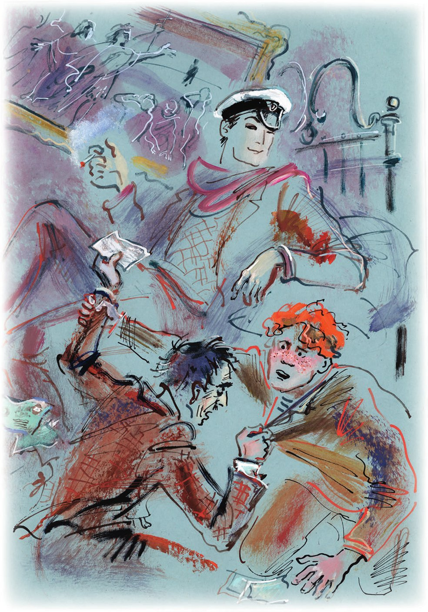
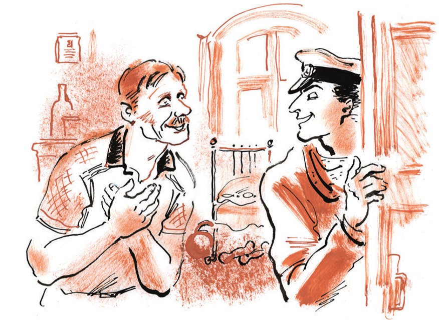

## Kapitel 14: Das erste Rendezvous

Ostap kehrte ins Hotel «Karlsbad» zurück. Unterwegs spiegelte er sich unzählige Male in den Spiegeln: in der Eingangshalle, auf der Treppe, im <abbr title="der Korridor, die Korridore — коридор">Korridor</abbr>. Solche Hotels <abbr title="sich schmücken mit + Dat. — украшаться">schmücken sich</abbr> nun einmal gern mit Spiegeln. Als er in sein Zimmer kam, erschrak er über die <abbr title="die Unordnung — беспорядок">Unordnung</abbr>. Der rote Plüschsessel lag auf dem Rücken. Er streckte seine kurzen Beinchen in die Luft und zeigte seine hässliche Unterseite aus <abbr title="die Jute — джут">Jute</abbr>. Die <abbr title="die Samtdecke, die Samtdecken — бархатная скатерть">Samtdecke</abbr> mit den goldenen <abbr title="die Borte, die Borten — позумент, галун">Borten</abbr> war vom Tisch gerutscht. Sogar das Bild «Christus erscheint dem Volk» hing schief. So hatte es den größten Teil seiner belehrenden Kraft verloren, die der Maler <abbr title="hineinlegen — вкладывать">hineingelegt</abbr> hatte. Vom Balkon wehte ein frischer Wind, der nach Dampfern roch. Er bewegte die Geldscheine, die überall auf dem Bett <abbr title="verstreut — разбросанный">verstreut</abbr> lagen. Zwischen ihnen lag eine eiserne <abbr title="die Schachtel, die Schachteln — коробка">Schachtel</abbr> von den <abbr title="die Zigarette, die Zigaretten — папироса, сигарета">Zigaretten</abbr> «Kaukasus». Auf dem Teppich <abbr title="sich wälzen — кататься, валяться">wälzten sich</abbr> Panikowski und Balaganow. Sie hatten sich <abbr title="sich ineinander verkrallen — сцепиться">ineinander verkrallt</abbr>, <abbr title="strampeln — брыкаться, дрыгать ногами">strampelten</abbr> mit den Beinen und sagten kein Wort.

Der große Kombinator stieg angeekelt über die <abbr title="der/die Kämpfende — дерущийся">Kämpfenden</abbr> und ging auf den Balkon. Unten auf dem Boulevard plauderten die <abbr title="der Spaziergänger, die Spaziergänger — гуляющий">Spaziergänger</abbr>. Unter ihren Füßen knirschte der Kies. Über den schwarzen <abbr title="der Ahornbaum, die Ahornbäume — клён">Ahornbäumen</abbr> schwebte der Atem eines <abbr title="das Sinfonieorchester, die Sinfonieorchester — симфонический оркестр">Sinfonieorchesters</abbr>. Tief im dunklen <abbr title="der Hafen, die Häfen — порт, гавань">Hafen</abbr> baute man ein <abbr title="das Kühlhaus, die Kühlhäuser — холодильник (склад)">Kühlhaus</abbr>. Es <abbr title="prahlen mit + Dat. — кичиться, хвастаться">prahlte</abbr> mit seinen Lichtern und dröhnte mit Eisen. Hinter dem <abbr title="der Wellenbrecher, die Wellenbrecher — волнорез, брекватер">Wellenbrecher</abbr> brüllte ein unsichtbarer Dampfer und verlangte etwas. Wahrscheinlich wollte er in den Hafen.

Als Ostap ins Zimmer zurückkam, saßen die Milchbrüder schon auf dem Boden, einander gegenüber. Müde stießen sie sich mit den Händen weg und murmelten: «Wer bist du denn überhaupt?»

— Konnten Sie <abbr title="sich einigen — договориться, поделить">sich nicht einigen</abbr>? — fragte Bender und zog den Vorhang zu.

Panikowski und Balaganow sprangen schnell auf und begannen zu erzählen. Jeder sagte, der ganze Erfolg sei sein Verdienst, und <abbr title="anschwärzen — чернить, очернять">schwärzte</abbr> den anderen an. Die peinlichen <abbr title="die Einzelheit, die Einzelheiten — подробность">Einzelheiten</abbr> ließen beide <abbr title="weglassen (ließ weg, hat weggelassen) — опускать, пропускать">weg</abbr>, ohne sich abzusprechen. Dafür erzählten sie viele andere Details. Diese zeigten nur, wie tapfer und wie flink sie gewesen waren.

— Na, genug! — sagte Ostap. — Klopfen Sie nicht mit Ihrer Glatze auf das <abbr title="das Parkett — паркет">Parkett</abbr>. Das Bild der Schlacht ist mir klar. Sie sagen also, ein Mädchen war bei ihm? Das ist gut. Ein kleiner Angestellter trägt also einfach so in der Tasche … Sie haben es wohl schon gezählt? Wie viel ist es? Oho! Zehntausend! Das Gehalt von Herrn Koreiko für zwanzig Jahre <abbr title="tadellos — безупречный">tadellosen</abbr> Dienst. Ein <abbr title="das Schauspiel, die Schauspiele — зрелище">Schauspiel</abbr> für die Götter, wie die klügsten <abbr title="der Leitartikler, die Leitartikler — передовик (автор передовиц)">Leitartikler</abbr> schreiben. Aber störe ich vielleicht? Sie haben hier auf dem Boden etwas gemacht. Sie haben das Geld <abbr title="teilen — делить">geteilt</abbr>? Machen Sie weiter, machen Sie weiter, ich sehe zu.

— Ich wollte es ehrlich machen, — sagte Balaganow und sammelte das Geld vom Bett. — Gerecht. Alle bekommen gleich viel: jeder zweieinhalbtausend.

Er legte das Geld in vier <abbr title="das Häufchen, die Häufchen — кучка">Häufchen</abbr> und trat bescheiden zur Seite.

— Für Sie, für mich, für ihn und für Koslewitsch.

— Sehr gut, — sagte Ostap. — Und jetzt soll Panikowski teilen. Er hat offenbar eine andere <abbr title="die Meinung, die Meinungen — мнение">Meinung</abbr>.

Panikowski mit seiner anderen Meinung machte sich mit großer Leidenschaft an die Arbeit. Er beugte sich über das Bett und bewegte seine dicken Lippen. Er <abbr title="lecken — лизать, слюнить">leckte</abbr> an den Fingern und legte die Scheine immer wieder von einem Platz zum anderen. Es sah aus, als ob er eine große königliche <abbr title="die Patience, die Patiencen — пасьянс">Patience</abbr> legte. Nach allen Tricks lagen auf der <abbr title="die Bettdecke, die Bettdecken — одеяло">Bettdecke</abbr> drei <abbr title="der Stapel, die Stapel — стопка, пачка">Stapel</abbr>. Der erste war groß und bestand aus sauberen, neuen Scheinen. Der zweite war genauso groß, aber aus etwas schmutzigeren Scheinen. Der dritte war klein und ganz schmutzig.

— Wir beide bekommen je viertausend, — sagte er zu Bender. — Und Balaganow zweitausend. Nicht einmal die hat er verdient.

— Und Koslewitsch? — fragte Balaganow und schloss <abbr title="zornig — гневно">zornig</abbr> die Augen.

— Wofür denn Koslewitsch? — kreischte Panikowski. — Das ist Raub! Wer ist dieser Koslewitsch, dass man mit ihm teilen muss? Ich kenne keinen Koslewitsch.

— Ist das alles? — fragte der große Kombinator.

— Alles, — antwortete Panikowski und sah <abbr title="unverwandt — не отрываясь">unverwandt</abbr> auf den Stapel mit den sauberen Scheinen. — Was für ein Koslewitsch kann es in so einem Moment geben?

— Und jetzt teile ich, — sagte Ostap wie ein Hausherr.

Ohne Eile schob er die Häufchen zusammen, legte das Geld in die eiserne Schachtel und steckte sie in die Tasche seiner weißen Hose.

— Dieses ganze Geld, — sagte er zum Schluss, — wird sofort dem <abbr title="der/die Geschädigte — потерпевший">Geschädigten</abbr> <abbr title="zurückgeben (gab zurück, hat zurückgegeben) — возвращать">zurückgegeben</abbr>, dem Bürger Koreiko. Gefällt Ihnen diese Art zu teilen?

— Nein, sie gefällt mir nicht, — <abbr title="jemandem herausrutschen — вырваться (о словах)">rutschte es Panikowski heraus</abbr>.

— Hören Sie auf mit den Witzen, Bender, — sagte Balaganow unzufrieden. — Man muss gerecht teilen.

— Das wird nicht passieren, — sagte Ostap kalt. — Und überhaupt habe ich um <abbr title="die Mitternacht — полночь">Mitternacht</abbr> keine Lust auf Witze mit Ihnen.

Panikowski <abbr title="zusammenschlagen (schlug zusammen, hat zusammengeschlagen) — всплеснуть (руками)">schlug</abbr> die alten, <abbr title="bläulich — синеватый, лиловатый">bläulich</abbr>-roten Hände zusammen. <abbr title="entsetzt — в ужасе">Entsetzt</abbr> sah er den großen Kombinator an, ging in die Ecke und wurde still. Nur ab und zu blitzte von dort der goldene Zahn des Konventionsbrechers.

Balaganows Gesicht wurde sofort nass, als wäre es in der Sonne gekocht worden.

— Wofür haben wir dann gearbeitet? — sagte er und schnaufte. — So geht das nicht. Das … erklären Sie das.

— Ihnen, — sagte Ostap höflich, — dem lieben Sohn vom Leutnant, kann ich nur wiederholen, was ich schon in Arbatow gesagt habe. Ich verehre das Strafgesetzbuch. Ich bin kein Räuber, sondern ein Kämpfer für Geldscheine, ein Kämpfer mit Idealen. Unter meinen vierhundert relativ ehrlichen Methoden, anderen das Geld abzunehmen, gibt es keinen Überfall. Das passt irgendwie nicht dazu. Und außerdem sind wir nicht wegen zehntausend hierhergekommen. Ich persönlich brauche mindestens fünfhunderttausend.

— Warum haben Sie uns dann geschickt? — fragte Balaganow, der langsam ruhiger wurde. — Wir haben uns <abbr title="sich Mühe geben — стараться">Mühe gegeben</abbr>.

— Mit anderen Worten: Sie wollen fragen, ob der verehrte Kommandeur weiß, warum er diese letzte Operation gemacht hat? Darauf antworte ich: Ja, er weiß es. Die Sache ist die …

In diesem Moment <abbr title="erlöschen (erlosch, ist erloschen) — гаснуть, потухнуть">erlosch</abbr> in der Ecke der goldene Zahn. Panikowski drehte sich um, senkte den Kopf und schrie: «Wer bist du denn überhaupt?» Dann warf er sich außer sich auf Ostap. Der große Kombinator <abbr title="sich rühren — шевелиться">rührte sich nicht</abbr> und drehte nicht einmal den Kopf. Mit einem Stoß seiner Faust, hart wie Gummi, schickte er den tobenden Konventionsbrecher an seinen alten Platz zurück. Dann sprach er weiter:

— Die Sache ist die, Schura: Das war ein Test. Ein Angestellter mit vierzig Rubel Gehalt hatte zehntausend Rubel in der Tasche. Das ist ein bisschen seltsam, und das gibt uns große Chancen. Wie die <abbr title="der Spieler, die Spieler — игрок">Spieler</abbr> auf der <abbr title="die Pferderennbahn, die Pferderennbahnen — ипподром, бега">Pferderennbahn</abbr> sagen: Wir dürfen auf den großen Gewinn hoffen. Fünfhunderttausend sind zweifellos ein großer Gewinn. Und so bekommen wir ihn. Ich gebe Koreiko die zehntausend zurück, und er nimmt sie. Ich möchte den Menschen sehen, der sein eigenes Geld nicht zurücknehmen würde. Und genau da ist er <abbr title="erledigt — конченый, погибший">erledigt</abbr>. Seine Gier wird ihn <abbr title="vernichten — губить, уничтожать">vernichten</abbr>. Sobald er <abbr title="zugeben (gab zu, hat zugegeben) — признавать">zugibt</abbr>, dass er reich ist, nehme ich ihn mit bloßen Händen. Er ist ein kluger Mensch. Er wird verstehen, dass ein Teil kleiner ist als das Ganze. Und er wird mir diesen Teil geben, damit er nicht alles verliert. Und da, Schura, erscheint auf der <abbr title="die Bühne, die Bühnen — сцена">Bühne</abbr> ein gewisses Tellerchen mit blauem Rand …

— Richtig! — rief Balaganow.

In der Ecke weinte Panikowski.

— Geben Sie mir mein Geld, — <abbr title="lispeln — шепелявить">lispelte</abbr> er. — Ich bin ganz arm! Ich war ein Jahr nicht im <abbr title="das Badehaus, die Badehäuser — баня">Badehaus</abbr>. Ich bin alt. Die Mädchen lieben mich nicht.

— <abbr title="sich wenden an + Akk. (wandte sich, hat sich gewandt) — обращаться к">Wenden Sie sich</abbr> an die Weltliga für <abbr title="die Sexualreform — сексуальная реформа">Sexualreform</abbr>, — sagte Bender. — Vielleicht hilft man Ihnen dort.

— Niemand liebt mich, — sagte Panikowski weiter und zitterte.

— Und warum sollte man Sie lieben? Solche wie Sie lieben die Mädchen nicht. Sie lieben junge Männer mit langen Beinen, die politisch <abbr title="gebildet — образованный, грамотный">gebildet</abbr> sind. Und Sie werden bald sterben. Und niemand wird über Sie in der Zeitung schreiben: «Wieder einer ist bei der Arbeit <abbr title="verglühen — сгореть (на работе)">verglüht</abbr>.» Und auf Ihrem Grab wird keine schöne Witwe mit <abbr title="persisch — персидский">persischen</abbr> Augen sitzen. Und keine verweinten Kinder werden fragen: «Papa, Papa, hörst du uns?»

— Sagen Sie so etwas nicht! — schrie Panikowski erschrocken. — Ich werde Sie alle <abbr title="überleben — пережить">überleben</abbr>. Sie kennen Panikowski nicht. Panikowski wird Sie alle noch verkaufen und wieder kaufen. Geben Sie mir mein Geld.

— Sagen Sie lieber: Werden Sie dienen oder nicht? Ich frage zum letzten Mal.

— Ich werde dienen, — antwortete Panikowski und <abbr title="abwischen — утирать, вытирать">wischte</abbr> sich langsame Greisentränen ab.

Nacht, Nacht, Nacht lag über dem ganzen Land.

Im Hafen von Tschernomorsk drehten sich leicht die <abbr title="der Kran, die Kräne — подъёмный кран">Kräne</abbr>. Sie ließen stählerne <abbr title="das Seil, die Seile — трос, строп">Seile</abbr> in die tiefen <abbr title="der Laderaum, die Laderäume — трюм">Laderäume</abbr> der ausländischen Schiffe hinunter. Dann drehten sie sich wieder und setzten <abbr title="die Kiste, die Kisten — ящик">Kisten</abbr> aus <abbr title="das Kiefernholz — сосна (древесина)">Kiefernholz</abbr> vorsichtig auf den <abbr title="der Kai, die Kais — пристань, причал">Kai</abbr>, mit der Liebe einer Katze. In den Kisten waren Maschinen für Traktorostroi, das große Traktorenwerk. Rosa Feuer wie von einem <abbr title="der Komet, die Kometen — комета">Kometen</abbr> <abbr title="schießen (schoss, ist geschossen) — вырываться, рваться">schoss</abbr> aus den hohen Schornsteinen der <abbr title="das Silikatwerk, die Silikatwerke — силикатный завод">Silikatwerke</abbr>. Wie <abbr title="der Sternhaufen, die Sternhaufen — звёздное скопление">Sternhaufen</abbr> brannten Dneprostroi, Magnitogorsk und Stalingrad. Im Norden ging der Stern des Roten Putilow-Werks auf, und nach ihm leuchteten sehr viele Sterne erster <abbr title="die Größe, die Größen — величина">Größe</abbr>. Das waren Fabriken, Kombinate, <abbr title="das Kraftwerk, die Kraftwerke — электростанция">Kraftwerke</abbr>, neue Baustellen. Der ganze <abbr title="der Fünfjahrplan, die Fünfjahrpläne — пятилетка">Fünfjahrplan</abbr> leuchtete. Er war heller als der alte Himmel, den schon die <abbr title="der Ägypter, die Ägypter — египтянин">Ägypter</abbr> langweilig fanden.

Ein junger Mann war mit seiner Geliebten zu lange im <abbr title="der Arbeiterklub, die Arbeiterklubs — рабочий клуб">Arbeiterklub</abbr> geblieben. Schnell schaltete er die <abbr title="elektrisch — электрический">elektrische</abbr> Landkarte vom Fünfjahrplan ein und flüsterte:

— Sieh mal, da ist ein rotes Lichtchen. Dort wird Sibkombain gebaut. Wir fahren dorthin. Willst du?

Und die Geliebte lachte leise und <abbr title="befreien — освобождать">befreite</abbr> ihre Hände.

Nacht, Nacht, Nacht lag, wie schon gesagt, über dem ganzen Land. Der Monarchist Chworobjew stöhnte im Schlaf. Er hatte von einem riesigen <abbr title="das Gewerkschaftsbuch, die Gewerkschaftsbücher — профсоюзная книжка">Gewerkschaftsbuch</abbr> geträumt. Im Zug, auf dem oberen <abbr title="der Liegeplatz, die Liegeplätze — (верхняя) полка">Liegeplatz</abbr>, schnarchte der Ingenieur Talmudowski. Er fuhr von Charkow nach Rostow, denn dort lockte ihn ein besseres Gehalt. Auf den breiten Wellen des <abbr title="der Atlantik — Атлантика">Atlantiks</abbr> schaukelten die amerikanischen Gentlemen. Sie brachten das Rezept für einen wunderbaren <abbr title="der Schnaps, die Schnäpse — самогон, водка">Schnaps</abbr> aus Weizen nach Hause. Wassissuali Lochankin wälzte sich auf seinem Sofa hin und her und <abbr title="reiben (rieb, hat gerieben) — тереть, потирать">rieb</abbr> sich die Stellen, die gelitten hatten. Der alte Rätselmacher Sinizki verschwendete <abbr title="der Strom — электричество, ток">Strom</abbr>. Er dachte sich für die <abbr title="die Zeitschrift, die Zeitschriften — журнал">Zeitschrift</abbr> «Das Wasserleitungswesen» ein Bilderrätsel aus: «Wo ist der Vorsitzende dieser Versammlung der Arbeiter und Angestellten, die sich zur <abbr title="die Wahl, die Wahlen — выборы">Wahl</abbr> des <abbr title="der Betriebsrat, die Betriebsräte — местком">Betriebsrats</abbr> der <abbr title="die Pumpstation, die Pumpstationen — насосная станция">Pumpstation</abbr> versammelt haben?» Dabei war er ganz leise, damit Sossja nicht aufwachte. Polychajew lag mit Serna Michailowna im Bett. Die anderen Herkulesianer schliefen unruhig in verschiedenen Teilen der Stadt. Alexander Iwanowitsch Koreiko konnte nicht einschlafen. Der Gedanke an seinen Reichtum quälte ihn. Hätte er gar keinen Reichtum gehabt, hätte er ruhig geschlafen. Was Bender, Balaganow und Panikowski machten, wissen wir schon. Nur über Koslewitsch, den Fahrer und Besitzer der «Antilope-Gnu», sagen wir jetzt nichts. Und das, obwohl ihm schon ein Unglück von sehr politischer Art passiert war.

Früh am Morgen öffnete Bender seine Arzttasche. Er nahm eine Milizmütze mit dem Wappen der Stadt Kiew heraus, steckte sie in die Tasche und ging zu Alexander Iwanowitsch Koreiko. Unterwegs neckte er die Milchfrauen. Denn die Stunde dieser <abbr title="geschäftstüchtig — оборотистый, деловитый">geschäftstüchtigen</abbr> Frauen hatte schon begonnen, die Stunde der Angestellten noch nicht. Dabei summte er die Worte einer <abbr title="die Romanze, die Romanzen — романс">Romanze</abbr>: «Und die Freude des ersten Rendezvous <abbr title="erregen — волновать, возбуждать">erregt</abbr> mein Blut nicht mehr.» Der große Kombinator war nicht ganz ehrlich. Das erste Rendezvous mit dem Millionär aus dem <abbr title="das Kontor, die Kontore — контора">Kontor</abbr> regte ihn sehr wohl auf. Er betrat das Haus Nr. 16 in der Kleinen-Tangenten-Straße. Dort setzte er die <abbr title="offiziell — официальный">offizielle</abbr> Mütze auf, runzelte die Stirn und klopfte an die Tür.

Mitten im Zimmer stand Alexander Iwanowitsch. Er trug ein <abbr title="das Netzhemd, die Netzhemden — сетка-безрукавка">Netzhemd</abbr> ohne Ärmel und hatte schon die Hose eines kleinen Angestellten angezogen. Das Zimmer war vorbildlich arm eingerichtet. So arm waren vor der Revolution die <abbr title="das Waisenhaus, die Waisenhäuser — сиротский приют">Waisenhäuser</abbr>, die unter dem Schutz der Kaiserin Maria Fjodorowna standen. Es gab hier drei Dinge. Ein eisernes <abbr title="das Krankenhausbett, die Krankenhausbetten — лазаретная кровать">Krankenhausbett</abbr>. Einen Küchentisch mit <abbr title="das Türchen, die Türchen — дверца">Türchen</abbr>, die man mit einem hölzernen <abbr title="der Riegel, die Riegel — щеколда, задвижка">Riegel</abbr> schloss, wie bei einem <abbr title="das Plumpsklo, die Plumpsklos — дачный сортир">Plumpsklo</abbr> auf dem Land. Und einen alten Wiener Stuhl, von dem die Farbe <abbr title="abblättern — облезать, шелушиться">abblätterte</abbr>. In der Ecke lagen <abbr title="die Hantel, die Hanteln — гантель">Hanteln</abbr>, und zwischen ihnen zwei große <abbr title="das Gewicht, die Gewichte — гиря">Gewichte</abbr>, die Freude eines <abbr title="der Gewichtheber, die Gewichtheber — тяжелоатлет">Gewichthebers</abbr>.

Als Alexander Iwanowitsch den Milizionär sah, machte er einen schweren Schritt nach vorn.

— Bürger Koreiko? — fragte Ostap und lächelte <abbr title="strahlend — лучезарно">strahlend</abbr>.

— Ja, — antwortete Alexander Iwanowitsch und zeigte ebenfalls Freude über das Treffen mit einem Vertreter der Staatsmacht.

— Alexander Iwanowitsch? — <abbr title="sich erkundigen — осведомляться">erkundigte sich</abbr> Ostap und lächelte noch strahlender.

— Ganz recht, — bestätigte Koreiko und machte seine Freude so warm, wie er nur konnte.

Danach blieb dem großen Kombinator nichts anderes übrig, als sich auf den Wiener Stuhl zu setzen und ein <abbr title="übernatürlich — сверхъестественный">übernatürliches</abbr> Lächeln aufzusetzen. Dann sah er Alexander Iwanowitsch an. Aber der Millionär aus dem Kontor <abbr title="sich anstrengen — напрягаться, стараться">strengte sich an</abbr> und zeigte Gott weiß was: <abbr title="die Rührung — умиление">Rührung</abbr>, Begeisterung, <abbr title="die Bewunderung — восхищение">Bewunderung</abbr> und stumme <abbr title="die Anbetung — обожание">Anbetung</abbr>. Und das alles wegen des glücklichen Treffens mit einem Vertreter der Staatsmacht.

Das Wachsen der Lächeln und Gefühle erinnerte an ein <abbr title="das Notenblatt, die Notenblätter — ноты, рукопись">Notenblatt</abbr> des <abbr title="der Komponist, die Komponisten — композитор">Komponisten</abbr> Franz Liszt. Auf der ersten Seite steht «schnell», auf der zweiten «sehr schnell», auf der dritten «viel schneller», auf der vierten «so schnell wie möglich» und auf der fünften trotzdem «noch schneller».

Ostap sah, dass Koreiko die fünfte Seite erreicht hatte und dass ein weiterer <abbr title="der Wettkampf, die Wettkämpfe — соревнование">Wettkampf</abbr> unmöglich war. Da kam er zur Sache.

— Ich komme mit einem Auftrag zu Ihnen, — sagte er und wurde ernst.

— Bitte, bitte, — sagte Alexander Iwanowitsch, und auch sein Gesicht wurde trüb.

— Wir wollen Ihnen eine Freude machen.

— Da bin ich aber neugierig.

<abbr title="unendlich — безмерно, бесконечно">Unendlich</abbr> traurig griff Bender in die Tasche. Koreiko sah ihm mit einem Gesicht wie bei einer Beerdigung zu. Ans Licht kam die eiserne Zigarettenschachtel «Kaukasus». Aber der <abbr title="der Ausruf, die Ausrufe — возглас">Ausruf</abbr> der Überraschung, auf den Ostap gewartet hatte, kam nicht. Der Untergrund-Millionär sah die Schachtel völlig gleichgültig an. Ostap nahm das Geld heraus, zählte es sorgfältig und schob den Packen zu Alexander Iwanowitsch.

— Genau zehntausend. Schreiben Sie bitte eine Quittung über den Empfang.

— Sie irren sich, Genosse, — sagte Koreiko sehr leise. — Was für zehntausend? Was für eine Quittung?

— Wieso was für eine? Man hat Sie doch gestern ausgeraubt?

— Mich hat niemand ausgeraubt.

— Wie, nicht ausgeraubt? — rief Ostap aufgeregt. — Gestern, am Meer. Man hat Ihnen zehntausend weggenommen. Die Räuber sind verhaftet. Schreiben Sie die Quittung.

— Aber bei Gott, mich hat niemand ausgeraubt, — sagte Koreiko, und über sein Gesicht huschte ein heller <abbr title="der Sonnenfleck, die Sonnenflecken — солнечный зайчик">Sonnenfleck</abbr>. — Das ist ein klarer <abbr title="der Irrtum, die Irrtümer — ошибка">Irrtum</abbr>.

Der große Kombinator hatte die ganze Tiefe seiner <abbr title="die Niederlage, die Niederlagen — поражение">Niederlage</abbr> noch nicht verstanden. Er wurde unanständig hektisch, und später dachte er immer mit <abbr title="die Scham — стыд">Scham</abbr> daran zurück. Er <abbr title="bestehen auf + Dat. (bestand, hat bestanden) — настаивать на">bestand darauf</abbr>, er ärgerte sich, er drückte Alexander Iwanowitsch das Geld in die Hände. Kurz: Er verlor, wie die Chinesen sagen, sein Gesicht. Koreiko <abbr title="mit den Schultern zucken — пожимать плечами">zuckte mit den Schultern</abbr> und lächelte <abbr title="zuvorkommend — предупредительно">zuvorkommend</abbr>, aber das Geld nahm er nicht.

— Man hat Sie also nicht ausgeraubt?

— Niemand hat mich ausgeraubt.

— Und man hat Ihnen keine zehntausend weggenommen?

— Natürlich nicht. Was glauben Sie denn, woher soll ich so viel Geld haben?

— Richtig, richtig, — sagte Ostap, der sich etwas beruhigt hatte. — Woher soll ein kleiner Angestellter so einen Haufen Geld haben? … Bei Ihnen ist also alles in Ordnung?

— Alles! — antwortete der Millionär mit einem bezaubernden Lächeln.

— Und der <abbr title="der Magen, die Mägen — желудок">Magen</abbr> ist auch in Ordnung? — fragte Ostap und lächelte noch <abbr title="verführerisch — обольстительно">verführerischer</abbr>.

— <abbr title="vollkommen — полностью, совершенно">Vollkommen</abbr>. Wissen Sie, ich bin ein sehr gesunder Mensch.

— Und schwere Träume quälen Sie nicht?

— Nein, sie quälen mich nicht.

Bei den Lächeln ging alles weiter wie bei Liszt: schnell, sehr schnell, viel schneller, so schnell wie möglich und sogar noch schneller. Die neuen Bekannten <abbr title="sich verabschieden — прощаться">verabschiedeten sich</abbr>, als ob sie einander von ganzem Herzen liebten.

— Vergessen Sie Ihr Milizmützchen nicht, — sagte Alexander Iwanowitsch. — Es liegt noch auf dem Tisch.

— Essen Sie vor dem Schlafen keine rohen Tomaten, — riet Ostap. — Damit Sie Ihrem Magen nicht schaden.

— Alles Gute, — sagte Koreiko. Er verbeugte sich fröhlich und <abbr title="mit dem Fuß scharren — шаркать ножкой">scharrte mit dem Füßchen</abbr>.

— Auf Wiedersehen, auf Wiedersehen, — antwortete Ostap. — Sie sind ein interessanter Mensch! Bei Ihnen ist alles in Ordnung. Erstaunlich: so viel Glück – und trotzdem in Freiheit.

Mit dem überflüssigen Lächeln noch im Gesicht sprang der große Kombinator auf die Straße. Mit schnellen Schritten ging er einige <abbr title="der Häuserblock, die Häuserblocks — квартал">Häuserblocks</abbr> weit. Er vergaß ganz, dass er noch die offizielle Mütze auf dem Kopf trug, mit dem Wappen von Kiew. In Tschernomorsk passte dieses Wappen überhaupt nicht. Erst in einer Gruppe von ehrwürdigen alten Männern kam er wieder zu sich. Sie lärmten vor der <abbr title="überdacht — крытый">überdachten</abbr> <abbr title="die Veranda, die Veranden — веранда">Veranda</abbr> der Volksküche Nr. 68. Dort begann er ruhig, seine Chancen <abbr title="abwägen — взвешивать">abzuwägen</abbr>.

Während er so nachdachte und zerstreut hin und her ging, machten die alten Männer mit ihrer täglichen Beschäftigung weiter.

Das waren Menschen, die in unserer Zeit seltsam und lächerlich <abbr title="wirken — казаться, производить впечатление">wirkten</abbr>.

Fast alle trugen weiße <abbr title="die Pikeeweste, die Pikeewesten — пикейный жилет">Pikeewesten</abbr> und Strohhüte, sogenannte <abbr title="die Kreissäge, die Kreissägen — канотье (букв. «циркулярная пила»)">Kreissägen</abbr>. Einige trugen sogar Hüte aus <abbr title="dunkel werden — потемневший">dunkel gewordenem</abbr> <abbr title="das Panamastroh — панамская солома">Panamastroh</abbr>.

Und natürlich trugen alle <abbr title="vergilbt — пожелтевший">vergilbte</abbr>, gestärkte Kragen. Aus diesen Kragen kamen haarige Hühnerhälse. Hier, vor der Volksküche Nr. 68, wo früher das berühmte Café «Florida» war, trafen sich die Trümmer des alten Handels-Tschernomorsk von vor dem Krieg. Da waren <abbr title="der Makler, die Makler — маклер">Makler</abbr> ohne <abbr title="das Büro, die Büros — контора, бюро">Büros</abbr>, <abbr title="der Kommissionär, die Kommissionäre — комиссионер">Kommissionäre</abbr>, die ohne Kommissionen <abbr title="verwelken — увядать">verwelkt</abbr> waren, Getreidehändler, Buchhalter, die nicht mehr ganz klar im Kopf waren, und anderes <abbr title="das Gesindel — шушера, сброд">Gesindel</abbr>. Früher trafen sie sich hier, um <abbr title="das Geschäft, die Geschäfte — сделка, дело">Geschäfte</abbr> zu machen. Jetzt zog sie eine lange <abbr title="die Gewohnheit, die Gewohnheiten — привычка">Gewohnheit</abbr> an diese sonnige Ecke – und das Bedürfnis, ihre alten Zungen zu <abbr title="wetzen — точить; чесать (языки)">wetzen</abbr>. Jeden Tag lasen sie die Moskauer «Prawda». Die <abbr title="örtlich — местный">örtliche</abbr> Presse <abbr title="achten — уважать">achteten</abbr> sie nicht. Alles, was auf der Welt passierte, sahen die Alten als <abbr title="das Vorspiel, die Vorspiele — прелюдия">Vorspiel</abbr>. Bald, so meinten sie, wird man Tschernomorsk zur freien Stadt <abbr title="erklären zu + Dat. — объявлять">erklären</abbr>. Vor etwa hundert Jahren war Tschernomorsk wirklich eine freie Stadt gewesen. Das war so lustig und brachte so viel Geld, dass die <abbr title="die Legende, die Legenden — легенда">Legende</abbr> vom «Porto franco» noch heute einen goldenen <abbr title="der Glanz — блеск">Glanz</abbr> auf die helle Ecke am Café «Florida» warf.

— Haben Sie von der <abbr title="die Abrüstungskonferenz, die Abrüstungskonferenzen — конференция по разоружению">Abrüstungskonferenz</abbr> gelesen? — fragte eine Pikeeweste die andere Pikeeweste. — Die Rede vom Grafen Bernstorff.

— Bernstorff, das ist ein Kopf! — antwortete die <abbr title="befragt — спрошенный">befragte</abbr> Weste. Sie sagte es so, als ob sie den Grafen seit vielen Jahren persönlich kannte. — Und haben Sie gelesen, was für eine Rede Snowden vor seinen <abbr title="der Wähler, die Wähler — избиратель">Wählern</abbr> in Birmingham gehalten hat, dieser Festung der <abbr title="der/die Konservative — консерватор">Konservativen</abbr>?

— Na, was soll man da sagen … Snowden, das ist ein Kopf! Hören Sie, Valiadis, — wandte er sich an einen dritten Alten mit Panamahut. — Was sagen Sie zu Snowden?

— Ich sage es Ihnen <abbr title="offen — откровенно">offen</abbr>, — antwortete der Panamahut. — Mit Snowden ist nicht gut <abbr title="mit jemandem ist nicht gut Kirschen essen — с ним шутки плохи (букв. «с ним нехорошо есть вишни»)">Kirschen essen</abbr>. Ich persönlich würde keine Kirschen mit ihm essen.

Es störte den Alten nicht im Geringsten, dass Snowden ihn um nichts in der Welt zu Kirschen eingeladen hätte. Er sprach weiter:

— Aber sagen Sie, was Sie wollen, ich sage es Ihnen offen: Chamberlain ist trotzdem auch ein Kopf.

Die Pikeewesten hoben die Schultern. Sie <abbr title="bestreiten (bestritt, hat bestritten) — отрицать, оспаривать">bestritten</abbr> nicht, dass Chamberlain auch ein Kopf war. Aber am meisten tröstete sie Briand.

— Briand! — sagten sie leidenschaftlich. — Das ist ein Kopf! Er mit seinem <abbr title="das Projekt, die Projekte — проект">Projekt</abbr> «Pan-Europa» …

— Ich sage es Ihnen offen, Monsieur Funt, — flüsterte Valiadis, — alles ist in Ordnung. Beneš ist mit «Pan-Europa» schon einverstanden. Aber wissen Sie, unter welcher Bedingung?

Die Pikeewesten kamen näher und streckten ihre Hühnerhälse.

— Unter der Bedingung, dass Tschernomorsk zur freien Stadt erklärt wird. Beneš, das ist ein Kopf. Die Tschechen müssen doch ihre <abbr title="landwirtschaftlich — сельскохозяйственный">landwirtschaftlichen</abbr> Geräte an jemanden verkaufen, oder? Na, und wir werden sie kaufen.

Bei dieser <abbr title="die Nachricht, die Nachrichten — сообщение, новость">Nachricht</abbr> leuchteten die Augen der Alten. Schon seit vielen Jahren wollten sie kaufen und verkaufen.

— Briand, das ist ein Kopf! — sagten sie und seufzten. — Beneš ist auch ein Kopf.

Als Ostap aus seinen Gedanken erwachte, merkte er: Ein fremder Alter hielt ihn fest am <abbr title="das Revers, die Revers — лацкан, борт пиджака">Revers</abbr> seiner Jacke. Der Alte trug einen zerdrückten Strohhut mit einem speckigen schwarzen Band. Seine <abbr title="die Ansteckkrawatte, die Ansteckkrawatten — прицепной галстук">Ansteckkrawatte</abbr> war zur Seite gerutscht, und ein <abbr title="der Kragenknopf, die Kragenknöpfe — запонка">Kragenknopf</abbr> aus <abbr title="das Kupfer — медь">Kupfer</abbr> sah Ostap direkt an.

— Und ich sage Ihnen, — schrie der Alte dem großen Kombinator ins Ohr, — Macdonald fällt darauf nicht herein! Er beißt nicht an! Hören Sie?

Ostap schob den <abbr title="aufgebracht — разгорячённый, возмущённый">aufgebrachten</abbr> Alten mit der Hand zur Seite und drängte sich aus der Menge.

— Hoover, das ist ein Kopf! — rief man ihm nach. — Und Hindenburg, das ist ein Kopf.

Zu dieser Zeit hatte Ostap schon eine Entscheidung getroffen. Er war im Kopf alle vierhundert relativ ehrlichen Methoden durchgegangen, anderen das Geld abzunehmen. Unter ihnen gab es wahre <abbr title="die Perle, die Perlen — жемчужина, перл">Perlen</abbr>. Zum Beispiel eine Aktiengesellschaft, die ein Schiff mit Gold heben sollte. Das Schiff war im <abbr title="der Krimkrieg — Крымская война">Krimkrieg</abbr> gesunken. Oder ein großes <abbr title="das Faschingsfest, die Faschingsfeste — масленичное гулянье">Faschingsfest</abbr> zugunsten der <abbr title="der/die Gefangene — узник, пленник">Gefangenen</abbr> des Kapitals. Oder eine <abbr title="die Konzession, die Konzessionen — концессия">Konzession</abbr> zum <abbr title="abnehmen (nahm ab, hat abgenommen) — снимать">Abnehmen</abbr> der Ladenschilder. Aber keine passte zu dieser Lage. Und Ostap dachte sich die vierhunderterste Methode aus.

«Die Festung mit einem <abbr title="der Überraschungsangriff, die Überraschungsangriffe — неожиданная атака">Überraschungsangriff</abbr> zu erobern, ist <abbr title="misslingen (misslang, ist misslungen) — не удаться">misslungen</abbr>, — dachte er. — Ich muss eine richtige <abbr title="die Belagerung, die Belagerungen — осада">Belagerung</abbr> beginnen. Das Wichtigste steht fest: Der Mandant hat Geld. Und er hat zehntausend abgelehnt, ohne mit der <abbr title="die Wimper, die Wimpern — ресница">Wimper</abbr> zu zucken. Also hat er <abbr title="enorm — огромный">enormes</abbr> Geld. Da sich die Parteien nicht geeinigt haben: Die Sitzung geht weiter.»

Auf dem Rückweg kaufte er eine harte gelbe Mappe mit <abbr title="der Schnürsenkel, die Schnürsenkel — шнурок (ботиночный)">Schnürsenkeln</abbr> zum Zubinden.

— Na? — fragten Balaganow und Panikowski <abbr title="wie aus einem Mund — в один голос">wie aus einem Mund</abbr>. Sie waren schon ganz <abbr title="erschöpft — изнурённый, истомлённый">erschöpft</abbr> vor <abbr title="die Ungeduld — нетерпение">Ungeduld</abbr>.

Ostap ging <abbr title="schweigen (schwieg, hat geschwiegen) — молчать">schweigend</abbr> zum kleinen <abbr title="der Bambustisch, die Bambustische — бамбуковый столик">Bambustisch</abbr>, legte die Mappe vor sich hin und schrieb mit großen Buchstaben darauf:

«Akte Alexander Iwanowitsch Koreiko. <abbr title="beginnen (begann, hat begonnen) — начинать">Begonnen</abbr> am 25. Juni 1930. Abgeschlossen am …ten … 193..»

Die Milchbrüder sahen Bender über die Schulter auf die Mappe.

— Was ist da drin? — fragte der neugierige Panikowski.

— Oh! — sagte Ostap. — Da drin ist alles: Palmen, Mädchen, blaue Schnellzüge, das blaue Meer, ein weißer Dampfer, ein kaum getragener Smoking, ein japanischer <abbr title="der Diener, die Diener — лакей, слуга">Diener</abbr>, ein eigener Billardtisch, Zähne aus <abbr title="das Platin — платина">Platin</abbr>, Socken ohne Löcher, <abbr title="das Mittagessen, die Mittagessen — обед">Mittagessen</abbr> mit reiner Butter und vor allem, meine kleinen Freunde, Ruhm und die Macht, die das Geld gibt.

Und er öffnete vor den staunenden Antilopen-Leuten die leere Mappe.

---

### Neue Wörter

- **der Korridor, die Korridore** — коридор
- **sich schmücken mit + Dat.** — украшаться
- **die Unordnung** — беспорядок
- **die Jute** — джут
- **die Samtdecke, die Samtdecken** — бархатная скатерть
- **die Borte, die Borten** — позумент, галун
- **hineinlegen** — вкладывать
- **verstreut** — разбросанный
- **die Schachtel, die Schachteln** — коробка
- **die Zigarette, die Zigaretten** — папироса, сигарета
- **sich wälzen** — кататься, валяться
- **sich ineinander verkrallen** — сцепиться
- **strampeln** — брыкаться, дрыгать ногами
- **der/die Kämpfende** — дерущийся
- **der Spaziergänger, die Spaziergänger** — гуляющий
- **der Ahornbaum, die Ahornbäume** — клён
- **das Sinfonieorchester, die Sinfonieorchester** — симфонический оркестр
- **der Hafen, die Häfen** — порт, гавань
- **das Kühlhaus, die Kühlhäuser** — холодильник (склад)
- **prahlen mit + Dat.** — кичиться, хвастаться
- **der Wellenbrecher, die Wellenbrecher** — волнорез, брекватер
- **sich einigen** — договориться, поделить
- **anschwärzen** — чернить, очернять
- **die Einzelheit, die Einzelheiten** — подробность
- **weglassen (ließ weg, hat weggelassen)** — опускать, пропускать
- **das Parkett** — паркет
- **tadellos** — безупречный
- **das Schauspiel, die Schauspiele** — зрелище
- **der Leitartikler, die Leitartikler** — передовик (автор передовиц)
- **teilen** — делить
- **das Häufchen, die Häufchen** — кучка
- **die Meinung, die Meinungen** — мнение
- **lecken** — лизать, слюнить
- **die Patience, die Patiencen** — пасьянс
- **die Bettdecke, die Bettdecken** — одеяло
- **der Stapel, die Stapel** — стопка, пачка
- **zornig** — гневно
- **unverwandt** — не отрываясь
- **der/die Geschädigte** — потерпевший
- **zurückgeben (gab zurück, hat zurückgegeben)** — возвращать
- **jemandem herausrutschen** — вырваться (о словах)
- **die Mitternacht** — полночь
- **zusammenschlagen (schlug zusammen, hat zusammengeschlagen)** — всплеснуть (руками)
- **bläulich** — синеватый, лиловатый
- **entsetzt** — в ужасе
- **sich Mühe geben** — стараться
- **erlöschen (erlosch, ist erloschen)** — гаснуть, потухнуть
- **sich rühren** — шевелиться
- **der Spieler, die Spieler** — игрок
- **die Pferderennbahn, die Pferderennbahnen** — ипподром, бега
- **erledigt** — конченый, погибший
- **vernichten** — губить, уничтожать
- **zugeben (gab zu, hat zugegeben)** — признавать
- **die Bühne, die Bühnen** — сцена
- **lispeln** — шепелявить
- **das Badehaus, die Badehäuser** — баня
- **sich wenden an + Akk. (wandte sich, hat sich gewandt)** — обращаться к
- **die Sexualreform** — сексуальная реформа
- **gebildet** — образованный, грамотный
- **verglühen** — сгореть (на работе)
- **persisch** — персидский
- **überleben** — пережить
- **abwischen** — утирать, вытирать
- **der Kran, die Kräne** — подъёмный кран
- **das Seil, die Seile** — трос, строп
- **der Laderaum, die Laderäume** — трюм
- **die Kiste, die Kisten** — ящик
- **das Kiefernholz** — сосна (древесина)
- **der Kai, die Kais** — пристань, причал
- **der Komet, die Kometen** — комета
- **schießen (schoss, ist geschossen)** — вырываться, рваться
- **das Silikatwerk, die Silikatwerke** — силикатный завод
- **der Sternhaufen, die Sternhaufen** — звёздное скопление
- **die Größe, die Größen** — величина
- **das Kraftwerk, die Kraftwerke** — электростанция
- **der Fünfjahrplan, die Fünfjahrpläne** — пятилетка
- **der Ägypter, die Ägypter** — египтянин
- **der Arbeiterklub, die Arbeiterklubs** — рабочий клуб
- **elektrisch** — электрический
- **befreien** — освобождать
- **das Gewerkschaftsbuch, die Gewerkschaftsbücher** — профсоюзная книжка
- **der Liegeplatz, die Liegeplätze** — (верхняя) полка
- **der Atlantik** — Атлантика
- **der Schnaps, die Schnäpse** — самогон, водка
- **reiben (rieb, hat gerieben)** — тереть, потирать
- **der Strom** — электричество, ток
- **die Zeitschrift, die Zeitschriften** — журнал
- **die Wahl, die Wahlen** — выборы
- **der Betriebsrat, die Betriebsräte** — местком
- **die Pumpstation, die Pumpstationen** — насосная станция
- **geschäftstüchtig** — оборотистый, деловитый
- **die Romanze, die Romanzen** — романс
- **erregen** — волновать, возбуждать
- **das Kontor, die Kontore** — контора
- **offiziell** — официальный
- **das Netzhemd, die Netzhemden** — сетка-безрукавка
- **das Waisenhaus, die Waisenhäuser** — сиротский приют
- **das Krankenhausbett, die Krankenhausbetten** — лазаретная кровать
- **das Türchen, die Türchen** — дверца
- **der Riegel, die Riegel** — щеколда, задвижка
- **das Plumpsklo, die Plumpsklos** — дачный сортир
- **abblättern** — облезать, шелушиться
- **die Hantel, die Hanteln** — гантель
- **das Gewicht, die Gewichte** — гиря
- **der Gewichtheber, die Gewichtheber** — тяжелоатлет
- **strahlend** — лучезарно
- **sich erkundigen** — осведомляться
- **übernatürlich** — сверхъестественный
- **sich anstrengen** — напрягаться, стараться
- **die Rührung** — умиление
- **die Bewunderung** — восхищение
- **die Anbetung** — обожание
- **das Notenblatt, die Notenblätter** — ноты, рукопись
- **der Komponist, die Komponisten** — композитор
- **der Wettkampf, die Wettkämpfe** — соревнование
- **unendlich** — безмерно, бесконечно
- **der Ausruf, die Ausrufe** — возглас
- **der Sonnenfleck, die Sonnenflecken** — солнечный зайчик
- **der Irrtum, die Irrtümer** — ошибка
- **die Niederlage, die Niederlagen** — поражение
- **die Scham** — стыд
- **bestehen auf + Dat. (bestand, hat bestanden)** — настаивать на
- **mit den Schultern zucken** — пожимать плечами
- **zuvorkommend** — предупредительно
- **der Magen, die Mägen** — желудок
- **verführerisch** — обольстительно
- **vollkommen** — полностью, совершенно
- **sich verabschieden** — прощаться
- **mit dem Fuß scharren** — шаркать ножкой
- **der Häuserblock, die Häuserblocks** — квартал
- **überdacht** — крытый
- **die Veranda, die Veranden** — веранда
- **abwägen** — взвешивать
- **wirken** — казаться, производить впечатление
- **die Pikeeweste, die Pikeewesten** — пикейный жилет
- **die Kreissäge, die Kreissägen** — канотье (букв. «циркулярная пила»)
- **dunkel werden** — потемневший
- **das Panamastroh** — панамская солома
- **vergilbt** — пожелтевший
- **der Makler, die Makler** — маклер
- **das Büro, die Büros** — контора, бюро
- **der Kommissionär, die Kommissionäre** — комиссионер
- **verwelken** — увядать
- **das Gesindel** — шушера, сброд
- **das Geschäft, die Geschäfte** — сделка, дело
- **die Gewohnheit, die Gewohnheiten** — привычка
- **wetzen** — точить; чесать (языки)
- **örtlich** — местный
- **achten** — уважать
- **das Vorspiel, die Vorspiele** — прелюдия
- **erklären zu + Dat.** — объявлять
- **die Legende, die Legenden** — легенда
- **der Glanz** — блеск
- **die Abrüstungskonferenz, die Abrüstungskonferenzen** — конференция по разоружению
- **befragt** — спрошенный
- **der Wähler, die Wähler** — избиратель
- **der/die Konservative** — консерватор
- **offen** — откровенно
- **mit jemandem ist nicht gut Kirschen essen** — с ним шутки плохи (букв. «с ним нехорошо есть вишни»)
- **bestreiten (bestritt, hat bestritten)** — отрицать, оспаривать
- **das Projekt, die Projekte** — проект
- **landwirtschaftlich** — сельскохозяйственный
- **die Nachricht, die Nachrichten** — сообщение, новость
- **das Revers, die Revers** — лацкан, борт пиджака
- **die Ansteckkrawatte, die Ansteckkrawatten** — прицепной галстук
- **der Kragenknopf, die Kragenknöpfe** — запонка
- **das Kupfer** — медь
- **aufgebracht** — разгорячённый, возмущённый
- **die Perle, die Perlen** — жемчужина, перл
- **der Krimkrieg** — Крымская война
- **das Faschingsfest, die Faschingsfeste** — масленичное гулянье
- **der/die Gefangene** — узник, пленник
- **die Konzession, die Konzessionen** — концессия
- **abnehmen (nahm ab, hat abgenommen)** — снимать
- **der Überraschungsangriff, die Überraschungsangriffe** — неожиданная атака
- **misslingen (misslang, ist misslungen)** — не удаться
- **die Belagerung, die Belagerungen** — осада
- **die Wimper, die Wimpern** — ресница
- **enorm** — огромный
- **der Schnürsenkel, die Schnürsenkel** — шнурок (ботиночный)
- **wie aus einem Mund** — в один голос
- **erschöpft** — изнурённый, истомлённый
- **die Ungeduld** — нетерпение
- **schweigen (schwieg, hat geschwiegen)** — молчать
- **der Bambustisch, die Bambustische** — бамбуковый столик
- **beginnen (begann, hat begonnen)** — начинать
- **der Diener, die Diener** — лакей, слуга
- **das Platin** — платина
- **das Mittagessen, die Mittagessen** — обед

[← Zurück](kapitel-14.md) · [Inhalt](README.md) · [Weiter →](kapitel-16.md)
