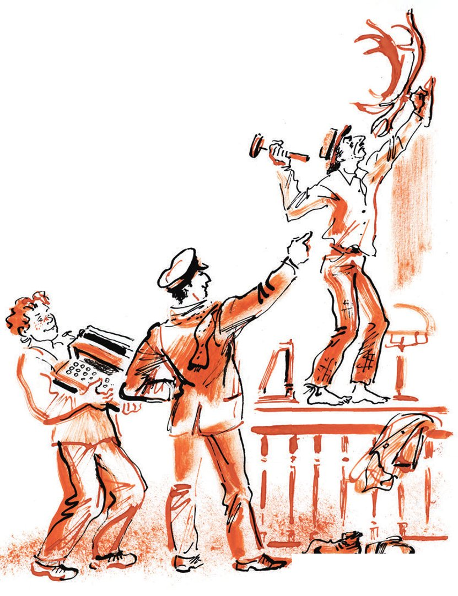
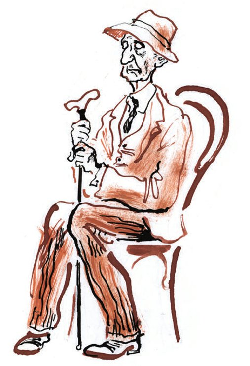

## Kapitel 15: Hörner und Hufe

Es war einmal ein armer Privathändler. Er war ein ziemlich reicher Mann. Ihm gehörte ein <abbr title="das Kurzwarengeschäft, die Kurzwarengeschäfte — галантерейный магазин">Kurzwarengeschäft</abbr> <abbr title="schräg gegenüber — наискосок, наискось">schräg gegenüber</abbr> vom Kino «Kapitolium». Ruhig und sorglos verkaufte er Wäsche, <abbr title="die Spitzenborte, die Spitzenborten — кружевная прошва">Spitzenborten</abbr>, <abbr title="die Krawatte, die Krawatten — галстук">Krawatten</abbr>, Knöpfe und andere kleine, aber <abbr title="gewinnbringend — прибыльный">gewinnbringende</abbr> Waren. Eines Abends kam er mit einem <abbr title="verzerrt — искажённый">verzerrten</abbr> Gesicht nach Hause. Ohne ein Wort ging er zum Büfett und nahm ein ganzes kaltes <abbr title="das Hähnchen, die Hähnchen — курица, цыплёнок">Hähnchen</abbr> heraus. Er lief damit im Zimmer hin und her und aß es ganz auf. Danach öffnete er das Büfett wieder. Er nahm einen ganzen Ring Krakauer Wurst, genau ein halbes Kilo schwer. Er setzte sich auf einen Stuhl, sah mit glasigen Augen auf einen Punkt und <abbr title="kauen — жевать">kaute</abbr> langsam das ganze halbe Kilo. Als er nach den <abbr title="hart gekocht — сваренный вкрутую">hart gekochten</abbr> Eiern auf dem Tisch griff, fragte seine Frau erschrocken:

— Was ist passiert, Borja?

— Ein Unglück! — antwortete er und stopfte sich ein hartes Ei wie aus Gummi in den Mund. — Man hat mir schreckliche Steuern <abbr title="auferlegen — облагать (налогом), налагать">auferlegt</abbr>. Das kannst du dir gar nicht vorstellen.

— Aber warum isst du denn so viel?

— Ich muss mich <abbr title="sich ablenken — отвлекаться, развлечься">ablenken</abbr>, — antwortete der Privathändler. — Ich habe Angst.

Die ganze Nacht ging der Privathändler durch seine Zimmer, in denen allein acht Kleiderschränke standen, und aß. Er aß alles, was im Haus war. Er hatte Angst.

Am nächsten Tag vermietete er den halben Laden an einen Händler für <abbr title="die Schreibwaren (Pl.) — писчебумажные принадлежности">Schreibwaren</abbr>. Jetzt lagen in einem Schaufenster Krawatten und Hosenträger. Im anderen hing an zwei <abbr title="die Schnur, die Schnüre — верёвочка, шнур">Schnüren</abbr> ein riesiger gelber Bleistift.

Dann kamen noch <abbr title="hart — тяжёлый, лихой">härtere</abbr> Zeiten. Im Laden erschien ein dritter <abbr title="der Mitinhaber, die Mitinhaber — совладелец">Mitinhaber</abbr>. Das war ein <abbr title="der Uhrmacher, die Uhrmacher — часовщик, часовых дел мастер">Uhrmacher</abbr>. Er schob den Bleistift zur Seite und füllte das halbe Fenster mit einer <abbr title="die Bronzeuhr, die Bronzeuhren — бронзовые часы">Bronzeuhr</abbr>. Auf der Uhr stand eine Figur der Psyche, aber es gab keinen <abbr title="der Minutenzeiger, die Minutenzeiger — минутная стрелка">Minutenzeiger</abbr>. Der arme Kurzwarenhändler lächelte jetzt nur noch <abbr title="ironisch — иронически">ironisch</abbr>. Ihm gegenüber saß nicht nur der verhasste Bleistiftmann, sondern auch der Uhrmacher mit einer schwarzen <abbr title="die Lupe, die Lupen — лупа">Lupe</abbr> im Auge.

Noch zweimal kam das Unglück zu dem Kurzwarenhändler. In den Laden zogen noch ein Klempner ein, der sofort eine <abbr title="die Lötlampe, die Lötlampen — паяльная лампа">Lötlampe</abbr> anzündete, und ein ganz seltsamer Kaufmann. Dieser Kaufmann glaubte, dass die Leute von Tschernomorsk gerade im Jahr 1930 nach Christi Geburt sich auf seine Ware stürzen würden: auf gestärkte Kragen.

Und das einst so <abbr title="stolz — гордый">stolze</abbr>, ruhige <abbr title="das Ladenschild, die Ladenschilder — вывеска">Ladenschild</abbr> des Kurzwarenhändlers sah jetzt scheußlich aus:

HANDEL                REPARATUR

mit Kurzwaren         aller Uhren

B. Pawel Bure

GALANTPROM            GLASIUS-SCHENKER

B. KULTURTRÄGER       KANZBUM

SPEZIALITÄT           ALLES FÜR

gestärkte Kragen      den Künstler und den Sowjetangestellten

aus Leningrad

LEW SOKOLOWSKI        KARL PAWIAINEN

REPARATUR von Rohren, Waschbecken und Toiletten

M. N. FANATJUK

Die Käufer und <abbr title="der Kunde, die Kunden — заказчик, клиент">Kunden</abbr> betraten den Laden, der früher so gut <abbr title="duften — благоухать">geduftet</abbr> hatte, jetzt nur noch mit Angst. Der Uhrmacher Glasius-Schenker saß unter den Uhren, zwischen <abbr title="das Rädchen, die Rädchen — колёсико">Rädchen</abbr>, <abbr title="der Kneifer, die Kneifer — пенсне">Kneifern</abbr> und Federn. Unter seinen Uhren war sogar eine <abbr title="die Turmuhr, die Turmuhren — башенные часы">Turmuhr</abbr>. Im Laden klingelten oft und laut die Wecker. Hinten drängten sich Schüler und fragten nach Heften, die es nirgends gab. Karl Pawiainen schnitt mit der <abbr title="die Schere, die Scheren — ножницы">Schere</abbr> an seinen Kragen herum, um sich die Zeit zu vertreiben, bis Kunden kamen. Und kaum fragte der freundliche B. Kulturträger eine Kundin: «Was wünschen Sie?», schon schlug der Klempner Fanatjuk mit dem <abbr title="der Hammer, die Hämmer — молоток">Hammer</abbr> krachend auf ein <abbr title="rostig — ржавый">rostiges</abbr> Rohr. Und der <abbr title="der Ruß — сажа">Ruß</abbr> von der Lötlampe setzte sich auf die zarte Kurzware.

Am Ende zerfiel das seltsame Kombinat der Privathändler. Karl Pawiainen fuhr mit einer Droschke in den Nebel davon. Er nahm seine Ware mit, die nicht zur Epoche passte. Nach ihm verschwanden auch Galantprom und Kanzbum im Nichts. Hinter ihnen jagten <abbr title="beritten — конный">berittene</abbr> Steuerinspektoren her. Fanatjuk wurde zum Säufer. Glasius-Schenker trat in das Uhrmacher-Kollektiv «Neue Zeit» ein. Die <abbr title="gewellt — гофрированный">gewellten</abbr> eisernen <abbr title="der Rollladen, die Rollläden — (металлическая) штора, жалюзи">Rollläden</abbr> fielen mit lautem Krach herunter. Auch das lustige Ladenschild verschwand.

Aber bald gingen die Rollläden wieder hoch. Über der früheren <abbr title="die Arche, die Archen — ковчег">Arche</abbr> der Privathändler erschien ein kleines, ordentliches Schild:

Filiale Tschernomorsk

des Arbatower Kontors

ZUR BESCHAFFUNG VON HÖRNERN UND HUFEN

Ein <abbr title="müßig — праздный">müßiger</abbr> Bürger von Tschernomorsk hätte in den Laden schauen können. Dann hätte er Folgendes bemerkt: Die Ladentische und Regale waren verschwunden, der Boden war sauber gewischt. Da standen eigelbe <abbr title="der Bürotisch, die Bürotische — конторский стол">Bürotische</abbr>. An den Wänden hingen die üblichen Plakate wie in jeder Behörde: über die <abbr title="die Sprechzeit, die Sprechzeiten — часы приёма">Sprechzeiten</abbr> und über die <abbr title="die Schädlichkeit — вредность">Schädlichkeit</abbr> des <abbr title="das Händeschütteln — рукопожатие">Händeschüttelns</abbr>. Quer durch die neue kleine Behörde lief schon eine <abbr title="die Schranke, die Schranken — барьер">Schranke</abbr> gegen die Besucher. Besucher gab es allerdings noch keine. An einem kleinen Tisch stand ein gelber Samowar. Er dampfte und <abbr title="klagen über + Akk. — жаловаться на">klagte</abbr> mit dünner Stimme über sein Samowar-Schicksal. Am Tisch saß ein Bote mit einem goldenen Zahn. Er rieb die Teebecher trocken und sang gereizt:

Was für Zeiten sind gekommen,

was für Zeiten sind gekommen,

keiner glaubt mehr an den Herrgott,

keiner glaubt mehr an den Herrgott.

Hinter der Schranke ging ein rothaariger junger Bursche hin und her. Ab und zu ging er zur Schreibmaschine, schlug mit einem dicken, steifen Finger auf eine <abbr title="die Taste, die Tasten — клавиша">Taste</abbr> und <abbr title="in Lachen ausbrechen (brach aus, ist ausgebrochen) — заливаться смехом">brach in Lachen aus</abbr>. Ganz hinten im Kontor, unter dem Schild «<abbr title="der Filialleiter, die Filialleiter — начальник отделения">Filialleiter</abbr>», saß der große Kombinator im Licht einer <abbr title="die Tischlampe, die Tischlampen — настольная (штепсельная) лампа">Tischlampe</abbr>.

Das Hotel «Karlsbad» hatten sie schon lange verlassen. Alle Antilopen-Leute außer Koslewitsch wohnten jetzt im «Krähenviertel», bei Wassissuali Lochankin. Der war darüber äußerst empört. Er versuchte sogar zu <abbr title="protestieren — протестовать">protestieren</abbr>. Er habe das Zimmer nicht an drei Leute vermietet, sagte er, sondern an einen: an einen <abbr title="einsam — одинокий">einsamen</abbr>, gebildeten Junggesellen. «Mon Dieu, Wassissuali Andrejewitsch, — antwortete Ostap <abbr title="unbekümmert — беззаботно">unbekümmert</abbr>, — quälen Sie sich nicht. Von uns dreien bin ja nur ich gebildet. Die Bedingung ist also erfüllt.» Auf die weiteren Klagen des Hausherrn sagte Bender vernünftig: «Dio mio, lieber Wassissuali! Vielleicht liegt genau darin die große, hausgesponnene Wahrheit.» Und Lochankin beruhigte sich sofort, nachdem er von Ostap zwanzig Rubel <abbr title="erbetteln — выпросить">erbettelt</abbr> hatte. Panikowski und Balaganow lebten sich im «Krähenviertel» sehr gut ein. Ihre Stimmen klangen schon <abbr title="selbstbewusst — уверенно">selbstbewusst</abbr> im gemeinsamen Chor der Gemeinschaftswohnung. Panikowski wurde sogar schon <abbr title="beschuldigen — обвинять">beschuldigt</abbr>, dass er nachts <abbr title="das Petroleum — керосин">Petroleum</abbr> aus fremden Primuskochern <abbr title="abzapfen — отливать, сцеживать">abzapfte</abbr>. Mitritsch machte Ostap gegenüber natürlich gleich eine <abbr title="bissig — въедливый, язвительный">bissige</abbr> <abbr title="die Bemerkung, die Bemerkungen — замечание">Bemerkung</abbr>. Darauf gab ihm der große Kombinator schweigend einen Stoß vor die Brust.

Das Kontor zur Beschaffung von Hörnern und Hufen wurde aus vielen Gründen eröffnet.

— Die <abbr title="die Ermittlung, die Ermittlungen — следствие, расследование">Ermittlungen</abbr> im Fall Koreiko, — sagte Ostap, — können viel Zeit kosten. Wie viel, weiß nur Gott. Und da es keinen Gott gibt, weiß es niemand. Eine schreckliche Lage. Vielleicht ein Jahr, vielleicht auch nur ein Monat. Jedenfalls brauchen wir eine <abbr title="die Fassade, die Fassaden — фасад, ширма">Fassade</abbr>, die legal aussieht. Wir müssen uns unter die muntere Masse der Angestellten mischen. Das alles gibt uns ein Kontor. Mich zieht es schon lange zur <abbr title="die Verwaltungsarbeit — административная деятельность">Verwaltungsarbeit</abbr>. In meiner Seele bin ich ein Bürokrat und ein Pfuscher. Wir werden etwas sehr Lustiges beschaffen, zum Beispiel <abbr title="das Teelöffelchen, die Teelöffelchen — чайная ложечка">Teelöffelchen</abbr>, <abbr title="die Hundemarke, die Hundemarken — собачий номер (жетон)">Hundemarken</abbr> oder <abbr title="die Posamenten (Pl.) — шмуклерский товар, позументы">Posamenten</abbr>. Oder Hörner und Hufe. Wunderbar! Hörner und Hufe für die Bedürfnisse der Kamm- und <abbr title="die Mundstückindustrie — мундштучная промышленность">Mundstückindustrie</abbr>. Ist das etwa keine Behörde? Außerdem habe ich in meinem Köfferchen wunderbare Formulare für alle Fälle des Lebens und einen runden Stempel.

Koreiko hatte das Geld nicht angenommen. Der gewissenhafte Ostap hielt es deshalb für möglich, es <abbr title="verbuchen — заприходовать">zu verbuchen</abbr>. Das Geld wurde bei einer Bank auf das <abbr title="das Girokonto, die Girokonten — текущий счёт">Girokonto</abbr> der neuen Behörde <abbr title="einzahlen — вносить (деньги)">eingezahlt</abbr>. Panikowski <abbr title="rebellieren — бунтовать">rebellierte</abbr> wieder und <abbr title="fordern — требовать">forderte</abbr>, dass man das Geld teilte. Zur Strafe bekam er den Posten des Boten. Der Posten war schlecht bezahlt, und für seine freiheitsliebende <abbr title="die Natur — натура, природа">Natur</abbr> war er <abbr title="demütigend — унизительный">demütigend</abbr>. Balaganow bekam den <abbr title="verantwortungsvoll — ответственный">verantwortungsvollen</abbr> Posten des <abbr title="der/die Bevollmächtigte — уполномоченный">Bevollmächtigten</abbr> für Hufe, mit einem Gehalt von zweiundneunzig Rubel. Auf dem <abbr title="der Markt, die Märkte — базар, рынок">Markt</abbr> wurde eine alte Schreibmaschine der Marke «Adler» gekauft. Leider fehlte ihr der Buchstabe «e». Man musste ihn durch «ä» ersetzen. Deshalb klang schon das erste <abbr title="das Schreiben, die Schreiben — письмо, отношение (служебное)">Schreiben</abbr>, das Ostap an ein Geschäft für Büroartikel schickte, so:

Gäbän Siä däm Übärbringär diäsäs Schräibäns, däm Botän Gänossän Panikowski, für diä Filialä Tschärnomorsk Büroartikäl für 150 Rubäl (hundärtfünfzig) und äin Kräditkonto auf Rächnung där Värwaltung in där Stadt Arbatow.

ANLAGÄN: käinä.

— Da hat uns Gott einen Dummkopf als Bevollmächtigten für Hufe geschickt! — ärgerte sich Ostap. — Man kann ihm nichts anvertrauen. Er kauft eine Maschine mit türkischem <abbr title="der Akzent, die Akzente — акцент">Akzent</abbr>. Ich bin also der Läitär där Filialä? Sie sind ein <abbr title="das Schwein, die Schweine — свинья">Schwein</abbr>, Schura, nach so etwas!

Aber nicht einmal die Maschine mit der seltsamen <abbr title="die Aussprache — произношение, прононс">Aussprache</abbr> konnte die helle Freude des großen Kombinators <abbr title="trüben — омрачать">trüben</abbr>. Die neue <abbr title="die Laufbahn, die Laufbahnen — поприще, карьера">Laufbahn</abbr> gefiel ihm sehr. Jede Stunde kam er mit <abbr title="der Einkauf, die Einkäufe — покупка">Einkäufen</abbr> ins Kontor gelaufen. Er brachte so komplizierte Büromaschinen und Geräte, dass der Bote und der Bevollmächtigte nur noch «Ach!» sagen konnten. Da gab es <abbr title="der Locher, die Locher — дырокол, дыропробиватель">Locher</abbr>, <abbr title="die Kopierpresse, die Kopierpressen — копировальный пресс">Kopierpressen</abbr>, einen Drehhocker und ein teures <abbr title="das Tintenfass, die Tintenfässer — чернильница">Tintenfass</abbr> aus Bronze. Es hatte die Form von mehreren kleinen <abbr title="die Bauernhütte, die Bauernhütten — избушка">Bauernhütten</abbr>, für Tinte in verschiedenen Farben. Dieses <abbr title="das Kunstwerk, die Kunstwerke — произведение искусства">Kunstwerk</abbr> hieß «Das Gesicht zum Dorf!» und kostete hundertfünfzig Rubel. Die <abbr title="die Krönung — венец, вершина">Krönung</abbr> war ein gusseiserner <abbr title="der Fahrkartenlocher, die Fahrkartenlocher — компостер">Fahrkartenlocher</abbr> der Eisenbahn. Ostap hatte ihn sich vom <abbr title="der Personenbahnhof, die Personenbahnhöfe — пассажирская станция">Personenbahnhof</abbr> geholt. Zum Schluss schleppte Bender ein großes <abbr title="das Hirschgeweih, die Hirschgeweihe — оленьи рога">Hirschgeweih</abbr> herein. Panikowski ächzte, klagte über seinen niedrigen <abbr title="der Lohn, die Löhne — ставка, зарплата">Lohn</abbr> und nagelte es über den Tisch des Chefs. Alles lief gut, sogar ausgezeichnet. Bei der <abbr title="planmäßig — планомерный">planmäßigen</abbr> Arbeit störte nur eines: Das Auto und sein <abbr title="ruhmreich — славный">ruhmreicher</abbr> Fahrer, Adam Koslewitsch, fehlten, und niemand wusste, warum.

Am dritten Tag nach der Eröffnung kam der erste Besucher. Zur allgemeinen Überraschung war es der Briefträger. Er brachte acht <abbr title="der Umschlag, die Umschläge — конверт, пакет">Umschläge</abbr>, plauderte ein bisschen mit dem Boten Panikowski über dies und das und ging wieder. In den Umschlägen waren drei Vorladungen. Man bat den Vertreter des Kontors dringend zu <abbr title="die Besprechung, die Besprechungen — совещание">Besprechungen</abbr> und Sitzungen. Alle drei Vorladungen <abbr title="betonen — подчёркивать">betonten</abbr>: Das Erscheinen ist Pflicht. In den anderen Papieren verlangten fremde, aber offenbar sehr eifrige Behörden verschiedene <abbr title="die Auskunft, die Auskünfte — справка, сведения">Auskünfte</abbr>, <abbr title="der Kostenvoranschlag, die Kostenvoranschläge — смета">Kostenvoranschläge</abbr> und Listen in vielen <abbr title="das Exemplar, die Exemplare — экземпляр">Exemplaren</abbr>. Auch das alles war dringend und Pflicht.

— Was ist denn das? — schrie Ostap. — Noch vor drei Tagen war ich ein freier <abbr title="der Bergadler, die Bergadler — горный орёл">Bergadler</abbr>, ein <abbr title="der Geier, die Geier — стервятник">Geier</abbr>! Ich <abbr title="mit den Flügeln schlagen — хлопать крыльями">schlug mit den Flügeln</abbr>, wo ich wollte. Und jetzt, bitte schön: Erscheinen ist Pflicht! Es gibt in dieser Stadt offenbar sehr viele Leute, die Ostap Bender unbedingt brauchen. Und wer soll diese ganze Korrespondenz mit den Freunden führen? Wir müssen Geld ausgeben und das <abbr title="das Personal — штат, персонал">Personal</abbr> vergrößern. Wir brauchen eine erfahrene Bürokraft. Soll sie über den Akten sitzen.

Zwei Stunden später passierte ein neues Unglück. Ein Bauer kam mit einem schweren Sack.

— Wer nimmt hier die Hörner an? — fragte er und ließ den Sack auf den Boden fallen.

Der große Kombinator sah den Besucher und seine Ware schief an. Es waren kleine, krumme, schmutzige Hörner. Ostap betrachtete sie mit Ekel.

— Ist die Ware denn gut? — fragte der Filialleiter vorsichtig.

— Schau doch, was für Hörnchen! — rief der Bauer eifrig und hielt dem großen Kombinator ein gelbes Horn unter die Nase. — Hörnchen erster Sorte. Ganz nach der <abbr title="die Norm, die Normen — норма, кондиция">Norm</abbr>.

Die Ware nach der Norm musste man kaufen. Der Bauer trank danach noch lange Tee mit Panikowski und erzählte vom Leben im Dorf. Das ärgerte Ostap, denn er hatte gerade umsonst fünfzehn Rubel verloren.

— Wenn Panikowski noch einen <abbr title="der Hörnerträger, die Hörnerträger — рогоносец">Hörnerträger</abbr> hereinlässt, — sagte Ostap, als der Besucher gegangen war, — dann dient Panikowski hier nicht mehr. Ich entlasse ihn ohne <abbr title="die Abfindung, die Abfindungen — выходное пособие">Abfindung</abbr>. Und überhaupt: Genug mit der staatlichen Tätigkeit. Es ist Zeit, sich um die Sache zu kümmern.

Der Filialleiter hängte an die Glastür ein Schild: «<abbr title="die Mittagspause, die Mittagspausen — обеденный перерыв">Mittagspause</abbr>». Dann holte er aus dem Schrank die Mappe, in der angeblich das blaue Meer und der weiße Dampfer <abbr title="stecken — находиться, торчать">steckten</abbr>. Er schlug mit der Hand darauf und sagte:

— Daran wird unser Kontor arbeiten. Jetzt ist in dieser «Akte» noch kein einziges Blatt. Aber wir werden die Spuren finden. Und wenn wir dafür Panikowski und Balaganow auf Dienstreise in die <abbr title="die Sandwüste, die Sandwüsten — песчаная пустыня">Sandwüste</abbr> Karakum schicken müssen, oder irgendwohin nach Krementschug, um <abbr title="das Beweismaterial — следственный материал, улики">Beweismaterial</abbr> zu sammeln.

In diesem Moment fing die Türklinke des Kontors an zu zucken. Hinter dem Glas <abbr title="treten (trat, ist getreten) — ступать, топтаться">trat</abbr> ein alter Mann von einem Fuß auf den anderen. Er trug einen Panamahut, der mit weißen Fäden gestopft war, und eine weite Jacke aus <abbr title="die Rohseide — чесуча">Rohseide</abbr>. Darunter sah man eine Pikeeweste. Der Alte streckte seinen Hühnerhals und legte sein großes Ohr an das Glas.

— Geschlossen, geschlossen! — rief Ostap schnell. — Die Beschaffung von Hufen ist <abbr title="vorübergehend — временно">vorübergehend</abbr> eingestellt.

Aber der Alte machte weiter Zeichen mit den Händen.

Hätte Ostap den alten Mann mit der weißen Weste nicht hereingelassen, wäre der Roman vielleicht in eine ganz andere Richtung gelaufen. Dann wären all die erstaunlichen Ereignisse nie passiert, an denen viele Menschen teilnehmen mussten: der große Kombinator, sein <abbr title="reizbar — раздражительный">reizbarer</abbr> Bote, sein sorgloser Bevollmächtigter für Hufe und noch viele andere. Darunter ein gewisser <abbr title="der Weise, die Weisen — мудрец">Weiser</abbr> aus dem Osten, die <abbr title="die Enkelin, die Enkelinnen — внучка">Enkelin</abbr> des alten Rätselmachers, ein berühmter Aktivist, der Chef des «Herkules» und eine große Zahl von sowjetischen und ausländischen Bürgern.

Aber Ostap öffnete die Tür. Der Alte lächelte traurig, ging hinter die Schranke und ließ sich auf einen Stuhl sinken. Er schloss die Augen und saß etwa fünf Minuten schweigend da. Man hörte nur kurze Pfiffe, die ab und zu aus seiner blassen Nase kamen. Die Mitarbeiter des Kontors dachten schon, der Besucher würde nie mehr sprechen. Sie <abbr title="beraten (beriet, hat beraten) — совещаться">berieten</abbr> flüsternd, wie man seinen Körper am besten auf die Straße tragen könnte. Da hob der Alte seine braunen <abbr title="das Augenlid, die Augenlider — веко">Augenlider</abbr> und sagte mit tiefer Stimme:

— Mein Name ist Funt. Funt.

— Und das reicht Ihrer Meinung nach, um in eine Behörde einzudringen, die Mittagspause hat? — sagte Bender fröhlich.

— Sie lachen, — antwortete der Alte, — aber mein Name ist Funt. Ich bin neunzig Jahre alt.

— Was wünschen Sie denn? — fragte Ostap. Er begann die Geduld zu verlieren.

Aber der Bürger Funt schwieg wieder, und zwar ziemlich lange.

— Sie haben ein Kontor, — sagte er endlich.

— Ja, ja, ein Kontor, — <abbr title="ermuntern — подбадривать">ermunterte</abbr> ihn Ostap. — Weiter, weiter.

Aber der Alte streichelte nur mit der Hand sein Knie.

— Sehen Sie diese Hose an mir? — sagte er nach langem Schweigen. — Das ist meine <abbr title="die Osterhose, die Osterhosen — пасхальные брюки">Osterhose</abbr>. Früher habe ich sie nur zu Ostern <abbr title="anziehen (zog an, hat angezogen) — надевать">angezogen</abbr>. Aber jetzt trage ich sie jeden Tag.

Panikowski gab ihm sogar einen <abbr title="der Klaps, die Klapse — шлепок">Klaps</abbr> auf den Rücken, damit die Worte ohne <abbr title="die Verzögerung, die Verzögerungen — задержка">Verzögerung</abbr> herauskamen. Trotzdem wurde Funt wieder still. Die Worte sprach er schnell, aber zwischen den Sätzen machte er Pausen. Manchmal dauerten sie bis zu drei Minuten. Für Menschen, die diese <abbr title="die Eigenart, die Eigenarten — особенность">Eigenart</abbr> von Funt nicht kannten, war ein Gespräch mit ihm <abbr title="unerträglich — невыносимый">unerträglich</abbr>. Ostap wollte Funt schon am gestärkten <abbr title="das Halsband, die Halsbänder — ошейник">Halsband</abbr> nehmen und ihm den Weg zur Tür zeigen. Da öffnete der Alte wieder den Mund. Danach wurde das Gespräch so interessant, dass Ostap sich mit Funts Art zu sprechen <abbr title="sich abfinden mit + Dat. (fand ab, hat abgefunden) — смириться с">abfinden</abbr> musste.

— Brauchen Sie keinen Vorsitzenden? — fragte Funt.

— Was für einen Vorsitzenden? — rief Bender.

— Einen offiziellen. Mit einem Wort: einen Chef der Behörde.

— Der Chef bin ich selbst.

— Sie wollen also selbst sitzen? Das hätten Sie gleich sagen sollen. Warum <abbr title="jemanden zum Narren halten — морочить голову">halten Sie mich zum Narren</abbr>, und das schon seit zwei Stunden?

Der Alte in der Osterhose wurde böse, aber die Pausen zwischen den Sätzen wurden nicht kürzer.

— Ich bin Funt, — wiederholte er mit Gefühl. — Ich bin neunzig Jahre alt. Mein ganzes Leben lang habe ich für andere gesessen. Das ist mein Beruf: für andere leiden.

— Ach, Sie sind ein Strohmann?

— Ja, — sagte der Alte und schüttelte mit Würde den Kopf. — Ich bin der <abbr title="der/die Sitzvorsitzende — зицпредседатель">Sitzvorsitzende</abbr> Funt. Ich habe immer gesessen. Ich habe gesessen unter Alexander dem Zweiten, dem <abbr title="der Befreier, die Befreier — освободитель">Befreier</abbr>, unter Alexander dem Dritten, dem <abbr title="der Friedensstifter, die Friedensstifter — миротворец">Friedensstifter</abbr>, unter Nikolaus dem Zweiten, dem <abbr title="blutig — кровавый">Blutigen</abbr>.

Und der Alte <abbr title="umbiegen (bog um, hat umgebogen) — загибать">bog</abbr> langsam die Finger um und zählte die Zaren.

— Unter Kerenski habe ich auch gesessen. Im <abbr title="der Kriegskommunismus — военный коммунизм">Kriegskommunismus</abbr> habe ich allerdings gar nicht gesessen. Der saubere <abbr title="der Handel — торговля, коммерция">Handel</abbr> war verschwunden, es gab keine Arbeit. Aber wie habe ich dafür unter der NEP gesessen! Wie habe ich unter der NEP gesessen! Das waren die besten Tage meines Lebens. In vier Jahren war ich nicht länger als drei Monate in Freiheit. Ich habe meine Enkelin <abbr title="verheiraten — выдавать замуж">verheiratet</abbr>, Golkonda Jewsejewna. Ich habe ihr einen <abbr title="der Konzertflügel, die Konzertflügel — концертное фортепиано">Konzertflügel</abbr> <abbr title="mitgeben (gab mit, hat mitgegeben) — давать (в приданое)">mitgegeben</abbr>, ein silbernes Vögelchen und achtzig Rubel in goldenen Zehnrubelstücken. Und jetzt gehe ich durch die Stadt und <abbr title="erkennen (erkannte, hat erkannt) — узнавать">erkenne</abbr> unser Tschernomorsk nicht wieder. Wo ist das alles? Wo ist das private Kapital? Wo ist die Erste <abbr title="die Kreditgenossenschaft, die Kreditgenossenschaften — общество взаимного кредита">Kreditgenossenschaft</abbr>? Wo, frage ich Sie, ist die Zweite Kreditgenossenschaft? Wo ist die <abbr title="die Kommanditgesellschaft, die Kommanditgesellschaften — товарищество на вере">Kommanditgesellschaft</abbr>? Wo sind die Aktiengesellschaften mit gemischtem Kapital? Wo ist das alles? Eine Schande!

Diese kurze Rede dauerte <abbr title="verhältnismäßig — сравнительно">verhältnismäßig</abbr> kurz – eine halbe Stunde. Als Panikowski Funt zuhörte, war er ganz <abbr title="gerührt — растроганный">gerührt</abbr>. Er nahm Balaganow zur Seite und flüsterte voll Respekt:

— Man sieht gleich: ein Mensch von früherszeit. So welche gibt's heute nich mehr, und bald gibt's gar keine mehr.

Und er reichte dem Alten liebenswürdig einen Becher süßen Tee.

Ostap zog den Sitzvorsitzenden an seinen Chefschreibtisch. Er ließ das Kontor schließen und begann, den ewigen Häftling <abbr title="geduldig — терпеливо">geduldig</abbr> <abbr title="ausfragen — выспрашивать">auszufragen</abbr>. Dieser Mensch hatte sein Leben «für seine Freunde gelassen», wie es in der Bibel steht. Der Sitzvorsitzende sprach gern. Hätte er zwischen den Sätzen nicht so lange <abbr title="ausruhen — отдыхать">ausgeruht</abbr>, könnte man sogar sagen, dass er ohne Pause plapperte.

— Kennen Sie nicht einen gewissen Koreiko, Alexander Iwanowitsch? — fragte Ostap und sah auf die Mappe mit den Schnürsenkeln.

— Nein, — antwortete der Alte. — So einen kenne ich nicht.

— Und mit dem «Herkules» hatten Sie zu tun?

Bei dem Wort «Herkules» bewegte sich der Sitzvorsitzende ein kleines bisschen. Ostap bemerkte diese leichte Bewegung nicht einmal. Aber an seiner Stelle hätte jede Pikeeweste aus dem Café «Florida» gedacht: «Funt ist schrecklich aufgeregt, er ist ganz außer sich!» Zum Beispiel Valiadis, der Funt schon seit langer Zeit kannte.

Wie sollte Funt den «Herkules» nicht kennen! Seine letzten vier <abbr title="die Haftstrafe, die Haftstrafen — отсидка, тюремный срок">Haftstrafen</abbr> hatten direkt mit dieser Behörde zu tun. Rund um den «Herkules» <abbr title="sich nähren von + Dat. — кормиться">nährten sich</abbr> mehrere private Aktiengesellschaften. Es gab zum Beispiel die Gesellschaft «Intensivnik». Als Vorsitzender wurde Funt eingeladen. «Intensivnik» bekam vom «Herkules» einen großen <abbr title="der Vorschuss, die Vorschüsse — аванс">Vorschuss</abbr>, um irgendwas aus dem Wald zu beschaffen. Was genau, muss ein Sitzvorsitzender nicht wissen. Und sofort platzte die Gesellschaft. Jemand <abbr title="einschaufeln — загребать">schaufelte</abbr> das Geld ein, und Funt saß ein halbes Jahr. Nach «Intensivnik» <abbr title="entstehen (entstand, ist entstanden) — возникать, образоваться">entstand</abbr> die Kommanditgesellschaft «Arbeits-Zeder». Natürlich mit dem würdigen Funt als Vorsitzendem. Natürlich ein Vorschuss vom «Herkules» für die Lieferung von gut <abbr title="abgelagert — выдержанный">abgelagertem</abbr> <abbr title="das Zedernholz — кедр (древесина)">Zedernholz</abbr>. Natürlich eine unerwartete <abbr title="die Pleite, die Pleiten — крах, банкротство">Pleite</abbr>. Jemand wurde reich, und Funt <abbr title="abarbeiten — отрабатывать">arbeitete</abbr> sein Vorsitzendengehalt ab: Er saß. Dann «Sägehilfe» – «Herkules» – Vorschuss – Pleite – jemand schaufelt ein – Haft. Und wieder: Vorschuss – «Herkules» – «Südlicher Holzfäller» – für Funt Haft – für jemanden ein großer Gewinn.

— Für wen denn? — <abbr title="nachbohren — допытываться">bohrte</abbr> Ostap nach und ging um den Alten herum. — Wer hat das wirklich <abbr title="leiten — руководить">geleitet</abbr>?

Der Alte <abbr title="schlürfen — прихлёбывать, сосать">schlürfte</abbr> schweigend seinen Tee und hob mit Mühe die schweren Augenlider.

— Wer weiß das schon? — sagte er kummervoll. — Vor Funt hat man alles <abbr title="verheimlichen — скрывать">verheimlicht</abbr>. Ich muss nur sitzen, das ist mein Beruf. Ich habe gesessen unter Alexander dem Zweiten und unter dem Dritten, und unter Nikolai Alexandrowitsch Romanow und unter Alexander Fjodorowitsch Kerenski. Und unter der NEP, vor dem NEP-Rausch, im Rausch und nach dem Rausch. Und jetzt bin ich ohne Arbeit und muss die Osterhose tragen.

Ostap <abbr title="herauspressen — выжимать, выцеживать">presste</abbr> noch lange einzelne Wörtchen aus dem Alten heraus. Er arbeitete wie ein <abbr title="der Goldwäscher, die Goldwäscher — старатель">Goldwäscher</abbr>, der unermüdlich <abbr title="die Tonne, die Tonnen — тонна">Tonnen</abbr> von Schlamm und Sand wäscht, um auf dem Boden ein paar <abbr title="das Goldkorn, die Goldkörner — золотая крупинка">Goldkörner</abbr> zu finden. Er stieß Funt mit der Schulter an, weckte ihn und <abbr title="kitzeln — щекотать">kitzelte</abbr> ihn sogar unter den <abbr title="die Achsel, die Achseln — подмышка">Achseln</abbr>. Nach all diesen Tricks erfuhr er Folgendes: Funt meinte, hinter allen geplatzten Gesellschaften <abbr title="stecken hinter + Dat. — скрываться за">steckte</abbr> zweifellos ein und dieselbe Person. Und was den «Herkules» <abbr title="betreffen (betraf, hat betroffen) — касаться">betraf</abbr>: Den hatte man um mehr als hunderttausend gemolken.

— Jedenfalls, — sagte der uralte Sitzvorsitzende, — jedenfalls ist dieser unbekannte Mensch ein Kopf. Kennen Sie Valiadis? Valiadis würde mit diesem Menschen keine Kirschen essen.

— Und mit Briand? — fragte Ostap lächelnd. Er dachte an die Versammlung der Pikeewesten vor dem früheren Café «Florida». — Würde Valiadis mit Briand Kirschen essen? Was meinen Sie?

— Niemals! — antwortete Funt. — Briand, das ist ein Kopf.

Drei Minuten lang bewegte er <abbr title="lautlos — беззвучно">lautlos</abbr> die Lippen. Dann sagte er noch:

— Hoover, das ist ein Kopf. Und Hindenburg ist ein Kopf. Hoover und Hindenburg, das sind zwei Köpfe.

Ostap bekam Angst. Die älteste aller Pikeewesten versank im <abbr title="der Sumpf, die Sümpfe — трясина, болото">Sumpf</abbr> der hohen Politik. Jeden Moment konnte er vom Kellogg-<abbr title="der Pakt, die Pakte — пакт">Pakt</abbr> anfangen oder vom spanischen <abbr title="der Diktator, die Diktatoren — диктатор">Diktator</abbr> Primo de Rivera. Dann hätte ihn keine Macht der Welt mehr von dieser ehrwürdigen Beschäftigung abbringen können. In seinen Augen erschien schon ein idiotischer Glanz. Über dem gelblichen gestärkten Kragen zitterte schon sein <abbr title="der Adamsapfel, die Adamsäpfel — кадык">Adamsapfel</abbr>. Das hieß: Gleich wird ein neuer Satz geboren. Da <abbr title="herausschrauben — вывинчивать">schraubte</abbr> Bender die <abbr title="die Glühbirne, die Glühbirnen — электрическая лампочка">Glühbirne</abbr> heraus und warf sie auf den Boden. Die Glühbirne <abbr title="zerplatzen — разбиться, лопнуть">zerplatzte</abbr> mit einem kalten Knall wie ein <abbr title="der Gewehrschuss, die Gewehrschüsse — винтовочный выстрел">Gewehrschuss</abbr>. Nur dieses <abbr title="das Ereignis, die Ereignisse — происшествие, событие">Ereignis</abbr> konnte den Sitzvorsitzenden von den <abbr title="international — международный">internationalen</abbr> Angelegenheiten <abbr title="abbringen von + Dat. (brachte ab, hat abgebracht) — отвлекать от">abbringen</abbr>. Ostap nutzte das schnell.

— Aber mit irgendjemandem vom «Herkules» haben Sie sich doch getroffen? — fragte er. — Wegen der Vorschüsse?

— Mit mir hatte nur der Buchhalter vom «Herkules» zu tun, Berlaga. Der wurde von ihnen bezahlt. Und ich weiß nichts. Vor mir hat man alles verheimlicht. Die Leute brauchen mich zum Sitzen. Ich habe gesessen unter dem <abbr title="der Zarismus — царизм">Zarismus</abbr> und unter dem Sozialismus, unter dem <abbr title="der Hetman, die Hetmane — гетман">Hetman</abbr> und unter der französischen Besatzung. Briand, das ist ein Kopf.

Mehr konnte man aus dem Alten nicht herauspressen. Aber auch das, was er gesagt hatte, reichte, um mit der <abbr title="die Suche — поиски">Suche</abbr> zu beginnen.

«Hier spürt man die Pranke von Koreiko», dachte Ostap.

Der Leiter der Filiale Tschernomorsk des Arbatower Kontors zur Beschaffung von Hörnern und Hufen setzte sich an den Tisch. Er schrieb die Rede des Sitzvorsitzenden Funt auf Papier. Die Überlegungen über die Beziehungen zwischen Valiadis und Briand ließ er weg.

Das erste Blatt der geheimen Ermittlungen über den Untergrund-Millionär wurde <abbr title="nummerieren — нумеровать">nummeriert</abbr>, an den richtigen Stellen <abbr title="lochen — прокалывать, пробивать">gelocht</abbr> und in die Akte <abbr title="heften — подшивать">geheftet</abbr>.

— Na, nehmen Sie mich jetzt als Vorsitzenden? — fragte der Alte und setzte seinen gestopften Panamahut auf. — Ich sehe, Ihr Kontor braucht einen Vorsitzenden. Ich bin nicht teuer: hundertzwanzig Rubel im Monat in Freiheit und zweihundertvierzig im Gefängnis. Hundert Prozent <abbr title="der Zuschlag, die Zuschläge — надбавка">Zuschlag</abbr> für <abbr title="gesundheitsschädlich — вредный (для здоровья)">gesundheitsschädliche</abbr> Arbeit.

— Wir nehmen Sie wohl, — sagte Ostap. — Reichen Sie Ihren Antrag beim Bevollmächtigten für Hufe ein.

---

### Neue Wörter

- **das Kurzwarengeschäft, die Kurzwarengeschäfte** — галантерейный магазин
- **schräg gegenüber** — наискосок, наискось
- **die Spitzenborte, die Spitzenborten** — кружевная прошва
- **die Krawatte, die Krawatten** — галстук
- **gewinnbringend** — прибыльный
- **verzerrt** — искажённый
- **das Hähnchen, die Hähnchen** — курица, цыплёнок
- **kauen** — жевать
- **hart gekocht** — сваренный вкрутую
- **auferlegen** — облагать (налогом), налагать
- **sich ablenken** — отвлекаться, развлечься
- **die Schreibwaren (Pl.)** — писчебумажные принадлежности
- **die Schnur, die Schnüre** — верёвочка, шнур
- **hart** — тяжёлый, лихой
- **der Mitinhaber, die Mitinhaber** — совладелец
- **der Uhrmacher, die Uhrmacher** — часовщик, часовых дел мастер
- **die Bronzeuhr, die Bronzeuhren** — бронзовые часы
- **der Minutenzeiger, die Minutenzeiger** — минутная стрелка
- **ironisch** — иронически
- **die Lupe, die Lupen** — лупа
- **die Lötlampe, die Lötlampen** — паяльная лампа
- **stolz** — гордый
- **das Ladenschild, die Ladenschilder** — вывеска
- **der Kunde, die Kunden** — заказчик, клиент
- **duften** — благоухать
- **das Rädchen, die Rädchen** — колёсико
- **der Kneifer, die Kneifer** — пенсне
- **die Turmuhr, die Turmuhren** — башенные часы
- **die Schere, die Scheren** — ножницы
- **der Hammer, die Hämmer** — молоток
- **rostig** — ржавый
- **der Ruß** — сажа
- **beritten** — конный
- **gewellt** — гофрированный
- **der Rollladen, die Rollläden** — (металлическая) штора, жалюзи
- **die Arche, die Archen** — ковчег
- **müßig** — праздный
- **der Bürotisch, die Bürotische** — конторский стол
- **die Sprechzeit, die Sprechzeiten** — часы приёма
- **die Schädlichkeit** — вредность
- **das Händeschütteln** — рукопожатие
- **die Schranke, die Schranken** — барьер
- **klagen über + Akk.** — жаловаться на
- **die Taste, die Tasten** — клавиша
- **in Lachen ausbrechen (brach aus, ist ausgebrochen)** — заливаться смехом
- **der Filialleiter, die Filialleiter** — начальник отделения
- **die Tischlampe, die Tischlampen** — настольная (штепсельная) лампа
- **protestieren** — протестовать
- **einsam** — одинокий
- **unbekümmert** — беззаботно
- **erbetteln** — выпросить
- **selbstbewusst** — уверенно
- **beschuldigen** — обвинять
- **das Petroleum** — керосин
- **abzapfen** — отливать, сцеживать
- **bissig** — въедливый, язвительный
- **die Bemerkung, die Bemerkungen** — замечание
- **die Ermittlung, die Ermittlungen** — следствие, расследование
- **die Fassade, die Fassaden** — фасад, ширма
- **die Verwaltungsarbeit** — административная деятельность
- **das Teelöffelchen, die Teelöffelchen** — чайная ложечка
- **die Hundemarke, die Hundemarken** — собачий номер (жетон)
- **die Posamenten (Pl.)** — шмуклерский товар, позументы
- **die Mundstückindustrie** — мундштучная промышленность
- **verbuchen** — заприходовать
- **das Girokonto, die Girokonten** — текущий счёт
- **einzahlen** — вносить (деньги)
- **rebellieren** — бунтовать
- **fordern** — требовать
- **die Natur** — натура, природа
- **demütigend** — унизительный
- **verantwortungsvoll** — ответственный
- **der/die Bevollmächtigte** — уполномоченный
- **der Markt, die Märkte** — базар, рынок
- **das Schreiben, die Schreiben** — письмо, отношение (служебное)
- **der Akzent, die Akzente** — акцент
- **das Schwein, die Schweine** — свинья
- **die Aussprache** — произношение, прононс
- **trüben** — омрачать
- **die Laufbahn, die Laufbahnen** — поприще, карьера
- **der Einkauf, die Einkäufe** — покупка
- **der Locher, die Locher** — дырокол, дыропробиватель
- **die Kopierpresse, die Kopierpressen** — копировальный пресс
- **das Tintenfass, die Tintenfässer** — чернильница
- **die Bauernhütte, die Bauernhütten** — избушка
- **das Kunstwerk, die Kunstwerke** — произведение искусства
- **die Krönung** — венец, вершина
- **der Fahrkartenlocher, die Fahrkartenlocher** — компостер
- **der Personenbahnhof, die Personenbahnhöfe** — пассажирская станция
- **das Hirschgeweih, die Hirschgeweihe** — оленьи рога
- **der Lohn, die Löhne** — ставка, зарплата
- **planmäßig** — планомерный
- **ruhmreich** — славный
- **der Umschlag, die Umschläge** — конверт, пакет
- **die Besprechung, die Besprechungen** — совещание
- **betonen** — подчёркивать
- **die Auskunft, die Auskünfte** — справка, сведения
- **der Kostenvoranschlag, die Kostenvoranschläge** — смета
- **das Exemplar, die Exemplare** — экземпляр
- **der Bergadler, die Bergadler** — горный орёл
- **der Geier, die Geier** — стервятник
- **mit den Flügeln schlagen** — хлопать крыльями
- **das Personal** — штат, персонал
- **die Norm, die Normen** — норма, кондиция
- **der Hörnerträger, die Hörnerträger** — рогоносец
- **die Abfindung, die Abfindungen** — выходное пособие
- **die Mittagspause, die Mittagspausen** — обеденный перерыв
- **stecken** — находиться, торчать
- **die Sandwüste, die Sandwüsten** — песчаная пустыня
- **das Beweismaterial** — следственный материал, улики
- **treten (trat, ist getreten)** — ступать, топтаться
- **die Rohseide** — чесуча
- **vorübergehend** — временно
- **reizbar** — раздражительный
- **der Weise, die Weisen** — мудрец
- **die Enkelin, die Enkelinnen** — внучка
- **beraten (beriet, hat beraten)** — совещаться
- **das Augenlid, die Augenlider** — веко
- **ermuntern** — подбадривать
- **die Osterhose, die Osterhosen** — пасхальные брюки
- **anziehen (zog an, hat angezogen)** — надевать
- **der Klaps, die Klapse** — шлепок
- **die Verzögerung, die Verzögerungen** — задержка
- **die Eigenart, die Eigenarten** — особенность
- **unerträglich** — невыносимый
- **das Halsband, die Halsbänder** — ошейник
- **sich abfinden mit + Dat. (fand ab, hat abgefunden)** — смириться с
- **jemanden zum Narren halten** — морочить голову
- **der/die Sitzvorsitzende** — зицпредседатель
- **der Befreier, die Befreier** — освободитель
- **der Friedensstifter, die Friedensstifter** — миротворец
- **blutig** — кровавый
- **umbiegen (bog um, hat umgebogen)** — загибать
- **der Kriegskommunismus** — военный коммунизм
- **der Handel** — торговля, коммерция
- **verheiraten** — выдавать замуж
- **der Konzertflügel, die Konzertflügel** — концертное фортепиано
- **mitgeben (gab mit, hat mitgegeben)** — давать (в приданое)
- **erkennen (erkannte, hat erkannt)** — узнавать
- **die Kreditgenossenschaft, die Kreditgenossenschaften** — общество взаимного кредита
- **die Kommanditgesellschaft, die Kommanditgesellschaften** — товарищество на вере
- **verhältnismäßig** — сравнительно
- **gerührt** — растроганный
- **geduldig** — терпеливо
- **ausfragen** — выспрашивать
- **ausruhen** — отдыхать
- **die Haftstrafe, die Haftstrafen** — отсидка, тюремный срок
- **sich nähren von + Dat.** — кормиться
- **der Vorschuss, die Vorschüsse** — аванс
- **einschaufeln** — загребать
- **entstehen (entstand, ist entstanden)** — возникать, образоваться
- **abgelagert** — выдержанный
- **das Zedernholz** — кедр (древесина)
- **die Pleite, die Pleiten** — крах, банкротство
- **abarbeiten** — отрабатывать
- **nachbohren** — допытываться
- **leiten** — руководить
- **schlürfen** — прихлёбывать, сосать
- **verheimlichen** — скрывать
- **herauspressen** — выжимать, выцеживать
- **der Goldwäscher, die Goldwäscher** — старатель
- **die Tonne, die Tonnen** — тонна
- **das Goldkorn, die Goldkörner** — золотая крупинка
- **kitzeln** — щекотать
- **die Achsel, die Achseln** — подмышка
- **stecken hinter + Dat.** — скрываться за
- **betreffen (betraf, hat betroffen)** — касаться
- **lautlos** — беззвучно
- **der Sumpf, die Sümpfe** — трясина, болото
- **der Pakt, die Pakte** — пакт
- **der Diktator, die Diktatoren** — диктатор
- **der Adamsapfel, die Adamsäpfel** — кадык
- **herausschrauben** — вывинчивать
- **die Glühbirne, die Glühbirnen** — электрическая лампочка
- **zerplatzen** — разбиться, лопнуть
- **der Gewehrschuss, die Gewehrschüsse** — винтовочный выстрел
- **das Ereignis, die Ereignisse** — происшествие, событие
- **international** — международный
- **abbringen von + Dat. (brachte ab, hat abgebracht)** — отвлекать от
- **der Zarismus** — царизм
- **der Hetman, die Hetmane** — гетман
- **die Suche** — поиски
- **nummerieren** — нумеровать
- **lochen** — прокалывать, пробивать
- **heften** — подшивать
- **der Zuschlag, die Zuschläge** — надбавка
- **gesundheitsschädlich** — вредный (для здоровья)

[← Zurück](kapitel-15.md) · [Inhalt](README.md) · [Weiter →](kapitel-17.md)
