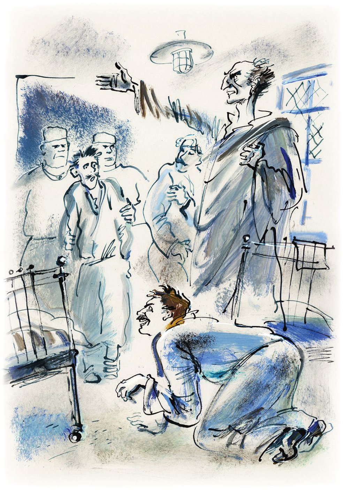

## Kapitel 16: Jahrbuch für Psychoanalytik

Der Arbeitstag in der Finanz- und Rechnungsabteilung des «Herkules» begann wie immer genau um neun Uhr.

Kukuschkind hatte schon den <abbr title="der Zipfel, die Zipfel — пола, кончик">Zipfel</abbr> seiner Jacke gehoben. Damit wollte er seine <abbr title="das Brillenglas, die Brillengläser — стекло очков">Brillengläser</abbr> putzen und gleichzeitig den Kollegen erzählen: Im Bankhaus «Sikomorski und Zesarewitsch» habe er viel ruhiger gearbeitet als in diesem Sodom vom «Herkules». Tesoimenizki hatte sich schon auf seinem Drehhocker zur Wand gedreht. Er streckte die Hand aus, um ein Blatt vom Kalender abzureißen. Lapidus junior hatte schon den Mund weit über einem Stück Brot mit <abbr title="die Heringsbutter — форшмак из селёдки">Heringsbutter</abbr> <abbr title="aufsperren — разинуть (рот)">aufgesperrt</abbr>. Da ging die Tür auf, und auf der Schwelle stand kein anderer als der Buchhalter Berlaga.

Dieser unerwartete <abbr title="der Auftritt, die Auftritte — выход, появление (антре)">Auftritt</abbr> <abbr title="verursachen — вызывать, причинять">verursachte</abbr> im Saal der Finanzabteilung große Verwirrung. Tesoimenizki rutschte auf seinem drehbaren Tellerchen aus, und das Kalenderblatt blieb hängen – vielleicht zum ersten Mal seit drei Jahren. Lapidus junior vergaß, in sein Brot zu beißen, und bewegte die <abbr title="der Kiefer, die Kiefer — челюсть">Kiefer</abbr> ins Leere. Dreyfus, Tschewaschewskaja und Sacharkow waren unendlich erstaunt. Koreiko hob den Kopf und senkte ihn wieder. Und der alte Kukuschkind setzte schnell seine Brille auf und vergaß, sie zu putzen. Das war ihm in dreißig <abbr title="das Dienstjahr, die Dienstjahre — год службы">Dienstjahren</abbr> noch nie passiert. Berlaga setzte sich, als ob nichts gewesen wäre, an seinen Tisch. Auf das <abbr title="fein — тонкий">feine</abbr> Grinsen von Lapidus junior reagierte er nicht. Er öffnete seine Bücher.

— Wie geht's der Gesundheit? — fragte Lapidus trotzdem. — Der Fersennerv?

— Alles vorbei, — antwortete Berlaga, ohne den Kopf zu heben. — Ich glaube nicht einmal, dass der Mensch so einen Nerv hat.

Bis zur Mittagspause rutschte die ganze Finanzabteilung voller Neugier auf ihren Hockern und Kissen hin und her. Und als die Glocke zur Pause schrillte wie bei Alarm, umringte die <abbr title="die Blüte, die Blüten — цвет (лучшая часть)">Blüte</abbr> der Rechnungswelt Berlaga. Aber der <abbr title="der Flüchtling, die Flüchtlinge — беглец">Flüchtling</abbr> antwortete kaum auf die Fragen. Er nahm die vier treuesten Kollegen zur Seite. Er <abbr title="sich vergewissern — убедиться">vergewisserte sich</abbr>, dass niemand Überflüssiges in der Nähe war. Dann erzählte er ihnen von seinen <abbr title="außergewöhnlich — необыкновенный">außergewöhnlichen</abbr> Abenteuern im Irrenhaus. Der geflohene Buchhalter <abbr title="würzen — приправлять">würzte</abbr> seine Geschichte mit vielen verschnörkelten Ausdrücken und Ausrufen. Diese lassen wir hier weg, damit die Erzählung <abbr title="verständlich — понятный, связный">verständlich</abbr> bleibt.

**Die Geschichte des Buchhalters Berlaga, was ihm im Irrenhaus passiert war. Unter strengster Geheimhaltung erzählt an Borissochlebski, Dreyfus, Sacharkow und Lapidus junior**

Wie schon berichtet, war der Buchhalter Berlaga ins Irrenhaus geflohen, weil er Angst vor der Säuberung hatte. In dieser <abbr title="die Heilanstalt, die Heilanstalten — лечебница, лечебное заведение">Heilanstalt</abbr> wollte er die unruhige Zeit aussitzen. Er wollte in den «Herkules» zurückkehren, wenn der Donner vorbei war und die acht Genossen mit den grauen Augen in die Nachbarbehörde <abbr title="weiterziehen (zog weiter, ist weitergezogen) — перекочевать">weitergezogen</abbr> waren.

Die ganze Sache hatte sein Schwager <abbr title="einfädeln — сварганить, устроить">eingefädelt</abbr>. Er besorgte ein Buch über die <abbr title="die Sitte, die Sitten — нравы, обычай">Sitten</abbr> und Gewohnheiten der <abbr title="der/die Geisteskranke — душевнобольной">Geisteskranken</abbr>. Nach langem Streit wählten sie aus allen <abbr title="die fixe Idee, die fixen Ideen — навязчивая идея">fixen Ideen</abbr> den <abbr title="der Größenwahn — бред величия, мания величия">Größenwahn</abbr>.

— Du musst gar nichts tun, — erklärte ihm der Schwager. — Du musst nur allen und jedem ins Ohr schreien: «Ich bin Napoleon!» Oder «Ich bin Émile Zola!» Oder «Mohammed!», wenn du willst.

— Und <abbr title="der Vizekönig, die Vizekönige — вице-король">Vizekönig</abbr> von Indien, geht das auch? — fragte Berlaga vertrauensvoll.

— Geht, geht. Ein <abbr title="der/die Verrückte — сумасшедший">Verrückter</abbr> darf alles. Also Vizekönig von Indien?

Der Schwager sprach so gewichtig, als wäre er mindestens <abbr title="der Assistenzarzt, die Assistenzärzte — младший ординатор">Assistenzarzt</abbr> in einer <abbr title="die Nervenklinik, die Nervenkliniken — психбольница">Nervenklinik</abbr>. In Wirklichkeit war er ein bescheidener Vertreter, der <abbr title="das Abonnement, die Abonnements — подписка">Abonnements</abbr> für teure <abbr title="die Prachtausgabe, die Prachtausgaben — роскошное издание">Prachtausgaben</abbr> des Staatsverlags verkaufte. Von seiner früheren Größe als Kaufmann war in seiner Truhe nur eine Melone aus Wien geblieben, mit weißem <abbr title="das Seidenfutter — шёлковая подкладка">Seidenfutter</abbr>.

Der Schwager lief zum Telefon, um den <abbr title="der Krankenwagen, die Krankenwagen — карета скорой помощи">Krankenwagen</abbr> zu rufen. Der neue Vizekönig von Indien zog seinen Kittel aus und zerriss sein <abbr title="das Baumwollhemd, die Baumwollhemden — сорочка (мадаполамовая)">Baumwollhemd</abbr>. Und für alle Fälle goss er sich ein Fläschchen der besten <abbr title="die Kopiertinte — копировальные чернила">Kopiertinte</abbr> erster Klasse über den Kopf. Dann legte er sich auf den Bauch auf den Boden. Als die <abbr title="der Sanitäter, die Sanitäter — санитар">Sanitäter</abbr> kamen, begann er zu schreien:

— Ich bin nichts weniger als der Vizekönig von Indien! Wo sind meine treuen <abbr title="der Nabob, die Nabobs — наиб, набоб">Nabobs</abbr>, meine <abbr title="der Maharadscha, die Maharadschas — магараджа">Maharadschas</abbr>, meine <abbr title="der Abrek, die Abreken — абрек (горец-разбойник)">Abreken</abbr>, meine <abbr title="der Kunak, die Kunaken — кунак (друг-горец)">Kunaken</abbr>, meine Elefanten?

Der Schwager hörte sich diesen Größenwahn an und schüttelte zweifelnd den Kopf. Seiner Meinung nach gehörten Abreken und Kunaken nicht zum <abbr title="der Machtbereich, die Machtbereiche — сфера власти">Machtbereich</abbr> eines indischen Königs. Aber die Sanitäter wischten nur mit einem nassen Tuch das Gesicht des Buchhalters ab, das mit der Tinte erster Klasse beschmiert war. Dann packten sie ihn gemeinsam und setzten ihn in den Wagen. Die lackierten Türen knallten, eine <abbr title="beunruhigend — тревожный">beunruhigende</abbr> medizinische Hupe <abbr title="ertönen — раздаваться, звучать">ertönte</abbr>, und das Auto brachte den Vizekönig Berlaga in sein neues <abbr title="das Reich, die Reiche — владения, царство">Reich</abbr>.

Unterwegs fuchtelte der Kranke mit den Armen und redete irgendetwas. Dabei dachte er die ganze Zeit voller Angst an die erste Begegnung mit echten Verrückten. Er fürchtete sehr, dass sie ihn beleidigen oder vielleicht sogar verprügeln würden.

Das Krankenhaus war ganz anders, als Berlaga es sich vorgestellt hatte. In einem langen, hellen Saal saßen Menschen in bläulichen <abbr title="der Bademantel, die Bademäntel — халат">Bademänteln</abbr> auf Sofas. Andere lagen auf Betten oder gingen spazieren. Der Buchhalter bemerkte, dass die Verrückten fast nicht miteinander sprachen. Sie haben keine Zeit zum Sprechen. Sie denken. Sie denken die ganze Zeit. Sie haben sehr viele Gedanken. Sie müssen sich an etwas erinnern, an das Wichtigste, von dem das Glück abhängt. Aber die Gedanken fallen <abbr title="auseinanderfallen — разваливаться">auseinander</abbr>. Und das Wichtigste <abbr title="wedeln mit + Dat. — вилять (хвостом)">wedelt</abbr> mit dem <abbr title="das Schwänzchen, die Schwänzchen — хвостик">Schwänzchen</abbr> und verschwindet. Und wieder muss man alles <abbr title="durchdenken (durchdachte, hat durchdacht) — обдумывать">durchdenken</abbr>. Man muss endlich verstehen, was passiert ist: Warum ist alles schlecht geworden, wenn doch früher alles gut war?

An Berlaga ging schon einige Male ein <abbr title="der/die Wahnsinnige — безумец">Wahnsinniger</abbr> vorbei, <abbr title="ungekämmt — нечёсаный">ungekämmt</abbr> und unglücklich. Er hielt sein Kinn mit den Fingern fest und ging immer auf derselben Linie: vom Fenster zur Tür, von der Tür zum Fenster, wieder zur Tür, wieder zum Fenster. In seinem armen Kopf <abbr title="poltern — грохотать">polterten</abbr> so viele Gedanken, dass er die andere Hand an die <abbr title="die Stirn, die Stirnen — лоб">Stirn</abbr> legte und schneller ging.

— Ich bin der Vizekönig von Indien! — schrie Berlaga und sah sich nach dem Sanitäter um.

Der Wahnsinnige sah nicht einmal zum Buchhalter hin. Er verzog <abbr title="schmerzlich — болезненно">schmerzlich</abbr> das Gesicht und begann wieder, seine Gedanken zu sammeln. Berlagas wilder Schrei hatte sie verscheucht. Dafür kam ein kleiner <abbr title="der/die Schwachsinnige — слабоумный, идиот">Schwachsinniger</abbr> zum Vizekönig. Er umarmte ihn vertrauensvoll um die Taille und sagte ein paar Worte in einer Vogelsprache.

— Was? — fragte Berlaga unterwürfig. Er war sehr erschrocken.

— Ene, mene, miste, es rappelt in der Kiste, — sagte sein neuer Bekannter ganz deutlich.

Berlaga sagte «Oi!» und ging weiter weg von dem Schwachsinnigen. Nach diesem Manöver kam er zu einem Mann mit einer Glatze, gelb wie eine <abbr title="die Zitrone, die Zitronen — лимон">Zitrone</abbr>. Der drehte sich sofort zur Wand und sah den Buchhalter ängstlich an.

— Wo sind meine Maharadschas? — fragte ihn Berlaga. Er fühlte, dass er seinen Ruf als Verrückter <abbr title="aufrechterhalten (erhielt aufrecht, hat aufrechterhalten) — поддерживать">aufrechterhalten</abbr> musste.

Aber da stand ein Kranker hinten im Saal von seinem Bett auf. Seine Beine waren dünn und gelb wie <abbr title="die Kirchenkerze, die Kirchenkerzen — церковная свеча">Kirchenkerzen</abbr>. <abbr title="leidend — страдальчески">Leidend</abbr> schrie er:

— In die Freiheit! In die Freiheit! In die <abbr title="die Pampas (Pl.) — пампасы">Pampas</abbr>!

Später erfuhr der Buchhalter: In die Pampas wollte ein alter <abbr title="der Erdkundelehrer, die Erdkundelehrer — учитель географии">Erdkundelehrer</abbr>. Aus seinem <abbr title="das Lehrbuch, die Lehrbücher — учебник">Lehrbuch</abbr> hatte der junge Berlaga einst die <abbr title="der Vulkan, die Vulkane — вулкан">Vulkane</abbr>, <abbr title="das Kap, die Kaps — мыс">Kaps</abbr> und <abbr title="die Landenge, die Landengen — перешеек">Landengen</abbr> kennengelernt. Der <abbr title="der Geograf, die Geografen — географ">Geograf</abbr> war völlig unerwartet verrückt geworden. Eines Tages sah er auf die Karte der beiden <abbr title="die Erdhalbkugel, die Erdhalbkugeln — полушарие">Erdhalbkugeln</abbr> und fand die Beringstraße nicht. Den ganzen Tag suchte der alte Lehrer auf der Karte. Alles war an seinem Platz: Neufundland, der <abbr title="der Suezkanal — Суэцкий канал">Suezkanal</abbr>, Madagaskar, die Sandwichinseln mit der Hauptstadt Honolulu und sogar der Vulkan Popocatépetl. Aber die Beringstraße fehlte. Und gleich dort, vor der Karte, <abbr title="überschnappen — свихнуться, тронуться">schnappte</abbr> der Alte über. Er war ein gutmütiger Verrückter, der niemandem etwas Böses tat. Aber Berlaga bekam schreckliche Angst. Der Schrei zerriss ihm die Seele.

— In die Freiheit! — schrie der Geograf weiter. — In die Pampas! In die Freiheit!

Er wusste besser als alle anderen, was Freiheit ist. Er war Geograf. Er kannte <abbr title="die Weite, die Weiten — простор">Weiten</abbr>, von denen normale Menschen mit ihren langweiligen Geschäften nicht einmal etwas ahnen. Er wollte in die Freiheit. Er wollte auf einem verschwitzten <abbr title="der Mustang, die Mustangs — мустанг">Mustang</abbr> durch das <abbr title="das Dickicht, die Dickichte — заросли, чаща">Dickicht</abbr> <abbr title="galoppieren — скакать (галопом)">galoppieren</abbr>.

In den <abbr title="der Krankensaal, die Krankensäle — палата">Krankensaal</abbr> kam eine junge <abbr title="die Ärztin, die Ärztinnen — докторша, врач">Ärztin</abbr> mit <abbr title="mitleidig — жалостливый, жалобный">mitleidigen</abbr> blauen Augen. Sie ging direkt zu Berlaga.

— Na, wie fühlen Sie sich, mein Lieber? — fragte sie und berührte mit ihrer warmen Hand den Puls des Buchhalters. — Es geht Ihnen doch besser, nicht wahr?

— Ich bin der Vizekönig von Indien! — meldete er und wurde rot. — Geben Sie mir meinen Lieblingselefanten zurück!

— Das ist bei Ihnen ein <abbr title="der Wahn — бред">Wahn</abbr>, — sagte die Ärztin freundlich. — Sie sind in einer Heilanstalt. Wir machen Sie gesund.

— O-o-oh! Mein Elefant! — schrie Berlaga herausfordernd.

— Aber verstehen Sie doch, — sagte die Ärztin noch freundlicher, — Sie sind kein Vizekönig. Das ist alles ein Wahn, verstehen Sie, ein Wahn!

— Nein, kein Wahn, — widersprach Berlaga. Er wusste: Zuerst muss man stur sein.

— Doch, ein Wahn!

— Nein, kein Wahn!

— Wahn!

— Kein Wahn!

Der Buchhalter sah, dass das Eisen heiß war, und begann es zu schmieden. Er stieß die gute Ärztin weg und stieß ein langes Geheul aus. Das <abbr title="in Aufruhr bringen — взбудоражить">brachte</abbr> alle Kranken in Aufruhr, besonders den kleinen Schwachsinnigen. Der setzte sich auf den Boden, <abbr title="sabbern — пускать слюни">sabberte</abbr> und sagte:

— Un, deux, trois, quatre, Mademoiselle Jurowatre.

Und Berlaga hörte zufrieden hinter seinem Rücken, wie die Ärztin zum Sanitäter sagte:

— Wir müssen ihn zu den drei anderen verlegen. Sonst macht er uns den ganzen Saal verrückt.

Zwei geduldige Sanitäter brachten den streitsüchtigen Vizekönig in ein kleines Zimmer für Kranke mit <abbr title="gestört — нарушенный">gestörtem</abbr> <abbr title="das Verhalten — поведение">Verhalten</abbr>. Dort lagen drei Männer ganz still. Erst jetzt verstand der Buchhalter, was echte Verrückte sind. Als die Kranken die Besucher sahen, wurden sie ungewöhnlich aktiv. Ein dicker Mann rollte vom Bett, ging schnell auf alle viere und hob seinen Hintern hoch in die Luft. Der Hintern war <abbr title="prall — тугой, обтянутый">prall</abbr> wie eine Mandoline. Der Mann begann kurz und laut zu <abbr title="bellen — лаять">bellen</abbr> und scharrte mit den Hinterpfoten in Krankenhauspantoffeln auf dem Parkett. Ein anderer <abbr title="sich wickeln in + Akk. — заворачиваться">wickelte sich</abbr> in eine Decke und schrie: «Auch du, Brutus, hast dich an die Bolschewiken verkauft!» Dieser Mann hielt sich zweifellos für Gaius Julius Caesar. Manchmal sprang allerdings in seinem <abbr title="aufgewühlt — взбаламученный">aufgewühlten</abbr> Kopf irgendein <abbr title="das Hebelchen, die Hebelchen — рычажок">Hebelchen</abbr> heraus. Dann <abbr title="verwechseln — путать">verwechselte</abbr> er alles und schrie: «Ich bin Heinrich Julius Zimmermann!»

— Gehen Sie weg! Ich bin nackt! — schrie der Dritte. — Sehen Sie mich nicht an. Ich schäme mich. Ich bin eine nackte Frau.

Dabei war er angezogen und war ein Mann mit Schnurrbart.

Die Sanitäter gingen. Der Vizekönig von Indien hatte jetzt solche Angst, dass er nicht mehr daran dachte, seinen Lieblingselefanten <abbr title="zurückfordern — требовать назад">zurückzufordern</abbr>. Auch nicht die Maharadschas, die treuen Nabobs und die <abbr title="rätselhaft — загадочный">rätselhaften</abbr> Abreken und Kunaken.

«Die <abbr title="erwürgen — душить, придушить">erwürgen</abbr> mich <abbr title="im Handumdrehen — в два счёта">im Handumdrehen</abbr>», dachte er und wurde eiskalt.

Er <abbr title="bereuen — сожалеть, раскаиваться">bereute</abbr> bitter, dass er im ruhigen Saal einen Skandal gemacht hatte. Wie schön wäre es jetzt, zu den Füßen des guten Erdkundelehrers zu sitzen! Und dem zarten <abbr title="das Gestammel — лепет">Gestammel</abbr> des kleinen Schwachsinnigen zuzuhören: «Ene, mene, miste, es rappelt in der Kiste.» Aber nichts Schreckliches passierte. Der Hundemensch <abbr title="kläffen — тявкать">kläffte</abbr> noch ein paar Mal und kletterte <abbr title="knurren — ворчать, рычать">knurrend</abbr> auf sein Bett. Gaius Julius warf die Decke ab, gähnte verzweifelt und <abbr title="sich strecken — потягиваться">streckte sich</abbr> mit dem ganzen Körper. Die Frau mit dem Schnurrbart zündete sich eine <abbr title="die Pfeife, die Pfeifen — трубка">Pfeife</abbr> an. Der süße Geruch des Tabaks «Unser Capstan» brachte Ruhe in Berlagas aufgewühlte Seele.

— Ich bin der Vizekönig von Indien, — erklärte er mutiger.

— Halt's Maul, du Mistkerl! — antwortete Gaius Julius <abbr title="faul — лениво">faul</abbr>. Und mit der <abbr title="die Offenheit — прямота">Offenheit</abbr> eines Römers fügte er hinzu: — Ich bring dich um! Ich reiß dir die Seele raus!

Diese Bemerkung des tapfersten aller <abbr title="der Kaiser, die Kaiser — император">Kaiser</abbr> und Krieger <abbr title="ernüchtern — отрезвлять">ernüchterte</abbr> den geflohenen Buchhalter. Er versteckte sich unter der Decke. Traurig dachte er über sein Leben voller Sorgen nach und <abbr title="einschlummern — задремать">schlummerte</abbr> ein.

Am Morgen hörte Berlaga im Halbschlaf seltsame Worte:

— Da hat man uns einen <abbr title="der/die Irre — псих">Irren</abbr> auf den Hals gesetzt. Zu dritt war es so schön – und plötzlich … Jetzt haben wir den <abbr title="jemanden am Hals haben — возиться с кем-то, иметь на шее">am Hals</abbr>! <abbr title="am Ende — чего доброго, в конце концов">Am Ende</abbr> beißt uns dieser verfluchte Vizekönig noch alle.

An der Stimme erkannte Berlaga, dass Gaius Julius Caesar diese Worte gesagt hatte. Etwas später öffnete er die Augen. Da sah er, dass der Hundemensch ihn mit lebhaftem Interesse ansah.

«Das Ende, — dachte der Vizekönig. — Gleich beißt er!»

Aber der Hundemensch schlug unerwartet die Hände zusammen und fragte mit einer Menschenstimme:

— Sagen Sie, sind Sie nicht der Sohn von Foma Berlaga?

— Ja, — antwortete der Buchhalter. Dann <abbr title="sich besinnen (besann, hat besonnen) — спохватиться, опомниться">besann er sich</abbr> und heulte sofort: — Gebt dem unglücklichen Vizekönig seinen treuen Elefanten zurück!

— Sehen Sie mich an, — sagte der <abbr title="der Hofhund, die Hofhunde — дворняга, дворовый пёс">Hofhund</abbr>-Mensch. — Erkennen Sie mich wirklich nicht?

— Michail Alexandrowitsch! — rief der Buchhalter. Endlich sah er klar. — Was für ein Wiedersehen!

Und der Vizekönig küsste den Hundemenschen herzlich. Dabei <abbr title="zusammenstoßen (stieß zusammen, ist zusammengestoßen) — сталкиваться">stießen</abbr> sie mit Schwung mit den Stirnen zusammen, und es klackte wie beim <abbr title="das Billard — бильярд">Billard</abbr>. Michail Alexandrowitsch standen Tränen in den Augen.

— Sie sind also nicht verrückt? — fragte Berlaga. — Warum haben Sie dann den <abbr title="den Narren spielen — валять дурака">Narren gespielt</abbr>?

— Und warum haben Sie den Narren gespielt? Na also! Elefanten will er haben! Und außerdem muss ich Ihnen sagen, Freund Berlaga: Ein Vizekönig ist für einen guten Verrückten schwach, schwach, schwach.

— Aber mein Schwager hat gesagt, das geht, — sagte Berlaga traurig.

— Nehmen Sie zum Beispiel mich, — sagte Michail Alexandrowitsch. — Ein feines Spiel. Der Hundemensch. <abbr title="schizophren — шизофренический">Schizophrener</abbr> Wahn, kompliziert durch eine <abbr title="manisch-depressiv — маниакально-депрессивный">manisch-depressive</abbr> <abbr title="die Psychose, die Psychosen — психоз">Psychose</abbr>. Und dazu, bemerken Sie das, Berlaga, ein <abbr title="der Dämmerzustand — сумеречное состояние">Dämmerzustand</abbr> der Seele. Glauben Sie, das ist mir leichtgefallen? Ich habe mit den Quellen gearbeitet. Haben Sie das Buch von Professor Bleuler gelesen, «Das <abbr title="autistisch — аутистический">autistische</abbr> Denken»?

— N-nein, — antwortete Berlaga mit der Stimme eines Vizekönigs, dem man den <abbr title="der Hosenbandorden — орден Подвязки">Hosenbandorden</abbr> abgerissen hat und den man zum <abbr title="der Offiziersbursche, die Offiziersburschen — денщик">Offiziersburschen</abbr> degradiert hat.

— Meine Herren! — rief Michail Alexandrowitsch. — Er hat das Buch von Bleuler nicht gelesen! Haben Sie keine Angst, kommen Sie her. Der ist genauso ein König, wie Sie Caesar sind.

Die zwei anderen Bewohner des kleinen Zimmers für Personen mit gestörtem Verhalten kamen näher.

— Sie haben Bleuler nicht gelesen? — fragte Gaius Julius erstaunt. — Erlauben Sie, mit welchem Material haben Sie sich denn <abbr title="sich vorbereiten — готовиться">vorbereitet</abbr>?

— Er hat wahrscheinlich die deutsche Zeitschrift «Jahrbuch für Psychoanalytik und Psychopathologik» <abbr title="abonnieren — выписывать (журнал)">abonniert</abbr>, — <abbr title="vermuten — предполагать">vermutete</abbr> der <abbr title="minderwertig — неполноценный">minderwertige</abbr> Schnurrbartträger.

Berlaga stand da <abbr title="wie ein begossener Pudel dastehen — стоять как оплёванный">wie ein begossener Pudel</abbr>. Und die Experten warfen nur so mit <abbr title="gelehrt — мудрёный, учёный">gelehrten</abbr> Ausdrücken aus der Theorie und Praxis der <abbr title="die Psychoanalyse — психоанализ">Psychoanalyse</abbr> um sich. Alle waren sich einig: Berlaga wird es schlecht gehen. Der <abbr title="der Chefarzt, die Chefärzte — главный врач">Chefarzt</abbr> Titanuschkin war auf Dienstreise und wurde jeden Tag zurückerwartet. Er würde ihn in fünf Minuten <abbr title="entlarven — разоблачать">entlarven</abbr>. Dass die Rückkehr von Titanuschkin auch ihnen selbst Kummer machte, sagten sie nicht.

— Vielleicht kann man den Wahn wechseln? — fragte Berlaga feige. — Was, wenn ich Émile Zola bin oder Mohammed?

— Zu spät, — sagte Gaius Julius. — In der <abbr title="die Krankengeschichte, die Krankengeschichten — история болезни">Krankengeschichte</abbr> steht schon, dass Sie Vizekönig sind. Ein Verrückter kann seine <abbr title="die Manie, die Manien — мания">Manien</abbr> nicht wechseln wie Socken. Jetzt sind Sie Ihr ganzes Leben lang in der dummen Lage eines Königs. Wir sitzen hier schon eine Woche und kennen die Regeln.

Nach einer Stunde kannte Berlaga alle Einzelheiten der echten Krankengeschichten seiner Zimmernachbarn.

Dass Michail Alexandrowitsch im Irrenhaus war, hatte ganz einfache, <abbr title="alltäglich — житейский, будничный">alltägliche</abbr> Gründe. Er war ein großer <abbr title="der NEP-Mann, die NEP-Leute — нэпман">NEP-Mann</abbr>. <abbr title="versehentlich — невзначай, нечаянно">Versehentlich</abbr> hatte er dreiundvierzigtausend <abbr title="die Einkommensteuer — подоходный налог">Einkommensteuer</abbr> nicht bezahlt. Deshalb <abbr title="drohen — грозить">drohte</abbr> ihm eine <abbr title="unfreiwillig — вынужденный">unfreiwillige</abbr> Reise in den Norden. Aber seine Geschäfte verlangten dringend, dass Michail Alexandrowitsch in Tschernomorsk blieb. Duwanow, so hieß der Mann, der sich als Frau <abbr title="sich ausgeben als (gab aus, hat ausgegeben) — выдавать себя за">ausgab</abbr>, war offenbar ein kleiner <abbr title="der Schädling, die Schädlinge — вредитель">Schädling</abbr>. Er hatte nicht ohne Grund Angst vor einer <abbr title="die Verhaftung, die Verhaftungen — арест">Verhaftung</abbr>. Ganz anders war es bei Gaius Julius Caesar. In seinem Pass stand: früherer <abbr title="der Rechtsanwalt, die Rechtsanwälte — присяжный поверенный, адвокат">Rechtsanwalt</abbr> I. N. Starochamski.

Gaius Julius Starochamski war aus hohen, ideologischen Gründen ins Irrenhaus gegangen.

— In Sowjetrussland, — sagte er und <abbr title="sich drapieren — драпироваться">drapierte sich</abbr> in seine Decke, — ist das Irrenhaus der einzige Ort, wo ein normaler Mensch leben kann. Alles andere ist ein <abbr title="das Überirrenhaus — сверхбедлам">Überirrenhaus</abbr>. Nein, mit den Bolschewiken kann ich nicht leben. Da lebe ich lieber hier, neben gewöhnlichen Verrückten. Die bauen wenigstens keinen Sozialismus auf. Außerdem bekommt man hier zu essen. Und dort, in ihrem Irrenhaus, muss man arbeiten. Aber für ihren Sozialismus arbeite ich nicht. Hier habe ich endlich persönliche Freiheit. <abbr title="die Gewissensfreiheit — свобода совести">Gewissensfreiheit</abbr>. <abbr title="die Redefreiheit — свобода слова">Redefreiheit</abbr> …

Er sah einen Sanitäter vorbeigehen, und Gaius Julius Starochamski schrie schrill:

— Es lebe die <abbr title="die Verfassunggebende Versammlung — Учредительное собрание">Verfassunggebende Versammlung</abbr>! Alle aufs <abbr title="das Forum — форум">Forum</abbr>! Auch du, Brutus, hast dich an die Funktionäre verkauft! — Dann drehte er sich zu Berlaga um und sagte: — Haben Sie gesehen? Ich schreie, was ich will. Versuchen Sie das mal auf der Straße.

Den ganzen Tag und den größten Teil der Nacht spielten die vier Kranken mit gestörtem Verhalten Karten: «Sechsundsechzig» ohne Zwanziger und Vierziger. Das ist ein <abbr title="knifflig — хитрый, мудрёный">kniffliges</abbr> Spiel. Es verlangt <abbr title="die Selbstbeherrschung — самообладание">Selbstbeherrschung</abbr>, <abbr title="der Scharfsinn — смекалка">Scharfsinn</abbr>, einen reinen Geist und klares Denken.

Am Morgen kam Professor Titanuschkin von der Dienstreise zurück. Er untersuchte alle vier schnell und ließ sie sofort aus dem Krankenhaus werfen. Es half weder das Buch von Bleuler noch der Dämmerzustand der Seele, kompliziert durch eine manisch-depressive Psychose, noch das «Jahrbuch für Psychoanalytik und Psychopathologik». Professor Titanuschkin hatte keinen Respekt vor <abbr title="der Simulant, die Simulanten — симулянт">Simulanten</abbr>.

Und sie liefen über die Straße und stießen die Passanten mit den Ellbogen zur Seite. Vorne schritt Gaius Julius. Hinter ihm eilten die Frau-Mann und der Hundemensch. Ganz hinten schleppte sich der <abbr title="entthront — развенчанный, свергнутый">entthronte</abbr> Vizekönig. Er <abbr title="verfluchen — проклинать">verfluchte</abbr> seinen Schwager und dachte voller Entsetzen daran, was jetzt kommen würde.

Der Buchhalter Berlaga beendete diese lehrreiche Geschichte. Dann sah er traurig zuerst Borissochlebski an, dann Dreyfus, dann Sacharkow und schließlich Lapidus junior. Es schien ihm, dass ihre Köpfe im Halbdunkel des Korridors mitfühlend <abbr title="wackeln — качаться, покачиваться">wackelten</abbr>.

— Da sehen Sie, was Sie mit Ihren <abbr title="die Fantasie, die Fantasien — фантазия">Fantasien</abbr> <abbr title="erreichen — добиваться">erreicht</abbr> haben, — sagte der <abbr title="hartherzig — жестокосердый">hartherzige</abbr> Lapidus junior. — Sie wollten einer Säuberung entkommen und sind in eine andere <abbr title="geraten in + Akk. (geriet, ist geraten) — попадать в">geraten</abbr>. Jetzt wird es Ihnen schlecht gehen. Wenn man Sie schon aus dem Irrenhaus <abbr title="hinaussäubern — вычистить">hinausgesäubert</abbr> hat, dann säubert man Sie aus dem «Herkules» bestimmt auch hinaus.

Borissochlebski, Dreyfus und Sacharkow sagten nichts. Und ohne etwas zu sagen, <abbr title="davonschwimmen (schwamm davon, ist davongeschwommen) — уплывать">schwammen</abbr> sie langsam in die Dunkelheit davon.

— Freunde! — rief der Buchhalter schwach. — Wohin gehen Sie denn?

Aber die Freunde rannten schon so schnell sie konnten. Ihre armseligen Hosen blitzten ein letztes Mal auf der Treppe auf und verschwanden.

— Das ist nicht schön, Berlaga, — sagte Lapidus kalt. — Sie ziehen mich umsonst in Ihre schmutzigen <abbr title="antisowjetisch — антисоветский">antisowjetischen</abbr> <abbr title="die Machenschaften (Pl.) — плутни, махинации">Machenschaften</abbr> hinein. Adieu!

Und der Vizekönig von Indien blieb allein.

Was hast du nur getan, Buchhalter Berlaga? Wo hattest du deine Augen, Buchhalter? Und was hätte dein Papa Foma gesagt, wenn er erfahren hätte, dass sein Sohn <abbr title="im Alter — на склоне лет">im Alter</abbr> Vizekönig geworden ist? Da siehst du, Buchhalter, wohin dich deine seltsamen Verbindungen gebracht haben – mit Herrn Funt, dem Vorsitzenden vieler Aktiengesellschaften mit gemischtem und <abbr title="unsauber — нечистый">unsauberem</abbr> Kapital. Es ist schrecklich, auch nur daran zu denken, was der alte Foma zu den Streichen seines Lieblingssohnes gesagt hätte. Aber Foma liegt schon lange auf dem Zweiten <abbr title="christlich — христианский">christlichen</abbr> <abbr title="der Friedhof, die Friedhöfe — кладбище">Friedhof</abbr>, unter einem steinernen <abbr title="der Seraph, die Seraphim — серафим">Seraph</abbr> mit einem abgebrochenen Flügel. Nur Jungen, die hierherkommen, um <abbr title="der Flieder — сирень">Flieder</abbr> zu stehlen, werfen manchmal einen gleichgültigen Blick auf die <abbr title="die Grabinschrift, die Grabinschriften — надгробная надпись">Grabinschrift</abbr>: «Dein Weg ist zu Ende. Schlaf, du Armer, du von allen geliebter F. Berlaga.» Vielleicht hätte der Alte aber auch gar nichts gesagt. Natürlich, er hätte gar nichts gesagt. Denn er selbst hatte auch kein besonders gerechtes Leben geführt. Er hätte einfach geraten, vorsichtiger zu sein und sich in ernsten Dingen nicht auf den Schwager zu <abbr title="sich verlassen auf + Akk. (verließ, hat verlassen) — полагаться на">verlassen</abbr>. Ja, weiß der Teufel, was du da getan hast, Buchhalter Berlaga!

Die schweren Gedanken des ehemaligen <abbr title="der Statthalter, die Statthalter — наместник">Statthalters</abbr> von Georg dem Fünften in Indien wurden von Rufen unterbrochen, die von der Treppe kamen:

— Berlaga! Wo ist er? Jemand fragt nach ihm. Ah, da steht er. Gehen Sie durch, Bürger!

Im Korridor erschien der Bevollmächtigte für Hufe. Balaganow schwenkte seine riesigen Arme wie ein <abbr title="der Gardesoldat, die Gardesoldaten — гвардеец">Gardesoldat</abbr>. Er ging auf Berlaga zu und gab ihm eine Vorladung: «Gän. Bärlaga. Nach Ärhalt diäsäs Schräibäns habän Siä unvärzüglich zur Klärung äinigär Umständä zu ärschäinän.»

Das Papier trug den Stempel der Filiale Tschernomorsk des Arbatower Kontors zur Beschaffung von Hörnern und Hufen. Außerdem trug es ein rundes Siegel. Was darauf stand, wäre nicht leicht zu lesen gewesen, auch wenn Berlaga daran gedacht hätte. Aber der geflohene Buchhalter war von all dem Unglück so niedergeschlagen, dass er nur fragte:

— Darf ich zu Hause anrufen?

— Was gibt's da anzurufen, — sagte der Leiter für Hufe finster.

Zwei Stunden später stand eine Menschenmenge vor dem Kino «Kapitolium». Sie wartete auf die erste <abbr title="die Vorstellung, die Vorstellungen — сеанс, представление">Vorstellung</abbr> und <abbr title="gaffen — глазеть">gaffte</abbr> aus Langeweile in alle Richtungen. Da bemerkte sie, wie ein Mann aus der Tür des Kontors zur Beschaffung von Hörnern kam. Er griff sich ans Herz und ging langsam davon. Es war der Buchhalter Berlaga. Zuerst bewegte er die Beine nur <abbr title="schlapp — вяло">schlapp</abbr>. Dann wurde er langsam schneller. Hinter der Ecke <abbr title="sich bekreuzigen — креститься">bekreuzigte sich</abbr> der Buchhalter heimlich und lief los, <abbr title="Hals über Kopf — сломя голову, очертя голову">Hals über Kopf</abbr>. Bald saß er schon wieder an seinem Tisch in der Finanzabteilung und starrte <abbr title="verstört — ошалело, растерянно">verstört</abbr> ins <abbr title="das Hauptbuch, die Hauptbücher — главная книга">Hauptbuch</abbr>. Die <abbr title="die Ziffer, die Ziffern — цифра">Ziffern</abbr> sprangen hoch und drehten sich vor seinen Augen.

Der große Kombinator <abbr title="zuklappen — захлопнуть">klappte</abbr> die Mappe mit der «Akte Koreiko» zu. Er sah Funt an, der unter dem neuen Schild «Vorsitzender des Vorstands» saß, und sagte:

— Als ich sehr jung und sehr arm war, verdiente ich mein Brot auf dem <abbr title="der Jahrmarkt, die Jahrmärkte — ярмарка">Jahrmarkt</abbr> in Cherson. Ich zeigte dort einen dicken Mönch mit großer Brust und gab ihn als Frau mit Bart aus – ein <abbr title="unerklärlich — необъяснимый">unerklärliches</abbr> <abbr title="das Phänomen, die Phänomene — феномен">Phänomen</abbr> der Natur. Aber nicht einmal damals bin ich so <abbr title="tief sinken (sank, ist gesunken) — опуститься (морально)">tief gesunken</abbr> wie dieser gemeine Berlaga.

— Ein erbärmlicher, nichtiger Mensch, — bestätigte Panikowski und brachte den Tee zu den Tischen. Er war froh, dass es auf der Welt Menschen gab, die noch kleiner waren als er selbst.

— Berlaga, das ist kein Kopf, — sagte der Sitzvorsitzende langsam, wie es seine Art war. — Macdonald, das ist ein Kopf. Seine Idee vom <abbr title="der Klassenfrieden — классовый мир">Klassenfrieden</abbr> in der Industrie …

— Genug, genug, — sagte Bender. — Wir <abbr title="anberaumen — назначать (заседание)">beraumen</abbr> eine besondere Sitzung an, um Ihre Ansichten über Macdonald und andere bürgerliche Politiker zu klären. Jetzt habe ich keine Zeit. Berlaga ist wirklich kein Kopf. Aber er hat uns einiges über das Leben und die Tätigkeit der <abbr title="selbstexplodierend — самовзрывающийся">selbstexplodierenden</abbr> Aktiengesellschaften erzählt.

Plötzlich wurde der große Kombinator fröhlich. Alles lief ausgezeichnet. <abbr title="stinkend — вонючий">Stinkende</abbr> Hörner brachte niemand mehr. Die Arbeit der Filiale Tschernomorsk konnte man als <abbr title="befriedigend — удовлетворительный">befriedigend</abbr> bezeichnen. Zwar hatte die Post wieder einen Haufen neue Schreiben, <abbr title="das Rundschreiben, die Rundschreiben — циркуляр">Rundschreiben</abbr> und Forderungen gebracht. Und Panikowski war schon zweimal zum <abbr title="das Arbeitsamt, die Arbeitsämter — биржа труда">Arbeitsamt</abbr> gelaufen, um eine Bürokraft zu holen. Aber das störte nicht.

— Ja! — schrie Ostap plötzlich. — Wo ist Koslewitsch? Wo ist die «Antilope»? Was ist das für eine Behörde ohne Auto? Ich muss zu einer Sitzung fahren. Alle laden mich ein, ohne mich können sie nicht leben. Wo ist Koslewitsch?

Panikowski sah weg und sagte mit einem Seufzer:

— Mit Koslewitsch steht es nicht gut.

— Was heißt das, nicht gut? Ist er betrunken, oder was?

— Schlimmer, — antwortete Panikowski. — Wir hatten sogar Angst, es Ihnen zu sagen. Die <abbr title="der Pfaffe, die Pfaffen — ксёндз; поп (пренебр.)">Pfaffen</abbr> haben ihn eingewickelt.

Dabei sah der Bote den Bevollmächtigten für Hufe an, und beide schüttelten traurig die Köpfe.

---

### Neue Wörter

- **der Zipfel, die Zipfel** — пола, кончик
- **das Brillenglas, die Brillengläser** — стекло очков
- **die Heringsbutter** — форшмак из селёдки
- **aufsperren** — разинуть (рот)
- **der Auftritt, die Auftritte** — выход, появление (антре)
- **verursachen** — вызывать, причинять
- **der Kiefer, die Kiefer** — челюсть
- **das Dienstjahr, die Dienstjahre** — год службы
- **fein** — тонкий
- **die Blüte, die Blüten** — цвет (лучшая часть)
- **der Flüchtling, die Flüchtlinge** — беглец
- **sich vergewissern** — убедиться
- **außergewöhnlich** — необыкновенный
- **würzen** — приправлять
- **verständlich** — понятный, связный
- **die Heilanstalt, die Heilanstalten** — лечебница, лечебное заведение
- **weiterziehen (zog weiter, ist weitergezogen)** — перекочевать
- **einfädeln** — сварганить, устроить
- **die Sitte, die Sitten** — нравы, обычай
- **der/die Geisteskranke** — душевнобольной
- **die fixe Idee, die fixen Ideen** — навязчивая идея
- **der Größenwahn** — бред величия, мания величия
- **der Vizekönig, die Vizekönige** — вице-король
- **der/die Verrückte** — сумасшедший
- **der Assistenzarzt, die Assistenzärzte** — младший ординатор
- **die Nervenklinik, die Nervenkliniken** — психбольница
- **das Abonnement, die Abonnements** — подписка
- **die Prachtausgabe, die Prachtausgaben** — роскошное издание
- **das Seidenfutter** — шёлковая подкладка
- **der Krankenwagen, die Krankenwagen** — карета скорой помощи
- **das Baumwollhemd, die Baumwollhemden** — сорочка (мадаполамовая)
- **die Kopiertinte** — копировальные чернила
- **der Sanitäter, die Sanitäter** — санитар
- **der Nabob, die Nabobs** — наиб, набоб
- **der Maharadscha, die Maharadschas** — магараджа
- **der Abrek, die Abreken** — абрек (горец-разбойник)
- **der Kunak, die Kunaken** — кунак (друг-горец)
- **der Machtbereich, die Machtbereiche** — сфера власти
- **beunruhigend** — тревожный
- **ertönen** — раздаваться, звучать
- **das Reich, die Reiche** — владения, царство
- **der Bademantel, die Bademäntel** — халат
- **auseinanderfallen** — разваливаться
- **wedeln mit + Dat.** — вилять (хвостом)
- **das Schwänzchen, die Schwänzchen** — хвостик
- **durchdenken (durchdachte, hat durchdacht)** — обдумывать
- **der/die Wahnsinnige** — безумец
- **ungekämmt** — нечёсаный
- **poltern** — грохотать
- **die Stirn, die Stirnen** — лоб
- **schmerzlich** — болезненно
- **der/die Schwachsinnige** — слабоумный, идиот
- **die Zitrone, die Zitronen** — лимон
- **aufrechterhalten (erhielt aufrecht, hat aufrechterhalten)** — поддерживать
- **die Kirchenkerze, die Kirchenkerzen** — церковная свеча
- **leidend** — страдальчески
- **die Pampas (Pl.)** — пампасы
- **der Erdkundelehrer, die Erdkundelehrer** — учитель географии
- **das Lehrbuch, die Lehrbücher** — учебник
- **der Vulkan, die Vulkane** — вулкан
- **das Kap, die Kaps** — мыс
- **die Landenge, die Landengen** — перешеек
- **der Geograf, die Geografen** — географ
- **die Erdhalbkugel, die Erdhalbkugeln** — полушарие
- **der Suezkanal** — Суэцкий канал
- **überschnappen** — свихнуться, тронуться
- **die Weite, die Weiten** — простор
- **der Mustang, die Mustangs** — мустанг
- **das Dickicht, die Dickichte** — заросли, чаща
- **galoppieren** — скакать (галопом)
- **der Krankensaal, die Krankensäle** — палата
- **die Ärztin, die Ärztinnen** — докторша, врач
- **mitleidig** — жалостливый, жалобный
- **der Wahn** — бред
- **in Aufruhr bringen** — взбудоражить
- **sabbern** — пускать слюни
- **gestört** — нарушенный
- **das Verhalten** — поведение
- **prall** — тугой, обтянутый
- **bellen** — лаять
- **sich wickeln in + Akk.** — заворачиваться
- **aufgewühlt** — взбаламученный
- **das Hebelchen, die Hebelchen** — рычажок
- **verwechseln** — путать
- **zurückfordern** — требовать назад
- **rätselhaft** — загадочный
- **erwürgen** — душить, придушить
- **im Handumdrehen** — в два счёта
- **bereuen** — сожалеть, раскаиваться
- **das Gestammel** — лепет
- **kläffen** — тявкать
- **knurren** — ворчать, рычать
- **sich strecken** — потягиваться
- **die Pfeife, die Pfeifen** — трубка
- **faul** — лениво
- **die Offenheit** — прямота
- **der Kaiser, die Kaiser** — император
- **ernüchtern** — отрезвлять
- **einschlummern** — задремать
- **der/die Irre** — псих
- **jemanden am Hals haben** — возиться с кем-то, иметь на шее
- **am Ende** — чего доброго, в конце концов
- **sich besinnen (besann, hat besonnen)** — спохватиться, опомниться
- **der Hofhund, die Hofhunde** — дворняга, дворовый пёс
- **zusammenstoßen (stieß zusammen, ist zusammengestoßen)** — сталкиваться
- **das Billard** — бильярд
- **den Narren spielen** — валять дурака
- **schizophren** — шизофренический
- **manisch-depressiv** — маниакально-депрессивный
- **die Psychose, die Psychosen** — психоз
- **der Dämmerzustand** — сумеречное состояние
- **autistisch** — аутистический
- **der Hosenbandorden** — орден Подвязки
- **der Offiziersbursche, die Offiziersburschen** — денщик
- **sich vorbereiten** — готовиться
- **abonnieren** — выписывать (журнал)
- **vermuten** — предполагать
- **minderwertig** — неполноценный
- **wie ein begossener Pudel dastehen** — стоять как оплёванный
- **gelehrt** — мудрёный, учёный
- **die Psychoanalyse** — психоанализ
- **der Chefarzt, die Chefärzte** — главный врач
- **entlarven** — разоблачать
- **die Krankengeschichte, die Krankengeschichten** — история болезни
- **die Manie, die Manien** — мания
- **alltäglich** — житейский, будничный
- **der NEP-Mann, die NEP-Leute** — нэпман
- **versehentlich** — невзначай, нечаянно
- **die Einkommensteuer** — подоходный налог
- **drohen** — грозить
- **unfreiwillig** — вынужденный
- **sich ausgeben als (gab aus, hat ausgegeben)** — выдавать себя за
- **der Schädling, die Schädlinge** — вредитель
- **die Verhaftung, die Verhaftungen** — арест
- **der Rechtsanwalt, die Rechtsanwälte** — присяжный поверенный, адвокат
- **sich drapieren** — драпироваться
- **das Überirrenhaus** — сверхбедлам
- **die Gewissensfreiheit** — свобода совести
- **die Redefreiheit** — свобода слова
- **die Verfassunggebende Versammlung** — Учредительное собрание
- **das Forum** — форум
- **knifflig** — хитрый, мудрёный
- **die Selbstbeherrschung** — самообладание
- **der Scharfsinn** — смекалка
- **der Simulant, die Simulanten** — симулянт
- **entthront** — развенчанный, свергнутый
- **verfluchen** — проклинать
- **wackeln** — качаться, покачиваться
- **die Fantasie, die Fantasien** — фантазия
- **erreichen** — добиваться
- **hartherzig** — жестокосердый
- **geraten in + Akk. (geriet, ist geraten)** — попадать в
- **hinaussäubern** — вычистить
- **davonschwimmen (schwamm davon, ist davongeschwommen)** — уплывать
- **antisowjetisch** — антисоветский
- **die Machenschaften (Pl.)** — плутни, махинации
- **im Alter** — на склоне лет
- **unsauber** — нечистый
- **christlich** — христианский
- **der Friedhof, die Friedhöfe** — кладбище
- **der Seraph, die Seraphim** — серафим
- **der Flieder** — сирень
- **die Grabinschrift, die Grabinschriften** — надгробная надпись
- **sich verlassen auf + Akk. (verließ, hat verlassen)** — полагаться на
- **der Statthalter, die Statthalter** — наместник
- **der Gardesoldat, die Gardesoldaten** — гвардеец
- **die Vorstellung, die Vorstellungen** — сеанс, представление
- **gaffen** — глазеть
- **schlapp** — вяло
- **sich bekreuzigen** — креститься
- **Hals über Kopf** — сломя голову, очертя голову
- **verstört** — ошалело, растерянно
- **das Hauptbuch, die Hauptbücher** — главная книга
- **die Ziffer, die Ziffern** — цифра
- **zuklappen** — захлопнуть
- **der Jahrmarkt, die Jahrmärkte** — ярмарка
- **unerklärlich** — необъяснимый
- **das Phänomen, die Phänomene** — феномен
- **tief sinken (sank, ist gesunken)** — опуститься (морально)
- **der Klassenfrieden** — классовый мир
- **anberaumen** — назначать (заседание)
- **selbstexplodierend** — самовзрывающийся
- **stinkend** — вонючий
- **befriedigend** — удовлетворительный
- **das Rundschreiben, die Rundschreiben** — циркуляр
- **das Arbeitsamt, die Arbeitsämter** — биржа труда
- **der Pfaffe, die Pfaffen** — ксёндз; поп (пренебр.)

[← Zurück](kapitel-16.md) · [Inhalt](README.md) · [Weiter →](kapitel-18.md)
