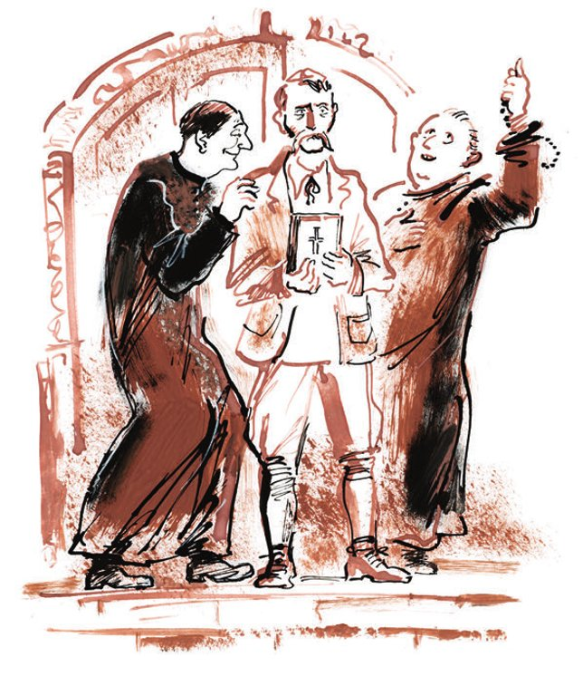
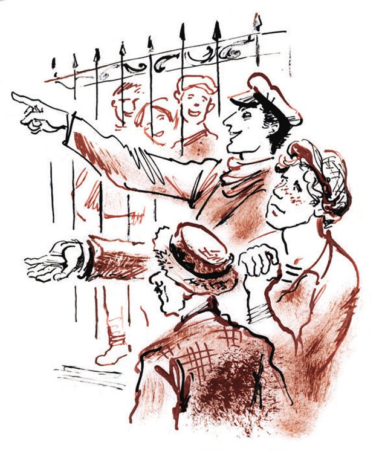

## Kapitel 17: Der verlorene Sohn kehrt heim

Der große Kombinator mochte keine katholischen <abbr title="der Priester, die Priester — священник; здесь: ксендз">Priester</abbr>. Genauso <abbr title="ablehnend — отрицательно">ablehnend</abbr> stand er den <abbr title="der Rabbiner, die Rabbiner — раввин">Rabbinern</abbr>, den Dalai-Lamas, den orthodoxen <abbr title="der Pope, die Popen — поп">Popen</abbr>, den <abbr title="der Muezzin, die Muezzins — муэдзин">Muezzins</abbr>, den <abbr title="der Schamane, die Schamanen — шаман">Schamanen</abbr> und allen anderen <abbr title="der Diener des Kults — служитель культа">Dienern des Kults</abbr> gegenüber.

— Ich selbst <abbr title="neigen zu + Dat. — быть склонным к">neige</abbr> zu <abbr title="der Betrug — обман">Betrug</abbr> und <abbr title="die Erpressung, die Erpressungen — шантаж, вымогательство">Erpressung</abbr>, — sagte er. — Zum Beispiel bin ich gerade dabei, einem sturen Bürger eine große Summe <abbr title="ablocken — выманивать">abzulocken</abbr>. Aber ich <abbr title="begleiten — сопровождать">begleite</abbr> meine zweifelhaften <abbr title="die Handlung, die Handlungen — действие, поступок">Handlungen</abbr> weder mit <abbr title="der Gesang, die Gesänge — песнопение">Gesängen</abbr> noch mit dem Dröhnen einer <abbr title="die Orgel, die Orgeln — орган">Orgel</abbr> noch mit dummen <abbr title="der Zauberspruch, die Zaubersprüche — заклинание">Zaubersprüchen</abbr> auf Latein oder Kirchenslawisch. Überhaupt arbeite ich lieber ohne Weihrauch und <abbr title="astral — астральный">astrale</abbr> Glöckchen.

Während Balaganow und Panikowski <abbr title="einander ins Wort fallen — перебивать друг друга">einander ins Wort fielen</abbr> und vom bösen Schicksal des «Antilope»-Fahrers erzählten, füllte sich Ostaps tapferes Herz mit Zorn und Ärger.

Die Priester hatten die Seele von Adam Koslewitsch auf einem <abbr title="der Einkehrhof, die Einkehrhöfe — постоялый двор">Einkehrhof</abbr> <abbr title="einfangen (fing ein, hat eingefangen) — поймать, уловить">eingefangen</abbr>. Dort stand die «Antilope» zwischen deutschen <abbr title="der Planwagen, die Planwagen — фургон">Planwagen</abbr> mit zwei Pferden und moldauischen Obstkarren im <abbr title="der Mistbrei — навозная каша">Mistbrei</abbr>. Pater Kuschakowski kam öfter auf den Hof, um mit den katholischen <abbr title="der Siedler, die Siedler — колонист, поселенец">Siedlern</abbr> <abbr title="fromm — благочестивый">fromme</abbr> Gespräche zu führen. Als der Diener des Kults die «Antilope» bemerkte, ging er einmal um sie herum und <abbr title="berühren — трогать">berührte</abbr> mit dem Finger einen Reifen. Er sprach mit Koslewitsch und erfuhr, dass Adam Kasimirowitsch zur römisch-katholischen Kirche gehörte, aber schon seit etwa zwanzig Jahren nicht mehr <abbr title="beichten — исповедоваться">gebeichtet</abbr> hatte. Pater Kuschakowski sagte: «Nicht gut, nicht gut, Pan Koslewitsch», und ging weg. Dabei hob er mit beiden Händen seinen schwarzen Rock und sprang über die <abbr title="schäumend — пенистый">schäumenden</abbr> <abbr title="die Bierpfütze, die Bierpfützen — пивная лужа">Bierpfützen</abbr>.

Am nächsten Tag, in aller <abbr title="in aller Herrgottsfrühe — ни свет ни заря">Herrgottsfrühe</abbr>, als die Fuhrleute die nervösen kleinen <abbr title="der Schieber, die Schieber — спекулянт">Schieber</abbr> zum Markt in das Städtchen Koschary fuhren, fünfzehn Mann in einem Wagen, erschien Pater Kuschakowski wieder. Diesmal begleitete ihn noch ein Priester: Alois Moroschek. Während Kuschakowski Adam Kasimirowitsch begrüßte, sah sich Pater Moroschek das Auto genau an. Er berührte nicht nur den Reifen mit dem Finger, sondern drückte sogar auf die Gummibirne der Hupe, und es ertönte der Matchiche. Danach wechselten die Priester einen Blick, traten von zwei Seiten an Koslewitsch heran und begannen, ihn <abbr title="jemanden einwickeln — охмурять, обрабатывать">einzuwickeln</abbr>. Sie wickelten ihn den ganzen Tag ein. Sobald Kuschakowski verstummte, setzte Moroschek ein. Und kaum hatte dieser eine Pause gemacht, um sich den <abbr title="der Schweiß — пот">Schweiß</abbr> abzuwischen, nahm sich wieder Kuschakowski Adam vor. Manchmal hob Kuschakowski seinen gelben Zeigefinger zum Himmel, und Moroschek ließ inzwischen den <abbr title="der Rosenkranz, die Rosenkränze — чётки">Rosenkranz</abbr> durch die Finger gleiten. Manchmal ließ aber Kuschakowski den Rosenkranz gleiten, und Moroschek zeigte zum Himmel. Ein paar Mal begannen die Priester leise auf Latein zu singen, und schon am Abend des ersten Tages sang Adam Kasimirowitsch mit. Dabei warfen beide Patres einen sachlichen Blick auf das Auto.

Nach einiger Zeit bemerkte Panikowski eine Veränderung an dem Besitzer der «Antilope». Adam Kasimirowitsch sprach <abbr title="unklar — смутный">unklare</abbr> Worte über das <abbr title="das Himmelreich — царствие небесное">Himmelreich</abbr>. Das bestätigte auch Balaganow. Dann verschwand Koslewitsch immer öfter für lange Zeit, und schließlich zog er ganz vom Hof weg.

— Warum haben Sie mir das nicht gemeldet? — <abbr title="sich empören — возмущаться">empörte sich</abbr> der große Kombinator.

Sie wollten es melden, aber sie hatten Angst vor dem Zorn des Kommandeurs. Sie hofften, dass Koslewitsch <abbr title="zur Vernunft kommen — опомниться">zur Vernunft kommen</abbr> und von selbst zurückkehren würde. Aber jetzt war alle Hoffnung verloren. Die Priester hatten ihn endgültig eingewickelt. Erst gestern hatten der Bote und der Bevollmächtigte für Hufe Koslewitsch zufällig getroffen. Er saß im Auto vor dem Eingang der katholischen Kirche. Sie konnten nicht schnell genug zu ihm hingehen. Aus der Kirche kam Pater Alois Moroschek mit einem Jungen in Spitzen.

— Verstehen Sie, Bender, — sagte Schura, — die ganze <abbr title="die Bande, die Banden — шайка, кодло">Bande</abbr> setzte sich in unsere «Antilope», der arme Koslewitsch nahm die Mütze ab, der Junge <abbr title="läuten — звонить">läutete</abbr> mit einem Glöckchen, und sie fuhren los. Es tat einem richtig weh, unseren Adam so zu sehen. Die «Antilope» sehen wir nie wieder.

Ohne ein Wort setzte der große Kombinator seine Kapitänsmütze mit dem lackierten <abbr title="der Schirm, die Schirme — козырёк">Schirm</abbr> auf und ging zum Ausgang.

— Funt, — sagte er, — Sie bleiben im Büro! Hörner und Hufe werden <abbr title="unter keinen Umständen — ни под каким видом">unter keinen Umständen</abbr> angenommen. Wenn Post kommt, werfen Sie sie in den Korb. Die <abbr title="die Schreibkraft, die Schreibkräfte — конторщица">Schreibkraft</abbr> sortiert sie später. Verstanden?

Als der Sitzvorsitzende den Mund zur Antwort öffnete (das geschah genau fünf Minuten später), waren die verwaisten Antilopen-Leute schon weit weg. An der Spitze des Zuges <abbr title="stürmen — нестись">stürmte</abbr> mit riesigen Schritten der Kommandeur. <abbr title="ab und zu — изредка">Ab und zu</abbr> drehte er den Kopf nach hinten und murmelte: «Den zarten Koslewitsch habt ihr nicht <abbr title="beschützen — уберечь, защитить">beschützt</abbr>, ihr <abbr title="der Melancholiker, die Melancholiker — меланхолик">Melancholiker</abbr>! Ich <abbr title="desavouieren — дезавуировать, отрекаться">desavouiere</abbr> euch alle! Ach, diese schwarze und weiße <abbr title="die Geistlichkeit — духовенство">Geistlichkeit</abbr>!» Der Bordmechaniker ging schweigend und tat so, als ob die Vorwürfe nicht ihn betrafen. Panikowski hüpfte wie ein <abbr title="der Affe, die Affen — обезьяна">Affe</abbr> und heizte sein <abbr title="das Rachegefühl — чувство мести">Rachegefühl</abbr> gegen die <abbr title="der Entführer, die Entführer — похититель">Entführer</abbr> von Koslewitsch an, obwohl ihm ein großer, kalter <abbr title="der Frosch, die Frösche — лягушка">Frosch</abbr> auf der Seele lag. Er fürchtete sich vor den schwarzen Priestern, denn er glaubte, dass sie viele <abbr title="die Zauberkraft, die Zauberkräfte — волшебная сила">Zauberkräfte</abbr> hatten.

In dieser Ordnung kam die ganze Abteilung zur Beschaffung von Hörnern und Hufen am <abbr title="der Fuß, die Füße — здесь: подножие">Fuß</abbr> der Kirche an. Vor einem eisernen Gitter aus <abbr title="die Spirale, die Spiralen — спираль">Spiralen</abbr> und Kreuzen stand die leere «Antilope». Die Kirche war gewaltig. Sie stach in den Himmel, stachelig und spitz wie eine <abbr title="die Gräte, die Gräten — рыбья кость">Gräte</abbr>. Sie blieb einem im Hals stecken. Glatt polierte rote Ziegel, <abbr title="die Dachschräge, die Dachschrägen — скат крыши">Dachschrägen</abbr> aus Dachziegeln, Fahnen aus Blech, fensterlose <abbr title="der Strebepfeiler, die Strebepfeiler — контрфорс">Strebepfeiler</abbr> und schöne <abbr title="das Götzenbild, die Götzenbilder — идол">Götzenbilder</abbr> aus Stein, die sich in <abbr title="die Nische, die Nischen — ниша">Nischen</abbr> vor dem Regen versteckten – diese ganze lange, <abbr title="soldatisch — солдатский">soldatische</abbr> <abbr title="die Gotik — готика">Gotik</abbr> fiel sofort über die Antilopen-Leute her. Sie fühlten sich klein. Ostap stieg ins Auto, zog die Luft durch die Nase ein und sagte voller Ekel:

— Pfui! Widerlich! Unsere «Antilope» riecht schon nach <abbr title="die Kerze, die Kerzen — свеча">Kerzen</abbr>, nach <abbr title="die Spendenbüchse, die Spendenbüchsen — кружка для пожертвований">Spendenbüchsen</abbr> für den Kirchenbau und nach den <abbr title="der Stiefel, die Stiefel — сапог">Stiefeln</abbr> der Priester. Natürlich ist es angenehmer, mit dem Auto zu <abbr title="die Taufe, die Taufen — крестины">Taufen</abbr> und <abbr title="das Begräbnis, die Begräbnisse — похороны">Begräbnissen</abbr> zu fahren als mit der Droschke. Und dazu noch umsonst! Nein, liebe Väterchen, unsere Geschäfte sind wichtiger!

Mit diesen Worten trat Bender in den Kirchhof. Er ging zwischen Kindern hindurch, die auf dem Asphalt <abbr title="Himmel und Hölle spielen — играть в классики">Himmel und Hölle</abbr> spielten, und stieg eine <abbr title="die Granittreppe, die Granittreppen — гранитная лестница">Granittreppe</abbr> hinauf, die aussah wie vor einer Bank. Sie führte zu den Türen des Gotteshauses. Die dicken Türen waren mit Eisenbändern <abbr title="beschlagen — обитый">beschlagen</abbr>. Darauf saßen in kleinen Quadraten <abbr title="der/die Heilige, die Heiligen — святой">Heilige</abbr> als <abbr title="das Relief, die Reliefs — барельеф">Relief</abbr>. Sie warfen sich <abbr title="die Kusshand, die Kusshände — воздушный поцелуй">Kusshände</abbr> zu, zeigten mit den Händen in verschiedene Richtungen oder <abbr title="sich vergnügen — развлекаться">vergnügten sich</abbr> mit dicken Büchern, auf die der gewissenhafte <abbr title="der Schnitzer, die Schnitzer — резчик">Schnitzer</abbr> sogar kleine lateinische Buchstaben <abbr title="schnitzen — вырезать">geschnitzt</abbr> hatte. Der große Kombinator zog an der Tür, aber sie <abbr title="nachgeben (gab nach, hat nachgegeben) — поддаваться">gab nicht nach</abbr>. Von innen kamen sanfte Töne eines <abbr title="das Harmonium, die Harmonien — фисгармония">Harmoniums</abbr>.

— Sie wickeln ihn ein! — rief Ostap und stieg die Treppe hinunter. — Das Einwickeln ist in vollem Gang! Unter dem süßen <abbr title="das Geplapper — лепет">Geplapper</abbr> der Mandoline.

— Vielleicht gehen wir lieber? — fragte Panikowski und drehte den Hut in den Händen. — Es ist doch ein Gotteshaus. Das <abbr title="sich gehören — прилично (быть)">gehört sich nicht</abbr>.

Aber Ostap beachtete ihn nicht. Er ging zur «Antilope» und begann ungeduldig auf die Gummibirne zu drücken. Er spielte den Matchiche so lange, bis hinter den dicken Türen Schlüssel klirrten. Die Antilopen-Leute hoben die Köpfe. Die Tür öffnete sich in zwei Hälften, und die lustigen Heiligen in ihren <abbr title="das Eichenquadrat — дубовый квадратик">Eichenquadraten</abbr> fuhren langsam nach innen. Aus dem Dunkel des Portals trat Adam Kasimirowitsch auf die hohe, helle Vortreppe. Er war blass. Sein <abbr title="der Schaffnerschnurrbart — кондукторские усы">Schaffnerschnurrbart</abbr> war feucht geworden und hing kläglich aus den Nasenlöchern. In den Händen hielt er ein Gebetbuch. Von beiden Seiten <abbr title="stützen — поддерживать">stützten</abbr> ihn die Priester: links Pater Kuschakowski, rechts Pater Alois Moroschek. Die Augen der Patres <abbr title="schwimmen (schwamm, ist geschwommen) — плавать">schwammen</abbr> in heiligem <abbr title="das Öl — масло; здесь: елей">Öl</abbr>.

— Hallo, Koslewitsch! — rief Ostap von unten. — Haben Sie noch nicht <abbr title="genug von etwas haben — надоесть">genug davon</abbr>?

— Guten Tag, Adam Kasimirowitsch, — sagte Panikowski frech, aber er versteckte sich dabei hinter dem Rücken des Kommandeurs.

Balaganow hob zum Gruß die Hand und schnitt eine <abbr title="die Grimasse, die Grimassen — гримаса, рожа">Grimasse</abbr>. Das bedeutete offenbar: «Adam, lassen Sie die Witze!»

Der Körper des «Antilope»-Fahrers machte einen Schritt nach vorn. Aber seine Seele, von beiden Seiten von den <abbr title="durchdringend — пронзительный">durchdringenden</abbr> Blicken Kuschakowskis und Moroscheks <abbr title="antreiben (trieb an, hat angetrieben) — подстёгивать">angetrieben</abbr>, zuckte zurück. Koslewitsch sah seine Freunde traurig an und senkte den Blick.

Und es begann der große Kampf um die unsterbliche Seele des Chauffeurs.

— He, ihr <abbr title="der Cherub, die Cherubim — херувим">Cherubim</abbr> und Seraphim! — sagte Ostap und <abbr title="auffordern — вызывать">forderte</abbr> die Feinde zum <abbr title="das Streitgespräch, die Streitgespräche — диспут">Streitgespräch</abbr> auf. — Es gibt keinen Gott!

— Doch, es gibt ihn, — widersprach Pater Alois Moroschek und <abbr title="decken — заслонять">deckte</abbr> Koslewitsch mit seinem Körper.

— Das ist doch reines <abbr title="das Rowdytum — хулиганство">Rowdytum</abbr>, — murmelte Pater Kuschakowski.

— Gibt es nicht, gibt es nicht, — sprach der große Kombinator weiter, — und hat es nie gegeben. Das ist eine medizinische Tatsache.

— Ich halte dieses Gespräch für <abbr title="unangebracht — неуместный">unangebracht</abbr>, — erklärte Kuschakowski ärgerlich.

— Und ein Auto wegnehmen – das ist <abbr title="angebracht — уместный">angebracht</abbr>? — schrie der <abbr title="taktlos — бестактный">taktlose</abbr> Balaganow. — Adam! Die wollen doch nur die «Antilope»!

Als der Chauffeur das hörte, hob er den Kopf und sah die Priester fragend an. Die Priester wurden unruhig. Mit <abbr title="rascheln — шуршать, шелестеть">raschelnden</abbr> <abbr title="die Soutane, die Soutanen — сутана">Soutanen</abbr> aus Seide versuchten sie, Koslewitsch zurück in die Kirche zu führen. Aber er sträubte sich.

— Und wie ist das nun mit Gott? — bestand der große Kombinator darauf.

Die Priester mussten eine Diskussion beginnen. Die Kinder hörten auf, auf einem Bein zu hüpfen, und kamen näher.

— Wie können Sie behaupten, dass es keinen Gott gibt, — begann Alois Moroschek mit inniger Stimme, — wenn doch alles Lebendige von ihm <abbr title="erschaffen (erschuf, hat erschaffen) — создавать, творить">erschaffen</abbr> wurde!..

— Ich weiß, ich weiß, — sagte Ostap, — ich bin selbst ein alter Katholik und <abbr title="der Lateiner, die Lateiner — латинист">Lateiner</abbr>. Puer, socer, vesper, gener, liber, miser, asper, tener.

Diese lateinischen Ausnahmen hatte Ostap in der dritten Klasse des privaten Gymnasiums Iliadi <abbr title="auswendig lernen — зазубрить, выучить наизусть">auswendig gelernt</abbr>. Seitdem saßen sie sinnlos in seinem Kopf. Aber auf Koslewitsch hatten sie eine magnetische Wirkung. Seine Seele <abbr title="sich vereinigen — соединяться">vereinigte sich</abbr> wieder mit dem Körper, und nach dieser <abbr title="die Vereinigung — объединение">Vereinigung</abbr> machte der Chauffeur schüchtern einen Schritt nach vorn.

— Mein Sohn, — sagte Kuschakowski und sah Ostap voller Hass an, — Sie irren sich, mein Sohn. Die <abbr title="das Wunder, die Wunder — чудо">Wunder</abbr> des Herrn <abbr title="zeugen von + Dat. — свидетельствовать о">zeugen</abbr> …

— Pater! Hören Sie auf zu <abbr title="schwafeln — трепаться">schwafeln</abbr>! — sagte der große Kombinator streng. — Ich habe selbst Wunder <abbr title="vollbringen (vollbrachte, hat vollbracht) — совершать, творить">vollbracht</abbr>. Erst vor vier Jahren musste ich in einem kleinen Städtchen ein paar Tage lang Jesus Christus sein. Und alles war in Ordnung. Ich habe sogar mit fünf Broten mehrere tausend <abbr title="der/die Gläubige, die Gläubigen — верующий">Gläubige</abbr> <abbr title="speisen — кормить">gespeist</abbr>. Gespeist habe ich sie schon, aber was war das für ein <abbr title="das Gedränge — давка">Gedränge</abbr>!

Das Streitgespräch ging in dieser seltsamen Art weiter. Ostaps Argumente <abbr title="überzeugen — убеждать">überzeugten</abbr> nicht, aber sie waren lustig, und sie wirkten auf Koslewitsch sehr <abbr title="belebend — живительно">belebend</abbr>. Auf den Wangen des Chauffeurs zeigte sich ein <abbr title="der Hauch — оттенок, лёгкий налёт">Hauch</abbr> von Röte, und sein Schnurrbart hob sich langsam nach oben.

— Los, los! — kamen <abbr title="aufmunternd — ободряющий">aufmunternde</abbr> Rufe hinter den Spiralen und Kreuzen des Gitters, wo sich schon eine große Menge Neugieriger versammelt hatte. — Erzähl ihnen vom Papst in Rom, vom <abbr title="der Kreuzzug, die Kreuzzüge — крестовый поход">Kreuzzug</abbr>!

Ostap erzählte auch vom Papst. Er <abbr title="brandmarken — клеймить">brandmarkte</abbr> Alexander Borgia für sein schlechtes Benehmen, erwähnte <abbr title="ohne jeden Zusammenhang — ни к селу ни к городу">ohne jeden Zusammenhang</abbr> den heiligen Serafim von Sarow und stürzte sich besonders auf die <abbr title="die Inquisition — инквизиция">Inquisition</abbr>, die Galilei verfolgt hatte. Er geriet so in <abbr title="in Fahrt geraten — увлечься, разойтись">Fahrt</abbr>, dass er Kuschakowski und Moroschek persönlich für das Unglück des großen <abbr title="der/die Gelehrte, die Gelehrten — учёный">Gelehrten</abbr> beschuldigte. Das war der letzte <abbr title="der Tropfen, die Tropfen — капля">Tropfen</abbr>. Als Adam Kasimirowitsch vom schrecklichen Schicksal Galileis hörte, legte er schnell das Gebetbuch auf eine Stufe und fiel in Balaganows Umarmung, die so breit war wie ein Tor. Panikowski <abbr title="sich herumdrücken — тереться, крутиться">drückte sich</abbr> gleich daneben herum und streichelte dem verlorenen Sohn die <abbr title="rau — шершавый">rauen</abbr> Wangen. In der Luft hingen glückliche Küsse.

— Pan Koslewitsch! — stöhnten die Priester. — Dokąd pan idzie? Opamiętaj się, panie!

Aber die Helden der Autorallye setzten sich schon ins Auto.

— Na, sehen Sie, — rief Ostap den <abbr title="betrübt — опечаленный">betrübten</abbr> Priestern zu und nahm den Platz des Kommandeurs ein, — ich habe Ihnen doch gesagt, dass es keinen Gott gibt. Eine wissenschaftliche Tatsache. Lebt wohl, Priester! <abbr title="auf Wiedersehen — до свидания">Auf Wiedersehen</abbr>, Patres!

Unter den <abbr title="zustimmend — одобрительный">zustimmenden</abbr> Rufen der Menge fuhr die «Antilope» ab, und bald verschwanden die Blechfahnen und Dachschrägen der Kirche aus den Augen. <abbr title="vor Freude — на радостях">Vor Freude</abbr> hielten die Antilopen-Leute vor einer <abbr title="die Bierstube, die Bierstuben — пивная">Bierstube</abbr>.

— Vielen Dank, Brüder, — sagte Koslewitsch und hielt einen schweren <abbr title="der Bierkrug, die Bierkrüge — пивная кружка">Bierkrug</abbr> in der Hand. — Ich war schon fast verloren. Die Priester haben mich eingewickelt. Besonders Kuschakowski. Oh, ist der <abbr title="schlau — хитрый">schlau</abbr>, der Teufel! Glauben Sie mir, er hat mich <abbr title="fasten — поститься">fasten</abbr> lassen! Sonst, sagt er, komme ich nicht in den Himmel.

— Der Himmel! — sagte Ostap. — Der Himmel ist jetzt <abbr title="veröden — приходить в запустение">verödet</abbr>. Nicht die richtige Epoche. Nicht der richtige <abbr title="der Zeitabschnitt, die Zeitabschnitte — отрезок времени">Zeitabschnitt</abbr>. Die Engel wollen jetzt auf die Erde. Auf der Erde ist es schön, da gibt es <abbr title="fließendes Wasser — водопровод; коммунальные удобства">fließendes Wasser</abbr> und Strom, da gibt es ein <abbr title="das Planetarium, die Planetarien — планетарий">Planetarium</abbr>, und man kann sich die Sterne ansehen, mit einem <abbr title="antireligiös — антирелигиозный">antireligiösen</abbr> Vortrag dazu.

Nach dem achten Krug verlangte Koslewitsch einen neunten, hob ihn hoch über den Kopf, lutschte an seinem Schaffnerschnurrbart und fragte begeistert:

— Es gibt keinen Gott?

— Nein, — antwortete Ostap.

— Also gibt es keinen? Na dann, <abbr title="zum Wohl! — будем здоровы!">zum Wohl</abbr>!

So trank er von da an weiter und sagte vor jedem neuen Krug:

— Gibt es Gott? Gibt es keinen? Na dann, zum Wohl!

Panikowski trank genauso viel wie die anderen, aber über Gott <abbr title="sich äußern — высказываться">äußerte er sich</abbr> nicht. Er wollte sich in diese <abbr title="umstritten — спорный">umstrittene</abbr> Sache nicht einmischen.

Mit der <abbr title="die Rückkehr — возвращение">Rückkehr</abbr> des verlorenen Sohnes und der «Antilope» bekam die Tschernomorsker Filiale des Arbatower Büros zur Beschaffung von Hörnern und Hufen den Glanz, der ihr noch gefehlt hatte. Vor der Tür des ehemaligen Kombinats der fünf Privatunternehmer wartete jetzt immer ein Auto. Natürlich konnte es sich nicht mit den blauen «Buicks» und den langen «Lincolns» messen, nicht einmal mit den kleinen Ford-Kutschen. Aber trotzdem war es ein Auto, ein Automobil, ein <abbr title="das Fahrzeug, die Fahrzeuge — экипаж, транспортное средство">Fahrzeug</abbr>, das, wie Ostap sagte, trotz all seiner Mängel immerhin manchmal ohne die Hilfe von Pferden durch die Straßen fahren konnte.

Ostap arbeitete mit Begeisterung. Hätte er seine Kräfte in die echte Beschaffung von Hörnern oder Hufen gesteckt, dann hätte die <abbr title="das Mundstück, die Mundstücke — мундштук">Mundstück</abbr>- und <abbr title="die Kammindustrie — гребеночное производство">Kammindustrie</abbr> wohl bis zum Ende des laufenden <abbr title="das Haushaltsjahrhundert — бюджетное столетие">Haushaltsjahrhunderts</abbr> genug Rohstoff gehabt. Aber der Leiter des Büros beschäftigte sich mit ganz anderen Dingen.

Ostap ließ Funt und Berlaga <abbr title="vorerst — пока, на первое время">vorerst</abbr> in Ruhe. Was sie erzählt hatten, war sehr interessant, aber es führte noch nicht direkt zu Koreiko. Nun beschloss er, sich im Interesse der Sache mit Sossja Sinizkaja anzufreunden. Zwischen zwei höflichen Küssen unter einer nächtlichen Akazie wollte er die Frage nach Alexander Iwanowitsch abklopfen, und zwar nicht so sehr nach ihm selbst als nach seinen Geldgeschäften. Aber eine lange <abbr title="die Beobachtung, die Beobachtungen — наблюдение">Beobachtung</abbr> durch den Bevollmächtigten für Hufe zeigte, dass es zwischen Sossja und Koreiko keine Liebe gab. Koreiko trat, wie Schura es sagte, umsonst auf der Stelle.

— Wo keine Liebe ist, — kommentierte Ostap mit einem Seufzer, — da spricht man nicht über Geld. Legen wir das Mädchen <abbr title="beiseite — в сторону">beiseite</abbr>.

Koreiko dachte mit einem Lächeln an den Gauner mit der Milizmütze, der einen jämmerlichen Versuch einer drittklassigen Erpressung gemacht hatte. Zur gleichen Zeit raste der Leiter der Filiale im gelben Auto durch die Stadt. Er fand Menschen und <abbr title="das Menschlein — людишки">Menschlein</abbr>, die der Millionär aus dem Büro längst vergessen hatte, die sich aber gut an ihn erinnerten. Ein paar Mal telefonierte Ostap mit Moskau. Er ließ einen bekannten Privatunternehmer ans Telefon rufen, einen <abbr title="ausgekocht — прожжённый, тёртый">ausgekochten</abbr> Kenner von <abbr title="das Geschäftsgeheimnis, die Geschäftsgeheimnisse — коммерческая тайна">Geschäftsgeheimnissen</abbr>. Jetzt kamen Briefe und Telegramme ins Büro. Ostap <abbr title="herausfischen — выуживать">fischte</abbr> sie schnell aus der übrigen Post heraus. Diese war wie früher voll von Einladungen zu Sitzungen, <abbr title="die Bestellung, die Bestellungen — заявка, требование">Bestellungen</abbr> von Hörnern und Verweisen wegen der nicht genug <abbr title="energisch — энергичный">energischen</abbr> Beschaffung von Hufen. Einiges aus diesen Briefen und Telegrammen kam in die Mappe mit den Schnürsenkeln.

Ende Juli machte sich Ostap bereit für eine Dienstreise in den Kaukasus. Die Sache verlangte die persönliche <abbr title="die Anwesenheit — присутствие">Anwesenheit</abbr> des großen Kombinators in einer kleinen <abbr title="die Weinbaurepublik — виноградная республика">Weinbaurepublik</abbr>.

Am Tag der <abbr title="die Abreise — отъезд">Abreise</abbr> des Chefs kam es in der Filiale zu einem <abbr title="skandalös — скандальный">skandalösen</abbr> <abbr title="der Vorfall, die Vorfälle — происшествие">Vorfall</abbr>. Panikowski wurde mit dreißig Rubeln zum Hafen geschickt, um eine Fahrkarte zu kaufen. Nach einer halben Stunde kam er zurück, betrunken, ohne Fahrkarte und ohne Geld. Zu seiner <abbr title="die Rechtfertigung — оправдание">Rechtfertigung</abbr> konnte er nichts sagen. Er <abbr title="umstülpen — выворачивать">stülpte</abbr> nur seine Taschen um, die dann herunterhingen wie die Löcher eines Billardtisches, und lachte ohne Pause. Alles brachte ihn zum Lachen: der Zorn des Kommandeurs, der <abbr title="vorwurfsvoll — укоризненный">vorwurfsvolle</abbr> Blick von Balaganow, der Samowar, um den er sich kümmern sollte, und Funt, der mit dem Panamahut über der Nase an seinem Tisch döste. Als Panikowski aber die Hirschgeweihe sah, den Stolz und Schmuck des Büros, packte ihn ein solches Lachen, dass er auf den Boden fiel. Bald schlief er dort ein, mit einem fröhlichen Lächeln auf den violetten Lippen.

— Jetzt sind wir eine richtige Behörde, — sagte Ostap. — Wir haben unseren eigenen <abbr title="der Veruntreuer, die Veruntreuer — растратчик">Veruntreuer</abbr>, und der ist gleichzeitig der versoffene Portier. Diese zwei <abbr title="der Typ, die Typen — тип">Typen</abbr> machen alle unsere <abbr title="die Unternehmung, die Unternehmungen — начинание">Unternehmungen</abbr> glaubwürdig.

Während Ostap weg war, erschienen Alois Moroschek und Kuschakowski mehrmals unter den Fenstern des Büros. Wenn Koslewitsch die Priester sah, versteckte er sich in der hintersten Ecke der Behörde. Die Priester öffneten die Tür, sahen hinein und riefen leise:

— Pan Koslewitsch! Pan Koslewitsch! Czy słyszysz głos Ojca Niebieskiego? Opamiętaj się, panie!

Dabei hob Pater Kuschakowski den Finger zum Himmel, und Pater Alois Moroschek ließ den Rosenkranz durch die Finger gleiten. Dann ging Balaganow den Dienern des Kults entgegen und zeigte ihnen schweigend seine <abbr title="feuerrot — огненный">feuerrote</abbr> <abbr title="die Faust, die Fäuste — кулак">Faust</abbr>. Und die Priester gingen weg und warfen traurige Blicke auf die «Antilope».

Ostap kam nach zwei Wochen zurück. Die ganze Behörde holte ihn ab. Von der hohen schwarzen Wand des <abbr title="anlegen — причаливать, швартоваться">anlegenden</abbr> Dampfers sah der große Kombinator freundlich und liebevoll auf seine <abbr title="der/die Untergebene, die Untergebenen — подчинённый">Untergebenen</abbr>. Er roch nach jungem <abbr title="das Lamm, die Lämmer — барашек, ягнёнок">Lamm</abbr> und nach Wein aus Imeretien.

In der Tschernomorsker Filiale saßen außer der Schreibkraft, die noch Ostap eingestellt hatte, zwei junge Männer in Stiefeln. Das waren Studenten, die die <abbr title="die Fachschule, die Fachschulen — техникум">Fachschule</abbr> für Viehzucht geschickt hatte. Sie sollten hier ein <abbr title="das Praktikum, die Praktika — практика, стажировка">Praktikum</abbr> machen.

— Na, wunderbar! — sagte Ostap <abbr title="säuerlich — кисло">säuerlich</abbr>. — Der <abbr title="der Nachwuchs — смена, молодое поколение">Nachwuchs</abbr> kommt. Nur müssen Sie bei mir richtig arbeiten, liebe Genossen. Sie wissen natürlich, dass Hörner, also <abbr title="der Auswuchs, die Auswüchse — вырост">Auswüchse</abbr>, die mit Fell oder einer harten <abbr title="die Hornschicht — роговой слой">Hornschicht</abbr> <abbr title="bedeckt — покрытый">bedeckt</abbr> sind, <abbr title="das Anhängsel, die Anhängsel — придаток">Anhängsel</abbr> des <abbr title="der Schädel, die Schädel — череп">Schädels</abbr> sind und hauptsächlich bei <abbr title="das Säugetier, die Säugetiere — млекопитающее">Säugetieren</abbr> vorkommen?

— Das wissen wir, — sagten die Studenten entschlossen. — Wir möchten nur unser Praktikum machen.

Die Studenten musste man auf eine komplizierte und ziemlich teure Art loswerden. Der große Kombinator schickte sie auf Dienstreise in die <abbr title="die Kalmückensteppe — калмыцкие степи">Kalmückensteppe</abbr>, um dort <abbr title="die Sammelstelle, die Sammelstellen — заготовительный пункт">Sammelstellen</abbr> zu gründen. Das kostete das Büro sechshundert Rubel, aber es gab keinen anderen Ausweg: Die Studenten hätten ihn sonst daran gehindert, eine Sache zu Ende zu bringen, die gerade so gut <abbr title="vorangehen (ging voran, ist vorangegangen) — продвигаться">voranging</abbr>.

Als Panikowski erfuhr, wie viel die Studenten gekostet hatten, nahm er Balaganow zur Seite und flüsterte gereizt:

— Und mich schickt man nicht auf Dienstreise. Und Urlaub bekomme ich auch nicht. Ich muss nach Jessentuki fahren, zur <abbr title="die Kur, die Kuren — лечение, курорт">Kur</abbr>. Freie Tage habe ich auch nicht, und <abbr title="die Arbeitskleidung — спецодежда">Arbeitskleidung</abbr> bekomme ich auch nicht. Nein, Schura, diese Bedingungen passen mir nicht. Und überhaupt habe ich erfahren, dass man beim «Herkules» besser bezahlt. Ich gehe dorthin, als Bote. Ehrenwort, mein edles Ehrenwort, ich gehe!

Am Abend rief Ostap wieder Berlaga zu sich.

— Auf die Knie! — schrie Ostap mit der Stimme Nikolaus' des Ersten, sobald er den Buchhalter sah.

Trotzdem war das Gespräch freundschaftlich und <abbr title="dauern — длиться">dauerte</abbr> zwei Stunden. Danach befahl Ostap, die «Antilope» am nächsten Morgen vor den Eingang des «Herkules» zu fahren.

---

### Neue Wörter

- **der Priester, die Priester** — священник; здесь: ксендз
- **ablehnend** — отрицательно
- **der Rabbiner, die Rabbiner** — раввин
- **der Pope, die Popen** — поп
- **der Muezzin, die Muezzins** — муэдзин
- **der Schamane, die Schamanen** — шаман
- **der Diener des Kults** — служитель культа
- **neigen zu + Dat.** — быть склонным к
- **der Betrug** — обман
- **die Erpressung, die Erpressungen** — шантаж, вымогательство
- **ablocken** — выманивать
- **begleiten** — сопровождать
- **die Handlung, die Handlungen** — действие, поступок
- **der Gesang, die Gesänge** — песнопение
- **die Orgel, die Orgeln** — орган
- **der Zauberspruch, die Zaubersprüche** — заклинание
- **astral** — астральный
- **einander ins Wort fallen** — перебивать друг друга
- **der Einkehrhof, die Einkehrhöfe** — постоялый двор
- **einfangen (fing ein, hat eingefangen)** — поймать, уловить
- **der Planwagen, die Planwagen** — фургон
- **der Mistbrei** — навозная каша
- **der Siedler, die Siedler** — колонист, поселенец
- **fromm** — благочестивый
- **berühren** — трогать
- **beichten** — исповедоваться
- **schäumend** — пенистый
- **die Bierpfütze, die Bierpfützen** — пивная лужа
- **in aller Herrgottsfrühe** — ни свет ни заря
- **der Schieber, die Schieber** — спекулянт
- **jemanden einwickeln** — охмурять, обрабатывать
- **der Schweiß** — пот
- **der Rosenkranz, die Rosenkränze** — чётки
- **unklar** — смутный
- **das Himmelreich** — царствие небесное
- **sich empören** — возмущаться
- **zur Vernunft kommen** — опомниться
- **die Bande, die Banden** — шайка, кодло
- **läuten** — звонить
- **der Schirm, die Schirme** — козырёк
- **unter keinen Umständen** — ни под каким видом
- **die Schreibkraft, die Schreibkräfte** — конторщица
- **stürmen** — нестись
- **ab und zu** — изредка
- **beschützen** — уберечь, защитить
- **der Melancholiker, die Melancholiker** — меланхолик
- **desavouieren** — дезавуировать, отрекаться
- **die Geistlichkeit** — духовенство
- **der Affe, die Affen** — обезьяна
- **das Rachegefühl** — чувство мести
- **der Entführer, die Entführer** — похититель
- **der Frosch, die Frösche** — лягушка
- **die Zauberkraft, die Zauberkräfte** — волшебная сила
- **der Fuß, die Füße** — здесь: подножие
- **die Spirale, die Spiralen** — спираль
- **die Gräte, die Gräten** — рыбья кость
- **die Dachschräge, die Dachschrägen** — скат крыши
- **der Strebepfeiler, die Strebepfeiler** — контрфорс
- **das Götzenbild, die Götzenbilder** — идол
- **die Nische, die Nischen** — ниша
- **soldatisch** — солдатский
- **die Gotik** — готика
- **die Kerze, die Kerzen** — свеча
- **die Spendenbüchse, die Spendenbüchsen** — кружка для пожертвований
- **der Stiefel, die Stiefel** — сапог
- **die Taufe, die Taufen** — крестины
- **das Begräbnis, die Begräbnisse** — похороны
- **Himmel und Hölle spielen** — играть в классики
- **die Granittreppe, die Granittreppen** — гранитная лестница
- **beschlagen** — обитый
- **der/die Heilige, die Heiligen** — святой
- **das Relief, die Reliefs** — барельеф
- **die Kusshand, die Kusshände** — воздушный поцелуй
- **sich vergnügen** — развлекаться
- **der Schnitzer, die Schnitzer** — резчик
- **schnitzen** — вырезать
- **nachgeben (gab nach, hat nachgegeben)** — поддаваться
- **das Harmonium, die Harmonien** — фисгармония
- **das Geplapper** — лепет
- **sich gehören** — прилично (быть)
- **das Eichenquadrat** — дубовый квадратик
- **der Schaffnerschnurrbart** — кондукторские усы
- **stützen** — поддерживать
- **schwimmen (schwamm, ist geschwommen)** — плавать
- **das Öl** — масло; здесь: елей
- **genug von etwas haben** — надоесть
- **die Grimasse, die Grimassen** — гримаса, рожа
- **durchdringend** — пронзительный
- **antreiben (trieb an, hat angetrieben)** — подстёгивать
- **der Cherub, die Cherubim** — херувим
- **auffordern** — вызывать
- **das Streitgespräch, die Streitgespräche** — диспут
- **decken** — заслонять
- **das Rowdytum** — хулиганство
- **unangebracht** — неуместный
- **angebracht** — уместный
- **taktlos** — бестактный
- **rascheln** — шуршать, шелестеть
- **die Soutane, die Soutanen** — сутана
- **erschaffen (erschuf, hat erschaffen)** — создавать, творить
- **der Lateiner, die Lateiner** — латинист
- **auswendig lernen** — зазубрить, выучить наизусть
- **sich vereinigen** — соединяться
- **die Vereinigung** — объединение
- **das Wunder, die Wunder** — чудо
- **zeugen von + Dat.** — свидетельствовать о
- **schwafeln** — трепаться
- **vollbringen (vollbrachte, hat vollbracht)** — совершать, творить
- **der/die Gläubige, die Gläubigen** — верующий
- **speisen** — кормить
- **das Gedränge** — давка
- **überzeugen** — убеждать
- **belebend** — живительно
- **der Hauch** — оттенок, лёгкий налёт
- **aufmunternd** — ободряющий
- **der Kreuzzug, die Kreuzzüge** — крестовый поход
- **brandmarken** — клеймить
- **ohne jeden Zusammenhang** — ни к селу ни к городу
- **die Inquisition** — инквизиция
- **in Fahrt geraten** — увлечься, разойтись
- **der/die Gelehrte, die Gelehrten** — учёный
- **der Tropfen, die Tropfen** — капля
- **sich herumdrücken** — тереться, крутиться
- **rau** — шершавый
- **betrübt** — опечаленный
- **auf Wiedersehen** — до свидания
- **zustimmend** — одобрительный
- **vor Freude** — на радостях
- **die Bierstube, die Bierstuben** — пивная
- **der Bierkrug, die Bierkrüge** — пивная кружка
- **schlau** — хитрый
- **fasten** — поститься
- **veröden** — приходить в запустение
- **der Zeitabschnitt, die Zeitabschnitte** — отрезок времени
- **fließendes Wasser** — водопровод; коммунальные удобства
- **das Planetarium, die Planetarien** — планетарий
- **antireligiös** — антирелигиозный
- **zum Wohl!** — будем здоровы!
- **sich äußern** — высказываться
- **umstritten** — спорный
- **die Rückkehr** — возвращение
- **das Fahrzeug, die Fahrzeuge** — экипаж, транспортное средство
- **das Mundstück, die Mundstücke** — мундштук
- **die Kammindustrie** — гребеночное производство
- **das Haushaltsjahrhundert** — бюджетное столетие
- **vorerst** — пока, на первое время
- **die Beobachtung, die Beobachtungen** — наблюдение
- **beiseite** — в сторону
- **das Menschlein** — людишки
- **ausgekocht** — прожжённый, тёртый
- **das Geschäftsgeheimnis, die Geschäftsgeheimnisse** — коммерческая тайна
- **herausfischen** — выуживать
- **die Bestellung, die Bestellungen** — заявка, требование
- **energisch** — энергичный
- **die Anwesenheit** — присутствие
- **die Weinbaurepublik** — виноградная республика
- **die Abreise** — отъезд
- **skandalös** — скандальный
- **der Vorfall, die Vorfälle** — происшествие
- **die Rechtfertigung** — оправдание
- **umstülpen** — выворачивать
- **vorwurfsvoll** — укоризненный
- **der Veruntreuer, die Veruntreuer** — растратчик
- **der Typ, die Typen** — тип
- **die Unternehmung, die Unternehmungen** — начинание
- **feuerrot** — огненный
- **die Faust, die Fäuste** — кулак
- **anlegen** — причаливать, швартоваться
- **der/die Untergebene, die Untergebenen** — подчинённый
- **das Lamm, die Lämmer** — барашек, ягнёнок
- **die Fachschule, die Fachschulen** — техникум
- **das Praktikum, die Praktika** — практика, стажировка
- **säuerlich** — кисло
- **der Nachwuchs** — смена, молодое поколение
- **der Auswuchs, die Auswüchse** — вырост
- **die Hornschicht** — роговой слой
- **bedeckt** — покрытый
- **das Anhängsel, die Anhängsel** — придаток
- **der Schädel, die Schädel** — череп
- **das Säugetier, die Säugetiere** — млекопитающее
- **die Kalmückensteppe** — калмыцкие степи
- **die Sammelstelle, die Sammelstellen** — заготовительный пункт
- **vorangehen (ging voran, ist vorangegangen)** — продвигаться
- **die Kur, die Kuren** — лечение, курорт
- **die Arbeitskleidung** — спецодежда
- **dauern** — длиться

[← Zurück](kapitel-17.md) · [Inhalt](README.md) · [Weiter →](kapitel-19.md)
