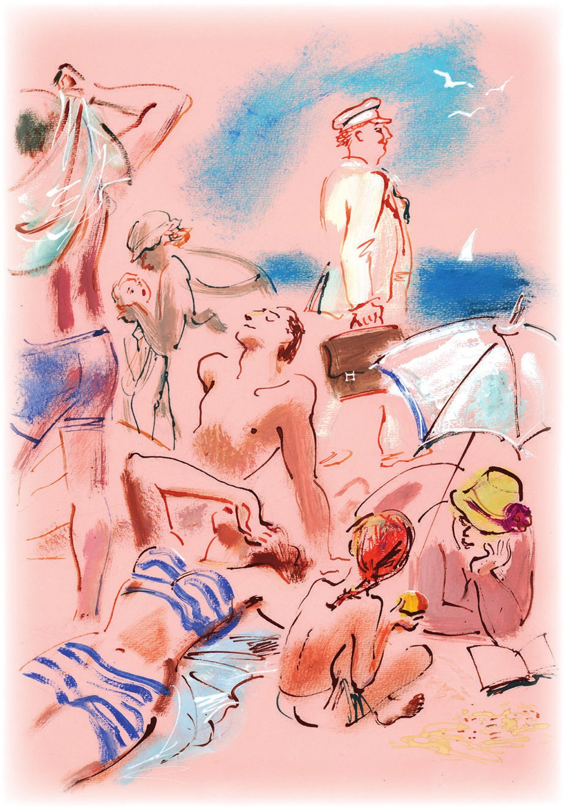
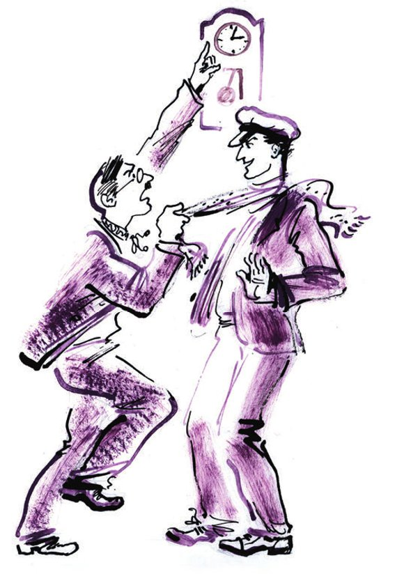
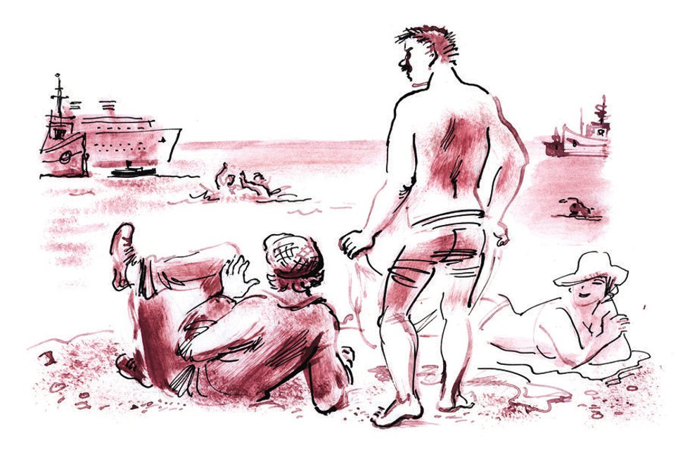

## Kapitel 18: Zu Lande und zu Wasser

Genosse Skumbrijewitsch kam an den <abbr title="der Strand, die Strände — пляж">Strand</abbr> und trug eine Aktentasche mit seinem Namen darauf. An der Tasche war eine silberne <abbr title="die Visitenkarte, die Visitenkarten — визитная карточка">Visitenkarte</abbr> mit <abbr title="umgebogen — загнутый">umgebogener</abbr> Ecke befestigt. Ihre sehr lange <abbr title="die Kursivschrift — курсив">Kursivschrift</abbr> machte klar, dass Jegor Skumbrijewitsch schon sein fünfjähriges <abbr title="das Dienstjubiläum, die Dienstjubiläen — юбилей службы">Dienstjubiläum</abbr> beim «Herkules» gefeiert hatte.

Er hatte ein sauberes, gerades, männliches Gesicht, wie ein Engländer auf einem <abbr title="das Werbeplakat, die Werbeplakate — рекламный плакат">Werbeplakat</abbr>, der sich gerade rasiert. Skumbrijewitsch blieb eine Weile an der <abbr title="die Tafel, die Tafeln — щит, доска">Tafel</abbr> stehen, auf der die Wassertemperatur mit Kreide angeschrieben war. Dann zog er mit Mühe seine Füße aus dem heißen Sand und ging los, um sich ein bequemeres Plätzchen zu suchen.

Im Lager der Badenden waren viele Menschen. Seine leichten Bauten entstanden jeden Morgen und verschwanden mit dem Sonnenuntergang wieder. Zurück blieben nur die <abbr title="der Abfall, die Abfälle — отходы, мусор">Abfälle</abbr> der Stadt im Sand: <abbr title="welk — увядший">welke</abbr> <abbr title="die Melonenschale, die Melonenschalen — дынная корка">Melonenschalen</abbr>, <abbr title="die Eierschale, die Eierschalen — яичная скорлупа">Eierschalen</abbr> und Fetzen von Zeitungen. Diese führen dann die ganze Nacht am leeren Ufer ein geheimes Leben, rascheln über irgendetwas und fliegen unter den <abbr title="der Felsen, die Felsen — скала">Felsen</abbr> herum.

Skumbrijewitsch <abbr title="sich einen Weg bahnen — пробираться">bahnte sich</abbr> einen Weg zwischen kleinen Hütten aus <abbr title="das Waffelhandtuch, die Waffelhandtücher — вафельное полотенце">Waffelhandtüchern</abbr>, Sonnenschirmen und Bettlaken, die man über Stöcke gespannt hatte. Darunter versteckten sich Mädchen in Badeanzügen mit kleinen Röckchen. Die Männer trugen auch Badeanzüge, aber nicht alle. Manche hatten nur <abbr title="das Feigenblatt, die Feigenblätter — фиговый листок">Feigenblätter</abbr>, und auch diese bedeckten keineswegs die biblischen Stellen, sondern die Nasen der Tschernomorsker Gentlemen. Das machten sie, damit sich die Haut auf der Nase nicht <abbr title="sich schälen — облезать, шелушиться">schälte</abbr>. So lagen die Männer in den freiesten <abbr title="die Haltung, die Haltungen — поза">Haltungen</abbr> da. Ab und zu bedeckten sie mit der Hand die biblische Stelle, gingen ins Wasser, tauchten kurz unter und liefen schnell zurück zu ihren Lagern im eingedrückten Sand. Sie wollten keinen einzigen <abbr title="der Kubikzentimeter — кубический сантиметр">Kubikzentimeter</abbr> des <abbr title="heilsam — целительный">heilsamen</abbr> Sonnenbades verlieren.

Was diesen Bürgern an Kleidung fehlte, <abbr title="ausgleichen (glich aus, hat ausgeglichen) — возмещать">glich</abbr> ein Gentleman von ganz anderer Art mehr als aus. Er trug <abbr title="die Knopfstiefelette, die Knopfstiefeletten — ботинки на пуговицах">Knopfstiefeletten</abbr> aus Chromleder, eine gestreifte <abbr title="die Anzughose, die Anzughosen — брюки (от визитки)">Anzughose</abbr>, eine bis oben <abbr title="zuknöpfen — застёгивать">zugeknöpfte</abbr> Jacke, einen Kragen, eine Krawatte, eine <abbr title="die Uhrkette, die Uhrketten — часовая цепочка">Uhrkette</abbr> und dazu einen Filzhut. Ein dicker Schnurrbart und Watte aus dem Fensterrahmen in den Ohren <abbr title="vervollständigen — дополнять">vervollständigten</abbr> das Bild dieses Mannes. Neben ihm steckte ein Spazierstock mit einem Knauf aus Glas <abbr title="senkrecht — перпендикулярно, вертикально">senkrecht</abbr> im Sand.

Die Hitze quälte ihn. Sein Kragen war vom Schweiß <abbr title="aufquellen (quoll auf, ist aufgequollen) — разбухать">aufgequollen</abbr>. Unter den Armen war es bei dem Gentleman so heiß wie in einem <abbr title="der Hochofen, die Hochöfen — доменная печь">Hochofen</abbr>; man hätte dort <abbr title="das Erz, die Erze — руда">Erz</abbr> <abbr title="schmelzen (schmolz, hat geschmolzen) — плавить">schmelzen</abbr> können. Aber er blieb <abbr title="regungslos — неподвижно">regungslos</abbr> liegen.

An jedem Strand der Welt kann man einen solchen Menschen treffen. Wer er ist, warum er gekommen ist, warum er in voller <abbr title="die Montur — обмундирование">Montur</abbr> daliegt – das weiß niemand. Aber solche Leute gibt es, einen an jedem Strand. Vielleicht sind es Mitglieder einer geheimen <abbr title="die Liga, die Ligen — лига">Liga</abbr> der Dummköpfe, oder die Reste des einst <abbr title="mächtig — могучий">mächtigen</abbr> Ordens der <abbr title="der Rosenkreuzer, die Rosenkreuzer — розенкрейцер">Rosenkreuzer</abbr>, oder verrückt gewordene Junggesellen – wer weiß …

Jegor Skumbrijewitsch <abbr title="sich niederlassen (ließ sich nieder, hat sich niedergelassen) — располагаться">ließ sich nieder</abbr> neben dem Mitglied der Liga der Dummköpfe und zog sich schnell aus. Der nackte Skumbrijewitsch sah dem angezogenen Skumbrijewitsch <abbr title="verblüffend — поразительно">verblüffend</abbr> <abbr title="unähnlich — непохожий">unähnlich</abbr>. Der <abbr title="hager — сухощавый">hagere</abbr> Kopf eines Engländers saß auf einem weißen Damenkörper mit <abbr title="abfallend — покатый">abfallenden</abbr> Schultern und einem sehr breiten <abbr title="das Becken, die Becken — таз">Becken</abbr>. Mit diesem Becken wackelnd ging Jegor zum Wasser, prüfte es mit einem Fuß und quiekte. Dann stellte er den zweiten Fuß ins Wasser und quiekte wieder. Danach machte er ein paar Schritte nach vorn, steckte die <abbr title="der Daumen, die Daumen — большой палец">Daumen</abbr> in die Ohren, schloss mit den Zeigefingern die Augen, <abbr title="zuklemmen — зажимать, прищемить">klemmte</abbr> mit den Mittelfingern die Nasenlöcher zu, stieß einen <abbr title="herzzerreißend — душераздирающий">herzzerreißenden</abbr> Schrei aus und tauchte viermal hintereinander unter. Erst nach alledem schwamm er los, mit weiten Armzügen, und drehte bei jedem Zug den Kopf zur Seite. Und die kleinen Wellen nahmen Jegor Skumbrijewitsch auf – einen vorbildlichen Herkules-Mann und hervorragenden Aktivisten. Fünf Minuten später drehte sich der müde Aktivist auf den Rücken, und sein runder Bauch, rund wie ein Globus, schaukelte auf der Oberfläche des Meeres. Da hörte man vom <abbr title="das Steilufer, die Steilufer — обрыв">Steilufer</abbr> über dem Strand den Matchiche der «Antilope».

Aus dem Auto stiegen Ostap Bender, Balaganow und der Buchhalter Berlaga. Auf Berlagas Gesicht lag völlige <abbr title="die Ergebenheit — покорность">Ergebenheit</abbr> in sein Schicksal. Alle drei gingen hinunter, <abbr title="mustern — разглядывать">musterten</abbr> ohne jede <abbr title="die Scheu — стеснение">Scheu</abbr> die Gesichter der Badenden und begannen, jemanden zu suchen.

— Das ist seine Hose, — sagte Berlaga endlich und blieb vor den Kleidern des <abbr title="ahnungslos — ничего не подозревающий">ahnungslosen</abbr> Skumbrijewitsch stehen. — Er ist wahrscheinlich weit hinausgeschwommen.

— Genug! — rief der große Kombinator. — Ich habe nicht <abbr title="vorhaben (hatte vor, hat vorgehabt) — намереваться">vor</abbr>, noch länger zu warten. Man muss nicht nur zu Lande, sondern auch zu Wasser handeln.

Er warf Anzug und Hemd ab. Darunter trug er eine <abbr title="die Badehose, die Badehosen — купальные трусы">Badehose</abbr>. Mit den Armen <abbr title="fuchteln — размахивать">fuchtelnd</abbr> stieg er ins Wasser. Auf der Brust des großen Kombinators war eine blaue <abbr title="die Tätowierung, die Tätowierungen — татуировка">Tätowierung</abbr> aus Schießpulver. Sie zeigte Napoleon mit <abbr title="der Dreispitz, die Dreispitze — треуголка">Dreispitz</abbr> und einem Bierkrug in der kurzen Hand.

— Balaganow! — rief Ostap schon aus dem Wasser. — Ziehen Sie Berlaga aus und machen Sie ihn bereit. Vielleicht brauchen wir ihn.

Und der große Kombinator schwamm auf der Seite los. Mit seiner <abbr title="kupfern — медный">kupfernen</abbr> Schulter teilte er das Wasser und hielt Kurs auf Nord-Nord-Ost, wo der <abbr title="perlmuttfarben — перламутровый">perlmuttfarbene</abbr> Bauch von Jegor Skumbrijewitsch schimmerte.

Bevor Ostap in die Tiefen des Meeres tauchte, hatte er auf dem <abbr title="das Festland — континент, суша">Festland</abbr> viel arbeiten müssen. Die <abbr title="die Hauptspur — магистральный след">Hauptspur</abbr> hatte den großen Kombinator unter die goldenen Buchstaben des «Herkules» geführt, und er verbrachte die meiste Zeit in dieser Behörde. Ihn <abbr title="wundern — удивлять">wunderten</abbr> die Zimmer mit Alkoven und Waschbecken nicht mehr, auch nicht die <abbr title="die Statue, die Statuen — статуя">Statuen</abbr>, die auf den Treppenabsätzen <abbr title="faulenzen — бездельничать">faulenzten</abbr>, und auch nicht der Portier mit dem goldenen Zickzack an der Mütze, der so gern über die Feuerbestattung plauderte.

Aus den <abbr title="wirr — сумбурный">wirren</abbr> Erklärungen des verzweifelten Berlaga tauchte die halbverantwortliche Gestalt des Genossen Skumbrijewitsch auf. Er hatte ein großes Zimmer mit zwei Fenstern. Früher hatten darin ausländische Kapitäne, <abbr title="der Löwenbändiger, die Löwenbändiger — укротитель львов">Löwenbändiger</abbr> oder reiche Studenten aus Kiew gewohnt.

Im Zimmer klingelten oft und <abbr title="nervtötend — раздражающе">nervtötend</abbr> die Telefone, manchmal eins allein, manchmal beide zugleich. Aber niemand nahm den <abbr title="der Hörer, die Hörer — трубка">Hörer</abbr> ab. Noch öfter ging die Tür auf. Ein kurz geschorener <abbr title="der Beamtenkopf, die Beamtenköpfe — служебная голова">Beamtenkopf</abbr> schob sich ins Zimmer, rollte <abbr title="ratlos — растерянно">ratlos</abbr> mit den Augen und verschwand wieder. Sofort machte er einem anderen Kopf Platz, der aber nicht geschoren, sondern mit harten <abbr title="die Zottel, die Zotteln — патлы, космы">Zotteln</abbr> bewachsen war oder einfach kahl und <abbr title="fliederfarben — сиреневый">fliederfarben</abbr> wie eine <abbr title="die Zwiebel, die Zwiebeln — луковица">Zwiebel</abbr>. Aber auch der Zwiebelschädel blieb nicht lange im Türspalt stecken. Das Zimmer war leer.

Als die Tür sich öffnete, vielleicht zum fünfzigsten Mal an diesem Tag, sah Bender ins Zimmer. Wie alle drehte er den Kopf von links nach rechts und von rechts nach links, und wie alle stellte er fest, dass Genosse Skumbrijewitsch nicht im Zimmer war. Der große Kombinator zeigte frech seine <abbr title="die Unzufriedenheit — недовольство">Unzufriedenheit</abbr> und wanderte durch Abteilungen, Sektionen, Sektoren und Büros. Überall fragte er, ob jemand Genossen Skumbrijewitsch gesehen hatte. Und überall bekam er dieselbe Antwort: «Skumbrijewitsch war gerade eben noch hier», oder: «Skumbrijewitsch ist vor einer Minute hinausgegangen».

Der halbverantwortliche Jegor gehörte zu einer <abbr title="zahlreich — многочисленный">zahlreichen</abbr> <abbr title="die Gattung, die Gattungen — вид, род">Gattung</abbr> von Angestellten, die entweder «gerade eben noch hier waren» oder «vor einer Minute hinausgegangen sind». Manche von ihnen schaffen es einen ganzen Arbeitstag lang nicht bis in ihr eigenes Büro. Genau um neun Uhr betritt so ein Mensch die Eingangshalle der Behörde. Voller guter <abbr title="der Vorsatz, die Vorsätze — намерение">Vorsätze</abbr> hebt er den Fuß auf die erste Treppenstufe. Große Dinge warten auf ihn. In seinem Büro hat er acht wichtige Rendezvous <abbr title="ansetzen — назначать">angesetzt</abbr>, zwei große Sitzungen und eine kleine. Auf dem Schreibtisch liegt ein Stapel Papiere, die sofort beantwortet werden müssen. Überhaupt hat er unendlich viel zu tun, der Tag ist zu kurz. Und der halbverantwortliche oder verantwortliche Bürger hebt munter den Fuß auf die <abbr title="die Marmorstufe, die Marmorstufen — мраморная ступень">Marmorstufe</abbr>. Aber ihn wieder aufzusetzen ist gar nicht so leicht. «Genosse Parussinow, auf eine Minute, — hört man eine gurrende Stimme, — ich wollte gerade mit Ihnen ein Frägelchen <abbr title="durcharbeiten — прорабатывать">durcharbeiten</abbr>.» Man nimmt Parussinow sanft am Arm und führt ihn in eine Ecke der Halle. Und von diesem Moment an ist der verantwortliche oder halbverantwortliche Mitarbeiter für das Land verloren – er geht von Hand zu Hand. Kaum hat er das Frägelchen durchgearbeitet und drei Stufen geschafft, da schnappt man ihn wieder. Man führt ihn ans Fenster oder in einen dunklen Korridor oder in einen verlassenen Winkel, wo der <abbr title="schlampig — неряшливый">schlampige</abbr> Hausverwalter leere Kisten <abbr title="hinwerfen (warf hin, hat hingeworfen) — набросать, бросить">hingeworfen</abbr> hat. Man <abbr title="auf jemanden einreden — втолковывать кому-то">redet auf ihn ein</abbr>, will etwas von ihm erreichen, besteht auf etwas und bittet ihn, etwas dringend <abbr title="durchziehen (zog durch, hat durchgezogen) — провернуть">durchzuziehen</abbr>. Um drei Uhr nachmittags erreicht er endlich den ersten Treppenabsatz. Um fünf Uhr gelingt es ihm sogar, bis zum Absatz im zweiten Stock <abbr title="durchbrechen (brach durch, ist durchgebrochen) — прорываться">durchzubrechen</abbr>. Aber da er im dritten Stock sitzt und der Arbeitstag schon zu Ende ist, läuft er schnell hinunter und verlässt die Behörde, um noch zu einer dringenden <abbr title="die Beratung, die Beratungen — совещание">Beratung</abbr> mehrerer Ämter zu kommen. Und in dieser Zeit schrillen in seinem Büro die Telefone, die vereinbarten Rendezvous platzen, die Briefe bleiben ohne Antwort, und die Teilnehmer der zwei großen Sitzungen und der einen kleinen trinken gleichgültig Tee und plaudern über die Pannen bei der Straßenbahn.

Bei Jegor Skumbrijewitsch waren alle diese Eigenschaften durch seine <abbr title="ehrenamtlich — общественный, на общественных началах">ehrenamtliche</abbr> Arbeit noch extrem <abbr title="verstärken — усиливать">verstärkt</abbr>. Dieser Arbeit <abbr title="sich widmen + Dat. — посвящать себя">widmete er sich</abbr> mit übertriebenem Eifer. Er nutzte geschickt und mit Gewinn den <abbr title="gegenseitig — взаимный">gegenseitigen</abbr> und <abbr title="allseitig — всесторонний">allseitigen</abbr> Betrug, der sich irgendwie unbemerkt im «Herkules» <abbr title="sich einbürgern — прижиться">eingebürgert</abbr> hatte und aus irgendeinem Grund «gesellschaftliche <abbr title="die Zusatzbelastung — общественная нагрузка">Zusatzbelastung</abbr>» hieß.

Die Herkulesianer saßen drei Stunden <abbr title="am Stück — подряд">am Stück</abbr> in Versammlungen und hörten sich das demütigende <abbr title="das Geschwätz — болтовня">Geschwätz</abbr> von Skumbrijewitsch an.

Sie alle hätten Jegor gern an seinen dicklichen <abbr title="der Schenkel, die Schenkel — ляжка, бедро">Schenkeln</abbr> gepackt und aus einem Fenster in ordentlicher Höhe geworfen. Manchmal schien es ihnen sogar, dass es überhaupt keine gesellschaftliche Tätigkeit gab und nie gegeben hatte, obwohl sie wussten, dass es draußen, hinter den Mauern des «Herkules», irgendein anderes, richtiges gesellschaftliches Leben gab. «So ein <abbr title="das Mistvieh — скотина">Mistvieh</abbr>, — dachten sie und drehten <abbr title="trübselig — тоскливо">trübselig</abbr> Bleistifte und Teelöffel in den Händen, — verfluchter Simulant!» Aber Skumbrijewitsch etwas <abbr title="nachweisen (wies nach, hat nachgewiesen) — уличить, доказать">nachzuweisen</abbr>, ihn zu entlarven, das lag nicht in ihrer Macht. Jegor hielt richtige Reden über die sowjetische Öffentlichkeit, über Kulturarbeit, über <abbr title="gewerkschaftlich — профсоюзный">gewerkschaftliche</abbr> Bildung und über <abbr title="der Laienzirkel, die Laienzirkel — кружок самодеятельности">Laienzirkel</abbr>. Aber hinter all diesen heißen Worten war nichts. Fünfzehn Zirkel, politische und musikalisch-dramatische, arbeiteten schon zwei Jahre lang an ihren <abbr title="der Perspektivplan, die Perspektivpläne — перспективный план">Perspektivplänen</abbr>. Die Zellen der freiwilligen Gesellschaften, die die Entwicklung der <abbr title="die Luftfahrt — авиация">Luftfahrt</abbr>, der chemischen Kenntnisse, des Autofahrens, des <abbr title="der Reitsport — конный спорт">Reitsports</abbr>, des Straßenbaus und die schnellste <abbr title="die Vernichtung — уничтожение">Vernichtung</abbr> des <abbr title="großmächtig — великодержавный">großmächtigen</abbr> <abbr title="der Chauvinismus — шовинизм">Chauvinismus</abbr> <abbr title="fördern — содействовать, споспешествовать">fördern</abbr> sollten, existierten nur in der <abbr title="entzündet — воспалённый">entzündeten</abbr> Fantasie der Mitglieder des <abbr title="das Betriebsgewerkschaftskomitee — местком">Betriebsgewerkschaftskomitees</abbr>. Und die Schule für gewerkschaftliche Bildung, deren Gründung Skumbrijewitsch für seinen besonderen Verdienst hielt, wurde die ganze Zeit <abbr title="umbauen — перестраивать">umgebaut</abbr>, und das bedeutet bekanntlich völlige <abbr title="die Untätigkeit — бездеятельность">Untätigkeit</abbr>. Wäre Skumbrijewitsch ein ehrlicher Mensch gewesen, hätte er wahrscheinlich selbst gesagt, dass diese ganze Arbeit «im Rahmen einer <abbr title="die Fata Morgana — мираж">Fata Morgana</abbr>» geschah. Aber im Gewerkschaftskomitee bekam diese Fata Morgana die Form von <abbr title="der Bericht, die Berichte — отчёт">Berichten</abbr>, und bei der nächsthöheren <abbr title="die Gewerkschaftsinstanz, die Gewerkschaftsinstanzen — профсоюзная инстанция">Gewerkschaftsinstanz</abbr> gab es schon keinen Zweifel mehr an den musikalisch-politischen Zirkeln. Die Schule für gewerkschaftliche Bildung stellte man sich dort als großes <abbr title="das Steingebäude, die Steingebäude — каменное здание">Steingebäude</abbr> vor, mit <abbr title="die Schulbank, die Schulbänke — парта">Schulbänken</abbr> darin, mit einem <abbr title="flott — бойкий">flotten</abbr> Lehrer, der mit Kreide die Kurve der wachsenden <abbr title="die Arbeitslosigkeit — безработица">Arbeitslosigkeit</abbr> in den Vereinigten Staaten an die Tafel zeichnet, und mit <abbr title="schnurrbärtig — усатый">schnurrbärtigen</abbr> Schülern, die vor den Augen aller politisch wachsen. Von dem ganzen vulkanischen Ring der gesellschaftlichen Tätigkeit, den Skumbrijewitsch um den «Herkules» gelegt hatte, waren nur zwei <abbr title="feuerspeiend — огнедышащий">feuerspeiende</abbr> Punkte aktiv: die Wandzeitung «Die Stimme des Vorsitzenden», die einmal im Monat erschien und während der Arbeitszeit von Skumbrijewitsch und Bomse gemacht wurde, und eine <abbr title="die Sperrholztafel, die Sperrholztafeln — фанерная доска">Sperrholztafel</abbr> mit der Aufschrift «Wir haben mit dem Trinken aufgehört und fordern andere heraus». Unter der Aufschrift stand allerdings kein einziger Name.

Die <abbr title="die Jagd — погоня, охота">Jagd</abbr> nach Skumbrijewitsch durch die Stockwerke des «Herkules» <abbr title="zum Hals heraushängen — осточертеть">hing</abbr> Bender schon zum Hals heraus. Der große Kombinator konnte den ruhmreichen Aktivisten einfach nicht <abbr title="einholen — догнать, настичь">einholen</abbr>. Er <abbr title="entgleiten (entglitt, ist entglitten) — ускользать">entglitt</abbr> ihm aus den Händen. Hier, im Gewerkschaftskomitee, hatte er gerade eben telefoniert, die <abbr title="die Membran, die Membranen — мембрана">Membran</abbr> war noch warm, und auf dem schwarzen <abbr title="der Lack — лак">Lack</abbr> des Hörers war der Hauch seines Atems noch nicht verschwunden. Dort, auf dem Fensterbrett, saß noch der Mensch, mit dem er sich gerade unterhalten hatte. Einmal sah Ostap sogar das <abbr title="das Spiegelbild, die Spiegelbilder — отражение">Spiegelbild</abbr> von Skumbrijewitsch im Spiegel an der Treppe. Er stürzte nach vorn, aber der Spiegel war sofort leer und zeigte nur ein Fenster mit einer fernen Wolke.

— Heilige Mutter Fürsprecherin, dreihändige Miliz! — rief Ostap und <abbr title="nach Luft schnappen — переводить дыхание">schnappte nach Luft</abbr>. — Was für ein banaler, allen verhasster <abbr title="der Bürokratismus — бюрократизм">Bürokratismus</abbr>! In unserer Tschernomorsker Filiale gibt es auch Schwächen, auch dort <abbr title="hapern — не ладиться">hapert</abbr> es mal hier und da, aber so etwas wie im «Herkules» … Stimmt's, Schura?

Der Bevollmächtigte für Hufe stieß einen schweren Seufzer aus, wie eine Pumpe. Sie waren wieder in dem kühlen Korridor im zweiten Stock gelandet, wo sie an diesem Tag schon etwa fünfzehnmal gewesen waren. Und wieder, zum fünfzehnten Mal, gingen sie an dem Holzsofa vorbei, das vor Polychajews Büro stand.

Auf dem Sofa saß seit dem Morgen ein deutscher Fachmann, den man für viel Geld aus Deutschland geholt hatte: der Ingenieur Heinrich-Maria Sause. Er trug einen gewöhnlichen europäischen Anzug. Nur ein ukrainisches Hemd, <abbr title="besticken — расшивать, вышивать">bestickt</abbr> mit einem <abbr title="Saporoger (Adj., unveränderlich) — запорожский">Saporoger</abbr> Muster, zeigte, dass der Ingenieur seit etwa drei Wochen in Russland war und schon ein Geschäft für <abbr title="die Volkskunst — кустарные изделия, народные промыслы">Volkskunst</abbr> besucht hatte. Er saß regungslos da, den Kopf an die hölzerne <abbr title="die Lehne, die Lehnen — спинка">Lehne</abbr> des Sofas gelegt und die Augen halb geschlossen, wie ein Mensch, den man gleich rasieren will. Man hätte denken können, dass er döste. Aber die Milchbrüder, die auf der Suche nach Skumbrijewitsch schon oft an ihm vorbeigelaufen waren, hatten bemerkt, dass sich die Farben im unbeweglichen Gesicht des Gastes aus Übersee <abbr title="ständig — постоянно, беспрестанно">ständig</abbr> änderten. Zu Beginn des Arbeitstages, als der Ingenieur seine Stellung vor Polychajews Tür bezog, war sein Gesicht <abbr title="mäßig — в меру">mäßig</abbr> rosig. Mit jeder Stunde glühte es mehr, und bis zur Frühstückspause hatte es die Farbe von Siegellack auf der Post. Wahrscheinlich hatte Genosse Polychajew zu dieser Zeit erst die zweite Treppe erreicht. Nach der Pause wechselten die Farben in <abbr title="umgekehrt — обратный">umgekehrter</abbr> Reihenfolge. Das Siegellackrot ging in Flecken wie bei <abbr title="der Scharlach — скарлатина">Scharlach</abbr> über. Heinrich-Maria wurde immer blasser, und um die Mitte des Tages, als es dem Chef des «Herkules» offenbar gelungen war, bis zum zweiten Treppenabsatz <abbr title="vordringen (drang vor, ist vorgedrungen) — прорваться, продвинуться">vorzudringen</abbr>, war das Gesicht des ausländischen Fachmanns weiß wie <abbr title="die Stärke — крахмал">Stärke</abbr>.

— Was ist mit diesem Menschen los? — flüsterte Ostap Balaganow zu. — Was für eine <abbr title="die Tonleiter, die Tonleitern — гамма">Tonleiter</abbr> der Gefühle!

Kaum hatte er diese Worte gesagt, da sprang Heinrich-Maria Sause vom Sofa auf und sah wütend auf Polychajews Tür, hinter der die Telefone vergeblich klingelten. «Wolokita!» kreischte er mit hoher <abbr title="die Diskantstimme — дискант">Diskantstimme</abbr>. Dann stürzte er sich auf den großen Kombinator und begann, ihn mit aller Kraft an den Schultern zu schütteln.

— Genosse Polychajew! — schrie er und hüpfte vor Ostap herum. — Genosse Polychajew!

Er zog seine Uhr heraus, hielt sie Balaganow unter die Nase, zuckte mit den Schultern und fiel wieder über Bender her.

— Was mach-en Sie? — fragte Ostap verdattert und zeigte, dass er etwas Deutsch konnte. — Was woll-en Sie von arme Besucher?

Aber Heinrich-Maria Sause ließ nicht <abbr title="nicht lockerlassen — не отставать">locker</abbr>. Die linke Hand hielt er weiter auf Benders Schulter, mit der rechten zog er Balaganow näher zu sich und hielt vor ihnen eine große, leidenschaftliche Rede. Währenddessen sah Ostap ungeduldig nach allen Seiten, in der Hoffnung, Skumbrijewitsch zu fangen, und der Bevollmächtigte für Hufe <abbr title="hicksen — икать">hickste</abbr> leise, hielt sich <abbr title="respektvoll — почтительно">respektvoll</abbr> die Hand vor den Mund und sah <abbr title="verständnislos — бессмысленно">verständnislos</abbr> auf die Schuhe des Ausländers.

Der Ingenieur Heinrich-Maria Sause hatte einen Vertrag für ein Jahr Arbeit in der UdSSR unterschrieben, oder, wie Heinrich es selbst genauer sagte, denn er liebte die <abbr title="die Genauigkeit — точность">Genauigkeit</abbr>: im <abbr title="der Konzern, die Konzerne — концерн">Konzern</abbr> «Herkules». «Passen Sie auf, Herr Sause, — warnte ihn sein Bekannter, der Doktor der Mathematik Bernhard Gerngroß, — für ihr Geld werden die Bolschewiken Sie ordentlich arbeiten lassen.» Aber Sause erklärte, dass er keine Angst vor Arbeit habe und schon lange ein weites Feld suche, um seine Kenntnisse auf dem Gebiet der <abbr title="die Mechanisierung — механизация">Mechanisierung</abbr> der <abbr title="die Forstwirtschaft — лесное хозяйство">Forstwirtschaft</abbr> anzuwenden.

Als Skumbrijewitsch Polychajew die <abbr title="die Ankunft — приезд">Ankunft</abbr> des ausländischen Fachmanns meldete, lief der Chef des «Herkules» unter seinen Palmen aufgeregt hin und her.

— Den brauchen wir dringend! Wo haben Sie ihn hingetan?

— Erst mal ins Hotel. Er soll sich von der Reise erholen.

— Was heißt hier erholen! — rief Polychajew. — So viel Geld haben wir für ihn bezahlt, in <abbr title="die Devisen (Pl.) — валюта">Devisen</abbr>! Morgen, genau um zehn, muss er hier sein.

Um fünf vor zehn betrat Heinrich-Maria Sause Polychajews Büro. Seine kaffeebraune Hose glänzte, und er lächelte beim Gedanken an das weite Feld der Tätigkeit. Der Chef war noch nicht da. Er war auch nach einer Stunde und nach zwei Stunden nicht da. Heinrich begann sich zu langweilen. Nur Skumbrijewitsch <abbr title="unterhalten (unterhielt, hat unterhalten) — развлекать">unterhielt</abbr> ihn. Er erschien <abbr title="von Zeit zu Zeit — время от времени">von Zeit zu Zeit</abbr> und fragte mit unschuldigem Lächeln:

— Was, ist Genosse Polychajew etwa noch nicht gekommen? Seltsam.

Nach zwei weiteren Stunden hielt Skumbrijewitsch im Korridor Bomse an, der gerade frühstückte, und begann mit ihm zu flüstern:

— Ich weiß wirklich nicht, was ich machen soll. Polychajew hat den Deutschen für zehn Uhr morgens bestellt und ist selbst nach Moskau gefahren, um sich um neue Räume zu kümmern. Vor einer Woche kommt er nicht zurück. Helfen Sie mir aus der <abbr title="in der Patsche sitzen — быть в затруднении">Patsche</abbr>, Adolf Nikolajewitsch! Ich habe meine gesellschaftliche Zusatzbelastung, die gewerkschaftliche Bildung können wir einfach nicht umbauen. Setzen Sie sich zu dem Deutschen, beschäftigen Sie ihn irgendwie. Wir haben doch Geld für ihn bezahlt, Devisen.

Bomse <abbr title="schnuppern — нюхать">schnupperte</abbr> ein letztes Mal an seinem täglichen Kotelettchen, <abbr title="hinunterschlucken — проглотить">schluckte</abbr> es hinunter, klopfte sich die Krümel ab und ging, um den Gast kennenzulernen.

<abbr title="im Laufe + Gen. — в течение">Im Laufe</abbr> einer Woche besichtigte Ingenieur Sause unter der Führung des liebenswürdigen Adolf Nikolajewitsch drei Museen, besuchte das Ballett «Dornröschen» und saß etwa zehn Stunden in einer feierlichen Sitzung, die man ihm zu Ehren <abbr title="veranstalten — устраивать">veranstaltet</abbr> hatte. Nach der Sitzung kam der <abbr title="inoffiziell — неофициальный">inoffizielle</abbr> Teil. Dabei amüsierten sich <abbr title="auserwählt — избранный">auserwählte</abbr> Herkulesianer prächtig, schwenkten <abbr title="das Schnapsglas, die Schnapsgläser — рюмка, стопка">Schnapsgläser</abbr> und riefen Sause zu: «Pej do dna! Ex und hopp!»

«Liebe Tilly, — schrieb der Ingenieur an seine <abbr title="die Verlobte, die Verlobten — невеста">Verlobte</abbr> nach Aachen, — ich lebe schon zehn Tage in Tschernomorsk, aber mit der Arbeit im Konzern „Herkules“ habe ich noch nicht begonnen. Ich fürchte, man wird mir diese Tage von der <abbr title="vereinbart — договорный">vereinbarten</abbr> Summe <abbr title="abziehen (zog ab, hat abgezogen) — вычитать">abziehen</abbr>.»

Aber am Fünfzehnten gab der <abbr title="der Kassierer, die Kassierer — кассир, артельщик-плательщик">Kassierer</abbr> Sause sein Gehalt für einen halben Monat.

— Finden Sie nicht, — sagte Heinrich zu seinem neuen Freund Bomse, — dass man mir das Geld umsonst bezahlt hat? Ich mache doch gar keine Arbeit.

— Lassen Sie diese finsteren Gedanken, Herr Kollege! — rief Adolf Nikolajewitsch. — Übrigens, wenn Sie wollen, kann man Ihnen einen eigenen Tisch in mein Büro stellen.

Danach schrieb Sause an seine Verlobte, und zwar schon an seinem eigenen, besonderen Tisch: «Meine liebe Kleine. Ich führe ein seltsames und ungewöhnliches Leben. Ich mache <abbr title="rein gar nichts — ровно ничего">rein gar nichts</abbr>, aber ich bekomme mein Geld pünktlich, genau zu den vereinbarten <abbr title="der Termin, die Termine — срок">Terminen</abbr>. Das alles <abbr title="erstaunen — удивлять, поражать">erstaunt</abbr> mich. Erzähl das unserem Freund, Doktor Bernhard Gerngroß. Er wird es interessant finden.»

Polychajew kam aus Moskau zurück, erfuhr, dass Sause schon einen Tisch hatte, und freute sich.

— Na, das ist ja prächtig! — sagte er. — Skumbrijewitsch soll den Deutschen in die Arbeit einführen.

Aber Skumbrijewitsch widmete sich mit seinem ganzen Eifer der Gründung eines mächtigen Zirkels für <abbr title="der Harmonikaspieler, die Harmonikaspieler — гармонист">Harmonikaspieler</abbr> und <abbr title="der Bajanspieler, die Bajanspieler — баянист">Bajanspieler</abbr>, und er <abbr title="abschieben (schob ab, hat abgeschoben) — сбрасывать, спихивать">schob</abbr> den Deutschen an Adolf Nikolajewitsch ab. Das gefiel Bomse nicht. Der Deutsche störte ihn beim Essen und mischte sich überhaupt in Dinge ein, die ihn nichts angingen. So gab Bomse ihn an die <abbr title="die Betriebsabteilung, die Betriebsabteilungen — эксплуатационный отдел">Betriebsabteilung</abbr> weiter. Da diese Abteilung aber gerade ihre Arbeit umbaute, was bedeutete, dass man endlos Tische von einem Platz zum anderen trug, wurde Heinrich-Maria in den Saal der Finanz- und Rechnungsabteilung abgeschoben. Hier beschlossen Arnikow, Dreyfus, Sacharkow, Koreiko und Borissochlebski, die kein Deutsch konnten, dass Sause ein ausländischer <abbr title="der Tourist, die Touristen — турист">Tourist</abbr> aus Argentinien sei. Ganze Tage lang erklärten sie ihm das <abbr title="das Buchhaltungssystem — система бухгалтерии">Buchhaltungssystem</abbr> des «Herkules». Dabei benutzten sie das <abbr title="das Fingeralphabet — азбука для глухонемых">Fingeralphabet</abbr> für Taubstumme.

Nach einem Monat fing ein sehr aufgeregter Sause Skumbrijewitsch in der Kantine ab und begann zu schreien:

— Ich will kein Geld umsonst bekommen! Geben Sie mir Arbeit! Wenn das so weitergeht, werde ich mich bei Ihrem <abbr title="der Patron, die Patrone — патрон, шеф">Patron</abbr> <abbr title="sich beschweren bei + Dat. — жаловаться">beschweren</abbr>!

Das Ende der Rede des ausländischen Fachmanns gefiel Skumbrijewitsch nicht. Er rief Bomse zu sich.

— Was ist mit dem Deutschen los? — fragte er. — Warum tobt er so?

— Wissen Sie was, — sagte Bomse, — meiner Meinung nach ist er einfach ein <abbr title="der Querulant, die Querulanten — склочник, кляузник">Querulant</abbr>. Ehrlich. Da sitzt ein Mensch am Tisch, tut <abbr title="keinen Handschlag tun — палец о палец не ударить">keinen Handschlag</abbr>, bekommt einen Haufen Geld und beschwert sich noch.

— Wirklich ein streitsüchtiger Charakter, — bemerkte Skumbrijewitsch, — und das, obwohl er Deutscher ist. Man muss gegen ihn <abbr title="die Maßnahme, die Maßnahmen — мера (репрессии)">Maßnahmen</abbr> ergreifen. Ich sage es irgendwann Polychajew. Der jagt ihn ganz schnell in die Flasche.

Heinrich-Maria aber beschloss, selbst zu Polychajew vorzudringen. Weil aber der Chef des «Herkules» ein <abbr title="prominent — видный">prominenter</abbr> Vertreter jener Mitarbeiter war, die «vor einer Minute hinausgegangen sind» oder «gerade eben noch hier waren», führte dieser Versuch nur dazu, dass er auf dem Holzsofa saß und dann <abbr title="explodieren — взрываться">explodierte</abbr>. Die Opfer dieser Explosion wurden die unschuldigen Kinder des Leutnants Schmidt.

— Bjurokratism! — schrie der Deutsche und ging vor Aufregung zur schweren russischen Sprache über.

Ostap nahm den europäischen Gast schweigend an der Hand, führte ihn zu dem <abbr title="der Beschwerdekasten, die Beschwerdekästen — ящик для жалоб">Beschwerdekasten</abbr>, der an der Wand hing, und sagte laut und langsam wie zu einem Tauben:

— Hierher! Verstehen? In den Kasten. Schreiben, schrieb, geschrieben. Verstehen? Ich schreibe, du schreibst, er, sie, es schreibt. Verstehen? Wir, ihr, sie schreiben Beschwerden und werfen sie in diesen Kasten. Werfen. Das <abbr title="das Verb, die Verben — глагол">Verb</abbr> «werfen». Wir, ihr, sie werfen Beschwerden hinein … Und niemand nimmt sie heraus. Herausnehmen! Ich nehme nicht heraus, du nimmst nicht heraus …

Aber da sah der große Kombinator am Ende des Korridors die breiten Hüften von Skumbrijewitsch. Er brach die Grammatikstunde ab und lief dem <abbr title="unfassbar — неуловимый">unfassbaren</abbr> Aktivisten nach.

— Halt durch, Deutschland! — rief Balaganow dem Deutschen aufmunternd zu und lief dem Kommandeur hinterher.

Aber zu Ostaps größtem Ärger war Skumbrijewitsch wieder verschwunden, als ob er sich plötzlich <abbr title="sich dematerialisieren — дематериализоваться">dematerialisiert</abbr> hätte.

— Das ist schon Mystik, — sagte Bender und drehte den Kopf hin und her. — Gerade war der Mensch noch da, und jetzt ist er weg.

Verzweifelt öffneten die Milchbrüder eine Tür nach der anderen. Aber schon aus dem dritten Zimmer sprang Balaganow heraus wie aus einem <abbr title="das Eisloch, die Eislöcher — прорубь">Eisloch</abbr>. Sein Gesicht war verzerrt, als hätte er einen <abbr title="der Nervenschmerz, die Nervenschmerzen — невралгия">Nervenschmerz</abbr>.

— Wa-wa, — sagte der Bevollmächtigte für Hufe und lehnte sich an die Wand, — wa-wa-wa.

— Was ist mit Ihnen, mein Kind? — fragte Bender. — Hat Sie jemand gekränkt?

— Da drin, — murmelte Balaganow und streckte eine zitternde Hand aus.

Ostap öffnete die Tür und sah einen schwarzen Sarg.

Der Sarg ruhte mitten im Zimmer auf einem Bürotisch mit <abbr title="das Schubladenschränkchen — тумба (стола)">Schubladenschränkchen</abbr>. Ostap nahm seine Kapitänsmütze ab und ging auf <abbr title="die Zehenspitze, die Zehenspitzen — цыпочки, носки">Zehenspitzen</abbr> zum Sarg. Balaganow beobachtete ängstlich, was er tat. Nach einer Minute winkte Ostap Balaganow heran und zeigte ihm eine große weiße Aufschrift auf den <abbr title="schräg — наклонный, скошенный">schrägen</abbr> Seiten des Sarges.

— Sehen Sie, Schura, was hier steht? — sagte er. — «Tod dem Bürokratismus!» Haben Sie sich jetzt beruhigt?

Das war ein wunderbarer <abbr title="der Agitationssarg — агитационный гроб">Agitationssarg</abbr>. An großen Feiertagen trugen die Herkulesianer ihn auf die Straße und durch die ganze Stadt und sangen dabei Lieder. Gewöhnlich trugen den Sarg auf den Schultern Skumbrijewitsch, Bomse, Berlaga und Polychajew selbst. Polychajew war ein Mensch von demokratischer Art und schämte sich nicht, sich neben seinen Untergebenen bei verschiedenen <abbr title="der Umzug, die Umzüge — шествие">Umzügen</abbr> und <abbr title="der Politkarneval, die Politkarnevale — политкарнавал">Politkarnevalen</abbr> zu zeigen. Skumbrijewitsch schätzte diesen Sarg sehr und hielt ihn für sehr wichtig. Manchmal band sich Jegor eine Schürze um, strich den Sarg mit eigenen Händen neu an und <abbr title="auffrischen — освежать">frischte</abbr> die antibürokratischen Losungen auf. Währenddessen <abbr title="röcheln — хрипеть">röchelten</abbr> und <abbr title="sich überschlagen (überschlug sich, hat sich überschlagen) — заходиться, захлёбываться">überschlugen sich</abbr> in seinem Büro die Telefone, und die verschiedensten Köpfe schoben sich durch den Türspalt und rollten traurig mit den Augen.

Jegor wurde nicht gefunden. Der Portier mit dem Zickzack an der Mütze teilte Bender mit, dass Genosse Skumbrijewitsch vor einer Minute noch hier gewesen und gerade eben gegangen sei: Er sei zum Baden an den <abbr title="der Kommandantenstrand — Комендантский пляж">Kommandantenstrand</abbr> gefahren. Das gab ihm, wie er gern sagte, eine <abbr title="die Ladung, die Ladungen — заряд">Ladung</abbr> <abbr title="die Frische — бодрость, свежесть">Frische</abbr>.

Sie nahmen <abbr title="für alle Fälle — на всякий случай">für alle Fälle</abbr> Berlaga mit, <abbr title="wachrütteln — растолкать">rüttelten</abbr> Koslewitsch wach, der am Steuer döste, und die Antilopen-Leute fuhren aus der Stadt hinaus.

Muss man sich wundern, dass Ostap nach alledem so aufgebracht war, dass er nicht mehr zögerte und Skumbrijewitsch ins Wasser folgte? Es störte ihn überhaupt nicht, dass er das wichtige Gespräch über schmutzige <abbr title="das Aktiengeschäft, die Aktiengeschäfte — акционерное дело">Aktiengeschäfte</abbr> im Schwarzen Meer führen musste.

Balaganow führte den Befehl des Kommandeurs genau aus. Er zog den gehorsamen Berlaga aus, führte ihn zum Wasser, hielt ihn mit beiden Händen an der Taille fest und begann geduldig zu warten. Auf dem Meer fand offenbar eine schwere Aussprache statt. Ostap brüllte wie der <abbr title="der Meereskönig — морской царь">Meereskönig</abbr>. Die Worte konnte man nicht verstehen. Man sah nur, dass Skumbrijewitsch versuchte, Kurs auf das Ufer zu nehmen, aber Ostap <abbr title="abschneiden (schnitt ab, hat abgeschnitten) — отрезать">schnitt</abbr> ihm den Weg ab und trieb ihn aufs offene Meer hinaus. Dann wurden die Stimmen lauter, und man hörte einzelne Worte: «Sie Überaktivist!», «Und wer hat genommen? Hat der Papst in Rom genommen?..», «Was habe ich damit zu tun?..»

Berlaga <abbr title="von einem Fuß auf den anderen treten — переминаться">trat</abbr> schon lange mit den nackten <abbr title="die Ferse, die Fersen — пятка">Fersen</abbr> von einem Fuß auf den anderen und drückte <abbr title="die Indianerspur, die Indianerspuren — индейский след">Indianerspuren</abbr> in den nassen Sand. Endlich kam vom Meer ein Ruf:

— Sie können ihn loslassen!

Balaganow ließ den Buchhalter ins Meer. Berlaga schwamm mit ungewöhnlicher Schnelligkeit im <abbr title="der Hundestil — по-собачьи">Hundestil</abbr> los und schlug mit Armen und Beinen aufs Wasser. Als Jegor Skumbrijewitsch Berlaga sah, tauchte er vor Angst mit dem Kopf unter.

Inzwischen <abbr title="sich ausstrecken — растянуться">streckte sich</abbr> der Bevollmächtigte für Hufe im Sand aus und zündete sich eine Papirossa an. Er musste ungefähr zwanzig Minuten warten. Als Erster kam Berlaga zurück. Er hockte sich hin, zog ein <abbr title="das Taschentuch, die Taschentücher — носовой платок">Taschentuch</abbr> aus der Hosentasche, wischte sich das Gesicht ab und sagte:

— Unser Skumbrijewitsch hat gestanden. Die <abbr title="die Gegenüberstellung, die Gegenüberstellungen — очная ставка">Gegenüberstellung</abbr> hat er nicht <abbr title="aushalten (hielt aus, hat ausgehalten) — выдерживать">ausgehalten</abbr>.

— Hat er also <abbr title="auspacken — выдать, расколоться">ausgepackt</abbr>, die <abbr title="die Natter, die Nattern — гадюка">Natter</abbr>? — fragte Schura gutmütig. Er nahm den <abbr title="der Zigarettenstummel, die Zigarettenstummel — окурок">Zigarettenstummel</abbr> mit Daumen und Zeigefinger von den Lippen und <abbr title="schnalzen — щёлкать">schnalzte</abbr> mit der Zunge. Dabei flog ihm ein Spucker aus dem Mund, schnell und lang wie ein <abbr title="der Torpedo, die Torpedos — торпеда">Torpedo</abbr>.

Berlaga hüpfte auf einem Bein, <abbr title="zielen — целиться">zielte</abbr> mit dem anderen auf das <abbr title="das Hosenbein, die Hosenbeine — штанина">Hosenbein</abbr> und erklärte <abbr title="nebulös — туманно">nebulös</abbr>:

— Ich habe das nicht im Interesse der Wahrheit getan, sondern im Interesse der <abbr title="die Wahrhaftigkeit — правдивость">Wahrhaftigkeit</abbr>.

Als Zweiter kam der große Kombinator. Mit Schwung legte er sich auf den Bauch, drückte die Wange an den warmen Sand und sah lange und bedeutungsvoll auf den blau gefrorenen Skumbrijewitsch, der gerade aus dem Wasser kroch. Dann nahm er von Balaganow die Mappe, <abbr title="befeuchten — смачивать">befeuchtete</abbr> den Bleistift mit der Zunge und begann, die neuen <abbr title="die Angabe, die Angaben — сведения, данные">Angaben</abbr> in die Akte einzutragen, die er durch schwere Arbeit gewonnen hatte.

Mit Jegor Skumbrijewitsch war eine erstaunliche <abbr title="die Verwandlung, die Verwandlungen — превращение">Verwandlung</abbr> geschehen. Noch vor einer halben Stunde hatten die Wellen den aktivsten Aktivisten aufgenommen, einen Menschen, über den sogar der Vorsitzende des Gewerkschaftskomitees, Genosse Niderlandjuk, sagte: «Wer auch immer – aber Skumbrijewitsch lässt uns nicht im Stich.» Und doch hatte Skumbrijewitsch sie <abbr title="jemanden im Stich lassen — подвести">im Stich gelassen</abbr>. Und wie! Die kleine Sommerwelle brachte nicht mehr einen herrlichen Frauenkörper mit dem Kopf eines Engländers beim Rasieren ans Ufer, sondern einen <abbr title="formlos — бесформенный">formlosen</abbr> <abbr title="der Weinschlauch, die Weinschläuche — бурдюк">Weinschlauch</abbr>, gefüllt mit <abbr title="der Senf — горчица">Senf</abbr> und <abbr title="der Meerrettich — хрен">Meerrettich</abbr>.

Während der große Kombinator auf dem Meer den <abbr title="der Pirat, die Piraten — пират">Piraten</abbr> spielte, hatte Heinrich-Maria Sause Polychajew doch noch erwischt und ein sehr ernstes Gespräch mit ihm gehabt. Er verließ den «Herkules» in völliger Verwirrung. Seltsam lächelnd ging er zum <abbr title="das Hauptpostamt — почтамт">Hauptpostamt</abbr>. Dort stand er an einem <abbr title="das Schreibpult, die Schreibpulte — конторка">Schreibpult</abbr> mit einer Glasplatte und schrieb einen Brief an seine Verlobte in der Stadt Aachen: «Liebes Mädchen. Ich <abbr title="sich beeilen — спешить">beeile mich</abbr>, dir eine frohe Nachricht mitzuteilen. Endlich schickt mich mein Patron Polychajew in die Produktion. Aber eins <abbr title="verblüffen — поражать">verblüfft</abbr> mich, liebe Tilly: Im Konzern „Herkules“ nennt man das „in die Flasche jagen“ (sagnat w butylku!). Mein neuer Freund Bomse hat mir erzählt, dass man mich zur Strafe in die Produktion schickt. Kannst du dir das vorstellen? Und wird unser guter Doktor der Mathematik, Bernhard Gerngroß, das jemals verstehen?»

---

### Neue Wörter

- **der Strand, die Strände** — пляж
- **die Visitenkarte, die Visitenkarten** — визитная карточка
- **umgebogen** — загнутый
- **die Kursivschrift** — курсив
- **das Dienstjubiläum, die Dienstjubiläen** — юбилей службы
- **das Werbeplakat, die Werbeplakate** — рекламный плакат
- **die Tafel, die Tafeln** — щит, доска
- **der Abfall, die Abfälle** — отходы, мусор
- **welk** — увядший
- **die Melonenschale, die Melonenschalen** — дынная корка
- **die Eierschale, die Eierschalen** — яичная скорлупа
- **der Felsen, die Felsen** — скала
- **sich einen Weg bahnen** — пробираться
- **das Waffelhandtuch, die Waffelhandtücher** — вафельное полотенце
- **das Feigenblatt, die Feigenblätter** — фиговый листок
- **sich schälen** — облезать, шелушиться
- **die Haltung, die Haltungen** — поза
- **der Kubikzentimeter** — кубический сантиметр
- **heilsam** — целительный
- **ausgleichen (glich aus, hat ausgeglichen)** — возмещать
- **die Knopfstiefelette, die Knopfstiefeletten** — ботинки на пуговицах
- **die Anzughose, die Anzughosen** — брюки (от визитки)
- **zuknöpfen** — застёгивать
- **die Uhrkette, die Uhrketten** — часовая цепочка
- **vervollständigen** — дополнять
- **senkrecht** — перпендикулярно, вертикально
- **aufquellen (quoll auf, ist aufgequollen)** — разбухать
- **der Hochofen, die Hochöfen** — доменная печь
- **das Erz, die Erze** — руда
- **schmelzen (schmolz, hat geschmolzen)** — плавить
- **regungslos** — неподвижно
- **die Montur** — обмундирование
- **die Liga, die Ligen** — лига
- **mächtig** — могучий
- **der Rosenkreuzer, die Rosenkreuzer** — розенкрейцер
- **sich niederlassen (ließ sich nieder, hat sich niedergelassen)** — располагаться
- **verblüffend** — поразительно
- **unähnlich** — непохожий
- **hager** — сухощавый
- **abfallend** — покатый
- **das Becken, die Becken** — таз
- **der Daumen, die Daumen** — большой палец
- **zuklemmen** — зажимать, прищемить
- **herzzerreißend** — душераздирающий
- **das Steilufer, die Steilufer** — обрыв
- **die Ergebenheit** — покорность
- **mustern** — разглядывать
- **die Scheu** — стеснение
- **ahnungslos** — ничего не подозревающий
- **vorhaben (hatte vor, hat vorgehabt)** — намереваться
- **die Badehose, die Badehosen** — купальные трусы
- **fuchteln** — размахивать
- **die Tätowierung, die Tätowierungen** — татуировка
- **der Dreispitz, die Dreispitze** — треуголка
- **kupfern** — медный
- **perlmuttfarben** — перламутровый
- **das Festland** — континент, суша
- **die Hauptspur** — магистральный след
- **wundern** — удивлять
- **die Statue, die Statuen** — статуя
- **faulenzen** — бездельничать
- **wirr** — сумбурный
- **der Löwenbändiger, die Löwenbändiger** — укротитель львов
- **nervtötend** — раздражающе
- **der Hörer, die Hörer** — трубка
- **der Beamtenkopf, die Beamtenköpfe** — служебная голова
- **ratlos** — растерянно
- **die Zottel, die Zotteln** — патлы, космы
- **fliederfarben** — сиреневый
- **die Zwiebel, die Zwiebeln** — луковица
- **die Unzufriedenheit** — недовольство
- **zahlreich** — многочисленный
- **die Gattung, die Gattungen** — вид, род
- **der Vorsatz, die Vorsätze** — намерение
- **ansetzen** — назначать
- **die Marmorstufe, die Marmorstufen** — мраморная ступень
- **durcharbeiten** — прорабатывать
- **schlampig** — неряшливый
- **hinwerfen (warf hin, hat hingeworfen)** — набросать, бросить
- **auf jemanden einreden** — втолковывать кому-то
- **durchziehen (zog durch, hat durchgezogen)** — провернуть
- **durchbrechen (brach durch, ist durchgebrochen)** — прорываться
- **die Beratung, die Beratungen** — совещание
- **ehrenamtlich** — общественный, на общественных началах
- **verstärken** — усиливать
- **sich widmen + Dat.** — посвящать себя
- **gegenseitig** — взаимный
- **allseitig** — всесторонний
- **sich einbürgern** — прижиться
- **die Zusatzbelastung** — общественная нагрузка
- **am Stück** — подряд
- **das Geschwätz** — болтовня
- **der Schenkel, die Schenkel** — ляжка, бедро
- **das Mistvieh** — скотина
- **trübselig** — тоскливо
- **nachweisen (wies nach, hat nachgewiesen)** — уличить, доказать
- **gewerkschaftlich** — профсоюзный
- **der Laienzirkel, die Laienzirkel** — кружок самодеятельности
- **der Perspektivplan, die Perspektivpläne** — перспективный план
- **die Luftfahrt** — авиация
- **der Reitsport** — конный спорт
- **die Vernichtung** — уничтожение
- **großmächtig** — великодержавный
- **der Chauvinismus** — шовинизм
- **fördern** — содействовать, споспешествовать
- **entzündet** — воспалённый
- **das Betriebsgewerkschaftskomitee** — местком
- **umbauen** — перестраивать
- **die Untätigkeit** — бездеятельность
- **die Fata Morgana** — мираж
- **der Bericht, die Berichte** — отчёт
- **die Gewerkschaftsinstanz, die Gewerkschaftsinstanzen** — профсоюзная инстанция
- **das Steingebäude, die Steingebäude** — каменное здание
- **die Schulbank, die Schulbänke** — парта
- **flott** — бойкий
- **die Arbeitslosigkeit** — безработица
- **schnurrbärtig** — усатый
- **feuerspeiend** — огнедышащий
- **die Sperrholztafel, die Sperrholztafeln** — фанерная доска
- **die Jagd** — погоня, охота
- **zum Hals heraushängen** — осточертеть
- **einholen** — догнать, настичь
- **entgleiten (entglitt, ist entglitten)** — ускользать
- **die Membran, die Membranen** — мембрана
- **der Lack** — лак
- **das Spiegelbild, die Spiegelbilder** — отражение
- **nach Luft schnappen** — переводить дыхание
- **der Bürokratismus** — бюрократизм
- **hapern** — не ладиться
- **besticken** — расшивать, вышивать
- **Saporoger (Adj., unveränderlich)** — запорожский
- **die Volkskunst** — кустарные изделия, народные промыслы
- **die Lehne, die Lehnen** — спинка
- **ständig** — постоянно, беспрестанно
- **mäßig** — в меру
- **umgekehrt** — обратный
- **der Scharlach** — скарлатина
- **vordringen (drang vor, ist vorgedrungen)** — прорваться, продвинуться
- **die Stärke** — крахмал
- **die Tonleiter, die Tonleitern** — гамма
- **die Diskantstimme** — дискант
- **nicht lockerlassen** — не отставать
- **hicksen** — икать
- **respektvoll** — почтительно
- **verständnislos** — бессмысленно
- **die Genauigkeit** — точность
- **der Konzern, die Konzerne** — концерн
- **die Mechanisierung** — механизация
- **die Forstwirtschaft** — лесное хозяйство
- **die Ankunft** — приезд
- **die Devisen (Pl.)** — валюта
- **unterhalten (unterhielt, hat unterhalten)** — развлекать
- **von Zeit zu Zeit** — время от времени
- **in der Patsche sitzen** — быть в затруднении
- **schnuppern** — нюхать
- **hinunterschlucken** — проглотить
- **im Laufe + Gen.** — в течение
- **veranstalten** — устраивать
- **inoffiziell** — неофициальный
- **auserwählt** — избранный
- **das Schnapsglas, die Schnapsgläser** — рюмка, стопка
- **die Verlobte, die Verlobten** — невеста
- **vereinbart** — договорный
- **abziehen (zog ab, hat abgezogen)** — вычитать
- **der Kassierer, die Kassierer** — кассир, артельщик-плательщик
- **rein gar nichts** — ровно ничего
- **der Termin, die Termine** — срок
- **erstaunen** — удивлять, поражать
- **der Harmonikaspieler, die Harmonikaspieler** — гармонист
- **der Bajanspieler, die Bajanspieler** — баянист
- **abschieben (schob ab, hat abgeschoben)** — сбрасывать, спихивать
- **die Betriebsabteilung, die Betriebsabteilungen** — эксплуатационный отдел
- **der Tourist, die Touristen** — турист
- **das Buchhaltungssystem** — система бухгалтерии
- **das Fingeralphabet** — азбука для глухонемых
- **der Patron, die Patrone** — патрон, шеф
- **sich beschweren bei + Dat.** — жаловаться
- **der Querulant, die Querulanten** — склочник, кляузник
- **keinen Handschlag tun** — палец о палец не ударить
- **die Maßnahme, die Maßnahmen** — мера (репрессии)
- **prominent** — видный
- **explodieren** — взрываться
- **der Beschwerdekasten, die Beschwerdekästen** — ящик для жалоб
- **das Verb, die Verben** — глагол
- **unfassbar** — неуловимый
- **sich dematerialisieren** — дематериализоваться
- **das Eisloch, die Eislöcher** — прорубь
- **der Nervenschmerz, die Nervenschmerzen** — невралгия
- **das Schubladenschränkchen** — тумба (стола)
- **die Zehenspitze, die Zehenspitzen** — цыпочки, носки
- **schräg** — наклонный, скошенный
- **der Agitationssarg** — агитационный гроб
- **der Umzug, die Umzüge** — шествие
- **der Politkarneval, die Politkarnevale** — политкарнавал
- **auffrischen** — освежать
- **röcheln** — хрипеть
- **sich überschlagen (überschlug sich, hat sich überschlagen)** — заходиться, захлёбываться
- **der Kommandantenstrand** — Комендантский пляж
- **die Ladung, die Ladungen** — заряд
- **die Frische** — бодрость, свежесть
- **für alle Fälle** — на всякий случай
- **wachrütteln** — растолкать
- **das Aktiengeschäft, die Aktiengeschäfte** — акционерное дело
- **der Meereskönig** — морской царь
- **abschneiden (schnitt ab, hat abgeschnitten)** — отрезать
- **von einem Fuß auf den anderen treten** — переминаться
- **die Ferse, die Fersen** — пятка
- **die Indianerspur, die Indianerspuren** — индейский след
- **der Hundestil** — по-собачьи
- **sich ausstrecken** — растянуться
- **das Taschentuch, die Taschentücher** — носовой платок
- **die Gegenüberstellung, die Gegenüberstellungen** — очная ставка
- **aushalten (hielt aus, hat ausgehalten)** — выдерживать
- **auspacken** — выдать, расколоться
- **die Natter, die Nattern** — гадюка
- **der Zigarettenstummel, die Zigarettenstummel** — окурок
- **schnalzen** — щёлкать
- **der Torpedo, die Torpedos** — торпеда
- **zielen** — целиться
- **das Hosenbein, die Hosenbeine** — штанина
- **nebulös** — туманно
- **die Wahrhaftigkeit** — правдивость
- **befeuchten** — смачивать
- **die Angabe, die Angaben** — сведения, данные
- **die Verwandlung, die Verwandlungen** — превращение
- **jemanden im Stich lassen** — подвести
- **formlos** — бесформенный
- **der Weinschlauch, die Weinschläuche** — бурдюк
- **der Senf** — горчица
- **der Meerrettich** — хрен
- **der Pirat, die Piraten** — пират
- **das Hauptpostamt** — почтамт
- **das Schreibpult, die Schreibpulte** — конторка
- **sich beeilen** — спешить
- **verblüffen** — поражать

[← Zurück](kapitel-18.md) · [Inhalt](README.md) · [Weiter →](kapitel-20.md)
