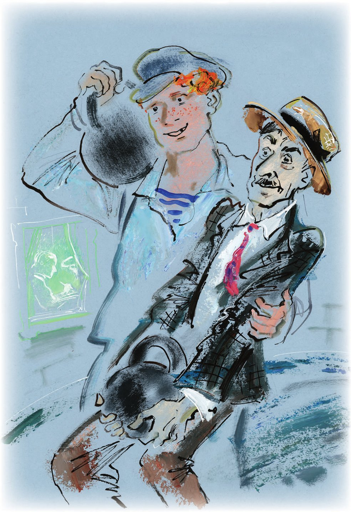
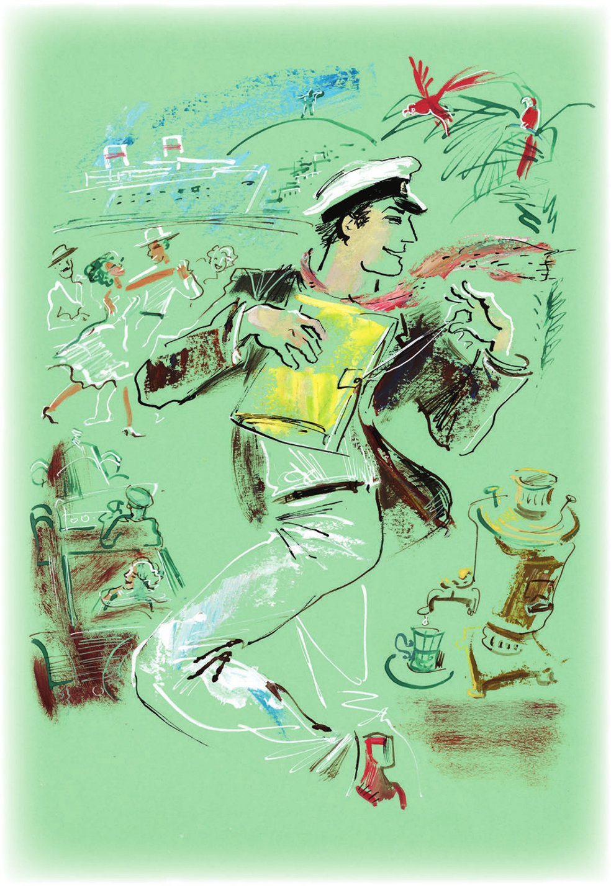

## Kapitel 20: Der Kommandeur tanzt Tango

In einem kleinen <abbr title="der Ausschank, die Ausschänke — буфет, ларёк">Ausschank</abbr> für künstliches Mineralwasser, auf dessen Schild blaue Siphons <abbr title="pinseln — малевать">gepinselt</abbr> waren, saßen Balaganow und Panikowski an einem weißen Tischchen. Der Bevollmächtigte für Hufe kaute eine <abbr title="die Cremerolle, die Cremerollen — трубочка с кремом">Cremerolle</abbr> und passte auf, dass die <abbr title="die Creme — крем">Creme</abbr> nicht am anderen Ende herausgedrückt wurde. Diese <abbr title="die Götterspeise — пища богов">Götterspeise</abbr> spülte er mit Selterswasser und grünem Sirup «Frisches Heu» hinunter. Der Bote trank heilsamen Kefir. Vor ihm standen schon sechs leere Fläschchen. Aus dem siebten schüttelte Panikowski besorgt die dicke Flüssigkeit in sein Glas. Heute hatte die neue Schreibkraft im Büro das Gehalt nach der Liste ausgezahlt, die Bender unterschrieben hatte. Die Freunde genossen die Kühle. Sie kam von den italienischen <abbr title="die Steinfliese, die Steinfliesen — каменная плита">Steinfliesen</abbr> des Ausschanks, von dem <abbr title="feuerfest — несгораемый">feuerfesten</abbr> <abbr title="der Eisschrank, die Eisschränke — шкаф-ледник">Eisschrank</abbr>, in dem der nasse <abbr title="der Schafskäse — брынза">Schafskäse</abbr> lag, von den dunkel gewordenen <abbr title="der Zylinder, die Zylinder — цилиндрический баллон">Zylindern</abbr> mit <abbr title="sprudelnd — шипучий">sprudelndem</abbr> Wasser und von der Theke aus Marmor. Ein Stück Eis war aus dem Schrank gerutscht, lag auf dem Boden und schmolz. Es war angenehm, das Eis anzusehen nach dem <abbr title="ermüdend — утомительный">ermüdenden</abbr> Anblick der Straße mit ihren kurzen Schatten, den Passanten, die von der Hitze <abbr title="erschlagen — прибитый, сражённый">erschlagen</abbr> waren, und den Hunden, die vor Durst <abbr title="halb verrückt — очумевший">halb verrückt</abbr> waren.

— Eine schöne Stadt, dieses Tschernomorsk! — sagte Panikowski und <abbr title="sich die Lippen lecken — облизываться">leckte sich die Lippen</abbr>. — Kefir hilft gut fürs Herz.

Diese Mitteilung brachte Balaganow aus irgendeinem Grund zum Lachen. <abbr title="unvorsichtig — неосторожно">Unvorsichtig</abbr> drückte er auf die Cremerolle, und eine dicke Wurst aus Creme kam heraus, die der Bevollmächtigte gerade noch in der Luft <abbr title="auffangen (fing auf, hat aufgefangen) — подхватить, поймать">auffangen</abbr> konnte.

— Wissen Sie, Schura, — fuhr Panikowski fort, — ich <abbr title="vertrauen + Dat. — доверять">vertraue</abbr> Bender irgendwie nicht mehr. Er macht etwas falsch.

— Na, na! — sagte Balaganow drohend. — Dich hat keiner gefragt.

— Nein, im Ernst. Ich respektiere Ostap Ibrahimowitsch sehr: Das ist ein Mensch!.. Sogar Funt – Sie wissen, wie sehr ich Funt respektiere – hat über Bender gesagt, dass er ein <abbr title="der Kopf (hier: kluger Mensch) — голова, умница">Kopf</abbr> ist. Aber ich sage Ihnen, Schura: Funt ist ein <abbr title="der Esel, die Esel — осёл">Esel</abbr>! Bei Gott, so ein Dummkopf. Einfach eine jämmerliche, nichtige <abbr title="die Person, die Personen — личность">Person</abbr>! Aber gegen Bender habe ich nichts. Nur gefällt mir einiges nicht. Ihnen, Schura, sage ich alles wie einem Verwandten.

Seit dem letzten Gespräch mit dem <abbr title="der Unterinspektor, die Unterinspektoren — субинспектор">Unterinspektor</abbr> der Kriminalpolizei hatte niemand mehr mit Balaganow wie mit einem Verwandten gesprochen. Deshalb hörte er die Worte des Boten mit <abbr title="die Genugtuung — удовлетворение">Genugtuung</abbr> und erlaubte ihm <abbr title="leichtsinnig — легкомысленно">leichtsinnig</abbr>, weiterzusprechen.

— Wissen Sie, Schura, — flüsterte Panikowski, — ich respektiere Bender sehr, aber ich muss Ihnen sagen: Bender ist ein Esel! Bei Gott, eine jämmerliche, nichtige Person!

— Na, na! — sagte Balaganow <abbr title="warnend — предостерегающе">warnend</abbr>.

— Was heißt hier na, na? Denken Sie doch nur, wofür er unser Geld ausgibt! Erinnern Sie sich nur! Wozu brauchen wir dieses dumme Büro? So viele <abbr title="die Ausgabe, die Ausgaben — расход">Ausgaben</abbr>! Allein Funt bezahlen wir hundertzwanzig. Und die Schreibkraft! Jetzt hat man noch zwei andere geschickt, ich habe es gesehen – die haben heute Gehalt nach der Liste bekommen. <abbr title="der Panzer-Halbstarke, die Panzer-Halbstarken — «бронеподростки»">Panzer-Halbstarke</abbr>! Wozu das alles? Er sagt – wegen der <abbr title="die Legalität — легальность">Legalität</abbr>. Ich pfeife auf die Legalität, wenn sie so viel Geld kostet. Und das Hirschgeweih für fünfundsechzig Rubel! Und das Tintenfass! Und all diese Locher!

Panikowski knöpfte seine Jacke auf, und das <abbr title="das Vorhemd, die Vorhemden — манишка">Vorhemd</abbr> für fünfzig Kopeken, das am Hals des Konventionsbrechers festgeknöpft war, <abbr title="hochschnellen — взвиться">schnellte</abbr> nach oben und rollte sich zusammen wie eine <abbr title="die Pergamentrolle, die Pergamentrollen — пергаментный свиток">Pergamentrolle</abbr>. Aber Panikowski war so erhitzt, dass er es nicht bemerkte.

— Ja, Schura. Wir beide bekommen ein <abbr title="lächerlich — мизерный, смешной">lächerliches</abbr> Gehalt, und er badet im Luxus. Und wozu, frage ich, ist er in den Kaukasus gefahren? Er sagt – auf Dienstreise. Das glaube ich nicht! Panikowski muss nicht alles glauben! Und ich bin für ihn zum Hafen gelaufen, um die Fahrkarte zu holen. Merken Sie sich das: eine Fahrkarte erster Klasse! Dieser <abbr title="der Dandy, die Dandys — франт">Dandy</abbr> vom Newski-Prospekt kann nicht in der zweiten fahren! Dahin gehen unsere zehntausend! Er telefoniert über <abbr title="die Fernleitung — междугородная линия">Fernleitung</abbr>, er schickt Blitztelegramme in die ganze Welt. Wissen Sie, was ein Blitztelegramm kostet? Vierzig Kopeken das Wort. Und ich muss auf Kefir <abbr title="verzichten auf + Akk. — отказываться от">verzichten</abbr>, den ich für meine Gesundheit brauche. Ich bin ein alter, kranker Mensch. Ich sage es Ihnen offen: Bender ist kein Kopf.

— Sie sollten trotzdem nicht so <abbr title="übertreiben (übertrieb, hat übertrieben) — перегибать, преувеличивать">übertreiben</abbr>, — bemerkte Balaganow zögernd. — Bender hat doch aus Ihnen einen Menschen gemacht. Denken Sie daran, wie Sie in Arbatow mit der Gans weggelaufen sind. Und jetzt sind Sie <abbr title="angestellt sein — служить, быть на службе">angestellt</abbr>, bekommen ein festes Gehalt, Sie sind ein Mitglied der Gesellschaft.

— Ich will kein Mitglied der Gesellschaft sein! — kreischte Panikowski plötzlich und fügte mit leiser Stimme hinzu: — Ihr Bender ist ein Idiot. Er hat diese dummen <abbr title="die Nachforschung, die Nachforschungen — розыск, расследование">Nachforschungen</abbr> angefangen, obwohl man das Geld schon heute mit <abbr title="bloß — голый">bloßen</abbr> Händen nehmen kann.

Da dachte der Bevollmächtigte für Hufe nicht mehr an den geliebten Chef und rückte näher an Panikowski heran. Und dieser bog immer wieder das widerspenstige Vorhemd nach unten und erzählte Balaganow von einem sehr ernsten <abbr title="das Experiment, die Experimente — опыт, эксперимент">Experiment</abbr>, das er <abbr title="auf eigene Faust — на свой страх и риск">auf eigene Faust</abbr> gemacht hatte.

An dem Tag, als der große Kombinator und Balaganow hinter Skumbrijewitsch her waren, hatte Panikowski <abbr title="eigenmächtig — самовольно">eigenmächtig</abbr> das Büro dem alten Funt überlassen. Er war heimlich in das Zimmer von Koreiko eingedrungen und hatte es, als der Besitzer nicht da war, gründlich durchsucht. Natürlich hatte er im Zimmer kein Geld gefunden, aber er hatte etwas Besseres entdeckt: Hanteln, sehr große schwarze Gewichte, jedes etwa anderthalb <abbr title="das Pud — пуд">Pud</abbr> schwer.

— Ihnen, Schura, sage ich es wie einem Verwandten. Ich habe das Geheimnis dieser Gewichte <abbr title="lüften — раскрыть (тайну)">gelüftet</abbr>.

Endlich fing Panikowski das lebendige Schwänzchen seines Vorhemds ein, knöpfte es an einem Knopf seiner Hose fest und sah Balaganow feierlich an.

— Was soll das denn für ein Geheimnis sein? — sagte der Bevollmächtigte für Hufe enttäuscht. — Ganz gewöhnliche Gewichte für die <abbr title="die Gymnastik — гимнастика">Gymnastik</abbr>.

— Sie wissen, Schura, wie sehr ich Sie respektiere, — ereiferte sich Panikowski, — aber Sie sind ein Esel. Das sind goldene Gewichte! Verstehen Sie? Gewichte aus reinem Gold! Jedes anderthalb Pud schwer. Drei Pud reines Gold. Das habe ich sofort verstanden, es hat mich richtig wie ein Schlag getroffen. Ich stand vor diesen Gewichten und lachte wie verrückt. Was für ein Schuft ist dieser Koreiko! Er hat sich goldene Gewichte gegossen, sie schwarz angemalt und denkt, dass es keiner merkt. Ihnen, Schura, sage ich es wie einem Verwandten: Würde ich Ihnen dieses Geheimnis etwa erzählen, wenn ich die Gewichte allein wegtragen könnte? Aber ich bin ein alter, kranker Mensch, und die Gewichte sind schwer. Und ich lade Sie ein wie einen Verwandten. Ich bin nicht Bender. Ich bin ehrlich!

— Und wenn sie doch nicht golden sind? — fragte der <abbr title="der Lieblingssohn — любимый сын">Lieblingssohn</abbr> des Leutnants. Er wünschte sich sehr, dass Panikowski seine Zweifel so schnell wie möglich <abbr title="zerstreuen — развеять, рассеять">zerstreute</abbr>.

— Und was sollen sie denn sonst sein, Ihrer Meinung nach? — fragte der Konventionsbrecher ironisch.

— Ja, — sagte Balaganow und <abbr title="mit den Wimpern klimpern — хлопать ресницами">klimperte</abbr> mit seinen roten Wimpern, — jetzt ist mir alles klar. Schau einer an, ein alter Mann – und hat alles herausgefunden! Und Bender macht wirklich etwas falsch: Er schreibt Papierchen, er fährt herum … Wir geben ihm aber trotzdem einen Teil ab, <abbr title="gerechterweise — по справедливости">gerechterweise</abbr>, ja?

— Wieso denn? — widersprach Panikowski. — Alles für uns! Jetzt werden wir wunderbar leben, Schura. Ich lasse mir Goldzähne machen und heirate, bei Gott, ich heirate, Ehrenwort, mein edles Ehrenwort!

Man beschloss, die wertvollen Gewichte ohne Verzögerung an sich zu nehmen.

— Bezahlen Sie den Kefir, Schura, — sagte Panikowski, — wir <abbr title="abrechnen — рассчитаться">rechnen</abbr> später ab.

Die <abbr title="der Verschwörer, die Verschwörer — заговорщик">Verschwörer</abbr> verließen den Ausschank und liefen, <abbr title="blenden — ослеплять">geblendet</abbr> von der Sonne, im Kreis durch die Stadt. Die Ungeduld quälte sie. Lange standen sie auf den Brücken der Stadt, legten sich mit dem Bauch auf das Geländer und sahen <abbr title="teilnahmslos — безучастно">teilnahmslos</abbr> hinunter: auf die Dächer der Häuser, auf die Straßen, die zum Hafen hinabführten und auf denen die Lastwagen so vorsichtig wie Pferde hinunterfuhren. Fette <abbr title="der Hafenspatz, die Hafenspatzen — портовый воробей">Hafenspatzen</abbr> hackten mit den Schnäbeln auf das <abbr title="das Pflaster — мостовая">Pflaster</abbr>, und aus allen <abbr title="die Toreinfahrt, die Toreinfahrten — подворотня">Toreinfahrten</abbr> beobachteten schmutzige Katzen sie. Hinter rostigen Dächern, <abbr title="die Dachluke, die Dachluken — чердачное окно">Dachluken</abbr> und <abbr title="die Antenne, die Antennen — антенна">Antennen</abbr> sah man das blaue Wasser, ein kleines Motorboot, das so schnell es konnte dahinfuhr, und einen gelben Schornstein eines Dampfers mit einem großen roten Buchstaben.

Von Zeit zu Zeit hob Panikowski den Kopf und fing an zu rechnen. Er rechnete Pud in Kilogramm um und Kilogramm in altmodische Solotnik, und jedes Mal kam eine so verlockende Zahl heraus, dass der Konventionsbrecher sogar leise quiekte.

Nach zehn Uhr abends gingen die Milchbrüder, <abbr title="schwanken — крениться, шататься">schwankend</abbr> unter der Last der zwei großen Gewichte, in Richtung des Büros zur Beschaffung von Hörnern und Hufen. Panikowski trug seinen Anteil mit beiden Händen, streckte den Bauch heraus und schnaufte fröhlich. Oft blieb er stehen, stellte das Gewicht auf den Bürgersteig und murmelte: «Ich heirate! Ehrenwort, mein edles Ehrenwort, ich heirate!» Der kräftige Balaganow trug sein Gewicht auf der Schulter. Manchmal konnte Panikowski einfach nicht um die Ecke biegen, weil das Gewicht ihn durch die <abbr title="die Trägheit — инерция">Trägheit</abbr> weiter nach vorn zog. Dann hielt Balaganow Panikowski mit der freien Hand am Kragen fest und gab seinem Körper die richtige Richtung.

Vor der Tür des Büros blieben sie stehen.

— Jetzt <abbr title="absägen — отпиливать">sägen</abbr> wir uns jeder ein Stückchen ab, — sagte Panikowski besorgt, — und morgen früh verkaufen wir es. Ich kenne einen Uhrmacher, Herrn Biberham. Der zahlt einen echten Preis. Nicht wie bei Tschernotorg, wo man nie einen echten Preis bekommt.

Aber da bemerkten die Verschwörer, dass unter den grünen Vorhängen des Büros Licht hervorkam.

— Wer kann denn um diese Zeit da sein? — wunderte sich Balaganow und beugte sich zum <abbr title="das Schlüsselloch, die Schlüssellöcher — замочная скважина">Schlüsselloch</abbr> hinunter.

Am Schreibtisch, von der Seite beleuchtet von einer hellen <abbr title="die Stehlampe, die Stehlampen — штепсельная лампа">Stehlampe</abbr>, saß Ostap Bender und schrieb schnell etwas.

— Ein Schriftsteller! — sagte Balaganow, <abbr title="prusten — прыснуть, фыркать">prustete</abbr> vor Lachen und überließ Panikowski das Schlüsselloch.

— Natürlich, — bemerkte Panikowski, als er genug gesehen hatte, — er schreibt wieder. Bei Gott, dieser jämmerliche Mensch bringt mich zum Lachen. Aber wo sollen wir denn sägen?

Und während sie hitzig darüber sprachen, dass man gleich morgen früh zuerst zwei Stückchen Gold an den Uhrmacher Biberham loswerden musste, hoben die Milchbrüder ihre Last hoch und gingen in die Dunkelheit.

Inzwischen schrieb der große Kombinator die <abbr title="die Lebensbeschreibung, die Lebensbeschreibungen — жизнеописание">Lebensbeschreibung</abbr> von Alexander Iwanowitsch Koreiko zu Ende. Von allen fünf Hütten des Tintenfass-Sets «Das Gesicht zum Dorf» waren die <abbr title="bronzen — бронзовый">bronzenen</abbr> <abbr title="das Deckelchen — крышечка">Deckelchen</abbr> abgenommen. Ostap <abbr title="eintauchen — макать">tauchte</abbr> die Feder <abbr title="ohne Wahl — без разбору">ohne Wahl</abbr> ein, wo die Hand gerade hinkam, rutschte auf dem Stuhl hin und her und scharrte mit den Füßen unter dem Tisch.

Er hatte das erschöpfte Gesicht eines <abbr title="der Kartenspieler, die Kartenspieler — картёжник">Kartenspielers</abbr>, der die ganze Nacht verloren und erst beim Morgengrauen endlich eine <abbr title="die Glückssträhne, die Glückssträhnen — везение, удачная полоса (талия)">Glückssträhne</abbr> erwischt hat. Die ganze Nacht kamen keine Bänke zustande, die Karten wollten nicht kommen. Der Spieler wechselte die Tische, versuchte das Schicksal zu <abbr title="überlisten — перехитрить">überlisten</abbr> und einen Platz zu finden, der Glück brachte. Aber die Karten blieben hartnäckig schlecht. Schon fing er an zu «quetschen»: Er sah sich die erste Karte an und schob ganz, ganz langsam die zweite hinter ihrem Rücken hervor. Schon legte er die Karte an den Rand des Tisches und sah sie sich von unten an. Schon legte er beide Karten mit der Rückseite nach außen zusammen und öffnete sie wie ein Buch. Kurz gesagt, er tat alles, was Menschen tun, wenn sie beim <abbr title="das Neunerspiel — игра в девятку">Neunerspiel</abbr> kein Glück haben. Aber das half nicht. Meistens bekam er Bilder: <abbr title="der Bube, die Buben — валет">Buben</abbr> mit Schnurrbärtchen wie aus <abbr title="der Bindfaden — бечёвка, верёвочка">Bindfaden</abbr>, Damen, die an Papierblumen rochen, und Könige mit Bärten wie <abbr title="der Hausmeister, die Hausmeister — дворник">Hausmeister</abbr>. Sehr oft kamen schwarze und rosa Zehner. Kurz, es kam der ganze <abbr title="der Mist — дрянь, мерзость">Mist</abbr>, den man offiziell «Baccara» nennt und inoffiziell «Null» oder «Fett». Und erst zu der Stunde, wenn die Kronleuchter gelb werden und erlöschen, wenn unter den Plakaten «Schlafen <abbr title="verboten — воспрещено">verboten</abbr>» die <abbr title="der Pechvogel, die Pechvögel — неудачник">Pechvögel</abbr> in abgetragenen Kragen auf den Stühlen schnarchen und sich <abbr title="sich verschlucken — захлёбываться">verschlucken</abbr>, geschieht das Wunder. Plötzlich kommen die Bänke zustande, die scheußlichen Figuren und Zehner verschwinden, es <abbr title="hageln — сыпаться градом">hagelt</abbr> Achter und Neuner. Der Spieler <abbr title="hetzen — метаться">hetzt</abbr> nicht mehr durch den Saal, er quetscht die Karten nicht mehr und sieht sie sich nicht mehr von unten an. Er spürt die Glückssträhne in den Händen. Und schon drängen sich die <abbr title="der Schnorrer, die Schnorrer — прихлебатель, попрошайка">Schnorrer</abbr> hinter dem Glücklichen, ziehen ihn an den Schultern und flüstern <abbr title="kriecherisch — подхалимски">kriecherisch</abbr>: «Onkel Jura, geben Sie mir drei Rubel.» Und er, blass und stolz, dreht kühn die Karten um und <abbr title="ausnehmen (nahm aus, hat ausgenommen) — потрошить, обчистить">nimmt</abbr> unter den Rufen «Plätze frei am neunten Tisch!» und «Amateurtische, schickt je einen Fünfziger!» seine Mitspieler aus. Und der grüne Tisch mit seinen weißen Linien und Bögen wird für ihn fröhlich und froh wie ein Fußballplatz.

Für Ostap gab es keine Zweifel mehr. Im Spiel war die <abbr title="die Wende — перелом">Wende</abbr> gekommen.

Alles Unklare war klar geworden. Die vielen Menschen mit Bindfaden-Schnurrbärtchen und Königsbärten, mit denen Ostap zusammengestoßen war und die Spuren in der gelben Mappe mit den Schnürsenkeln hinterlassen hatten, <abbr title="purzeln — посыпаться, кувыркаться">purzelten</abbr> plötzlich zur Seite. Und in den <abbr title="der Vordergrund — передний план">Vordergrund</abbr> trat, alles und jeden <abbr title="zermalmen — сокрушать">zermalmend</abbr>, eine weißäugige <abbr title="die Schinkenfratze — ветчинное рыло">Schinkenfratze</abbr> mit <abbr title="weizenblond — пшеничный">weizenblonden</abbr> Augenbrauen und tiefen <abbr title="die Gefreitenfalte, die Gefreitenfalten — ефрейторская складка">Gefreitenfalten</abbr> auf den Wangen.

Ostap setzte den Schlusspunkt, <abbr title="ablöschen — промокать">löschte</abbr> die Lebensbeschreibung mit einem <abbr title="der Löscher, die Löscher — пресс-папье">Löscher</abbr> ab, der statt eines Griffs einen silbernen kleinen Bären hatte, und begann, die Dokumente <abbr title="einheften — подшивать">einzuheften</abbr>. Er hielt seine Akten gern in Ordnung. Ein letztes Mal bewunderte er die gut <abbr title="glätten — разглаживать">geglätteten</abbr> Aussagen, Telegramme und verschiedenen <abbr title="die Bescheinigung, die Bescheinigungen — справка">Bescheinigungen</abbr>. In der Mappe waren sogar Fotografien und <abbr title="der Auszug, die Auszüge — выписка">Auszüge</abbr> aus den <abbr title="das Geschäftsbuch, die Geschäftsbücher — бухгалтерская книга">Geschäftsbüchern</abbr>. Das ganze Leben von Alexander Iwanowitsch Koreiko lag in der Mappe, und zusammen mit ihm lagen dort Palmen, Mädchen, das blaue Meer, ein weißer Dampfer, blaue Schnellzüge, ein <abbr title="spiegelblank — зеркальный">spiegelblankes</abbr> Auto und Rio de Janeiro, die <abbr title="die Zauberstadt — волшебный город">Zauberstadt</abbr> tief in der Bucht, wo die guten Mulatten leben und die <abbr title="überwältigend — подавляющий">überwältigende</abbr> Mehrheit der Bürger weiße Hosen trägt. Endlich hatte der große Kombinator genau das Individuum gefunden, von dem er sein ganzes Leben lang geträumt hatte.

— Und es gibt niemanden, der meine titanische Arbeit auch nur <abbr title="würdigen — оценить по достоинству">würdigen</abbr> kann, — sagte Ostap traurig, stand auf und band die dicke Mappe zu. — Balaganow ist sehr nett, aber dumm. Panikowski ist einfach ein zänkischer alter Mann. Und Koslewitsch ist ein Engel ohne Flügel. Er zweifelt bis heute nicht daran, dass wir Hörner für den Bedarf der Mundstückindustrie beschaffen. Wo sind meine Freunde, meine Frauen, meine Kinder? Die einzige Hoffnung ist, dass der verehrte Alexander Iwanowitsch meine große Arbeit würdigt und mir für meine Armut fünfhunderttausend <abbr title="auszahlen — выдавать, выплачивать">auszahlt</abbr>. Ach nein! Jetzt nehme ich nicht weniger als eine Million, sonst werden die guten Mulatten mich einfach nicht respektieren.

Ostap stand vom Tisch auf, nahm seine wunderbare Mappe und begann nachdenklich durch das leere Büro zu gehen. Er ging um die Schreibmaschine mit dem türkischen Akzent und um den Fahrkartenlocher der Eisenbahn herum und berührte mit dem Kopf fast das Hirschgeweih. Die weiße Narbe an Ostaps Kehle wurde rosa. Allmählich wurden die Bewegungen des großen Kombinators langsamer, und seine Füße in den roten Schuhen, die er zufällig einem griechischen Matrosen abgekauft hatte, glitten lautlos über den Boden. <abbr title="unmerklich — незаметно">Unmerklich</abbr> bewegte er sich seitwärts. Mit der rechten Hand drückte er die Mappe zärtlich an die Brust wie ein Mädchen, den linken Arm streckte er nach vorn. Über der Stadt hörte man <abbr title="deutlich — явственно">deutlich</abbr>, wie das Rad der Fortuna nach <abbr title="das Kolophonium — канифоль">Kolophonium</abbr> knarrte. Es war ein feiner musikalischer Ton, der plötzlich in einen leichten <abbr title="der Geigenklang — скрипичный звук">Geigenklang</abbr> überging. Und eine längst vergessene Melodie, die einem ans Herz ging, brachte alle Gegenstände in der Tschernomorsker Filiale des Arbatower Büros zur Beschaffung von Hörnern und Hufen zum Klingen.

Als Erster begann der Samowar. Plötzlich fiel aus ihm ein brennendes <abbr title="das Kohlestückchen — уголёк">Kohlestückchen</abbr> auf das <abbr title="das Tablett, die Tabletts — поднос">Tablett</abbr>. Und der Samowar sang:

Unter dem <abbr title="glühend — знойный">glühenden</abbr> Himmel Argentiniens, Wo der Südhimmel so blau ist …

Der große Kombinator tanzte Tango. Sein Gesicht, wie von einer Medaille, war im <abbr title="das Profil — профиль">Profil</abbr> zu sehen. Er ging auf ein Knie, stand schnell wieder auf, drehte sich und glitt mit leichten Schritten wieder nach vorn. Unsichtbare <abbr title="der Frackschoß, die Frackschöße — фалда фрака">Frackschöße</abbr> flogen bei den unerwarteten <abbr title="die Drehung, die Drehungen — поворот">Drehungen</abbr> auseinander.

Und die Melodie hatte schon die Schreibmaschine mit dem türkischen Akzent übernommen:

… Wo där Südhimmäl so blau ist, Wo die Fraun wie auf äinäm Bildä …

Und der <abbr title="plump — неуклюжий">plumpe</abbr> Fahrkartenlocher aus <abbr title="das Gusseisen — чугун">Gusseisen</abbr>, der schon viel erlebt hatte, seufzte dumpf über die <abbr title="unwiederbringlich — невозвратный">unwiederbringliche</abbr> Zeit:

… Wo die Frauen wie auf einem Bilde Alle Tango tanzen.

Ostap tanzte den klassischen <abbr title="der Provinztango — провинциальное танго">Provinztango</abbr>, den man vor zwanzig Jahren in den <abbr title="die Kleinkunstbühne, die Kleinkunstbühnen — театр миниатюр">Kleinkunstbühnen</abbr> tanzte. Damals trug der Buchhalter Berlaga seine erste Melone, Skumbrijewitsch arbeitete in der Kanzlei des Stadthauptmanns, Polychajew legte die Prüfung für seinen ersten <abbr title="der Beamtenrang, die Beamtenränge — гражданский чин">Beamtenrang</abbr> ab, und der Sitzvorsitzende Funt war noch ein <abbr title="rüstig — бодрый">rüstiger</abbr> Mann von siebzig Jahren. Zusammen mit den anderen Pikeewesten saß er im Café «Florida» und besprach die schreckliche Tatsache, dass wegen des italienisch-türkischen Krieges die <abbr title="die Dardanellen (Pl.) — Дарданеллы">Dardanellen</abbr> geschlossen waren. Und die Pikeewesten, damals noch rosig und glatt, gingen die Politiker dieser Epoche durch. «Enver Bey – das ist ein Kopf. Yuan Shikai – das ist ein Kopf. Purischkewitsch – der ist auch ein Kopf!» – sagten sie. Und schon damals behaupteten sie, dass Briand ein Kopf ist, denn er war auch damals schon Minister.

Ostap tanzte. Über seinem Kopf raschelten Palmen, und bunte Vögelchen flogen vorbei. <abbr title="der Ozeandampfer, die Ozeandampfer — океанский пароход">Ozeandampfer</abbr> rieben ihre <abbr title="die Bordwand, die Bordwände — борт">Bordwände</abbr> an den Anlegestellen von Rio de Janeiro. <abbr title="pfiffig — сметливый">Pfiffige</abbr> brasilianische <abbr title="der Kaufmann, die Kaufleute — купец">Kaufleute</abbr> betrieben vor aller Augen Kaffee-Dumping, und in offenen Restaurants amüsierten sich die jungen Leute des Landes mit <abbr title="alkoholisch — спиртной">alkoholischen</abbr> Getränken.

— Die Parade kommandiere ich! — rief der große Kombinator.

Er machte das Licht aus, verließ das Zimmer und ging auf dem kürzesten Weg zur Kleinen Tangentialstraße. Die blassen, <abbr title="zirkelförmig — циркульный">zirkelförmigen</abbr> Beine der Scheinwerfer gingen am Himmel auseinander, kamen herunter und schnitten plötzlich ein Stück von einem Haus heraus. Dann sah man einen Balkon oder eine Glasgalerie im arnautischen Stil mit einem Pärchen, das vor Überraschung <abbr title="erstarren — остолбенеть">erstarrt</abbr> war. Hinter einer Ecke kamen Ostap zwei kleine <abbr title="der Panzer, die Panzer — танк">Panzer</abbr> mit runden <abbr title="der Pilzhut, die Pilzhüte — грибная шляпка">Pilzhüten</abbr> entgegen. Sie schaukelten und <abbr title="rasseln — греметь, лязгать">rasselten</abbr> mit ihren Ketten. Ein <abbr title="der Kavallerist, die Kavalleristen — кавалерист">Kavallerist</abbr> beugte sich aus dem Sattel und fragte einen Passanten nach dem kürzesten Weg zum Alten Markt. An einer Stelle versperrte die <abbr title="die Artillerie — артиллерия">Artillerie</abbr> Ostap den Weg. Er huschte in der Lücke zwischen zwei <abbr title="die Batterie, die Batterien — батарея">Batterien</abbr> hindurch. An einer anderen Stelle nagelten Milizionäre eilig eine Tafel mit schwarzer Aufschrift an das Tor eines Hauses: «<abbr title="der Gasschutzraum, die Gasschutzräume — газоубежище">Gasschutzraum</abbr>».

Ostap hatte es eilig. Der argentinische Tango trieb ihn an. Ohne auf die Umgebung zu achten, betrat er das Haus von Koreiko und klopfte an die bekannte Tür.

— Wer ist da? — hörte man die Stimme des Untergrund-Millionärs.

— Ein Telegramm! — antwortete der große Kombinator und zwinkerte der Dunkelheit zu.

Die Tür ging auf, und er trat ein. Dabei blieb er mit der Mappe am <abbr title="der Türrahmen, die Türrahmen — дверной косяк">Türrahmen</abbr> hängen.

Im Morgengrauen saßen der Bevollmächtigte und der Bote weit außerhalb der Stadt in einer Schlucht.

Sie sägten die Gewichte. Ihre Nasen waren voll von <abbr title="der Gusseisenstaub — чугунная пыль">Gusseisenstaub</abbr>. Neben Panikowski lag das Vorhemd im Gras. Er hatte es ausgezogen, weil es ihn bei der Arbeit störte. Unter die Gewichte hatte der <abbr title="umsichtig — предусмотрительный">umsichtige</abbr> Konventionsbrecher eine Zeitung gelegt, damit kein einziges <abbr title="das Stäubchen, die Stäubchen — пылинка">Stäubchen</abbr> des kostbaren Metalls verloren ging.

Ab und zu <abbr title="austauschen — обмениваться">tauschten</abbr> die Milchbrüder wichtige Blicke aus und sägten mit neuer Kraft weiter. In der Morgenstille hörte man nur das Pfeifen der <abbr title="der Ziesel, die Ziesel — суслик">Ziesel</abbr> und das Kreischen der heiß gewordenen <abbr title="die Metallsäge, die Metallsägen — ножовка">Metallsägen</abbr>.

— Was soll das! — sagte Balaganow plötzlich und hörte auf zu arbeiten. — Ich säge schon drei Stunden, und es ist immer noch nicht golden.

Panikowski antwortete nicht. Er hatte schon alles verstanden und bewegte die Säge die letzte halbe Stunde nur noch <abbr title="zum Schein — для виду">zum Schein</abbr>.

— Na, dann sägen wir noch ein bisschen! — sagte der rothaarige Schura munter.

— Natürlich muss man sägen, — bemerkte Panikowski. Er versuchte, die schreckliche Stunde der Abrechnung <abbr title="hinauszögern — оттягивать">hinauszuzögern</abbr>.

Er bedeckte das Gesicht mit der Handfläche und sah durch die gespreizten Finger auf Balaganows breiten Rücken, der sich gleichmäßig bewegte.

— Ich verstehe gar nichts! — sagte Schura, als er zu Ende gesägt hatte und das Gewicht in zwei Hälften auseinandernahm, wie einen Apfel. — Das ist kein Gold!

— Sägen Sie, sägen Sie, — <abbr title="lallen — лепетать">lallte</abbr> Panikowski. Aber Balaganow hielt in jeder Hand eine gusseiserne <abbr title="die Halbkugel, die Halbkugeln — полушарие">Halbkugel</abbr> und kam langsam auf den Konventionsbrecher zu.

— Kommen Sie mir nicht mit diesem Eisen zu nahe! — kreischte Panikowski und lief zur Seite. — Ich verachte Sie!

Aber da holte Schura aus, stöhnte vor Anstrengung und warf ein <abbr title="das Bruchstück, die Bruchstücke — обломок">Bruchstück</abbr> des Gewichts nach dem <abbr title="der Intrigant, die Intriganten — интриган">Intriganten</abbr>. Als der Intrigant das <abbr title="das Geschoss, die Geschosse — снаряд">Geschoss</abbr> über seinem Kopf pfeifen hörte, legte er sich auf den Boden.

Der Kampf zwischen dem Bevollmächtigten und dem Boten dauerte nicht lange. Der wütende Balaganow <abbr title="herumtrampeln — топтать">trampelte</abbr> zuerst mit Genuss auf dem Vorhemd herum und nahm sich dann dessen Besitzer vor. Während er zuschlug, sagte Schura:

— Wer hat sich diese Gewichte ausgedacht? Wer hat staatliche Gelder <abbr title="veruntreuen — растратить">veruntreut</abbr>? Wer hat über Bender <abbr title="schimpfen über + Akk. — ругать">geschimpft</abbr>?

Außerdem erinnerte sich der <abbr title="der Erstgeborene — первенец">Erstgeborene</abbr> des Leutnants an den <abbr title="der Bruch — нарушение">Bruch</abbr> der Suchariewka-Konvention, und das kostete Panikowski ein paar zusätzliche <abbr title="der Knuff, die Knüffe — тумак">Knüffe</abbr>.

— Das mit dem Vorhemd werden Sie mir <abbr title="büßen — поплатиться">büßen</abbr>! — schrie Panikowski wütend und schützte sich mit den Ellbogen. — Merken Sie sich, das Vorhemd verzeihe ich Ihnen nie! Solche Vorhemden gibt es heute nicht mehr zu kaufen!

Zum Schluss nahm Balaganow seinem Gegner ein schäbiges kleines Portemonnaie mit achtunddreißig Rubeln ab.

— Das ist für deinen Kefir, du Natter! — sagte er dabei.

Ohne Freude kehrten sie in die Stadt zurück.

Vorn ging der <abbr title="verärgert — рассерженный">verärgerte</abbr> Schura, und hinter ihm schleppte sich Panikowski, <abbr title="hinken — хромать, припадать на ногу">hinkte</abbr> auf einem Bein und weinte laut.

— Ich bin ein armer, unglücklicher alter Mann! — schluchzte er. — Das mit dem Vorhemd werden Sie mir büßen. Geben Sie mir mein Geld zurück!

— Du kriegst gleich was von mir! — sagte Schura, ohne sich umzudrehen. — Ich erzähle alles Bender. Abenteurer!

---

### Neue Wörter

- **der Ausschank, die Ausschänke** — буфет, ларёк
- **pinseln** — малевать
- **die Cremerolle, die Cremerollen** — трубочка с кремом
- **die Creme** — крем
- **die Götterspeise** — пища богов
- **die Steinfliese, die Steinfliesen** — каменная плита
- **feuerfest** — несгораемый
- **der Eisschrank, die Eisschränke** — шкаф-ледник
- **der Schafskäse** — брынза
- **der Zylinder, die Zylinder** — цилиндрический баллон
- **sprudelnd** — шипучий
- **ermüdend** — утомительный
- **erschlagen** — прибитый, сражённый
- **halb verrückt** — очумевший
- **sich die Lippen lecken** — облизываться
- **unvorsichtig** — неосторожно
- **auffangen (fing auf, hat aufgefangen)** — подхватить, поймать
- **vertrauen + Dat.** — доверять
- **der Kopf (hier: kluger Mensch)** — голова, умница
- **der Esel, die Esel** — осёл
- **die Person, die Personen** — личность
- **der Unterinspektor, die Unterinspektoren** — субинспектор
- **die Genugtuung** — удовлетворение
- **leichtsinnig** — легкомысленно
- **warnend** — предостерегающе
- **die Ausgabe, die Ausgaben** — расход
- **der Panzer-Halbstarke, die Panzer-Halbstarken** — «бронеподростки»
- **die Legalität** — легальность
- **das Vorhemd, die Vorhemden** — манишка
- **hochschnellen** — взвиться
- **die Pergamentrolle, die Pergamentrollen** — пергаментный свиток
- **lächerlich** — мизерный, смешной
- **der Dandy, die Dandys** — франт
- **die Fernleitung** — междугородная линия
- **verzichten auf + Akk.** — отказываться от
- **übertreiben (übertrieb, hat übertrieben)** — перегибать, преувеличивать
- **angestellt sein** — служить, быть на службе
- **die Nachforschung, die Nachforschungen** — розыск, расследование
- **bloß** — голый
- **das Experiment, die Experimente** — опыт, эксперимент
- **auf eigene Faust** — на свой страх и риск
- **eigenmächtig** — самовольно
- **das Pud** — пуд
- **lüften** — раскрыть (тайну)
- **die Gymnastik** — гимнастика
- **der Lieblingssohn** — любимый сын
- **zerstreuen** — развеять, рассеять
- **mit den Wimpern klimpern** — хлопать ресницами
- **gerechterweise** — по справедливости
- **abrechnen** — рассчитаться
- **der Verschwörer, die Verschwörer** — заговорщик
- **blenden** — ослеплять
- **teilnahmslos** — безучастно
- **der Hafenspatz, die Hafenspatzen** — портовый воробей
- **das Pflaster** — мостовая
- **die Toreinfahrt, die Toreinfahrten** — подворотня
- **die Dachluke, die Dachluken** — чердачное окно
- **die Antenne, die Antennen** — антенна
- **schwanken** — крениться, шататься
- **die Trägheit** — инерция
- **absägen** — отпиливать
- **das Schlüsselloch, die Schlüssellöcher** — замочная скважина
- **die Stehlampe, die Stehlampen** — штепсельная лампа
- **prusten** — прыснуть, фыркать
- **die Lebensbeschreibung, die Lebensbeschreibungen** — жизнеописание
- **bronzen** — бронзовый
- **das Deckelchen** — крышечка
- **eintauchen** — макать
- **ohne Wahl** — без разбору
- **der Kartenspieler, die Kartenspieler** — картёжник
- **die Glückssträhne, die Glückssträhnen** — везение, удачная полоса (талия)
- **überlisten** — перехитрить
- **das Neunerspiel** — игра в девятку
- **der Bube, die Buben** — валет
- **der Bindfaden** — бечёвка, верёвочка
- **der Hausmeister, die Hausmeister** — дворник
- **der Mist** — дрянь, мерзость
- **verboten** — воспрещено
- **der Pechvogel, die Pechvögel** — неудачник
- **sich verschlucken** — захлёбываться
- **hageln** — сыпаться градом
- **hetzen** — метаться
- **der Schnorrer, die Schnorrer** — прихлебатель, попрошайка
- **kriecherisch** — подхалимски
- **ausnehmen (nahm aus, hat ausgenommen)** — потрошить, обчистить
- **die Wende** — перелом
- **purzeln** — посыпаться, кувыркаться
- **der Vordergrund** — передний план
- **zermalmen** — сокрушать
- **die Schinkenfratze** — ветчинное рыло
- **weizenblond** — пшеничный
- **die Gefreitenfalte, die Gefreitenfalten** — ефрейторская складка
- **ablöschen** — промокать
- **der Löscher, die Löscher** — пресс-папье
- **einheften** — подшивать
- **glätten** — разглаживать
- **die Bescheinigung, die Bescheinigungen** — справка
- **der Auszug, die Auszüge** — выписка
- **das Geschäftsbuch, die Geschäftsbücher** — бухгалтерская книга
- **spiegelblank** — зеркальный
- **die Zauberstadt** — волшебный город
- **überwältigend** — подавляющий
- **würdigen** — оценить по достоинству
- **auszahlen** — выдавать, выплачивать
- **unmerklich** — незаметно
- **deutlich** — явственно
- **das Kolophonium** — канифоль
- **der Geigenklang** — скрипичный звук
- **das Kohlestückchen** — уголёк
- **das Tablett, die Tabletts** — поднос
- **glühend** — знойный
- **das Profil** — профиль
- **der Frackschoß, die Frackschöße** — фалда фрака
- **die Drehung, die Drehungen** — поворот
- **plump** — неуклюжий
- **das Gusseisen** — чугун
- **unwiederbringlich** — невозвратный
- **der Provinztango** — провинциальное танго
- **die Kleinkunstbühne, die Kleinkunstbühnen** — театр миниатюр
- **der Beamtenrang, die Beamtenränge** — гражданский чин
- **rüstig** — бодрый
- **die Dardanellen (Pl.)** — Дарданеллы
- **der Ozeandampfer, die Ozeandampfer** — океанский пароход
- **die Bordwand, die Bordwände** — борт
- **pfiffig** — сметливый
- **der Kaufmann, die Kaufleute** — купец
- **alkoholisch** — спиртной
- **zirkelförmig** — циркульный
- **erstarren** — остолбенеть
- **der Panzer, die Panzer** — танк
- **der Pilzhut, die Pilzhüte** — грибная шляпка
- **rasseln** — греметь, лязгать
- **der Kavallerist, die Kavalleristen** — кавалерист
- **die Artillerie** — артиллерия
- **die Batterie, die Batterien** — батарея
- **der Gasschutzraum, die Gasschutzräume** — газоубежище
- **der Türrahmen, die Türrahmen** — дверной косяк
- **der Gusseisenstaub** — чугунная пыль
- **umsichtig** — предусмотрительный
- **das Stäubchen, die Stäubchen** — пылинка
- **austauschen** — обмениваться
- **der Ziesel, die Ziesel** — суслик
- **die Metallsäge, die Metallsägen** — ножовка
- **zum Schein** — для виду
- **hinauszögern** — оттягивать
- **lallen** — лепетать
- **die Halbkugel, die Halbkugeln** — полушарие
- **das Bruchstück, die Bruchstücke** — обломок
- **der Intrigant, die Intriganten** — интриган
- **das Geschoss, die Geschosse** — снаряд
- **herumtrampeln** — топтать
- **veruntreuen** — растратить
- **schimpfen über + Akk.** — ругать
- **der Erstgeborene** — первенец
- **der Bruch** — нарушение
- **der Knuff, die Knüffe** — тумак
- **büßen** — поплатиться
- **verärgert** — рассерженный
- **hinken** — хромать, припадать на ногу

[← Zurück](kapitel-20.md) · [Inhalt](README.md) · [Weiter →](kapitel-22.md)
