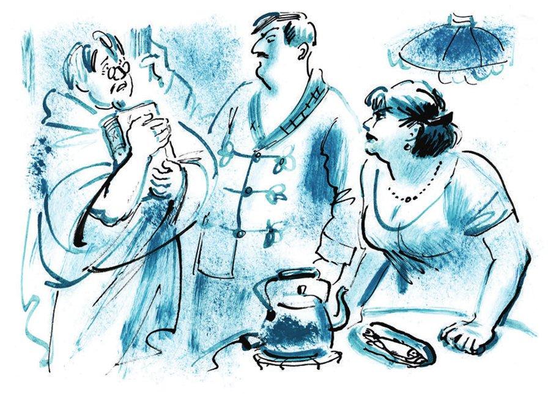

## Kapitel 21: Das Ende des «Krähenviertels»

Warwara Ptiburdukowa war glücklich. Sie saß am runden Tisch und ließ den Blick zufrieden über ihren <abbr title="der Haushalt, die Haushalte — хозяйство">Haushalt</abbr> gleiten. Im Zimmer der Ptiburdukows standen so viele Möbel, dass es fast keinen freien Platz mehr gab. Aber auch die kleine <abbr title="die Fläche, die Flächen — площадь">Fläche</abbr>, die übrig blieb, reichte für das Glück. Die Lampe schickte ihr Licht durch das Fenster nach draußen, wo ein kleiner grüner <abbr title="der Zweig, die Zweige — ветка">Zweig</abbr> zitterte wie eine <abbr title="die Brosche, die Broschen — брошь">Brosche</abbr> an einem Damenkleid. Auf dem Tisch lagen <abbr title="der Keks, die Kekse — печенье">Kekse</abbr>, <abbr title="das Bonbon, die Bonbons — конфета">Bonbons</abbr> und <abbr title="mariniert — маринованный">marinierter</abbr> <abbr title="der Zander, die Zander — судак">Zander</abbr> in einer runden Blechdose. Der elektrische <abbr title="der Wasserkocher, die Wasserkocher — (электрический) чайник">Wasserkocher</abbr> sammelte auf seiner gewölbten <abbr title="die Oberfläche, die Oberflächen — поверхность">Oberfläche</abbr> die ganze <abbr title="die Gemütlichkeit — уют">Gemütlichkeit</abbr> des Ptiburdukow'schen Nestes. In ihm spiegelten sich das Bett, die weißen <abbr title="die Gardine, die Gardinen — занавеска">Gardinen</abbr> und der <abbr title="der Nachttisch, die Nachttische — ночная тумбочка">Nachttisch</abbr>. Auch Ptiburdukow selbst spiegelte sich darin. Er saß seiner Frau gegenüber, in einem blauen <abbr title="der Schlafanzug, die Schlafanzüge — пижама">Schlafanzug</abbr> mit Schnüren. Auch er war glücklich. Er ließ den <abbr title="der Zigarettenrauch — папиросный дым">Zigarettenrauch</abbr> durch seinen Schnurrbart ziehen und <abbr title="sägen — пилить">sägte</abbr> mit der <abbr title="die Laubsäge, die Laubsägen — лобзик">Laubsäge</abbr> aus Sperrholz ein <abbr title="das Spielzeug, die Spielzeuge — игрушка">Spielzeug</abbr>: ein kleines Plumpsklo, wie es auf jeder <abbr title="die Datscha, die Datschen — дача">Datscha</abbr> steht. Die Arbeit war <abbr title="mühsam — кропотливый, трудный">mühsam</abbr>. Man musste die Wände aussägen, ein schräges Dach daraufsetzen, die <abbr title="die Inneneinrichtung — внутреннее оборудование">Inneneinrichtung</abbr> bauen, ein winziges Fenster <abbr title="verglasen — застеклить">verglasen</abbr> und an der Tür einen <abbr title="mikroskopisch — микроскопический">mikroskopisch</abbr> kleinen <abbr title="der Haken, die Haken — крючок">Haken</abbr> befestigen. Ptiburdukow arbeitete mit Leidenschaft. Für ihn gab es keine bessere <abbr title="die Erholung — отдых">Erholung</abbr> als <abbr title="die Laubsägearbeit, die Laubsägearbeiten — выпиливание лобзиком">Laubsägearbeiten</abbr>.

Als er fertig war, lachte der Ingenieur fröhlich, klopfte seiner Frau auf den dicken, warmen Rücken und zog die Dose mit dem Zander zu sich heran. Aber in diesem Moment klopfte es laut an der Tür, die Lampe <abbr title="flackern — мигать, мерцать">flackerte</abbr>, und der Wasserkocher rutschte von seinem <abbr title="das Drahtgestell, die Drahtgestelle — проволочная подставка">Drahtgestell</abbr>.

— Wer kann das so spät noch sein? — sagte Ptiburdukow und öffnete die Tür.

Auf der Treppe stand Wassissuali Lochankin. Er war bis zum Bart in eine weiße Steppdecke aus Marseille <abbr title="wickeln — заворачивать">gewickelt</abbr>, unter der haarige Beine hervorschauten. An die Brust drückte er das Buch «Mann und Weib», dick und vergoldet wie eine <abbr title="die Ikone, die Ikonen — икона">Ikone</abbr>. Wassissualis Augen irrten umher.

— Bitte sehr, treten Sie ein, — sagte der Ingenieur verblüfft und machte einen Schritt zurück. — Warwara, was ist das?

— Ich kam zu euch, um hier für immer zu wohnen, — antwortete Lochankin in feierlichen Jamben und mit einer Stimme wie aus dem Grab. — Ich hoffe, dass ich <abbr title="die Zuflucht — приют, убежище">Zuflucht</abbr> bei euch finde.

— Wieso Zuflucht? — sagte Ptiburdukow und wurde <abbr title="puterrot — багровый">puterrot</abbr>. — Was <abbr title="wünschen — желать">wünschen</abbr> Sie, Wassissuali Andrejewitsch?

Warwara lief auf den Treppenabsatz hinaus.

— Saschuk! Sieh mal, er ist ja nackt! — rief sie. — Was ist passiert, Wassissuali? Komm doch herein, kommen Sie herein.

Lochankin trat mit nackten Füßen über die Schwelle. Er murmelte: «Ein Unglück, ein Unglück», und begann, im Zimmer hin und her zu <abbr title="rennen (rannte, ist gerannt) — бегать, метаться">rennen</abbr>. Mit einem Zipfel der Decke <abbr title="fegen — смахнуть, мести">fegte</abbr> er sofort Ptiburdukows feine <abbr title="die Tischlerarbeit, die Tischlerarbeiten — столярная работа">Tischlerarbeit</abbr> auf den Boden. Der Ingenieur zog sich in die Ecke zurück. Er fühlte, dass jetzt nichts Gutes mehr zu erwarten war.

— Was für ein Unglück? — bohrte Warwara nach. — Warum hast du nur eine Decke an?

— Ich kam zu euch, um hier für immer zu wohnen, — wiederholte Lochankin mit der Stimme einer Kuh.

Seine gelbe Ferse <abbr title="trommeln — барабанить">trommelte</abbr> auf dem sauberen, <abbr title="gewachst — натёртый воском">gewachsten</abbr> Boden einen unruhigen <abbr title="der Wirbel, die Wirbel — барабанная дробь">Wirbel</abbr>.

— Was redest du für einen Unsinn? — <abbr title="anfahren (fuhr an, hat angefahren) — набрасываться, накричать">fuhr</abbr> Warwara ihren früheren Mann an. — Geh nach Hause und <abbr title="seinen Rausch ausschlafen — проспаться">schlaf deinen Rausch aus</abbr>! Raus hier! Los, los, nach Hause!

— Ein Haus gibt's nicht mehr, — sagte Wassissuali und zitterte weiter. — Es ist bis auf den Grund <abbr title="abbrennen (brannte ab, ist abgebrannt) — сгореть">abgebrannt</abbr>. Das Feuer, ach, das Feuer trieb mich her. Ich rettete nur meine Decke und auch das Buch, das mir so teuer ist. Doch seid ihr mir so hartherzig – so geh ich fort und verfluche euch dazu.

Wassissuali ging traurig schwankend zur Tür. Aber Warwara und ihr Mann hielten ihn fest. Sie baten ihn um Verzeihung, sagten, sie hätten nicht sofort verstanden, was los war, und begannen überhaupt, sich um ihn zu kümmern. Ptiburdukows neuer Anzug, <abbr title="die Unterwäsche — нижнее бельё">Unterwäsche</abbr> und Schuhe wurden <abbr title="hervorholen — извлекать, доставать">hervorgeholt</abbr>.

Während Lochankin sich anzog, <abbr title="sich beraten (beriet, hat beraten) — совещаться">berieten sich</abbr> die <abbr title="die Eheleute (Pl.) — супруги">Eheleute</abbr> im Flur.

— Wo bringen wir ihn unter? — flüsterte Warwara. — Er kann nicht bei uns <abbr title="übernachten — ночевать">übernachten</abbr>, wir haben nur ein Zimmer.

— Du wunderst mich, — sagte der gutmütige Ingenieur. — Ein Mensch hat ein Unglück, und du denkst nur an dein eigenes <abbr title="das Wohlergehen — благополучие">Wohlergehen</abbr>.

Als die Eheleute ins Zimmer zurückkamen, saß der <abbr title="der Abgebrannte, die Abgebrannten — погорелец">Abgebrannte</abbr> am Tisch und aß den marinierten Fisch direkt aus der Blechdose. Außerdem waren zwei Bände «Festigkeitslehre» vom Regal geworfen worden. An ihrer Stelle stand jetzt das vergoldete «Mann und Weib».

— Ist wirklich das ganze Haus abgebrannt? — fragte Ptiburdukow mitfühlend. — Wie schrecklich!

— Ich aber denke, vielleicht musste es so sein, — sagte Wassissuali und aß das Abendessen der Gastgeber auf. — Vielleicht komme ich aus den <abbr title="die Flamme, die Flammen — пламя">Flammen</abbr> verwandelt heraus, wie? Aber er kam nicht verwandelt heraus.

Als alles besprochen war, machten sich die Ptiburdukows für die Nacht fertig. Für Wassissuali legte man eine kleine <abbr title="die Matratze, die Matratzen — матрас">Matratze</abbr> auf genau den Rest der Fläche, der noch vor einer Stunde für das Glück gereicht hatte. Man schloss das Fenster, machte das Licht aus, und die Nacht kam ins Zimmer. Etwa zwanzig Minuten lagen alle still, wälzten sich ab und zu hin und her und seufzten schwer. Dann kam vom Boden Lochankins gedehntes Flüstern:

— Warwara! Warwara! Hör mal, Warwara!

— Was willst du? — fragte die frühere Frau empört.

— Warum hast du mich verlassen, Warwara?

Er bekam keine Antwort auf diese <abbr title="grundsätzlich — принципиальный">grundsätzliche</abbr> Frage. Da begann Wassissuali zu jammern:

— Du bist ein Weibchen, Warwara! Du bist eine Wölfin! Eine Wölfin bist du, und ich verachte dich…

Der Ingenieur lag regungslos im Bett. Er erstickte fast vor Wut und <abbr title="die Fäuste ballen — сжимать кулаки">ballte die Fäuste</abbr>.

Das «Krähenviertel» hatte um zwölf Uhr nachts <abbr title="Feuer fangen — загореться">Feuer gefangen</abbr>. Das war genau die Zeit, als Ostap Bender im leeren Büro Tango tanzte und die Milchbrüder Balaganow und Panikowski die Stadt verließen, gebeugt unter dem Gewicht der goldenen Gewichte.

In der langen Kette von Abenteuern, die dem <abbr title="der Brand, die Brände — пожар">Brand</abbr> in Wohnung Nummer drei <abbr title="vorausgehen (ging voraus, ist vorausgegangen) — предшествовать">vorausgingen</abbr>, war das erste Glied die Niemandsgroßmutter. Bekanntlich verbrannte sie oben auf ihrem <abbr title="der Hängeboden, die Hängeböden — антресоль">Hängeboden</abbr> Petroleum, denn der <abbr title="die Elektrizität — электричество">Elektrizität</abbr> traute sie nicht. Seit man Wassissuali Andrejewitsch verprügelt hatte, war in der Wohnung lange nichts Interessantes mehr <abbr title="geschehen (geschah, ist geschehen) — происходить">geschehen</abbr>. Der unruhige <abbr title="der Verstand — ум">Verstand</abbr> des Kammerherrn Mitritsch litt unter der <abbr title="erzwungen — вынужденный">erzwungenen</abbr> Untätigkeit. Er dachte gründlich über die Gewohnheiten der Großmutter nach und wurde unruhig.

— Die Alte <abbr title="abfackeln — спалить">fackelt</abbr> uns noch die ganze Wohnung ab! — murmelte er. — Was macht ihr das schon? Aber ich hab ein Klavier, das kostet vielleicht zweitausend.

Nach diesem Schluss versicherte Mitritsch seinen ganzen <abbr title="der bewegliche Besitz — движимое имущество">beweglichen Besitz</abbr> gegen Feuer. Jetzt konnte er ruhig sein. Gleichgültig sah er zu, wie die Großmutter eine große, trübe Flasche Petroleum zu sich hinaufschleppte. Sie trug sie auf dem Arm wie ein Kind. Als Erster erfuhr der Bürger Gigienischwili von Mitritschs vorsichtiger Tat, und er <abbr title="deuten — истолковать">deutete</abbr> sie sofort auf seine Weise. Er trat im Flur auf Mitritsch zu, packte ihn an der Brust und sagte drohend:

— Willst die ganze Wohnung anzünden? Willst die <abbr title="die Versicherung, die Versicherungen — страховка">Versicherung</abbr> kassieren? Denkst du, Gigienischwili ist ein Dummkopf? Gigienischwili versteht alles.

Und noch am selben Tag versicherte sich der leidenschaftliche Mieter selbst auf eine große Summe. Bei dieser Nachricht packte das Entsetzen das ganze «Krähenviertel». Luzija Franzewna Pferd lief mit aufgerissenen Augen in die Küche.

— Die Schufte brennen uns noch nieder! Machen Sie, was Sie wollen, Bürger, ich gehe sofort und versichere mich. Brennen werden wir sowieso, da will ich wenigstens die Versicherung haben. Ich habe keine Lust, wegen denen <abbr title="betteln gehen — идти по миру, нищенствовать">betteln zu gehen</abbr>.

Am nächsten Tag war die ganze Wohnung versichert, <abbr title="mit Ausnahme von + Dat. — за исключением">mit Ausnahme</abbr> von Lochankin und der Niemandsgroßmutter. Lochankin las die Zeitschrift «Rodina» und bemerkte nichts, und die Großmutter glaubte nicht an Versicherungen, so wie sie nicht an die Elektrizität glaubte. Nikita Prjachin brachte eine Versicherungspolice mit einem fliederfarbenen Rand nach Hause und betrachtete lange die Wasserzeichen gegen das Licht.

— Das heißt also, der Staat <abbr title="entgegenkommen (kam entgegen, ist entgegengekommen) — идти навстречу">kommt uns entgegen</abbr>? — sagte er finster. — Er hilft den Mietern? Na, danke schön! Jetzt heißt es also: Wie wir wollen, so machen wir's.

Er versteckte die Police unter seinem Hemd und ging in sein Zimmer. Seine Worte lösten solche Angst aus, dass in dieser Nacht im «Krähenviertel» niemand schlief. Dunja packte ihre Sachen in Bündel, und die anderen <abbr title="der Bettmieter, die Bettmieter — коечник (снимающий койку)">Bettmieter</abbr> gingen zu Bekannten übernachten. Tagsüber beobachteten sich alle gegenseitig und trugen ihre Sachen Stück für Stück aus dem Haus.

Alles war klar. Das Haus war verloren. Es konnte gar nicht anders, es musste abbrennen. Und tatsächlich loderte es um zwölf Uhr nachts auf. Es war gleich an sechs Stellen angezündet worden.

Das Haus war schon voll Rauch wie von einem Samowar, mit roten Adern aus Feuer, als Lochankin als Letzter heraussprang. Er hielt die weiße Decke um sich. Er schrie aus vollem Hals: «Feuer! Feuer!», obwohl er mit dieser Nachricht niemanden überraschen konnte. Alle Bewohner des «Krähenviertels» waren schon <abbr title="sich versammeln — собраться">versammelt</abbr>. Der betrunkene Prjachin saß auf seiner <abbr title="die Truhe, die Truhen — сундук">Truhe</abbr> mit den beschlagenen Ecken. Er starrte sinnlos auf die <abbr title="flimmern — мерцать">flimmernden</abbr> Fenster und sagte immer wieder: «Wie wir wollen, so machen wir's.» Gigienischwili roch angeekelt an seinen Händen, die nach Petroleum rochen, und wischte sie jedes Mal an der Hose ab. Die erste <abbr title="die Feuerspirale, die Feuerspiralen — огненная спираль">Feuerspirale</abbr> sprang aus dem <abbr title="das Lüftungsfenster, die Lüftungsfenster — форточка">Lüftungsfenster</abbr>, ließ <abbr title="der Funke, die Funken — искра">Funken</abbr> fallen und rollte sich unter dem hölzernen <abbr title="das Gesims, die Gesimse — карниз">Gesims</abbr> auf. Die erste Scheibe platzte und fiel klirrend heraus. Die Niemandsgroßmutter begann schrecklich zu heulen.

— Vierzig Jahre hat das Haus gestanden, — erklärte Mitritsch würdevoll und ging in der Menge auf und ab. — Unter jeder <abbr title="die Regierung, die Regierungen — власть, правительство">Regierung</abbr> hat es gestanden, ein gutes Haus war das. Und unter der sowjetischen ist es abgebrannt. So eine traurige Tatsache, Bürger.

Der weibliche Teil des «Krähenviertels» drängte sich zu einem Haufen zusammen und ließ das Feuer nicht aus den Augen. Flammen wie aus <abbr title="die Kanone, die Kanonen — пушка, орудие">Kanonen</abbr> schlugen schon aus allen Fenstern. <abbr title="manchmal — иногда">Manchmal</abbr> verschwand das Feuer, und dann schien das dunkle Haus zurückzuspringen wie eine Kanone nach dem <abbr title="der Schuss, die Schüsse — выстрел">Schuss</abbr>. Und wieder rollte eine rotgelbe Wolke hinaus und beleuchtete feierlich die Zitronengasse. Es wurde heiß. Neben dem Haus konnte man nicht mehr stehen, und die Gesellschaft <abbr title="umziehen (zog um, ist umgezogen) — перекочевать">zog</abbr> auf den gegenüberliegenden <abbr title="der Gehsteig, die Gehsteige — тротуар">Gehsteig</abbr> um.

Nur Nikita Prjachin döste auf seiner Truhe mitten auf der Straße. Plötzlich sprang er auf, barfuß und furchtbar anzusehen.

— <abbr title="der Rechtgläubige, die Rechtgläubigen — православный">Rechtgläubige</abbr>! — schrie er und zerriss sich das Hemd. — Bürger!

Er lief seitwärts vom Feuer weg, stürzte sich in die Menge, rief unverständliche Worte und zeigte mit der Hand auf das brennende Haus. In der Menge entstand Aufregung.

— Sie haben ein Kind vergessen, — sagte eine Frau mit einem Strohhut überzeugt.

Man umringte Nikita. Er <abbr title="wegstoßen (stieß weg, hat weggestoßen) — отпихивать">stieß</abbr> alle mit den Händen weg und wollte zum Haus.

— Auf dem Bett liegt sie! — schrie Prjachin außer sich. — Lass mich durch, sag ich!

Über sein Gesicht liefen Tränen, rot wie Feuer. Er schlug Gigienischwili, der ihm den Weg versperrte, auf den Kopf und lief in den Hof. Eine Minute später lief er wieder heraus, mit einer <abbr title="die Leiter, die Leitern — лестница (приставная)">Leiter</abbr> in den Händen.

— Halten Sie ihn auf! — schrie die Frau mit dem Strohhut. — Er verbrennt doch!

— Weg da, sag ich! — brüllte Nikita Prjachin. Er stellte die Leiter an die Wand und stieß die jungen Männer aus der Menge weg, die ihn an den Beinen packten. — Ich lass sie nicht zugrunde gehen. Meine Seele brennt.

Er trat mit den Füßen um sich und kletterte nach oben, zum <abbr title="rauchen — дымиться">rauchenden</abbr> Fenster im ersten Stock.

— Zurück! — rief man aus der Menge. — Wozu kletterst du hinauf? Du verbrennst!

— Auf dem Bett liegt sie! — rief Nikita weiter. — Eine ganze Gans und eine große Flasche Kornschnaps! Soll die etwa zugrunde gehen, rechtgläubige Bürger?

Mit unerwarteter <abbr title="die Geschicklichkeit — проворство, ловкость">Geschicklichkeit</abbr> packte Prjachin die Regenrinne am Fenster und verschwand im <abbr title="im Nu — мигом">Nu</abbr>, als hätte ihn eine <abbr title="die Luftpumpe, die Luftpumpen — воздушный насос">Luftpumpe</abbr> nach innen <abbr title="saugen — всасывать">gesaugt</abbr>. Seine letzten Worte waren: «Wie wir wollen, so machen wir's.» In der Gasse wurde es still. Die Stille wurde nur von der Glocke und den <abbr title="das Hornsignal, die Hornsignale — трубный сигнал">Hornsignalen</abbr> der <abbr title="die Feuerwehr, die Feuerwehren — пожарная команда">Feuerwehr</abbr> unterbrochen. In den Hof liefen <abbr title="der Feuerwehrmann, die Feuerwehrleute — пожарный">Feuerwehrleute</abbr> mit <abbr title="die Axt, die Äxte — топор">Äxten</abbr>, in steifen <abbr title="der Segeltuchanzug, die Segeltuchanzüge — брезентовый костюм">Segeltuchanzügen</abbr> mit breiten blauen Gürteln.

Eine Minute nachdem Nikita Prjachin die einzige <abbr title="die Heldentat, die Heldentaten — героический поступок">Heldentat</abbr> seines Lebens vollbracht hatte, löste sich ein brennender <abbr title="der Balken, die Balken — бревно, балка">Balken</abbr> vom Haus und krachte auf die Erde. Das Dach brach knisternd auseinander und fiel ins Innere des Hauses. Eine leuchtende Säule stieg zum Himmel auf, als hätte man aus dem Haus eine <abbr title="die Kanonenkugel, die Kanonenkugeln — ядро">Kanonenkugel</abbr> zum Mond geschossen.

So ging die Wohnung Nummer drei unter, die man besser unter dem Namen «Krähenviertel» kannte.

Plötzlich hörte man in der Gasse das Klappern von <abbr title="der Huf, die Hufe — копыто">Hufen</abbr>. Im Schein des Feuers raste der Ingenieur Talmudowski in einer Droschke vorbei. Auf seinen Knien lag ein Koffer voller <abbr title="der Aufkleber, die Aufkleber — наклейка, ярлык">Aufkleber</abbr>. Der Ingenieur hüpfte auf dem Sitz, beugte sich zum Kutscher vor und schrie:

— Bei so einem Gehalt setze ich hier keinen Fuß mehr hin! <abbr title="zufahren — поезжай быстрей! (окрик)">Fahr zu</abbr>, schneller!

Und sofort verschwand sein fetter Rücken, beleuchtet von den Flammen und den Fackeln der Feuerwehr, hinter der Ecke.

---

### Neue Wörter

- **der Haushalt, die Haushalte** — хозяйство
- **die Fläche, die Flächen** — площадь
- **der Zweig, die Zweige** — ветка
- **die Brosche, die Broschen** — брошь
- **der Keks, die Kekse** — печенье
- **das Bonbon, die Bonbons** — конфета
- **mariniert** — маринованный
- **der Zander, die Zander** — судак
- **der Wasserkocher, die Wasserkocher** — (электрический) чайник
- **die Oberfläche, die Oberflächen** — поверхность
- **die Gemütlichkeit** — уют
- **die Gardine, die Gardinen** — занавеска
- **der Nachttisch, die Nachttische** — ночная тумбочка
- **der Schlafanzug, die Schlafanzüge** — пижама
- **der Zigarettenrauch** — папиросный дым
- **sägen** — пилить
- **die Laubsäge, die Laubsägen** — лобзик
- **das Spielzeug, die Spielzeuge** — игрушка
- **die Datscha, die Datschen** — дача
- **mühsam** — кропотливый, трудный
- **die Inneneinrichtung** — внутреннее оборудование
- **verglasen** — застеклить
- **mikroskopisch** — микроскопический
- **der Haken, die Haken** — крючок
- **die Erholung** — отдых
- **die Laubsägearbeit, die Laubsägearbeiten** — выпиливание лобзиком
- **flackern** — мигать, мерцать
- **das Drahtgestell, die Drahtgestelle** — проволочная подставка
- **wickeln** — заворачивать
- **die Ikone, die Ikonen** — икона
- **die Zuflucht** — приют, убежище
- **puterrot** — багровый
- **wünschen** — желать
- **rennen (rannte, ist gerannt)** — бегать, метаться
- **fegen** — смахнуть, мести
- **die Tischlerarbeit, die Tischlerarbeiten** — столярная работа
- **trommeln** — барабанить
- **gewachst** — натёртый воском
- **der Wirbel, die Wirbel** — барабанная дробь
- **anfahren (fuhr an, hat angefahren)** — набрасываться, накричать
- **seinen Rausch ausschlafen** — проспаться
- **abbrennen (brannte ab, ist abgebrannt)** — сгореть
- **die Unterwäsche** — нижнее бельё
- **hervorholen** — извлекать, доставать
- **sich beraten (beriet, hat beraten)** — совещаться
- **die Eheleute (Pl.)** — супруги
- **übernachten** — ночевать
- **das Wohlergehen** — благополучие
- **der Abgebrannte, die Abgebrannten** — погорелец
- **die Flamme, die Flammen** — пламя
- **die Matratze, die Matratzen** — матрас
- **grundsätzlich** — принципиальный
- **die Fäuste ballen** — сжимать кулаки
- **Feuer fangen** — загореться
- **der Brand, die Brände** — пожар
- **vorausgehen (ging voraus, ist vorausgegangen)** — предшествовать
- **der Hängeboden, die Hängeböden** — антресоль
- **die Elektrizität** — электричество
- **geschehen (geschah, ist geschehen)** — происходить
- **der Verstand** — ум
- **erzwungen** — вынужденный
- **abfackeln** — спалить
- **der bewegliche Besitz** — движимое имущество
- **deuten** — истолковать
- **die Versicherung, die Versicherungen** — страховка
- **betteln gehen** — идти по миру, нищенствовать
- **mit Ausnahme von + Dat.** — за исключением
- **entgegenkommen (kam entgegen, ist entgegengekommen)** — идти навстречу
- **der Bettmieter, die Bettmieter** — коечник (снимающий койку)
- **sich versammeln** — собраться
- **die Truhe, die Truhen** — сундук
- **flimmern** — мерцать
- **die Feuerspirale, die Feuerspiralen** — огненная спираль
- **das Lüftungsfenster, die Lüftungsfenster** — форточка
- **der Funke, die Funken** — искра
- **das Gesims, die Gesimse** — карниз
- **die Regierung, die Regierungen** — власть, правительство
- **die Kanone, die Kanonen** — пушка, орудие
- **manchmal** — иногда
- **der Schuss, die Schüsse** — выстрел
- **umziehen (zog um, ist umgezogen)** — перекочевать
- **der Gehsteig, die Gehsteige** — тротуар
- **der Rechtgläubige, die Rechtgläubigen** — православный
- **wegstoßen (stieß weg, hat weggestoßen)** — отпихивать
- **die Leiter, die Leitern** — лестница (приставная)
- **rauchen** — дымиться
- **die Geschicklichkeit** — проворство, ловкость
- **im Nu** — мигом
- **die Luftpumpe, die Luftpumpen** — воздушный насос
- **saugen** — всасывать
- **das Hornsignal, die Hornsignale** — трубный сигнал
- **die Feuerwehr, die Feuerwehren** — пожарная команда
- **der Feuerwehrmann, die Feuerwehrleute** — пожарный
- **die Axt, die Äxte** — топор
- **der Segeltuchanzug, die Segeltuchanzüge** — брезентовый костюм
- **die Heldentat, die Heldentaten** — героический поступок
- **der Balken, die Balken** — бревно, балка
- **die Kanonenkugel, die Kanonenkugeln** — ядро
- **der Huf, die Hufe** — копыто
- **der Aufkleber, die Aufkleber** — наклейка, ярлык
- **zufahren** — поезжай быстрей! (окрик)

[← Zurück](kapitel-21.md) · [Inhalt](README.md) · [Weiter →](kapitel-23.md)
