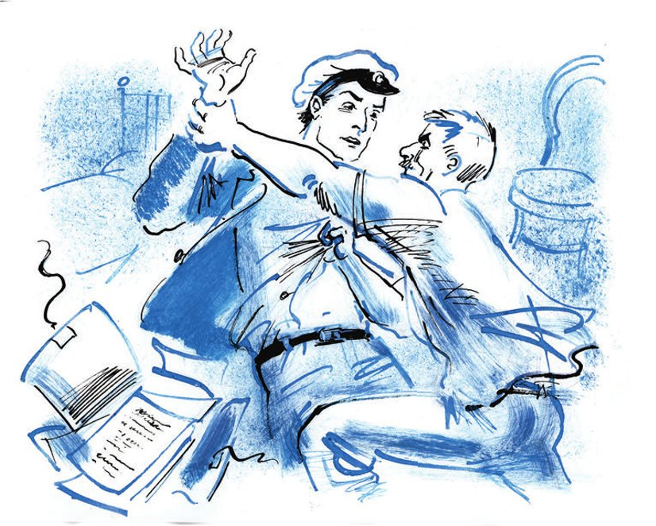

## Kapitel 22: Die Parade kommandiere ich

— Ich sterbe vor <abbr title="die Langeweile — скука">Langeweile</abbr>, — sagte Ostap. — Wir <abbr title="sich unterhalten (unterhielt, hat unterhalten) — беседовать">unterhalten uns</abbr> erst seit zwei Stunden, und Sie <abbr title="auf die Nerven gehen — надоедать, действовать на нервы">gehen</abbr> mir schon so auf die Nerven, als würde ich Sie mein ganzes Leben lang kennen. Mit so einem störrischen <abbr title="der Charakter, die Charaktere — характер">Charakter</abbr> ist man gut Millionär in Amerika. Bei uns muss ein Millionär <abbr title="umgänglich — покладистый, сговорчивый">umgänglicher</abbr> sein.

— Sie sind verrückt! — antwortete Alexander Iwanowitsch.

— Beleidigen Sie mich nicht, — bemerkte Bender sanft. — Ich bin der Sohn eines türkischen Staatsbürgers und folglich ein Nachkomme der <abbr title="der Janitschar, die Janitscharen — янычар">Janitscharen</abbr>. Ich werde Sie nicht <abbr title="schonen — щадить">schonen</abbr>, wenn Sie mich kränken. Die Janitscharen kennen kein Mitleid, weder mit Frauen noch mit Kindern noch mit sowjetischen Untergrund-Millionären.

— Gehen Sie, Bürger! — sagte Koreiko mit der Stimme eines Bürokraten vom «Herkules». — Es ist schon nach zwei Uhr nachts, ich will schlafen, ich muss früh zum Dienst.

— Richtig, richtig, das hatte ich ganz vergessen! — rief Ostap. — Sie dürfen nicht zu spät zum Dienst kommen. Man könnte Sie ohne Abfindung entlassen. Immerhin, zwei Wochen Gehalt – dreiundzwanzig Rubel! Bei Ihrer Sparsamkeit kann man davon ein halbes Jahr leben.

— Das geht Sie nichts an. Lassen Sie mich in Ruhe. Hören Sie? Verschwinden Sie!

— Aber diese Sparsamkeit wird Sie noch ruinieren. Natürlich ist es für Sie gefährlich, Ihre Millionen zu zeigen. Aber Sie übertreiben. Haben Sie schon einmal darüber nachgedacht, was mit Ihnen passiert, wenn Sie endlich Geld ausgeben dürfen? <abbr title="die Enthaltsamkeit — воздержание">Enthaltsamkeit</abbr> ist eine gefährliche Sache! Ich kannte eine Französischlehrerin, Ernestina Iossifowna Poincaré. Sie hatte in ihrem ganzen Leben nie Wein getrunken. Und was geschah? Auf einer <abbr title="die Party, die Partys — вечеринка">Party</abbr> bot man ihr ein Gläschen <abbr title="der Kognak, die Kognaks — коньяк">Kognak</abbr> an. Das gefiel ihr so gut, dass sie die ganze Flasche austrank und gleich beim Abendessen <abbr title="den Verstand verlieren — сойти с ума">den Verstand verlor</abbr>. Und auf der Welt gab es eine Französischlehrerin weniger. Dasselbe kann auch Ihnen passieren.

— Was wollen Sie, <abbr title="zum Teufel — чёрт возьми">zum Teufel</abbr>, von mir erreichen?

— Dasselbe, was mein <abbr title="der Jugendfreund, die Jugendfreunde — друг детства">Jugendfreund</abbr> Kolja Osten-Baken von meiner Jugendfreundin erreichen wollte, der polnischen <abbr title="die Schönheit, die Schönheiten — красавица; красота">Schönheit</abbr> Inga Sajonz. Er wollte Liebe. Und ich will auch Liebe. Ich will, dass Sie, Bürger Koreiko, mich lieben und mir als Zeichen Ihrer Zuneigung eine Million Rubel <abbr title="aushändigen — выдать, вручить">aushändigen</abbr>.

— Raus! — sagte Koreiko leise.

— Na bitte, schon wieder haben Sie vergessen, dass ich ein Nachkomme der Janitscharen bin.

Mit diesen Worten stand Ostap auf. Jetzt standen die beiden Gesprächspartner einander gegenüber. Koreiko hatte ein Gesicht wie ein Sturm auf dem Meer, in seinen Augen blitzten weiße <abbr title="die Schaumkrone, die Schaumkronen — барашек (на волне)">Schaumkronen</abbr>. Der große Kombinator lächelte <abbr title="herzlich — сердечно">herzlich</abbr> und zeigte seine weißen Zähne, die aussahen wie <abbr title="das Maiskorn, die Maiskörner — кукурузное зерно">Maiskörner</abbr>. Die Feinde traten nahe an die <abbr title="die Schreibtischlampe, die Schreibtischlampen — настольная лампа">Schreibtischlampe</abbr>, und an der Wand erschienen ihre riesigen Schatten.

— Tausendmal habe ich Ihnen gesagt, — sagte Koreiko und beherrschte sich mit Mühe, — dass ich keine Millionen habe und nie hatte. Verstanden? Verstanden? Und jetzt verschwinden Sie! Ich werde mich über Sie beschweren.

— Über mich werden Sie sich niemals beschweren, — sagte Ostap bedeutungsvoll. — Gehen kann ich schon. Aber ich werde noch nicht auf Ihrer Kleinen Tangentialstraße sein, da werden Sie schon weinend hinter mir herlaufen, meine Janitscharen-Fersen lecken und mich <abbr title="anflehen — умолять">anflehen</abbr>, dass ich zurückkomme.

— Und warum sollte ich Sie anflehen?

— Sie werden. Es muss so sein, wie mein Freund Wassissuali Lochankin gern sagte, genau darin liegt die große, hausgesponnene Wahrheit. Hier ist sie!

Der große Kombinator legte eine Mappe auf den Tisch. Während er langsam ihre Bänder, die wie Schnürsenkel aussahen, aufknotete, sprach er weiter:

— Nur eines vereinbaren wir vorher. Keine <abbr title="der Exzess, die Exzesse — эксцесс">Exzesse</abbr>! Sie dürfen mich nicht <abbr title="würgen — душить">würgen</abbr>, Sie dürfen sich nicht aus dem Fenster stürzen, und, das Wichtigste, sterben Sie nicht an einem <abbr title="der Schlaganfall, die Schlaganfälle — удар, инсульт">Schlaganfall</abbr>. Wenn Sie auf die Idee kommen, hier <abbr title="plötzlich — внезапно, скоропостижно">plötzlich</abbr> zu sterben, bringen Sie mich in eine dumme Lage. Dann ist die Frucht langer, gewissenhafter Arbeit verloren. Kurz, reden wir vernünftig miteinander. Es ist kein Geheimnis mehr, dass Sie mich nicht lieben. Nie werde ich bei Ihnen erreichen, was Kolja Osten-Baken bei Inga Sajonz erreicht hat, meiner Jugendfreundin. Deshalb werde ich nicht vergeblich seufzen und Sie nicht um die Taille fassen. Betrachten Sie die <abbr title="die Serenade, die Serenaden — серенада">Serenade</abbr> als beendet. Die <abbr title="die Balalaika, die Balalaikas — балалайка">Balalaikas</abbr>, die <abbr title="die Gusli (Pl.) — гусли">Gusli</abbr> und die vergoldeten <abbr title="die Harfe, die Harfen — арфа">Harfen</abbr> sind verstummt. Ich komme zu Ihnen als <abbr title="die juristische Person — юридическое лицо">juristische Person</abbr> zu einer juristischen Person. Hier ist ein Packen von drei bis vier Kilo. Er ist zu verkaufen und kostet eine Million Rubel, genau die Million, die Sie mir aus <abbr title="der Geiz — жадность, скупость">Geiz</abbr> nicht schenken wollen. Kaufen Sie!

Koreiko beugte sich über den Tisch und las auf der Mappe: «Akte Alexander Iwanowitsch Koreiko. Begonnen am 25. Juni 1930. Abgeschlossen am 10. August 1930.»

— Was für ein Unsinn! — sagte er und <abbr title="die Arme ausbreiten — развести руками">breitete</abbr> die Arme aus. — Was ist das bloß für ein Unglück! Erst kamen Sie zu mir mit irgendwelchem Geld, jetzt haben Sie eine Akte erfunden. Einfach lächerlich.

— Nun, kommt der Kauf <abbr title="zustande kommen — состояться">zustande</abbr>? — drängte der große Kombinator. — Der Preis ist nicht hoch. Für ein Kilo der wunderbarsten Auskünfte aus dem Gebiet des <abbr title="unterirdisch — подземный">unterirdischen</abbr> Handels nehme ich nur dreihunderttausend.

— Was für Auskünfte denn noch? — fragte Koreiko grob und streckte die Hand nach der Mappe aus.

— Die interessantesten, — antwortete Ostap und schob seine Hand höflich zur Seite. — Auskünfte über Ihr zweites und wichtigstes Leben. Es <abbr title="sich unterscheiden (unterschied, hat unterschieden) — отличаться">unterscheidet sich</abbr> gewaltig von Ihrem ersten Leben, dem Leben im «Herkules» für sechsundvierzig Rubel im Monat. Ihr erstes Leben kennt jeder. Von zehn bis vier sind Sie für die Sowjetmacht. Aber von Ihrem zweiten Leben, von vier bis zehn, weiß nur ich. Haben Sie die <abbr title="die Situation, die Situationen — ситуация">Situation</abbr> <abbr title="erfassen — понять, учесть">erfasst</abbr>?

Koreiko antwortete nicht. Schatten lagen in den Falten seines Gesichts, das an einen Gefreiten erinnerte.

— Nein, — sagte der große Kombinator <abbr title="entschieden — решительно">entschieden</abbr>, — Sie <abbr title="abstammen von + Dat. — происходить от">stammen</abbr> nicht wie alle Bürger vom Affen ab, sondern von der Kuh. Sie begreifen sehr langsam, ganz wie ein <abbr title="der Paarhufer, die Paarhufer — парнокопытное">Paarhufer</abbr> aus der Klasse der Säugetiere. Das sage ich Ihnen als Fachmann für Hörner und Hufe. Also noch einmal. Nach meinen Auskünften haben Sie sieben bis acht Millionen. Die Mappe kostet eine Million. Wenn Sie sie nicht kaufen, bringe ich sie sofort an einen anderen Ort. Dort bekomme ich nichts dafür, keine Kopeke. Aber Sie sind dann verloren. Das sage ich Ihnen als juristische Person einer juristischen Person. Ich bleibe derselbe arme Dichter und <abbr title="der Vielweiber, die Vielweiber — многоженец">Vielweiber</abbr>, der ich war. Aber bis zu meinem Tod wird mich der Gedanke trösten, dass ich die Öffentlichkeit von einem großen <abbr title="der Geizhals, die Geizhälse — скряга, сквалыга">Geizhals</abbr> befreit habe.

— Zeigen Sie die Akte, — sagte Koreiko nachdenklich.

— Nur keine <abbr title="die Hektik — суета">Hektik</abbr>, — bemerkte Ostap und öffnete die Mappe. — Die Parade kommandiere ich. Das wurde Ihnen seinerzeit <abbr title="telegrafisch — по телеграфу">telegrafisch</abbr> mitgeteilt. Nun, die Parade ist da, und ich kommandiere sie, wie Sie sehen.

Alexander Iwanowitsch warf einen Blick auf die erste Seite der Akte. Er sah sein eigenes Foto, das dort <abbr title="aufkleben — наклеить">aufgeklebt</abbr> war, lächelte <abbr title="unangenehm — неприятно">unangenehm</abbr> und sagte:

— Ich verstehe gar nicht, was Sie von mir wollen. Höchstens mal aus Neugier hineinschauen.

— Ich auch aus Neugier, — erklärte der große Kombinator. — Also gut, fangen wir an, und gehen wir von diesem letzten Endes unschuldigen Gefühl aus. Meine Herren Geschworenen, Alexander Iwanowitsch Koreiko wurde geboren… Übrigens können wir die glückliche Kindheit <abbr title="überspringen (übersprang, hat übersprungen) — пропустить">überspringen</abbr>. In jener <abbr title="himmelblau — голубенький">himmelblauen</abbr> Zeit betrieb Sascha noch keinen kommerziellen Raub. Dann kommt die <abbr title="rosig — розоватый">rosige</abbr> <abbr title="die Knabenzeit — отрочество">Knabenzeit</abbr>. Wir überspringen noch eine Seite. Und hier ist die Jugend, der Anfang des Lebens. Hier können wir schon <abbr title="haltmachen — остановиться">haltmachen</abbr>. Aus Neugier. Seite sechs der Akte…

Ostap <abbr title="umblättern — перевернуть страницу">blätterte</abbr> Seite sechs um und las den Inhalt der Seiten sieben, acht und so weiter vor, bis einschließlich Seite zwölf.

— Und so, meine Herren Geschworenen, haben Sie soeben die ersten großen <abbr title="das Geschäftchen, die Geschäftchen — делишки">Geschäftchen</abbr> meines Mandanten kennengelernt. Nämlich: Handel mit staatlichen Medikamenten in der Zeit von <abbr title="der Hunger — голод">Hunger</abbr> und Typhus, außerdem Arbeit in der <abbr title="die Versorgung — снабжение">Versorgung</abbr>, die zum Verschwinden eines ganzen Eisenbahnzuges mit <abbr title="das Lebensmittel, die Lebensmittel — продовольствие">Lebensmitteln</abbr> führte. Der Zug war für die hungernde Wolgaregion <abbr title="bestimmt sein für + Akk. — предназначаться для">bestimmt</abbr>. Alle diese Tatsachen, meine Herren Geschworenen, interessieren uns nur aus reiner Neugier.

Ostap sprach in der scheußlichen Art eines Rechtsanwalts aus der Zeit vor der Revolution. So ein Anwalt packt irgendein Wörtchen, lässt es nicht mehr aus den Zähnen und schleppt es alle zehn Tage eines großen Prozesses hinter sich her.

— Nicht ohne Neugier betrachten wir auch das Auftauchen meines Mandanten in Moskau im Jahr 1922…

Das Gesicht von Alexander Iwanowitsch blieb <abbr title="neutral — нейтральный">neutral</abbr>, aber seine Hände tasteten <abbr title="ziellos — бесцельно">ziellos</abbr> über den Tisch wie die Hände eines Blinden.

— Erlauben Sie, meine Herren Geschworenen, Ihnen eine Frage zu stellen. Natürlich aus Neugier. Welchen Gewinn können einem Menschen zwei gewöhnliche Fässer bringen, die mit <abbr title="das Leitungswasser — водопроводная вода">Leitungswasser</abbr> gefüllt sind? Zwanzig Rubel? Drei Rubel? Acht Kopeken? Nein, meine Herren Geschworenen! Alexander Iwanowitsch haben sie vierhunderttausend Goldrubel und null null Kopeken gebracht. Allerdings trugen diese Fässer einen <abbr title="ausdrucksvoll — выразительный">ausdrucksvollen</abbr> Namen: «Gewerbegenossenschaft für chemische Produkte „Revanche“». Doch gehen wir weiter. Seiten zweiundvierzig bis dreiundfünfzig. <abbr title="der Schauplatz, die Schauplätze — место действия">Schauplatz</abbr>: eine kleine, <abbr title="vertrauensselig — доверчивый">vertrauensselige</abbr> Republik. Blauer Himmel, <abbr title="das Kamel, die Kamele — верблюд">Kamele</abbr>, Oasen und Gecken mit goldenen Käppchen. Mein Mandant hilft beim Bau eines Kraftwerks. Ich betone: Er hilft. Sehen Sie sich sein Gesicht an, meine Herren Geschworenen!..

Ostap war in <abbr title="in Schwung kommen — увлечься, войти в раж">Schwung</abbr> gekommen. Er drehte sich zu Alexander Iwanowitsch um und zeigte mit dem Finger auf ihn. Aber einen eleganten, weichen Bogen mit der Hand zu beschreiben, wie es die Rechtsanwälte früher taten, gelang ihm nicht. Der Mandant packte plötzlich seine Hand im Flug und begann, sie schweigend zu verdrehen. Gleichzeitig <abbr title="beabsichtigen — вознамериться, намереваться">beabsichtigte</abbr> Herr Mandant, sich mit der anderen Hand in die Kehle des Herrn Rechtsanwalts zu <abbr title="sich krallen in + Akk. — вцепиться">krallen</abbr>. Eine halbe Minute lang rangen die Gegner miteinander und zitterten vor Anstrengung. Ostaps Hemd ging auf, und in der Lücke blitzte die Tätowierung auf. Napoleon hielt wie immer seinen Bierkrug, war aber so rot, als hätte er sich inzwischen ordentlich <abbr title="sich betrinken (betrank, hat betrunken) — напиться">betrunken</abbr>.

— <abbr title="unter Druck setzen — давить на">Setzen Sie</abbr> meine <abbr title="die Psyche — психика">Psyche</abbr> nicht unter Druck! — sagte Ostap. Er riss Koreiko von sich los und <abbr title="Atem holen — перевести дыхание">holte Atem</abbr>. — So kann man nicht arbeiten.

— Schuft! Schuft! — flüsterte Alexander Iwanowitsch. — So ein Schuft!

Er saß auf dem Boden und <abbr title="verziehen (verzog, hat verzogen) — кривить">verzog</abbr> das Gesicht vor Schmerz, den ihm der Nachkomme der Janitscharen <abbr title="zufügen — причинить">zugefügt</abbr> hatte.

— Die Sitzung geht weiter! — sagte Ostap, <abbr title="als wäre nichts geschehen — как ни в чём не бывало">als wäre nichts geschehen</abbr>. — Und wie Sie sehen, meine Herren Geschworenen: Das Eis ist gebrochen. Der Mandant hat versucht, mich zu töten. Natürlich aus kindlicher Neugier. Er wollte einfach wissen, was in mir drin ist. Ich beeile mich, diese Neugier zu <abbr title="befriedigen — удовлетворять">befriedigen</abbr>. Drinnen ist ein edles und sehr gesundes Herz, eine ausgezeichnete <abbr title="die Lunge, die Lungen — лёгкие">Lunge</abbr> und eine Leber ohne jedes Zeichen von <abbr title="der Stein, die Steine — камень">Steinen</abbr>. Ich bitte, diese Tatsache ins Protokoll aufzunehmen. Und jetzt: Fahren wir fort mit unseren Spielen, wie der <abbr title="der Redakteur, die Redakteure — редактор">Redakteur</abbr> einer <abbr title="humoristisch — юмористический">humoristischen</abbr> Zeitschrift sagte, als er die nächste Sitzung eröffnete und streng auf seine Mitarbeiter blickte.

Die Spiele gefielen Alexander Iwanowitsch außerordentlich schlecht. Die Dienstreise, von der Ostap zurückgekommen war, mit einem Atem nach jungem Wein und <abbr title="das Lammfleisch — баранина">Lammfleisch</abbr>, hatte in der Akte <abbr title="umfangreich — обширный">umfangreiche</abbr> Spuren hinterlassen. Da war eine Kopie des <abbr title="das Urteil, die Urteile — приговор">Urteils</abbr>, das man in seiner <abbr title="die Abwesenheit — отсутствие">Abwesenheit</abbr> <abbr title="ein Urteil fällen — вынести приговор">gefällt</abbr> hatte, Pläne des <abbr title="das Wohltätigkeitskombinat — благотворительный комбинат">Wohltätigkeitskombinats</abbr>, auf <abbr title="das Pauspapier — калька">Pauspapier</abbr> <abbr title="abzeichnen — срисовать">abgezeichnet</abbr>, Auszüge aus dem «Gewinn- und Verlustkonto» und auch Fotos von der elektrischen Schlucht und von den <abbr title="der Filmkönig, die Filmkönige — кинокороль">Filmkönigen</abbr>.

— Und schließlich, meine Herren Geschworenen, die dritte <abbr title="die Etappe, die Etappen — этап">Etappe</abbr> in der Tätigkeit meines <abbr title="rauflustig — драчливый">rauflustigen</abbr> Mandanten: bescheidene <abbr title="die Büroarbeit — конторская работа">Büroarbeit</abbr> im «Herkules» – für die Gesellschaft; und eifrige Untergrund-Handelstätigkeit – für die Seele. Nur aus Neugier erwähnen wir die <abbr title="die Spekulation, die Spekulationen — спекуляция">Spekulation</abbr> mit Devisen, Pelzen, <abbr title="das Steinchen, die Steinchen — камушек">Steinchen</abbr> und anderen kleinen Dingen des täglichen <abbr title="der Bedarf — потребность; предметы первой необходимости">Bedarfs</abbr>. Und zum Schluss halten wir bei einer Serie von Aktiengesellschaften, die sich selbst in die Luft sprengen. Sie trugen bunte, frech genossenschaftliche Namen: «Der Intensive», «Arbeitszeder», «Sägehilfe» und «Südholzfäller». Und all das hat nicht Herr Funt <abbr title="lenken — руководить, вертеть">gelenkt</abbr>, der Häftling des Privatkapitals, sondern mein Freund, der Mandant.

Dabei zeigte der große Kombinator wieder mit der Hand auf Koreiko und beschrieb damit den eleganten Bogen, den er sich schon lange <abbr title="sich vornehmen (nahm vor, hat vorgenommen) — задумать, намереваться">vorgenommen</abbr> hatte.

Dann bat Ostap mit <abbr title="schwülstig — напыщенный">schwülstigen</abbr> Worten das <abbr title="eingebildet — воображаемый">eingebildete</abbr> Gericht um <abbr title="die Erlaubnis — разрешение">Erlaubnis</abbr>, dem Angeklagten einige Fragen zu stellen. Aus Anstand wartete er eine Minute und begann:

— Hatte der Angeklagte irgendwelche <abbr title="außerdienstlich — внеслужебный">außerdienstlichen</abbr> Geschäfte mit dem Herkules-Mitarbeiter Berlaga? Nein. Richtig! Und mit dem Herkules-Mitarbeiter Skumbrijewitsch? Auch nicht. Wunderbar. Und mit dem Herkules-Mitarbeiter Polychajew?

Der Millionär und <abbr title="der Büroangestellte, die Büroangestellten — конторщик">Büroangestellte</abbr> schwieg.

— Ich habe keine weiteren Fragen. Puh!.. Ich bin müde und habe Hunger. Sagen Sie, Alexander Iwanowitsch, haben Sie nicht zufällig ein kaltes Kotelett unter dem Hemd? Nein? Erstaunliche Armut, besonders wenn man <abbr title="bedenken (bedachte, hat bedacht) — принимать во внимание">bedenkt</abbr>, wie groß die Summe ist, die Sie mit Polychajews Hilfe aus dem guten «Herkules» <abbr title="herauspumpen — выкачать">herausgepumpt</abbr> haben. Hier sind Polychajews <abbr title="eigenhändig — собственноручный">eigenhändige</abbr> Erklärungen. Er war der einzige Herkules-Mann, der wusste, wer sich hinter dem Büroangestellten für sechsundvierzig Rubel versteckte. Aber auch er verstand nicht wirklich, wer Sie sind. Ich dagegen weiß es. Ja, meine Herren Geschworenen, mein Mandant ist <abbr title="schuldig — виновный, грешный">schuldig</abbr>. Das ist bewiesen. Trotzdem erlaube ich mir, um <abbr title="die Milde — снисхождение">Milde</abbr> zu bitten, allerdings unter der Bedingung, dass der Mandant mir die Mappe abkauft. Ich bin fertig.

Gegen Ende der Rede des großen Kombinators hatte sich Alexander Iwanowitsch beruhigt. Er steckte die Hände in die Taschen seiner leichten Hose und ging zum Fenster. Der junge Tag lärmte schon mit den <abbr title="das Glöckchen, die Glöckchen — бубенец, колокольчик">Glöckchen</abbr> der Straßenbahnen durch die Stadt.

Hinter dem <abbr title="der Zaun, die Zäune — забор, палисад">Zaun</abbr> marschierten Mitglieder des Osoawiachim, des Vereins für <abbr title="die Verteidigung — оборона">Verteidigung</abbr>. Sie trugen ihre <abbr title="das Gewehr, die Gewehre — винтовка">Gewehre</abbr> schief und krumm, als wären es <abbr title="die Hacke, die Hacken — мотыга">Hacken</abbr>. Auf dem <abbr title="verzinkt — оцинкованный">verzinkten</abbr> Gesims spazierten Tauben mit roten Füßchen, die wie <abbr title="das Weidenkätzchen, die Weidenkätzchen — вербная почка («вербные лапки»)">Weidenkätzchen</abbr> aussahen. Sie trippelten hin und her und <abbr title="abrutschen — срываться">rutschten</abbr> jede Minute ab. Alexander Iwanowitsch, der sich an Sparsamkeit gewöhnt hatte, machte die Schreibtischlampe aus und sagte:

— Dann waren Sie es also, der mir die <abbr title="blödsinnig — дурацкий">blödsinnigen</abbr> Telegramme geschickt hat?

— Ich, — antwortete Ostap. — «VERLADET APFELSINEN FÄSSERN GEBRÜDER KARAMASOW». Ist das etwa schlecht?

— Ziemlich dumm.

— Und der halbidiotische Bettler? — fragte Ostap. Er fühlte, dass die Parade gelungen war. — Ist der gut?

— Ein <abbr title="der Dummejungenstreich, die Dummejungenstreiche — мальчишеская выходка">Dummejungenstreich</abbr>! Und das Buch über die Millionäre auch. Und als Sie als <abbr title="der Aufseher, die Aufseher — надзиратель">Aufseher</abbr> aus Kiew kamen, habe ich sofort verstanden, dass Sie ein kleiner Gauner sind. Leider habe ich mich geirrt. Sonst hätten Sie mich <abbr title="den Teufel werden Sie! — чёрта с два">den Teufel</abbr> gefunden.

— Ja, Sie haben sich geirrt. Auch das beste Pferd stolpert mal, wie die polnische Schönheit Inga Sajonz sagte, einen Monat nach ihrer Hochzeit mit meinem Jugendfreund Kolja Osten-Baken.

— Na gut, der Überfall ist noch zu verstehen, aber die Gewichte! Warum haben Sie mir die Gewichte gestohlen?

— Was für Gewichte? Ich habe keine Gewichte gestohlen.

— Sie schämen sich nur, es zuzugeben. Überhaupt haben Sie eine Menge Dummheiten gemacht.

— Möglich, — bemerkte Ostap. — Ich bin kein Engel. Ich habe meine Schwächen. Aber ich habe mich mit Ihnen <abbr title="sich verplaudern — заболтаться">verplaudert</abbr>. Die Mulatten warten auf mich. Darf ich das Geld <abbr title="in Empfang nehmen — получить">in Empfang nehmen</abbr>?

— Ja, das Geld! — sagte Koreiko. — Mit dem Geld gibt es einen <abbr title="die Sache hat einen Haken — загвоздка, заминка">Haken</abbr>. Die Mappe ist gut, keine Frage, die kann man kaufen. Aber als Sie meine <abbr title="die Einnahme, die Einnahmen — доход">Einnahmen</abbr> gezählt haben, haben Sie die Ausgaben und die direkten Verluste völlig <abbr title="übersehen (übersah, hat übersehen) — упустить из виду">übersehen</abbr>. Eine Million – das ist eine <abbr title="absurd — несуразный, нелепый">absurde</abbr> Zahl.

— Auf Wiedersehen, — sagte Ostap kalt. — Und bitte bleiben Sie eine halbe Stunde zu Hause. Man wird Sie in einer hübschen <abbr title="vergittert — зарешеченный">vergitterten</abbr> Kutsche abholen.

— So macht man keine Geschäfte, — sagte Koreiko mit dem Lächeln eines Kaufmanns.

— Kann sein, — seufzte Ostap. — Aber wissen Sie, ich bin kein <abbr title="der Finanzmann, die Finanzleute — финансист">Finanzmann</abbr>. Ich bin ein freier Künstler und ein kalter <abbr title="der Philosoph, die Philosophen — философ">Philosoph</abbr>.

— Und wofür wollen Sie das Geld bekommen? Ich habe es verdient, und Sie…

— Ich habe nicht nur gearbeitet. Ich habe sogar gelitten. Nach den Gesprächen mit Berlaga, Skumbrijewitsch und Polychajew habe ich den Glauben an die Menschheit verloren. Ist das etwa keine Million Rubel wert, der Glaube an die Menschheit?

— Doch, doch, das ist es wert, — beruhigte ihn Alexander Iwanowitsch.

— Also gehen wir zu den <abbr title="die Vorratskammer, die Vorratskammern — закрома, кладовая">Vorratskammern</abbr>? — fragte Ostap. — <abbr title="übrigens — кстати">Übrigens</abbr>, wo haben Sie Ihr Bargeld? Wohl nicht auf der Sparkasse?

— Gehen wir! — antwortete Koreiko. — Dort werden Sie es sehen.

— Ist es vielleicht weit? — fragte Ostap hastig. — Ich kann ein Auto holen.

Aber der Millionär lehnte das Auto ab. Er erklärte, dass es nicht weit war und dass man überhaupt keinen unnötigen <abbr title="der Pomp — помпа, пышность">Pomp</abbr> brauchte. Er ließ Bender höflich vorgehen und ging hinaus. Vom Tisch nahm er ein kleines <abbr title="das Päckchen, die Päckchen — пакетик">Päckchen</abbr> mit, das in Zeitungspapier eingewickelt war. Auf der Treppe summte Ostap: «Unter dem Himmel des heißen Argentinien…»

---

### Neue Wörter

- **die Langeweile** — скука
- **sich unterhalten (unterhielt, hat unterhalten)** — беседовать
- **auf die Nerven gehen** — надоедать, действовать на нервы
- **der Charakter, die Charaktere** — характер
- **umgänglich** — покладистый, сговорчивый
- **der Janitschar, die Janitscharen** — янычар
- **schonen** — щадить
- **die Enthaltsamkeit** — воздержание
- **die Party, die Partys** — вечеринка
- **der Kognak, die Kognaks** — коньяк
- **den Verstand verlieren** — сойти с ума
- **zum Teufel** — чёрт возьми
- **der Jugendfreund, die Jugendfreunde** — друг детства
- **die Schönheit, die Schönheiten** — красавица; красота
- **aushändigen** — выдать, вручить
- **die Schaumkrone, die Schaumkronen** — барашек (на волне)
- **herzlich** — сердечно
- **das Maiskorn, die Maiskörner** — кукурузное зерно
- **die Schreibtischlampe, die Schreibtischlampen** — настольная лампа
- **anflehen** — умолять
- **der Exzess, die Exzesse** — эксцесс
- **würgen** — душить
- **der Schlaganfall, die Schlaganfälle** — удар, инсульт
- **plötzlich** — внезапно, скоропостижно
- **die Serenade, die Serenaden** — серенада
- **die Balalaika, die Balalaikas** — балалайка
- **die Gusli (Pl.)** — гусли
- **die Harfe, die Harfen** — арфа
- **die juristische Person** — юридическое лицо
- **der Geiz** — жадность, скупость
- **die Arme ausbreiten** — развести руками
- **zustande kommen** — состояться
- **unterirdisch** — подземный
- **sich unterscheiden (unterschied, hat unterschieden)** — отличаться
- **die Situation, die Situationen** — ситуация
- **erfassen** — понять, учесть
- **entschieden** — решительно
- **abstammen von + Dat.** — происходить от
- **der Paarhufer, die Paarhufer** — парнокопытное
- **der Vielweiber, die Vielweiber** — многоженец
- **der Geizhals, die Geizhälse** — скряга, сквалыга
- **die Hektik** — суета
- **telegrafisch** — по телеграфу
- **aufkleben** — наклеить
- **unangenehm** — неприятно
- **überspringen (übersprang, hat übersprungen)** — пропустить
- **himmelblau** — голубенький
- **rosig** — розоватый
- **die Knabenzeit** — отрочество
- **haltmachen** — остановиться
- **umblättern** — перевернуть страницу
- **das Geschäftchen, die Geschäftchen** — делишки
- **der Hunger** — голод
- **die Versorgung** — снабжение
- **das Lebensmittel, die Lebensmittel** — продовольствие
- **bestimmt sein für + Akk.** — предназначаться для
- **neutral** — нейтральный
- **ziellos** — бесцельно
- **das Leitungswasser** — водопроводная вода
- **ausdrucksvoll** — выразительный
- **der Schauplatz, die Schauplätze** — место действия
- **vertrauensselig** — доверчивый
- **das Kamel, die Kamele** — верблюд
- **in Schwung kommen** — увлечься, войти в раж
- **beabsichtigen** — вознамериться, намереваться
- **sich krallen in + Akk.** — вцепиться
- **sich betrinken (betrank, hat betrunken)** — напиться
- **unter Druck setzen** — давить на
- **die Psyche** — психика
- **Atem holen** — перевести дыхание
- **verziehen (verzog, hat verzogen)** — кривить
- **zufügen** — причинить
- **als wäre nichts geschehen** — как ни в чём не бывало
- **befriedigen** — удовлетворять
- **die Lunge, die Lungen** — лёгкие
- **der Stein, die Steine** — камень
- **der Redakteur, die Redakteure** — редактор
- **humoristisch** — юмористический
- **das Lammfleisch** — баранина
- **umfangreich** — обширный
- **das Urteil, die Urteile** — приговор
- **die Abwesenheit** — отсутствие
- **ein Urteil fällen** — вынести приговор
- **das Wohltätigkeitskombinat** — благотворительный комбинат
- **das Pauspapier** — калька
- **abzeichnen** — срисовать
- **der Filmkönig, die Filmkönige** — кинокороль
- **die Etappe, die Etappen** — этап
- **rauflustig** — драчливый
- **die Büroarbeit** — конторская работа
- **die Spekulation, die Spekulationen** — спекуляция
- **das Steinchen, die Steinchen** — камушек
- **der Bedarf** — потребность; предметы первой необходимости
- **lenken** — руководить, вертеть
- **sich vornehmen (nahm vor, hat vorgenommen)** — задумать, намереваться
- **schwülstig** — напыщенный
- **eingebildet** — воображаемый
- **die Erlaubnis** — разрешение
- **außerdienstlich** — внеслужебный
- **der Büroangestellte, die Büroangestellten** — конторщик
- **bedenken (bedachte, hat bedacht)** — принимать во внимание
- **herauspumpen** — выкачать
- **eigenhändig** — собственноручный
- **schuldig** — виновный, грешный
- **die Milde** — снисхождение
- **das Glöckchen, die Glöckchen** — бубенец, колокольчик
- **der Zaun, die Zäune** — забор, палисад
- **die Verteidigung** — оборона
- **das Gewehr, die Gewehre** — винтовка
- **die Hacke, die Hacken** — мотыга
- **verzinkt** — оцинкованный
- **das Weidenkätzchen, die Weidenkätzchen** — вербная почка («вербные лапки»)
- **abrutschen** — срываться
- **blödsinnig** — дурацкий
- **der Dummejungenstreich, die Dummejungenstreiche** — мальчишеская выходка
- **der Aufseher, die Aufseher** — надзиратель
- **den Teufel werden Sie!** — чёрта с два
- **sich verplaudern** — заболтаться
- **in Empfang nehmen** — получить
- **die Sache hat einen Haken** — загвоздка, заминка
- **die Einnahme, die Einnahmen** — доход
- **übersehen (übersah, hat übersehen)** — упустить из виду
- **absurd** — несуразный, нелепый
- **vergittert** — зарешеченный
- **der Finanzmann, die Finanzleute** — финансист
- **der Philosoph, die Philosophen** — философ
- **die Vorratskammer, die Vorratskammern** — закрома, кладовая
- **übrigens** — кстати
- **der Pomp** — помпа, пышность
- **das Päckchen, die Päckchen** — пакетик

[← Zurück](kapitel-22.md) · [Inhalt](README.md) · [Weiter →](kapitel-24.md)
