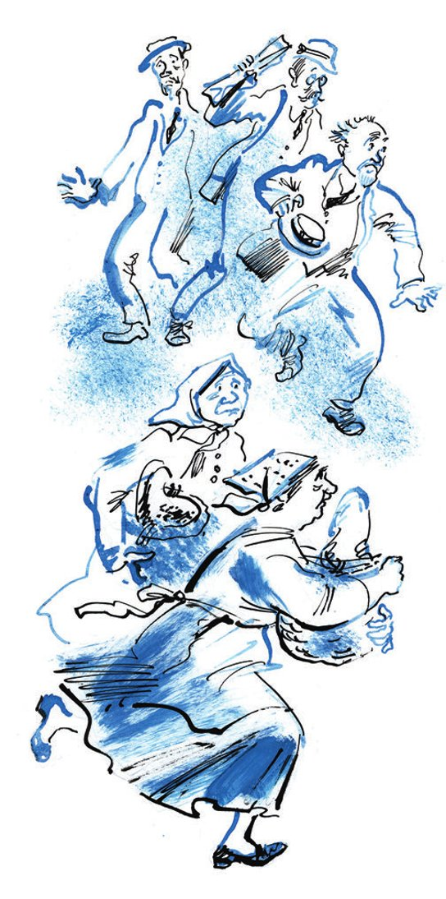
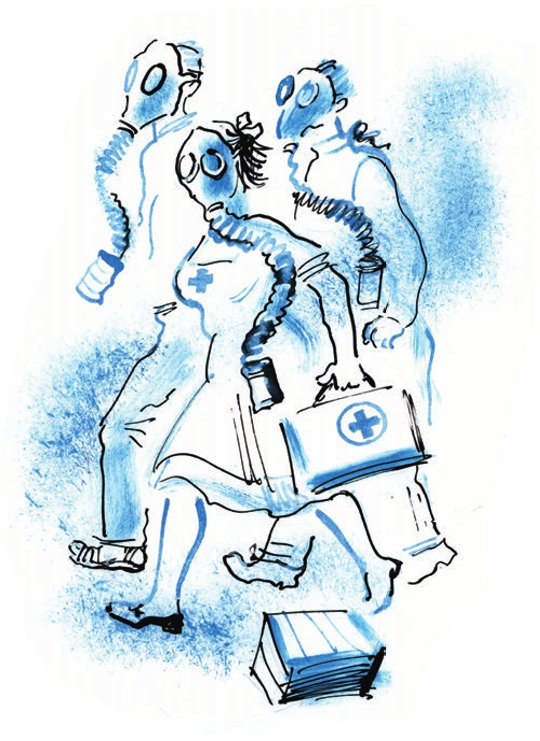
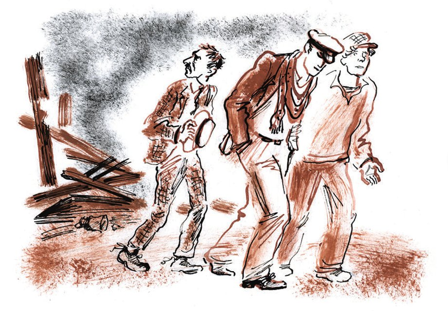

## Kapitel 23: Das Herz des Chauffeurs

Auf der Straße <abbr title="sich einhaken bei + Dat. — взять под руку">hakte</abbr> sich Ostap bei Alexander Iwanowitsch ein, und die beiden Kombinatoren gingen schnell in Richtung Bahnhof.

— Sie sind besser, als ich dachte, — sagte Bender <abbr title="freundschaftlich — дружелюбно">freundschaftlich</abbr>. — Und das ist richtig so. Vom Geld muss man sich leicht trennen, ohne Stöhnen.

— Für einen guten Menschen ist mir auch eine Million nicht zu schade, — antwortete der Büroangestellte und lauschte dabei auf irgendetwas.

Als sie in die Mehringstraße <abbr title="einbiegen (bog ein, ist eingebogen) — свернуть">einbogen</abbr>, flog über die Stadt der heulende Ton einer Sirene. Der Ton war lang, <abbr title="wellenförmig — волнистый">wellenförmig</abbr> und traurig. Bei so einem Ton wird es den <abbr title="der Seemann, die Seeleute — моряк">Seeleuten</abbr> in einer <abbr title="neblig — туманный">nebligen</abbr> Nacht irgendwie <abbr title="mulmig — не по себе, жутковато">mulmig</abbr>, und aus irgendeinem Grund möchten sie dann um eine <abbr title="die Gehaltserhöhung, die Gehaltserhöhungen — прибавка к жалованью">Gehaltserhöhung</abbr> bitten, weil der Dienst so gefährlich ist. Die Sirene heulte weiter, <abbr title="als ob — как будто">als ob</abbr> sie sich die Seele aus dem Leib schreien wollte. Ihr <abbr title="sich anschließen (schloss an, hat angeschlossen) — присоединиться">schlossen sich</abbr> die Hupen an Land an und andere Sirenen, weiter weg und noch trauriger. Die Passanten hatten es plötzlich eilig, als würde ein <abbr title="der Platzregen — ливень">Platzregen</abbr> sie jagen. Dabei grinsten alle und schauten zum Himmel. Die Händlerinnen, die <abbr title="der Sonnenblumenkern, die Sonnenblumenkerne — семечки">Sonnenblumenkerne</abbr> verkauften, dicke alte Frauen, liefen mit <abbr title="vorstrecken — выпятить">vorgestreckten</abbr> Bäuchen. In ihren Schilfkörben hüpften zwischen den Kernen die kleinen Gläser zum <abbr title="abmessen (maß ab, hat abgemessen) — отмерять">Abmessen</abbr>. Schräg über die Straße <abbr title="flitzen — промчаться, шмыгнуть">flitzte</abbr> Adolf Nikolajewitsch Bomse. Er schaffte es <abbr title="glücklich — благополучно">glücklich</abbr>, durch die Drehtür des «Herkules» zu schlüpfen. Auf bunten Pferdchen galoppierte ein Zug der berittenen Miliz-Reserve vorbei. Ein Wagen vom Roten Kreuz huschte vorüber. Die Straße war plötzlich leer. Ostap bemerkte, dass sich weit vorne vom ehemaligen Café «Florida» eine kleine <abbr title="die Herde, die Herden — табун, стадо">Herde</abbr> von Pikeewesten <abbr title="sich lösen — отделиться">löste</abbr>. Die alten Herren schwenkten Zeitungen, Strohhüte und <abbr title="der Panamahut, die Panamahüte — панама">Panamahüte</abbr> und <abbr title="traben — трусить, бежать рысцой">trabten</abbr> über das Pflaster. Aber noch bevor sie die Ecke erreichten, krachte ein ohrenbetäubender, platzender Kanonenschuss. Die Pikeewesten <abbr title="einziehen (zog ein, hat eingezogen) — втянуть, пригнуть">zogen</abbr> die Köpfe ein, blieben stehen und liefen sofort wieder zurück. Die Schöße ihrer <abbr title="die Rohseidenjacke, die Rohseidenjacken — чесучовый пиджак">Rohseidenjacken</abbr> blähten sich auf.

Das Benehmen der Pikeewesten brachte Ostap zum Lachen. Während er ihre erstaunlichen <abbr title="die Geste, die Gesten — жест">Gesten</abbr> und Sprünge bewunderte, hatte Alexander Iwanowitsch Zeit, das Päckchen auszupacken, das er von zu Hause mitgenommen hatte.

— Unanständige Greise!

<abbr title="der Operettenkomiker, die Operettenkomiker — опереточный комик">Operettenkomiker</abbr>! — sagte Ostap und drehte sich zu Koreiko um.

Aber Koreiko war nicht da. Stattdessen sah den großen Kombinator eine <abbr title="ungeheuerlich — чудовищный, потрясающий">ungeheuerliche</abbr> Fratze an: mit gläsernen <abbr title="das Taucherauge, die Taucheraugen — водолазный глаз">Taucheraugen</abbr> und einem <abbr title="der Rüssel, die Rüssel — хобот">Rüssel</abbr> aus Gummi, an dessen Ende ein <abbr title="khakifarben — цвета хаки">khakifarbener</abbr> <abbr title="der Blechzylinder, die Blechzylinder — жестяной цилиндр">Blechzylinder</abbr> baumelte. Ostap war so überrascht, dass er sogar in die Luft sprang.

— Was sind das für Scherze? — sagte er drohend und streckte die Hand nach der <abbr title="die Gasmaske, die Gasmasken — противогаз">Gasmaske</abbr> aus. — Bürger Mandant, ich rufe Sie zur <abbr title="die Ordnung — порядок">Ordnung</abbr>!

Aber in diesem Moment kam eine Gruppe von Leuten mit genau solchen Gasmasken angelaufen, und unter einem Dutzend gleicher Gummifratzen war Koreiko nicht mehr zu finden. Ostap hielt seine Mappe fest und schaute sofort auf die Beine der <abbr title="das Ungeheuer, die Ungeheuer — чудовище">Ungeheuer</abbr>. Kaum glaubte er, die <abbr title="die Witwenhose — вдовьи брюки">Witwenhose</abbr> von Alexander Iwanowitsch zu erkennen, da packte man ihn an beiden Armen, und eine forsche Stimme sagte:

— Genosse! Sie sind <abbr title="vergiften — отравить">vergiftet</abbr>!

— Wer ist vergiftet? — schrie Ostap und versuchte, sich loszureißen. — Lassen Sie mich los!

— Genosse, Sie sind mit Gas vergiftet! — wiederholte der Sanitäter fröhlich. — Sie sind in die vergiftete <abbr title="die Zone, die Zonen — зона">Zone</abbr> geraten. Sehen Sie, eine <abbr title="die Gasbombe, die Gasbomben — газовая бомба">Gasbombe</abbr>.

Auf dem Pflaster lag tatsächlich ein kleiner Kasten, aus dem eilig dicker Rauch quoll. Die verdächtige Hose war schon weit weg. Ein letztes Mal blitzte sie zwischen zwei <abbr title="die Rauchschwade, die Rauchschwaden — клуб дыма">Rauchschwaden</abbr> auf und verschwand. Ostap wehrte sich schweigend und wütend. Jetzt hielten ihn schon sechs Masken fest.

— Außerdem, Genosse, sind Sie durch einen <abbr title="der Splitter, die Splitter — осколок">Splitter</abbr> am Arm <abbr title="verwunden — ранить">verwundet</abbr>. Seien Sie nicht böse, Genosse! Seien Sie <abbr title="bewusst — сознательный">bewusst</abbr>! Sie wissen doch, dass gerade Manöver sind. Gleich verbinden wir Sie und bringen Sie in den Gasschutzraum.

Der große Kombinator konnte einfach nicht verstehen, dass <abbr title="der Widerstand — сопротивление">Widerstand</abbr> <abbr title="zwecklos — бесполезный">zwecklos</abbr> war. So geht es einem Spieler, der im Morgengrauen eine Glückssträhne erwischt und den ganzen Tisch in Staunen versetzt hat. Plötzlich verspielt er in zehn Minuten alles an einen jungen Mann, der nur aus Neugier zufällig vorbeigekommen ist. Und schon sitzt er nicht mehr da, blass und <abbr title="triumphierend — торжествующий">triumphierend</abbr>, und um ihn herum <abbr title="sich drängeln — толпиться, толкаться">drängeln sich</abbr> keine Schnorrer mehr, die um ein bisschen <abbr title="das Kleingeld — мелочь">Kleingeld</abbr> für das Glück betteln. Nach Hause geht er zu Fuß.

Zu Ostap lief eine Komsomolzin mit einem roten Kreuz auf der Schürze. Sie zog aus einer Segeltuchtasche <abbr title="die Binde, die Binden — бинт">Binden</abbr> und Watte, <abbr title="runzeln — хмурить">runzelte</abbr> die Stirn, um nicht zu lachen, und wickelte den Arm des großen Kombinators über dem Ärmel ein. Als sie mit dieser <abbr title="barmherzig — милосердный">barmherzigen</abbr> Tat fertig war, lachte das Mädchen und lief zum nächsten Verwundeten, der ihr gehorsam sein Bein hinhielt. Ostap wurde zu einer <abbr title="die Trage, die Tragen — носилки">Trage</abbr> geschleppt. Dort kam es zu einem neuen <abbr title="das Handgemenge — схватка, потасовка">Handgemenge</abbr>, bei dem die Rüssel hin und her schaukelten. Der erste Sanitäter, der hier das Kommando hatte, versuchte weiter mit lauter <abbr title="die Dozentenstimme — лекторский голос">Dozentenstimme</abbr>, in Ostap das Bewusstsein und andere bürgerliche <abbr title="die Tugend, die Tugenden — доблесть, добродетель">Tugenden</abbr> zu wecken.

— Brüder! — murmelte der große Kombinator, während man ihn mit Riemen an der Trage <abbr title="festschnallen — пристегнуть">festschnallte</abbr>. — Teilt, Brüder, meinem verstorbenen Papa, dem türkischen Staatsbürger, mit, dass sein lieber Sohn, der frühere Fachmann für Hörner und Hufe, den <abbr title="der Heldentod — смерть храбрых">Heldentod</abbr> auf dem <abbr title="das Schlachtfeld, die Schlachtfelder — поле брани">Schlachtfeld</abbr> gestorben ist.

Die letzten Worte des Opfers auf dem Schlachtfeld waren:

— Schlaft, ihr <abbr title="der Kampfadler, die Kampfadler — орёл боевой">Kampfadler</abbr>! Nachtigall, Nachtigall, mein Vögelchen…

Danach trug man Ostap fort. Er schwieg und richtete die Augen zum Himmel, wo gerade ein Durcheinander begann. Helle <abbr title="der Rauchballen, die Rauchballen — клубок дыма">Rauchballen</abbr>, so dicht wie Herzen, rollten über den Himmel. Ganz hoch oben flogen in einem <abbr title="ungleichmäßig — неровный">ungleichmäßigen</abbr> Winkel durchsichtige Flugzeuge, wie aus <abbr title="das Zelluloid — целлулоид">Zelluloid</abbr>. Von ihnen ging ein helles <abbr title="das Vibrieren — дрожание">Vibrieren</abbr> aus, als wären sie alle mit <abbr title="der Eisendraht, die Eisendrähte — железная нить">Eisendrähten</abbr> miteinander verbunden. In den kurzen Pausen zwischen den Kanonenschüssen heulten weiter die Sirenen.

Ostap musste noch eine <abbr title="die Demütigung, die Demütigungen — унижение">Demütigung</abbr> ertragen. Man trug ihn am «Herkules» vorbei. Aus den Fenstern aller vier Stockwerke der <abbr title="die Forstbehörde — лесоучреждение">Forstbehörde</abbr> schauten die Angestellten. Die ganze Finanzbuchhaltung stand auf den <abbr title="die Fensterbank, die Fensterbänke — подоконник">Fensterbänken</abbr>. Lapidus junior erschreckte Kukuschkind und tat so, als wollte er ihn hinunterstoßen. Berlaga machte große Augen und verbeugte sich vor der Trage. Im Fenster des ersten Stocks standen vor dem Hintergrund von Palmen Polychajew und Skumbrijewitsch <abbr title="Arm in Arm — обнявшись">Arm in Arm</abbr>. Als sie den <abbr title="fesseln — связать">gefesselten</abbr> Ostap bemerkten, flüsterten sie miteinander und <abbr title="zuknallen — захлопнуть">knallten</abbr> schnell das Fenster zu.

Vor dem Schild «Gasschutzraum Nr. 34» hielt die Trage. Man half Ostap aufzustehen. Weil er wieder versuchte, sich loszureißen, musste der Sanitäter noch einmal an sein Bewusstsein <abbr title="appellieren an + Akk. — взывать к">appellieren</abbr>.

Der Gasschutzraum befand sich im <abbr title="der Klubraum, die Klubräume — клуб (помещение)">Klubraum</abbr> des Hauses. Das war ein langes, helles <abbr title="das Souterrain, die Souterrains — полуподвал">Souterrain</abbr> mit einer gerippten <abbr title="die Decke, die Decken — потолок">Decke</abbr>. An Drähten hingen dort <abbr title="das Modell, die Modelle — модель">Modelle</abbr> von Kriegs- und Postflugzeugen. Ganz hinten im Klub war eine kleine Bühne. Auf ihre Rückwand hatte man zwei blaue Fenster mit Mond und Sternen und eine braune Tür gemalt. Unter einer Wand mit der Aufschrift «Wir wollen keinen Krieg, aber wir sind zur <abbr title="die Abwehr — отпор, оборона">Abwehr</abbr> bereit» drückten sich die Pikeewesten herum. Man hatte die ganze Herde auf einmal gefangen. Auf der Bühne ging ein <abbr title="der Dozent, die Dozenten — лектор">Dozent</abbr> in einer grünen Uniformjacke auf und ab. Unzufrieden sah er immer wieder zur Tür, durch die mit Lärm neue Gruppen von Vergifteten kamen, und sprach mit militärischer <abbr title="die Deutlichkeit — отчётливость">Deutlichkeit</abbr>:

— Nach der Art ihrer Wirkung werden die chemischen <abbr title="der Kampfstoff, die Kampfstoffe — боевое отравляющее вещество">Kampfstoffe</abbr> in erstickende, <abbr title="tränenreizend — слезоточивый">tränenreizende</abbr>, allgemein giftige, <abbr title="blasenziehend — нарывной">blasenziehende</abbr>, reizende und so weiter <abbr title="einteilen — делить, подразделять">eingeteilt</abbr>. Unter den tränenreizenden Kampfstoffen können wir <abbr title="das Chlorpikrin — хлорпикрин">Chlorpikrin</abbr>, <abbr title="das Brombenzol — бромистый бензол">Brombenzol</abbr>, <abbr title="das Bromaceton — бромацетон">Bromaceton</abbr>, <abbr title="das Chloracetophenon — хлорацетофенон">Chloracetophenon</abbr> <abbr title="nennen (nannte, hat genannt) — назвать, отметить">nennen</abbr>…

Ostap <abbr title="wenden (wandte, hat gewandt) — переводить (взгляд)">wandte</abbr> seinen düsteren Blick vom Dozenten zu den <abbr title="der Zuhörer, die Zuhörer — слушатель">Zuhörern</abbr>. Die jungen Leute hingen dem <abbr title="der Redner, die Redner — оратор">Redner</abbr> an den Lippen, oder sie schrieben den Vortrag in ihre Heftchen, oder sie <abbr title="basteln — возиться, мастерить">bastelten</abbr> an einer Tafel mit Gewehrteilen herum. In der zweiten Reihe saß allein ein sportliches Mädchen und sah nachdenklich auf den <abbr title="der Theatermond — театральная луна">Theatermond</abbr>.

«Ein gutes Mädchen, — dachte Ostap. — Schade, dass ich keine Zeit habe. Woran denkt sie wohl? Bestimmt nicht an Brombenzol. Ai-ai-ai! Noch heute Morgen hätte ich mit so einem Mädchen irgendwohin <abbr title="durchbrennen (brannte durch, ist durchgebrannt) — сбежать, рвануть">durchbrennen</abbr> können, nach <abbr title="Ozeanien — Океания">Ozeanien</abbr>, auf die Fidschi-Inseln oder auf irgendwelche Inseln der <abbr title="die Wohnungsgenossenschaft, die Wohnungsgenossenschaften — жилтоварищество">Wohnungsgenossenschaft</abbr> oder nach Rio de Janeiro.»

Beim Gedanken an das verlorene Rio lief Ostap unruhig im Schutzraum hin und her.

Die Pikeewesten, etwa vierzig Mann, hatten sich schon von dem <abbr title="der Schock — потрясение, шок">Schock</abbr> erholt. Sie hatten ihre gestärkten Kragen wieder <abbr title="festschrauben — привинтить">festgeschraubt</abbr> und sprachen eifrig über «Paneuropa», über die <abbr title="die Flottenkonferenz, die Flottenkonferenzen — морская конференция">Flottenkonferenz</abbr> der drei Mächte und über den Gandhismus.

— Haben Sie gehört? — sagte eine Weste zur anderen. — Gandhi ist in Dandi angekommen.

— Gandhi, das ist ein Kopf! — seufzte die andere. — Und Dandi, das ist auch ein Kopf.

Es kam zu einem Streit. Einige Westen behaupteten, dass Dandi eine Stadt war und kein Kopf sein konnte. Die anderen bewiesen mit <abbr title="wahnsinnig — безумный, сумасшедший">wahnsinniger</abbr> <abbr title="die Hartnäckigkeit — упорство">Hartnäckigkeit</abbr> das Gegenteil. Am Ende <abbr title="sich einigen auf + Akk. — сойтись на">einigten sich</abbr> alle darauf, dass Tschernomorsk in den nächsten Tagen zur Freien Stadt erklärt würde.

Der Dozent verzog wieder das Gesicht, denn die Tür ging auf, und mit Gepolter kamen neue Bewohner herein: Balaganow und Panikowski. Der Gasangriff hatte sie auf dem Rückweg von ihrer nächtlichen Expedition <abbr title="überraschen — застигнуть">überrascht</abbr>. Nach der Arbeit an den Gewichten waren sie so <abbr title="verdreckt — перепачканный">verdreckt</abbr> wie Kater, die etwas angestellt haben. Als die Milchbrüder den Kommandeur sahen, senkten sie den Blick.

— Waren Sie etwa beim Namenstag eines <abbr title="der Bischof, die Bischöfe — архиерей">Bischofs</abbr>? — fragte Ostap mürrisch.

Er hatte Angst vor Fragen, wie es mit der Sache Koreiko stand. Deshalb zog er zornig die Augenbrauen zusammen und ging zum Angriff über.

— Na, meine Gänse und Schwäne, wo wart ihr, was habt ihr getrieben?

— Bei Gott, — sagte Balaganow und legte die Hand auf die Brust. — Das hat alles Panikowski <abbr title="anzetteln — затеять">angezettelt</abbr>.

— Panikowski! — sagte der Kommandeur streng.

— Ehrenwort, edles Ehrenwort! — rief der Konventionsbrecher. — Sie wissen doch, Bender, wie ich Sie achte! Das sind Balaganows Streiche.

— Schura! — sagte Ostap noch strenger.

— Und Sie haben ihm geglaubt! — sagte der Bevollmächtigte für Hufe vorwurfsvoll. — Na, was denken Sie, hätte ich etwa ohne Ihre Erlaubnis diese Gewichte genommen?

— Also haben Sie die Gewichte genommen? — schrie Ostap. — Wozu denn?

— Panikowski hat gesagt, dass sie aus Gold sind.

Ostap sah Panikowski an. Erst jetzt bemerkte er, dass unter dessen Jacke das Vorhemd für fünfzig Kopeken fehlte. Stattdessen schaute die nackte Brust in Gottes Welt hinaus. Ohne ein Wort plumpste der große Kombinator auf einen Stuhl. Er begann zu zittern und griff mit den Händen in die Luft. Dann brach aus seiner Kehle ein Donnern wie von einem Vulkan, aus den Augen liefen Tränen, und ein schreckliches Lachen ertönte im Gasschutzraum. In diesem Lachen lag die ganze <abbr title="die Erschöpfung — утомление, усталость">Erschöpfung</abbr> der Nacht, die ganze <abbr title="die Enttäuschung, die Enttäuschungen — разочарование">Enttäuschung</abbr> im Kampf mit Koreiko, den die Milchbrüder so kläglich <abbr title="parodieren — пародировать">parodiert</abbr> hatten. Die Pikeewesten zuckten zusammen, und der Dozent sprach noch lauter und deutlicher über die chemischen Kampfstoffe.

Das Lachen <abbr title="prickeln — покалывать">prickelte</abbr> noch mit tausend Nadeln aus Mineralwasser in Ostap, aber er fühlte sich schon frisch und <abbr title="verjüngen — омолодить">verjüngt</abbr>. Er fühlte sich wie ein Mann, der beim Friseur alle Instanzen <abbr title="durchlaufen (durchlief, hat durchlaufen) — пройти">durchlaufen</abbr> hat: die Freundschaft mit dem Rasiermesser, die Bekanntschaft mit der Schere, den kleinen Regen aus Kölnischwasser und sogar das <abbr title="kämmen — причёсывать">Kämmen</abbr> der Augenbrauen mit einem besonderen Bürstchen. Eine <abbr title="lackglänzend — лаковый, блестящий">lackglänzende</abbr> Ozeanwelle <abbr title="schwappen — плеснуть">schwappte</abbr> schon in sein Herz. Als Balaganow nach den Geschäften fragte, antwortete er, dass alles ausgezeichnet lief, wenn man von der unerwarteten <abbr title="die Flucht — бегство">Flucht</abbr> des Millionärs in unbekannte Richtung nicht mitrechnete.

Die Milchbrüder schenkten Ostaps Worten nicht die <abbr title="gebührend — должный">gebührende</abbr> <abbr title="die Aufmerksamkeit — внимание">Aufmerksamkeit</abbr>. Sie freuten sich, dass die Sache mit den Gewichten so <abbr title="glimpflich — благополучно, без последствий">glimpflich</abbr> <abbr title="ausgehen (ging aus, ist ausgegangen) — закончиться">ausgegangen</abbr> war.

— Sehen Sie, Bender, — sagte der Bevollmächtigte für Hufe, — da sitzt das Fräulein. Mit der ist Koreiko immer spazieren gegangen.

— Das ist also Sossja Sinizkaja? — sagte Ostap mit <abbr title="der Nachdruck — ударение, выразительность">Nachdruck</abbr>. — Wirklich: «Auf einem lärmenden Ball, ganz zufällig…»

Ostap drängte sich zur Bühne durch, hielt den Redner höflich an und erfuhr von ihm, dass die Gas-<abbr title="die Gefangenschaft — плен">Gefangenschaft</abbr> noch etwa anderthalb bis zwei Stunden dauern würde. Er bedankte sich und setzte sich gleich dort an der Bühne neben Sossja. Nach einer Weile schaute das Mädchen nicht mehr auf das <abbr title="bemalt — размалёванный">bemalte</abbr> Fenster. Sie lachte unanständig laut und versuchte, Ostap ihren Kamm aus der Hand zu reißen. Was den großen Kombinator betrifft, so redete er, nach den Bewegungen seiner Lippen zu <abbr title="urteilen — судить">urteilen</abbr>, ohne Pause.

In den Gasschutzraum schleppte man den Ingenieur Talmudowski. Er wehrte sich mit zwei Koffern. Seine rosige Stirn war <abbr title="feucht — влажный">feucht</abbr> von Schweiß und glänzte wie ein <abbr title="der Pfannkuchen, die Pfannkuchen — блин">Pfannkuchen</abbr>.

— Ich kann nichts machen, Genosse! — sagte der Sanitäter. — Manöver! Sie sind in die vergiftete Zone geraten.

— Aber ich bin doch mit der Droschke gefahren! — ereiferte sich der Ingenieur. — Mit der Drosch-ke! Ich muss dienstlich zum Bahnhof. In der Nacht habe ich den Zug verpasst. Soll ich ihn jetzt etwa wieder verpassen?

— Genosse, seien Sie bewusst!

— Wieso muss ich bewusst sein, wenn ich mit der Droschke gefahren bin! — empörte sich Talmudowski.

Er bestand so sehr auf diesem Umstand, als würde eine Fahrt in der Droschke den Fahrgast <abbr title="unverwundbar — неуязвимый">unverwundbar</abbr> machen und Chlorpikrin, Bromaceton und Brombenzol ihre <abbr title="tödlich — губительный, смертельный">tödlichen</abbr> <abbr title="die Eigenschaft, die Eigenschaften — свойство">Eigenschaften</abbr> nehmen. Wer weiß, wie lange Talmudowski noch mit den Leuten vom Osoawiachim <abbr title="streiten (stritt, hat gestritten) — ругаться, спорить">gestritten</abbr> hätte. Aber da kam ein neuer Vergifteter in den Gasschutzraum, ein Bürger, der nach dem Kopf in der <abbr title="die Mullbinde, die Mullbinden — марлевая повязка">Mullbinde</abbr> zu urteilen auch verwundet war. Als Talmudowski den neuen Gast sah, verstummte er und tauchte flink in der Menge der Pikeewesten unter. Aber der Mann mit dem Mull bemerkte sofort die <abbr title="stattlich — корпулентный, видный">stattliche</abbr> Figur des Ingenieurs und ging direkt auf ihn zu.

— Endlich habe ich Sie erwischt, Ingenieur Talmudowski! — sagte er <abbr title="unheilvoll — зловеще">unheilvoll</abbr>. — Mit welchem Recht haben Sie das <abbr title="das Werk, die Werke — завод">Werk</abbr> verlassen?

Talmudowski ließ seine kleinen Augen, die wie die eines <abbr title="das Wildschwein, die Wildschweine — кабан">Wildschweins</abbr> aussahen, nach allen Seiten wandern. Als er sah, dass er nirgendwohin fliehen konnte, setzte er sich auf seine Koffer und zündete sich eine Zigarette an.

— Ich komme zu ihm ins Hotel, — fuhr der Mann mit dem Mull laut fort, — und man sagt mir: abgereist. Wieso, frage ich, abgereist, wenn er erst gestern <abbr title="anreisen — прибыть">angereist</abbr> ist und laut Vertrag ein Jahr arbeiten muss? Abgereist, sagen sie, mit Koffern nach Kasan. Ich dachte schon, alles ist aus, wir müssen wieder einen Spezialisten suchen. Aber jetzt habe ich ihn: Da sitzt er, sehen Sie, und raucht gemütlich. Sie sind ein <abbr title="der Springer, die Springer — летун (кто часто меняет работу)">Springer</abbr>, Ingenieur Talmudowski! Sie zerstören die Produktion!

Der Ingenieur sprang von den Koffern und schrie: «Sie zerstören die Produktion!» Dann packte er seinen <abbr title="der Ankläger, die Ankläger — обличитель, обвинитель">Ankläger</abbr> um die Taille, führte ihn in eine Ecke und summte ihn an wie eine große Fliege. Bald hörte man aus der Ecke Bruchstücke von Sätzen: «Bei so einem Gehalt…», «Suchen Sie doch selbst…», «Und die <abbr title="die Reisespesen (Pl.) — командировочные">Reisespesen</abbr>?» Der Mann mit dem Mull sah den Ingenieur sehnsüchtig an.

Schon hatte der Dozent seine <abbr title="die Belehrung, die Belehrungen — наставление">Belehrungen</abbr> beendet und zum Schluss gezeigt, wie man eine Gasmaske benutzt. Schon waren die Türen des Gasschutzraums geöffnet, und die Pikeewesten liefen, einer am anderen festgehalten, zur «Florida». Schon hatte Talmudowski seinen Verfolger <abbr title="abschütteln — стряхнуть, отделаться">abgeschüttelt</abbr> und war in die Freiheit entkommen, wobei er aus vollem Hals nach einer Droschke rief. Aber der große Kombinator plauderte immer noch mit Sossja.

— Was für eine <abbr title="die Femina — фемина, женщина">Femina</abbr>! — sagte Panikowski <abbr title="eifersüchtig — ревниво">eifersüchtig</abbr>, als er mit Balaganow auf die Straße ging. — Ach, wenn die Gewichte doch aus Gold wären! Ehrenwort, edles Ehrenwort, ich würde sie heiraten!

Als die <abbr title="unglückselig — злополучный">unglückseligen</abbr> Gewichte erwähnt wurden, stieß Balaganow Panikowski schmerzhaft mit dem Ellbogen. Das war genau <abbr title="rechtzeitig — своевременно">rechtzeitig</abbr>. In der Tür des Gasschutzraums erschien Ostap, die Femina am Arm. Er verabschiedete sich lange von Sossja und sah sie dabei schmachtend direkt an. Sossja lächelte ein letztes Mal und ging.

— Worüber haben Sie mit ihr gesprochen? — fragte Panikowski misstrauisch.

— Ach, über nichts, über Gott und die Welt, — antwortete Ostap. — Na, goldene Kompanie, an die Arbeit! Wir müssen den Mandanten finden.

Panikowski wurde in den «Herkules» geschickt, Balaganow in die Wohnung von Alexander Iwanowitsch. Ostap selbst <abbr title="eilen — спешить, броситься">eilte</abbr> zu den Bahnhöfen. Aber der Millionär und Büroangestellte war verschwunden. Im «Herkules» war seine <abbr title="die Marke, die Marken — марка, жетон">Marke</abbr> nicht von der <abbr title="die Anwesenheitstafel, die Anwesenheitstafeln — табельная доска">Anwesenheitstafel</abbr> genommen worden. In seine Wohnung war er nicht zurückgekehrt. Und während des Gasangriffs waren von den Bahnhöfen acht <abbr title="der Fernzug, die Fernzüge — поезд дальнего следования">Fernzüge</abbr> abgefahren. Aber Ostap hatte auch kein anderes Ergebnis erwartet.

— Letzten Endes, — sagte er ohne Fröhlichkeit, — ist das nicht schlimm. In China ist es ziemlich schwer, den richtigen Menschen zu finden: Dort leben vierhundert Millionen Einwohner. Bei uns dagegen ist es sehr leicht: nur hundertsechzig Millionen, dreimal leichter als in China. Wenn wir nur Geld haben. Und das haben wir.

Doch als Ostap aus der Bank kam, hielt er vierunddreißig Rubel in der Hand.

— Das ist alles, was von den zehntausend übrig geblieben ist, — sagte er mit <abbr title="unsäglich — неизъяснимый">unsäglicher</abbr> Traurigkeit. — Und ich dachte, auf dem Girokonto sind noch sechs- oder siebentausend… Wie ist das nur passiert? Alles war so lustig, wir haben Hörner und Hufe <abbr title="beschaffen — заготовлять, доставать">beschafft</abbr>, das Leben war <abbr title="berauschend — упоительный">berauschend</abbr>, die Erdkugel drehte sich extra für uns, und plötzlich… Ich verstehe! Die Gemeinkosten! Der Apparat hat das ganze Geld aufgefressen.

Und er sah die Milchbrüder vorwurfsvoll an. Panikowski zuckte mit den Schultern, als wollte er sagen: «Sie wissen doch, Bender, wie ich Sie achte! Ich habe immer gesagt, dass Sie ein Esel sind!» Balaganow streichelte verwirrt seine Locken und fragte:

— Was sollen wir denn jetzt machen?

— Was heißt hier was! — rief Ostap. — Und das Büro für die Beschaffung von Hörnern und Hufen? Und das <abbr title="das Inventar — инвентарь">Inventar</abbr>? Allein für das Tintenfass «Das Gesicht zum Dorf» gibt jede Behörde mit Freuden hundert Rubel! Und die Schreibmaschine! Und der Locher, das Hirschgeweih, die Tische, die <abbr title="die Barriere, die Barrieren — барьер">Barriere</abbr>, der Samowar! Das alles kann man verkaufen. Und schließlich haben wir noch Panikowskis Goldzahn in Reserve. Natürlich ist er nicht so groß wie die Gewichte, aber immerhin ist er ein <abbr title="das Molekül, die Moleküle — молекула">Molekül</abbr> Gold, ein <abbr title="das Edelmetall, die Edelmetalle — благородный металл">Edelmetall</abbr>.

Vor dem Büro blieben die Freunde stehen. Aus der offenen Tür kamen die jungen <abbr title="die Löwenstimme, die Löwenstimmen — львиный голос">Löwenstimmen</abbr> der Studenten von der Fachschule für Viehzucht, die von ihrer Dienstreise zurück waren, das verschlafene <abbr title="das Gebrummel — бормотание">Gebrummel</abbr> von Funt und noch einige fremde <abbr title="der Bass, die Bässe — бас">Bässe</abbr> und <abbr title="der Bariton, die Baritone — баритон">Baritone</abbr> von eindeutig landwirtschaftlicher <abbr title="die Klangfarbe — тембр">Klangfarbe</abbr>.

— Das ist ein <abbr title="der Tatbestand — состав преступления">Tatbestand</abbr>! — schrien die <abbr title="der Praktikant, die Praktikanten — практикант">Praktikanten</abbr>. — Wir haben uns schon damals gewundert. In der ganzen <abbr title="die Kampagne, die Kampagnen — кампания">Kampagne</abbr> sind nur zwölf Kilo Hörner <abbr title="minderer Sorte — несортовой">minderer Sorte</abbr> beschafft worden.

— Sie kommen vor Gericht! — donnerten die Bässe und Baritone. — Wo ist der Abteilungsleiter? Wo ist der Bevollmächtigte für Hufe?

Balaganow begann zu zittern.

— Das Büro ist gestorben, — flüsterte Ostap, — und wir werden hier nicht mehr gebraucht. Wir gehen eine Straße entlang, die von Sonne überflutet ist. Und Funt bringt man in ein Haus aus rotem <abbr title="der Backstein, die Backsteine — кирпич">Backstein</abbr>, an dessen Fenster durch eine seltsame Laune des <abbr title="der Architekt, die Architekten — архитектор">Architekten</abbr> dicke Gitter <abbr title="schrauben — привинчивать">geschraubt</abbr> sind.

Der Ex-Abteilungsleiter hatte sich nicht geirrt. Die <abbr title="gestürzt — поверженный">gestürzten</abbr> Engel waren noch keine drei Häuserblocks vom Büro entfernt, als sie hinter sich das Rattern einer Droschke hörten. In der Droschke fuhr Funt. Er hätte ganz wie ein guter <abbr title="der Großvater, die Großväter — дедушка">Großvater</abbr> ausgesehen, der sich nach langen Vorbereitungen auf den Weg zu seinem <abbr title="verheiratet — женатый">verheirateten</abbr> Enkel gemacht hat. Aber da war ein <abbr title="der Milizionär, die Milizionäre — милиционер">Milizionär</abbr>, der auf dem <abbr title="das Trittbrett, die Trittbretter — подножка">Trittbrett</abbr> stand und den Alten am stacheligen Rücken festhielt.

— Funt hat immer <abbr title="sitzen (saß, hat gesessen) — сидеть (в тюрьме)">gesessen</abbr>, — hörten die Antilopen-Leute die tiefe, dumpfe Stimme des Alten, als die Droschke an ihnen vorbeifuhr. — Funt hat gesessen unter Alexander dem Zweiten, dem Befreier, unter Alexander dem Dritten, dem Friedensstifter, unter Nikolaus dem Zweiten, dem Blutigen, unter Alexander Fjodorowitsch Kerenski…

Und während er die Zaren und die Rechtsanwälte aufzählte, <abbr title="einknicken — загибать">knickte</abbr> Funt die Finger ein.

— Und was machen wir jetzt? — fragte Balaganow.

— Ich bitte Sie, nicht zu vergessen, dass Sie im selben Zeitabschnitt leben wie Ostap Bender, — sagte der große Kombinator traurig. — Ich bitte Sie, daran zu denken, dass er eine wunderbare <abbr title="die Reisetasche, die Reisetaschen — саквояж">Reisetasche</abbr> hat, in der alles ist, was man braucht, um sich Taschengeld zu <abbr title="verschaffen — добывать">verschaffen</abbr>. Gehen wir nach Hause, zu Lochankin.

In der Zitronengasse wartete ein neuer Schlag auf sie.

— Wo ist denn das Haus? — rief Ostap. — Hier war doch gestern Abend noch ein Haus?

Aber das Haus war nicht mehr da, das «Krähenviertel» war nicht mehr da. Über die <abbr title="verkohlt — обгорелый">verkohlten</abbr> Balken ging nur ein <abbr title="der Versicherungsinspektor, die Versicherungsinspektoren — страховой инспектор">Versicherungsinspektor</abbr>. Im hinteren Hof fand er eine <abbr title="die Kanne, die Kannen — бидон">Kanne</abbr>, in der Petroleum gewesen war. Er roch daran und schüttelte zweifelnd den Kopf.

— Na, und was jetzt? — fragte Balaganow und lächelte erschrocken.

Der große Kombinator antwortete nicht. Der Verlust der Reisetasche hatte ihn niedergeschlagen. Verbrannt war der Zaubersack, in dem ein indischer Turban war, das Plakat «Der Priester ist da», ein Arztkittel, ein Stethoskop. Was war da nicht alles drin gewesen!

— Tja, — sagte Ostap endlich, — das Schicksal spielt mit dem Menschen, und der Mensch spielt Trompete.

Sie <abbr title="trotten — брести">trotteten</abbr> durch die Straßen, blass, enttäuscht, <abbr title="abgestumpft — отупевший">abgestumpft</abbr> vor Kummer. Passanten <abbr title="anrempeln — толкать">rempelten</abbr> sie an, aber sie <abbr title="zurückschnauzen — огрызаться">schnauzten</abbr> nicht einmal zurück. Panikowski hatte schon bei dem <abbr title="der Misserfolg, die Misserfolge — неудача">Misserfolg</abbr> in der Bank die Schultern <abbr title="hochziehen (zog hoch, hat hochgezogen) — поднять">hochgezogen</abbr> und ließ sie nicht mehr sinken. Balaganow zupfte an seinen roten Locken und seufzte bekümmert. Bender ging hinter allen anderen, mit gesenktem Kopf, und brummte mechanisch: «Aus, aus ist der Tag der Spiele, schieß, mein kleiner <abbr title="der Zuave, die Zuaven — зуав">Zuave</abbr>». In diesem Zustand schleppten sich sie zur <abbr title="die Herberge, die Herbergen — постоялый двор">Herberge</abbr>. Ganz hinten, unter einem <abbr title="das Vordach, die Vordächer — навес">Vordach</abbr>, schimmerte gelb die «Antilope». Auf der <abbr title="die Treppe, die Treppen — крыльцо, лестница">Treppe</abbr> der <abbr title="die Schenke, die Schenken — трактир">Schenke</abbr> saß Koslewitsch. Genüsslich pustend schlürfte er heißen Tee aus der Untertasse. Sein Gesicht war rot wie ein <abbr title="der Tontopf, die Tontöpfe — глиняный горшок">Tontopf</abbr>. Er war <abbr title="selig — блаженный">selig</abbr>.

— Adam! — sagte der große Kombinator und blieb vor dem Chauffeur stehen. — Wir haben nichts mehr. Wir sind Bettler, Adam! Nehmen Sie uns auf! Wir gehen zugrunde.

Koslewitsch stand auf. Der Kommandeur, <abbr title="demütigen — унизить">gedemütigt</abbr> und arm, stand <abbr title="barhäuptig — с непокрытой головой">barhäuptig</abbr> vor ihm. Die hellen polnischen Augen von Adam Kasimirowitsch glänzten vor Tränen. Er stieg die Stufen hinunter und umarmte einen Antilopen-Mann nach dem anderen.

— Der Taxi ist frei! — sagte er und schluckte Tränen des Mitleids hinunter. — Bitte einsteigen.

— Aber vielleicht müssen wir weit fahren, sehr weit, — sagte Ostap. — Vielleicht bis ans Ende der Welt, und vielleicht noch weiter. Denken Sie gut nach!

— Wohin Sie wollen! — antwortete der treue Koslewitsch. — Der Taxi ist frei!

Panikowski weinte. Er hielt sich die kleinen Fäuste vors Gesicht und flüsterte:

— Was für ein Herz! Ehrenwort, edles Ehrenwort! Was für ein Herz!

---

### Neue Wörter

- **sich einhaken bei + Dat.** — взять под руку
- **freundschaftlich** — дружелюбно
- **einbiegen (bog ein, ist eingebogen)** — свернуть
- **wellenförmig** — волнистый
- **der Seemann, die Seeleute** — моряк
- **neblig** — туманный
- **mulmig** — не по себе, жутковато
- **die Gehaltserhöhung, die Gehaltserhöhungen** — прибавка к жалованью
- **als ob** — как будто
- **sich anschließen (schloss an, hat angeschlossen)** — присоединиться
- **der Platzregen** — ливень
- **der Sonnenblumenkern, die Sonnenblumenkerne** — семечки
- **vorstrecken** — выпятить
- **abmessen (maß ab, hat abgemessen)** — отмерять
- **flitzen** — промчаться, шмыгнуть
- **glücklich** — благополучно
- **die Herde, die Herden** — табун, стадо
- **sich lösen** — отделиться
- **der Panamahut, die Panamahüte** — панама
- **traben** — трусить, бежать рысцой
- **einziehen (zog ein, hat eingezogen)** — втянуть, пригнуть
- **die Rohseidenjacke, die Rohseidenjacken** — чесучовый пиджак
- **die Geste, die Gesten** — жест
- **der Operettenkomiker, die Operettenkomiker** — опереточный комик
- **ungeheuerlich** — чудовищный, потрясающий
- **das Taucherauge, die Taucheraugen** — водолазный глаз
- **der Rüssel, die Rüssel** — хобот
- **khakifarben** — цвета хаки
- **der Blechzylinder, die Blechzylinder** — жестяной цилиндр
- **die Gasmaske, die Gasmasken** — противогаз
- **die Ordnung** — порядок
- **das Ungeheuer, die Ungeheuer** — чудовище
- **die Witwenhose** — вдовьи брюки
- **vergiften** — отравить
- **die Zone, die Zonen** — зона
- **die Gasbombe, die Gasbomben** — газовая бомба
- **die Rauchschwade, die Rauchschwaden** — клуб дыма
- **der Splitter, die Splitter** — осколок
- **verwunden** — ранить
- **bewusst** — сознательный
- **der Widerstand** — сопротивление
- **zwecklos** — бесполезный
- **triumphierend** — торжествующий
- **sich drängeln** — толпиться, толкаться
- **das Kleingeld** — мелочь
- **die Binde, die Binden** — бинт
- **runzeln** — хмурить
- **barmherzig** — милосердный
- **die Trage, die Tragen** — носилки
- **das Handgemenge** — схватка, потасовка
- **die Dozentenstimme** — лекторский голос
- **die Tugend, die Tugenden** — доблесть, добродетель
- **festschnallen** — пристегнуть
- **der Heldentod** — смерть храбрых
- **das Schlachtfeld, die Schlachtfelder** — поле брани
- **der Kampfadler, die Kampfadler** — орёл боевой
- **der Rauchballen, die Rauchballen** — клубок дыма
- **ungleichmäßig** — неровный
- **das Zelluloid** — целлулоид
- **das Vibrieren** — дрожание
- **der Eisendraht, die Eisendrähte** — железная нить
- **die Demütigung, die Demütigungen** — унижение
- **die Forstbehörde** — лесоучреждение
- **die Fensterbank, die Fensterbänke** — подоконник
- **Arm in Arm** — обнявшись
- **fesseln** — связать
- **zuknallen** — захлопнуть
- **appellieren an + Akk.** — взывать к
- **der Klubraum, die Klubräume** — клуб (помещение)
- **das Souterrain, die Souterrains** — полуподвал
- **die Decke, die Decken** — потолок
- **das Modell, die Modelle** — модель
- **die Abwehr** — отпор, оборона
- **der Dozent, die Dozenten** — лектор
- **die Deutlichkeit** — отчётливость
- **der Kampfstoff, die Kampfstoffe** — боевое отравляющее вещество
- **tränenreizend** — слезоточивый
- **blasenziehend** — нарывной
- **einteilen** — делить, подразделять
- **das Chlorpikrin** — хлорпикрин
- **das Brombenzol** — бромистый бензол
- **das Bromaceton** — бромацетон
- **das Chloracetophenon** — хлорацетофенон
- **nennen (nannte, hat genannt)** — назвать, отметить
- **wenden (wandte, hat gewandt)** — переводить (взгляд)
- **der Zuhörer, die Zuhörer** — слушатель
- **der Redner, die Redner** — оратор
- **basteln** — возиться, мастерить
- **der Theatermond** — театральная луна
- **durchbrennen (brannte durch, ist durchgebrannt)** — сбежать, рвануть
- **Ozeanien** — Океания
- **die Wohnungsgenossenschaft, die Wohnungsgenossenschaften** — жилтоварищество
- **der Schock** — потрясение, шок
- **festschrauben** — привинтить
- **die Flottenkonferenz, die Flottenkonferenzen** — морская конференция
- **wahnsinnig** — безумный, сумасшедший
- **die Hartnäckigkeit** — упорство
- **sich einigen auf + Akk.** — сойтись на
- **überraschen** — застигнуть
- **verdreckt** — перепачканный
- **der Bischof, die Bischöfe** — архиерей
- **anzetteln** — затеять
- **die Erschöpfung** — утомление, усталость
- **die Enttäuschung, die Enttäuschungen** — разочарование
- **parodieren** — пародировать
- **prickeln** — покалывать
- **verjüngen** — омолодить
- **durchlaufen (durchlief, hat durchlaufen)** — пройти
- **kämmen** — причёсывать
- **lackglänzend** — лаковый, блестящий
- **schwappen** — плеснуть
- **die Flucht** — бегство
- **gebührend** — должный
- **die Aufmerksamkeit** — внимание
- **glimpflich** — благополучно, без последствий
- **ausgehen (ging aus, ist ausgegangen)** — закончиться
- **der Nachdruck** — ударение, выразительность
- **die Gefangenschaft** — плен
- **bemalt** — размалёванный
- **urteilen** — судить
- **feucht** — влажный
- **der Pfannkuchen, die Pfannkuchen** — блин
- **unverwundbar** — неуязвимый
- **tödlich** — губительный, смертельный
- **die Eigenschaft, die Eigenschaften** — свойство
- **streiten (stritt, hat gestritten)** — ругаться, спорить
- **die Mullbinde, die Mullbinden** — марлевая повязка
- **stattlich** — корпулентный, видный
- **unheilvoll** — зловеще
- **das Werk, die Werke** — завод
- **das Wildschwein, die Wildschweine** — кабан
- **anreisen** — прибыть
- **der Springer, die Springer** — летун (кто часто меняет работу)
- **der Ankläger, die Ankläger** — обличитель, обвинитель
- **die Reisespesen (Pl.)** — командировочные
- **die Belehrung, die Belehrungen** — наставление
- **abschütteln** — стряхнуть, отделаться
- **die Femina** — фемина, женщина
- **eifersüchtig** — ревниво
- **unglückselig** — злополучный
- **rechtzeitig** — своевременно
- **eilen** — спешить, броситься
- **die Marke, die Marken** — марка, жетон
- **die Anwesenheitstafel, die Anwesenheitstafeln** — табельная доска
- **der Fernzug, die Fernzüge** — поезд дальнего следования
- **unsäglich** — неизъяснимый
- **beschaffen** — заготовлять, доставать
- **berauschend** — упоительный
- **das Inventar** — инвентарь
- **die Barriere, die Barrieren** — барьер
- **das Molekül, die Moleküle** — молекула
- **das Edelmetall, die Edelmetalle** — благородный металл
- **die Löwenstimme, die Löwenstimmen** — львиный голос
- **das Gebrummel** — бормотание
- **der Bass, die Bässe** — бас
- **der Bariton, die Baritone** — баритон
- **die Klangfarbe** — тембр
- **der Tatbestand** — состав преступления
- **der Praktikant, die Praktikanten** — практикант
- **die Kampagne, die Kampagnen** — кампания
- **minderer Sorte** — несортовой
- **der Backstein, die Backsteine** — кирпич
- **der Architekt, die Architekten** — архитектор
- **schrauben** — привинчивать
- **gestürzt** — поверженный
- **der Großvater, die Großväter** — дедушка
- **verheiratet** — женатый
- **der Milizionär, die Milizionäre** — милиционер
- **das Trittbrett, die Trittbretter** — подножка
- **sitzen (saß, hat gesessen)** — сидеть (в тюрьме)
- **einknicken** — загибать
- **die Reisetasche, die Reisetaschen** — саквояж
- **verschaffen** — добывать
- **verkohlt** — обгорелый
- **der Versicherungsinspektor, die Versicherungsinspektoren** — страховой инспектор
- **die Kanne, die Kannen** — бидон
- **trotten** — брести
- **abgestumpft** — отупевший
- **anrempeln** — толкать
- **zurückschnauzen** — огрызаться
- **der Misserfolg, die Misserfolge** — неудача
- **hochziehen (zog hoch, hat hochgezogen)** — поднять
- **der Zuave, die Zuaven** — зуав
- **die Herberge, die Herbergen** — постоялый двор
- **das Vordach, die Vordächer** — навес
- **die Treppe, die Treppen** — крыльцо, лестница
- **die Schenke, die Schenken** — трактир
- **der Tontopf, die Tontöpfe** — глиняный горшок
- **selig** — блаженный
- **demütigen** — унизить
- **barhäuptig** — с непокрытой головой

[← Zurück](kapitel-23.md) · [Inhalt](README.md) · [Weiter →](kapitel-25.md)
