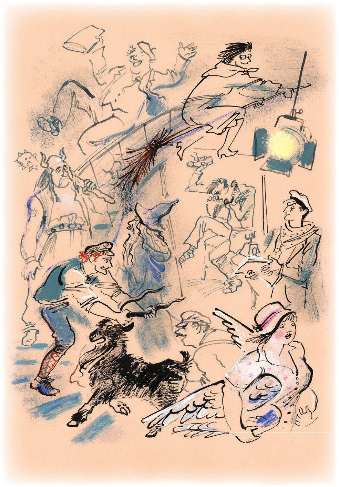
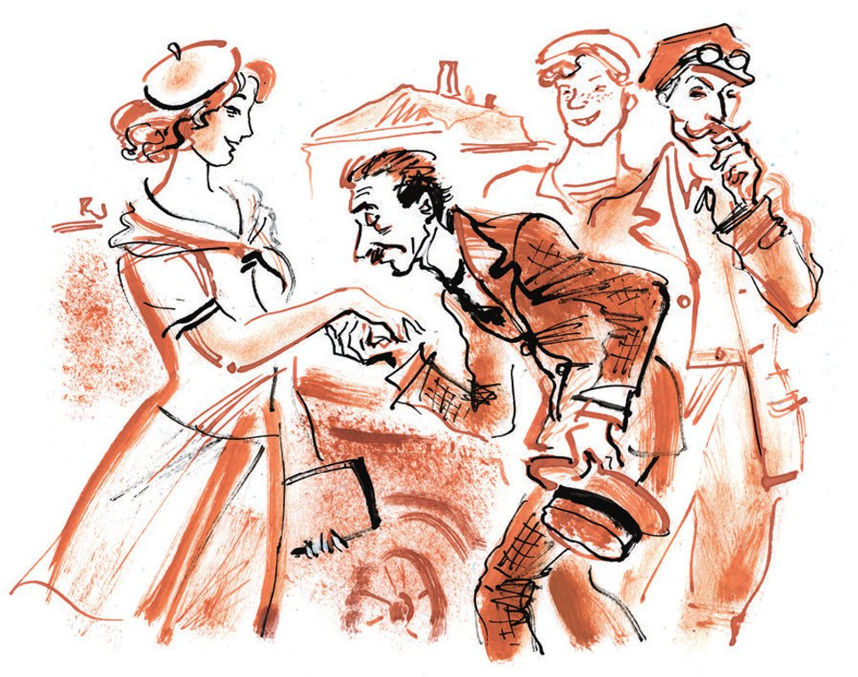
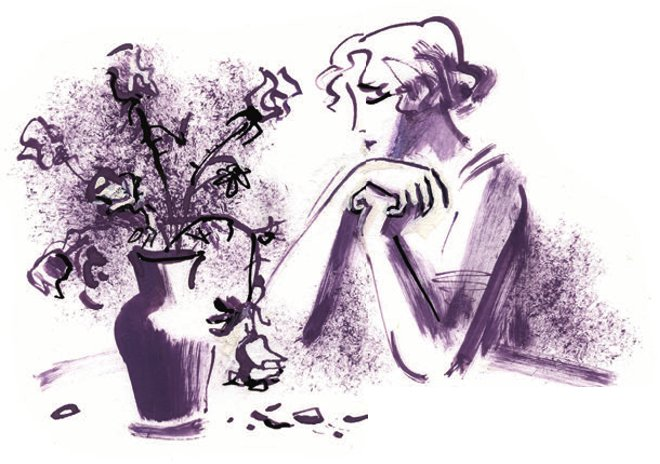

## Kapitel 24: Das Wetter begünstigte die Liebe

Über alles, was der große Kombinator in den Tagen nach dem Umzug in die Herberge tat, sprach Panikowski mit großer <abbr title="die Missbilligung — неодобрение">Missbilligung</abbr>.

— Bender <abbr title="spinnen (spann, hat gesponnen) — сходить с ума, «чудить»">spinnt</abbr>! — sagte er zu Balaganow. — Er richtet uns noch ganz <abbr title="zugrunde richten — погубить">zugrunde</abbr>!

Und wirklich: Statt die letzten vierunddreißig Rubel so lange wie möglich <abbr title="strecken — растягивать">zu strecken</abbr> und sie nur für Lebensmittel auszugeben, ging Ostap in ein <abbr title="das Blumengeschäft, die Blumengeschäfte — цветочный магазин">Blumengeschäft</abbr>. Für fünfunddreißig Rubel kaufte er einen <abbr title="der Rosenstrauß, die Rosensträuße — букет роз">Rosenstrauß</abbr>, der so groß wie ein <abbr title="das Blumenbeet, die Blumenbeete — клумба">Blumenbeet</abbr> war und sich bewegte. Den fehlenden Rubel <abbr title="sich leihen (lieh, hat geliehen) — взять взаймы">lieh</abbr> er sich von Balaganow. Zwischen die Blumen steckte er einen Zettel: «Hören Sie, wie mein großes Herz schlägt?» Balaganow bekam den Befehl, die Blumen zu Sossja Sinizkaja zu bringen.

— Was machen Sie da? — sagte Balaganow und schwenkte den Strauß. — Wozu dieser <abbr title="der Schick — шик">Schick</abbr>?

— Das muss sein, Schura, das muss sein, — antwortete Ostap. — Da kann man nichts machen! Ich habe ein großes Herz. Wie ein Kalb. Und außerdem ist das sowieso kein Geld. Was wir brauchen, ist eine Idee.

Danach setzte sich Ostap in die «Antilope» und bat Koslewitsch, ihn irgendwohin aus der Stadt hinauszufahren.

— Ich muss, — sagte er, — in der Einsamkeit über alles <abbr title="philosophieren — философствовать">philosophieren</abbr>, was passiert ist, und die nötigen <abbr title="die Prognose, die Prognosen — прогноз">Prognosen</abbr> für die Zukunft machen.

Den ganzen Tag fuhr der treue Adam den großen Kombinator über die weißen Straßen am Meer, vorbei an <abbr title="das Erholungsheim, die Erholungsheime — дом отдыха">Erholungsheimen</abbr> und <abbr title="das Sanatorium, die Sanatorien — санаторий">Sanatorien</abbr>. Dort schlurften die <abbr title="der Urlauber, die Urlauber — отдыхающий">Urlauber</abbr> in <abbr title="der Pantoffel, die Pantoffeln — туфля, тапочка">Pantoffeln</abbr> herum, schlugen mit Hämmern auf <abbr title="die Krocketkugel, die Krocketkugeln — крокетный шар">Krocketkugeln</abbr> oder sprangen an den <abbr title="das Volleyballnetz, die Volleyballnetze — волейбольная сетка">Volleyballnetzen</abbr>. Der <abbr title="der Telegrafendraht, die Telegrafendrähte — телеграфная проволока">Telegrafendraht</abbr> gab Töne von sich wie ein <abbr title="das Cello, die Cellos — виолончель">Cello</abbr>. <abbr title="die Sommerfrischlerin, die Sommerfrischlerinnen — дачница">Sommerfrischlerinnen</abbr> schleppten in Einkaufstaschen aus Teppichstoff blaue <abbr title="die Aubergine, die Auberginen — баклажан">Auberginen</abbr> und Melonen. Junge Männer, die nach dem Baden Taschentücher auf den nassen Haaren trugen, sahen den Frauen frech in die Augen und machten <abbr title="das Kompliment, die Komplimente — комплимент, любезность">Komplimente</abbr>. Den vollständigen <abbr title="der Vorrat, die Vorräte — запас, набор">Vorrat</abbr> an solchen Komplimenten besaß jeder Tschernomorsker unter fünfundzwanzig. Wenn zwei Sommerfrischlerinnen vorbeigingen, riefen die jungen Tschernomorsker ihnen nach: «Ach, wie <abbr title="hübsch — хорошенький">hübsch</abbr> ist die, die am Rand geht!» Dabei lachten sie von ganzem Herzen. Es war so komisch, dass die Frauen auf keinen Fall herausfinden konnten, welche von ihnen das Kompliment <abbr title="meinen — иметь в виду">gemeint</abbr> hatte. Kam ihnen aber nur eine Sommerfrischlerin entgegen, dann blieben die <abbr title="der Spaßvogel, die Spaßvögel — остряк, шутник">Spaßvögel</abbr> stehen, als hätte sie der Blitz getroffen, und schmatzten lange mit den Lippen, um <abbr title="die Liebesqual, die Liebesqualen — любовное томление">Liebesqualen</abbr> darzustellen. Die junge Frau wurde rot und lief über die Straße, wobei sie ihre blauen Auberginen fallen ließ. Darüber lachten die <abbr title="der Schürzenjäger, die Schürzenjäger — ловелас, бабник">Schürzenjäger</abbr> ein <abbr title="homerisch — гомерический">homerisches</abbr> Lachen.

Ostap lag halb auf den harten Kissen der «Antilope» und dachte nach. Geld von Polychajew oder Skumbrijewitsch zu holen, war nicht gelungen: Die Herkulesianer waren in Urlaub gefahren. Der verrückte Buchhalter Berlaga zählte nicht. Von ihm war kein guter <abbr title="der Milchertrag — удой">Milchertrag</abbr> zu erwarten. Aber Ostaps Pläne und sein großes Herz verlangten, dass er in Tschernomorsk blieb. Wie lange er hier bleiben musste, hätte er jetzt selbst nicht sagen können.

Ostap hörte eine bekannte Stimme wie aus dem Grab und blickte auf den Gehsteig. Hinter einer Reihe von Pappeln schritt ein nicht mehr junges Ehepaar Arm in Arm. Die beiden gingen offenbar zum Strand. Hinter ihnen trottete Lochankin. Er trug einen <abbr title="der Damenschirm, die Damenschirme — дамский зонтик">Damenschirm</abbr> und einen Korb, aus dem eine <abbr title="die Thermosflasche, die Thermosflaschen — термос">Thermosflasche</abbr> herausschaute und ein <abbr title="das Badetuch, die Badetücher — купальная простыня">Badetuch</abbr> heraushing.

— Warwara, — jammerte er, — hör mal, Warwara!

— Was willst du, du mein Unglück? — fragte die Ptiburdukowa, ohne sich umzudrehen.

— <abbr title="besitzen (besaß, hat besessen) — обладать">Besitzen</abbr> will ich dich, Warwara!..

— Nein, so ein Mistkerl! — bemerkte Ptiburdukow, ebenfalls ohne sich umzudrehen.

Und die seltsame Familie verschwand im <abbr title="der Staub — пыль">Staub</abbr> der «Antilope».

Als der Staub sich gelegt hatte, sah Bender vor dem Hintergrund von Meer und <abbr title="die Blumenrabatte, die Blumenrabatten — цветочный партер">Blumenrabatten</abbr> ein großes Atelier aus Glas.

<abbr title="der Gipslöwe, die Gipslöwen — гипсовый лев">Gipslöwen</abbr> mit <abbr title="beschmiert — измаранный">beschmierten</abbr> <abbr title="die Schnauze, die Schnauzen — морда">Schnauzen</abbr> saßen am Fuß einer breiten Treppe. Aus dem Atelier kam ein <abbr title="aufdringlich — назойливый, беспокойный">aufdringlicher</abbr> Geruch nach <abbr title="die Birnenessenz — грушевая эссенция">Birnenessenz</abbr>. Ostap schnupperte und bat Koslewitsch anzuhalten. Er stieg aus dem Wagen und zog wieder den belebenden Geruch der Essenz durch die Nasenlöcher ein.

— Wieso bin ich nicht gleich darauf gekommen! — murmelte er und drehte sich vor dem Eingang hin und her.

Er richtete den Blick auf das Schild «1. Tschernomorsker <abbr title="die Filmfabrik, die Filmfabriken — кинофабрика">Filmfabrik</abbr>», streichelte den Treppenlöwen über die warme Mähne, sagte: «Golkonda» und fuhr schnell zurück zur Herberge.

Die ganze Nacht saß er am Fenster und schrieb beim Licht einer kleinen Petroleumlampe. Der Wind, der durchs Fenster kam, <abbr title="blättern — перебирать (листы)">blätterte</abbr> in den <abbr title="beschrieben — исписанный">beschriebenen</abbr> Blättern. Vor dem <abbr title="der Verfasser, die Verfasser — сочинитель, автор">Verfasser</abbr> lag keine besonders <abbr title="reizvoll — привлекательный">reizvolle</abbr> Landschaft. Der <abbr title="zartfühlend — деликатный">zartfühlende</abbr> Mond beleuchtete nicht gerade einen <abbr title="der Palast, die Paläste — хоромы, дворец">Palast</abbr>. Die Herberge atmete, bewegte sich und röchelte im Schlaf. In den dunklen Ecken stampften unsichtbare Pferde. Kleine <abbr title="der Spekulant, die Spekulanten — спекулянт">Spekulanten</abbr> schliefen auf ihren Fuhrwerken, ihre armselige Ware unter sich. Ein Pferd hatte sich losgemacht und lief über den Hof. Vorsichtig stieg es über die <abbr title="die Deichsel, die Deichseln — оглобля">Deichseln</abbr>, zog sein <abbr title="das Halfter, die Halfter — недоуздок">Halfter</abbr> hinter sich her und steckte die Schnauze in die Fuhrwerke, um Gerste zu suchen. Es kam auch zum Fenster des Verfassers, legte den Kopf auf die Fensterbank und sah Ostap traurig an.

— Geh, geh, Pferd, — bemerkte der große Kombinator, — das ist nichts für deinen Verstand!

Kurz vor dem Morgengrauen, als die Herberge erwachte und zwischen den Fuhrwerken schon ein Junge mit einem Eimer Wasser herumging und mit dünner Stimme rief: «Wer will die Gäule <abbr title="tränken — поить (животных)">tränken</abbr>?», beendete Ostap sein Werk. Er nahm aus der «Akte Koreiko» ein leeres Blatt Papier und schrieb darauf die <abbr title="die Überschrift, die Überschriften — заголовок">Überschrift</abbr>:

«DER HALS»

Ein abendfüllender Film. <abbr title="das Drehbuch, die Drehbücher — сценарий">Drehbuch</abbr> von O. Bender

In der 1. Tschernomorsker Filmfabrik herrschte ein solches <abbr title="das Tohuwabohu — кавардак, ералаш">Tohuwabohu</abbr>, wie es nur auf <abbr title="der Pferdemarkt, die Pferdemärkte — конская ярмарка">Pferdemärkten</abbr> vorkommt, und zwar genau in dem Moment, wenn die ganze Gesellschaft einen <abbr title="der Taschendieb, die Taschendiebe — карманник">Taschendieb</abbr> jagt.

Am Eingang saß der <abbr title="der Pförtner, die Pförtner — комендант, вахтёр">Pförtner</abbr>. Von allen, die hereinkamen, verlangte er streng einen <abbr title="der Passierschein, die Passierscheine — пропуск">Passierschein</abbr>. Aber wenn man ihm keinen gab, ließ er einen auch so hinein. Leute in blauen <abbr title="die Baskenmütze, die Baskenmützen — берет">Baskenmützen</abbr> stießen zusammen mit Leuten in <abbr title="der Arbeitsoverall, die Arbeitsoveralls — рабочий комбинезон">Arbeitsoveralls</abbr>, liefen über die zahlreichen Treppen auseinander und rannten sofort dieselben Treppen wieder hinunter. In der <abbr title="die Vorhalle, die Vorhallen — вестибюль">Vorhalle</abbr> liefen sie einen Kreis, blieben eine Sekunde stehen, starrten <abbr title="wie versteinert — остолбенело">wie versteinert</abbr> vor sich hin und rannten dann wieder nach oben, so flink, als hätte man sie von hinten mit einem nassen Tau <abbr title="peitschen — стегать, хлестать">gepeitscht</abbr>. Mit <abbr title="rasend — бешеный, стремительный">rasender</abbr> Geschwindigkeit flogen Assistenten, <abbr title="der Berater, die Berater — консультант">Berater</abbr>, Experten, <abbr title="der Verwalter, die Verwalter — администратор">Verwalter</abbr>, <abbr title="der Regisseur, die Regisseure — режиссёр">Regisseure</abbr> mit ihren <abbr title="die Adjutantin, die Adjutantinnen — адъютантша">Adjutantinnen</abbr>, <abbr title="der Beleuchter, die Beleuchter — осветитель">Beleuchter</abbr>, <abbr title="der Schnittmeister, die Schnittmeister — монтажёр">Schnittmeister</abbr>, ältere <abbr title="die Drehbuchautorin, die Drehbuchautorinnen — сценаристка">Drehbuchautorinnen</abbr>, Leiter der Kommas und die <abbr title="der Hüter, die Hüter — хранитель">Hüter</abbr> des großen <abbr title="gusseisern — чугунный">gusseisernen</abbr> Stempels vorbei.

Ostap ging zuerst in seinem gewohnten Schritt durch die Filmfabrik. Aber bald merkte er, dass er auf keinen Fall in diese <abbr title="kreisen — кружиться">kreisende</abbr> Welt hineinkam. Niemand antwortete auf seine Fragen, niemand blieb stehen.

— Man muss sich an die <abbr title="die Besonderheit, die Besonderheiten — особенность">Besonderheiten</abbr> des Gegners <abbr title="sich anpassen an + Akk. — приспособиться к">anpassen</abbr>, — sagte Ostap.

Er lief langsam los und fühlte sofort <abbr title="die Erleichterung — облегчение">Erleichterung</abbr>. Es gelang ihm sogar, mit irgendeiner Adjutantin ein paar Worte zu wechseln. Da lief der große Kombinator so schnell er konnte und merkte bald, dass er im <abbr title="der Takt — темп, такт">Takt</abbr> war. Jetzt lief er Nase an Nase mit dem Leiter der <abbr title="die Literaturabteilung, die Literaturabteilungen — литературная часть">Literaturabteilung</abbr>.

— Ein Drehbuch! — rief Ostap.

— Was für eins? — fragte der <abbr title="der Literaturchef, die Literaturchefs — завлит">Literaturchef</abbr> und lief in festem <abbr title="der Trab — рысь">Trab</abbr>.

— Ein gutes! — antwortete Ostap und schob sich eine halbe <abbr title="die Pferdelänge, die Pferdelängen — полкорпуса (на скачках)">Pferdelänge</abbr> nach vorn.

— Ich frage Sie, was für eins? <abbr title="stumm — немой">Stumm</abbr> oder mit Ton?

— Stumm.

Der Literaturchef warf leicht die Beine in dicken <abbr title="der Strumpf, die Strümpfe — чулок">Strümpfen</abbr> nach vorn, überholte Ostap in der Kurve und rief:

— Brauchen wir nicht!

— Wieso – brauchen Sie nicht? — fragte der große Kombinator und begann, schwer zu galoppieren.

— Einfach so! Den <abbr title="der Stummfilm, die Stummfilme — немое кино">Stummfilm</abbr> gibt es nicht mehr. Wenden Sie sich an die Tonleute.

Beide blieben für einen Moment stehen, sahen sich wie versteinert an und liefen in verschiedene Richtungen davon.

Fünf Minuten später lief Bender wieder mit seinem Manuskript fuchtelnd in passender Gesellschaft, zwischen zwei trabenden Beratern.

— Ein Drehbuch! — teilte Ostap mit und atmete schwer.

Die Berater bewegten im <abbr title="der Gleichschritt — в ногу, дружно">Gleichschritt</abbr> ihre Hebel und drehten sich zu Ostap um:

— Was für ein Drehbuch?

— Ein <abbr title="der Tonfilm, die Tonfilme — звуковое кино">Tonfilm</abbr>.

— Brauchen wir nicht, — antworteten die Berater und <abbr title="zulegen — прибавить (ходу)">legten</abbr> einen Schritt zu. Der große Kombinator kam wieder aus dem Takt und <abbr title="hoppeln — скакать неуклюже">hoppelte</abbr> schmählich hinterher.

— Wieso brauchen Sie nicht?

— Einfach so, brauchen wir nicht. Den Tonfilm gibt es noch nicht.

Nach einer halben Stunde gewissenhaften Trabs hatte Bender die heikle Lage in der 1. Tschernomorsker Filmfabrik <abbr title="durchschauen — уяснить, разгадать">durchschaut</abbr>. Das Heikle bestand darin, dass der Stummfilm schon nicht mehr arbeitete, weil die <abbr title="die Ära — эра">Ära</abbr> des Tonfilms begonnen hatte. Der Tonfilm aber arbeitete noch nicht, wegen <abbr title="organisatorisch — организационный">organisatorischer</abbr> <abbr title="die Störung, die Störungen — неполадка">Störungen</abbr>, die mit der <abbr title="die Abwicklung — ликвидация">Abwicklung</abbr> der Ära des Stummfilms zu tun hatten.

Mitten am Arbeitstag, als der Lauf der Assistenten, Berater, Experten, Verwalter, Regisseure, Adjutantinnen, Beleuchter, Drehbuchautoren und Hüter des großen gusseisernen Stempels das Tempo des einst berühmten <abbr title="der Traber, die Traber — рысак">Trabers</abbr> «Krepysch» erreicht hatte, <abbr title="sich verbreiten — распространиться">verbreitete sich</abbr> ein Gerücht: Irgendwo, in irgendeinem Zimmer, saß ein Mann, der <abbr title="im Eilverfahren — в срочном порядке">im Eilverfahren</abbr> den Tonfilm <abbr title="konstruieren — конструировать">konstruierte</abbr>. Ostap sprang in vollem Lauf in ein großes Arbeitszimmer und blieb stehen, verblüfft von der Stille. Seitlich am Tisch saß ein kleiner Mann mit einem <abbr title="das Beduinenbärtchen — бедуинская бородка">Beduinenbärtchen</abbr> und einem goldenen Kneifer an einer Schnur. Er hatte sich vorgebeugt und zog sich mit Mühe einen Schuh vom Fuß.

— Guten Tag, Genosse! — sagte der große Kombinator laut.

Aber der Mann antwortete nicht. Er zog den Schuh aus und begann, Sand herauszuschütteln.

— Guten Tag! — wiederholte Ostap. — Ich habe ein Drehbuch gebracht!

Der Mann mit dem Beduinenbärtchen zog den Schuh ohne Eile wieder an und begann schweigend, ihn <abbr title="zuschnüren — шнуровать">zuzuschnüren</abbr>. Danach wandte er sich seinen Papieren zu, kniff ein Auge zu und begann, winzige <abbr title="der Krakel, die Krakel — каракули">Krakel</abbr> wie <abbr title="die Glasperle, die Glasperlen — бисер">Glasperlen</abbr> zu malen.

— Warum schweigen Sie denn? — brüllte Bender so laut, dass auf dem Tisch des <abbr title="der Filmschaffende, die Filmschaffenden — кинодеятель">Filmschaffenden</abbr> der <abbr title="der Telefonhörer, die Telefonhörer — телефонная трубка">Telefonhörer</abbr> klirrte.

Erst jetzt hob der Filmschaffende den Kopf, sah Ostap an und sagte:

— Bitte sprechen Sie lauter. Ich höre nichts.

— Schreiben Sie ihm Zettel, — riet ein Berater in einer bunten Weste, der gerade vorbeiflog. — Er ist taub.

Ostap setzte sich an den Tisch und schrieb auf einen Fetzen Papier: «Sind Sie der Tonmann?»

— Ja, — antwortete der Taube.

«Habe Tonfilm-Drehbuch gebracht. Heißt „Der Hals“, eine <abbr title="die Volkstragödie, die Volkstragödien — народная трагедия">Volkstragödie</abbr> in sechs Teilen», schrieb Ostap schnell.

Der Taube sah sich den Zettel durch seinen goldenen Kneifer an und sagte:

— <abbr title="großartig — прекрасно, великолепно">Großartig</abbr>! Wir ziehen Sie sofort in die Arbeit hinein. Wir brauchen frische <abbr title="die Kraft, die Kräfte — сила">Kräfte</abbr>.

«Freue mich, <abbr title="mitwirken — содействовать, участвовать">mitzuwirken</abbr>. Wie steht's mit einem Vorschuss?», schrieb Bender.

— «Der Hals» – das ist genau das, was wir brauchen! — sagte der Taube. — Bleiben Sie hier sitzen, ich komme gleich. Nur gehen Sie nirgendwohin. Ich bin genau in einer Minute zurück.

Der Taube nahm das Drehbuch des abendfüllenden Films «Der Hals» mit und schlüpfte aus dem Zimmer.

— Wir ziehen Sie in die <abbr title="die Tonabteilung — звуковая группа">Tonabteilung</abbr> hinein! — rief er, als er hinter der Tür verschwand. — In einer Minute bin ich zurück.

Danach saß Ostap anderthalb Stunden in dem Arbeitszimmer, aber der Taube kam nicht zurück. Erst als er auf die Treppe hinausging und wieder in den Takt kam, erfuhr Ostap, dass der Taube schon lange mit dem Auto weggefahren war und heute nicht mehr zurückkam. Und überhaupt würde er nie mehr hierher zurückkommen. Man hatte ihn nämlich plötzlich nach Uman <abbr title="versetzen — перевести (по службе)">versetzt</abbr>, damit er dort <abbr title="die Kulturarbeit — культработа">Kulturarbeit</abbr> unter den <abbr title="der Lastfuhrmann, die Lastfuhrleute — ломовой извозчик">Lastfuhrleuten</abbr> machte. Aber das Schrecklichste war, dass der Taube das Drehbuch des abendfüllenden Films «Der Hals» mitgenommen hatte. Der große Kombinator kam aus dem Kreis der Laufenden heraus und sank auf eine Bank. Er lehnte sich an die Schulter des Portiers, der dort saß.

— Da, zum Beispiel ich! — sagte plötzlich der Portier. Offenbar sprach er einen Gedanken aus, der ihn schon lange quälte. — Der <abbr title="der Regieassistent, die Regieassistenten — помреж">Regieassistent</abbr> Terentjew hat zu mir gesagt, ich soll mir einen Bart wachsen lassen. Du wirst, sagt er, <abbr title="Nebukadnezar — Навуходоносор">Nebukadnezar</abbr> spielen oder <abbr title="Belsazar — Валтасар">Belsazar</abbr> in dem Film, den Namen weiß ich nicht mehr. Und ich hab ihn wachsen lassen, schau, was für ein <abbr title="der Mordsbart — бородища">Mordsbart</abbr>, wie bei einem Patriarchen! Und was soll ich jetzt damit, mit dem Bart? Der Regieassistent sagt: Stummfilme gibt es nicht mehr, und im Tonfilm, sagt er, kannst du nicht spielen, du hast eine unangenehme Stimme. Und jetzt sitze ich hier mit dem Bart, pfui, wie ein <abbr title="der Ziegenbock, die Ziegenböcke — козёл">Ziegenbock</abbr>! <abbr title="abrasieren — сбрить">Abrasieren</abbr> tut mir leid, und tragen ist eine Schande. So lebe ich.

— Und wird bei Ihnen auch gedreht? — fragte Bender, der langsam wieder zu sich kam.

— Was soll denn hier gedreht werden? — antwortete der bärtige Portier wichtig. — Letztes Jahr haben sie einen Stummfilm über das Leben im alten Rom gedreht. Bis heute <abbr title="prozessieren — судиться">prozessieren</abbr> sie noch, wegen einer <abbr title="die Kriminalsache, die Kriminalsachen — уголовщина, уголовное дело">Kriminalsache</abbr>.

— Und warum rennen sie alle so? — erkundigte sich der große Kombinator und zeigte auf die Treppe.

— Bei uns rennen nicht alle, — bemerkte der Portier. — Der Genosse Suprugow zum Beispiel rennt nicht. Ein sachlicher Mann. Ich will immer schon wegen dem Bart zu ihm gehen und fragen, wie man den Bart bezahlen wird: nach der <abbr title="die Lohnliste, die Lohnlisten — ведомость">Lohnliste</abbr> oder mit einer Anweisung extra…

Als Ostap das Wort «Anweisung» hörte, ging er zu Suprugow. Der Portier hatte nicht gelogen. Suprugow sprang nicht über die Stockwerke, trug keine <abbr title="alpin — альпийский">alpine</abbr> Baskenmütze, ja nicht einmal ausländische <abbr title="die Golfhose, die Golfhosen — брюки-гольф">Golfhosen</abbr>. Auf ihm ruhte das Auge angenehm aus.

Den großen Kombinator empfing er außerordentlich kühl.

— Ich habe zu tun, — sagte er mit einer Stimme wie ein <abbr title="der Pfau, die Pfauen — павлин">Pfau</abbr>. — Ihnen kann ich nur zwei Minuten widmen.

— Das reicht völlig, — begann Ostap. — Mein Drehbuch «Der Hals»…

— Kürzer, — sagte Suprugow.

— Das Drehbuch «Der Hals»…

— Sagen Sie mal klar, was Sie wollen!

— «Der Hals»…

— Kürzer. Wie viel <abbr title="zustehen (stand zu, hat zugestanden) — причитаться, полагаться">steht</abbr> Ihnen zu?

— Bei mir war so ein Tauber…

— Genosse! Wenn Sie mir nicht sofort sagen, wie viel Ihnen zusteht, bitte ich Sie hinauszugehen. Ich habe keine Zeit.

— Neunhundert Rubel, — murmelte der große Kombinator.

— Dreihundert! — erklärte Suprugow <abbr title="kategorisch — категорически">kategorisch</abbr>. — Nehmen Sie es und gehen Sie. Und denken Sie daran: Sie haben mir anderthalb Minuten zu viel gestohlen.

Suprugow <abbr title="kritzeln — накатать, нацарапать">kritzelte</abbr> mit <abbr title="schwungvoll — размашистый">schwungvoller</abbr> <abbr title="die Handschrift, die Handschriften — почерк">Handschrift</abbr> einen Zettel an die Buchhaltung, gab ihn Ostap und griff nach dem Telefonhörer.

Als Ostap aus der Buchhaltung kam, steckte er das Geld in die Tasche und sagte:

— Nebukadnezar hat recht. Ein einziger sachlicher Mann ist hier – und das ist Suprugow.

Inzwischen hatten das Rennen auf den Treppen, das <abbr title="das Kreiseln — кружение">Kreiseln</abbr>, das Kreischen und das <abbr title="das Gegacker — гогот">Gegacker</abbr> in der 1. Tschernomorsker Filmfabrik den Höhepunkt erreicht. Die Adjutantinnen <abbr title="fletschen — скалить">fletschten</abbr> die Zähne. Regieassistenten führten einen schwarzen Ziegenbock herum und waren begeistert von seiner <abbr title="die Fotogenität — фотогеничность">Fotogenität</abbr>. Berater, Experten und Hüter des gusseisernen Stempels <abbr title="zusammenprallen — сшибаться">prallten</abbr> miteinander zusammen und lachten <abbr title="heiser — хрипло">heiser</abbr>. Eine <abbr title="die Botin, die Botinnen — курьерша">Botin</abbr> mit einem Besen sauste vorbei. Dem großen Kombinator kam es sogar so vor, als würde einer der <abbr title="der Assistenzdoktorand, die Assistenzdoktoranden — ассистент-аспирант">Assistenzdoktoranden</abbr> in himmelblauen <abbr title="die Pantalons (Pl.) — панталоны">Pantalons</abbr> über die Menge <abbr title="emporfliegen (flog empor, ist emporgeflogen) — взлететь">emporfliegen</abbr>, um den Kronleuchter herumfliegen und sich auf das Gesims setzen.

Und in derselben Minute begann die Uhr in der Vorhalle zu schlagen.

«Bamm!» — schlug die Uhr.

Geschrei und <abbr title="das Gekreische — клёкот, крик">Gekreische</abbr> erschütterten das Glasatelier. Assistenten, Berater, Experten und Schnittmeister rollten die Treppen hinunter. An den Ausgangstüren begann ein Gedränge.

«Bamm! Bamm!» — schlug die Uhr.

Aus den Ecken kam die Stille. Die Hüter des großen Stempels, die Leiter der Kommas, die Verwalter und die Adjutantinnen waren verschwunden. Ein letztes Mal blitzte der Besen der Botin auf.

«Bamm!» — schlug die Uhr zum vierten Mal.

Im Atelier war niemand mehr. Nur in der Tür hing noch der Assistenzdoktorand in den himmelblauen Pantalons. Er war mit der Jackentasche am <abbr title="der Messinggriff, die Messinggriffe — медная ручка">Messinggriff</abbr> <abbr title="hängen bleiben — зацепиться">hängen geblieben</abbr>, zappelte, quiekte kläglich und scharrte mit kleinen Hufen auf dem <abbr title="der Marmorboden — мраморный пол">Marmorboden</abbr>. Der Arbeitstag war zu Ende. Vom Ufer, aus dem <abbr title="das Fischerdorf, die Fischerdörfer — рыбачий посёлок">Fischerdorf</abbr>, hörte man einen Hahn krähen.

Als die Kasse der «Antilope» durch das Filmgeld <abbr title="auffüllen — пополнить">aufgefüllt</abbr> war, wurde die Autorität des Kommandeurs wieder fester. Nach Koreikos Flucht war sie etwas <abbr title="verblassen — поблёкнуть">verblasst</abbr>. Panikowski bekam eine kleine Summe für Kefir, und man versprach ihm ein goldenes <abbr title="das Gebiss, die Gebisse — вставные челюсти">Gebiss</abbr>. Für Balaganow kaufte Ostap eine Jacke und dazu eine Brieftasche aus Leder, die knarrte wie ein Sattel. Obwohl die Brieftasche leer war, nahm Schura sie oft heraus und schaute hinein. Koslewitsch bekam fünfzig Rubel für Benzin.

Die Antilopen-Leute führten ein sauberes, <abbr title="sittsam — нравственный">sittsames</abbr>, fast <abbr title="dörflich — деревенский">dörfliches</abbr> Leben. Sie halfen dem Wirt der Herberge, Ordnung zu machen, und kannten sich bald mit den Preisen für Gerste und <abbr title="der Schmand — сметана">Schmand</abbr> aus. Manchmal ging Panikowski auf den Hof, öffnete besorgt dem nächsten Pferd das Maul, sah ihm auf die Zähne und murmelte: «Ein guter <abbr title="der Hengst, die Hengste — жеребец">Hengst</abbr>», obwohl vor ihm eine gute <abbr title="die Stute, die Stuten — кобыла">Stute</abbr> stand.

Nur der Kommandeur war ganze Tage lang verschwunden. Und wenn er in der Herberge erschien, war er fröhlich und zerstreut. Er setzte sich zu seinen Freunden, die in der schmutzigen <abbr title="die Glasveranda, die Glasveranden — стеклянная галерея">Glasveranda</abbr> Tee tranken, legte ein kräftiges Bein in einem roten Schuh über das Knie und sagte freundlich:

— Ist das Leben wirklich schön, Panikowski, oder kommt mir das nur so vor?

— Wo <abbr title="sich herumtreiben (trieb herum, hat herumgetrieben) — шататься, «безумствовать»">treiben</abbr> Sie sich denn so herum? — fragte der Konventionsbrecher eifersüchtig.

— Alter! Dieses Mädchen ist nichts für Sie, — antwortete Ostap.

Dabei lachte Balaganow mitfühlend und betrachtete seine neue Brieftasche, und Koslewitsch <abbr title="schmunzeln — усмехаться">schmunzelte</abbr> in seinen Schaffnerschnurrbart. Er hatte den Kommandeur und Sossja schon mehrmals über die Küstenchaussee gefahren.

Das Wetter <abbr title="begünstigen — благоприятствовать">begünstigte</abbr> die Liebe. Die Pikeewesten behaupteten, dass es einen solchen August seit der Zeit des <abbr title="der Freihafen — порто-франко, свободная гавань">Freihafens</abbr> nicht mehr gegeben hatte. Die Nacht zeigte einen klaren Himmel wie im <abbr title="das Teleskop, die Teleskope — телескоп">Teleskop</abbr>, und der Tag rollte eine <abbr title="erfrischend — освежающий">erfrischende</abbr> Meereswelle an die Stadt. Die Hausmeister verkauften an ihren Toren gestreifte <abbr title="die Wassermelone, die Wassermelonen — арбуз">Wassermelonen</abbr> von der Sorte «Klosterwassermelone». Die Bürger strengten sich an, drückten die Melonen an den Polen zusammen und neigten das Ohr, um das ersehnte Knacken zu hören. Abends kamen verschwitzte, glückliche Fußballspieler von den Sportplätzen zurück. Hinter ihnen liefen Jungen und wirbelten Staub auf. Sie zeigten mit den Fingern auf den berühmten <abbr title="der Torwart, die Torwarte — вратарь, голкипер">Torwart</abbr>, und manchmal hoben sie ihn sogar auf die Schultern und trugen ihn <abbr title="voller Respekt — с уважением">voller Respekt</abbr>.

Eines Abends <abbr title="ankündigen — предупредить, объявить">kündigte</abbr> der Kommandeur der Besatzung der «Antilope» an, dass am nächsten Tag ein großer Ausflug aufs Land <abbr title="bevorstehen (stand bevor, hat bevorgestanden) — предстоять">bevorstand</abbr>, mit Verteilung von Geschenken.

— Da unsere <abbr title="die Kindervorstellung, die Kindervorstellungen — детский утренник">Kindervorstellung</abbr> von einem Mädchen besucht wird, — sagte Ostap bedeutungsvoll, — möchte ich die Herren <abbr title="der Freiwillige, die Freiwilligen — вольноопределяющийся, доброволец">Freiwilligen</abbr> bitten, sich das Gesicht zu waschen, sich zu putzen und vor allem auf der Fahrt keine groben Ausdrücke zu benutzen.

Panikowski wurde sehr aufgeregt. Er bettelte beim Kommandeur drei Rubel, lief ins Badehaus und putzte und <abbr title="schrubben — скрести, тереть">schrubbte</abbr> sich danach die ganze Nacht wie ein Soldat vor der Parade. Er stand früher auf als alle anderen und trieb Koslewitsch sehr zur Eile an. Die Antilopen-Leute betrachteten Panikowski mit Staunen. Er war glatt rasiert und so <abbr title="pudern — пудрить">gepudert</abbr>, dass er wie ein pensionierter Conférencier aussah. Jede Minute zog er an seiner Jacke herum und konnte den Hals in seinem Oscar-Wilde-Kragen nur mit Mühe drehen.

Auf dem Ausflug benahm sich Panikowski sehr würdig. Als man ihn mit Sossja bekannt machte, <abbr title="sich verneigen — поклониться">verneigte sich</abbr> er elegant. Aber dabei wurde er so verlegen, dass sogar der <abbr title="der Puder — пудра">Puder</abbr> auf seinen Wangen rot wurde. Im Auto zog er das linke Bein unter sich, um den zerrissenen Schuh zu verstecken, aus dem der große <abbr title="der Zeh, die Zehen — палец ноги">Zeh</abbr> schaute. Sossja trug ein weißes Kleid, das mit rotem Faden <abbr title="säumen — обшить, окаймлять">gesäumt</abbr> war. Die Antilopen-Leute gefielen ihr sehr. Sie musste über den <abbr title="ungehobelt — неотёсанный, грубый">ungehobelten</abbr> Schura Balaganow lachen, der sich auf der ganzen Fahrt mit einem Kamm der Marke «Sobinow» die Haare kämmte. Manchmal <abbr title="in der Nase bohren — ковырять в носу">bohrte</abbr> er auch mit dem Finger in der Nase. Danach nahm er jedes Mal ein Taschentuch heraus und <abbr title="sich fächeln — обмахиваться">fächelte sich</abbr> damit schmachtend Luft zu. Adam Kasimirowitsch brachte Sossja bei, die «Antilope» zu lenken, und gewann damit auch ihre Zuneigung. Ein wenig <abbr title="verunsichern — смущать">verunsicherte</abbr> sie Panikowski. Sie dachte, dass er aus Stolz nicht mit ihr sprach. Aber am häufigsten ruhte ihr Blick auf dem Gesicht des Kommandeurs, das wie auf einer Medaille aussah.

Bei Sonnenuntergang verteilte Ostap die versprochenen Geschenke. Koslewitsch bekam einen <abbr title="der Anhänger, die Anhänger — брелок">Anhänger</abbr> in Form eines <abbr title="der Kompass, die Kompasse — компас">Kompasses</abbr>, der sehr gut zu seiner dicken silbernen Uhr passte. Balaganow bekam das Buch «Der Vortragskünstler» in einem Einband aus <abbr title="das Kunstleder — дерматин">Kunstleder</abbr>, und Panikowski eine rosa Krawatte mit blauen Blumen.

— Und jetzt, meine Freunde, — sagte Bender, als die «Antilope» in die Stadt zurückgekommen war, — machen Sossja Viktorowna und ich noch einen kleinen Spaziergang. Und für Sie ist es Zeit, in die Herberge zu gehen, heia machen.

Die Herberge war schon eingeschlafen. Balaganow und Koslewitsch schnarchten <abbr title="das Arpeggio, die Arpeggios — арпеджио">Arpeggios</abbr> durch die Nase. Nur Panikowski, die neue Krawatte um den Hals, wanderte zwischen den Fuhrwerken umher und <abbr title="die Hände ringen — ломать руки">rang</abbr> in stummer <abbr title="die Sehnsucht — тоска">Sehnsucht</abbr> die Hände.

— Was für eine Femina! — flüsterte er. — Ich liebe sie wie eine Tochter!

Ostap saß mit Sossja auf den Stufen des <abbr title="das Altertumsmuseum — музей древностей">Altertumsmuseums</abbr>. Auf dem Platz, der mit <abbr title="die Lava — лава">Lava</abbr> gepflastert war, gingen junge Leute spazieren, <abbr title="flirten — флиртовать, любезничать">flirteten</abbr> und lachten. Hinter einer Reihe von <abbr title="die Platane, die Platanen — платан">Platanen</abbr> leuchteten die Fenster des Internationalen <abbr title="der Seemannsklub, die Seemannsklubs — клуб моряков">Seemannsklubs</abbr>. Ausländische Matrosen mit weichen Hüten gingen zu zweit und zu dritt vorbei und wechselten unverständliche, kurze Bemerkungen.

— Warum haben Sie sich in mich verliebt? — fragte Sossja und berührte Ostaps Hand.

— Sie sind zart und wunderbar, — antwortete der Kommandeur. — Sie sind besser als alle auf der Welt.

Lange saßen sie schweigend im schwarzen Schatten der Museumssäulen und dachten an ihr kleines Glück. Es war warm und dunkel wie zwischen zwei Handflächen.

— Erinnern Sie sich, ich habe Ihnen von Koreiko erzählt? — sagte Sossja plötzlich. — Von dem, der mir einen <abbr title="der Heiratsantrag, die Heiratsanträge — предложение (руки и сердца)">Heiratsantrag</abbr> gemacht hat.

— Ja, — sagte Ostap zerstreut.

— Er ist ein sehr komischer Mensch, — fuhr Sossja fort. — Erinnern Sie sich, ich habe Ihnen erzählt, wie plötzlich er abgereist ist?

— Ja, — sagte Ostap schon aufmerksamer, — er ist sehr komisch.

— Stellen Sie sich vor, heute habe ich einen Brief von ihm bekommen, einen sehr komischen…

— Was? — rief der <abbr title="der Verliebte, die Verliebten — влюблённый">Verliebte</abbr> und stand auf.

— Sind Sie eifersüchtig? — fragte Sossja <abbr title="schelmisch — лукаво">schelmisch</abbr>.

— Hm, ein bisschen. Und was schreibt Ihnen dieser <abbr title="der Spießer, die Spießer — пошляк, мещанин">Spießer</abbr>?

— Er ist überhaupt kein Spießer. Er ist einfach ein sehr unglücklicher und armer Mensch. Setzen Sie sich, Ostap. Warum sind Sie aufgestanden? Im Ernst, ich liebe ihn überhaupt nicht. Er bittet mich, zu ihm zu kommen.

— Wohin, wohin kommen? — schrie Ostap. — Wo ist er?

— Nein, das sage ich Ihnen nicht. Sie sind eifersüchtig. Sie bringen ihn noch um.

— Aber, aber, Sossja! — sagte der Kommandeur vorsichtig. — Ich bin einfach neugierig, wo die Leute so eine Stelle finden.

— Oh, er ist sehr weit weg! Er schreibt, er hat eine sehr günstige Stelle gefunden, hier hat man ihm zu wenig bezahlt. Jetzt arbeitet er beim Bau der Östlichen Magistrale.

— An welcher Stelle?

— Ehrlich, Sie sind zu neugierig! Man darf nicht so ein <abbr title="Othello — Отелло">Othello</abbr> sein!

— Bei Gott, Sossja, Sie bringen mich zum Lachen. Sehe ich etwa aus wie ein alter, dummer <abbr title="der Mohr, die Mohren — мавр">Mohr</abbr>? Ich möchte einfach nur wissen, in welchem Teil der Östlichen Magistrale die Leute Stellen finden.

— Ich sage es Ihnen, wenn Sie wollen. Er arbeitet als <abbr title="der Zeitnehmer, die Zeitnehmer — табельщик">Zeitnehmer</abbr> im Nördlichen <abbr title="das Gleisbaustädtchen — укладочный городок">Gleisbaustädtchen</abbr>, — sagte das Mädchen sanft. — Aber das heißt nur so, Städtchen. In Wirklichkeit ist es ein Zug. Alexander Iwanowitsch hat ihn mir sehr interessant beschrieben. Dieser Zug legt Schienen. Verstehen Sie? Und auf diesen Schienen fährt er auch. Und von Süden kommt ihm ein anderes, genau solches Städtchen entgegen. Bald treffen sie sich. Dann gibt es eine feierliche Schienenverbindung. Und das alles in der Wüste, schreibt er, mit Kamelen… Wirklich interessant, nicht?

— Ungewöhnlich interessant, — sagte der große Kombinator und lief zwischen den Säulen hin und her. — Wissen Sie was, Sossja, wir müssen gehen. Es ist schon spät. Und kalt. Und überhaupt, gehen wir!

Er zog Sossja von den Stufen hoch, führte sie auf den Platz und zögerte dort.

— Bringen Sie mich denn nicht nach Hause? — fragte das Mädchen beunruhigt.

— Was? — sagte Ostap. — Ach, nach Hause? Sehen Sie, ich…

— Gut, — sagte Sossja kühl. — Auf Wiedersehen. Und kommen Sie nicht mehr zu mir. Hören Sie?

Aber der große Kombinator hörte schon nichts mehr. Erst nachdem er einen Häuserblock weit gelaufen war, blieb er stehen.

— Zart und wunderbar! — murmelte er. Ostap drehte um und lief der Geliebten nach. Etwa zwei Minuten raste er unter den schwarzen Bäumen dahin. Dann blieb er wieder stehen, nahm seine Kapitänsmütze ab und trat auf der Stelle.

— Nein, das ist nicht Rio de Janeiro! — sagte er schließlich.

Er machte noch zwei <abbr title="zögernd — колеблющийся, нерешительный">zögernde</abbr> Schritte, blieb wieder stehen, <abbr title="sich die Mütze aufstülpen — нахлобучить">stülpte</abbr> sich die Mütze auf und raste, ohne noch nachzudenken, zur Herberge.

In derselben Nacht fuhr die «Antilope» mit blass leuchtenden Scheinwerfern aus dem Tor der Herberge. Der verschlafene Koslewitsch drehte mit Mühe das Lenkrad. Balaganow war während der kurzen <abbr title="die Reisevorbereitung, die Reisevorbereitungen — сборы в дорогу">Reisevorbereitungen</abbr> schon im Auto eingeschlafen. Panikowski ließ traurig seine kleinen Augen wandern und zitterte in der <abbr title="die Nachtkühle — ночная свежесть">Nachtkühle</abbr>. Auf seinem Gesicht sah man noch die Spuren des festlichen Puders.

— Der <abbr title="der Karneval — карнавал">Karneval</abbr> ist vorbei! — rief der Kommandeur, als die «Antilope» polternd unter der Eisenbahnbrücke durchfuhr. — Jetzt beginnt der harte Alltag.

Und im Zimmer des alten Rätselmachers, neben einem Strauß <abbr title="verwelkt — засохший, увядший">verwelkter</abbr> Rosen, weinte die Zarte und Wunderbare.

---

### Neue Wörter

- **die Missbilligung** — неодобрение
- **spinnen (spann, hat gesponnen)** — сходить с ума, «чудить»
- **zugrunde richten** — погубить
- **strecken** — растягивать
- **das Blumengeschäft, die Blumengeschäfte** — цветочный магазин
- **der Rosenstrauß, die Rosensträuße** — букет роз
- **das Blumenbeet, die Blumenbeete** — клумба
- **sich leihen (lieh, hat geliehen)** — взять взаймы
- **der Schick** — шик
- **philosophieren** — философствовать
- **die Prognose, die Prognosen** — прогноз
- **das Erholungsheim, die Erholungsheime** — дом отдыха
- **das Sanatorium, die Sanatorien** — санаторий
- **der Urlauber, die Urlauber** — отдыхающий
- **der Pantoffel, die Pantoffeln** — туфля, тапочка
- **die Krocketkugel, die Krocketkugeln** — крокетный шар
- **das Volleyballnetz, die Volleyballnetze** — волейбольная сетка
- **der Telegrafendraht, die Telegrafendrähte** — телеграфная проволока
- **das Cello, die Cellos** — виолончель
- **die Sommerfrischlerin, die Sommerfrischlerinnen** — дачница
- **die Aubergine, die Auberginen** — баклажан
- **das Kompliment, die Komplimente** — комплимент, любезность
- **der Vorrat, die Vorräte** — запас, набор
- **hübsch** — хорошенький
- **meinen** — иметь в виду
- **der Spaßvogel, die Spaßvögel** — остряк, шутник
- **die Liebesqual, die Liebesqualen** — любовное томление
- **der Schürzenjäger, die Schürzenjäger** — ловелас, бабник
- **homerisch** — гомерический
- **der Milchertrag** — удой
- **der Damenschirm, die Damenschirme** — дамский зонтик
- **die Thermosflasche, die Thermosflaschen** — термос
- **das Badetuch, die Badetücher** — купальная простыня
- **besitzen (besaß, hat besessen)** — обладать
- **der Staub** — пыль
- **die Blumenrabatte, die Blumenrabatten** — цветочный партер
- **der Gipslöwe, die Gipslöwen** — гипсовый лев
- **beschmiert** — измаранный
- **die Schnauze, die Schnauzen** — морда
- **aufdringlich** — назойливый, беспокойный
- **die Birnenessenz** — грушевая эссенция
- **die Filmfabrik, die Filmfabriken** — кинофабрика
- **blättern** — перебирать (листы)
- **beschrieben** — исписанный
- **der Verfasser, die Verfasser** — сочинитель, автор
- **reizvoll** — привлекательный
- **zartfühlend** — деликатный
- **der Palast, die Paläste** — хоромы, дворец
- **der Spekulant, die Spekulanten** — спекулянт
- **die Deichsel, die Deichseln** — оглобля
- **das Halfter, die Halfter** — недоуздок
- **tränken** — поить (животных)
- **die Überschrift, die Überschriften** — заголовок
- **das Drehbuch, die Drehbücher** — сценарий
- **das Tohuwabohu** — кавардак, ералаш
- **der Pferdemarkt, die Pferdemärkte** — конская ярмарка
- **der Taschendieb, die Taschendiebe** — карманник
- **der Pförtner, die Pförtner** — комендант, вахтёр
- **der Passierschein, die Passierscheine** — пропуск
- **die Baskenmütze, die Baskenmützen** — берет
- **der Arbeitsoverall, die Arbeitsoveralls** — рабочий комбинезон
- **die Vorhalle, die Vorhallen** — вестибюль
- **wie versteinert** — остолбенело
- **peitschen** — стегать, хлестать
- **rasend** — бешеный, стремительный
- **der Berater, die Berater** — консультант
- **der Verwalter, die Verwalter** — администратор
- **der Regisseur, die Regisseure** — режиссёр
- **die Adjutantin, die Adjutantinnen** — адъютантша
- **der Beleuchter, die Beleuchter** — осветитель
- **der Schnittmeister, die Schnittmeister** — монтажёр
- **die Drehbuchautorin, die Drehbuchautorinnen** — сценаристка
- **der Hüter, die Hüter** — хранитель
- **gusseisern** — чугунный
- **kreisen** — кружиться
- **die Besonderheit, die Besonderheiten** — особенность
- **sich anpassen an + Akk.** — приспособиться к
- **die Erleichterung** — облегчение
- **der Takt** — темп, такт
- **die Literaturabteilung, die Literaturabteilungen** — литературная часть
- **der Literaturchef, die Literaturchefs** — завлит
- **der Trab** — рысь
- **die Pferdelänge, die Pferdelängen** — полкорпуса (на скачках)
- **stumm** — немой
- **der Strumpf, die Strümpfe** — чулок
- **der Stummfilm, die Stummfilme** — немое кино
- **der Gleichschritt** — в ногу, дружно
- **der Tonfilm, die Tonfilme** — звуковое кино
- **zulegen** — прибавить (ходу)
- **hoppeln** — скакать неуклюже
- **durchschauen** — уяснить, разгадать
- **die Ära** — эра
- **organisatorisch** — организационный
- **die Störung, die Störungen** — неполадка
- **die Abwicklung** — ликвидация
- **der Traber, die Traber** — рысак
- **sich verbreiten** — распространиться
- **im Eilverfahren** — в срочном порядке
- **konstruieren** — конструировать
- **das Beduinenbärtchen** — бедуинская бородка
- **zuschnüren** — шнуровать
- **der Krakel, die Krakel** — каракули
- **die Glasperle, die Glasperlen** — бисер
- **der Filmschaffende, die Filmschaffenden** — кинодеятель
- **der Telefonhörer, die Telefonhörer** — телефонная трубка
- **die Volkstragödie, die Volkstragödien** — народная трагедия
- **großartig** — прекрасно, великолепно
- **die Kraft, die Kräfte** — сила
- **mitwirken** — содействовать, участвовать
- **die Tonabteilung** — звуковая группа
- **versetzen** — перевести (по службе)
- **die Kulturarbeit** — культработа
- **der Lastfuhrmann, die Lastfuhrleute** — ломовой извозчик
- **der Regieassistent, die Regieassistenten** — помреж
- **Nebukadnezar** — Навуходоносор
- **Belsazar** — Валтасар
- **der Mordsbart** — бородища
- **der Ziegenbock, die Ziegenböcke** — козёл
- **abrasieren** — сбрить
- **prozessieren** — судиться
- **die Kriminalsache, die Kriminalsachen** — уголовщина, уголовное дело
- **die Lohnliste, die Lohnlisten** — ведомость
- **alpin** — альпийский
- **die Golfhose, die Golfhosen** — брюки-гольф
- **der Pfau, die Pfauen** — павлин
- **zustehen (stand zu, hat zugestanden)** — причитаться, полагаться
- **kategorisch** — категорически
- **kritzeln** — накатать, нацарапать
- **schwungvoll** — размашистый
- **die Handschrift, die Handschriften** — почерк
- **das Kreiseln** — кружение
- **das Gegacker** — гогот
- **fletschen** — скалить
- **die Fotogenität** — фотогеничность
- **zusammenprallen** — сшибаться
- **heiser** — хрипло
- **die Botin, die Botinnen** — курьерша
- **der Assistenzdoktorand, die Assistenzdoktoranden** — ассистент-аспирант
- **die Pantalons (Pl.)** — панталоны
- **emporfliegen (flog empor, ist emporgeflogen)** — взлететь
- **das Gekreische** — клёкот, крик
- **der Messinggriff, die Messinggriffe** — медная ручка
- **hängen bleiben** — зацепиться
- **der Marmorboden** — мраморный пол
- **das Fischerdorf, die Fischerdörfer** — рыбачий посёлок
- **auffüllen** — пополнить
- **verblassen** — поблёкнуть
- **das Gebiss, die Gebisse** — вставные челюсти
- **sittsam** — нравственный
- **dörflich** — деревенский
- **der Schmand** — сметана
- **der Hengst, die Hengste** — жеребец
- **die Stute, die Stuten** — кобыла
- **die Glasveranda, die Glasveranden** — стеклянная галерея
- **sich herumtreiben (trieb herum, hat herumgetrieben)** — шататься, «безумствовать»
- **schmunzeln** — усмехаться
- **begünstigen** — благоприятствовать
- **der Freihafen** — порто-франко, свободная гавань
- **das Teleskop, die Teleskope** — телескоп
- **erfrischend** — освежающий
- **die Wassermelone, die Wassermelonen** — арбуз
- **der Torwart, die Torwarte** — вратарь, голкипер
- **voller Respekt** — с уважением
- **ankündigen** — предупредить, объявить
- **bevorstehen (stand bevor, hat bevorgestanden)** — предстоять
- **die Kindervorstellung, die Kindervorstellungen** — детский утренник
- **der Freiwillige, die Freiwilligen** — вольноопределяющийся, доброволец
- **schrubben** — скрести, тереть
- **pudern** — пудрить
- **sich verneigen** — поклониться
- **der Puder** — пудра
- **der Zeh, die Zehen** — палец ноги
- **säumen** — обшить, окаймлять
- **ungehobelt** — неотёсанный, грубый
- **in der Nase bohren** — ковырять в носу
- **sich fächeln** — обмахиваться
- **verunsichern** — смущать
- **der Anhänger, die Anhänger** — брелок
- **der Kompass, die Kompasse** — компас
- **das Kunstleder** — дерматин
- **das Arpeggio, die Arpeggios** — арпеджио
- **die Hände ringen** — ломать руки
- **die Sehnsucht** — тоска
- **das Altertumsmuseum** — музей древностей
- **die Lava** — лава
- **flirten** — флиртовать, любезничать
- **die Platane, die Platanen** — платан
- **der Seemannsklub, die Seemannsklubs** — клуб моряков
- **der Heiratsantrag, die Heiratsanträge** — предложение (руки и сердца)
- **der Verliebte, die Verliebten** — влюблённый
- **schelmisch** — лукаво
- **der Spießer, die Spießer** — пошляк, мещанин
- **Othello** — Отелло
- **der Mohr, die Mohren** — мавр
- **der Zeitnehmer, die Zeitnehmer** — табельщик
- **das Gleisbaustädtchen** — укладочный городок
- **zögernd** — колеблющийся, нерешительный
- **sich die Mütze aufstülpen** — нахлобучить
- **die Reisevorbereitung, die Reisevorbereitungen** — сборы в дорогу
- **die Nachtkühle** — ночная свежесть
- **der Karneval** — карнавал
- **verwelkt** — засохший, увядший

[← Zurück](kapitel-24.md) · [Inhalt](README.md) · [Weiter →](kapitel-26.md)
