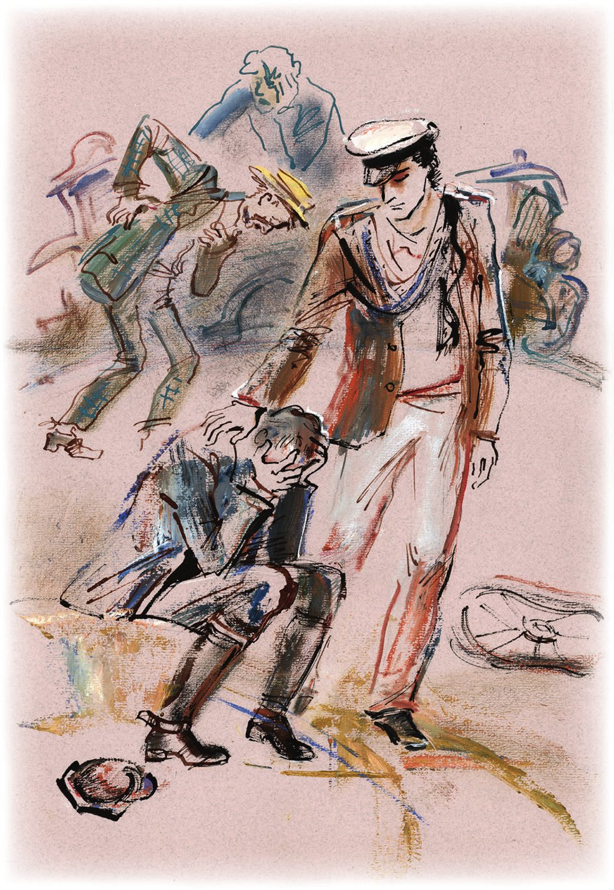
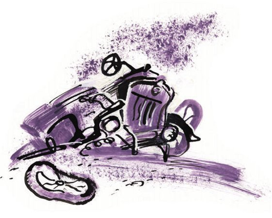

## Kapitel 25: Drei Wege

Der «Antilope» ging es nicht gut. Sie blieb sogar an leichten <abbr title="die Steigung, die Steigungen — подъём">Steigungen</abbr> stehen und rollte <abbr title="willenlos — безвольно">willenlos</abbr> zurück. Im <abbr title="der Motor, die Motoren — мотор">Motor</abbr> hörte man fremde Geräusche und ein Röcheln, als würde man unter der gelben Motorhaube jemanden erwürgen. Das Auto war <abbr title="überladen — перегруженный">überladen</abbr>. Außer der Besatzung trug es große Vorräte an Treibstoff. In Kannen und großen Flaschen, die jeden freien Platz füllten, gluckerte das Benzin. Koslewitsch schüttelte den Kopf, gab Gas und sah Ostap bekümmert an.

— Adam, — sagte der Kommandeur, — Sie sind unser Vater, wir sind Ihre Kinder. Kurs nach Osten! Sie haben ein ausgezeichnetes <abbr title="das Navigationsgerät, die Navigationsgeräte — навигационный прибор">Navigationsgerät</abbr>: den Kompass-Anhänger. Kommen Sie nicht vom Weg ab!

Die Antilopen-Leute fuhren schon den dritten Tag. Aber außer Ostap wusste niemand genau, was das <abbr title="das Ziel, die Ziele — цель">Ziel</abbr> der neuen Reise war. Panikowski sah schwermütig auf die <abbr title="zottig — лохматый">zottigen</abbr> <abbr title="das Maisfeld, die Maisfelder — кукурузное поле">Maisfelder</abbr> und lispelte schüchtern:

— Wozu fahren wir schon wieder? Wozu das alles? Es war so schön in Tschernomorsk.

Und wenn er an die wunderbare Femina dachte, seufzte er <abbr title="krampfhaft — судорожно">krampfhaft</abbr>. Außerdem hatte er Hunger, aber es gab nichts zu essen: Das Geld war alle.

— Vorwärts! — antwortete Ostap. — Jammern Sie nicht, Alter. Auf Sie warten ein goldenes Gebiss, eine <abbr title="rundlich — толстенький, пухлый">rundliche</abbr> kleine Witwe und ein ganzes <abbr title="das Schwimmbecken, die Schwimmbecken — бассейн">Schwimmbecken</abbr> voll Kefir. Für Balaganow kaufe ich einen kleinen Matrosenanzug und schicke ihn in die <abbr title="die Grundschule, die Grundschulen — школа первой ступени">Grundschule</abbr>. Dort lernt er lesen und schreiben, was in seinem Alter unbedingt nötig ist. Und Koslewitsch, unser treuer Adam, bekommt ein neues Auto. Was für eins wollen Sie, Adam Kasimirowitsch? Einen «Studebaker», einen «Lincoln», einen «Rolls», einen «Hispano-Suiza»?

— Einen «Isotta Fraschini», — sagte Koslewitsch und wurde rot.

— Gut. Sie werden ihn bekommen. Er wird «Antilope die Zweite» heißen oder «Tochter der Antilope», wie Sie wollen. Und jetzt gibt es keinen Grund, den Mut zu verlieren. Für die <abbr title="die Verpflegung — довольствие, питание">Verpflegung</abbr> sorge ich. <abbr title="zwar — правда, хотя">Zwar</abbr> ist meine Reisetasche verbrannt, aber die feuerfesten Ideen sind mir geblieben. Wenn es ganz schlimm wird, halten wir in irgendeinem glücklichen Städtchen und veranstalten dort einen Stierkampf wie in Sevilla. Panikowski wird der <abbr title="der Picador, die Picadores — пикадор">Picador</abbr> sein. Schon das allein wird ein <abbr title="ungesund — нездоровый">ungesundes</abbr> Interesse beim Publikum wecken, und folglich riesige Einnahmen.

Das Auto <abbr title="sich bewegen — двигаться">bewegte sich</abbr> auf einer breiten Landstraße vorwärts, auf der man die Spuren von <abbr title="die Traktorkette, die Traktorketten — тракторная гусеница">Traktorketten</abbr> sah. Plötzlich bremste der Chauffeur.

— Wohin fahren? — fragte er. — Drei Wege.

Die Passagiere stiegen aus. Sie <abbr title="lockern — разминать">lockerten</abbr> ihre schwachen Beine und gingen ein Stück nach vorn. An der <abbr title="die Weggabelung, die Weggabelungen — распутье, развилка">Weggabelung</abbr> stand ein schiefer <abbr title="der Steinpfeiler, die Steinpfeiler — каменный столб">Steinpfeiler</abbr>, auf dem eine dicke <abbr title="die Krähe, die Krähen — ворона">Krähe</abbr> saß. Die plattgedrückte Sonne ging hinter den zottigen Maisfeldern unter. Balaganows schmaler Schatten reichte bis zum Horizont. Die Erde färbte sich leicht dunkel, und ein erster Stern kündigte pünktlich die Nacht an.

Drei Wege lagen vor den Antilopen-Leuten: eine <abbr title="die Asphaltstraße, die Asphaltstraßen — асфальтовая дорога">Asphaltstraße</abbr>, eine Chaussee und ein Feldweg. Der Asphalt leuchtete noch gelb in der Sonne, blauer <abbr title="der Dunst — пар, дымка">Dunst</abbr> stand über der Chaussee, der Feldweg war schon ganz dunkel und verlor sich gleich hinter dem Pfeiler im Feld. Ostap schrie die Krähe an. Die Krähe erschrak sehr, flog aber nicht weg. Ostap ging grübelnd an der Kreuzung herum und sagte:

— Ich erkläre die Konferenz der russischen Recken für eröffnet! <abbr title="anwesend — присутствующий, налицо">Anwesend</abbr> sind: Ilja Muromez – Ostap Bender, Dobrynja Nikititsch – Balaganow, und Aljoscha Popowitsch – unser aller verehrter Michail Panikowski.

Koslewitsch nutzte den Halt und kroch mit einem <abbr title="der Engländer, die Engländer — разводной (французский) ключ">Engländer</abbr> unter die «Antilope». Darum wurde er nicht zu den Recken gezählt.

— Lieber Dobrynja, — ordnete Ostap an, — stellen Sie sich bitte rechts hin! Monsieur Popowitsch, nehmen Sie Ihren Platz auf der linken Seite ein! Legen Sie die Hand an die Stirn und schauen Sie in die Ferne.

— Was sind denn das jetzt wieder für Witze? — empörte sich Aljoscha Popowitsch. — Ich habe Hunger. Fahren wir schnell irgendwohin!

— Schämen Sie sich, Aljoscha, — sagte Ostap. — Stellen Sie sich hin, wie es sich für einen alten Ritter gehört. Und denken Sie nach. Sehen Sie, wie Dobrynja sich benimmt. Über den könnte man sofort eine <abbr title="die Heldensage, die Heldensagen — былина">Heldensage</abbr> schreiben. Also, ihr Recken, welchen Weg sollen wir nehmen? Auf welchem liegt das Geld herum, das wir für die laufenden Ausgaben brauchen? Ich weiß, Koslewitsch würde den Asphalt nehmen, Chauffeure lieben gute Straßen. Aber Adam ist ein ehrlicher Mensch, er versteht nicht viel vom Leben. Rittern <abbr title="nützen — быть полезным">nützt</abbr> der Asphalt nichts. Er führt wahrscheinlich zu einem <abbr title="der Getreidegigant, die Getreidegiganten — зерновой гигант (совхоз)">Getreidegiganten</abbr>. Dort gehen wir im Lärm der Maschinen verloren. Am Ende <abbr title="überrollen — задавить, переехать">überrollt</abbr> uns noch irgendein «Caterpillar» oder ein Mähdrescher. Unter einem Mähdrescher zu sterben, das ist langweilig. Nein, ihr Recken, wir fahren nicht auf der Asphaltstraße. Jetzt die Chaussee. Koslewitsch würde natürlich auch die nicht ablehnen. Aber glauben Sie Ilja Muromez: Die Chaussee taugt nicht für uns. Soll man uns ruhig <abbr title="die Rückständigkeit — отсталость">Rückständigkeit</abbr> vorwerfen, wir fahren diesen Weg nicht. Mein <abbr title="der Instinkt, die Instinkte — чутьё, инстинкт">Instinkt</abbr> <abbr title="voraussagen — предсказывать, подсказывать">sagt</abbr> mir eine Begegnung mit taktlosen <abbr title="der Kolchosbauer, die Kolchosbauern — колхозник">Kolchosbauern</abbr> und anderen vorbildlichen Bürgern voraus. Außerdem haben die keine Zeit für uns. Über ihre <abbr title="vergesellschaftet — обобществлённый">vergesellschafteten</abbr> Felder ziehen gerade zahlreiche Literatur- und <abbr title="die Musikbrigade, die Musikbrigaden — музыкальная бригада">Musikbrigaden</abbr>. Sie sammeln Material für <abbr title="das Agrarpoem, die Agrarpoeme — агропоэма">Agrarpoeme</abbr> und <abbr title="die Gemüsegartenkantate, die Gemüsegartenkantaten — огородная кантата">Gemüsegartenkantaten</abbr>. Es bleibt der Feldweg, Bürger Recken! Hier ist er – der alte <abbr title="der Märchenweg — сказочный путь">Märchenweg</abbr>, auf dem die «Antilope» fahren wird. Hier weht der russische Geist! Hier riecht es nach Russland! Hier fliegt noch der Feuervogel, der schon fast verglüht ist, und Leute unseres Berufs bekommen noch ein paar goldene <abbr title="das Federchen, die Federchen — пёрышко">Federchen</abbr> ab. Hier sitzt noch der <abbr title="der Großbauer, die Großbauern — кулак">Großbauer</abbr> Kaschtschei auf seinen Truhen. Er hielt sich für unsterblich und hat jetzt mit Entsetzen festgestellt, dass es mit ihm zu Ende geht. Aber für uns, ihr Recken, fällt bei ihm noch etwas ab, besonders wenn wir uns ihm als <abbr title="wandernd — странствующий">wandernde</abbr> Mönche vorstellen. Vom Standpunkt der <abbr title="die Straßenbautechnik — дорожная техника">Straßenbautechnik</abbr> ist dieser Märchenweg <abbr title="abscheulich — отвратительный">abscheulich</abbr>. Aber für uns gibt es keinen anderen Weg. Adam! Wir fahren!

Koslewitsch lenkte das Auto traurig auf den Feldweg. Dort begann es sofort, <abbr title="die Schlangenlinie, die Schlangenlinien — зигзаг, «крендель»">Schlangenlinien</abbr> zu fahren, sich zur Seite zu <abbr title="sich neigen — крениться">neigen</abbr> und die Passagiere hoch in die Luft zu werfen. Die Antilopen-Leute hielten sich aneinander fest, fluchten leise und stießen mit den Knien an die harten Kannen.

— Ich will essen! — stöhnte Panikowski. — Ich will eine Gans! Warum sind wir aus Tschernomorsk weggefahren?

Das Auto kreischte, kam aus einer tiefen <abbr title="die Spurrinne, die Spurrinnen — колея">Spurrinne</abbr> heraus und fiel wieder hinein.

— Halten Sie durch, Adam! — rief Bender. — Um jeden Preis, halten Sie durch! Wenn die «Antilope» uns nur bis zur Östlichen Magistrale bringt, dann <abbr title="verleihen (verlieh, hat verliehen) — награждать">verleihen</abbr> wir ihr goldene Reifen mit Schwertern und Schleifen!

Koslewitsch hörte nicht zu. Bei den verrückten Sprüngen riss ihm das Lenkrad aus den Händen. Panikowski litt weiter.

— Bender, — <abbr title="krächzen — хрипеть">krächzte</abbr> er plötzlich, — Sie wissen, wie ich Sie achte, aber Sie verstehen gar nichts! Sie wissen nicht, was eine Gans ist! Ach, wie ich diesen Vogel liebe! Das ist ein herrlicher, fetter Vogel, Ehrenwort, edles Ehrenwort. Eine Gans! Bender! Ein <abbr title="das Flügelchen, die Flügelchen — крылышко">Flügelchen</abbr>! Ein <abbr title="das Hälschen — шейка">Hälschen</abbr>! Eine <abbr title="die Keule, die Keulen — ножка (птицы)">Keule</abbr>! Wissen Sie, Bender, wie ich eine Gans fange? Ich töte sie wie ein <abbr title="der Torero, die Toreros — тореадор">Torero</abbr> – mit einem einzigen Schlag. Das ist eine Oper, wenn ich auf eine Gans losgehe! «Carmen»!..

— Wissen wir, — sagte der Kommandeur. — Haben wir in Arbatow gesehen. Ein zweites Mal <abbr title="abraten von + Dat. (riet ab, hat abgeraten) — не советовать, отговаривать">rate</abbr> ich Ihnen ab.

Panikowski verstummte. Aber schon nach einer Minute, als ein neuer <abbr title="der Stoß, die Stöße — толчок">Stoß</abbr> des Autos ihn auf Bender warf, hörte man wieder sein <abbr title="fiebrig — горячечный">fiebriges</abbr> Flüstern:

— Bender! Sie spaziert auf der Straße. Die Gans! Dieser herrliche Vogel spaziert, und ich stehe da und tue so, als ginge mich das nichts an. Sie kommt näher. Gleich wird sie mich <abbr title="anzischen — шипеть на">anzischen</abbr>. Diese Vögel denken, dass sie stärker sind als alle anderen, und das ist ihre schwache Seite. Bender! Das ist ihre schwache Seite!..

Jetzt sang der Konventionsbrecher fast.

— Sie geht auf mich los und zischt wie ein <abbr title="das Grammofon, die Grammofone — граммофон">Grammofon</abbr>. Aber ich bin kein Feigling, Bender. Ein anderer an meiner Stelle wäre weggelaufen, aber ich stehe da und warte. Jetzt kommt sie heran und streckt den Hals aus, den weißen Gänsehals mit dem gelben Schnabel. Sie will mich beißen. Beachten Sie, Bender, der moralische <abbr title="der Vorteil, die Vorteile — преимущество">Vorteil</abbr> ist auf meiner Seite. Nicht ich greife sie an, sie greift mich an. Und da, in <abbr title="die Notwehr — самозащита, самооборона">Notwehr</abbr>, pack ich sie…

Aber Panikowski konnte seine Rede nicht beenden. Es gab ein schreckliches, ekelhaftes Krachen, und die Antilopen-Leute lagen in einer Sekunde auf der Straße, in den verschiedensten Stellungen. Balaganows Beine <abbr title="ragen — торчать">ragten</abbr> aus dem <abbr title="der Graben, die Gräben — канава">Graben</abbr>. Auf dem Bauch des großen Kombinators lag eine Kanne Benzin. Panikowski stöhnte, leicht <abbr title="einklemmen — придавить, зажать">eingeklemmt</abbr> unter einer Feder. Koslewitsch stand auf und machte schwankend ein paar Schritte.

Die «Antilope» gab es nicht mehr. Auf der Straße lag ein hässlicher Haufen Trümmer: <abbr title="der Kolben, die Kolben — поршень">Kolben</abbr>, Kissen, Federn. Kupferne kleine Därme glänzten im Mondlicht. Die zerfallene Karosserie war in den Graben gerutscht und lag neben Balaganow, der wieder zu sich gekommen war. Die Kette kroch wie eine <abbr title="die Kreuzotter, die Kreuzottern — гадюка">Kreuzotter</abbr> in die Spurrinne. In der Stille, die jetzt folgte, hörte man ein feines Klingen, und von irgendeinem kleinen Hügel rollte ein Rad herab. Der Schlag hatte es offenbar weit <abbr title="schleudern — отбросить, швырнуть">geschleudert</abbr>. Das Rad beschrieb einen Bogen und legte sich sanft zu Koslewitschs Füßen.

Erst da verstand der Chauffeur, dass alles zu Ende war. Die «Antilope» war tot. Adam Kasimirowitsch setzte sich auf die Erde und nahm den Kopf in die Hände. Nach einigen Minuten berührte ihn der Kommandeur an der Schulter und sagte mit veränderter Stimme:

— Adam, wir müssen gehen.

Koslewitsch stand auf und setzte sich sofort wieder hin.

— Wir müssen gehen, — wiederholte Ostap. — Die «Antilope» war ein treues Auto, aber es gibt noch viele Autos auf der Welt. Bald können Sie sich jedes <abbr title="aussuchen — выбрать">aussuchen</abbr>. Gehen wir, wir müssen uns beeilen. Wir müssen irgendwo übernachten, essen, Geld für die <abbr title="die Fahrkarte, die Fahrkarten — билет">Fahrkarten</abbr> <abbr title="auftreiben (trieb auf, hat aufgetrieben) — раздобыть">auftreiben</abbr>. Wir müssen weit fahren. Gehen wir, gehen wir, Koslewitsch! Das Leben ist schön, <abbr title="trotz + Gen. — невзирая на">trotz</abbr> seiner Schwächen. Wo ist Panikowski? Wo ist dieser <abbr title="der Gänsedieb, die Gänsediebe — гусекрад">Gänsedieb</abbr>? Schura! Führen Sie Adam!

Man führte Koslewitsch an den Armen. Er fühlte sich wie ein Kavallerist, dessen Pferd durch seine eigene <abbr title="die Unachtsamkeit — недосмотр, невнимательность">Unachtsamkeit</abbr> gestorben ist. Er glaubte, dass jetzt alle Fußgänger über ihn lachen würden.

Nach dem Tod der «Antilope» wurde das Leben sofort schwerer. Übernachten mussten sie auf dem Feld.

Ostap schlief sofort verärgert ein, auch Balaganow und Koslewitsch schliefen ein. Nur Panikowski saß die ganze Nacht am Lagerfeuer und zitterte.

Die Antilopen-Leute standen bei <abbr title="der Tagesanbruch — рассвет">Tagesanbruch</abbr> auf, aber das nächste Dorf erreichten sie erst um vier Uhr nachmittags. Den ganzen Weg schleppte sich Panikowski hinterher. Er hinkte ein wenig. Vor Hunger hatten seine Augen einen Glanz wie bei einer Katze bekommen, und er klagte ohne Pause über das Schicksal und über den Kommandeur.

Im Dorf befahl Ostap der Besatzung, in der Dritten Straße zu warten und nirgendwohin wegzugehen. Er selbst ging in die Erste Straße, zum <abbr title="der Dorfsowjet, die Dorfsowjets — сельсовет">Dorfsowjet</abbr>. Von dort kam er ziemlich schnell zurück.

— Alles ist geregelt, — sagte er mit fröhlicherer Stimme. — Gleich bekommen wir ein <abbr title="das Quartier, die Quartiere — квартира, постой">Quartier</abbr> und ein Mittagessen. Nach dem Essen <abbr title="sich aalen — нежиться">aalen</abbr> wir uns im Heu. Erinnern Sie sich – Milch und Heu? Und am Abend geben wir eine Vorstellung. Ich habe sie schon für fünfzehn Rubel verkauft. Das Geld haben wir schon. Schura! Sie müssen etwas aus dem «Vortragskünstler» <abbr title="vortragen (trug vor, hat vorgetragen) — декламировать">vortragen</abbr>. Ich zeige antireligiöse <abbr title="der Kartentrick, die Kartentricks — карточный фокус">Kartentricks</abbr>, und Panikowski… Wo ist Panikowski? Wo ist er denn hin?

— Er war gerade noch hier, — sagte Koslewitsch.

Aber da hörte man hinter dem Flechtzaun, an dem die Antilopen-Leute standen, das <abbr title="das Geschnatter — гусиный гогот">Geschnatter</abbr> von Gänsen und das <abbr title="das Gekreisch — визг">Gekreisch</abbr> einer Bäuerin. Weiße Federn flogen, und Panikowski lief auf die Straße. Offenbar hatte die Hand des Toreros <abbr title="versagen — изменить, отказать">versagt</abbr>, und er hatte dem Vogel in Notwehr einen falschen Schlag versetzt. Hinter ihm her lief die Bäuerin und schwang ein Holzscheit.

— Erbärmliche, nichtige Frau! — schrie Panikowski und rannte aus dem Dorf hinaus.

— Was für ein <abbr title="der Schwätzer, die Schwätzer — трепло, болтун">Schwätzer</abbr>! — rief Ostap und <abbr title="verbergen (verbarg, hat verborgen) — скрывать">verbarg</abbr> seinen Ärger nicht. — Dieser Schuft hat uns die Vorstellung verdorben. Laufen wir, bevor man uns die fünfzehn Rubel wieder wegnimmt.

Inzwischen hatte die zornige Bäuerin Panikowski eingeholt. Sie holte geschickt aus und <abbr title="eins überziehen — огреть">zog</abbr> ihm mit dem Holzscheit eins über den Rücken über. Der Konventionsbrecher fiel zu Boden, sprang aber sofort wieder auf und raste mit unnatürlicher Geschwindigkeit davon. Nach diesem <abbr title="der Akt der Vergeltung — акт возмездия">Akt der Vergeltung</abbr> drehte die Bäuerin zufrieden um. Als sie an den Antilopen-Leuten vorbeilief, drohte sie ihnen mit dem Holzscheit.

— Jetzt ist unsere <abbr title="künstlerisch — артистический">künstlerische</abbr> Karriere zu Ende, — sagte Ostap und verließ mit schnellen Schritten das Dorf. — Mittagessen, Ruhe – alles ist dahin.

Panikowski holten sie erst nach etwa drei Kilometern ein. Er lag in einem Graben am Straßenrand und klagte laut. Vor Müdigkeit, Angst und Schmerz war er blass geworden. Die vielen kleinen roten Äderchen eines alten Mannes waren aus seinem Gesicht verschwunden. Er war so jämmerlich, dass der Kommandeur die Abrechnung <abbr title="absagen — отменить">absagte</abbr>, die er mit ihm machen wollte.

— Da schlug man Aljoscha Popowitsch auf sein mächtig Rückelein! — sagte Ostap im Vorbeigehen.

Alle sahen Panikowski mit <abbr title="der Abscheu — отвращение">Abscheu</abbr> an. Und wieder schleppte er sich am Ende der Kolonne hinterher, stöhnte und stammelte:

— Warten Sie auf mich, eilen Sie nicht so. Ich bin alt, ich bin krank, mir geht es schlecht!.. Eine Gans! Eine Keule! Ein Hälschen! Eine Femina!.. Erbärmliche, nichtige Menschen!..

Aber die Antilopen-Leute hatten sich so an die Klagen des Alten gewöhnt, dass sie nicht mehr darauf achteten. Der Hunger trieb sie vorwärts. Nie zuvor war ihnen die Welt so eng und unbequem gewesen. Die Straße zog sich endlos hin, und Panikowski blieb immer weiter zurück. Die Freunde waren schon in ein schmales gelbes <abbr title="das Tal, die Täler — долина">Tal</abbr> hinabgestiegen, aber der Konventionsbrecher war noch als schwarze Figur auf dem Kamm des Hügels zu sehen, vor dem grünlichen <abbr title="der Dämmerungshimmel — сумеречное небо">Dämmerungshimmel</abbr>.

— Der Alte ist <abbr title="unmöglich — невозможный">unmöglich</abbr> geworden, — sagte der hungrige Bender. — Wir müssen ihn entlassen. Gehen Sie, Schura, holen Sie diesen Simulanten her!

Balaganow ging unwillig los, um den Auftrag auszuführen. Während er auf den Hügel hinauflief, verschwand die Figur Panikowskis.

— Da ist etwas passiert, — sagte Koslewitsch nach einer Weile und sah auf den Hügelkamm. Von dort winkte Balaganow mit den Armen wie ein <abbr title="der Signalmast, die Signalmasten — семафор">Signalmast</abbr>.

Der Chauffeur und der Kommandeur stiegen hinauf.

Der Konventionsbrecher lag mitten auf der Straße, <abbr title="reglos — неподвижно">reglos</abbr> wie eine Puppe. Das rosa Band der Krawatte lag schief über seiner Brust. Ein Arm war unter den Rücken <abbr title="drehen — подвернуть">gedreht</abbr>. Die Augen sahen trotzig in den Himmel. Panikowski war tot.

— <abbr title="die Herzlähmung — паралич сердца">Herzlähmung</abbr>, — sagte Ostap, nur um irgendetwas zu sagen. — Das kann ich auch ohne Stethoskop feststellen. Der arme Alte!

Er drehte sich weg. Balaganow konnte die Augen nicht von dem <abbr title="der Tote, die Toten — покойник">Toten</abbr> <abbr title="abwenden — отвести (глаза)">abwenden</abbr>. Plötzlich verzog er das Gesicht und sagte mit Mühe:

— Und ich hab ihn wegen der Gewichte verprügelt. Und schon vorher hab ich mich mit ihm <abbr title="sich prügeln — драться">geprügelt</abbr>.

Koslewitsch dachte an die tote «Antilope», sah Panikowski entsetzt an und begann, ein lateinisches Gebet zu singen.

— Lassen Sie das, Adam! — sagte der große Kombinator. — Ich weiß alles, was Sie vorhaben. Nach dem Psalm sagen Sie: «Der Herr hat's gegeben, der Herr hat's genommen», dann: «Wir alle stehen in Gottes Hand», und dann noch irgendetwas Sinnloses, zum Beispiel: «Ihm geht es jetzt immerhin besser als uns.» Das alles ist nicht nötig, Adam Kasimirowitsch. Vor uns liegt eine einfache Aufgabe: Der Körper muss der Erde übergeben werden.

Es war schon ganz dunkel, als man für den Konventionsbrecher die letzte <abbr title="die Ruhestätte, die Ruhestätten — пристанище, место упокоения">Ruhestätte</abbr> fand. Es war ein natürliches Grab. Der Regen hatte es am Fuß einer senkrecht stehenden Steinplatte <abbr title="auswaschen (wusch aus, hat ausgewaschen) — вымыть, размыть">ausgewaschen</abbr>. Diese Platte stand offenbar schon lange an der Straße. Vielleicht hatte darauf einmal prächtig die Inschrift gestanden: «Besitzthum des Gutsherrn, Major a. D. Georgij Afanasjewitsch Wolk-Lisizkij». Vielleicht war es auch nur ein <abbr title="der Grenzstein, die Grenzsteine — межевой знак">Grenzstein</abbr> aus der Zeit Potjomkins. Aber das war auch nicht wichtig. Man legte Panikowski in die Grube, scharrte mit Stöcken Erde zusammen und <abbr title="zuschütten — засыпать">schüttete</abbr> ihn zu. Dann <abbr title="sich stemmen gegen + Akk. — налечь на">stemmten</abbr> die Antilopen-Leute sich mit den Schultern gegen die Platte, die mit der Zeit locker geworden war, und stürzten sie herunter. Jetzt war das Grab fertig. Im Licht von <abbr title="aufflammen — вспыхивать">aufflammenden</abbr> Streichhölzern schrieb der große Kombinator mit einem Stück Backstein die Grabinschrift auf die Platte:

Hier liegt

MICHAIL SAMUELEWITSCH PANIKOWSKI

ein Mensch ohne Pass

Ostap nahm seine Kapitänsmütze ab und sagte:

— Ich war oft <abbr title="ungerecht — несправедливый">ungerecht</abbr> gegen den Verstorbenen. Aber war der Verstorbene ein moralischer Mensch? Nein, er war kein moralischer Mensch. Er war ein ehemaliger Blinder, ein Hochstapler und Gänsedieb. All seine Kräfte setzte er dafür ein, <abbr title="auf Kosten + Gen. — за счёт">auf Kosten</abbr> der Gesellschaft zu leben. Aber die Gesellschaft wollte nicht, dass er auf ihre Kosten lebte. Und diesen <abbr title="der Widerspruch, die Widersprüche — противоречие">Widerspruch</abbr> in den Ansichten konnte Michail Samuelewitsch nicht ertragen, denn er hatte einen <abbr title="jähzornig — вспыльчивый">jähzornigen</abbr> Charakter. Und darum ist er gestorben. Das ist alles!

Koslewitsch und Balaganow waren mit Ostaps <abbr title="die Grabrede, die Grabreden — надгробное слово">Grabrede</abbr> nicht zufrieden. Sie hätten es passender gefunden, wenn der große Kombinator ausführlich über die <abbr title="die Wohltat, die Wohltaten — благодеяние">Wohltaten</abbr> gesprochen hätte, die der Verstorbene der Gesellschaft erwiesen hatte; über seine Hilfe für die Armen, über seine <abbr title="feinfühlig — чуткий">feinfühlige</abbr> Seele, über seine Liebe zu Kindern und über all das, was man jedem Toten <abbr title="zuschreiben (schrieb zu, hat zugeschrieben) — приписывать">zuschreibt</abbr>. Balaganow trat sogar an das Grab, um das alles selbst zu sagen. Aber der Kommandeur hatte seine Mütze schon wieder aufgesetzt und ging mit schnellen Schritten davon.

Als der Rest der Antilopen-Armee das Tal durchquert hatte und über einen neuen Hügel gestiegen war, sahen sie gleich dahinter einen kleinen Bahnhof.

— Da ist ja die <abbr title="die Zivilisation — цивилизация">Zivilisation</abbr>, — sagte Ostap. — Vielleicht gibt es ein Büfett, etwas zu essen. Wir schlafen auf den Bänken. Morgen früh fahren wir nach Osten. Was meinen Sie?

Der Chauffeur und der Bordmechaniker schwiegen.

— Warum schweigen Sie denn wie zwei Bräutigame?

— Wissen Sie, Bender, — sagte Balaganow endlich, — ich fahre nicht mit. Seien Sie nicht beleidigt, aber ich glaube nicht daran. Ich weiß nicht, wohin man fahren muss. Wir gehen dort alle zugrunde. Ich bleibe.

— Dasselbe wollte ich Ihnen auch sagen, — unterstützte ihn Koslewitsch.

— Wie Sie wollen, — bemerkte Ostap plötzlich kühl.

Auf dem Bahnhof gab es kein Büfett. Eine helle Petroleumlampe brannte. Im <abbr title="der Wartesaal, die Wartesäle — пассажирский зал">Wartesaal</abbr> dösten zwei Bäuerinnen auf ihren Säcken. Das ganze Bahnpersonal ging auf dem Bahnsteig aus Brettern auf und ab und sah unruhig in die Dunkelheit vor dem Morgen, hinter das Signal.

— Was für ein Zug? — fragte Ostap.

— Ein Sonderzug, — antwortete der <abbr title="der Bahnhofsvorsteher, die Bahnhofsvorsteher — начальник станции">Bahnhofsvorsteher</abbr> nervös und rückte seine rote Mütze mit silbernen Tressen zurecht. — Mit besonderem Auftrag. Er hat zwei Minuten <abbr title="die Verspätung — опоздание">Verspätung</abbr>. Die <abbr title="die Ausweichstelle, die Ausweichstellen — разъезд">Ausweichstelle</abbr> gibt die Strecke nicht frei.

Ein Dröhnen begann, die Drähte zitterten, aus dem Dröhnen schlüpften kleine Wolfsaugen, und ein kurzer, glänzender Zug fuhr mit Schwung in den Bahnhof. Die breiten Fenster der <abbr title="der Polsterwagen, die Polsterwagen — мягкий вагон">Polsterwagen</abbr> leuchteten auf. Direkt vor der Nase der Antilopen-Leute flogen die Blumensträuße und Weinflaschen des <abbr title="der Speisewagen, die Speisewagen — вагон-ресторан">Speisewagens</abbr> vorbei. Noch während der Fahrt sprangen <abbr title="der Schaffner, die Schaffner — проводник">Schaffner</abbr> mit <abbr title="die Laterne, die Laternen — фонарь">Laternen</abbr> ab, und der Bahnsteig war sofort voll von fröhlichem russischem <abbr title="das Geplauder — говор, болтовня">Geplauder</abbr> und fremden Sprachen. An den Wagen hingen Bögen aus <abbr title="der Tannenzweig, die Tannenzweige — хвойная ветка">Tannenzweigen</abbr> und Losungen: «Gruß den Helden – den Erbauern der Östlichen Magistrale!»

Der Sonderzug mit den Gästen fuhr zur <abbr title="die Eröffnung — открытие">Eröffnung</abbr> der Bahnlinie.

Der große Kombinator verschwand. Nach einer halben Minute war er wieder da und flüsterte:

— Ich fahre! Wie ich fahre, weiß ich nicht, weiß ich nicht, aber ich fahre! Wollen Sie mit? Ich frage zum letzten Mal.

— Nein, — sagte Balaganow.

— Ich fahre nicht, — sagte Koslewitsch. — Ich kann nicht mehr.

— Was werden Sie denn machen?

— Was soll ich schon machen? — antwortete Schura. — Ich werde wieder ein Kind des Leutnants Schmidt – das ist alles.

— Ich will die «Antilope» wieder zusammenbauen, — sagte Adam Kasimirowitsch kläglich. — Ich gehe zu ihr, sehe sie mir an, repariere sie.

Ostap wollte etwas sagen, aber ein langer Pfiff schloss ihm den Mund. Er zog Balaganow an sich, klopfte ihm auf den Rücken, küsste Koslewitsch, winkte mit der Hand und lief zum Zug. Dessen Wagen stießen beim ersten <abbr title="der Ruck — толчок, рывок">Ruck</abbr> der Lokomotive schon aneinander. Aber bevor er den Zug erreichte, drehte er um, drückte Koslewitsch die fünfzehn Rubel für die verkaufte Vorstellung in die Hand und sprang auf das Trittbrett des fahrenden Zuges.

Als er sich umsah, erblickte er im fliederfarbenen <abbr title="das Dämmerlicht — сумрак, мгла">Dämmerlicht</abbr> zwei kleine Figuren, die den <abbr title="der Bahndamm, die Bahndämme — насыпь">Bahndamm</abbr> hinaufstiegen. Balaganow kehrte in das unruhige Lager der Kinder des Leutnants Schmidt zurück. Koslewitsch trottete zu den Überresten der «Antilope».

---

### Neue Wörter

- **die Steigung, die Steigungen** — подъём
- **willenlos** — безвольно
- **der Motor, die Motoren** — мотор
- **überladen** — перегруженный
- **das Navigationsgerät, die Navigationsgeräte** — навигационный прибор
- **das Ziel, die Ziele** — цель
- **zottig** — лохматый
- **das Maisfeld, die Maisfelder** — кукурузное поле
- **krampfhaft** — судорожно
- **rundlich** — толстенький, пухлый
- **das Schwimmbecken, die Schwimmbecken** — бассейн
- **die Grundschule, die Grundschulen** — школа первой ступени
- **die Verpflegung** — довольствие, питание
- **zwar** — правда, хотя
- **der Picador, die Picadores** — пикадор
- **ungesund** — нездоровый
- **sich bewegen** — двигаться
- **die Traktorkette, die Traktorketten** — тракторная гусеница
- **lockern** — разминать
- **die Weggabelung, die Weggabelungen** — распутье, развилка
- **der Steinpfeiler, die Steinpfeiler** — каменный столб
- **die Krähe, die Krähen** — ворона
- **die Asphaltstraße, die Asphaltstraßen** — асфальтовая дорога
- **der Dunst** — пар, дымка
- **anwesend** — присутствующий, налицо
- **der Engländer, die Engländer** — разводной (французский) ключ
- **die Heldensage, die Heldensagen** — былина
- **nützen** — быть полезным
- **der Getreidegigant, die Getreidegiganten** — зерновой гигант (совхоз)
- **überrollen** — задавить, переехать
- **die Rückständigkeit** — отсталость
- **der Instinkt, die Instinkte** — чутьё, инстинкт
- **voraussagen** — предсказывать, подсказывать
- **der Kolchosbauer, die Kolchosbauern** — колхозник
- **vergesellschaftet** — обобществлённый
- **die Musikbrigade, die Musikbrigaden** — музыкальная бригада
- **das Agrarpoem, die Agrarpoeme** — агропоэма
- **die Gemüsegartenkantate, die Gemüsegartenkantaten** — огородная кантата
- **der Märchenweg** — сказочный путь
- **das Federchen, die Federchen** — пёрышко
- **der Großbauer, die Großbauern** — кулак
- **wandernd** — странствующий
- **die Straßenbautechnik** — дорожная техника
- **abscheulich** — отвратительный
- **die Schlangenlinie, die Schlangenlinien** — зигзаг, «крендель»
- **sich neigen** — крениться
- **die Spurrinne, die Spurrinnen** — колея
- **verleihen (verlieh, hat verliehen)** — награждать
- **krächzen** — хрипеть
- **das Flügelchen, die Flügelchen** — крылышко
- **das Hälschen** — шейка
- **die Keule, die Keulen** — ножка (птицы)
- **der Torero, die Toreros** — тореадор
- **abraten von + Dat. (riet ab, hat abgeraten)** — не советовать, отговаривать
- **der Stoß, die Stöße** — толчок
- **fiebrig** — горячечный
- **anzischen** — шипеть на
- **das Grammofon, die Grammofone** — граммофон
- **der Vorteil, die Vorteile** — преимущество
- **die Notwehr** — самозащита, самооборона
- **ragen** — торчать
- **der Graben, die Gräben** — канава
- **einklemmen** — придавить, зажать
- **der Kolben, die Kolben** — поршень
- **die Kreuzotter, die Kreuzottern** — гадюка
- **schleudern** — отбросить, швырнуть
- **aussuchen** — выбрать
- **die Fahrkarte, die Fahrkarten** — билет
- **auftreiben (trieb auf, hat aufgetrieben)** — раздобыть
- **trotz + Gen.** — невзирая на
- **der Gänsedieb, die Gänsediebe** — гусекрад
- **die Unachtsamkeit** — недосмотр, невнимательность
- **der Tagesanbruch** — рассвет
- **der Dorfsowjet, die Dorfsowjets** — сельсовет
- **das Quartier, die Quartiere** — квартира, постой
- **sich aalen** — нежиться
- **vortragen (trug vor, hat vorgetragen)** — декламировать
- **der Kartentrick, die Kartentricks** — карточный фокус
- **das Geschnatter** — гусиный гогот
- **das Gekreisch** — визг
- **versagen** — изменить, отказать
- **der Schwätzer, die Schwätzer** — трепло, болтун
- **verbergen (verbarg, hat verborgen)** — скрывать
- **eins überziehen** — огреть
- **der Akt der Vergeltung** — акт возмездия
- **künstlerisch** — артистический
- **absagen** — отменить
- **der Abscheu** — отвращение
- **das Tal, die Täler** — долина
- **der Dämmerungshimmel** — сумеречное небо
- **unmöglich** — невозможный
- **der Signalmast, die Signalmasten** — семафор
- **reglos** — неподвижно
- **drehen** — подвернуть
- **die Herzlähmung** — паралич сердца
- **der Tote, die Toten** — покойник
- **abwenden** — отвести (глаза)
- **sich prügeln** — драться
- **die Ruhestätte, die Ruhestätten** — пристанище, место упокоения
- **auswaschen (wusch aus, hat ausgewaschen)** — вымыть, размыть
- **der Grenzstein, die Grenzsteine** — межевой знак
- **zuschütten** — засыпать
- **sich stemmen gegen + Akk.** — налечь на
- **aufflammen** — вспыхивать
- **ungerecht** — несправедливый
- **auf Kosten + Gen.** — за счёт
- **der Widerspruch, die Widersprüche** — противоречие
- **jähzornig** — вспыльчивый
- **die Grabrede, die Grabreden** — надгробное слово
- **die Wohltat, die Wohltaten** — благодеяние
- **feinfühlig** — чуткий
- **zuschreiben (schrieb zu, hat zugeschrieben)** — приписывать
- **die Zivilisation** — цивилизация
- **der Wartesaal, die Wartesäle** — пассажирский зал
- **der Bahnhofsvorsteher, die Bahnhofsvorsteher** — начальник станции
- **die Verspätung** — опоздание
- **die Ausweichstelle, die Ausweichstellen** — разъезд
- **der Polsterwagen, die Polsterwagen** — мягкий вагон
- **der Speisewagen, die Speisewagen** — вагон-ресторан
- **der Schaffner, die Schaffner** — проводник
- **die Laterne, die Laternen** — фонарь
- **das Geplauder** — говор, болтовня
- **der Tannenzweig, die Tannenzweige** — хвойная ветка
- **die Eröffnung** — открытие
- **der Ruck** — толчок, рывок
- **das Dämmerlicht** — сумрак, мгла
- **der Bahndamm, die Bahndämme** — насыпь

[← Zurück](kapitel-25.md) · [Inhalt](README.md) · [Weiter →](kapitel-27.md)
