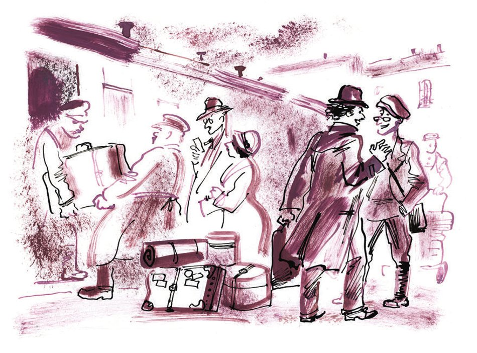
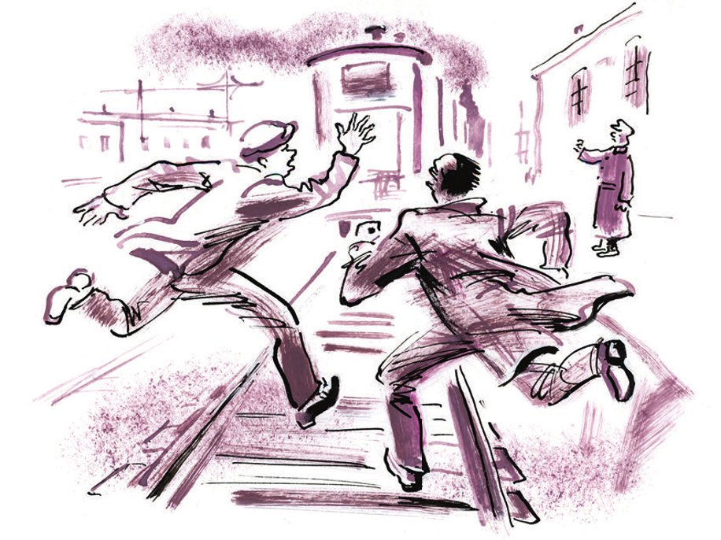
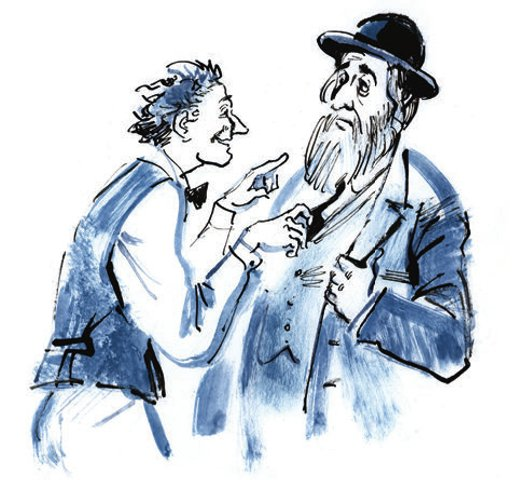

# Dritter Teil: Eine Privatperson

## Kapitel 26: Der Passagier des Sonderzugs

Am <abbr title="asphaltiert — асфальтированный">asphaltierten</abbr> Bahnsteig des Rjasaner Bahnhofs in Moskau stand ein kurzer <abbr title="der Sonderzug, die Sonderzüge — литерный (особый) поезд">Sonderzug</abbr>. Er hatte nur sechs Wagen: einen <abbr title="der Gepäckwagen, die Gepäckwagen — багажный вагон">Gepäckwagen</abbr>, in dem <abbr title="entgegen der Gewohnheit — против обыкновения">entgegen der Gewohnheit</abbr> kein Gepäck untergebracht war, sondern auf Eis die <abbr title="der Lebensmittelvorrat, die Lebensmittelvorräte — запас продовольствия">Lebensmittelvorräte</abbr> lagerten, einen Speisewagen, aus dem ein weißer Koch herausschaute, und einen <abbr title="der Salonwagen, die Salonwagen — салон-вагон">Salonwagen</abbr> der Regierung. Die übrigen drei Wagen waren für Passagiere bestimmt, und auf ihren Sofas, die mit <abbr title="derb — грубый, суровый">derben</abbr>, gestreiften <abbr title="der Bezug, die Bezüge — чехол">Bezügen</abbr> bedeckt waren, sollten eine <abbr title="die Delegation, die Delegationen — делегация">Delegation</abbr> von <abbr title="der Stoßarbeiter, die Stoßarbeiter — ударник (труда)">Stoßarbeitern</abbr> sowie ausländische und sowjetische <abbr title="der Korrespondent, die Korrespondenten — корреспондент">Korrespondenten</abbr> Platz nehmen.

Der Zug bereitete sich darauf vor, zur Verbindung der Schienen der Östlichen <abbr title="die Magistrale, die Magistralen — магистраль">Magistrale</abbr> aufzubrechen.

Es stand eine lange Reise bevor. Die Stoßarbeiter <abbr title="zwängen — впихивать, втискивать">zwängten</abbr> <abbr title="der Reisekorb, die Reisekörbe — дорожная корзина">Reisekörbe</abbr>, an deren Eisenstangen kleine schwarze <abbr title="das Vorhängeschloss, die Vorhängeschlösser — висячий замок">Vorhängeschlösser</abbr> baumelten, in den <abbr title="der Vorraum, die Vorräume — тамбур">Vorraum</abbr> der Wagen. Die sowjetische Presse <abbr title="hasten — метаться, спешить">hastete</abbr> über den Bahnsteig und schwenkte lackierte Reisetaschen aus Sperrholz.

Die Ausländer behielten die Gepäckträger im Auge, die ihre dicken ledernen Koffer, <abbr title="der Schrankkoffer, die Schrankkoffer — кофр">Schrankkoffer</abbr> und <abbr title="die Pappschachtel, die Pappschachteln — картонка">Pappschachteln</abbr> mit bunten Aufklebern von Reisebüros und <abbr title="die Dampfschiffgesellschaft, die Dampfschiffgesellschaften — пароходная компания">Dampfschiffgesellschaften</abbr> trugen.

Die Passagiere hatten sich bereits mit dem Büchlein «Die Östliche Magistrale» <abbr title="sich eindecken mit + Dat. — запастись чем-то">eingedeckt</abbr>, auf dessen Umschlag ein Kamel abgebildet war, das an einer Schiene schnupperte. Das Büchlein wurde gleich hier verkauft, von einem <abbr title="der Gepäckkarren, die Gepäckkarren — багажная тележка">Gepäckkarren</abbr> aus. Der Autor des Buches, der Journalist Palamidow, war schon mehrmals an dem Karren vorbeigegangen und hatte eifersüchtig die Käufer beobachtet. Er galt als Kenner der Magistrale und fuhr nun zum dritten Mal dorthin.

Die Abfahrtszeit rückte näher, doch die <abbr title="die Abschiedsszene, die Abschiedsszenen — сцена прощания">Abschiedsszene</abbr> erinnerte in nichts an die Abfahrt eines gewöhnlichen Personenzuges. Auf dem Bahnsteig standen keine alten Frauen, niemand hielt einen Säugling aus dem Fenster, damit er einen letzten Blick auf seinen Großvater werfe. <abbr title="selbstverständlich — разумеется">Selbstverständlich</abbr> gab es auch keinen Großvater, in dessen trüben Augen sich gewöhnlich die Angst vor der <abbr title="die Zugluft — сквозняк">Zugluft</abbr> der Eisenbahn spiegelt. Selbstverständlich küsste sich auch niemand. Die Delegation der Stoßarbeiter war von <abbr title="der Gewerkschaftsfunktionär, die Gewerkschaftsfunktionäre — профсоюзный деятель">Gewerkschaftsfunktionären</abbr> zum Bahnhof gebracht worden, die die Frage der Abschiedsküsse noch nicht hatten durcharbeiten können. Die Moskauer Korrespondenten wurden von <abbr title="der Redaktionsmitarbeiter, die Redaktionsmitarbeiter — сотрудник редакции">Redaktionsmitarbeitern</abbr> verabschiedet, die es gewohnt waren, sich in solchen Fällen mit einem <abbr title="der Händedruck, die Händedrücke — рукопожатие">Händedruck</abbr> abzufinden. Die ausländischen Korrespondenten dagegen, dreißig an der Zahl, fuhren <abbr title="vollzählig — в полном составе">vollzählig</abbr> zur Eröffnung der Magistrale, mit Ehefrauen und <abbr title="das Grammophon, die Grammophone — граммофон">Grammophonen</abbr>, sodass niemand da war, der sie hätte verabschieden können.

Die Teilnehmer der Expedition sprachen, wie es der Augenblick verlangte, lauter als sonst, griffen ohne Grund nach ihren <abbr title="der Notizblock, die Notizblöcke — блокнот">Notizblöcken</abbr> und <abbr title="tadeln — порицать, упрекать">tadelten</abbr> die <abbr title="der/die Zurückbleibende, die Zurückbleibenden — остающийся, провожающий">Zurückbleibenden</abbr> dafür, dass sie nicht mit auf eine so interessante Reise fuhren. Besonders laut war der Journalist Lawuasjan. Er war jung im Herzen, doch in seinen Locken leuchtete, wie der Mond im <abbr title="der Dschungel, die Dschungel — джунгли">Dschungel</abbr>, eine Glatze.

— Es ist widerlich, Sie anzusehen! — rief er den Zurückbleibenden zu. — Können Sie denn überhaupt begreifen, was die Östliche Magistrale ist!

Wären die Hände des hitzigen Lawuasjan nicht von einer großen Schreibmaschine in einer <abbr title="die Hülle, die Hüllen — чехол">Hülle</abbr> aus Wachstuch, wie sie Kutscher benutzen, besetzt gewesen, so hätte er vielleicht sogar einen seiner Freunde verprügelt, so leidenschaftlich war er und so <abbr title="ergeben sein + Dat. — быть преданным чему-то">ergeben</abbr> der Sache der Zeitungsinformation. Schon jetzt hätte er am liebsten ein Blitztelegramm an seine Redaktion geschickt, nur gab es nichts, worüber er hätte schreiben können.

Der Mitarbeiter eines Gewerkschaftsorgans, Uchudschanski, der als Erster am Bahnhof eingetroffen war, <abbr title="schlendern — прохаживаться, фланировать">schlenderte</abbr> <abbr title="gemächlich — неторопливо">gemächlich</abbr> am Zug entlang. Er trug das Werk «Das Turkestanische Land. Eine vollständige geographische Beschreibung unseres Vaterlandes. Ein Tisch- und Reisebuch für russische Menschen» von Semjonow-Tjan-Schanski bei sich, erschienen im Jahre 1903. Er blieb bei den Gruppen der Abreisenden und der Zurückbleibenden stehen und sagte mit einem gewissen <abbr title="satirisch — сатирический">satirischen</abbr> <abbr title="der Unterton, die Untertöne — оттенок, нотка">Unterton</abbr> in der Stimme:

— Sie fahren weg? Soso!

Oder:

— Sie bleiben hier? Soso!

Auf diese Weise gelangte er bis zur Spitze des Zuges, betrachtete lange, den Kopf in den Nacken gelegt, die Lokomotive und sagte schließlich zum <abbr title="der Lokführer, die Lokführer — машинист">Lokführer</abbr>:

— Sie arbeiten? Soso!

Danach ging der Journalist Uchudschanski in sein <abbr title="das Abteil, die Abteile — купе">Abteil</abbr>, faltete die neueste Nummer seines Gewerkschaftsorgans auseinander und vertiefte sich in die <abbr title="die Lektüre — чтение">Lektüre</abbr> seines eigenen Artikels mit dem Titel «Die Arbeit der Ladenkommissionen verbessern» und dem Untertitel «Die Kommissionen <abbr title="sich umgestalten — перестраиваться">gestalten sich</abbr> <abbr title="unzureichend — недостаточно">unzureichend</abbr> um». Der Artikel enthielt einen Bericht über irgendeine Sitzung, und die Haltung des Autors zu dem beschriebenen Ereignis ließ sich in einem einzigen Satz zusammenfassen: «Sie tagen? Soso!» Uchudschanski las bis zur Abfahrt.

Einer der Zurückbleibenden, ein Mann mit einer rosa <abbr title="die Plüschnase, die Plüschnasen — плюшевый нос">Plüschnase</abbr> und <abbr title="samtig — бархатный">samtigen</abbr> <abbr title="die Schläfe, die Schläfen — висок">Schläfen</abbr>, sprach eine <abbr title="die Prophezeiung, die Prophezeiungen — пророчество">Prophezeiung</abbr> aus, die alle <abbr title="fürchterlich — страшно">fürchterlich</abbr> erschreckte.

— Ich kenne solche Reisen, — erklärte er, — ich bin selbst gefahren. Ihre Zukunft ist mir bekannt. Sie sind hier etwa hundert Mann. Sie werden <abbr title="insgesamt — в общей сложности">insgesamt</abbr> einen ganzen Monat unterwegs sein. Zwei von Ihnen werden auf einer kleinen, <abbr title="abgelegen — глухой, отдалённый">abgelegenen</abbr> Station ohne Geld und Papiere den Zug verpassen und Sie erst nach einer Woche einholen, hungrig und <abbr title="zerlumpt — оборванный">zerlumpt</abbr>. Irgendwem wird ganz bestimmt ein Koffer gestohlen. Vielleicht Palamidow, vielleicht Lawuasjan oder Nawrozki. Und der Geschädigte wird die ganze Fahrt über jammern und bei den Nachbarn einen <abbr title="der Rasierpinsel, die Rasierpinsel — кисточка для бритья">Rasierpinsel</abbr> erbetteln. Den Pinsel wird er ungewaschen zurückgeben, und die <abbr title="die Waschschüssel, die Waschschüsseln — тазик">Waschschüssel</abbr> wird er verlieren. Ein Reisender wird natürlich sterben, und die Freunde des <abbr title="der/die Verstorbene, die Verstorbenen — покойный">Verstorbenen</abbr> werden, statt zur Schienenverbindung zu fahren, die teure <abbr title="die Asche — прах, пепел">Asche</abbr> nach Moskau bringen müssen. Das ist sehr langweilig und widerlich – Asche zu transportieren. Außerdem wird es unterwegs <abbr title="der Zank — склока, ссора">Zank</abbr> geben. Glauben Sie mir! Irgendjemand, sagen wir Palamidow oder Uchudschanski, wird eine <abbr title="gemeinschaftsschädlich — антиобщественный">gemeinschaftsschädliche</abbr> Tat begehen. Und Sie werden ihn lange und trübselig <abbr title="richten über + Akk. — судить">richten</abbr>, und er wird sich mit Kreischen und Stöhnen <abbr title="sich distanzieren von + Dat. — отмежёвываться">distanzieren</abbr>. Mir ist alles bekannt. Jetzt fahren Sie in Hüten und Schirmmützen, zurück kommen Sie aber in Tjubeteikas. Der Dümmste von Ihnen kauft sich die vollständige <abbr title="die Rüstung, die Rüstungen — доспех">Rüstung</abbr> eines Bucharer Juden: eine Samtmütze, mit <abbr title="das Schakalfell — шакалий мех">Schakalfell</abbr> <abbr title="verbrämen — оторачивать">verbrämt</abbr>, und eine dicke <abbr title="wattiert — ватный">wattierte</abbr> Steppdecke, die wie ein <abbr title="der Morgenrock, die Morgenröcke — халат">Morgenrock</abbr> genäht ist. Und natürlich werden Sie alle abends im Wagen «Stenka Rasin» singen, Sie werden dumm <abbr title="grölen — реветь, горланить">grölen</abbr>: «Und er wirft sie über Bord in die <abbr title="vorschriftsmäßig — надлежащий, предписанный">vorschriftsmäßige</abbr> Welle.» Nicht genug damit, sogar die Ausländer werden singen: «Wnis po matuschke po Wolge, sur notre mère Volga, die Mutter Wolga hinab.»

Lawuasjan geriet in Zorn und holte mit der Schreibmaschine gegen den Propheten aus.

— Sie beneiden uns! — sagte er. — Wir werden nicht singen.

— Sie werden singen, meine Lieben. Das ist <abbr title="unvermeidlich — неизбежный">unvermeidlich</abbr>. Mir ist doch alles bekannt.

— Wir werden nicht singen.

— Doch, Sie werden. Und wenn Sie ehrliche Leute sind, dann schreiben Sie mir <abbr title="unverzüglich — немедленно">unverzüglich</abbr> eine Postkarte darüber.

In diesem Augenblick ertönte ein verhaltener Schrei. Vom Dach des Gepäckwagens war der <abbr title="der Fotoreporter, die Fotoreporter — фоторепортёр">Fotoreporter</abbr> Menschow gefallen. Er war hinaufgeklettert, um die Augenblicke der Abfahrt festzuhalten. Einige Sekunden lang lag Menschow auf dem hohen Bahnsteig und hielt den Apparat über den Kopf. Dann stand er auf, prüfte besorgt den Verschluss und kletterte wieder aufs Dach.

— Sie fallen? — fragte Uchudschanski, der sich mit der Zeitung aus dem Fenster beugte.

— Was ist das schon für ein Fall! — sagte der Fotoreporter <abbr title="verächtlich — презрительно">verächtlich</abbr>. — Hätten Sie mal gesehen, wie ich von der <abbr title="die Spiralrutsche, die Spiralrutschen — спиральный спуск (горка)">Spiralrutsche</abbr> im Park für Kultur und Erholung gefallen bin!

— Soso, — bemerkte der Vertreter des Gewerkschaftsorgans und verschwand im Fenster.

Menschow kletterte wieder aufs Dach, ließ sich auf ein Knie nieder und setzte seine Arbeit fort. Ihn betrachtete mit dem Ausdruck lebhaftester Genugtuung ein norwegischer Schriftsteller, der seine Sachen bereits im Abteil untergebracht hatte und auf den Bahnsteig gekommen war, um ein wenig <abbr title="auf und ab gehen — прогуливаться взад-вперёд">auf und ab zu gehen</abbr>. Der Schriftsteller hatte helles Kinderhaar und eine große <abbr title="die Warägernase — варяжский нос">Warägernase</abbr>. Der Norweger war von Menschows fotografischer <abbr title="die Tollkühnheit — удальство, лихость">Tollkühnheit</abbr> so begeistert, dass er das Bedürfnis verspürte, seine Gefühle mit jemandem zu teilen. Mit schnellen Schritten ging er auf einen alten Stoßarbeiter aus der Trjochgorka-Fabrik zu, setzte ihm den Zeigefinger auf die Brust und rief durchdringend:

— Sie!!!

Dann zeigte er auf seine eigene Brust und rief ebenso durchdringend:

— Ich!!!

Nachdem der Schriftsteller auf diese Weise sämtliche russischen Wörter erschöpft hatte, die ihm <abbr title="zur Verfügung stehen — иметься в распоряжении">zur Verfügung</abbr> standen, lächelte er freundlich und lief zu seinem Wagen, denn das zweite <abbr title="das Glockenzeichen, die Glockenzeichen — звонок (сигнал отправления)">Glockenzeichen</abbr> war ertönt. Der Stoßarbeiter lief ebenfalls zu seinem Platz. Menschow stieg auf die Erde herab. Köpfe nickten, letzte Lächeln zeigten sich, ein <abbr title="der Feuilletonist, die Feuilletonisten — фельетонист">Feuilletonist</abbr> in einem Mantel mit schwarzem <abbr title="der Samtkragen, die Samtkragen — бархатный воротник">Samtkragen</abbr> lief vorbei. Als das Ende des Zuges schon über der <abbr title="die Ausfahrtsweiche, die Ausfahrtsweichen — выходная стрелка">Ausfahrtsweiche</abbr> hin und her <abbr title="schlingern — мотаться, раскачиваться">schlingerte</abbr>, stürzten aus dem <abbr title="das Bahnhofsbüfett, die Bahnhofsbüfetts — вокзальный буфет">Bahnhofsbüfett</abbr> zwei Korrespondenten-Brüder – Lew Rubaschkin und Jan Skameikin. Skameikin hielt ein Wiener Schnitzel zwischen den Zähnen. Die Brüder sprangen wie junge Hunde den Bahnsteig entlang, hüpften auf die mit <abbr title="das Erdöl — нефть">Erdöl</abbr> <abbr title="beflecken — запятнать">befleckte</abbr> Erde hinunter und begriffen erst hier, zwischen den Schwellen, dass sie den Zug nicht mehr einholen würden.

Der Zug aber, der aus dem im Bau befindlichen Moskau hinauslief, hatte schon sein ohrenbetäubendes Lied angestimmt. Er schlug mit den Rädern, lachte unter den Brücken <abbr title="höllisch — адски">höllisch</abbr> und beruhigte sich erst ein wenig, als er zwischen den Wäldern der Datschen angelangt war, und nahm hohe Geschwindigkeit auf. Er hatte auf dem Globus eine <abbr title="beträchtlich — порядочный, значительный">beträchtliche</abbr> Kurve zu beschreiben, mehrere <abbr title="die Klimazone, die Klimazonen — климатическая зона">Klimazonen</abbr> zu wechseln, aus der Kühle der Mitte in die heiße Wüste zu gelangen, viele große und kleine Städte hinter sich zu lassen und die Moskauer Uhrzeit um vier Stunden <abbr title="die Uhr vorstellen — перевести (часы) вперёд">vorzustellen</abbr>.

Am Abend des ersten Tages erschienen im Wagen der sowjetischen Korrespondenten zwei Boten der kapitalistischen Welt: der Vertreter einer <abbr title="freisinnig — свободомыслящий, либеральный">freisinnigen</abbr> österreichischen Zeitung, Herr Heinrich, und der Amerikaner Hiram Burman. Sie kamen, um sich bekannt zu machen. Herr Heinrich war von kleinem <abbr title="der Wuchs — рост">Wuchs</abbr>. Mister Hiram trug einen weichen Hut mit <abbr title="hochgebogen — подкрученный, загнутый вверх">hochgebogener</abbr> <abbr title="die Krempe, die Krempen — поля (шляпы)">Krempe</abbr>. Beide sprachen recht rein und richtig Russisch. Eine Zeit lang standen alle schweigend im Gang und musterten einander mit Interesse. Um <abbr title="in Gang kommen — раскачаться, разговориться">in Gang zu kommen</abbr>, sprach man über das Künstlertheater. Heinrich lobte das Theater, Mister Burman dagegen bemerkte <abbr title="ausweichend — уклончиво">ausweichend</abbr>, dass ihn in der UdSSR als <abbr title="der Zionist, die Zionisten — сионист">Zionisten</abbr> vor allem die Judenfrage interessiere.

— Eine solche Frage gibt es bei uns nicht mehr, — sagte Palamidow.

— Wie kann es denn keine Judenfrage geben? — wunderte sich Hiram.

— Gibt es nicht. Existiert nicht.

Mister Burman geriet in Aufregung. Sein ganzes Leben lang hatte er in seiner Zeitung Artikel zur Judenfrage geschrieben, und es wäre ihm schmerzlich gewesen, sich von dieser Frage zu trennen.

— Aber in Russland gibt es doch Juden? — sagte er vorsichtig.

— Gibt es, — antwortete Palamidow.

— Dann gibt es also auch die Frage?

— Nein. Juden gibt es, aber eine Frage gibt es nicht.

Die Elektrizität, die sich im Gang des Wagens <abbr title="sich ansammeln — скапливаться">angesammelt</abbr> hatte, wurde durch das Erscheinen Uchudschanskis etwas <abbr title="entladen (entlud, hat entladen) — разряжать">entladen</abbr>. Er ging mit einem Handtuch um den Hals zum Waschbecken.

— Sie unterhalten sich? — sagte er und schwankte von der schnellen Fahrt des Zuges. — Soso!

Als er zurückkam, sauber und munter, mit Wassertropfen an den Schläfen, hatte der Streit bereits den ganzen Gang erfasst. Aus den Abteilen waren die Sowjetjournalisten herausgekommen, aus dem Nachbarwagen waren einige Stoßarbeiter erschienen, dazu noch zwei Ausländer – ein italienischer Korrespondent mit einem <abbr title="faschistisch — фашистский">faschistischen</abbr> Abzeichen, das ein <abbr title="das Liktorenbündel, die Liktorenbündel — ликторский пучок">Liktorenbündel</abbr> mit Beil darstellte, und ein deutscher Professor, ein <abbr title="der Orientalist, die Orientalisten — востоковед">Orientalist</abbr>, der auf Einladung der VOKS, der Gesellschaft für kulturelle Verbindungen mit dem Ausland, zu den Feierlichkeiten fuhr. Die <abbr title="die Front, die Fronten — фронт">Front</abbr> des Streites war sehr breit – vom Aufbau des Sozialismus in der UdSSR bis zu den im Westen in Mode kommenden <abbr title="die Herrenbaskenmütze, die Herrenbaskenmützen — мужской берет">Herrenbaskenmützen</abbr>. Und in allen Punkten, welche es auch sein mochten, ergaben sich Meinungsverschiedenheiten.

— Sie streiten? Soso, — sagte Uchudschanski und zog sich in sein Abteil zurück.

Im allgemeinen Lärm konnte man nur einzelne Ausrufe unterscheiden.

— Wenn das so ist, — sagte Herr Heinrich und packte den Putilow-Arbeiter Suworow am <abbr title="das Russenhemd, die Russenhemden — косоворотка">Russenhemd</abbr>, — warum <abbr title="schwatzen — болтать">schwatzen</abbr> Sie dann dreizehn Jahre lang nur? Warum machen Sie nicht die <abbr title="die Weltrevolution — мировая революция">Weltrevolution</abbr>, von der Sie so viel reden? Sie können es also nicht? Dann hören Sie auf zu schwatzen!

— Wir werden bei Ihnen ja auch keine Revolution machen! Die machen Sie schon selbst.

— Ich? Nein, ich werde keine Revolution machen.

— Na, dann macht man sie ohne Sie, und Sie wird man nicht fragen.

Mister Hiram Burman stand an die <abbr title="geprägt — тиснёный">geprägte</abbr> Lederwand zwischen den Fenstern gelehnt und blickte teilnahmslos auf die Streitenden. Die Judenfrage war gleich zu Beginn des Gesprächs in irgendeine <abbr title="die Diskussionsspalte — дискуссионная трещина">Diskussionsspalte</abbr> gefallen, und die anderen Themen riefen in seiner Seele keinerlei Gefühle hervor. Von der Gruppe, in der der deutsche Professor sich <abbr title="anerkennend — положительно, одобрительно">anerkennend</abbr> über die Vorzüge der sowjetischen Ehe gegenüber der kirchlichen äußerte, löste sich ein <abbr title="der Versfeuilletonist, die Versfeuilletonisten — стихотворный фельетонист">Versfeuilletonist</abbr>, der unter dem <abbr title="das Pseudonym, die Pseudonyme — псевдоним">Pseudonym</abbr> Gargantua schrieb. Er trat zu dem nachdenklich gewordenen Hiram und begann ihm mit <abbr title="der Feuereifer — жар, пыл">Feuereifer</abbr> etwas zu erklären. Hiram hörte zu, merkte aber bald, dass er rein gar nichts verstand. Gargantua indessen, der jede Minute etwas an Hirams <abbr title="die Garderobe — туалет, одежда">Garderobe</abbr> in Ordnung brachte – bald band er ihm die Krawatte, bald zupfte er ihm eine <abbr title="die Fussel, die Fusseln — пушинка, ворсинка">Fussel</abbr> ab, bald knöpfte er einen Knopf zu und wieder auf –, sprach ziemlich laut und, wie es schien, sogar deutlich. Doch seine Rede hatte einen unfassbaren Defekt, der die Wörter in <abbr title="das Häcksel — труха, сечка">Häcksel</abbr> verwandelte. Das Unglück wurde dadurch <abbr title="verschlimmern — усугублять">verschlimmert</abbr>, dass Gargantua gern redete und nach jedem Satz von seinem Gesprächspartner eine Bestätigung verlangte.

— Nicht wahr? — sagte er und drehte den Kopf hin und her, als wollte er mit seiner großen, guten Nase irgendein Futter <abbr title="aufpicken — клюнуть">aufpicken</abbr>. — Stimmt doch?

Nur diese Worte waren in Gargantuas Reden zu verstehen. Alles Übrige verschmolz zu einem wunderbaren, überzeugenden <abbr title="das Grollen — рокот">Grollen</abbr>. Mister Burman stimmte aus Höflichkeit zu und lief bald davon. Alle stimmten Gargantua zu, und er hielt sich für einen Menschen, der jeden von allem überzeugen konnte.

— Sehen Sie, — sagte er zu Palamidow, — Sie verstehen nicht, mit Menschen zu reden. Ich aber habe ihn überzeugt. Gerade eben habe ich ihm bewiesen, und er hat mir zugestimmt, dass es bei uns keinerlei Judenfrage mehr gibt. Nicht wahr? Stimmt doch?

Palamidow verstand nichts, nickte und begann dem Gespräch zu lauschen, das zwischen dem deutschen Orientalisten und dem Schaffner des Wagens im Gange war. Der Schaffner hatte schon lange versucht, sich in die Unterhaltung einzumischen, und erst jetzt einen freien Zuhörer gefunden, der ihm <abbr title="gewachsen sein + Dat. — быть по плечу, под стать">gewachsen</abbr> war. Nachdem er sich zuvor nach dem Titel sowie nach Vor- und Familiennamen seines Gesprächspartners erkundigt hatte, stellte der Schaffner den Besen beiseite und begann <abbr title="gemessen — плавно, размеренно">gemessen</abbr>:

— Sie haben es sicher nicht gehört, Bürger Professor, in Mittelasien gibt es so ein Tier, das heißt Kamel. Auf dem Rücken hat es zwei <abbr title="der Hubbel, die Hubbel — кочка, бугор (разг.)">Hubbel</abbr>. Und ich hatte einen Bekannten bei der Eisenbahn, Sie haben sicher von ihm gehört, Genosse Dolschnostjuk, <abbr title="der Gepäckausgeber, die Gepäckausgeber — багажный раздатчик">Gepäckausgeber</abbr>. Der hat sich auf dieses Kamel gesetzt, zwischen die Hubbel, und hat es mit der <abbr title="die Peitsche, die Peitschen — хлыст, кнут">Peitsche</abbr> geschlagen. Das Kamel war böse und fing an, ihn mit den Hubbeln zu <abbr title="quetschen — давить, мять">quetschen</abbr>, beinahe hätte es ihn ganz <abbr title="erdrücken — задавить">erdrückt</abbr>. Dolschnostjuk konnte aber noch abspringen. Ein forscher Bursche war das, Sie haben sicher von ihm gehört? Da hat ihm das Kamel die ganze Uniformjacke <abbr title="bespucken — оплевать">bespuckt</abbr>, und die Jacke kam gerade aus der <abbr title="die Wäscherei, die Wäschereien — прачечная">Wäscherei</abbr> …

Das abendliche Gespräch brannte allmählich nieder. Der <abbr title="der Zusammenstoß, die Zusammenstöße — столкновение">Zusammenstoß</abbr> zweier Welten endete glücklich. Zu einem Streit kam es irgendwie nicht. Die <abbr title="die Koexistenz — сосуществование">Koexistenz</abbr> zweier Systeme im Sonderzug – des kapitalistischen und des sozialistischen – musste <abbr title="wohl oder übel — волей-неволей">wohl oder übel</abbr> etwa einen Monat dauern. Der Feind der Weltrevolution, Herr Heinrich, erzählte einen alten Reisewitz, worauf alle in den Speisewagen zum Abendessen gingen; sie gingen von Wagen zu Wagen über die <abbr title="rütteln — трясти(сь)">rüttelnden</abbr> eisernen Übergangsplatten und kniffen die Augen vor dem <abbr title="der Durchzug — сквозной ветер">Durchzug</abbr> zusammen. Im Speisewagen setzte sich die Bevölkerung des Zuges jedoch getrennt. Gleich hier, beim Abendessen, fand die <abbr title="die Brautschau — смотрины">Brautschau</abbr> statt. Das Ausland, vertreten durch die Korrespondenten der größten Zeitungen und <abbr title="die Telegrafenagentur, die Telegrafenagenturen — телеграфное агентство">Telegrafenagenturen</abbr> der ganzen Welt, machte sich <abbr title="gesittet — чинно">gesittet</abbr> über den <abbr title="der Kornbranntwein — хлебное вино (водка)">Kornbranntwein</abbr> her und betrachtete mit schrecklicher Höflichkeit die Stoßarbeiter in Stiefeln und die sowjetischen Journalisten, die ganz wie zu Hause in Hausschuhen erschienen waren und statt Krawatten nur <abbr title="der Manschettenknopf, die Manschettenknöpfe — запонка">Manschettenknöpfe</abbr> trugen.

Verschiedene Leute saßen im Speisewagen: der <abbr title="der Provinzler, die Provinzler — провинциал">Provinzler</abbr> aus New York, Mister Burman, und ein kanadisches Mädchen, das erst eine Stunde vor der Abfahrt des Sonderzuges von jenseits des Ozeans eingetroffen war und deshalb noch benommen den Kopf über einem Kotelett auf einem langen Metalltellerchen drehte, und ein japanischer Diplomat, und ein anderer, jüngerer Japaner, und Herr Heinrich, dessen gelbe Augen aus irgendeinem Grund spöttisch lächelten, und ein junger englischer Diplomat mit schlanker <abbr title="die Tennistaille — теннисная талия">Tennistaille</abbr>, und der deutsche Orientalist, der sich überaus geduldig die Erzählung des Schaffners über die Existenz eines seltsamen Tieres mit zwei Hubbeln auf dem Rücken angehört hatte, und ein amerikanischer <abbr title="der Ökonom, die Ökonomen — экономист">Ökonom</abbr>, und ein Tschechoslowake, und ein Pole, und vier amerikanische Korrespondenten, darunter ein <abbr title="der Pastor, die Pastoren — пастор">Pastor</abbr>, der für die Zeitung des Christlichen Vereins Junger Männer schrieb, und eine hundertprozentige Amerikanerin aus einer alten <abbr title="die Pionierfamilie, die Pionierfamilien — семья первопоселенцев">Pionierfamilie</abbr> mit holländischem Namen, die dadurch berühmt geworden war, dass sie im vorigen Jahr in Mineralnyje Wody den Zug verpasst und sich zu <abbr title="der Werbezweck, die Werbezwecke — цель рекламы">Werbezwecken</abbr> eine Zeit lang im Bahnhofsbüfett versteckt hatte (dieses Ereignis rief in der amerikanischen Presse großen <abbr title="der Aufruhr — переполох">Aufruhr</abbr> hervor. Drei Tage lang wurden Artikel unter verlockenden <abbr title="die Schlagzeile, die Schlagzeilen — заголовок">Schlagzeilen</abbr> gedruckt: «Ein Mädchen aus alter Familie in den <abbr title="die Klaue, die Klauen — лапа, коготь">Klauen</abbr> wilder kaukasischer <abbr title="der Bergbewohner, die Bergbewohner — горец">Bergbewohner</abbr>» und «Tod oder <abbr title="das Lösegeld — выкуп">Lösegeld</abbr>»), und viele andere. Die einen standen allem Sowjetischen <abbr title="feindselig — враждебно">feindselig</abbr> gegenüber, die anderen hofften, in kürzester Frist die rätselhaften Seelen der Asiaten zu <abbr title="ergründen — разгадать, постичь">ergründen</abbr>, die dritten wiederum bemühten sich gewissenhaft zu begreifen, was denn letzten Endes im Land der <abbr title="der Sowjet, die Sowjets — совет">Sowjets</abbr> vor sich gehe.

Die sowjetische Seite lärmte an ihren Tischchen. Die Stoßarbeiter hatten Essen in Papiertüten mitgebracht und machten sich über den Tee in <abbr title="der Glashalter, die Glashalter — подстаканник">Glashaltern</abbr> aus weißem Krupp-Metall her. Die <abbr title="wohlhabend — состоятельный">wohlhabenderen</abbr> Journalisten bestellten Schnitzel, und Lawuasjan, den plötzlich ein Anfall von <abbr title="die Slawophilie — славянофильство">Slawophilie</abbr> gepackt hatte, beschloss, sich vor den Ausländern keine <abbr title="sich keine Blöße geben — не ударить лицом в грязь">Blöße</abbr> zu geben, und verlangte <abbr title="die Niere, die Nieren — почка">Nieren</abbr> sauté. Die Nieren aß er nicht, da er sie <abbr title="von Kindesbeinen an — сызмальства">von Kindesbeinen an</abbr> nicht mochte, doch nichtsdestoweniger <abbr title="sich aufblähen — надуваться">blähte</abbr> er sich vor Stolz auf und warf den Fremden herausfordernde Blicke zu. Auch auf der sowjetischen Seite saßen verschiedene Leute. Da war ein Arbeiter aus Sormowo, den eine Vollversammlung auf die Reise geschickt hatte, und ein Bauarbeiter vom Stalingrader Traktorenwerk, der vor zehn Jahren in den <abbr title="der Schützengraben, die Schützengräben — окоп">Schützengräben</abbr> gegen Wrangel gelegen hatte, auf eben jenem Feld, wo jetzt der Traktorengigant steht, und ein <abbr title="der Weber, die Weber — ткач">Weber</abbr> aus Serpuchow, der sich für die Östliche Magistrale interessierte, weil sie die Lieferung von Baumwolle in die <abbr title="der Textilbezirk, die Textilbezirke — текстильный район">Textilbezirke</abbr> beschleunigen sollte.

Hier saßen auch Metallarbeiter aus Leningrad und <abbr title="der Bergmann, die Bergleute — шахтёр">Bergleute</abbr> aus dem Donbass, ein Lokführer aus der Ukraine und der Leiter der Delegation in einem weißen Russenhemd mit einem großen Bucharischen Stern, den er für den Kampf gegen den <abbr title="der Emir, die Emire — эмир">Emir</abbr> erhalten hatte. Wie hätte sich der Diplomat mit der Tennistaille gewundert, hätte er erfahren, dass der kleine, höfliche Verseschmied Gargantua achtmal bei verschiedenen Hajdamaken-<abbr title="der Ataman, die Atamane — атаман">Atamanen</abbr> in Gefangenschaft gewesen und einmal von den Machno-Leuten sogar <abbr title="erschießen (erschoss, hat erschossen) — расстрелять">erschossen</abbr> worden war, worüber er sich nicht gern <abbr title="sich verbreiten über + Akk. — распространяться о чём-то">verbreitete</abbr>, da er äußerst unangenehme Erinnerungen daran <abbr title="bewahren — сохранять">bewahrt</abbr> hatte, wie er mit <abbr title="durchschossen — простреленный">durchschossener</abbr> Schulter aus dem <abbr title="das Massengrab, die Massengräber — братская (общая) могила">Massengrab</abbr> gekrochen war.

Möglicherweise hätte sich auch der Vertreter der christlichen jungen Männer ans Herz gegriffen, wenn er herausgefunden hätte, dass der fröhliche Palamidow Vorsitzender eines <abbr title="das Armeetribunal, die Armeetribunale — армейский трибунал">Armeetribunals</abbr> gewesen war, dass Lawuasjan sich im Interesse der Zeitungsinformation als Frau verkleidet und sich in eine Versammlung von <abbr title="die Baptistin, die Baptistinnen — баптистка">Baptistinnen</abbr> eingeschlichen hatte, worüber er dann eine große antireligiöse Korrespondenz schrieb; dass keiner der anwesenden Sowjetbürger seine Kinder hatte taufen lassen und dass sich unter diesen <abbr title="die Ausgeburt, die Ausgeburten — исчадие">Ausgeburten</abbr> sogar vier Schriftsteller befanden.

Verschiedene Leute saßen im Speisewagen.

Am zweiten Tag <abbr title="sich erfüllen — сбываться">erfüllten sich</abbr> die Worte des Plüschpropheten. Als der Zug donnernd und dröhnend über die Brücke von Sysran die Wolga überquerte, stimmten die Passagiere des Sonderzuges mit unangenehmen Großstadtstimmen das Lied vom Wolga-Recken an. Dabei bemühten sie sich, einander nicht in die Augen zu sehen. Im Nachbarwagen sangen die Ausländer, denen nicht genau bekannt war, wo und was man zu singen hatte, mit Begeisterung «Ej, polna, polna korobotschka» mit dem nicht weniger seltsamen Refrain: «Ech, juchnem!» Dem Mann mit der Plüschnase schickte niemand eine Postkarte, man schämte sich. Allein Uchudschanski hielt durch. Er sang nicht mit den anderen. Als der Gesangsrausch den Zug ergriff, schwieg er als Einziger, presste die Zähne fest zusammen und tat so, als lese er die «Vollständige geographische Beschreibung unseres Vaterlandes». Er wurde streng bestraft. Der musikalische <abbr title="der Paroxysmus, die Paroxysmen — пароксизм, приступ">Paroxysmus</abbr> überfiel ihn in der Nacht, weit hinter Samara. Zur Mitternachtsstunde, als der ungewöhnliche Zug schon schlief, drang aus Uchudschanskis Abteil eine schwankende Stimme: «Es steht an der Wolga ein Felsen, mit wildem Moos <abbr title="bewachsen — поросший">bewachsen</abbr>.» Die Reise forderte ihren <abbr title="der Tribut — дань">Tribut</abbr>.

Und noch später, als auch Uchudschanski eingeschlafen war, öffnete sich die Tür von der Plattform, für eine Sekunde hörte man das freie Donnern der Räder, und in den leeren, blitzenden Gang trat, sich umblickend, Ostap Bender. Eine Sekunde lang zögerte er, dann winkte er schläfrig ab und öffnete gleich die erste Abteiltür. Im Schein des blauen <abbr title="das Nachtlämpchen, die Nachtlämpchen — ночная лампочка">Nachtlämpchens</abbr> schliefen Gargantua, Uchudschanski und der Fotograf Menschow. Die vierte, obere Liege war leer. Der große Kombinator überlegte nicht lange. Er spürte eine Schwäche in den Beinen nach den schweren <abbr title="die Irrfahrt, die Irrfahrten — скитание">Irrfahrten</abbr>, den unwiederbringlichen Verlusten und zwei Stunden Stehen auf dem Trittbrett des Wagens, und kletterte hinauf. Von dort bot sich ihm eine wunderbare Erscheinung: Am Fenster, auf dem Tischchen, lag mit hochgereckten Beinchen, wie Deichseln, ein weißhäutiges gekochtes Huhn.

— Ich wandle auf dem falschen Pfad Panikowskis, — flüsterte Ostap.

Mit diesen Worten holte er das Huhn zu sich herauf und aß es ohne Brot und Salz. Die Knöchelchen schob er unter die harte <abbr title="die Nackenrolle, die Nackenrollen — валик (подушка)">Nackenrolle</abbr> aus Leinen. Er schlief glücklich ein, unter dem Knarren der Trennwände, und atmete den <abbr title="unverwechselbar — неповторимый">unverwechselbaren</abbr> Eisenbahngeruch von Farbe ein.

---

### Neue Wörter

- **asphaltiert** — асфальтированный
- **der Sonderzug, die Sonderzüge** — литерный (особый) поезд
- **der Gepäckwagen, die Gepäckwagen** — багажный вагон
- **entgegen der Gewohnheit** — против обыкновения
- **der Lebensmittelvorrat, die Lebensmittelvorräte** — запас продовольствия
- **der Salonwagen, die Salonwagen** — салон-вагон
- **derb** — грубый, суровый
- **der Bezug, die Bezüge** — чехол
- **die Delegation, die Delegationen** — делегация
- **der Stoßarbeiter, die Stoßarbeiter** — ударник (труда)
- **der Korrespondent, die Korrespondenten** — корреспондент
- **die Magistrale, die Magistralen** — магистраль
- **zwängen** — впихивать, втискивать
- **der Reisekorb, die Reisekörbe** — дорожная корзина
- **das Vorhängeschloss, die Vorhängeschlösser** — висячий замок
- **der Vorraum, die Vorräume** — тамбур
- **hasten** — метаться, спешить
- **der Schrankkoffer, die Schrankkoffer** — кофр
- **die Pappschachtel, die Pappschachteln** — картонка
- **die Dampfschiffgesellschaft, die Dampfschiffgesellschaften** — пароходная компания
- **sich eindecken mit + Dat.** — запастись чем-то
- **der Gepäckkarren, die Gepäckkarren** — багажная тележка
- **die Abschiedsszene, die Abschiedsszenen** — сцена прощания
- **selbstverständlich** — разумеется
- **die Zugluft** — сквозняк
- **der Gewerkschaftsfunktionär, die Gewerkschaftsfunktionäre** — профсоюзный деятель
- **der Redaktionsmitarbeiter, die Redaktionsmitarbeiter** — сотрудник редакции
- **der Händedruck, die Händedrücke** — рукопожатие
- **vollzählig** — в полном составе
- **das Grammophon, die Grammophone** — граммофон
- **der Notizblock, die Notizblöcke** — блокнот
- **tadeln** — порицать, упрекать
- **der/die Zurückbleibende, die Zurückbleibenden** — остающийся, провожающий
- **der Dschungel, die Dschungel** — джунгли
- **die Hülle, die Hüllen** — чехол
- **ergeben sein + Dat.** — быть преданным чему-то
- **schlendern** — прохаживаться, фланировать
- **gemächlich** — неторопливо
- **satirisch** — сатирический
- **der Unterton, die Untertöne** — оттенок, нотка
- **der Lokführer, die Lokführer** — машинист
- **das Abteil, die Abteile** — купе
- **die Lektüre** — чтение
- **sich umgestalten** — перестраиваться
- **unzureichend** — недостаточно
- **die Plüschnase, die Plüschnasen** — плюшевый нос
- **samtig** — бархатный
- **die Schläfe, die Schläfen** — висок
- **die Prophezeiung, die Prophezeiungen** — пророчество
- **fürchterlich** — страшно
- **insgesamt** — в общей сложности
- **abgelegen** — глухой, отдалённый
- **zerlumpt** — оборванный
- **der Rasierpinsel, die Rasierpinsel** — кисточка для бритья
- **die Waschschüssel, die Waschschüsseln** — тазик
- **der/die Verstorbene, die Verstorbenen** — покойный
- **die Asche** — прах, пепел
- **der Zank** — склока, ссора
- **gemeinschaftsschädlich** — антиобщественный
- **richten über + Akk.** — судить
- **sich distanzieren von + Dat.** — отмежёвываться
- **die Rüstung, die Rüstungen** — доспех
- **das Schakalfell** — шакалий мех
- **verbrämen** — оторачивать
- **wattiert** — ватный
- **der Morgenrock, die Morgenröcke** — халат
- **grölen** — реветь, горланить
- **vorschriftsmäßig** — надлежащий, предписанный
- **unvermeidlich** — неизбежный
- **unverzüglich** — немедленно
- **der Fotoreporter, die Fotoreporter** — фоторепортёр
- **verächtlich** — презрительно
- **die Spiralrutsche, die Spiralrutschen** — спиральный спуск (горка)
- **auf und ab gehen** — прогуливаться взад-вперёд
- **die Warägernase** — варяжский нос
- **die Tollkühnheit** — удальство, лихость
- **zur Verfügung stehen** — иметься в распоряжении
- **das Glockenzeichen, die Glockenzeichen** — звонок (сигнал отправления)
- **der Feuilletonist, die Feuilletonisten** — фельетонист
- **der Samtkragen, die Samtkragen** — бархатный воротник
- **die Ausfahrtsweiche, die Ausfahrtsweichen** — выходная стрелка
- **schlingern** — мотаться, раскачиваться
- **das Bahnhofsbüfett, die Bahnhofsbüfetts** — вокзальный буфет
- **das Erdöl** — нефть
- **beflecken** — запятнать
- **höllisch** — адски
- **beträchtlich** — порядочный, значительный
- **die Klimazone, die Klimazonen** — климатическая зона
- **die Uhr vorstellen** — перевести (часы) вперёд
- **freisinnig** — свободомыслящий, либеральный
- **der Wuchs** — рост
- **hochgebogen** — подкрученный, загнутый вверх
- **die Krempe, die Krempen** — поля (шляпы)
- **in Gang kommen** — раскачаться, разговориться
- **ausweichend** — уклончиво
- **der Zionist, die Zionisten** — сионист
- **sich ansammeln** — скапливаться
- **entladen (entlud, hat entladen)** — разряжать
- **faschistisch** — фашистский
- **das Liktorenbündel, die Liktorenbündel** — ликторский пучок
- **der Orientalist, die Orientalisten** — востоковед
- **die Front, die Fronten** — фронт
- **die Herrenbaskenmütze, die Herrenbaskenmützen** — мужской берет
- **das Russenhemd, die Russenhemden** — косоворотка
- **schwatzen** — болтать
- **die Weltrevolution** — мировая революция
- **geprägt** — тиснёный
- **die Diskussionsspalte** — дискуссионная трещина
- **anerkennend** — положительно, одобрительно
- **der Versfeuilletonist, die Versfeuilletonisten** — стихотворный фельетонист
- **das Pseudonym, die Pseudonyme** — псевдоним
- **der Feuereifer** — жар, пыл
- **die Garderobe** — туалет, одежда
- **die Fussel, die Fusseln** — пушинка, ворсинка
- **das Häcksel** — труха, сечка
- **verschlimmern** — усугублять
- **aufpicken** — клюнуть
- **das Grollen** — рокот
- **gewachsen sein + Dat.** — быть по плечу, под стать
- **gemessen** — плавно, размеренно
- **der Hubbel, die Hubbel** — кочка, бугор (разг.)
- **der Gepäckausgeber, die Gepäckausgeber** — багажный раздатчик
- **die Peitsche, die Peitschen** — хлыст, кнут
- **quetschen** — давить, мять
- **erdrücken** — задавить
- **bespucken** — оплевать
- **die Wäscherei, die Wäschereien** — прачечная
- **der Zusammenstoß, die Zusammenstöße** — столкновение
- **die Koexistenz** — сосуществование
- **wohl oder übel** — волей-неволей
- **rütteln** — трясти(сь)
- **der Durchzug** — сквозной ветер
- **die Brautschau** — смотрины
- **die Telegrafenagentur, die Telegrafenagenturen** — телеграфное агентство
- **gesittet** — чинно
- **der Kornbranntwein** — хлебное вино (водка)
- **der Manschettenknopf, die Manschettenknöpfe** — запонка
- **der Provinzler, die Provinzler** — провинциал
- **die Tennistaille** — теннисная талия
- **der Ökonom, die Ökonomen** — экономист
- **der Pastor, die Pastoren** — пастор
- **die Pionierfamilie, die Pionierfamilien** — семья первопоселенцев
- **der Werbezweck, die Werbezwecke** — цель рекламы
- **der Aufruhr** — переполох
- **die Schlagzeile, die Schlagzeilen** — заголовок
- **die Klaue, die Klauen** — лапа, коготь
- **der Bergbewohner, die Bergbewohner** — горец
- **das Lösegeld** — выкуп
- **feindselig** — враждебно
- **ergründen** — разгадать, постичь
- **der Sowjet, die Sowjets** — совет
- **der Glashalter, die Glashalter** — подстаканник
- **wohlhabend** — состоятельный
- **die Slawophilie** — славянофильство
- **sich keine Blöße geben** — не ударить лицом в грязь
- **die Niere, die Nieren** — почка
- **von Kindesbeinen an** — сызмальства
- **sich aufblähen** — надуваться
- **der Schützengraben, die Schützengräben** — окоп
- **der Weber, die Weber** — ткач
- **der Textilbezirk, die Textilbezirke** — текстильный район
- **der Bergmann, die Bergleute** — шахтёр
- **der Emir, die Emire** — эмир
- **der Ataman, die Atamane** — атаман
- **erschießen (erschoss, hat erschossen)** — расстрелять
- **sich verbreiten über + Akk.** — распространяться о чём-то
- **bewahren** — сохранять
- **durchschossen** — простреленный
- **das Massengrab, die Massengräber** — братская (общая) могила
- **das Armeetribunal, die Armeetribunale** — армейский трибунал
- **die Baptistin, die Baptistinnen** — баптистка
- **die Ausgeburt, die Ausgeburten** — исчадие
- **sich erfüllen** — сбываться
- **der Paroxysmus, die Paroxysmen** — пароксизм, приступ
- **bewachsen** — поросший
- **der Tribut** — дань
- **das Nachtlämpchen, die Nachtlämpchen** — ночная лампочка
- **die Irrfahrt, die Irrfahrten** — скитание
- **die Nackenrolle, die Nackenrollen** — валик (подушка)
- **unverwechselbar** — неповторимый

[← Zurück](kapitel-26.md) · [Inhalt](README.md) · [Weiter →](kapitel-28.md)
