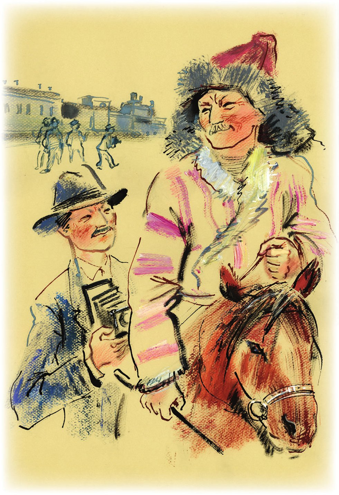
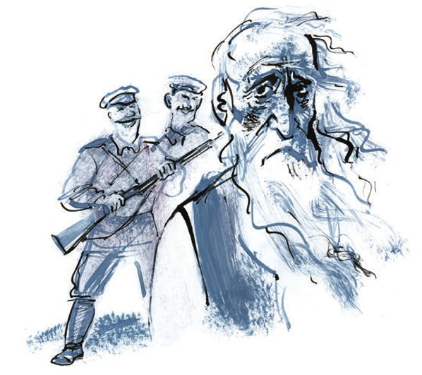

## Kapitel 27: «Gestatten Sie einem Söldling des Kapitals einzutreten»

In der Nacht träumte Ostap von Sossjas traurigem, <abbr title="verschwommen — затушёванный, расплывчатый">verschwommenem</abbr> Gesicht, und dann erschien Panikowski. Der <abbr title="der Verletzer, die Verletzer — нарушитель">Verletzer</abbr> der Konvention trug einen <abbr title="der Kutscherhut, die Kutscherhüte — извозчичья шляпа">Kutscherhut</abbr> mit einer Feder, rang die Hände und sagte: «Bender! Bender! Sie wissen nicht, was ein Huhn ist! Das ist ein herrlicher, fetter Vogel, das Huhn!» Ostap verstand nicht und ärgerte sich:

«Was für ein Huhn? Ihre <abbr title="die Spezialität, die Spezialitäten — специальность">Spezialität</abbr> ist doch die Gans!» Aber Panikowski beharrte auf seiner Meinung: «Huhn, Huhn, Huhn!»

Bender wachte auf. Tief über seinem Kopf sah er die Decke, die gewölbt war wie der Deckel von Großmutters Truhe. Direkt vor der Nase des großen Kombinators bewegte sich das <abbr title="das Gepäcknetz, die Gepäcknetze — багажная сетка">Gepäcknetz</abbr>. Im Abteil war es sehr hell. Durch das halb heruntergelassene Fenster drängte die heiße Luft der Orenburger Steppe herein.

— Mein Huhn! — tönte es von unten. — Wo ist denn mein Huhn geblieben? Außer uns ist doch niemand im Abteil! Nicht wahr? Erlauben Sie, und wessen Beine sind das?

Ostap bedeckte die Augen mit der Hand und erinnerte sich sofort mit <abbr title="das Missvergnügen — неудовольствие">Missvergnügen</abbr> daran, dass auch Panikowski das zu tun pflegte, wenn ihm Unheil drohte. Als er die Hand wegnahm, sah der große Kombinator Köpfe, die in Höhe seiner <abbr title="die Pritsche, die Pritschen — полка, нары">Pritsche</abbr> aufgetaucht waren.

— Sie schlafen? Soso, — sagte der erste Kopf.

— Sagen Sie, mein Lieber, — sprach der zweite <abbr title="wohlwollend — доброжелательно">wohlwollend</abbr>, — haben Sie mein Huhn gegessen? Nicht wahr? Stimmt doch?

Der Fotoreporter Menschow saß unten und hatte beide Arme bis zu den Ellbogen in einen schwarzen <abbr title="der Fotosack, die Fotosäcke — фотографический мешок (для перезарядки)">Fotosack</abbr> gesteckt. Er lud Kassetten nach.

— Ja, — sagte Ostap <abbr title="zurückhaltend — сдержанно">zurückhaltend</abbr>, — ich habe es gegessen.

— Na, vielen Dank! — rief Gargantua unerwartet aus. — Ich wusste schon gar nicht mehr, was ich damit machen sollte. Bei der Hitze hätte das Huhn doch verderben können. Stimmt doch? Wegwerfen wäre schade! Nicht wahr?

— Selbstverständlich, — sagte Ostap vorsichtig, — ich bin sehr froh, dass ich Ihnen diesen kleinen Dienst <abbr title="erweisen (erwies, hat erwiesen) — оказывать (услугу)">erweisen</abbr> konnte.

— Von welcher Zeitung sind Sie? — fragte der Fotoreporter und wühlte mit einem schmachtenden Lächeln weiter in seinem Sack. — Sind Sie nicht in Moskau eingestiegen?

— Sie sind, wie ich sehe, Fotograf, — sagte Ostap und wich einer direkten Antwort aus. — Ich kannte einmal einen Provinzfotografen, der sogar Konservendosen nur bei rotem Licht öffnete, weil er fürchtete, sie würden sonst verderben.

Menschow lachte. Der Witz des neuen Passagiers war nach seinem Geschmack. Und an diesem Morgen stellte niemand dem großen Kombinator mehr heikle Fragen. Er sprang von der Liege, strich sich über die Wangen, auf denen in drei Tagen <abbr title="räuberisch — разбойничий">räuberische</abbr> <abbr title="die Bartstoppel, die Bartstoppeln — щетина">Bartstoppeln</abbr> gewachsen waren, und blickte den guten Gargantua fragend an. Der Versfeuilletonist packte seinen Koffer aus, nahm ein <abbr title="das Rasierzeug — бритвенный прибор">Rasierzeug</abbr> heraus, reichte es Ostap und erklärte lange etwas, wobei er unsichtbares Futter aufpickte und alle Augenblicke eine Bestätigung seiner Worte verlangte.

Während Ostap sich rasierte, wusch und <abbr title="sich herausputzen — чиститься, прихорашиваться">herausputzte</abbr>, verbreitete Menschow, mit fotografischen Riemen <abbr title="umgürten — опоясать">umgürtet</abbr>, im ganzen Wagen die Nachricht, dass in ihrem Abteil ein neuer Provinzkorrespondent fahre, der den Zug in der Nacht mit dem <abbr title="der Aeroplan, die Aeroplane — аэроплан">Aeroplan</abbr> eingeholt und Gargantuas Huhn gegessen habe. Die Geschichte von dem Huhn rief große Heiterkeit hervor. Fast alle Korrespondenten hatten <abbr title="hausgemacht — домашний">hausgemachten</abbr> <abbr title="der Proviant — снедь, провизия">Proviant</abbr> mit auf die Reise genommen: Mürbekekse, Frikadellen, <abbr title="das Weißbrot, die Weißbrote — батон">Weißbrote</abbr> und hart gekochte Eier. Diesen Proviant aß niemand. Die Korrespondenten zogen es vor, in den Speisewagen zu gehen.

Und Bender hatte seine Toilette noch nicht beendet, als ein <abbr title="beleibt — тучный">beleibter</abbr> Schriftsteller in einem weichen Kinderjäckchen im Abteil erschien. Er legte vor Ostap zwölf Eier auf den Tisch und sagte:

— Essen Sie. Das sind Eier. Wenn Eier existieren, muss sie doch irgendjemand essen?

Dann schaute der Schriftsteller aus dem Fenster, betrachtete die <abbr title="warzig — бородавчатый">warzige</abbr> Steppe und sprach mit Bitterkeit:

— Die Wüste ist talentlos! Aber sie existiert. Und damit muss man <abbr title="rechnen mit + Dat. — считаться с">rechnen</abbr>.

Er war ein Philosoph. Nachdem er Ostaps Dank angehört hatte, schüttelte der Schriftsteller den Kopf und ging zu sich, um eine Erzählung zu Ende zu schreiben. Da er ein pünktlicher Mensch war, hatte er fest beschlossen, jeden Tag unbedingt eine Erzählung zu schreiben. Diesen Beschluss erfüllte er mit dem <abbr title="der Fleiß — прилежание">Fleiß</abbr> eines <abbr title="der Musterschüler, die Musterschüler — первый ученик, отличник">Musterschülers</abbr>. Offenbar <abbr title="beflügeln — вдохновлять, окрылять">beflügelte</abbr> ihn der Gedanke, dass, wenn es schon Papier gibt, doch irgendjemand darauf schreiben muss.

Dem Beispiel des Philosophen folgten andere Passagiere. Nawrozki brachte gefüllte Paprika im <abbr title="das Einmachglas, die Einmachgläser — банка (стеклянная)">Einmachglas</abbr>, Lawuasjan Frikadellen, an denen Zeitungszeilen <abbr title="kleben — липнуть, прилипать">klebten</abbr>, Sapegin Hering und Mürbekekse, und Dnestrow ein Glas <abbr title="das Apfelmus — яблочное повидло">Apfelmus</abbr>. Es kamen noch andere, doch Ostap stellte den Empfang ein.

— Ich kann nicht, ich kann nicht, meine Freunde, — sagte er. — Tu einem einen Gefallen, und schon fallen alle über dich her.

Die Korrespondenten gefielen ihm sehr. Ostap war bereit, gerührt zu sein, doch er hatte sich so <abbr title="sich vollessen (aß sich voll, hat sich vollgegessen) — наесться до отвала">vollgegessen</abbr>, dass er nicht in der Lage war, sich irgendwelchen Gefühlen <abbr title="sich hingeben + Dat. (gab hin, hat hingegeben) — предаваться">hinzugeben</abbr>. Mit Mühe kletterte er auf seine Liege und verschlief fast den ganzen Tag.

Es war der dritte Tag der Reise. In Erwartung von Ereignissen <abbr title="schmachten — томиться">schmachtete</abbr> der Sonderzug. Bis zur Magistrale war es noch weit, nichts <abbr title="sehenswert — достопримечательный">Sehenswertes</abbr> hatte sich ereignet, und dennoch <abbr title="schielen — коситься">schielten</abbr> die Moskauer Korrespondenten, <abbr title="ausdörren — иссушать">ausgedörrt</abbr> von dem erzwungenen <abbr title="der Müßiggang — безделье, праздность">Müßiggang</abbr>, misstrauisch aufeinander.

«Hat nicht irgendwer irgendwas erfahren und darüber ein Blitztelegramm an seine Redaktion geschickt?»

Schließlich konnte Lawuasjan nicht mehr <abbr title="an sich halten (hielt, hat gehalten) — сдерживаться">an sich halten</abbr> und schickte eine telegrafische Meldung ab: «durchfuhren orenburg stop aus lokomotivschornstein quillt rauch stop stimmung munter komma in delegationswagen gespräche nur über östliche magistrale stop blitzt anweisungen aralsee lawuasjan».

Das Geheimnis wurde bald gelüftet, und schon auf der nächsten Station bildete sich am Telegrafenschalter eine Schlange. Alle schickten kurze Meldungen über die muntere Stimmung und über den Lokomotivschornstein, aus welchem Rauch quoll.

Für die Ausländer <abbr title="sich auftun (tat auf, hat aufgetan) — открываться">tat sich</abbr> gleich hinter Orenburg ein weites <abbr title="das Betätigungsfeld, die Betätigungsfelder — поле деятельности">Betätigungsfeld</abbr> auf, als sie das erste Kamel, die erste <abbr title="die Jurte, die Jurten — юрта">Jurte</abbr> und den ersten Kasachen mit spitzer Pelzmütze und einer Peitsche in der Hand sahen. Auf einer kleinen <abbr title="die Haltestelle, die Haltestellen — полустанок">Haltestelle</abbr>, wo der Zug zufällig aufgehalten wurde, richteten sich mindestens zwanzig Fotoapparate auf ein Kamelmaul. Es begann die <abbr title="die Exotik — экзотика">Exotik</abbr>, die Schiffe der Wüste, die freiheitsliebenden Söhne der Steppe und das übrige romantische <abbr title="das Zugvieh — тягло, тягловый скот">Zugvieh</abbr>.

Die Amerikanerin aus alter Familie stieg mit einer runden, dunkel getönten Brille aus dem Wagen. Vor dem Sonnenlicht schützte sie außerdem ein grüner <abbr title="der Sonnenschirm, die Sonnenschirme — зонтик (от солнца)">Sonnenschirm</abbr>. In diesem Aufzug filmte sie lange ein grauhaariger Amerikaner mit einer Handkamera der Marke «Eyemo». Zuerst stand sie neben dem Kamel, dann davor und schließlich darauf, eingepasst zwischen die Hubbel, von denen der Schaffner so warm erzählt hatte. Der kleine, boshafte Heinrich huschte durch die Menge und sagte zu allen:

— Passen Sie auf sie auf, sonst bleibt sie zufällig auf der Station hängen, und es gibt wieder eine Sensation in der amerikanischen Presse: «Tapfere Korrespondentin in den Klauen eines rasend gewordenen Kamels».

Der japanische Diplomat stand zwei Schritte von einem Kasachen entfernt. Beide sahen einander schweigend an. Sie hatten vollkommen gleiche, leicht <abbr title="abgeplattet — сплющенный">abgeplattete</abbr> Gesichter, <abbr title="borstig — жёсткий, щетинистый">borstige</abbr> Schnurrbärte, gelbe, wie lackierte Haut und geschwollene, schmale Augen. Man hätte sie für Zwillinge halten können, wenn der Kasache nicht einen <abbr title="der Schafspelz, die Schafspelze — баранья шуба">Schafspelz</abbr> getragen hätte, gegürtet mit einer <abbr title="die Schärpe, die Schärpen — кушак">Schärpe</abbr> aus <abbr title="der Kattun — ситец">Kattun</abbr>, und der Japaner einen grauen Londoner Anzug, und wenn der Kasache nicht erst im vorigen Jahr zu lesen begonnen und der Japaner nicht vor zwanzig Jahren zwei Universitäten absolviert hätte – in Tokio und in Paris. Der Diplomat trat einen Schritt zurück, neigte den Kopf über seine <abbr title="die Spiegelreflexkamera, die Spiegelreflexkameras — зеркальный фотоаппарат">Spiegelreflexkamera</abbr> und ließ den Verschluss klicken. Der Kasache lachte, setzte sich auf sein <abbr title="struppig — шершавый, лохматый">struppiges</abbr> Pferdchen und ritt in die Steppe davon.

Doch schon auf der nächsten Station traten neue Elemente in die romantische Erzählung. Hinter dem Bahnhofsgebäude lagen rote <abbr title="zylindrisch — цилиндрический">zylindrische</abbr> Fässer – eiserne Behälter für Treibstoff –, ein neues Holzgebäude leuchtete gelb, und davor zog sich, mit den <abbr title="die Raupenkette, die Raupenketten — гусеничная цепь">Raupenketten</abbr> schwer in die Erde gedrückt, eine Reihe von <abbr title="der Traktor, die Traktoren — трактор">Traktoren</abbr> hin. Auf einem gitterartigen Stapel von Schwellen stand ein Mädchen, eine <abbr title="die Traktoristin, die Traktoristinnen — трактористка">Traktoristin</abbr>, in schwarzen Arbeitshosen und Filzstiefeln. Hier nahmen die sowjetischen Korrespondenten <abbr title="die Revanche — реванш">Revanche</abbr>. Die Fotoapparate auf Augenhöhe, begannen sie sich an das Mädchen heranzupirschen. Allen voran schlich Menschow.

Zwischen den Zähnen hielt er eine <abbr title="die Aluminiumkassette, die Aluminiumkassetten — алюминиевая кассета">Aluminiumkassette</abbr>, und mit seinen Bewegungen erinnerte er an einen <abbr title="der Schütze, die Schützen — стрелок">Schützen</abbr>, der in der <abbr title="die Schützenkette, die Schützenketten — стрелковая цепь">Schützenkette</abbr> einen Sprung nach vorn macht. Doch während das Kamel sich im vollen Bewusstsein seines Rechts auf <abbr title="die Berühmtheit — известность, слава">Berühmtheit</abbr> fotografieren ließ, erwies sich die Traktoristin als bescheidener. Etwa fünf Aufnahmen ertrug sie ruhig, dann wurde sie rot und ging weg. Die Fotografen stürzten sich auf die Traktoren. Am Horizont, hinter den Maschinen, war übrigens eine Kette von Kamelen zu sehen. Das alles – Traktoren und Kamele – passte <abbr title="vorzüglich — отлично">vorzüglich</abbr> in den Rahmen eines Bildes mit dem Titel «Altes und Neues» oder «Wer wen?».

Ostap erwachte vor Sonnenuntergang. Der Zug lief weiter durch die Wüste. Im Gang streifte Lawuasjan umher und <abbr title="anstacheln — подбивать, подстрекать">stachelte</abbr> die Kollegen an, eine eigene Zugzeitung herauszugeben. Er hatte sich sogar schon einen Namen ausgedacht: «Mit <abbr title="der Volldampf — на всех парах">Volldampf</abbr>».

— Na, was ist denn das für ein Name! — sagte Ostap. — Ich habe einmal die Wandzeitung einer Feuerwehr gesehen, die hieß «Vom Regen in die <abbr title="vom Regen in die Traufe kommen — из огня да в полымя">Traufe</abbr>». Das war <abbr title="sachdienlich — по существу, по делу">sachdienlich</abbr>.

— Sie sind ein Profi der Feder! — schrie Lawuasjan. — Geben Sie zu, dass Sie einfach zu faul sind, für das <abbr title="das Sprachrohr, die Sprachrohre — рупор">Sprachrohr</abbr> der Zugöffentlichkeit zu schreiben.

Der große Kombinator bestritt nicht, dass er ein Profi der Feder sei. Im Notfall hätte er ohne <abbr title="das Stocken — запинка">Stocken</abbr> erklären können, welches <abbr title="das Presseorgan, die Presseorgane — орган печати">Presseorgan</abbr> er in diesem Zug vertrat – die «Tschernomorsker Zeitung». Übrigens bestand dafür keine besondere Notwendigkeit, denn der Zug war ein Sonderzug, und ihn suchten keine <abbr title="grimmig — сердитый, свирепый">grimmigen</abbr> <abbr title="der Kontrolleur, die Kontrolleure — контролёр">Kontrolleure</abbr> mit vernickelten <abbr title="die Zange, die Zangen — щипцы, компостер">Zangen</abbr> heim. Lawuasjan aber saß bereits mit seiner Schreibmaschine im Wagen der Stoßarbeiter, wo sein Vorschlag ein Durcheinander auslöste. Schon schrieb der Alte aus der Trjochgorka mit einem Tintenstift eine Notiz über die Notwendigkeit, im Zug einen Abend des <abbr title="der Erfahrungsaustausch — обмен опытом">Erfahrungsaustauschs</abbr> und eine literarische Lesung zu veranstalten, schon suchte man einen <abbr title="der Karikaturist, die Karikaturisten — карикатурист">Karikaturisten</abbr> und <abbr title="mobilisieren — мобилизовать">mobilisierte</abbr> Nawrozki für eine <abbr title="die Umfrage, die Umfragen — анкета, опрос">Umfrage</abbr> darüber, welcher der von den Delegierten vertretenen Betriebe den <abbr title="der Produktions- und Finanzplan — промфинплан">Produktions- und Finanzplan</abbr> besser erfüllt habe.

Am Abend versammelte sich im Abteil von Gargantua, Menschow, Uchudschanski und Bender eine Menge Zeitungsvolk. Man saß eng, zu sechst auf einer Liege. Von oben hingen Köpfe und Beine herab. Die spürbar frische Nacht kühlte die Journalisten ab, die den ganzen Tag unter der Hitze gelitten hatten, und die langen Takte der Räder, die schon seit drei Tagen nicht verstummten, stimmten zur Freundschaft. Man sprach über die Östliche Magistrale, erinnerte sich an die eigenen Redakteure und Sekretäre, erzählte von komischen <abbr title="der Zeitungsschnitzer, die Zeitungsschnitzer — газетный ляпсус">Zeitungsschnitzern</abbr> und <abbr title="rügen — журить, порицать">rügte</abbr> gemeinsam Uchudschanski dafür, dass ihm jede journalistische <abbr title="die Ader, die Adern — жилка">Ader</abbr> fehle. Uchudschanski hob den Kopf hoch und antwortete überlegen:

— Sie <abbr title="quatschen — трепаться">quatschen</abbr>? Soso!

Mitten in der Fröhlichkeit erschien Herr Heinrich.

— Gestatten Sie einem <abbr title="der Söldling, die Söldlinge — наёмник">Söldling</abbr> des Kapitals einzutreten, — sagte er <abbr title="keck — бойко, дерзко">keck</abbr>.

Heinrich ließ sich auf den Knien des dicken Schriftstellers nieder, worauf der Schriftsteller ächzte und <abbr title="stoisch — стоически">stoisch</abbr> dachte: «Wenn ich schon Knie habe, muss doch irgendjemand darauf sitzen? Da sitzt er eben.»

— Na, wie geht der Aufbau des Sozialismus voran? — fragte der Vertreter der freisinnigen Zeitung frech.

Es hatte sich irgendwie so ergeben, dass man alle Ausländer im Zug zuvorkommend behandelte und ihren Namen «Mister», «Herr» oder «Signor» hinzufügte, den Korrespondenten der freisinnigen Zeitung dagegen einfach Heinrich nannte, ihn für einen Schwätzer hielt und nicht ernst nahm. Deshalb antwortete Palamidow auf die direkt gestellte Frage:

— Heinrich! Sie bemühen sich <abbr title="vergebens — напрасно">vergebens</abbr>! Gleich werden Sie wieder auf die Sowjetmacht schimpfen, das ist langweilig und uninteressant. Und außerdem können wir das auch von einer bösen alten Frau in der Warteschlange hören.

— Ganz und gar nicht, — sagte Heinrich, — ich will eine <abbr title="biblisch — библейский">biblische</abbr> Geschichte von Adam und Eva erzählen. Erlauben Sie?

— Hören Sie, Heinrich, warum sprechen Sie so gut Russisch? — fragte Sapegin.

— Gelernt habe ich es in Odessa, als ich im Jahre neunzehnhundertachtzehn mit der Armee des Generals von Belz diese herrliche Stadt besetzte. Ich <abbr title="bekleiden — занимать (должность), состоять в чине">bekleidete</abbr> damals den Rang eines Leutnants. Sie haben sicher von von Belz gehört?

— Nicht nur gehört, — sagte Palamidow, — sondern auch gesehen. Ihr von Belz lag in seinem goldenen Arbeitszimmer im Palast des <abbr title="der Befehlshaber, die Befehlshaber — командующий">Befehlshabers</abbr> des Odessaer <abbr title="der Militärbezirk, die Militärbezirke — военный округ">Militärbezirks</abbr> mit durchschossenem Kopf. Er hatte sich erschossen, als er erfuhr, dass in Ihrem Vaterland die Revolution ausgebrochen war.

Bei dem Wort «Revolution» lächelte Herr Heinrich dienstlich und sagte:

— Der General war seinem <abbr title="der Eid, die Eide — присяга, клятва">Eid</abbr> treu.

— Und warum haben Sie sich nicht erschossen, Heinrich? — fragte man von der oberen Pritsche. — Wie war das bei Ihnen mit dem Eid?

— Na, was ist, wollen Sie die biblische Geschichte hören? — sagte der Vertreter der freisinnigen Zeitung gereizt.

Man <abbr title="löchern — донимать, допекать">löcherte</abbr> ihn jedoch noch eine Weile mit Fragen über den Eid, und erst als er schon ganz <abbr title="gekränkt — обиженный">gekränkt</abbr> war und gehen wollte, war man bereit, die Geschichte zu hören.

*Die Erzählung des Herrn Heinrich von Adam und Eva*

— Es war einmal, meine Herren, in Moskau ein junger Mann, ein Komsomolze. Er hieß Adam. Und es war in derselben Stadt ein junges Mädchen, die Komsomolzin Eva. Und diese jungen Leute gingen eines Tages im Moskauer <abbr title="das Paradies — рай">Paradies</abbr> spazieren – im Park für Kultur und Erholung. Ich weiß nicht, worüber sie sich dort unterhielten. Bei uns unterhalten sich junge Leute gewöhnlich über die Liebe. Aber Ihre Adam und Eva waren <abbr title="der Marxist, die Marxisten — марксист">Marxisten</abbr> und sprachen möglicherweise über die Weltrevolution. Jedenfalls ergab es sich, dass sie, während sie durch den ehemaligen Neskutschny-Garten, den «Garten ohne Langeweile», spazierten, sich unter einem Baum ins Gras setzten. Ich weiß nicht, was für ein Baum das war. Vielleicht war es der Baum der <abbr title="die Erkenntnis, die Erkenntnisse — познание">Erkenntnis</abbr> von Gut und Böse. Aber die Marxisten mögen, wie Sie wissen, keine Mystik. Ihnen schien es aller Wahrscheinlichkeit nach eine einfache <abbr title="die Eberesche, die Ebereschen — рябина">Eberesche</abbr> zu sein. Während sie sich weiter unterhielten, riss Eva einen Zweig vom Baum ab und schenkte ihn Adam. Doch da erschien ein Mann, den die <abbr title="fantasielos — лишённый воображения">fantasielosen</abbr> jungen Marxisten für einen <abbr title="der Parkwächter, die Parkwächter — садовый сторож">Parkwächter</abbr> hielten. In Wirklichkeit aber war es aller Wahrscheinlichkeit nach ein Engel mit einem <abbr title="flammend — огненный, пылающий">flammenden</abbr> Schwert. Schimpfend und <abbr title="murren — ворчать">murrend</abbr> führte der Engel Adam und Eva ins Büro, um ein Protokoll über die der Gartenwirtschaft zugefügten <abbr title="die Beschädigung, die Beschädigungen — повреждение">Beschädigungen</abbr> aufzunehmen. Dieser <abbr title="belanglos — ничтожный, незначительный">belanglose</abbr> <abbr title="der Alltagsvorfall, die Alltagsvorfälle — бытовое происшествие">Alltagsvorfall</abbr> lenkte die jungen Leute von der hohen Politik ab, und Adam sah, dass vor ihm die zarte Eva stand, und Eva bemerkte, dass vor ihr der männliche Adam stand. Und die jungen Leute verliebten sich ineinander. Drei Jahre später hatten sie schon zwei Söhne.

An dieser Stelle verstummte Herr Heinrich unerwartet und stopfte sich die weichen, gestreiften Manschetten in die Ärmel.

— Na, und weiter? — fragte Lawuasjan.

— Weiter, — sagte Heinrich stolz, — heißt der eine Sohn Kain und der andere Abel, und nach einer gewissen <abbr title="die Frist, die Fristen — срок">Frist</abbr> wird Kain den Abel erschlagen, Abraham wird Isaak <abbr title="zeugen — родить, зачать (о мужчине)">zeugen</abbr>, Isaak wird Jakob zeugen, und überhaupt wird die ganze biblische Geschichte von vorne beginnen, und kein <abbr title="der Marxismus — марксизм">Marxismus</abbr> wird das verhindern können. Alles wiederholt sich. Es wird auch die <abbr title="die Sintflut — потоп">Sintflut</abbr> geben, und Noah mit seinen drei Söhnen, und Ham wird Noah kränken, und es wird auch den Turm zu Babel geben, der niemals fertig gebaut wird, meine Herren. Und so weiter. Nichts Neues wird auf der Welt geschehen. Sie haben sich also umsonst über das neue Leben ereifert.

Und Heinrich lehnte sich zufrieden zurück und drückte mit seinem schmalen <abbr title="der Heringsrücken — селёдочная спина">Heringsrücken</abbr> den dicken, gutmütigen Schriftsteller platt.

— Das alles wäre wunderbar, — sagte Palamidow, — wenn es durch Beweise <abbr title="untermauern — подкреплять, обосновывать">untermauert</abbr> wäre. Aber beweisen können Sie nichts. Sie wünschen sich einfach, dass es so sei. Es besteht keine Notwendigkeit, Ihnen den Glauben an Wunder zu verbieten. Glauben Sie, beten Sie.

— Und haben Sie Beweise, dass es anders kommen wird? — rief der Vertreter der freisinnigen Zeitung.

— Ja, — antwortete Palamidow, — einen davon werden Sie übermorgen sehen, an der Schienenverbindung der Östlichen Magistrale.

— Na, jetzt geht's los! — brummte Heinrich. — Der Aufbau! Die Fabriken! Der Fünfjahrplan! Was <abbr title="vor die Nase halten — тыкать в глаза">halten</abbr> Sie mir Ihr Eisen vor die Nase? Der Geist ist wichtig! Alles wird sich wiederholen! Es wird den Dreißigjährigen Krieg geben und den Hundertjährigen Krieg, und wieder wird man Menschen verbrennen, die es wagen zu sagen, dass die Erde rund ist. Und wieder wird man den armen Jakob betrügen, ihn sieben Jahre <abbr title="unentgeltlich — бесплатно">unentgeltlich</abbr> arbeiten lassen und ihm statt der <abbr title="vollbusig — полногрудый">vollbusigen</abbr> Rahel die hässliche, <abbr title="kurzsichtig — близорукий">kurzsichtige</abbr> Lea als Frau <abbr title="unterschieben (schob unter, hat untergeschoben) — подсунуть">unterschieben</abbr>. Alles, alles wird sich wiederholen. Und der Ewige Jude wird nach wie vor über die Erde wandern …

— Der Ewige Jude wird nie mehr über die Erde wandern! — sagte plötzlich der große Kombinator und ließ einen fröhlichen Blick über die Versammelten schweifen.

— Und auch dafür können Sie innerhalb von zwei Tagen Beweise <abbr title="vorlegen — представить, предъявить">vorlegen</abbr>? — <abbr title="zetern — вопить, голосить">zeterte</abbr> Heinrich.

— Auch sofort, — antwortete Ostap liebenswürdig. — Wenn die Gesellschaft es erlaubt, erzähle ich, was mit dem sogenannten Ewigen Juden geschehen ist.

Die Gesellschaft erlaubte es gern. Alle machten sich bereit, der Erzählung des neuen Passagiers zuzuhören, und Uchudschanski sagte sogar: «Sie erzählen? Soso.» Und der große Kombinator begann.

*Die Erzählung des Ostap Bender vom Ewigen Juden*

— Ich will Sie nicht an die lange und langweilige Geschichte des Ewigen Juden erinnern. Ich sage nur, dass dieser <abbr title="abgeschmackt — пошлый">abgeschmackte</abbr> Alte rund zweitausend Jahre lang durch die ganze Welt zog, ohne sich in Hotels <abbr title="sich anmelden — прописываться, регистрироваться">anzumelden</abbr>, und den Bürgern mit seinen Klagen über die hohen <abbr title="der Eisenbahntarif, die Eisenbahntarife — железнодорожный тариф">Eisenbahntarife</abbr> auf die Nerven ging, derentwegen er zu Fuß gehen musste. Man hat ihn <abbr title="unzählig — бесчисленный">unzählige</abbr> Male gesehen. Er war bei der historischen Sitzung zugegen, auf der es Kolumbus nicht gelang, über die Vorschüsse <abbr title="Rechenschaft ablegen über + Akk. — отчитываться в">Rechenschaft abzulegen</abbr>, die er für die Entdeckung Amerikas erhalten hatte. Noch als ganz junger Mann sah er den Brand Roms. Etwa hundertfünfzig Jahre lebte er in Indien und setzte die <abbr title="der Jogi, die Jogis — йог">Jogis</abbr> mit seiner <abbr title="die Zählebigkeit — живучесть">Zählebigkeit</abbr> und seinem zänkischen Charakter in außerordentliches Erstaunen. Mit einem Wort, der Alte hätte viel Interessantes erzählen können, hätte er am Ende jedes Jahrhunderts seine <abbr title="die Memoiren (Pl.) — мемуары">Memoiren</abbr> geschrieben. Aber der Ewige Jude war <abbr title="der Analphabet, die Analphabeten — неграмотный">Analphabet</abbr> und hatte zudem ein löchriges Gedächtnis.

Vor nicht allzu langer Zeit wohnte der Alte in der schönen Stadt Rio de Janeiro, trank <abbr title="das Erfrischungsgetränk, die Erfrischungsgetränke — прохладительный напиток">Erfrischungsgetränke</abbr>, betrachtete die Ozeandampfer und spazierte in weißen Hosen unter Palmen. Diese Hosen hatte er vor achthundert Jahren in Palästina günstig einem Ritter abgekauft, der das Heilige Grab <abbr title="zurückerobern — отвоевать">zurückerobert</abbr> hatte, und sie waren noch so gut wie neu. Und plötzlich wurde der Alte unruhig. Es zog ihn nach Russland, an den <abbr title="der Dnjepr — Днепр">Dnjepr</abbr>. Er war überall gewesen: am Rhein und am Ganges, am Mississippi und am Jangtse, am Niger und an der Wolga. Nur am Dnjepr war er nicht gewesen. Er wollte, sehen Sie, auch auf diesen breiten Strom einen Blick werfen.

<abbr title="ausgerechnet — аккурат, как раз">Ausgerechnet</abbr> im Jahre 1919 überquerte der Ewige Jude in seinen Ritterhosen <abbr title="illegal — нелегально">illegal</abbr> die rumänische Grenze. Muss ich erwähnen, dass er auf dem Bauch acht Paar <abbr title="der Seidenstrumpf, die Seidenstrümpfe — шёлковый чулок">Seidenstrümpfe</abbr> und ein Fläschchen Pariser <abbr title="das Parfüm, die Parfüms — духи">Parfüm</abbr> trug, die ihn eine Dame aus Kischinjow ihren Kiewer Verwandten zu überbringen gebeten hatte? In jener stürmischen Zeit nannte man das Tragen von <abbr title="die Schmuggelware — контрабанда">Schmuggelware</abbr> auf dem Bauch «als <abbr title="der Wickel, die Wickel — компресс, припарка">Wickel</abbr> tragen». In diese Kunst hatte man den Alten in Kischinjow rasch eingewiesen. Als der Ewige Jude nach Erledigung des Auftrags am Ufer des Dnjepr stand und seinen <abbr title="ungepflegt — неопрятный">ungepflegten</abbr> grünen Bart hängen ließ, trat ein Mann mit gelb-blauen <abbr title="der Hosenstreifen, die Hosenstreifen — лампас">Hosenstreifen</abbr> und Petljura-<abbr title="das Schulterstück, die Schulterstücke — погон">Schulterstücken</abbr> zu ihm und fragte streng:

— Jud?

— Jud, — antwortete der Alte.

— Na, dann komm mit, — lud ihn der Mann mit den Hosenstreifen ein.

Und er führte ihn zum Kurin-Ataman, dem Anführer seiner Kosakenschar.

— Einen Juden haben wir gefangen, — meldete er und stieß den Alten mit dem Knie vorwärts.

— Ein Jud? — fragte der Ataman fröhlich verwundert.

— Ein Jud, — antwortete der <abbr title="der Wanderer, die Wanderer — скиталец, странник">Wanderer</abbr>.

— Na, dann stellt ihn mal an die Wand, — sagte der Kurin-Ataman freundlich.

— Aber ich bin doch der Ewige! — schrie der Alte.

Zweitausend Jahre hatte er ungeduldig auf den Tod gewartet, und jetzt wollte er plötzlich sehr gern leben.

— Halt's Maul, du Judenfratze! — schrie der <abbr title="wulstlippig — губастый">wulstlippige</abbr> Ataman freudig. — Hau ihn <abbr title="niederhauen (hieb nieder, hat niedergehauen) — зарубить">nieder</abbr>, ihr wackeren Burschen!

Und den Ewigen Wanderer gab es nicht mehr.

— Das ist alles, — schloss Ostap.

— Ich denke, Herr Heinrich, Ihnen als ehemaligem Leutnant der österreichischen Armee sind die <abbr title="die Gepflogenheit, die Gepflogenheiten — повадка, обычай">Gepflogenheiten</abbr> Ihrer Freunde, der Petljura-Leute, bekannt? — sagte Palamidow.

Heinrich antwortete nichts und ging sofort. Zuerst dachten alle, er sei beleidigt, doch schon am nächsten Tag stellte sich heraus, dass der Korrespondent der freisinnigen Zeitung vom sowjetischen Wagen geradewegs zu Mister Hiram Burman gegangen war und ihm die Geschichte vom Ewigen Juden für vierzig Dollar verkauft hatte. Und Hiram <abbr title="übermitteln — передавать">übermittelte</abbr> Ostap Benders Erzählung schon auf der nächsten Station per Telegraf an seine Zeitung.

---

### Neue Wörter

- **verschwommen** — затушёванный, расплывчатый
- **der Verletzer, die Verletzer** — нарушитель
- **der Kutscherhut, die Kutscherhüte** — извозчичья шляпа
- **die Spezialität, die Spezialitäten** — специальность
- **das Gepäcknetz, die Gepäcknetze** — багажная сетка
- **das Missvergnügen** — неудовольствие
- **die Pritsche, die Pritschen** — полка, нары
- **wohlwollend** — доброжелательно
- **der Fotosack, die Fotosäcke** — фотографический мешок (для перезарядки)
- **zurückhaltend** — сдержанно
- **erweisen (erwies, hat erwiesen)** — оказывать (услугу)
- **räuberisch** — разбойничий
- **die Bartstoppel, die Bartstoppeln** — щетина
- **das Rasierzeug** — бритвенный прибор
- **sich herausputzen** — чиститься, прихорашиваться
- **umgürten** — опоясать
- **der Aeroplan, die Aeroplane** — аэроплан
- **hausgemacht** — домашний
- **der Proviant** — снедь, провизия
- **das Weißbrot, die Weißbrote** — батон
- **beleibt** — тучный
- **warzig** — бородавчатый
- **rechnen mit + Dat.** — считаться с
- **der Fleiß** — прилежание
- **der Musterschüler, die Musterschüler** — первый ученик, отличник
- **beflügeln** — вдохновлять, окрылять
- **das Einmachglas, die Einmachgläser** — банка (стеклянная)
- **kleben** — липнуть, прилипать
- **das Apfelmus** — яблочное повидло
- **sich vollessen (aß sich voll, hat sich vollgegessen)** — наесться до отвала
- **sich hingeben + Dat. (gab hin, hat hingegeben)** — предаваться
- **schmachten** — томиться
- **sehenswert** — достопримечательный
- **schielen** — коситься
- **ausdörren** — иссушать
- **der Müßiggang** — безделье, праздность
- **an sich halten (hielt, hat gehalten)** — сдерживаться
- **sich auftun (tat auf, hat aufgetan)** — открываться
- **das Betätigungsfeld, die Betätigungsfelder** — поле деятельности
- **die Jurte, die Jurten** — юрта
- **die Haltestelle, die Haltestellen** — полустанок
- **die Exotik** — экзотика
- **das Zugvieh** — тягло, тягловый скот
- **der Sonnenschirm, die Sonnenschirme** — зонтик (от солнца)
- **abgeplattet** — сплющенный
- **borstig** — жёсткий, щетинистый
- **der Schafspelz, die Schafspelze** — баранья шуба
- **die Schärpe, die Schärpen** — кушак
- **der Kattun** — ситец
- **die Spiegelreflexkamera, die Spiegelreflexkameras** — зеркальный фотоаппарат
- **struppig** — шершавый, лохматый
- **zylindrisch** — цилиндрический
- **die Raupenkette, die Raupenketten** — гусеничная цепь
- **der Traktor, die Traktoren** — трактор
- **die Traktoristin, die Traktoristinnen** — трактористка
- **die Revanche** — реванш
- **die Aluminiumkassette, die Aluminiumkassetten** — алюминиевая кассета
- **der Schütze, die Schützen** — стрелок
- **die Schützenkette, die Schützenketten** — стрелковая цепь
- **die Berühmtheit** — известность, слава
- **vorzüglich** — отлично
- **anstacheln** — подбивать, подстрекать
- **der Volldampf** — на всех парах
- **vom Regen in die Traufe kommen** — из огня да в полымя
- **sachdienlich** — по существу, по делу
- **das Sprachrohr, die Sprachrohre** — рупор
- **das Stocken** — запинка
- **das Presseorgan, die Presseorgane** — орган печати
- **grimmig** — сердитый, свирепый
- **der Kontrolleur, die Kontrolleure** — контролёр
- **die Zange, die Zangen** — щипцы, компостер
- **der Erfahrungsaustausch** — обмен опытом
- **der Karikaturist, die Karikaturisten** — карикатурист
- **mobilisieren** — мобилизовать
- **die Umfrage, die Umfragen** — анкета, опрос
- **der Produktions- und Finanzplan** — промфинплан
- **der Zeitungsschnitzer, die Zeitungsschnitzer** — газетный ляпсус
- **rügen** — журить, порицать
- **die Ader, die Adern** — жилка
- **quatschen** — трепаться
- **der Söldling, die Söldlinge** — наёмник
- **keck** — бойко, дерзко
- **stoisch** — стоически
- **vergebens** — напрасно
- **biblisch** — библейский
- **bekleiden** — занимать (должность), состоять в чине
- **der Befehlshaber, die Befehlshaber** — командующий
- **der Militärbezirk, die Militärbezirke** — военный округ
- **der Eid, die Eide** — присяга, клятва
- **löchern** — донимать, допекать
- **gekränkt** — обиженный
- **das Paradies** — рай
- **der Marxist, die Marxisten** — марксист
- **die Erkenntnis, die Erkenntnisse** — познание
- **die Eberesche, die Ebereschen** — рябина
- **fantasielos** — лишённый воображения
- **der Parkwächter, die Parkwächter** — садовый сторож
- **flammend** — огненный, пылающий
- **murren** — ворчать
- **die Beschädigung, die Beschädigungen** — повреждение
- **belanglos** — ничтожный, незначительный
- **der Alltagsvorfall, die Alltagsvorfälle** — бытовое происшествие
- **die Frist, die Fristen** — срок
- **zeugen** — родить, зачать (о мужчине)
- **der Marxismus** — марксизм
- **die Sintflut** — потоп
- **der Heringsrücken** — селёдочная спина
- **untermauern** — подкреплять, обосновывать
- **vor die Nase halten** — тыкать в глаза
- **unentgeltlich** — бесплатно
- **vollbusig** — полногрудый
- **kurzsichtig** — близорукий
- **unterschieben (schob unter, hat untergeschoben)** — подсунуть
- **vorlegen** — представить, предъявить
- **zetern** — вопить, голосить
- **abgeschmackt** — пошлый
- **sich anmelden** — прописываться, регистрироваться
- **der Eisenbahntarif, die Eisenbahntarife** — железнодорожный тариф
- **unzählig** — бесчисленный
- **Rechenschaft ablegen über + Akk.** — отчитываться в
- **der Jogi, die Jogis** — йог
- **die Zählebigkeit** — живучесть
- **die Memoiren (Pl.)** — мемуары
- **der Analphabet, die Analphabeten** — неграмотный
- **das Erfrischungsgetränk, die Erfrischungsgetränke** — прохладительный напиток
- **zurückerobern** — отвоевать
- **der Dnjepr** — Днепр
- **ausgerechnet** — аккурат, как раз
- **illegal** — нелегально
- **der Seidenstrumpf, die Seidenstrümpfe** — шёлковый чулок
- **das Parfüm, die Parfüms** — духи
- **die Schmuggelware** — контрабанда
- **der Wickel, die Wickel** — компресс, припарка
- **ungepflegt** — неопрятный
- **der Hosenstreifen, die Hosenstreifen** — лампас
- **das Schulterstück, die Schulterstücke** — погон
- **der Wanderer, die Wanderer** — скиталец, странник
- **wulstlippig** — губастый
- **niederhauen (hieb nieder, hat niedergehauen)** — зарубить
- **die Gepflogenheit, die Gepflogenheiten** — повадка, обычай
- **übermitteln** — передавать

[← Zurück](kapitel-27.md) · [Inhalt](README.md) · [Weiter →](kapitel-29.md)
