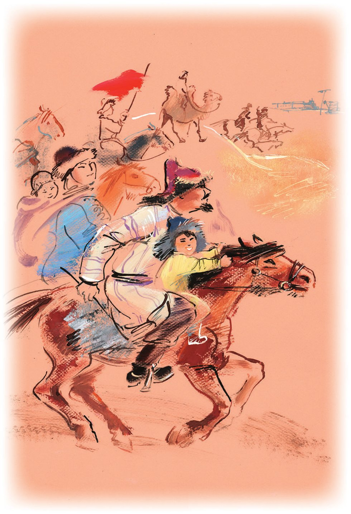
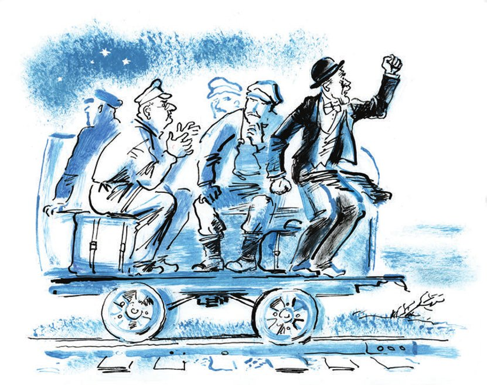

## Kapitel 29: Gremjaschtschi Kljutsch

Die Sonne ging über der hügeligen Wüste um 5 Uhr 02 Minuten 46 Sekunden auf. Ostap erhob sich eine Minute später. Der Fotoreporter Menschow behängte sich bereits mit Taschen und Riemen. Die Schirmmütze hatte er verkehrt herum aufgesetzt, damit der Schirm ihn nicht beim Blick in den <abbr title="der Sucher, die Sucher — видоискатель">Sucher</abbr> störte. Dem Fotografen stand ein großer Tag bevor. Auch Ostap hoffte auf einen großen Tag und sprang, ohne sich auch nur gewaschen zu haben, aus dem Wagen. Die gelbe Mappe hatte er mitgenommen.

Die eingetroffenen Züge mit Gästen aus Moskau, Sibirien und Mittelasien bildeten Straßen und Gassen. Von allen Seiten rückten die <abbr title="die Zuggarnitur, die Zuggarnituren — состав (поезда)">Zuggarnituren</abbr> an die Tribüne heran, die Lokomotiven zischten, und der weiße Dampf blieb an einer langen Leinwand-Losung hängen: «Die Magistrale ist das erste Kind des Fünfjahrplans».

Noch schliefen alle, und ein kühler Wind klapperte mit den Fahnen auf der leeren Tribüne, als Ostap sah, dass sich der klare Horizont des stark <abbr title="zerklüftet — сильно пересечённый">zerklüfteten</abbr> Geländes plötzlich mit Staubwolken <abbr title="sich verfinstern — омрачаться">verfinsterte</abbr>. Von allen Seiten tauchten hinter den Hügeln spitze Mützen auf. Tausende Reiter, die in hölzernen Sätteln saßen und ihre zottigen Pferdchen antrieben, eilten zu dem hölzernen <abbr title="der Pfeil, die Pfeile — стрела">Pfeil</abbr>, der genau an dem Punkt stand, der vor zwei Jahren als Ort der künftigen Schienenverbindung festgelegt worden war.

Die Nomaden kamen mit ganzen <abbr title="der Aul, die Aule — аул">Aulen</abbr>. Die Familienväter ritten, ebenfalls zu Pferde, nach Männerart, ritten die Ehefrauen, die Kinder bewegten sich zu dritt auf eigenen Pferdchen vorwärts, und sogar die bösen Schwiegermütter schickten ihre treuen Rosse voran, indem sie ihnen die Absätze in den Bauch stießen. Reitergruppen wirbelten im Staub, jagten mit roten Fahnen über das Feld, reckten sich in den <abbr title="der Steigbügel, die Steigbügel — стремя">Steigbügeln</abbr> und betrachteten, seitwärts gewandt, neugierig die Wunder. Wunder gab es viele: Züge, Schienen, die schmucken Gestalten der Kameraleute, ein gitterartiger <abbr title="der Speisesaal, die Speisesäle — столовая">Speisesaal</abbr>, der unerwartet auf kahlem Boden <abbr title="emporwachsen (wuchs empor, ist emporgewachsen) — вырасти">emporgewachsen</abbr> war, und <abbr title="der Lautsprecher, die Lautsprecher — радиорепродуктор, громкоговоритель">Lautsprecher</abbr>, aus denen eine frische Stimme tönte: «Eins, zwei, drei, vier, fünf, sechs» – man prüfte die Bereitschaft der Funkanlage. Zwei Gleisbausiedlungen, zwei Bauunternehmen auf Rädern, mit Materiallagern, Kantinen, Kanzleien, Badehäusern und Unterkünften für die Arbeiter, standen einander vor der Tribüne gegenüber, nur durch zwanzig Meter Schwellen getrennt, die noch nicht mit Schienen <abbr title="vernähen — прошить, сшить">vernäht</abbr> waren. An dieser Stelle würde die letzte Schiene gelegt und der letzte <abbr title="der Schienennagel, die Schienennägel — костыль (железнодорожный)">Schienennagel</abbr> eingeschlagen werden. An der Spitze der Südlichen Siedlung hing ein Plakat: «Her mit dem Norden!», an der Spitze der Nördlichen: «Her mit dem Süden!».

Die Arbeiter beider Siedlungen <abbr title="sich vermischen — смешиваться">vermischten sich</abbr> zu einem Haufen. Sie sahen sich zum ersten Mal, obwohl sie seit Beginn des Baus voneinander wussten und aneinander dachten, als sie noch anderthalbtausend Kilometer Wüste, Felsen, Seen und Flüsse trennten. Der Wettbewerb bei der Arbeit hatte das Wiedersehen um ein Jahr beschleunigt. Im letzten Monat hatte man die Schienen im <abbr title="der Laufschritt — бегом">Laufschritt</abbr> verlegt. Sowohl der Norden als auch der Süden wollten einander zuvorkommen und als Erste in Gremjaschtschi Kljutsch einfahren. Der Norden hatte gesiegt. Jetzt unterhielten sich die Leiter der beiden Siedlungen, der eine in einem <abbr title="graphitgrau — графитный">graphitgrauen</abbr> Tolstoi-Kittel, der andere in einem weißen Russenhemd, friedlich am Pfeil, wobei auf dem Gesicht des Nordleiters gegen seinen Willen von Zeit zu Zeit ein <abbr title="das Schlangenlächeln — змеиная улыбка">Schlangenlächeln</abbr> erschien. Er beeilte sich, es zu verscheuchen, und lobte den Süden, doch das Lächeln hob seinen von der Sonne <abbr title="ausbleichen — выцветать">ausgebleichten</abbr> Schnurrbart erneut.

Ostap lief zu den Wagen der Nördlichen Siedlung, doch die Siedlung war leer. Alle ihre Bewohner waren zur Tribüne gegangen, vor der schon die Musiker saßen. Sie verbrannten sich die Lippen an den heißen metallenen Mundstücken und spielten eine <abbr title="die Ouvertüre, die Ouvertüren — увертюра">Ouvertüre</abbr>.

Die sowjetischen Journalisten besetzten den linken Flügel der Tribüne. Lawuasjan hing sich hinunter und flehte Menschow an, ihn bei der Ausübung seiner Dienstpflichten zu fotografieren. Doch Menschow hatte dafür keine Zeit. Er fotografierte die Stoßarbeiter der Magistrale in Gruppen und einzeln, ließ die <abbr title="der Nagelschläger, die Nagelschläger — костыльщик">Nagelschläger</abbr> die Hämmer schwingen und die <abbr title="der Erdarbeiter, die Erdarbeiter — грабарь, землекоп">Erdarbeiter</abbr> sich auf die Schaufeln stützen. Auf dem rechten Flügel saßen die Ausländer. An den Aufgängen zur Tribüne kontrollierten <abbr title="der Rotarmist, die Rotarmisten — красноармеец">Rotarmisten</abbr> die <abbr title="die Einladungskarte, die Einladungskarten — пригласительный билет">Einladungskarten</abbr>. Ostap hatte keine Karte. Der Kommandant des Zuges gab sie nach einer Liste aus, auf der der Vertreter der «Tschernomorsker Zeitung» O. Bender nicht <abbr title="verzeichnen — значиться, вносить в список">verzeichnet</abbr> war. Vergebens winkte Gargantua den großen Kombinator nach oben und rief: «Nicht wahr? Stimmt doch?» – Ostap schüttelte <abbr title="verneinend — отрицательно">verneinend</abbr> den Kopf und ließ die Augen über die Tribüne wandern, auf der sich Helden und Gäste dicht <abbr title="sich zusammendrängen — тесниться">zusammendrängten</abbr>.

In der ersten Reihe saß ruhig der Zeitnehmer der Nördlichen Gleisbausiedlung, Alexander Koreiko. Zum Schutz vor der Sonne war sein Kopf mit einem Dreispitz aus Zeitungspapier bedeckt. Er hatte ein Ohr leicht vorgeschoben, um den ersten Redner besser zu hören, der sich schon zum <abbr title="das Mikrofon, die Mikrofone — микрофон">Mikrofon</abbr> durchdrängte.

— Alexander Iwanowitsch! — rief Ostap und legte die Hände wie ein Rohr vor den Mund.

Koreiko blickte nach unten und stand auf. Die Musiker stimmten die «Internationale» an, doch der reiche Zeitnehmer hörte der Hymne unaufmerksam zu. Die lächerliche Gestalt des großen Kombinators, der auf dem für die letzten Schienen freigeräumten Platz hin und her lief, raubte ihm sofort die <abbr title="die Seelenruhe — душевное спокойствие">Seelenruhe</abbr>. Er blickte über die Köpfe der Menge hinweg und überlegte, wohin er fliehen könnte. Doch ringsum war Wüste.

Fünfzehntausend Reiter zogen unablässig hin und her, <abbr title="durchwaten — переходить вброд">durchwateten</abbr> Dutzende Male den kalten Fluss und stellten sich erst zu Beginn der Kundgebung in Reiterformation hinter der Tribüne auf. Manche aber, schüchtern und stolz, schwebten den ganzen Tag über auf den Gipfeln der Hügel und wagten es nicht, näher an die <abbr title="brausen — гудеть, шуметь">brausende</abbr> und brüllende Kundgebung heranzureiten.

Die Erbauer der Magistrale feierten ihren Sieg laut, fröhlich, mit Geschrei, Musik und dem <abbr title="das Hochwerfen — подбрасывание">Hochwerfen</abbr> ihrer Lieblinge und Helden in die Luft. Mit Geklirr flogen die Schienen auf das <abbr title="das Gleisbett, die Gleisbetten — полотно (железнодорожное)">Gleisbett</abbr>. In einer Minute waren sie verlegt, und die <abbr title="der Gleisleger, die Gleisleger — рабочий-укладчик">Gleisleger</abbr>, die Millionen von Schienennägeln eingeschlagen hatten, überließen das Recht auf die letzten Schläge ihren Vorgesetzten.

— Gemäß der Gesetze der Gastfreundschaft, — sagte der Büfettier, der mit den Köchen auf dem Dach des Speisewagens saß.

Ein Ingenieur, Träger des <abbr title="der Rotbannerorden — орден Красного Знамени">Rotbannerordens</abbr>, schob seinen großen Filzhut in den Nacken, packte einen Hammer mit langem Stiel, machte ein weinerliches Gesicht und schlug direkt auf die Erde. Das freundliche Lachen der Nagelschläger, unter denen es <abbr title="der Kraftprotz, die Kraftprotze — силач">Kraftprotze</abbr> gab, die einen Schienennagel mit einem einzigen Schlag einschlugen, begleitete diese Operation. Bald jedoch begannen sich die weichen Schläge auf die Erde mit einem Klirren abzuwechseln, das bezeugte, dass der Hammer zuweilen mit dem Schienennagel in <abbr title="die Berührung, die Berührungen — соприкосновение">Berührung</abbr> kam. Die Hämmer schwangen der Sekretär des <abbr title="das Regionalkomitee, die Regionalkomitees — крайком">Regionalkomitees</abbr>, Mitglieder der Regierung, die Leiter des Nordens und des Südens und die Gäste. Den allerletzten Schienennagel schlug der Leiter des Baus in knapp einer halben Stunde in die Schwelle.

Die Reden begannen. Sie wurden jeweils zweimal gehalten – auf Kasachisch und auf Russisch.

— Genossen, — sagte ein Nagelschläger und Stoßarbeiter langsam und bemühte sich, nicht auf den Rotbannerorden zu schauen, den man ihm eben ans Hemd geheftet hatte, — was getan ist, ist getan, und da braucht man nicht viel zu reden. Aber von unserem ganzen Verlegekollektiv eine Bitte an die Regierung – uns sofort auf eine neue Baustelle zu schicken. Wir haben uns gut <abbr title="sich aufeinander einspielen — сработаться">aufeinander eingespielt</abbr> und in den letzten Monaten jeden Tag fünf Kilometer Schienen verlegt. Wir <abbr title="sich verpflichten — обязываться">verpflichten uns</abbr>, diese Norm zu halten und zu steigern. Und es lebe unsere Weltrevolution! Ich wollte noch sagen, Genossen, dass die Schwellen mit viel <abbr title="der Ausschuss — брак (производственный)">Ausschuss</abbr> geliefert wurden, man musste sie wegwerfen. Diese Sache muss man auf die richtige Höhe bringen!

Die Korrespondenten konnten sich nicht mehr über einen Mangel an Ereignissen beklagen. Man schrieb Reden mit. Man packte Ingenieure an der Taille und verlangte Auskünfte mit genauen Zahlenangaben. Es wurde heiß, staubig und geschäftig. Die Kundgebung in der Wüste <abbr title="qualmen — дымиться">qualmte</abbr> wie ein riesiges Lagerfeuer. Lawuasjan kritzelte zehn Zeilen hin, lief zum Telegrafen, schickte ein Blitztelegramm ab und begann wieder mitzuschreiben. Uchudschanski schrieb nichts mit und schickte keine Telegramme. In seiner Tasche lag der «Feierliche Baukasten», der es ermöglichte, in fünf Minuten eine prächtige Korrespondenz mit asiatischem Ornament zusammenzustellen.

Uchudschanskis Zukunft war gesichert. Deshalb sagte er mit einem noch höheren satirischen Unterton als gewöhnlich zu seinen Kollegen:

— Sie bemühen sich? Soso!

Unerwartet erschienen in der Loge der sowjetischen Journalisten Lew Rubaschkin und Jan Skameikin, die in Moskau zurückgeblieben waren. Ein Flugzeug, das frühmorgens zur Schienenverbindung geflogen war, hatte sie mitgenommen. Es war zehn Kilometer von Gremjaschtschi Kljutsch entfernt, hinter einem fernen Hügel, auf einem natürlichen <abbr title="der Flugplatz, die Flugplätze — аэродром">Flugplatz</abbr> gelandet, und die Korrespondenten-Brüder waren erst jetzt von dort zu Fuß angelangt. Kaum hatten sie gegrüßt, rissen Lew Rubaschkin und Jan Skameikin ihre Notizblöcke aus den Taschen und machten sich daran, die verlorene Zeit aufzuholen.

Die Fotoapparate der Ausländer klickten unaufhörlich. Die Kehlen waren von Reden und Sonne ausgetrocknet. Die Versammelten blickten immer öfter hinunter auf den kalten Fluss, auf den Speisesaal, wo die gestreiften Schatten des Vordachs auf überlangen Banketttischen lagen, die mit grünen <abbr title="das Narsan — нарзан (минеральная вода)">Narsan</abbr>-Flaschen vollgestellt waren. Daneben standen <abbr title="der Kiosk, die Kioske — киоск">Kioske</abbr>, zu denen die Teilnehmer der Kundgebung von Zeit zu Zeit zum Trinken liefen. Koreiko quälte der Durst, doch er hielt unter seinem Kinder-Dreispitz durch. Der große Kombinator neckte ihn von fern, indem er eine Flasche Limonade und die gelbe Mappe mit den Schnürsenkeln über den Kopf hob.

Auf den Tisch, neben die Karaffe und das Mikrofon, stellte man ein kleines <abbr title="das Pioniermädchen, die Pioniermädchen — девочка-пионерка">Pioniermädchen</abbr>.

— Na, Kleine, — sagte der Leiter des Baus fröhlich, — sag uns, was du von der Östlichen Magistrale hältst?

Es wäre nicht verwunderlich gewesen, wenn das Mädchen plötzlich mit dem Füßchen <abbr title="aufstampfen — топнуть">aufgestampft</abbr> und begonnen hätte: «Genossen! Gestatten Sie mir, die <abbr title="die Bilanz, die Bilanzen — итог, баланс">Bilanz</abbr> jener <abbr title="die Errungenschaft, die Errungenschaften — достижение">Errungenschaften</abbr> zu ziehen, welche …» – und so weiter, denn es gibt bei uns <abbr title="musterhaft — примерный">musterhafte</abbr> Kinder, die mit trauriger <abbr title="die Beflissenheit — старательность, усердие">Beflissenheit</abbr> zweistündige Reden halten. Die Pionierin von Gremjaschtschi Kljutsch aber packte mit ihren schwachen Händchen sogleich den Stier bei den Hörnern und schrie mit dünner, komischer Stimme:

— Es lebe der Fünfjahrplan!

Palamidow trat zu dem ausländischen Professor und Ökonomen, um von ihm ein Interview zu bekommen.

— Ich bin begeistert, — sagte der Professor, — alle Bauten, die ich in der UdSSR gesehen habe, sind grandios. Ich zweifle nicht daran, dass der Fünfjahrplan erfüllt wird. Darüber werde ich schreiben.

Darüber gab er tatsächlich ein halbes Jahr später ein Buch heraus, in dem er auf zweihundert Seiten bewies, dass der Fünfjahrplan in den vorgesehenen Fristen erfüllt werde und die UdSSR eines der mächtigsten Industrieländer werden würde. Auf Seite zweihunderteins aber erklärte der Professor, dass man gerade aus diesem Grund das Land der Sowjets so schnell wie möglich vernichten müsse, da es sonst der kapitalistischen Gesellschaft den natürlichen Untergang bringen werde. Der Professor erwies sich als ein geschäftstüchtigerer Mensch als der <abbr title="geschwätzig — болтливый">geschwätzige</abbr> Heinrich.

Hinter dem Hügel stieg ein weißes Flugzeug auf. Nach allen Seiten <abbr title="auseinanderstieben (stob auseinander, ist auseinandergestoben) — кинуться врассыпную">stoben</abbr> die Kasachen auseinander. Der große Schatten des Flugzeugs warf sich über die Tribüne und lief, sich krümmend, in die Wüste. Die Kasachen jagten mit Geschrei und erhobenen Peitschen dem Schatten nach. Die Kameraleute kurbelten beunruhigt ihre Apparate. Es wurde noch <abbr title="turbulent — суматошный">turbulenter</abbr> und staubiger. Die Kundgebung war zu Ende.

— Folgendes, Genossen, — sagte Palamidow, während er mit den Kollegen von der Feder zum Speisesaal eilte, — lassen Sie uns vereinbaren: keine <abbr title="die Plattheit, die Plattheiten — пошлость">Plattheiten</abbr> schreiben.

— Plattheit ist abscheulich! — pflichtete Lawuasjan bei. — Sie ist entsetzlich.

Und auf dem Weg zum Speisesaal beschlossen die Korrespondenten einstimmig, nicht über Usun-Kulak zu schreiben, was «Langes Ohr» bedeutet, was wiederum so viel bedeutet wie Steppentelegraf. Darüber hatten alle geschrieben, die je im Osten gewesen waren, und man konnte es nicht mehr lesen. Keine Skizzen unter dem Titel «Die Legende vom Issyk-Kul-See» zu schreiben. Genug der Plattheiten nach östlichem Geschmack!

Auf der leer gewordenen Tribüne, zwischen Zigarettenstummeln, zerrissenen Zetteln und aus der Wüste <abbr title="hereinwehen — наносить (ветром)">hereingewehtem</abbr> Sand, saß nur noch Koreiko. Er konnte sich einfach nicht entschließen, hinunterzusteigen.

— Kommen Sie herunter, Alexander Iwanowitsch! — rief Ostap. — Haben Sie Mitleid mit sich selbst! Ein Schluck kaltes Narsan! Na? Wollen Sie nicht? Dann haben Sie wenigstens mit mir Mitleid! Ich habe Hunger! Ich gehe ja doch nicht weg! Vielleicht wollen Sie, dass ich Ihnen Schuberts Ständchen singe, «Leise flehen meine Lieder»? Ich kann das!

Doch Koreiko wartete nicht ab. Auch ohne Ständchen war ihm klar, dass er das Geld würde herausgeben müssen. Gebückt und auf jeder Stufe stehen bleibend, begann er hinabzusteigen.

— Sie tragen einen Dreispitz? — <abbr title="herumalbern — резвиться, дурачиться">alberte</abbr> Ostap herum. — Und wo ist der graue <abbr title="der Feldrock, die Feldröcke — походный сюртук">Feldrock</abbr>? Sie glauben nicht, wie ich Sie vermisst habe. Na, guten Tag, guten Tag! Sollen wir uns vielleicht <abbr title="abbusseln — почеломкаться, расцеловаться">abbusseln</abbr>? Oder gehen wir gleich in die Schatzkammer, in die Leichtweißhöhle, wo Sie Ihre Tugriks aufbewahren!

— Erst essen, — sagte Koreiko, dessen Zunge vor Durst ausgetrocknet war und kratzte wie eine <abbr title="die Raspel, die Raspeln — рашпиль">Raspel</abbr>.

— Man kann auch essen. Nur diesmal ohne <abbr title="der Lausbubenstreich, die Lausbubenstreiche — шалопайство">Lausbubenstreiche</abbr>. Übrigens haben Sie keinerlei Chancen. Hinter den Hügeln liegen meine Burschen auf der Lauer, — log Ostap für alle Fälle.

Und als er an die Burschen dachte, wurde er traurig.

Das Essen für die Erbauer und Gäste wurde nach <abbr title="eurasisch — евразийский">eurasischer</abbr> Art gegeben. Die Kasachen ließen sich mit untergeschlagenen Beinen auf Teppichen nieder, wie es im Osten alle tun und im Westen nur die <abbr title="der Schneider, die Schneider — портной">Schneider</abbr>. Die Kasachen aßen <abbr title="der Pilaw — плов">Pilaw</abbr> aus weißen Schälchen und tranken Limonade dazu. Die Europäer setzten sich an die Tische.

Viel Mühe, Sorge und Aufregung hatten die Erbauer der Magistrale in zwei Jahren Arbeit <abbr title="durchstehen (stand durch, hat durchgestanden) — перенести, выдержать">durchgestanden</abbr>. Aber nicht wenig <abbr title="die Unruhe — беспокойство">Unruhe</abbr> bereitete ihnen auch die Organisation eines Festessens mitten in der Wüste. Lange wurde das Menü <abbr title="erörtern — обсуждать">erörtert</abbr>, das asiatische und das europäische. Eine <abbr title="langwierig — продолжительный">langwierige</abbr> Diskussion rief die Frage der alkoholischen Getränke hervor. Für einige Tage glich die Bauverwaltung den Vereinigten Staaten vor der Präsidentenwahl. Die Anhänger der trockenen und der nassen Linie traten zum <abbr title="der Zweikampf, die Zweikämpfe — единоборство">Zweikampf</abbr> an. Schließlich sprach sich die Parteizelle gegen den Alkohol aus. Da tauchte ein neuer Umstand auf – Ausländer, Diplomaten, Moskauer! Wie sollte man sie etwas eleganter bewirten? Immerhin waren sie bei sich da drüben, in ihren Londons und New Yorks, an allerlei kulinarische Exzesse gewöhnt. Und so ließ man aus Taschkent einen alten Fachmann kommen, Iwan Ossipowitsch. Er war einst <abbr title="der Oberkellner, die Oberkellner — метрдотель">Oberkellner</abbr> in Moskau beim berühmten Martjanytsch gewesen und verbrachte nun seine letzten Tage als Leiter einer Volksernährungskantine beim Hühnermarkt.

— Also passen Sie auf, Iwan Ossipowitsch, — sagte man ihm in der Verwaltung, — lassen Sie uns nicht <abbr title="im Stich lassen — подвести, бросить">im Stich</abbr>. Es kommen Ausländer. Man muss alles irgendwie ansehnlicher machen, schicker.

— Glauben Sie meinem Wort, — murmelte der Alte mit Tränen in den Augen, — was für Leute habe ich bewirtet! Den Prinzen von Württemberg habe ich bewirtet! Ich brauche nicht einmal Geld. Wie sollte ich am Ende meines Lebens nicht noch einmal Menschen bewirten? Ich bewirte sie – und dann sterbe ich!

Iwan Ossipowitsch geriet in schreckliche Aufregung. Als er von dem endgültigen Verzicht auf Alkohol erfuhr, wurde er beinahe krank, doch er brachte es nicht über sich, Europa ohne Mittagessen zu lassen. Der Kostenvoranschlag, den er vorlegte, wurde stark <abbr title="kürzen — урезать, сокращать">gekürzt</abbr>, und der Alte legte, vor sich hin murmelnd: «Ich bewirte sie und sterbe», sechzig Rubel aus seinen Ersparnissen dazu. Am Tag des Essens erschien Iwan Ossipowitsch in einem nach <abbr title="die Mottenkugel, die Mottenkugeln — нафталин">Mottenkugeln</abbr> riechenden Frack. Während die Kundgebung lief, war er nervös, schaute zur Sonne und schrie die Nomaden an, die einfach aus Neugier versuchten, zu Pferde in den Speisesaal zu reiten. Der Alte holte mit der <abbr title="die Serviette, die Servietten — салфетка">Serviette</abbr> gegen sie aus und schepperte:

— Geh weg, du Mamai, siehst du nicht, was hier los ist! Ach, Herrgott! Die Sauce piquante steht zu lange. Und die <abbr title="die Consommé, die Consommés — консоме, бульон">Consommé</abbr> mit pochiertem Ei ist nicht fertig!

Auf dem Tisch standen schon die <abbr title="die Vorspeise, die Vorspeisen — закуска">Vorspeisen</abbr>. Alles war außerordentlich schön und mit großem Können serviert. Steife Servietten standen <abbr title="aufrecht — торчком, прямо">aufrecht</abbr>, auf Glastellerchen lag im Eis Butter, zu Knospen gerollt, die Heringe hielten Zwiebelringe oder Oliven im Maul, es gab Blumen, und sogar das gewöhnliche graue Brot sah äußerst <abbr title="präsentabel — презентабельный">präsentabel</abbr> aus.

Endlich erschienen die Gäste bei Tisch. Alle waren <abbr title="verstaubt — запылённый">verstaubt</abbr>, rot von der Hitze und sehr hungrig. Keiner glich dem Prinzen von Württemberg. Iwan Ossipowitsch spürte plötzlich das Nahen eines Unglücks.

— Ich bitte die Gäste um Entschuldigung, — sagte er unterwürfig, — noch fünf Minütchen, und wir beginnen mit dem Essen! Ich habe eine persönliche Bitte an Sie – rühren Sie vor dem Essen nichts auf dem Tisch an, damit alles ist, wie es sich gehört.

Für eine Minute lief er in die Küche, weltmännisch tänzelnd, und als er zurückkam, auf einer Platte irgendeinen Paradefisch tragend, sah er eine schreckliche Szene der <abbr title="die Plünderung, die Plünderungen — разграбление">Plünderung</abbr> des Tisches. Das glich so wenig dem von Iwan Ossipowitsch ausgearbeiteten <abbr title="das Zeremoniell, die Zeremonielle — церемониал">Zeremoniell</abbr> der Nahrungsaufnahme, dass er stehen blieb. Der Engländer mit der Tennistaille aß sorglos Butterbrot, und Heinrich zog, über den Tisch gebeugt, mit den Fingern eine Olive aus dem Heringsmaul. Auf dem Tisch ging alles durcheinander. Die Gäste, die den ersten Hunger stillten, tauschten fröhlich ihre Eindrücke aus.

— Was ist denn das? — fragte der Alte mit <abbr title="gebrochen — упавший, надломленный">gebrochener</abbr> Stimme.

— Wo bleibt die Suppe, Väterchen? — schrie Heinrich mit vollem Mund.

Iwan Ossipowitsch antwortete nichts. Er winkte nur mit der Serviette ab und ging davon. Die weiteren Sorgen überließ er seinen Untergebenen.

Als die Kombinatoren sich zum Tisch durchgeschlagen hatten, hielt ein dicker Mann mit einer Nase, die wie eine Banane herabhing, die erste <abbr title="die Tischrede, die Tischreden — застольная речь">Tischrede</abbr>. Zu seiner äußersten Verwunderung erkannte Ostap in ihm den Ingenieur Talmudowski.

— Ja! Wir sind Helden! — rief Talmudowski und streckte ein Glas Narsan vor sich. — Ein Gruß uns, den Erbauern der Magistrale! Aber was sind das für Bedingungen bei unserer Arbeit, Bürger! Ich sage zum Beispiel etwas über das Gehalt. Ich bestreite nicht, auf der Magistrale ist das Gehalt besser als anderswo, aber die kulturellen <abbr title="die Annehmlichkeit, die Annehmlichkeiten — удобство">Annehmlichkeiten</abbr>! Kein Theater! Wüste! Keinerlei Kanalisation!.. Nein, so kann ich nicht arbeiten!

— Wer ist das denn! — fragten die Erbauer einander. — Wissen Sie es nicht?

Unterdessen hatte Talmudowski schon seine Koffer unter dem Tisch hervorgezogen.

— Ich pfeife auf den Vertrag! — schrie er und ging zum Ausgang. — Was? Das <abbr title="das Umzugsgeld — подъёмные">Umzugsgeld</abbr> zurück? Nur gerichtlich, nur gerichtlich!

Und sogar während er die Essenden mit seinen Koffern anrempelte, schrie er statt «Pardon» grimmig: «Nur gerichtlich!»

Spät in der Nacht rollte er bereits in einer <abbr title="die Motordraisine, die Motordraisinen — моторная дрезина">Motordraisine</abbr>, nachdem er sich den <abbr title="der Streckenmeister, die Streckenmeister — дорожный мастер">Streckenmeistern</abbr> angeschlossen hatte, die dienstlich zum südlichen Ausgangspunkt der Magistrale fuhren. Talmudowski saß rittlings auf seinen Koffern und erklärte den Meistern die Gründe, aus denen ein ehrlicher Fachmann in diesem Loch nicht arbeiten könne. Mit ihnen fuhr auch der Oberkellner Iwan Ossipowitsch nach Hause. In seinem Kummer hatte er nicht einmal den Frack ausgezogen. Er war schwer betrunken.

— <abbr title="der Barbar, die Barbaren — варвар">Barbaren</abbr>! — schrie er, beugte sich in den <abbr title="schneidend — бреющий, режущий">schneidenden</abbr> Wind hinaus und drohte mit der Faust in Richtung Gremjaschtschi Kljutsch. — Das ganze Service zum Hundeteufel!.. Anton Pawlowitsch habe ich bewirtet, den Prinzen von Württemberg!.. Ich komme nach Hause und sterbe! Dann wird man sich an Iwan Ossipowitsch erinnern. Deck, wird man sagen, eine Banketttafel für vierundachtzig Personen, zum Hundeteufel. Und es wird keiner da sein! Es gibt keinen Iwan Ossipowitsch Trikartow mehr! <abbr title="verscheiden (verschied, ist verschieden) — скончаться, почить">Verschieden</abbr>! Hinübergegangen in eine bessere Welt, allwo nicht ist Krankheit noch Trauer noch Seufzen, sondern das Leben ohne Ende … E-e-ewiges Ge-den-ken!..

Und während der Alte sich selbst die <abbr title="die Totenmesse, die Totenmessen — отпевание, заупокойная служба">Totenmesse</abbr> sang, knatterten die Schöße seines Fracks im Wind wie <abbr title="der Wimpel, die Wimpel — вымпел">Wimpel</abbr>.

Ostap ließ Koreiko sein Kompott nicht aufessen, zog ihn vom Tisch hoch und schleppte ihn zur Abrechnung. Über eine angelehnte Leiter kletterten die Kombinatoren in einen <abbr title="der Güterwagen, die Güterwagen — товарный вагон">Güterwagen</abbr>, in dem sich die Kanzlei der Nördlichen Gleisverlegung befand und das <abbr title="das Klappbett, die Klappbetten — складная кровать">Klappbett</abbr> des Zeitnehmers aus Leinwand stand. Hier schlossen sie sich ein.

Nach dem Essen, als die Passagiere des Sonderzugs ruhten und Kräfte für die Teilnahme am abendlichen Volksfest sammelten, ertappte der Feuilletonist Gargantua die Korrespondenten-Brüder bei einer <abbr title="unerlaubt — недозволенный">unerlaubten</abbr> Beschäftigung. Lew Rubaschkin und Jan Skameikin trugen zwei Zettel zum Telegrafen. Auf dem einen stand eine kurze Meldung: «dringend moskau steppentelegraf strich usun-kulak anf langes ohr komma trug in die aule kunde von vollzogener schienenverbindung magistrale rubaschkin».

Der zweite Zettel war von oben bis unten beschrieben. Folgendes stand darauf:

*Die Legende vom Issyk-Kul-See*

Der alte Karakalpake Uchum Bucheew erzählte mir diese Legende, <abbr title="umwehen — овеять">umweht</abbr> vom Atem der Jahrhunderte. Vor zweihunderttausendvierhundertfünfundachtzig Monden verliebte sich die junge, wie eine <abbr title="die Dschejran, die Dschejrans — джейран">Dschejran</abbr> (Bergwidder) <abbr title="leichtfüßig — быстроногий">leichtfüßige</abbr> Gattin des Khans, die schöne Sumburun, heiß in den jungen Krieger Ai-Bulak. Groß war der Kummer des alten Khans, als er von der <abbr title="die Untreue — измена">Untreue</abbr> seiner heiß geliebten Gattin erfuhr. Zwölf Monde lang sandte der Alte Gebete empor, dann versiegelte er mit Tränen in den Augen die Schöne in einem Fass, band einen <abbr title="der Barren, die Barren — слиток">Barren</abbr> reinen Goldes im Gewicht von sieben Dschasassyn (18 Kilo) daran und warf die kostbare Last in den Bergsee. Seitdem trägt der See seinen Namen – Issyk-Kul, was bedeutet: «O wie so <abbr title="trügerisch — обманчивый, коварный">trügerisch</abbr> sind Weiberherzen».

JAN SKAMEIKIN-SARMATSKI (KOLBEN)

— Nicht wahr? — fragte Gargantua und zeigte die Zettel, die er den Brüdern entrissen hatte. — Stimmt doch?

— Natürlich, eine <abbr title="die Unverschämtheit, die Unverschämtheiten — наглость, возмутительность">Unverschämtheit</abbr>! — antwortete Palamidow. — Wie konnten Sie es wagen, nach allem, was gesagt wurde, eine Legende zu schreiben? Ihrer Meinung nach heißt Issyk-Kul übersetzt «O wie so trügerisch sind Weiberherzen, mögen sie klagen, mögen sie scherzen»? Wirklich? Hat Ihnen der falsche Karakalpake Uchum Bucheew nicht etwas <abbr title="vorflunkern — наврать">vorgeflunkert</abbr>? Lautet dieser Name nicht vielmehr so: «Werft keine jungen Schönen in den See, sondern werft in den See <abbr title="leichtgläubig — легковерный">leichtgläubige</abbr> Korrespondenten, die dem <abbr title="verderblich — губительный">verderblichen</abbr> Einfluss der Exotik <abbr title="erliegen (erlag, ist erlegen) — поддаваться">erliegen</abbr>»?

Der Schriftsteller im Kinderjäckchen wurde rot. In seinem Notizbuch standen schon Usun-Kulak und zwei duftende Legenden, <abbr title="spicken mit + Dat. — уснащать, нашпиговывать">gespickt</abbr> mit orientalischem Ornament.

— Ich finde, — sagte er, — daran ist nichts Schlimmes. Wenn Usun-Kulak existiert, muss doch irgendjemand darüber schreiben?

— Aber man hat schon tausendmal darüber geschrieben! — sagte Lawuasjan.

— Usun-Kulak existiert, — seufzte der Schriftsteller, — und damit muss man rechnen.

---

### Neue Wörter

- **der Sucher, die Sucher** — видоискатель
- **die Zuggarnitur, die Zuggarnituren** — состав (поезда)
- **zerklüftet** — сильно пересечённый
- **sich verfinstern** — омрачаться
- **der Pfeil, die Pfeile** — стрела
- **der Aul, die Aule** — аул
- **der Steigbügel, die Steigbügel** — стремя
- **der Speisesaal, die Speisesäle** — столовая
- **emporwachsen (wuchs empor, ist emporgewachsen)** — вырасти
- **der Lautsprecher, die Lautsprecher** — радиорепродуктор, громкоговоритель
- **vernähen** — прошить, сшить
- **der Schienennagel, die Schienennägel** — костыль (железнодорожный)
- **sich vermischen** — смешиваться
- **der Laufschritt** — бегом
- **graphitgrau** — графитный
- **das Schlangenlächeln** — змеиная улыбка
- **ausbleichen** — выцветать
- **die Ouvertüre, die Ouvertüren** — увертюра
- **der Nagelschläger, die Nagelschläger** — костыльщик
- **der Erdarbeiter, die Erdarbeiter** — грабарь, землекоп
- **der Rotarmist, die Rotarmisten** — красноармеец
- **die Einladungskarte, die Einladungskarten** — пригласительный билет
- **verzeichnen** — значиться, вносить в список
- **verneinend** — отрицательно
- **sich zusammendrängen** — тесниться
- **das Mikrofon, die Mikrofone** — микрофон
- **die Seelenruhe** — душевное спокойствие
- **durchwaten** — переходить вброд
- **brausen** — гудеть, шуметь
- **das Hochwerfen** — подбрасывание
- **das Gleisbett, die Gleisbetten** — полотно (железнодорожное)
- **der Gleisleger, die Gleisleger** — рабочий-укладчик
- **der Rotbannerorden** — орден Красного Знамени
- **der Kraftprotz, die Kraftprotze** — силач
- **die Berührung, die Berührungen** — соприкосновение
- **das Regionalkomitee, die Regionalkomitees** — крайком
- **sich aufeinander einspielen** — сработаться
- **sich verpflichten** — обязываться
- **der Ausschuss** — брак (производственный)
- **qualmen** — дымиться
- **der Flugplatz, die Flugplätze** — аэродром
- **das Narsan** — нарзан (минеральная вода)
- **der Kiosk, die Kioske** — киоск
- **das Pioniermädchen, die Pioniermädchen** — девочка-пионерка
- **aufstampfen** — топнуть
- **die Bilanz, die Bilanzen** — итог, баланс
- **die Errungenschaft, die Errungenschaften** — достижение
- **musterhaft** — примерный
- **die Beflissenheit** — старательность, усердие
- **geschwätzig** — болтливый
- **auseinanderstieben (stob auseinander, ist auseinandergestoben)** — кинуться врассыпную
- **turbulent** — суматошный
- **die Plattheit, die Plattheiten** — пошлость
- **hereinwehen** — наносить (ветром)
- **herumalbern** — резвиться, дурачиться
- **der Feldrock, die Feldröcke** — походный сюртук
- **abbusseln** — почеломкаться, расцеловаться
- **die Raspel, die Raspeln** — рашпиль
- **der Lausbubenstreich, die Lausbubenstreiche** — шалопайство
- **eurasisch** — евразийский
- **der Schneider, die Schneider** — портной
- **der Pilaw** — плов
- **durchstehen (stand durch, hat durchgestanden)** — перенести, выдержать
- **die Unruhe** — беспокойство
- **erörtern** — обсуждать
- **langwierig** — продолжительный
- **der Zweikampf, die Zweikämpfe** — единоборство
- **der Oberkellner, die Oberkellner** — метрдотель
- **im Stich lassen** — подвести, бросить
- **kürzen** — урезать, сокращать
- **die Mottenkugel, die Mottenkugeln** — нафталин
- **die Serviette, die Servietten** — салфетка
- **die Consommé, die Consommés** — консоме, бульон
- **die Vorspeise, die Vorspeisen** — закуска
- **aufrecht** — торчком, прямо
- **präsentabel** — презентабельный
- **verstaubt** — запылённый
- **die Plünderung, die Plünderungen** — разграбление
- **das Zeremoniell, die Zeremonielle** — церемониал
- **gebrochen** — упавший, надломленный
- **die Tischrede, die Tischreden** — застольная речь
- **die Annehmlichkeit, die Annehmlichkeiten** — удобство
- **das Umzugsgeld** — подъёмные
- **die Motordraisine, die Motordraisinen** — моторная дрезина
- **der Streckenmeister, die Streckenmeister** — дорожный мастер
- **der Barbar, die Barbaren** — варвар
- **schneidend** — бреющий, режущий
- **verscheiden (verschied, ist verschieden)** — скончаться, почить
- **die Totenmesse, die Totenmessen** — отпевание, заупокойная служба
- **der Wimpel, die Wimpel** — вымпел
- **der Güterwagen, die Güterwagen** — товарный вагон
- **das Klappbett, die Klappbetten** — складная кровать
- **unerlaubt** — недозволенный
- **umwehen** — овеять
- **die Dschejran, die Dschejrans** — джейран
- **leichtfüßig** — быстроногий
- **die Untreue** — измена
- **der Barren, die Barren** — слиток
- **trügerisch** — обманчивый, коварный
- **die Unverschämtheit, die Unverschämtheiten** — наглость, возмутительность
- **vorflunkern** — наврать
- **leichtgläubig** — легковерный
- **verderblich** — губительный
- **erliegen (erlag, ist erlegen)** — поддаваться
- **spicken mit + Dat.** — уснащать, нашпиговывать

[← Zurück](kapitel-29.md) · [Inhalt](README.md) · [Weiter →](kapitel-31.md)
