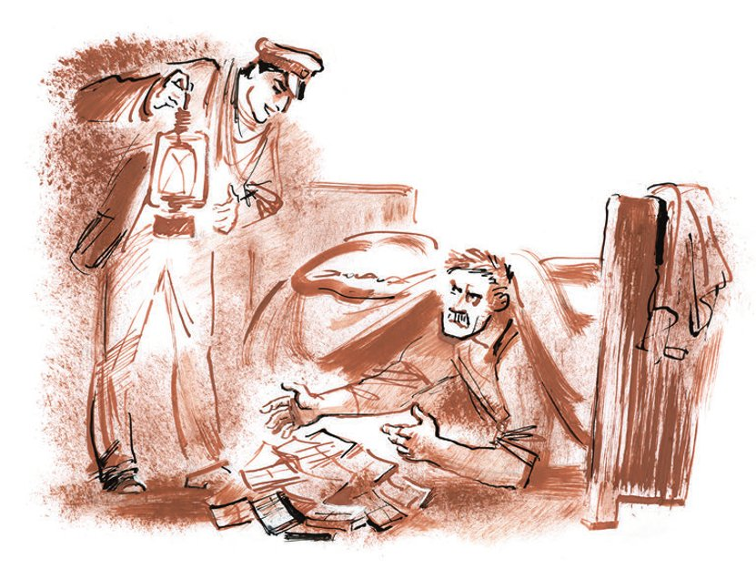

## Kapitel 30: Alexander ibn Iwanowitsch

In dem aufgeheizten, dunklen Güterwagen war die Luft dicht und <abbr title="beständig — устойчивый">beständig</abbr> wie in einem alten Stiefel. Es roch nach Leder und Füßen. Koreiko zündete die <abbr title="die Schaffnerlaterne, die Schaffnerlaternen — кондукторский фонарь">Schaffnerlaterne</abbr> an und kroch unter das Bett. Ostap sah ihm nachdenklich zu, auf einer leeren <abbr title="die Makaronikiste, die Makaronikisten — ящик из-под макарон">Makaronikiste</abbr> sitzend. Beide Kombinatoren waren vom Kampf <abbr title="ermattet — утомлённый">ermattet</abbr> und begegneten dem Ereignis, das Koreiko außerordentlich gefürchtet und Bender sein ganzes Leben lang erwartet hatte, mit einer gewissen <abbr title="amtlich — казённый">amtlichen</abbr> Ruhe. Man hätte sogar meinen können, das Ganze spiele sich in einem <abbr title="der Genossenschaftsladen, die Genossenschaftsläden — кооперативный магазин">Genossenschaftsladen</abbr> ab: Der Käufer verlangt eine <abbr title="die Kopfbedeckung, die Kopfbedeckungen — головной убор">Kopfbedeckung</abbr>, und der Verkäufer wirft träge eine zottelige Schirmmütze in der Farbe von Kopfsteinpflaster auf den Ladentisch. Ihm ist es gleich, ob der Käufer die Mütze nimmt oder nicht. Und auch der Käufer selbst ereifert sich nicht sonderlich und fragt nur zur Beruhigung seines Gewissens: «Haben Sie vielleicht noch andere?» – worauf gewöhnlich die Antwort folgt: «Nehmen Sie, nehmen Sie, sonst gibt’s nicht mal die.» Und beide sehen einander mit vollkommener <abbr title="die Gleichgültigkeit — равнодушие">Gleichgültigkeit</abbr> an. Koreiko <abbr title="hantieren — возиться">hantierte</abbr> lange unter dem Bett, offenbar schnallte er den Kofferdeckel auf und wühlte <abbr title="aufs Geratewohl — наугад">aufs Geratewohl</abbr> darin herum.

— He, dort auf dem <abbr title="der Schoner, die Schoner — шхуна">Schoner</abbr>! — rief Ostap müde. — Was für ein Glück, dass Sie nicht rauchen! Einen Geizhals wie Sie um eine Zigarette zu bitten, wäre einfach eine Qual. Sie würden nie das <abbr title="das Zigarettenetui, die Zigarettenetuis — портсигар">Zigarettenetui</abbr> hinhalten, aus Angst, man könnte Ihnen statt einer Zigarette gleich mehrere wegnehmen, sondern würden lange in der Tasche kramen, mühsam die Schachtel einen Spalt öffnen und eine jämmerliche, <abbr title="verbogen — согнутый">verbogene</abbr> Zigarette herausziehen. Sie sind ein schlechter Mensch. Na, was kostet es Sie schon, den ganzen Koffer herauszuziehen!

— Das fehlte noch! — knurrte Koreiko, der unter dem Bett nach Luft rang.

Der Vergleich mit dem geizigen Raucher war ihm unangenehm. Gerade in dieser Minute zog er dicke Bündel aus dem Koffer. Die vernickelte Zunge des Schlosses zerkratzte ihm die bis zu den Ellbogen entblößten Arme. Der Bequemlichkeit halber legte er sich auf den Rücken und arbeitete weiter wie ein Bergmann <abbr title="vor Ort — в забое">vor Ort</abbr>. Aus der Matratze rieselten dem Millionär <abbr title="die Spreu — мякина, полова">Spreu</abbr> und anderer Strohkram, irgendein Pulver und <abbr title="die Granne, die Grannen — ость (колоса), «усики»">Grannen</abbr> in die Augen.

«Ach, wie schlimm, — dachte Alexander Iwanowitsch, — schlimm und schrecklich. Was, wenn er mich jetzt erwürgt und das ganze Geld nimmt? Ganz einfach. Er <abbr title="zerstückeln — разрезать на части">zerstückelt</abbr> mich und schickt mich als langsames <abbr title="das Frachtgut, die Frachtgüter — груз (малой скоростью)">Frachtgut</abbr> in verschiedene Städte. Und den Kopf <abbr title="einlegen — заквасить, засолить">legt</abbr> er in einem Fass mit Kohl ein.»

Koreiko brach ein <abbr title="kellerfeucht — погребной сырости">kellerfeuchter</abbr> Schweiß aus. Voller Angst lugte er unter dem Bett hervor. Bender döste auf seiner Kiste und neigte den Kopf zur Eisenbahnlaterne.

«Und vielleicht ihn … als langsames Frachtgut, — dachte Alexander Iwanowitsch, während er weiter Bündel herauszog und sich <abbr title="sich entsetzen — ужасаться">entsetzte</abbr>, — in verschiedene Städte? Streng <abbr title="vertraulich — конфиденциально">vertraulich</abbr>. Was?»

Er lugte wieder hervor. Der große Kombinator <abbr title="sich recken — потягиваться">reckte sich</abbr> und gähnte verzweifelt wie eine <abbr title="die Dogge, die Doggen — дог">Dogge</abbr>. Dann nahm er die Schaffnerlaterne und begann sie zu schwenken, wobei er ausrief:

— Station Chazepetowka! Aussteigen, Bürger! Wir sind da! Übrigens, ganz vergessen, Ihnen zu sagen: Vielleicht haben Sie vor, mich <abbr title="abstechen (stach ab, hat abgestochen) — зарезать">abzustechen</abbr>? Dann sollen Sie wissen – ich bin dagegen. Und außerdem hat man mich schon einmal umgebracht. Da war so ein <abbr title="verschroben — взбалмошный, чудаковатый">verschrobener</abbr> Alter aus guter Familie, ein ehemaliger Adelsmarschall, zugleich Registrator auf dem Standesamt, Kisa Worobjaninow. Wir suchten mit ihm <abbr title="auf Anteile — на паях">auf Anteile</abbr> das Glück im Wert von hundertfünfzigtausend Rubel. Und kurz vor der Aufteilung der erbeuteten Summe hat mir der dumme Adelsmarschall mit dem Rasiermesser über den Hals geschnitten. Ach, wie <abbr title="geschmacklos — пошлый, безвкусный">geschmacklos</abbr> das war, Koreiko! Geschmacklos und schmerzhaft! Die Chirurgen haben mein junges Leben mit knapper Not gerettet, wofür ich ihnen zutiefst dankbar bin.

Endlich kroch Koreiko unter dem Bett hervor und schob Ostap die Geldbündel vor die Füße. Jedes Bündel war <abbr title="säuberlich — аккуратно">säuberlich</abbr> in weißes Papier eingeklebt und mit Bindfaden verschnürt.

— Neunundneunzig Bündel, — sagte Koreiko traurig, — zu je zehntausend. In Scheinen zu fünfundzwanzig Tscherwonzen. Sie brauchen nicht nachzuprüfen, bei mir ist es wie in der Bank.

— Und wo ist das hundertste Bündel? — fragte Ostap mit Begeisterung.

— Zehntausend habe ich abgezogen. Zur <abbr title="die Verrechnung — зачёт">Verrechnung</abbr> für den Raubüberfall am Meeresufer.

— Na, das ist nun eine Schweinerei. Das Geld wurde doch für Sie selbst ausgegeben. Betreiben Sie keine <abbr title="die Formalitätenkrämerei — формалистика">Formalitätenkrämerei</abbr>.

Koreiko gab seufzend das fehlende Geld heraus, wofür er seine Lebensbeschreibung in der gelben Mappe mit den Schnürsenkeln erhielt. Die Lebensbeschreibung verbrannte er sofort in dem eisernen Ofen, dessen Rohr durch das Dach des Wagens hinausführte. Ostap nahm unterdessen <abbr title="stichprobenartig — на выдержку, выборочно">stichprobenartig</abbr> eines der Bündel, riss die <abbr title="die Umhüllung, die Umhüllungen — обёртка">Umhüllung</abbr> ab, überzeugte sich, dass Koreiko ihn nicht betrogen hatte, und steckte es in die Tasche.

— Und wo sind die Devisen? — fragte der große Kombinator <abbr title="pedantisch — придирчиво">pedantisch</abbr>. — Wo sind die mexikanischen Dollars, die türkischen Lira, wo die Pfund, Rupien, Peseten, Centavos, rumänischen Lei, wo die Lats und <abbr title="der Złoty, die Złoty — злотый">Złoty</abbr> der <abbr title="der Randstaat, die Randstaaten — лимитроф (пограничное государство)">Randstaaten</abbr>? Geben Sie wenigstens einen Teil in Devisen!

— Nehmen Sie, nehmen Sie, was da ist, — antwortete Koreiko, der vor dem Ofen saß und auf die sich im Feuer <abbr title="sich krümmen — корчиться">krümmenden</abbr> Dokumente blickte, — nehmen Sie, sonst gibt’s bald nicht mal das. Devisen halte ich nicht.

— Da bin ich nun Millionär! — rief Ostap fröhlich verwundert. — Die Träume eines Idioten sind wahr geworden!

Ostap wurde plötzlich traurig. Ihn verblüffte die <abbr title="die Alltäglichkeit — обыденность">Alltäglichkeit</abbr> der Umgebung, es kam ihm seltsam vor, dass sich die Welt nicht in derselben Sekunde verändert hatte und dass ringsum nichts, rein gar nichts geschehen war. Und obwohl er wusste, dass es in unserer strengen Zeit keine geheimnisvollen Höhlen, Fässchen mit Gold und Wunderlampen des Aladin gibt, tat ihm doch irgendetwas leid. Ihm wurde ein wenig langweilig, so wie Roald Amundsen, als er im <abbr title="das Luftschiff, die Luftschiffe — дирижабль">Luftschiff</abbr> «Norge» über den Nordpol hinwegflog, zu dem er sich sein ganzes Leben lang durchgekämpft hatte, und ohne Begeisterung zu seinen Gefährten sagte: «Na, da sind wir also.» Unten waren zerbrochenes Eis, Spalten, Kälte, Leere. Das Geheimnis ist gelüftet, das Ziel erreicht, es gibt nichts mehr zu tun, und man muss den Beruf wechseln. Doch die Traurigkeit dauert nur eine Minute, denn vor einem liegen Ruhm, Ehre und Achtung – Chöre erklingen, <abbr title="die Gymnasiastin, die Gymnasiastinnen — гимназистка">Gymnasiastinnen</abbr> in weißen <abbr title="die Pelerine, die Pelerinen — пелерина">Pelerinen</abbr> stehen <abbr title="Spalier stehen — стоять шпалерами">Spalier</abbr>, alte Mütter von <abbr title="der Polarforscher, die Polarforscher — полярный исследователь">Polarforschern</abbr> weinen, die von ihren Expeditionsgefährten aufgegessen wurden, Nationalhymnen werden gespielt, Raketen werden abgeschossen, und der alte König drückt den Forscher an seine stacheligen Orden und Sterne.

Die Schwäche des Augenblicks ging vorüber. Ostap warf die Bündel in ein Säckchen, das Alexander Iwanowitsch ihm liebenswürdig angeboten hatte, klemmte es sich unter den Arm und rollte die schwere Tür des Güterwagens auf.

Das Fest ging zu Ende. Raketen warfen sich wie goldene <abbr title="die Angelrute, die Angelruten — удочка">Angelruten</abbr> in den Himmel und fischten rote und grüne Fischchen heraus, kaltes Feuer <abbr title="spritzen — брызгать">spritzte</abbr> in die Augen, <abbr title="pyrotechnisch — пиротехнический">pyrotechnische</abbr> Sonnen drehten sich, <abbr title="der Feuertopf, die Feuertöpfe — бурак (фейерверк)">Feuertöpfe</abbr> schleuderten einen <abbr title="der Salat, die Salate — салат, винегрет">Salat</abbr> aus leuchtenden Tomaten und gelben Ausrufezeichen in die Höhe. Hinter der Telegrafenhütte wurde auf einer Holzbühne ein Stück für die Nomaden gespielt. Einige von ihnen saßen auf Bänken, andere sahen sich die Vorstellung von der Höhe ihrer Sättel aus an. Oft wieherten die Pferde. Der Sonderzug war vom Ende bis zur Spitze erleuchtet.

— Ja! — rief Ostap. — Das Bankett im Speisewagen! Das hatte ich ganz vergessen! Welche Freude! Kommen Sie, Koreiko, ich lade Sie ein, ich lade alle ein! Gemäß der Gesetze der Gastfreundschaft! Kognak mit Zitrönchen, <abbr title="das Wildklößchen, die Wildklößchen — клёцки из дичи">Wildklößchen</abbr>, <abbr title="das Frikandeau, die Frikandeaus — фрикандо">Frikandeau</abbr> mit Champignons, alter Ungarwein, neuer Ungarwein, Champagnerwein!..

— Frikandeau, Frikandeau, — sagte Koreiko böse, — und dann <abbr title="einsperren — посадить (в тюрьму)">sperrt</abbr> man einen ein. Ich will mich nicht zur Schau stellen!

— Ich verspreche Ihnen ein <abbr title="paradiesisch — райский">paradiesisches</abbr> Abendessen auf weißem Tischtuch, — beharrte Ostap. — Kommen Sie, kommen Sie! Und überhaupt, lassen Sie das <abbr title="das Einsiedlertum — отшельничество">Einsiedlertum</abbr>, beeilen Sie sich, Ihren Anteil an Spirituosen zu trinken und Ihre zwanzigtausend Frikadellen zu essen. Sonst fallen <abbr title="der/die Unbefugte, die Unbefugten — посторонний">Unbefugte</abbr> darüber her und verschlingen Ihre Portion. Ich bringe Sie im Sonderzug unter, da bin ich ein Mann vom Fach, – und schon morgen sind wir in einem verhältnismäßig kultivierten Zentrum. Und dort, mit unseren Millionen … Alexander Iwanowitsch!..

Der große Kombinator wollte jetzt alle <abbr title="beglücken — облагодетельствовать">beglücken</abbr>, er wollte, dass alle fröhlich waren. Koreikos finsteres Gesicht <abbr title="bedrücken — тяготить">bedrückte</abbr> ihn. Und er machte sich daran, Alexander Iwanowitsch zu überreden. Er stimmte zu, dass man sich nicht zur Schau stellen sollte, aber wozu sich <abbr title="aushungern — морить голодом">aushungern</abbr>? Ostap verstand selbst nicht recht, wozu er einen fröhlichen Zeitnehmer brauchte, doch einmal angefangen, konnte er nicht mehr aufhören. Zum Schluss begann er sogar zu drohen:

— Da sitzen Sie dann auf Ihrem Koffer, und an einem schönen Tag kommt der <abbr title="der Knochenmann — костлявая (смерть)">Knochenmann</abbr> zu Ihnen – und mit der <abbr title="die Sense, die Sensen — коса">Sense</abbr> in den Nacken. Was? Stellen Sie sich diese <abbr title="die Attraktion, die Attraktionen — аттракцион">Attraktion</abbr> vor? Beeilen Sie sich, Alexander Iwanowitsch, die Frikadellen stehen noch auf dem Tisch. Seien Sie kein <abbr title="der Dickschädel, die Dickschädel — твердолобый, упрямец">Dickschädel</abbr>.

Nach dem Verlust der Million war Koreiko weicher und <abbr title="empfänglich — восприимчивый">empfänglicher</abbr> geworden.

— Vielleicht sollte man tatsächlich ein bisschen <abbr title="sich auslüften — проветриться">auslüften</abbr>? — sagte er unsicher. — Einen Abstecher ins Zentrum machen? Aber natürlich ohne <abbr title="der Prunk — шик, пышность">Prunk</abbr>, ohne dieses <abbr title="das Husarentum — гусарство">Husarentum</abbr>.

— Was heißt hier Husarentum! Einfach zwei <abbr title="gemeinnützig — общественный">gemeinnützig</abbr> tätige Ärzte fahren nach Moskau, um das Künstlertheater zu besuchen und mit eigenen Augen die <abbr title="die Mumie, die Mumien — мумия">Mumie</abbr> im Museum der Schönen Künste zu betrachten. Nehmen Sie den Koffer.

Die Millionäre gingen zum Zug. Ostap schwenkte lässig seinen Sack wie ein <abbr title="das Weihrauchfass, die Weihrauchfässer — кадило">Weihrauchfass</abbr>. Alexander Iwanowitsch lächelte auf die dümmste Weise. Die Passagiere des Sonderzugs spazierten auf und ab und hielten sich möglichst nahe an den Wagen, denn man <abbr title="ankoppeln — прицеплять">koppelte</abbr> schon die Lokomotive an. Im Dunkeln schimmerten die weißen Hosen der Korrespondenten.

Im Abteil, auf Ostaps oberer Liege, lag unter einem <abbr title="das Laken, die Laken — простыня">Laken</abbr> ein ihm unbekannter Mann und las Zeitung.

— Na, kommen Sie herunter, — sagte Ostap freundlich, — der Hausherr ist da.

— Das ist mein Platz, Genosse, — bemerkte der Unbekannte. — Ich bin Lew Rubaschkin.

— Wissen Sie, Lew Rubaschkin, wecken Sie nicht die <abbr title="die Bestie, die Bestien — зверь">Bestie</abbr> in mir, gehen Sie hier weg.

Den großen Kombinator trieb der verständnislose Blick Alexander Iwanowitschs zum Kampf.

— Das ist ja was Neues, — sagte der Korrespondent <abbr title="hochnäsig — заносчиво">hochnäsig</abbr>. — Wer sind Sie denn?

— Das geht Sie einen <abbr title="einen Dreck angehen — не ваше собачье дело">Dreck</abbr> an! Man sagt Ihnen – kommen Sie runter, also kommen Sie runter!

— Jeder <abbr title="der/die Betrunkene, die Betrunkenen — пьяный">Betrunkene</abbr>, — begann Rubaschkin kreischend, — darf hier wohl <abbr title="randalieren — хулиганить, буянить">randalieren</abbr> …

Ostap packte den Korrespondenten schweigend am nackten Bein. Auf Rubaschkins Geschrei lief der ganze Wagen zusammen. Koreiko verzog sich für alle Fälle auf die Plattform.

— Sie prügeln sich? — fragte Uchudschanski. — Soso.

Ostap, der Rubaschkin schon mit dem Sack auf den Kopf geschlagen hatte, wurde von Gargantua und dem dicken Schriftsteller im Kinderjäckchen an den Armen festgehalten.

— Soll er seine Fahrkarte zeigen! — schrie sich der große Kombinator heiser. — Soll er seine <abbr title="die Platzkarte, die Platzkarten — плацкарта">Platzkarte</abbr> zeigen!

Rubaschkin, splitternackt, sprang von Liege zu Liege und verlangte nach dem Kommandanten. Ostap, der den Boden der Wirklichkeit verloren hatte, bestand ebenfalls darauf, die Obrigkeit zu rufen. Der Skandal endete mit einer großen Unannehmlichkeit. Rubaschkin legte sowohl Fahrkarte als auch Platzkarte vor und verlangte darauf mit tragischer Stimme dasselbe von Bender.

— Ich zeige sie aber aus <abbr title="das Prinzip, die Prinzipien — принцип">Prinzip</abbr> nicht! — erklärte der große Kombinator und verließ eilig den Tatort. — Ich habe nun mal solche Prinzipien!

— Ein Schwarzfahrer! — kreischte Lew Rubaschkin, der nackt in den Gang gesprungen war. — Ich mache Sie aufmerksam, Genosse Kommandant, hier ist ein Schwarzfahrer mitgefahren!

— Wo ist der Schwarzfahrer? — verkündete der Kommandant, in dessen Augen ein Glanz wie bei einem <abbr title="der Jagdhund, die Jagdhunde — гончая">Jagdhund</abbr> erschien.

Alexander Iwanowitsch, der sich ängstlich hinter einem Vorsprung der Tribüne versteckt hatte, starrte in die Dunkelheit, konnte aber nichts erkennen. Am Zug bewegten sich Gestalten, Zigarettenglut hüpfte, und man hörte Stimmen: «Bemühen Sie sich gefälligst, vorzuzeigen!», «Und ich sage Ihnen, aus Prinzip!», «Rowdytum!», «Nicht wahr? Stimmt doch?», «Irgendjemand muss doch ohne Fahrkarte fahren?» Die <abbr title="der Pufferteller, die Pufferteller — буферная тарелка">Pufferteller</abbr> schlugen aneinander, dicht über dem Boden lief zischend die <abbr title="die Bremsluft — тормозной воздух">Bremsluft</abbr> hin, und die hellen Fenster der Wagen setzten sich in Bewegung. Ostap <abbr title="sich aufplustern — хорохориться">plusterte sich</abbr> noch auf, doch an ihm fuhren schon die gestreiften Sofas vorbei, die Gepäcknetze, die Schaffner mit Laternen, die Blumensträuße und die Deckenventilatoren des Speisewagens. Es fuhr das Bankett davon, mit Champagnerwein, mit altem und neuem Ungarwein. Die Wildklößchen entrissen sich den Händen und <abbr title="entschwinden (entschwand, ist entschwunden) — исчезнуть, унестись">entschwanden</abbr> in die Nacht. Das Frikandeau, das zarte Frikandeau, von dem Ostap so heiß erzählt hatte, verließ Gremjaschtschi Kljutsch. Alexander Iwanowitsch kam näher.

— Das lasse ich nicht auf sich beruhen, — knurrte Ostap, — einen Korrespondenten der Sowjetpresse in der Wüste zurückzulassen! Ich bringe die ganze Öffentlichkeit auf die Beine. Koreiko! Wir fahren mit dem ersten Schnellzug! Wir kaufen alle Plätze im internationalen Schlafwagen!

— Aber was denn, — sagte Koreiko, — was heißt hier Schnellzug! Von hier fahren überhaupt keine Züge. Laut Plan beginnt der <abbr title="der Betrieb — эксплуатация">Betrieb</abbr> erst in zwei Monaten.

Ostap hob den Kopf. Er sah den schwarzen abessinischen Himmel, die wilden Sterne und begriff alles. Doch Koreikos <abbr title="zaghaft — робкий">zaghafte</abbr> Erinnerung an das Bankett gab ihm neue Kräfte.

— Hinter dem Hügel steht ein Flugzeug, — sagte Bender, — das, welches zu den Feierlichkeiten hergeflogen ist. Es startet erst im Morgengrauen. Wir schaffen es.

Um es zu schaffen, setzten sich die Millionäre mit weitem <abbr title="der Dromedarschritt — дромадерский шаг">Dromedarschritt</abbr> in Bewegung. Ihre Füße rutschten im Sand auseinander, die Feuer der Nomaden brannten, den Koffer und den Sack zu schleppen war nicht gerade schwer, aber äußerst widerlich. Während sie von der Seite von Gremjaschtschi Kljutsch den Hügel hinaufkletterten, rückte von der anderen Seite unter dem Knattern der Propeller die Morgendämmerung auf den Hügel vor. Den Hügel hinunter liefen Bender und Koreiko schon, aus Angst, das Flugzeug könnte ohne sie abfliegen.

Unter den gewellten Tragflächen des Flugzeugs, die hoch wie ein Dach waren, gingen kleine <abbr title="der Mechaniker, die Mechaniker — механик">Mechaniker</abbr> in Ledermänteln umher. Drei Propeller drehten sich schwach und <abbr title="belüften — вентилировать, проветривать">belüfteten</abbr> die Wüste. An den quadratischen Fenstern der Passagierkabine baumelten Vorhänge mit Plüschkügelchen. Der Pilot lehnte mit dem Rücken an der Aluminiumstufe, aß eine <abbr title="die Pastete, die Pasteten — пирожок">Pastete</abbr> und trank Narsan aus der Flasche dazu.

— Wir sind Passagiere, — rief Ostap atemlos, — zwei Fahrkarten erster Klasse!

Niemand antwortete ihm. Der Pilot warf die Flasche weg und begann, seine <abbr title="der Stulpenhandschuh, die Stulpenhandschuhe — перчатки с раструбами">Stulpenhandschuhe</abbr> anzuziehen.

— Gibt es Plätze? — wiederholte Ostap und packte den Piloten am Arm.

— Passagiere nehmen wir nicht, — sagte der Pilot und griff nach dem <abbr title="der Handlauf, die Handläufe — поручень">Handlauf</abbr> der Leiter. — Das ist ein Sonderflug.

— Ich kaufe das Flugzeug! — sagte der große Kombinator hastig. — Wickeln Sie es mir ein.

— Aus dem Weg! — schrie der Mechaniker und stieg hinter dem Piloten hinauf.

Die Propeller verschwanden in schneller Drehung. Zitternd und schwankend begann das Flugzeug, sich gegen den Wind zu drehen. Die <abbr title="der Luftwirbel, die Luftwirbel — воздушный вихрь">Luftwirbel</abbr> stießen die Millionäre zurück, zum Hügel. Von Ostaps Kopf flog die Kapitänsmütze und rollte in Richtung Indien davon, mit solcher Geschwindigkeit, dass ihre Ankunft in Kalkutta spätestens in drei Stunden zu erwarten gewesen wäre. So wäre sie auch auf die Hauptstraße von Kalkutta gerollt und hätte durch ihr rätselhaftes Erscheinen die Aufmerksamkeit von Kreisen erregt, die dem Intelligence Service nahestehen, wenn das Flugzeug nicht weggeflogen und der Sturm sich nicht gelegt hätte. In der Luft blitzte das Flugzeug mit seinen Rippen auf und verschwand im Sonnenlicht. Ostap lief zu der Mütze, die an einem <abbr title="der Saxaul, die Saxaule — саксаул">Saxaul</abbr>-Strauch hängen geblieben war, und sprach:

— Das Verkehrswesen ist uns <abbr title="aus dem Ruder laufen — отбиться от рук">aus dem Ruder gelaufen</abbr>. Mit der Eisenbahn haben wir uns <abbr title="sich zerstreiten (zerstritt, hat zerstritten) — поссориться">zerstritten</abbr>. Die Luftwege sind für uns gesperrt. Zu Fuß? Vierhundert Kilometer. Das beflügelt nicht. Es bleibt nur eins – den Islam annehmen und sich auf Kamelen fortbewegen.

Zum Islam schwieg Koreiko, doch der Gedanke an Kamele gefiel ihm. Der verlockende Anblick des Speisewagens und des Flugzeugs hatte ihn in dem Wunsch bestärkt, die Vergnügungsreise eines gemeinnützig tätigen Arztes zu unternehmen, natürlich ohne Husarentum, aber auch nicht ohne eine gewisse <abbr title="die Verwegenheit — лихость, удаль">Verwegenheit</abbr>.

Die zur Schienenverbindung gekommenen Aule waren noch nicht aufgebrochen, und es gelang, Kamele unweit von Gremjaschtschi Kljutsch zu kaufen. Die Schiffe der Wüste kosteten hundertachtzig Rubel das Stück.

— Wie billig! — flüsterte Ostap. — Kaufen wir fünfzig Kamele. Oder hundert!

— Das ist Husarentum, — sagte Alexander Iwanowitsch mürrisch. — Was soll man mit ihnen anfangen? Zwei reichen.

Die Kasachen setzten die Reisenden unter Geschrei zwischen die <abbr title="der Höcker, die Höcker — горб">Höcker</abbr>, halfen, den Koffer, den Sack und den Proviant für die Reise festzubinden – einen Weinschlauch mit <abbr title="der Kumys — кумыс">Kumys</abbr> und zwei <abbr title="der Hammel, die Hammel — баран">Hammel</abbr>. Die Kamele erhoben sich zuerst auf die Hinterbeine, wodurch sich die Millionäre tief verbeugten, und dann auf die Vorderbeine und schritten an der Strecke der Östlichen Magistrale entlang. Die an Schnüren angebundenen Hammel trotteten hinterher, ließen von Zeit zu Zeit Kügelchen rollen und <abbr title="blöken — блеять">blökten</abbr> herzzerreißend.

— He, Scheich Koreiko! — rief Ostap. — Alexander ibn Iwanowitsch! Ist das Leben schön?

Der Scheich antwortete nichts. Er hatte ein <abbr title="klapprig — ледащий, хилый">klappriges</abbr> Kamel erwischt und <abbr title="dreschen (drosch, hat gedroschen) — лупить, колотить">drosch</abbr> wütend mit einem Saxaulstock auf dessen kahles Hinterteil ein.

---

### Neue Wörter

- **beständig** — устойчивый
- **die Schaffnerlaterne, die Schaffnerlaternen** — кондукторский фонарь
- **die Makaronikiste, die Makaronikisten** — ящик из-под макарон
- **ermattet** — утомлённый
- **amtlich** — казённый
- **der Genossenschaftsladen, die Genossenschaftsläden** — кооперативный магазин
- **die Kopfbedeckung, die Kopfbedeckungen** — головной убор
- **die Gleichgültigkeit** — равнодушие
- **hantieren** — возиться
- **aufs Geratewohl** — наугад
- **der Schoner, die Schoner** — шхуна
- **das Zigarettenetui, die Zigarettenetuis** — портсигар
- **verbogen** — согнутый
- **vor Ort** — в забое
- **die Spreu** — мякина, полова
- **die Granne, die Grannen** — ость (колоса), «усики»
- **zerstückeln** — разрезать на части
- **das Frachtgut, die Frachtgüter** — груз (малой скоростью)
- **einlegen** — заквасить, засолить
- **kellerfeucht** — погребной сырости
- **sich entsetzen** — ужасаться
- **vertraulich** — конфиденциально
- **sich recken** — потягиваться
- **die Dogge, die Doggen** — дог
- **abstechen (stach ab, hat abgestochen)** — зарезать
- **verschroben** — взбалмошный, чудаковатый
- **auf Anteile** — на паях
- **geschmacklos** — пошлый, безвкусный
- **säuberlich** — аккуратно
- **die Verrechnung** — зачёт
- **die Formalitätenkrämerei** — формалистика
- **stichprobenartig** — на выдержку, выборочно
- **die Umhüllung, die Umhüllungen** — обёртка
- **pedantisch** — придирчиво
- **der Złoty, die Złoty** — злотый
- **der Randstaat, die Randstaaten** — лимитроф (пограничное государство)
- **sich krümmen** — корчиться
- **die Alltäglichkeit** — обыденность
- **das Luftschiff, die Luftschiffe** — дирижабль
- **die Gymnasiastin, die Gymnasiastinnen** — гимназистка
- **die Pelerine, die Pelerinen** — пелерина
- **Spalier stehen** — стоять шпалерами
- **der Polarforscher, die Polarforscher** — полярный исследователь
- **die Angelrute, die Angelruten** — удочка
- **spritzen** — брызгать
- **pyrotechnisch** — пиротехнический
- **der Feuertopf, die Feuertöpfe** — бурак (фейерверк)
- **der Salat, die Salate** — салат, винегрет
- **das Wildklößchen, die Wildklößchen** — клёцки из дичи
- **das Frikandeau, die Frikandeaus** — фрикандо
- **einsperren** — посадить (в тюрьму)
- **paradiesisch** — райский
- **das Einsiedlertum** — отшельничество
- **der/die Unbefugte, die Unbefugten** — посторонний
- **beglücken** — облагодетельствовать
- **bedrücken** — тяготить
- **aushungern** — морить голодом
- **der Knochenmann** — костлявая (смерть)
- **die Sense, die Sensen** — коса
- **die Attraktion, die Attraktionen** — аттракцион
- **der Dickschädel, die Dickschädel** — твердолобый, упрямец
- **empfänglich** — восприимчивый
- **sich auslüften** — проветриться
- **der Prunk** — шик, пышность
- **das Husarentum** — гусарство
- **gemeinnützig** — общественный
- **die Mumie, die Mumien** — мумия
- **das Weihrauchfass, die Weihrauchfässer** — кадило
- **ankoppeln** — прицеплять
- **das Laken, die Laken** — простыня
- **die Bestie, die Bestien** — зверь
- **hochnäsig** — заносчиво
- **einen Dreck angehen** — не ваше собачье дело
- **der/die Betrunkene, die Betrunkenen** — пьяный
- **randalieren** — хулиганить, буянить
- **die Platzkarte, die Platzkarten** — плацкарта
- **das Prinzip, die Prinzipien** — принцип
- **der Jagdhund, die Jagdhunde** — гончая
- **der Pufferteller, die Pufferteller** — буферная тарелка
- **die Bremsluft** — тормозной воздух
- **sich aufplustern** — хорохориться
- **entschwinden (entschwand, ist entschwunden)** — исчезнуть, унестись
- **der Betrieb** — эксплуатация
- **zaghaft** — робкий
- **der Dromedarschritt** — дромадерский шаг
- **der Mechaniker, die Mechaniker** — механик
- **belüften** — вентилировать, проветривать
- **die Pastete, die Pasteten** — пирожок
- **der Stulpenhandschuh, die Stulpenhandschuhe** — перчатки с раструбами
- **der Handlauf, die Handläufe** — поручень
- **der Luftwirbel, die Luftwirbel** — воздушный вихрь
- **der Saxaul, die Saxaule** — саксаул
- **aus dem Ruder laufen** — отбиться от рук
- **sich zerstreiten (zerstritt, hat zerstritten)** — поссориться
- **die Verwegenheit** — лихость, удаль
- **der Höcker, die Höcker** — горб
- **der Kumys** — кумыс
- **der Hammel, die Hammel** — баран
- **blöken** — блеять
- **klapprig** — ледащий, хилый
- **dreschen (drosch, hat gedroschen)** — лупить, колотить

[← Zurück](kapitel-30.md) · [Inhalt](README.md) · [Weiter →](kapitel-32.md)
