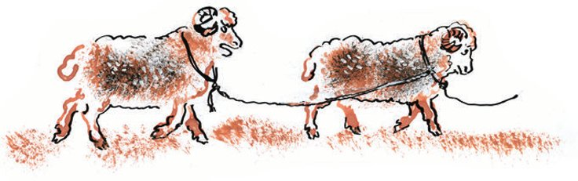
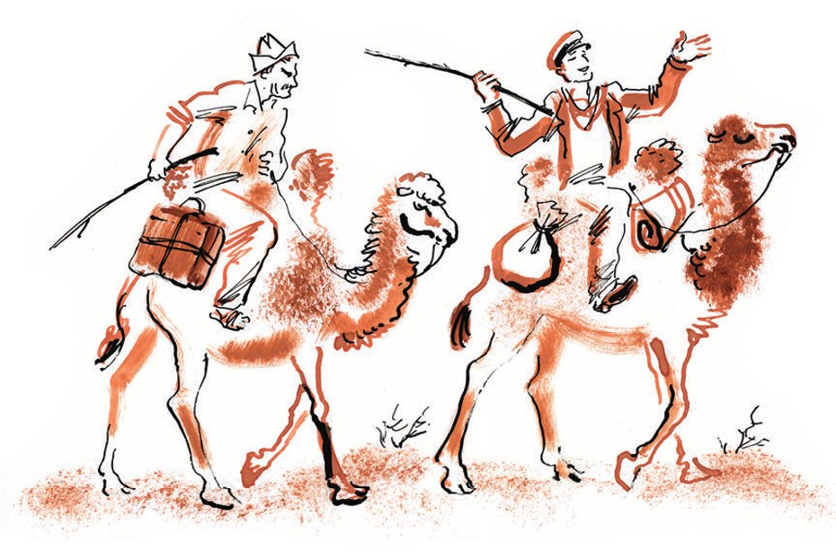

## Kapitel 31: Bagdad

Sieben Tage lang schleppten die Kamele die frisch <abbr title="frisch gebacken — новоявленный, новоиспечённый">gebackenen</abbr> <abbr title="der Scheich, die Scheichs — шейх">Scheichs</abbr> durch die Wüste. Zu Beginn der Reise amüsierte sich Ostap von ganzem Herzen. Alles <abbr title="belustigen — потешать, забавлять">belustigte</abbr> ihn: Alexander-Ibn-Iwanowitsch, der zwischen den Kamelhöckern zappelte, das klapprige Wüstenschiff, das sich vor seinen Pflichten zu <abbr title="sich drücken vor + Dat. — увиливать от">drücken</abbr> versuchte, und der Sack mit der Million, mit dessen Schlägen der große Kombinator gelegentlich die widerspenstigen Hammel antrieb. Sich selbst nannte Ostap Oberst Lawrence.

— Ich bin der Emir Dynamit! — rief er, während er auf dem hohen Kamelrücken schaukelte. — Wenn wir in zwei Tagen kein anständiges Essen bekommen, <abbr title="aufwiegeln — подстрекать к бунту">wiegle</abbr> ich irgendwelche <abbr title="der Stamm, die Stämme — племя">Stämme</abbr> auf. Ehrenwort! Ich ernenne mich zum <abbr title="der Bevollmächtigte, die Bevollmächtigten — уполномоченный">Bevollmächtigten</abbr> des Propheten und rufe den Heiligen Krieg aus, den <abbr title="der Dschihad — джихад">Dschihad</abbr>. Zum Beispiel gegen Dänemark. Warum haben die Dänen ihren Prinzen Hamlet zu Tode gequält? Bei der heutigen politischen Lage gibt sich sogar der Völkerbund mit so einem <abbr title="der Kriegsgrund, die Kriegsgründe — повод к войне">Kriegsgrund</abbr> zufrieden. Bei Gott, ich kaufe den Engländern für eine Million Gewehre ab – sie verkaufen den Stämmen so gern <abbr title="die Feuerwaffe, die Feuerwaffen — огнестрельное оружие">Feuerwaffen</abbr> –, und dann marsch, marsch nach Dänemark. Deutschland lässt uns durch – <abbr title="auf Rechnung der Reparationen — в счёт репараций">als Teil der Reparationen</abbr>. Stellen Sie sich den <abbr title="der Einfall, die Einfälle — вторжение, нашествие">Einfall</abbr> der Stämme in Kopenhagen vor! Allen voran ich, auf einem weißen Kamel. Ach! Panikowski ist nicht mehr da! Dem würde eine dänische Gans schmecken!..

Aber nach einigen Tagen, als von den Hammeln nur noch die <abbr title="der Strick, die Stricke — верёвка">Stricke</abbr> übrig waren und der Kumys ausgetrunken war, wurde auch der Emir Dynamit traurig und murmelte nur noch schwermütig:

— In sandigen Steppen des arabischen Lands, da wuchsen drei stolze Palmen – wozu nur?

Beide Scheichs hatten stark abgenommen, waren zerlumpt, hatten sich Bärtchen wachsen lassen und sahen aus wie <abbr title="der Derwisch, die Derwische — дервиш">Derwische</abbr> aus einer armen <abbr title="die Gemeinde, die Gemeinden — приход, община">Gemeinde</abbr>.

— Nur noch ein wenig Geduld, Ibn-Koreiko, und wir kommen in ein Städtchen, das Bagdad in nichts <abbr title="nachstehen + Dat. (stand nach, hat nachgestanden) — уступать кому-либо">nachsteht</abbr>. Flache Dächer, einheimische Orchester, kleine Restaurants im orientalischen Geschmack, süße Weine, <abbr title="sagenhaft — легендарный">sagenhafte</abbr> Mädchen und vierzigtausend <abbr title="der Spieß, die Spieße — вертел, шампур">Spieße</abbr> mit <abbr title="der Schaschlik — шашлык">Schaschlik</abbr> nach Karser, türkischer, tatarischer, mesopotamischer und Odessaer Art. Und endlich eine Eisenbahn.

Am achten Tag erreichten die Reisenden einen uralten Friedhof. Bis zum Horizont zogen sich, wie <abbr title="versteinert — окаменевший">versteinerte</abbr> Wellen, Reihen von halbrunden <abbr title="das Grabmal, die Grabmäler — гробница">Grabmälern</abbr> hin. Die Toten wurden hier nicht <abbr title="begraben (begrub, hat begraben) — хоронить, зарывать">begraben</abbr>. Man legte sie auf die Erde und baute steinerne <abbr title="die Haube, die Hauben — колпак">Hauben</abbr> über sie. Über der aschgrauen Stadt der Toten funkelte eine schreckliche Sonne. Der alte Orient lag in seinen heißen Gräbern.

Die Kombinatoren peitschten die Kamele an und ritten bald in eine Oase ein. Weit im Umkreis erleuchteten die grünen Fackeln der Pappeln die Stadt; sie spiegelten sich in den quadratischen, überfluteten Reisfeldern. Einsam standen <abbr title="die Ulme, die Ulmen — вяз, карагач">Ulmen</abbr>, die genau die Form eines riesigen Globus auf einem Holzbein nachbildeten. Allmählich begegneten ihnen <abbr title="das Eselchen, die Eselchen — ослик">Eselchen</abbr>, die dicke Reiter in <abbr title="der Kaftan, die Kaftane — халат">Kaftanen</abbr> und Bündel von Klee trugen.

Koreiko und Bender ritten an <abbr title="der Laden, die Läden — лавка">Läden</abbr> vorbei, die grünen Tabak in Pulverform verkauften und stinkende, kegelförmige Seife, die wie <abbr title="der Schrapnellkopf, die Schrapnellköpfe — головка шрапнели">Schrapnellköpfe</abbr> aussah. Handwerker mit weißen Bärten wie aus <abbr title="der Musselin — кисея, муслин">Musselin</abbr> hantierten mit Kupferblechen und rollten sie zu Becken und <abbr title="enghalsig — узкогорлый">enghalsigen</abbr> Krügen. Schuster trockneten in der Sonne kleine, mit Tinte gefärbte Häute. Die dunkelblauen, gelben und hellblauen <abbr title="die Kachel, die Kacheln — изразец, кафель">Kacheln</abbr> der <abbr title="die Moschee, die Moscheen — мечеть">Moscheen</abbr> glänzten in einem flüssigen, gläsernen Licht.

Den Rest des Tages und die Nacht verschliefen die Millionäre schwer und wie <abbr title="betäubt — оглушённый, бесчувственный">betäubt</abbr> im Hotel; am Morgen badeten sie in weißen Wannen, rasierten sich und gingen in die Stadt. Die <abbr title="ungetrübt — безоблачный">ungetrübte</abbr> Stimmung der Scheichs wurde nur dadurch verdorben, dass sie den Koffer und den Sack mit sich <abbr title="herumschleppen — таскать с собой">herumschleppen</abbr> mussten.

— Ich halte es für meine allererste Pflicht, — sagte Bender <abbr title="prahlerisch — хвастливо">prahlerisch</abbr>, — Sie mit einem <abbr title="zauberhaft — волшебный">zauberhaften</abbr> <abbr title="das Kellerlokal, die Kellerlokale — погребок">Kellerlokal</abbr> bekannt zu machen. Es heißt «Unter dem Mond». Ich war vor etwa fünf Jahren hier und hielt Vorträge über den Kampf gegen die <abbr title="die Abtreibung, die Abtreibungen — аборт">Abtreibung</abbr>. Was für ein Keller! Halbdunkel, Kühle, der Wirt aus Tiflis, ein einheimisches Orchester, kalter Wodka, <abbr title="die Tänzerin, die Tänzerinnen — танцовщица">Tänzerinnen</abbr> mit Tamburinen und <abbr title="die Zimbel, die Zimbeln — кимвал">Zimbeln</abbr>. Da lassen wir uns den ganzen Tag nieder. Dürfen gemeinnützige Ärzte nicht auch ihre kleinen Schwächen haben? Ich lade ein. Das goldene Kalb <abbr title="haften für + Akk. — отвечать за">haftet</abbr> für alles.

Und der große Kombinator schüttelte seinen Sack. Doch das Kellerlokal «Unter dem Mond» gab es nicht mehr. Zu Ostaps Verwunderung gab es nicht einmal mehr die Straße, auf der seine Tamburine und Zimbeln geklungen hatten. Hier verlief eine gerade europäische Straße, die auf ihrer ganzen Länge zugleich bebaut wurde. Es standen <abbr title="der Bauzaun, die Bauzäune — строительный забор">Bauzäune</abbr> herum, <abbr title="der Alabasterstaub — алебастровая пыль">Alabasterstaub</abbr> hing in der Luft, und Lastwagen <abbr title="aufheizen — раскалять">heizten</abbr> die ohnehin heiße Luft noch weiter auf. Nachdem Ostap eine Minute lang die Fassaden aus grauem Backstein mit den langen, liegenden Fenstern betrachtet hatte, stieß er Koreiko an, sagte: «Es gibt noch ein Plätzchen, das führt einer aus Baku», und führte ihn ans andere Ende der Stadt. Doch an dem Plätzchen hing nicht mehr das gereimte Schild, das der <abbr title="der Schankwirt, die Schankwirte — духанщик, трактирщик">Schankwirt</abbr> aus Baku persönlich gedichtet hatte:

ACHTE DICH, ACHTE UNS, ACHTE DEN KAUKASUS – BESUCHE UNS.

Stattdessen erblickten die Scheichs ein Pappschild mit arabischen und russischen Buchstaben:

STÄDTISCHES MUSEUM DER SCHÖNEN KÜNSTE

— Gehen wir hinein, — sagte Ostap traurig, — da ist es wenigstens kühl. Und außerdem gehört ein Museumsbesuch zum Programm reisender gemeinnütziger Ärzte!

Sie betraten einen großen, mit Kreide <abbr title="weißen — белить">geweißten</abbr> Raum, setzten ihre Millionen auf dem Boden ab und wischten sich lange die heißen Stirnen mit den Ärmeln ab. Das Museum besaß nur acht <abbr title="das Exponat, die Exponate — экспонат">Exponate</abbr>: einen <abbr title="der Mammutzahn, die Mammutzähne — зуб мамонта">Mammutzahn</abbr>, den die Stadt Taschkent dem jungen Museum geschenkt hatte, ein Ölgemälde «<abbr title="das Gefecht, die Gefechte — стычка, бой">Gefecht</abbr> mit den <abbr title="die Basmatschi (Pl.) — басмачи">Basmatschi</abbr>», zwei Emir-Kaftane, einen Goldfisch im Aquarium, eine <abbr title="die Vitrine, die Vitrinen — витрина">Vitrine</abbr> mit getrockneten <abbr title="die Heuschrecke, die Heuschrecken — саранча">Heuschrecken</abbr>, eine Porzellanfigur aus der Fabrik Kusnezow und schließlich das Modell eines <abbr title="der Obelisk, die Obelisken — обелиск">Obelisken</abbr>, den die Stadt auf dem Hauptplatz aufstellen wollte. Gleich daneben, am <abbr title="der Sockel, die Sockel — подножие, цоколь">Sockel</abbr> des Entwurfs, lag ein großer <abbr title="der Blechkranz, die Blechkränze — жестяной венок">Blechkranz</abbr> mit Schleifen. Den hatte vor kurzem eine besondere <abbr title="die Abordnung, die Abordnungen — делегация">Abordnung</abbr> aus der Nachbarrepublik gebracht; da es den Obelisken aber noch nicht gab (die dafür <abbr title="bewilligen — ассигновать, выделять">bewilligten</abbr> Mittel waren in den Bau eines Badehauses geflossen, das sich als weit nötiger erwiesen hatte), hatte die Abordnung die <abbr title="entsprechend — соответствующий">entsprechenden</abbr> Reden gehalten und den Kranz auf den Entwurf gelegt.

Sofort trat ein junger Mann mit einem bucharischen Käppchen aus Teppichstoff auf dem rasierten Kopf zu den Besuchern und fragte so aufgeregt wie ein Autor:

— Ihre Eindrücke, Genossen?

— <abbr title="nicht übel — ничего себе, неплохо">Nicht übel</abbr>, — sagte Ostap.

Der junge Mann war der Leiter des Museums und begann unverzüglich von den Schwierigkeiten zu sprechen, die sein <abbr title="das Sorgenkind, die Sorgenkinder — детище, предмет забот">Sorgenkind</abbr> durchmachte. Die Mittel reichten nicht. Taschkent hatte sich mit einem einzigen Zahn <abbr title="sich aus der Affäre ziehen — отделаться">aus der Affäre gezogen</abbr>, und die eigenen Schätze, künstlerische wie historische, sammelte niemand. Man schickte keinen Fachmann.

— Wenn ich dreihundert Rubel hätte! — rief der Leiter. — Ich würde hier einen Louvre <abbr title="aufziehen (zog auf, hat aufgezogen) — устроить, организовать">aufziehen</abbr>!

— Sagen Sie, kennen Sie die Stadt gut? — fragte Ostap und zwinkerte Alexander Iwanowitsch zu. — Könnten Sie uns nicht einige <abbr title="die Sehenswürdigkeit, die Sehenswürdigkeiten — достопримечательность">Sehenswürdigkeiten</abbr> zeigen? Ich kannte Ihre Stadt, aber sie hat sich irgendwie verändert.

Der Leiter freute sich sehr. Mit dem Ruf, er werde alles persönlich zeigen, schloss er das Museum ab und führte die Millionäre in genau die Straße, in der sie vor einer halben Stunde das Kellerlokal «Unter dem Mond» gesucht hatten.

— Der Prospekt des Sozialismus! — sagte er und sog genussvoll den Alabasterstaub ein. — Ach! Was für eine herrliche Luft! Was hier in einem Jahr sein wird! Asphalt! Ein Autobus! Ein Institut für <abbr title="die Bewässerung — ирригация, орошение">Bewässerung</abbr>! Ein Tropeninstitut! Na, wenn Taschkent uns diesmal keine wissenschaftlichen Kräfte gibt!.. Wissen Sie, die haben so viele Mammutknochen, und mir haben sie nur einen Zahn geschickt, während es in unserer Republik doch so einen <abbr title="der Drang — тяга, стремление">Drang</abbr> zu den Naturwissenschaften gibt.

— Ach so? — bemerkte Koreiko und sah Ostap vorwurfsvoll an.

— Und wissen Sie, — flüsterte der <abbr title="der/die Begeisterte — энтузиаст">Begeisterte</abbr>, — ich habe den <abbr title="der Verdacht — подозрение">Verdacht</abbr>, dass das gar kein Mammutzahn ist. Die haben mir einen Elefantenzahn untergeschoben!

— Und wie steht es bei Ihnen mit solchen ... mit <abbr title="die Kneipe, die Kneipen — кабачок, пивнушка">Kneipen</abbr> nach asiatischer Art, Sie wissen schon, mit <abbr title="die Pauke, die Pauken — литавра, тимпан">Pauken</abbr> und Flöten? — fragte der große Kombinator ungeduldig.

— <abbr title="überwinden (überwand, hat überwunden) — изжить, преодолеть">Überwunden</abbr>, — antwortete der junge Mann gleichgültig. — Diese <abbr title="die Seuche, die Seuchen — зараза, эпидемия">Seuche</abbr> hätte man längst <abbr title="ausrotten — истребить">ausrotten</abbr> müssen, eine <abbr title="die Brutstätte, die Brutstätten — рассадник">Brutstätte</abbr> von Epidemien. Gerade im Frühjahr haben wir die letzte <abbr title="die Spelunke, die Spelunken — вертеп, притон">Spelunke</abbr> <abbr title="erdrosseln — придушить">erdrosselt</abbr>. Sie hieß «Unter dem Mond».

— Erdrosselt? — stöhnte Koreiko.

— Ehrenwort! Aber dafür ist eine Großküche eröffnet worden. Europäische Küche. Die Teller werden mit Hilfe von Elektrizität gespült und getrocknet. Die Kurve der Magenkrankheiten ist <abbr title="steil — круто, резко">steil</abbr> nach unten gegangen.

— Was da alles passiert! — rief der große Kombinator und <abbr title="bedecken — закрывать, покрывать">bedeckte</abbr> das Gesicht mit den Händen.

— Sie haben ja noch gar nichts gesehen, — sagte der Museumsleiter und lachte verlegen. — Fahren wir zum Mittagessen in die Großküche.

Sie setzten sich in einen offenen Wagen unter einem Leinendach mit Girlanden, die mit einer blauen Borte <abbr title="einfassen — обшивать, окаймлять">eingefasst</abbr> waren, und fuhren los. Unterwegs zwang der liebenswürdige Führer die Millionäre jede Minute, sich unter dem <abbr title="der Baldachin, die Baldachine — балдахин">Baldachin</abbr> hervorzubeugen, und zeigte ihnen Gebäude, die schon <abbr title="errichten — возводить">errichtet</abbr> waren, Gebäude, die gerade errichtet wurden, und Orte, an denen sie erst noch errichtet werden sollten. Koreiko sah Ostap mit bösen Augen an. Ostap wandte sich ab und sagte:

— Was für ein herrlicher einheimischer kleiner <abbr title="der Basar, die Basare — базар">Basar</abbr>! Bagdad!

— Am Siebzehnten fangen wir mit dem <abbr title="der Abriss, die Abrisse — снос">Abriss</abbr> an, — sagte der junge Mann. — Hier kommen ein Krankenhaus und ein <abbr title="das Genossenschaftszentrum, die Genossenschaftszentren — коопцентр">Genossenschaftszentrum</abbr> hin.

— Und es tut Ihnen nicht leid um diese ganze Exotik? Das ist doch Bagdad!

— Sehr schön! — seufzte Koreiko.

Der junge Mann wurde ärgerlich:

— Für Sie ist es schön, für die Durchreisenden, aber wir müssen hier leben.

Im großen Saal der Großküche, zwischen gekachelten Wänden, unter <abbr title="der Fliegenfänger, die Fliegenfänger — липучка для мух">Fliegenfängern</abbr>, die in Bändern von der Decke hingen, aßen die Reisenden <abbr title="die Graupensuppe — перловый суп">Graupensuppe</abbr> und kleine braune Frikadellen. Ostap erkundigte sich nach Wein, bekam aber die begeisterte Antwort, dass man vor kurzem nicht weit von der Stadt eine Mineralquelle entdeckt habe, deren Wasser an Geschmack das berühmte Narsan noch <abbr title="übertreffen (übertraf, hat übertroffen) — превосходить">übertreffe</abbr>. Als Beweis wurde eine Flasche des neuen Wassers bestellt und in <abbr title="die Grabesstille — гробовое молчание">Grabesstille</abbr> ausgetrunken.

— Und wie steht es mit der Kurve der <abbr title="die Prostitution — проституция">Prostitution</abbr>? — fragte Alexander Ibn-Iwanowitsch hoffnungsvoll.

— Ist steil gesunken, — antwortete der unerbittliche junge Mann.

— Ei, was da alles passiert! — sagte Ostap mit <abbr title="gekünstelt — фальшивый, натянутый">gekünsteltem</abbr> Lachen.

Aber er wusste wirklich nicht, was da passierte. Als sie vom Tisch aufstanden, stellte sich heraus, dass der junge Mann schon für alle bezahlt hatte. Er weigerte sich <abbr title="um keinen Preis — ни за что">um keinen Preis</abbr>, von den Millionären Geld zu nehmen, und versicherte, er bekomme übermorgen ohnehin sein Gehalt und werde bis dahin schon irgendwie <abbr title="über die Runden kommen — обернуться, перебиться">über die Runden kommen</abbr>.

— Na, und das Vergnügen? Wie vergnügt sich die Stadt? — fragte Ostap, schon ohne <abbr title="die Ekstase — экстаз">Ekstase</abbr>. — Pauken, Zimbeln?

— Wissen Sie das denn nicht? — wunderte sich der Museumsleiter. — Letzte Woche ist bei uns die städtische <abbr title="die Philharmonie, die Philharmonien — филармония">Philharmonie</abbr> eröffnet worden. Das große Sinfonische Quartett «Bebel und Paganini». Wir fahren sofort hin. Wie konnte ich das nur übersehen!

Nachdem er das Mittagessen bezahlt hatte, war es aus ethischen Gründen unmöglich, den Besuch der Philharmonie abzulehnen. Als sie herauskamen, sagte Alexander Ibn-Iwanowitsch mit der Stimme eines Hausmeisters:

— Städtische <abbr title="die Mundharmonika, die Mundharmonikas — губная гармошка">Mundharmonika</abbr>!

Der große Kombinator wurde rot.

Auf dem Weg zum Hotel ließ der junge Mann den Kutscher plötzlich halten, half den Millionären hinaus, nahm sie bei der Hand und führte sie, vor <abbr title="überschäumend — переполняющий, бьющий через край">überschäumender</abbr> Begeisterung auf die Zehenspitzen steigend, zu einem kleinen Stein, der mit einem Gitterchen <abbr title="umzäunen — огораживать">umzäunt</abbr> war.

— Hier wird der Obelisk stehen! — sagte er bedeutungsvoll. — Die Säule des Marxismus!

Beim Abschied bat der junge Mann, recht oft wiederzukommen. Der gutmütige Ostap versprach, unbedingt wiederzukommen, denn er habe noch nie einen so fröhlichen Tag verbracht wie heute.

— Ich gehe zum Bahnhof, — sagte Koreiko, als er mit Bender allein war.

— Fahren wir in eine andere Stadt, um zu <abbr title="prassen — кутить">prassen</abbr>? — fragte Ostap. — In Taschkent kann man gut drei Tage lustig verbringen.

— Mir reicht's, — antwortete Alexander Iwanowitsch. — Ich bringe den Koffer zur Gepäckaufbewahrung und nehme hier irgendwo eine Stelle als kleiner <abbr title="der Kontorist, die Kontoristen — конторщик">Kontorist</abbr> an. Ich warte auf den Kapitalismus. Dann werde ich mich vergnügen.

— Na, dann warten Sie eben, — sagte Ostap ziemlich grob, — ich aber fahre. Der heutige Tag war ein ärgerliches <abbr title="das Missverständnis, die Missverständnisse — недоразумение">Missverständnis</abbr>, <abbr title="die Überspitzungen vor Ort — перегибы на местах">Überspitzungen vor Ort</abbr>. Das goldene Kälbchen hat in unserem Land noch so manche Macht!

Auf dem Bahnhofsplatz sahen sie eine <abbr title="die Schar, die Scharen — толпа, ватага">Schar</abbr> von Sonderzug-Korrespondenten, die nach der <abbr title="die Schienenverbindung, die Schienenverbindungen — смычка (рельсов)">Schienenverbindung</abbr> eine Ausflugsreise durch Mittelasien machten. Sie umringten Uchudschanski. Der Besitzer des feierlichen <abbr title="der Baukasten, die Baukästen — комплект, набор">Baukastens</abbr> drehte sich <abbr title="selbstgefällig — самодовольно">selbstgefällig</abbr> nach allen Seiten und zeigte seine <abbr title="die Erwerbung, die Erwerbungen — приобретение">Erwerbungen</abbr>. Er trug eine Samtmütze, mit einem <abbr title="der Schakalschwanz, die Schakalschwänze — шакалий хвост">Schakalschwanz</abbr> verbrämt, und einen Kaftan, der aus einer wattierten Steppdecke geschneidert war.

Die Prophezeiungen des Plüschpropheten erfüllten sich weiter.

---

### Neue Wörter

- **frisch gebacken** — новоявленный, новоиспечённый
- **der Scheich, die Scheichs** — шейх
- **belustigen** — потешать, забавлять
- **sich drücken vor + Dat.** — увиливать от
- **aufwiegeln** — подстрекать к бунту
- **der Stamm, die Stämme** — племя
- **der Bevollmächtigte, die Bevollmächtigten** — уполномоченный
- **der Dschihad** — джихад
- **der Kriegsgrund, die Kriegsgründe** — повод к войне
- **die Feuerwaffe, die Feuerwaffen** — огнестрельное оружие
- **auf Rechnung der Reparationen** — в счёт репараций
- **der Einfall, die Einfälle** — вторжение, нашествие
- **der Strick, die Stricke** — верёвка
- **der Derwisch, die Derwische** — дервиш
- **die Gemeinde, die Gemeinden** — приход, община
- **nachstehen + Dat. (stand nach, hat nachgestanden)** — уступать кому-либо
- **sagenhaft** — легендарный
- **der Spieß, die Spieße** — вертел, шампур
- **der Schaschlik** — шашлык
- **versteinert** — окаменевший
- **das Grabmal, die Grabmäler** — гробница
- **begraben (begrub, hat begraben)** — хоронить, зарывать
- **die Haube, die Hauben** — колпак
- **die Ulme, die Ulmen** — вяз, карагач
- **das Eselchen, die Eselchen** — ослик
- **der Kaftan, die Kaftane** — халат
- **der Laden, die Läden** — лавка
- **der Schrapnellkopf, die Schrapnellköpfe** — головка шрапнели
- **der Musselin** — кисея, муслин
- **enghalsig** — узкогорлый
- **die Kachel, die Kacheln** — изразец, кафель
- **die Moschee, die Moscheen** — мечеть
- **betäubt** — оглушённый, бесчувственный
- **ungetrübt** — безоблачный
- **herumschleppen** — таскать с собой
- **prahlerisch** — хвастливо
- **zauberhaft** — волшебный
- **das Kellerlokal, die Kellerlokale** — погребок
- **die Abtreibung, die Abtreibungen** — аборт
- **die Tänzerin, die Tänzerinnen** — танцовщица
- **die Zimbel, die Zimbeln** — кимвал
- **haften für + Akk.** — отвечать за
- **der Bauzaun, die Bauzäune** — строительный забор
- **der Alabasterstaub** — алебастровая пыль
- **aufheizen** — раскалять
- **der Schankwirt, die Schankwirte** — духанщик, трактирщик
- **weißen** — белить
- **das Exponat, die Exponate** — экспонат
- **der Mammutzahn, die Mammutzähne** — зуб мамонта
- **das Gefecht, die Gefechte** — стычка, бой
- **die Basmatschi (Pl.)** — басмачи
- **die Vitrine, die Vitrinen** — витрина
- **die Heuschrecke, die Heuschrecken** — саранча
- **der Obelisk, die Obelisken** — обелиск
- **der Sockel, die Sockel** — подножие, цоколь
- **der Blechkranz, die Blechkränze** — жестяной венок
- **die Abordnung, die Abordnungen** — делегация
- **bewilligen** — ассигновать, выделять
- **entsprechend** — соответствующий
- **nicht übel** — ничего себе, неплохо
- **das Sorgenkind, die Sorgenkinder** — детище, предмет забот
- **sich aus der Affäre ziehen** — отделаться
- **aufziehen (zog auf, hat aufgezogen)** — устроить, организовать
- **die Sehenswürdigkeit, die Sehenswürdigkeiten** — достопримечательность
- **die Bewässerung** — ирригация, орошение
- **der Drang** — тяга, стремление
- **der/die Begeisterte** — энтузиаст
- **der Verdacht** — подозрение
- **die Kneipe, die Kneipen** — кабачок, пивнушка
- **die Pauke, die Pauken** — литавра, тимпан
- **überwinden (überwand, hat überwunden)** — изжить, преодолеть
- **die Seuche, die Seuchen** — зараза, эпидемия
- **ausrotten** — истребить
- **die Brutstätte, die Brutstätten** — рассадник
- **die Spelunke, die Spelunken** — вертеп, притон
- **erdrosseln** — придушить
- **steil** — круто, резко
- **bedecken** — закрывать, покрывать
- **einfassen** — обшивать, окаймлять
- **der Baldachin, die Baldachine** — балдахин
- **errichten** — возводить
- **der Basar, die Basare** — базар
- **der Abriss, die Abrisse** — снос
- **das Genossenschaftszentrum, die Genossenschaftszentren** — коопцентр
- **der Fliegenfänger, die Fliegenfänger** — липучка для мух
- **die Graupensuppe** — перловый суп
- **übertreffen (übertraf, hat übertroffen)** — превосходить
- **die Grabesstille** — гробовое молчание
- **die Prostitution** — проституция
- **gekünstelt** — фальшивый, натянутый
- **um keinen Preis** — ни за что
- **über die Runden kommen** — обернуться, перебиться
- **die Ekstase** — экстаз
- **die Philharmonie, die Philharmonien** — филармония
- **die Mundharmonika, die Mundharmonikas** — губная гармошка
- **überschäumend** — переполняющий, бьющий через край
- **umzäunen** — огораживать
- **prassen** — кутить
- **der Kontorist, die Kontoristen** — конторщик
- **das Missverständnis, die Missverständnisse** — недоразумение
- **die Überspitzungen vor Ort** — перегибы на местах
- **die Schar, die Scharen** — толпа, ватага
- **die Schienenverbindung, die Schienenverbindungen** — смычка (рельсов)
- **der Baukasten, die Baukästen** — комплект, набор
- **selbstgefällig** — самодовольно
- **die Erwerbung, die Erwerbungen** — приобретение
- **der Schakalschwanz, die Schakalschwänze** — шакалий хвост

[← Zurück](kapitel-31.md) · [Inhalt](README.md) · [Weiter →](kapitel-33.md)
