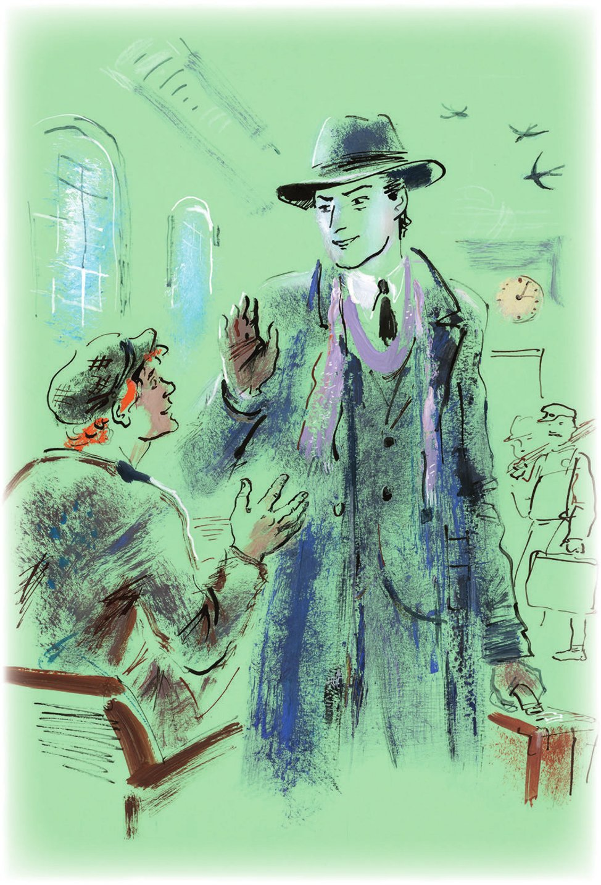
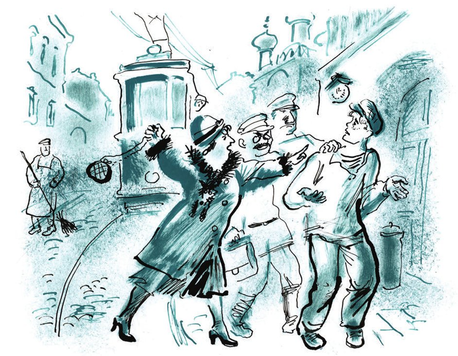

## Kapitel 32: Das Tor der großen Möglichkeiten

An jenem traurigen und hellen Herbsttag, an dem in den Moskauer Grünanlagen die Gärtner die Blumen abschneiden und an die Kinder verteilen, schlief der älteste Sohn des Leutnants Schmidt, Schura Balaganow, auf einer Bank im Wartesaal des Rjasaner Bahnhofs. Er lag da, den Kopf auf die hölzerne <abbr title="die Armlehne, die Armlehnen — бортик, подлокотник">Armlehne</abbr> gelegt. Die zerknitterte Schirmmütze war ihm über die Nase gezogen. Alles an ihm verriet, dass der Bordmechaniker der «Antilope» und Bevollmächtigte für Hufe unglücklich und bettelarm war. An seiner unrasierten Wange klebte ein <abbr title="zersplittert — раздробленный">zersplittertes</abbr> Stück Eierschale. Die <abbr title="der Segeltuchschuh, die Segeltuchschuhe — парусиновая туфля">Segeltuchschuhe</abbr> hatten Form und Farbe verloren und erinnerten eher an moldauische <abbr title="der Bastschuh, die Bastschuhe — постолы, лапти">Bastschuhe</abbr>. Unter der hohen Decke des zweigeschossigen Saals flogen <abbr title="die Schwalbe, die Schwalben — ласточка">Schwalben</abbr>.

Hinter den großen, ungeputzten Fenstern sah man Stellwerke, Signalmasten und andere Gegenstände, die man im Eisenbahnwesen braucht. Gepäckträger liefen los, und bald zog die Bevölkerung des <abbr title="eintreffen (traf ein, ist eingetroffen) — прибывать">eingetroffenen</abbr> Zuges durch den Saal. Als Letzter kam vom Bahnsteig ein Reisender in sauberer Kleidung herein. Unter einem offenen, leichten Regenmantel sah man einen Anzug mit einem winzigen, <abbr title="kaleidoskopartig — калейдоскопический">kaleidoskopartigen</abbr> Karomuster. Die Hosen fielen wie ein Wasserfall auf <abbr title="der Lackschuh, die Lackschuhe — лаковая туфля">Lackschuhe</abbr>. Das ausländische Aussehen des Reisenden vervollständigte ein weicher Hut, ein wenig schräg in die Stirn gerückt. Die Dienste eines Gepäckträgers nahm er nicht in Anspruch und trug den Koffer selbst. Der Reisende schlenderte durch den leer gewordenen Saal und wäre zweifellos in der Vorhalle gelandet, hätte er nicht plötzlich die jämmerliche Gestalt Balaganows bemerkt. Er kniff die Augen zusammen, trat näher und betrachtete eine Weile den Schläfer. Dann hob er vorsichtig, mit zwei behandschuhten Fingern, die Mütze vom Gesicht des Bordmechanikers und lächelte.

— Stehen Sie auf, Graf, man ruft Sie aus dem <abbr title="das Verlies, die Verliese — подземелье, темница">Verlies</abbr>! — sagte er und rüttelte Balaganow wach.

Schura setzte sich auf, rieb sich mit der Hand das Gesicht und erkannte erst dann den Reisenden.

— Kommandeur! — schrie er.

— Nein, nein, — bemerkte Bender und wehrte ihn mit der Handfläche ab, — umarmen Sie mich nicht. Ich bin jetzt stolz.

Balaganow drehte sich um den Kommandeur herum. Er erkannte ihn nicht wieder. Nicht nur der Anzug hatte sich verändert. Ostap war schmaler geworden, in seinen Augen lag eine gewisse <abbr title="die Zerstreutheit — рассеянность">Zerstreutheit</abbr>, das Gesicht war von einer kolonialen <abbr title="die Bräune — загар">Bräune</abbr> bedeckt.

— Ganz schön fein geworden, fein geworden! — rief Balaganow freudig. — Na, so was von fein!

— Ja, ich bin fein geworden, — teilte Bender mit Würde mit. — Sehen Sie sich die Hosen an. Europa, Klasse A! Und haben Sie das gesehen? Der Ringfinger meiner linken Hand ist mit einem <abbr title="der Brillantring, die Brillantringe — бриллиантовый перстень">Brillantring</abbr> geschmückt. Vier Karat. Na, und was sind Ihre Errungenschaften? Immer noch bei den Söhnen?

— Ach, na ja, — <abbr title="herumdrucksen — мяться, мямлить">druckste</abbr> Schura herum, — mehr so <abbr title="der Kleinkram — мелочи">Kleinkram</abbr>.

Im Bahnhofsbüfett bestellte Ostap Weißwein und <abbr title="das Biskuit, die Biskuits — бисквит">Biskuits</abbr> für sich und Bier mit belegten Broten für den Bordmechaniker.

— Sagen Sie, Schura, ehrlich, wie viel Geld brauchen Sie zum Glück? — fragte Ostap. — Rechnen Sie aber alles zusammen.

— Hundert Rubel, — antwortete Balaganow und löste sich nur <abbr title="ungern — неохотно">ungern</abbr> vom Brot mit Wurst.

— Nein, nein, Sie haben mich nicht verstanden. Nicht für heute, sondern überhaupt. Zum Glück. Verstehen Sie? Damit es Ihnen auf der Welt gut geht.

Balaganow dachte lange nach, lächelte zaghaft und erklärte schließlich, dass er zum vollkommenen Glück sechstausendvierhundert Rubel brauche und dass es ihm mit dieser Summe auf der Welt sehr gut gehen werde.

— Schön, — sagte Ostap, — Sie bekommen fünfzigtausend.

Er öffnete auf den Knien eine viereckige Reisetasche und schob Balaganow fünf weiße Bündel zu, die mit Bindfaden verschnürt waren. Dem Bordmechaniker verging sofort der Appetit. Er hörte auf zu essen, <abbr title="verstauen — запрятать">verstaute</abbr> das Geld in den Taschen und nahm die Hände nicht mehr heraus.

— Also doch das Tellerchen? — fragte er <abbr title="entzückt — восхищённо">entzückt</abbr>.

— Ja, ja, das Tellerchen, — antwortete Ostap gleichgültig. — Mit blauem Rand. Der Mandant hat es mir im Maul gebracht. Er hat lange mit dem Schwanz gewedelt, bevor ich mich bereit erklärte, es zu nehmen. Jetzt kommandiere ich die Parade! Ich fühle mich ausgezeichnet.

Die letzten Worte sprach er unsicher aus.

Die Parade, um die Wahrheit zu sagen, wollte nicht <abbr title="gelingen (gelang, ist gelungen) — удаваться">gelingen</abbr>, und der große Kombinator log, wenn er behauptete, er fühle sich ausgezeichnet. <abbr title="zutreffend — справедливый, верный">Zutreffender</abbr> wäre es gewesen zu sagen, dass er eine gewisse <abbr title="die Befangenheit — неловкость, смущение">Befangenheit</abbr> empfand, die er sich jedoch nicht einmal selbst eingestehen wollte.

Seit er sich von Alexander Iwanowitsch bei der Gepäckaufbewahrung getrennt hatte, wo der Untergrund-Millionär sein Köfferchen abgegeben hatte, war ein Monat vergangen.

Gleich in der ersten Stadt, in die Ostap mit den Gefühlen eines Eroberers einzog, konnte er kein Hotelzimmer bekommen.

— Ich zahle, so viel Sie wollen! — sagte der große Kombinator hochmütig.

— Da wird nichts draus, Bürger, — antwortete der Portier. — Der Kongress der <abbr title="der Bodenkundler, die Bodenkundler — почвовед">Bodenkundler</abbr> ist vollzählig angereist, um die <abbr title="die Versuchsstation, die Versuchsstationen — опытная станция">Versuchsstation</abbr> zu besichtigen. Alles ist für die Vertreter der Wissenschaft <abbr title="reservieren — бронировать">reserviert</abbr>.

Und das höfliche Gesicht des Portiers drückte <abbr title="die Ehrfurcht — почтение, благоговение">Ehrfurcht</abbr> vor dem Kongress aus. Ostap hätte am liebsten geschrien, dass er die Hauptperson sei, dass man ihn achten und verehren müsse, dass er in seinem Sack eine Million habe, aber er hielt es für klüger, sich zu beherrschen, und ging in äußerster <abbr title="die Gereiztheit — раздражение">Gereiztheit</abbr> auf die Straße.

Den ganzen Tag fuhr er mit einer Droschke durch die Stadt. Im besten Restaurant schmachtete er anderthalb Stunden im Warten, bis die Bodenkundler, die mit dem gesamten Kongress zu Mittag aßen, vom Tisch aufstanden. Im Theater wurde an diesem Tag eine Vorstellung für Bodenkundler gegeben, und an freie Bürger wurden keine Karten verkauft. Außerdem hätte man Ostap mit einem Sack in der Hand ohnehin nicht in den <abbr title="der Zuschauerraum, die Zuschauerräume — зрительный зал">Zuschauerraum</abbr> gelassen, und wohin mit dem Sack, wusste er nicht. Um nicht im Interesse der Wissenschaft auf der Straße übernachten zu müssen, reiste der Millionär noch am selben Abend ab und schlief sich im internationalen Schlafwagen aus.

Am Morgen stieg Bender in einer großen Stadt an der Wolga aus. Von den Bäumen <abbr title="segeln — слетать, парить">segelten</abbr> gelbe, durchsichtige Blätter, sich wie Schrauben drehend, herab. Die Wolga atmete Wind. In keinem Hotel gab es ein Zimmer.

— Höchstens in einem Monat, — sagten zweifelnd die Hoteldirektoren, solche mit Spitzbärtchen und solche ohne, solche mit Schnurrbart und solche einfach rasiert. — Bis im Kraftwerk das dritte <abbr title="das Aggregat, die Aggregate — агрегат">Aggregat</abbr> <abbr title="montieren — монтировать">montiert</abbr> ist, brauchen Sie gar nicht erst zu hoffen. Alles ist an Fachleute vergeben. Und dann noch der <abbr title="der Bezirkskongress, die Bezirkskongresse — окружной съезд">Bezirkskongress</abbr> des Komsomol. Da können wir nichts machen.

Während der große Kombinator an den hohen <abbr title="das Pult, die Pulte — конторка">Pulten</abbr> der Portiers <abbr title="herumstehen (stand herum, hat herumgestanden) — торчать, стоять без дела">herumstand</abbr>, eilten über die Hoteltreppen Ingenieure, Techniker, ausländische Fachleute und Komsomolzen – Delegierte des Kongresses.

Und wieder verbrachte Ostap den Tag in einer Droschke und wartete ungeduldig auf den Schnellzug, in dem man sich waschen, ausruhen und ein Zeitungsblatt lesen konnte.

Der große Kombinator verbrachte fünfzehn Nächte in verschiedenen Zügen und fuhr von Stadt zu Stadt, weil es nirgends Zimmer gab. An einem Ort wurde ein Hochofen gebaut, am zweiten ein Kühlhaus, am dritten ein Zinkwerk. Überall wimmelte es von geschäftigen Leuten. Am vierten Ort versperrte Ostap ein <abbr title="das Pioniertreffen, die Pioniertreffen — пионерский слёт">Pioniertreffen</abbr> den Weg, und in dem Zimmer, in dem der Millionär einen kurzweiligen Abend mit einer Freundin hätte verbringen können, lärmten Kinder. Unterwegs richtete er sich häuslich ein, schaffte sich einen Koffer für die Million und Reiseutensilien an und <abbr title="sich ausstatten — экипироваться">stattete sich</abbr> aus. Schon plante Ostap eine lange und ruhige Reise nach Wladiwostok, nachdem er ausgerechnet hatte, dass Hin- und Rückfahrt drei Wochen dauern würden, als er plötzlich fühlte, dass er, wenn er sich nicht sofort irgendwo niederließ, an einer rätselhaften Eisenbahnkrankheit sterben würde. Und er tat das, was er immer getan hatte, wenn er der glückliche Besitzer leerer Taschen gewesen war. Er gab sich für einen anderen aus und telegrafierte voraus, dass ein Ingenieur komme oder ein gemeinnütziger Arzt oder ein <abbr title="der Tenor, die Tenöre — тенор">Tenor</abbr> oder ein Schriftsteller. Zu seiner Verwunderung fanden sich für alle Leute, die dienstlich reisten, Zimmer, und Ostap erholte sich ein wenig vom Schaukeln der Züge. Einmal musste er sich, um ein Zimmer zu bekommen, sogar als Sohn des Leutnants Schmidt ausgeben. Nach diesem Vorfall gab sich der große Kombinator trübsinnigen <abbr title="die Betrachtung, die Betrachtungen — размышление">Betrachtungen</abbr> hin.

«Und das ist der Weg eines Millionärs! — dachte er bekümmert. — Wo ist die Achtung? Wo die Ehre? Wo der Ruhm? Wo die Macht?»

Sogar Europa, Klasse A, mit der Ostap vor Balaganow geprahlt hatte – Anzug, Schuhe und Hut –, war in einem <abbr title="das Kommissionsgeschäft, die Kommissionsgeschäfte — комиссионный магазин">Kommissionsgeschäft</abbr> gekauft und hatte bei aller vorzüglichen Qualität einen <abbr title="der Makel, die Makel — изъян, недостаток">Makel</abbr>: Es waren keine eigenen Sachen, keine <abbr title="vertraut — родной, привычный">vertrauten</abbr>, sie stammten <abbr title="aus zweiter Hand — с чужого плеча">aus zweiter Hand</abbr>. Jemand hatte sie schon getragen, vielleicht eine Stunde, eine Minute, aber getragen hatte sie doch ein Fremder. <abbr title="kränkend — обидный">Kränkend</abbr> war auch, dass die Regierung der <abbr title="misslich — бедственный">misslichen</abbr> Lage der Millionäre keinerlei Beachtung schenkte und die Güter des Lebens planmäßig verteilte. Und überhaupt war alles schlecht. Der Bahnhofsvorsteher legte nicht die Hand an die Mütze, wie er es in früheren Zeiten vor jedem Krämer mit einem <abbr title="das Kapitälchen — капиталишко">Kapitälchen</abbr> von fünfzigtausend getan hatte, die Stadtväter kamen nicht ins Hotel, um sich vorzustellen, die Presse beeilte sich nicht mit Interviews und druckte statt der Fotografien der Millionäre die Porträts irgendwelcher Stoßarbeiter, die hundertzwanzig Rubel im Monat verdienten.

Ostap zählte jeden Tag seine Million, und es war immer eine Million minus irgendeiner Kleinigkeit. Er gab sich alle Mühe, aß mehrmals am Tag zu Mittag, trank <abbr title="erlesen — коллекционный, изысканный">erlesene</abbr> Weine, verteilte <abbr title="maßlos — непомерный">maßlose</abbr> Trinkgelder, kaufte einen Ring, eine japanische Vase und einen Pelz mit <abbr title="das Iltisfutter — подбой из хорьков">Iltisfutter</abbr>. Pelz und Vase musste er dem <abbr title="der Etagenkellner, die Etagenkellner — номерной, коридорный">Etagenkellner</abbr> schenken, weil Ostap sich unterwegs nicht gern mit <abbr title="sperrig — громоздкий">sperrigen</abbr> Dingen abgab. Außerdem konnte er sich im Notfall noch eine Menge Pelze und Vasen kaufen. In einem Monat waren jedoch nur sechstausend ausgegeben worden.

Nein! Die Parade wollte entschieden nicht gelingen, obwohl alles an seinem Platz war. Die <abbr title="der Flügelmann, die Flügelleute — линейный (на параде)">Flügelleute</abbr> waren rechtzeitig aufgestellt, die Truppenteile zur angegebenen Zeit eingetroffen, das Orchester spielte.

Aber die <abbr title="das Regiment, die Regimenter — полк">Regimenter</abbr> schauten nicht auf ihn, nicht ihm riefen sie «Hurra», nicht für ihn fuchtelte der <abbr title="der Kapellmeister, die Kapellmeister — капельмейстер">Kapellmeister</abbr> mit den Armen. Ostap gab jedoch nicht auf. Er setzte große Hoffnung auf Moskau.

— Und wie ist es mit Rio de Janeiro? — fragte Balaganow aufgeregt. — Fahren wir hin?

— Zum Teufel damit! — sagte Ostap mit unerwarteter Wut. — Das ist alles erfunden, es gibt kein Rio de Janeiro, und Amerika gibt es nicht, und Europa gibt es nicht, nichts gibt es. Und überhaupt ist die letzte Stadt Schepetowka, an der sich die Wellen des Atlantischen Ozeans brechen.

— <abbr title="na, so was! — ну и дела!">Na, so was</abbr>! — seufzte Balaganow.

— Mir hat ein Arzt alles erklärt, — fuhr Ostap fort, — das Ausland ist ein <abbr title="der Mythos, die Mythen — миф">Mythos</abbr> vom Leben nach dem Tod. Wer dorthin gelangt, kehrt nicht zurück.

— Der reinste Zirkus! — rief Schura, der nichts verstanden hatte. — Ach, wie werde ich jetzt leben! Der arme Panikowski! Er hat zwar die Konvention gebrochen, aber Gott sei mit ihm! Wie hätte sich der Alte gefreut!

— Ich schlage vor, das <abbr title="das Andenken — память">Andenken</abbr> des Verstorbenen durch Aufstehen zu ehren, — sagte Bender.

Die Milchbrüder erhoben sich und standen eine Minute schweigend da, den Blick auf die zerbrochenen Biskuits und das angebissene belegte Brot gesenkt.

Das <abbr title="bedrückend — тягостный">bedrückende</abbr> Schweigen unterbrach Balaganow.

— Wissen Sie, was mit Koslewitsch ist? — sagte er. — Der reinste Zirkus! Er hat die «Antilope» doch wieder zusammengebaut und arbeitet in Tschernomorsk. Er hat einen Brief geschickt. Hier ...

Der Bordmechaniker zog den Brief aus der Mütze.

«Guten Tag, Schura, — schrieb der Fahrer der „Antilope“, — wie leben Sie? Sind Sie immer noch Sohn von L. Sch.? Mir geht es gut, nur gibt es kein Geld, und das Auto hat nach der <abbr title="die Reparatur, die Reparaturen — ремонт">Reparatur</abbr> irgendwelche Launen und arbeitet nur eine Stunde am Tag. Ich repariere es die ganze Zeit, ich habe gar keine Kraft mehr. Die Fahrgäste sind gekränkt. Vielleicht schicken Sie mir, lieber Schura, einen <abbr title="der Ölschlauch, die Ölschläuche — маслопроводный шланг">Ölschlauch</abbr>, und sei es kein neuer. Hier auf dem Markt ist <abbr title="schlechterdings — положительно, решительно">schlechterdings</abbr> keiner zu kriegen. Suchen Sie auf dem Smolensker Markt, dort, wo man alte Schlösser und Schlüssel verkauft. Und wenn es Ihnen schlecht geht, dann kommen Sie, wir werden uns schon irgendwie durchschlagen. Ich stehe an der Ecke der Mehring-Straße, am <abbr title="der Taxistand, die Taxistände — биржа (стоянка)">Taxistand</abbr>. Wo ist jetzt O. B.? Ihr <abbr title="hochachtungsvoll — с уважением">hochachtungsvoll</abbr> Adam Koslewitsch. Ich habe vergessen zu schreiben. Zu mir an den Taxistand sind die Priester gekommen, Kuschakowski und Moroschek. Es gab einen Skandal. A. K.»

— Dann laufe ich jetzt einen Schlauch suchen, — sagte Balaganow besorgt.

— Nicht nötig, — antwortete Ostap, — ich kaufe ihm ein neues Auto. Wir fahren ins Grand Hotel, ich habe telegrafisch ein Zimmer für den <abbr title="der Dirigent, die Dirigenten — дирижёр">Dirigenten</abbr> eines Sinfonieorchesters reserviert. Und Sie muss man neu einkleiden, waschen, einer Generalüberholung unterziehen. Vor Ihnen, Schura, öffnet sich das Tor der großen Möglichkeiten.

Sie traten auf den Kalantschowka-Platz hinaus. Taxis gab es keine. Mit einer Droschke wollte Ostap nicht fahren.

— Das ist die Kutsche der Vergangenheit, — sagte er <abbr title="angewidert — брезгливо">angewidert</abbr>, — mit der kommt man nicht weit. Außerdem wohnen dort im Futter kleine Mäuse.

Sie mussten in die Straßenbahn steigen. Der Wagen war überfüllt. Es war einer jener vom Streit <abbr title="verseucht — заражённый">verseuchten</abbr> Wagen, die häufig durch die Hauptstadt <abbr title="verkehren — курсировать, циркулировать">verkehren</abbr>. Das <abbr title="das Gezänk — склока, свара">Gezänk</abbr> beginnt in ihnen irgendeine rachsüchtige Alte im morgendlichen Gedränge vor Dienstbeginn. Nach und nach werden alle Fahrgäste des Wagens in den Streit hineingezogen, sogar diejenigen, die eine halbe Stunde nach Beginn des <abbr title="der Zwischenfall, die Zwischenfälle — инцидент">Zwischenfalls</abbr> eingestiegen sind. Die böse Alte ist längst ausgestiegen, der Anlass des Streits ist längst verloren gegangen, aber das Geschrei und die gegenseitigen <abbr title="die Beleidigung, die Beleidigungen — оскорбление">Beleidigungen</abbr> gehen weiter, und in den <abbr title="der Wortwechsel, die Wortwechsel — перебранка">Wortwechsel</abbr> treten immer neue <abbr title="der Kader, die Kader — кадры">Kader</abbr> von Fahrgästen ein. Und in einem solchen Wagen verstummt das Schimpfen bis spät in die Nacht nicht.

Die erregten Fahrgäste drängten Balaganow schnell von Ostap ab, und bald baumelten die Milchbrüder an den entgegengesetzten Enden des Wagens, eingeklemmt zwischen Brüsten und Körben. Ostap hing an einem <abbr title="der Halteriemen, die Halteriemen — ремень (в трамвае)">Halteriemen</abbr> und zerrte mühsam an seinem Koffer, den die <abbr title="die Strömung, die Strömungen — течение">Strömung</abbr> ständig davontrug.

Plötzlich übertönte das gewohnte Straßenbahngeschimpfe ein weibliches Geheul von der Seite, wo Balaganow hin und her schwankte:

— Gestohlen!!! Haltet ihn! Da steht er doch!

Alle drehten die Köpfe. Zum Tatort drängten sich, vor Neugier keuchend, die Liebhaber solcher Dinge. Ostap sah das verdutzte Gesicht Balaganows. Der Bordmechaniker begriff selbst noch nicht, was geschehen war, aber man hielt ihn schon an der Hand fest, in der eine billige Damenhandtasche mit einem feinen Bronzekettchen fest umklammert war.

— Bandit! — schrie die Frau. — Kaum habe ich mich umgedreht, da hat er ...

Der Besitzer von fünfzigtausend hatte eine Handtasche gestohlen, in der sich eine <abbr title="die Puderdose, die Puderdosen — пудреница">Puderdose</abbr> aus <abbr title="das Schildpatt — черепаха (материал)">Schildpatt</abbr>, ein Gewerkschaftsbuch und 1 Rubel 70 Kopeken Bargeld befanden. Der Wagen hielt. Die Liebhaber schleppten Balaganow zum Ausgang. Als er an Ostap vorbeikam, flüsterte Schura kläglich:

— Was ist das denn? Ich hab's doch ganz mechanisch gemacht.

— Ich zeig dir gleich mechanisch! — sagte ein Liebhaber mit Kneifer und Aktentasche und schlug dem Bordmechaniker genüsslich in den <abbr title="der Nacken, die Nacken — шея, затылок">Nacken</abbr>.

Durch das Fenster sah Ostap, wie ein Milizionär mit schnellen Schritten auf die Gruppe zukam und den Verbrecher über das Pflaster abführte.

Der große Kombinator wandte sich ab.

---

### Neue Wörter

- **die Armlehne, die Armlehnen** — бортик, подлокотник
- **zersplittert** — раздробленный
- **der Segeltuchschuh, die Segeltuchschuhe** — парусиновая туфля
- **der Bastschuh, die Bastschuhe** — постолы, лапти
- **die Schwalbe, die Schwalben** — ласточка
- **eintreffen (traf ein, ist eingetroffen)** — прибывать
- **kaleidoskopartig** — калейдоскопический
- **der Lackschuh, die Lackschuhe** — лаковая туфля
- **das Verlies, die Verliese** — подземелье, темница
- **die Zerstreutheit** — рассеянность
- **die Bräune** — загар
- **der Brillantring, die Brillantringe** — бриллиантовый перстень
- **herumdrucksen** — мяться, мямлить
- **der Kleinkram** — мелочи
- **das Biskuit, die Biskuits** — бисквит
- **ungern** — неохотно
- **verstauen** — запрятать
- **entzückt** — восхищённо
- **gelingen (gelang, ist gelungen)** — удаваться
- **zutreffend** — справедливый, верный
- **die Befangenheit** — неловкость, смущение
- **der Bodenkundler, die Bodenkundler** — почвовед
- **die Versuchsstation, die Versuchsstationen** — опытная станция
- **reservieren** — бронировать
- **die Ehrfurcht** — почтение, благоговение
- **die Gereiztheit** — раздражение
- **der Zuschauerraum, die Zuschauerräume** — зрительный зал
- **segeln** — слетать, парить
- **das Aggregat, die Aggregate** — агрегат
- **montieren** — монтировать
- **der Bezirkskongress, die Bezirkskongresse** — окружной съезд
- **das Pult, die Pulte** — конторка
- **herumstehen (stand herum, hat herumgestanden)** — торчать, стоять без дела
- **das Pioniertreffen, die Pioniertreffen** — пионерский слёт
- **sich ausstatten** — экипироваться
- **der Tenor, die Tenöre** — тенор
- **die Betrachtung, die Betrachtungen** — размышление
- **das Kommissionsgeschäft, die Kommissionsgeschäfte** — комиссионный магазин
- **der Makel, die Makel** — изъян, недостаток
- **vertraut** — родной, привычный
- **aus zweiter Hand** — с чужого плеча
- **kränkend** — обидный
- **misslich** — бедственный
- **das Kapitälchen** — капиталишко
- **erlesen** — коллекционный, изысканный
- **maßlos** — непомерный
- **das Iltisfutter** — подбой из хорьков
- **der Etagenkellner, die Etagenkellner** — номерной, коридорный
- **sperrig** — громоздкий
- **der Flügelmann, die Flügelleute** — линейный (на параде)
- **das Regiment, die Regimenter** — полк
- **der Kapellmeister, die Kapellmeister** — капельмейстер
- **na, so was!** — ну и дела!
- **der Mythos, die Mythen** — миф
- **das Andenken** — память
- **bedrückend** — тягостный
- **die Reparatur, die Reparaturen** — ремонт
- **der Ölschlauch, die Ölschläuche** — маслопроводный шланг
- **schlechterdings** — положительно, решительно
- **der Taxistand, die Taxistände** — биржа (стоянка)
- **hochachtungsvoll** — с уважением
- **der Dirigent, die Dirigenten** — дирижёр
- **angewidert** — брезгливо
- **verseucht** — заражённый
- **verkehren** — курсировать, циркулировать
- **das Gezänk** — склока, свара
- **der Zwischenfall, die Zwischenfälle** — инцидент
- **die Beleidigung, die Beleidigungen** — оскорбление
- **der Wortwechsel, die Wortwechsel** — перебранка
- **der Kader, die Kader** — кадры
- **der Halteriemen, die Halteriemen** — ремень (в трамвае)
- **die Strömung, die Strömungen** — течение
- **die Puderdose, die Puderdosen** — пудреница
- **das Schildpatt** — черепаха (материал)
- **der Nacken, die Nacken** — шея, затылок

[← Zurück](kapitel-32.md) · [Inhalt](README.md) · [Weiter →](kapitel-34.md)
