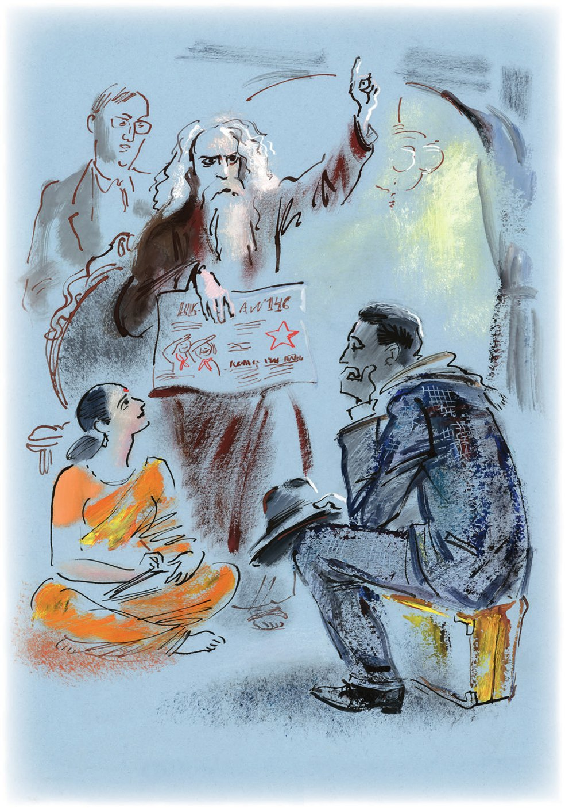

## Kapitel 33: Der indische Gast

Im viereckigen, geschlossenen Hof des Grand Hotels hörte man Küchengeklapper, das Zischen des Dampfes und Rufe: «Zwei Teegedecke auf Nummer sechzehn», in den weißen Korridoren aber war es hell und still wie im <abbr title="der Schaltraum, die Schalträume — распределительный зал">Schaltraum</abbr> eines Kraftwerks. In hundertfünfzig Zimmern schlief der Kongress der Bodenkundler, der von seiner Exkursion zurückgekehrt war; dreißig Zimmer waren den Delegationen ausländischer Kaufleute <abbr title="zuweisen (wies zu, hat zugewiesen) — отводить, предоставлять">zugewiesen</abbr>, die die brennende Frage klärten, ob man mit der Sowjetunion letzten Endes gewinnbringend Handel treiben könne; das beste <abbr title="das Appartement, die Appartements — апартамент">Appartement</abbr> mit vier Zimmern bewohnte ein berühmter indischer Dichter und Philosoph, und in einem kleinen Zimmer, das für den Dirigenten eines Sinfonieorchesters bestimmt war, schlief Ostap Bender.

Er lag angezogen auf einer <abbr title="die Plüschdecke, die Plüschdecken — плюшевое одеяло">Plüschdecke</abbr> und drückte den Koffer mit der Million an die Brust. Im Laufe der Nacht hatte der große Kombinator den gesamten <abbr title="der Sauerstoff — кислород">Sauerstoff</abbr> des Zimmers eingeatmet, und die übrig gebliebenen chemischen Elemente konnte man nur noch aus Höflichkeit <abbr title="der Stickstoff — азот">Stickstoff</abbr> nennen. Es roch nach saurem Wein, nach höllischen Frikadellen und nach noch etwas <abbr title="unbeschreiblich — непередаваемо">unbeschreiblich</abbr> Ekelhaftem. Ostap stöhnte und drehte sich um. Der Koffer fiel auf den Boden. Ostap öffnete schnell die Augen.

— Was war denn das? — murmelte er und <abbr title="Grimassen schneiden — гримасничать">schnitt Grimassen</abbr>. — <abbr title="der Husarenstreich, die Husarenstreiche — гусарство, лихая выходка">Husarenstreiche</abbr> im Restaurantsaal! Und sogar, wie es scheint, irgendein <abbr title="das Gardekavalleristengehabe — кавалергардство">Gardekavalleristengehabe</abbr>! Pfui! Ich habe mich benommen wie ein Kaufmann der zweiten <abbr title="die Gilde, die Gilden — гильдия">Gilde</abbr>! Mein Gott, habe ich etwa die <abbr title="der/die Anwesende, die Anwesenden — присутствующий">Anwesenden</abbr> beleidigt? Da hat irgendein Dummkopf geschrien: «Bodenkundler, aufstehen!», und dann hat er geweint und geschworen, dass er im <abbr title="im Herzen — в душе">Herzen</abbr> selbst ein Bodenkundler sei. Natürlich war das ich! Ja, aber aus welchem <abbr title="der Anlass, die Anlässe — повод">Anlass</abbr>?..

Und er erinnerte sich, dass er gestern, als er beschlossen hatte, ein <abbr title="standesgemäß — подобающий, соответствующий положению">standesgemäßes</abbr> Leben zu beginnen, sich vorgenommen hatte, eine Villa im maurischen Stil zu bauen. Den Vormittag hatte er in grandiosen Träumen verbracht. Er stellte sich ein Haus mit <abbr title="das Minarett, die Minarette — минарет">Minaretten</abbr> vor, einen Pförtner mit dem Gesicht eines Denkmals, einen kleinen <abbr title="der Salon, die Salons — гостиная">Salon</abbr>, ein <abbr title="das Billardzimmer, die Billardzimmer — бильярдная">Billardzimmer</abbr> und irgendeinen Konferenzsaal. In der <abbr title="die Grundstücksabteilung, die Grundstücksabteilungen — земельный отдел">Grundstücksabteilung</abbr> des Sowjets erklärte man dem großen Kombinator, dass man ein <abbr title="das Grundstück, die Grundstücke — участок">Grundstück</abbr> bekommen könne. Doch schon im <abbr title="das Baubüro, die Baubüros — строительная контора">Baubüro</abbr> brach alles zusammen. Der Pförtner stürzte, mit seiner steinernen Fratze polternd, der goldene Konferenzsaal geriet ins <abbr title="ins Wanken geraten — зашататься">Wanken</abbr>, und die Minarette fielen in sich zusammen.

— Sind Sie eine Privatperson? — fragte man den Millionär im Büro.

— Ja, — antwortete Ostap, — eine scharf ausgeprägte Individualität.

— Leider bauen wir nur für Kollektive und Organisationen.

— Für genossenschaftliche, gesellschaftliche und wirtschaftliche? — fragte Bender <abbr title="verbittert — с горечью">verbittert</abbr>.

— Ja, für die.

— Und ich?

— Sie bauen selber.

— Ja, aber wo nehme ich die Steine her, die <abbr title="der Fensterriegel, die Fensterriegel — шпингалет">Fensterriegel</abbr>? Und schließlich die <abbr title="die Fußleiste, die Fußleisten — плинтус">Fußleisten</abbr>?

— Beschaffen Sie sie irgendwie. Obwohl das schwierig ist. Die <abbr title="das Kontingent, die Kontingente — контингент, лимит">Kontingente</abbr> sind schon nach den Anforderungen der Industrie und der Genossenschaften verteilt.

<abbr title="aller Wahrscheinlichkeit nach — по всей вероятности">Aller Wahrscheinlichkeit nach</abbr> war das auch der Grund für die abscheulichen nächtlichen Husarenstreiche.

Im Liegen zog Ostap sein Notizbüchlein hervor und begann, die Ausgaben seit dem <abbr title="der Erhalt — получение">Erhalt</abbr> der Million zusammenzurechnen. Auf der ersten Seite stand eine denkwürdige <abbr title="die Eintragung, die Eintragungen — запись">Eintragung</abbr>:

Kamel ............. 180 R.

Hammel ............. 30 R.

Kumys ............... 1 R. 75 K.

Summe ............. 211 R. 75 K.

Das Weitere war nicht besser. Pelz, <abbr title="die Soße, die Soßen — соус">Soße</abbr>, Eisenbahnfahrkarte, wieder Soße, wieder Fahrkarte, drei Turbane, gekauft <abbr title="für schlechte Zeiten — на чёрный день">für schlechte Zeiten</abbr>, Droschken, die Vase und allerlei Unsinn. Wenn man die fünfzigtausend für Balaganow nicht mitrechnete, die ihm kein Glück gebracht hatten, war die Million noch da.

— Man lässt mich keine <abbr title="die Kapitalanlage, die Kapitalanlagen — капитальное вложение">Kapitalanlagen</abbr> machen! — empörte sich Ostap. — Man lässt mich nicht! Vielleicht sollte ich ein intellektuelles Leben führen wie mein Freund Lochankin? Schließlich habe ich materielle Werte schon <abbr title="anhäufen — накопить">angehäuft</abbr>, jetzt muss ich <abbr title="nach und nach — помаленьку">nach und nach</abbr> geistige Werte ansammeln. Ich muss sofort herausfinden, worin der Sinn des Lebens besteht.

Er erinnerte sich, dass sich in der Hotelhalle den ganzen Tag junge Mädchen drängten, die mit dem angereisten indischen Philosophen über die Seele sprechen wollten.

— Ich gehe zum Inder, — beschloss er. — Dann erfahre ich endlich, worum es geht. Das ist zwar <abbr title="die Angeberei — пижонство, позёрство">Angeberei</abbr>, aber einen anderen Ausweg gibt es nicht.

Ohne sich von seinem Koffer zu trennen, ging Bender, so wie er war, im zerknitterten Anzug, in die <abbr title="die Beletage — бельэтаж">Beletage</abbr> hinunter und klopfte an die Tür des großen Mannes. Ein Dolmetscher öffnete ihm.

— Empfängt der Philosoph? — fragte Ostap.

— Das kommt darauf an, wen, — antwortete der Dolmetscher höflich. — Sind Sie eine Privatperson?

— Nein, nein, — sagte der große Kombinator erschrocken, — ich komme von einer Genossenschaftsorganisation.

— Sind Sie mit einer Gruppe hier? Wie viele Personen sind Sie? Wissen Sie, dem Meister fällt es schwer, alle Einzelpersonen zu empfangen. Er unterhält sich lieber ...

— Mit einem Kollektiv? — <abbr title="aufgreifen (griff auf, hat aufgegriffen) — подхватить">griff</abbr> Ostap auf. — Gerade mich hat das Kollektiv <abbr title="bevollmächtigen — уполномочить">bevollmächtigt</abbr>, eine wichtige grundsätzliche Frage zum Sinn des Lebens zu klären.

Der Dolmetscher ging hinaus und kam nach fünf Minuten zurück. Er zog die <abbr title="die Portiere, die Portieren — портьера">Portiere</abbr> beiseite und sagte feierlich:

— Es trete die Genossenschaftsorganisation ein, die zu erfahren wünscht, worin der Sinn des Lebens besteht.

In einem Sessel mit hoher, unbequemer, geschnitzter Lehne saß der große Philosoph und Dichter in einer braunen <abbr title="die Samtkutte, die Samtkutten — бархатная ряса">Samtkutte</abbr> und einer ebensolchen Zipfelmütze. Sein Gesicht war dunkel und zart, die Augen aber schwarz wie die eines <abbr title="der Unterleutnant, die Unterleutnants — подпоручик">Unterleutnants</abbr>. Der Bart, weiß und breit wie eine <abbr title="die Frackbrust — фрачная манишка">Frackbrust</abbr>, bedeckte die Brust. Eine <abbr title="die Stenotypistin, die Stenotypistinnen — стенографистка">Stenotypistin</abbr> saß zu seinen Füßen. Zwei Dolmetscher, ein Inder und ein Engländer, hatten zu beiden Seiten Platz genommen.

Beim Anblick Ostaps mit dem Koffer rutschte der Philosoph unruhig in seinem Sessel hin und her und flüsterte dem Dolmetscher besorgt etwas zu. Die Stenotypistin begann eilig mitzuschreiben, und der Dolmetscher wandte sich an den großen Kombinator:

— Der Meister möchte wissen, ob im Koffer des <abbr title="der Ankömmling, die Ankömmlinge — пришелец">Ankömmlings</abbr> Lieder und <abbr title="die Sage, die Sagen — сага, сказание">Sagen</abbr> enthalten sind und ob der Ankömmling sie vorzulesen gedenkt, denn dem Meister hat man schon viele Lieder und Sagen vorgelesen, und er kann sie nicht mehr hören.

— Sagen Sie dem Meister, dass keine Sagen da sind, — antwortete Ostap <abbr title="ehrerbietig — почтительно">ehrerbietig</abbr>.

Der schwarzäugige <abbr title="der Greis, die Greise — старец">Greis</abbr> wurde noch unruhiger, redete lebhaft und begann ängstlich mit dem Finger auf den Koffer zu zeigen.

— Der Meister fragt, — begann der Dolmetscher, — ob der Ankömmling vorhat, sich bei ihm im Zimmer <abbr title="sich einquartieren — поселиться">einzuquartieren</abbr>, denn zu ihm ist noch nie jemand mit einem Koffer zur <abbr title="die Audienz, die Audienzen — приём, аудиенция">Audienz</abbr> gekommen.

Und erst nachdem Ostap den Dolmetscher beruhigt hatte und der Dolmetscher den Philosophen, ließ die <abbr title="die Anspannung — напряжение">Anspannung</abbr> nach, und das Gespräch begann.

— Bevor er Ihre Frage nach dem Sinn des Lebens beantwortet, — sagte der Dolmetscher, — möchte der Meister einige Worte über die Volksbildung in Indien sagen.

— Richten Sie dem Meister aus, — teilte Ostap mit, — dass mich das Problem der Volksbildung seit meiner Kindheit bewegt.

Der Philosoph schloss die Augen und begann gemächlich zu sprechen. Die erste Stunde sprach er Englisch, die zweite Bengalisch. Manchmal fing er an, mit leiser, angenehmer Stimme zu singen, und einmal stand er sogar auf, hob seine Kutte an und machte einige Tanzbewegungen, die offenbar die Spiele der Schulkinder im <abbr title="der Pandschab — Пенджаб">Pandschab</abbr> darstellen sollten. Dann setzte er sich und schloss wieder die Augen, und Ostap hörte lange die Übersetzung an. Anfangs nickte Ostap höflich, dann schaute er schläfrig aus dem Fenster und begann schließlich, sich zu <abbr title="sich zerstreuen — развлекаться">zerstreuen</abbr>: Er <abbr title="klimpern — перебирать, звенеть">klimperte</abbr> in der Tasche mit dem Kleingeld, bewunderte seinen Ring und zwinkerte sogar ziemlich deutlich der hübschen Stenotypistin zu, worauf diese noch schneller mit dem Bleistift kritzelte.

— Und wie steht es nun mit dem Sinn des Lebens? — fragte der Millionär, als er einen günstigen Augenblick <abbr title="erhaschen — улучить">erhascht</abbr> hatte.

— Der Meister möchte zuerst, — erklärte der Dolmetscher, — den Ankömmling mit dem umfangreichen Material bekannt machen, das er bei der Besichtigung des Volksbildungswesens in der UdSSR gesammelt hat.

— Richten Sie Seiner Wohlgeboren aus, — antwortete Ostap, — dass der Ankömmling nichts dagegen hat.

Und die Maschine setzte sich wieder in Bewegung. Der Meister redete, sang Pionierlieder, zeigte eine Wandzeitung, die ihm die Kinder der 146. Arbeitsschule überreicht hatten, und vergoss einmal sogar ein paar Tränen. Die Dolmetscher brummten zweistimmig, die Stenotypistin schrieb, und Ostap reinigte sich zerstreut die Fingernägel.

Endlich <abbr title="husten — кашлять">hustete</abbr> Ostap laut.

— Wissen Sie, — sagte er, — Sie brauchen nicht mehr zu übersetzen. Ich verstehe auf einmal irgendwie Bengalisch. Wenn es um den Sinn des Lebens geht, dann übersetzen Sie wieder.

Als man dem Philosophen Ostaps <abbr title="beharrlich — настойчивый">beharrlichen</abbr> Wunsch bestätigte, geriet der schwarzäugige Greis in Aufregung.

— Der Meister sagt, — erklärte der Dolmetscher, — dass er selbst in Ihr großes Land gekommen ist, um zu erfahren, worin der Sinn des Lebens besteht. Nur dort, wo die Volksbildung auf eine solche Höhe gebracht ist wie bei Ihnen, wird das Leben <abbr title="sinnvoll — осмысленный">sinnvoll</abbr>. Das Kollektiv ...

— Auf Wiedersehen, — sagte der große Kombinator schnell, — richten Sie dem Meister aus, dass der Ankömmling um die Erlaubnis bittet, sich sofort zu entfernen.

Aber der Philosoph sang bereits mit zarter Stimme den Budjonny-Marsch, den er von sowjetischen Kindern gelernt hatte. Und Ostap entfernte sich ohne Erlaubnis.

— Krischna! — rief der große Kombinator und lief in seinem Zimmer auf und ab. — Wischnu! Was geht auf der Welt vor? Wo ist die große, hausgesponnene Wahrheit? Oder bin ich vielleicht ein Dummkopf und verstehe nichts, und das Leben ist dumm und <abbr title="planlos — бессистемно">planlos</abbr> vergangen? Ein echter Inder, sehen Sie mal, weiß alles über unser <abbr title="weitläufig — обширный">weitläufiges</abbr> Land, und ich <abbr title="herunterleiern — долбить, твердить">leiere</abbr> wie der indische Gast in der Oper immer dasselbe herunter: «Unzählbar sind die flammenden Diamanten in steinernen <abbr title="der Lagerschuppen, die Lagerschuppen — лабаз, амбар">Lagerschuppen</abbr>». Wie widerlich!

An diesem Tag aß Ostap ohne Wodka zu Mittag und ließ zum ersten Mal den Koffer im Zimmer. Dann saß er still auf dem Fensterbrett und betrachtete interessiert die gewöhnlichen Passanten, die wie <abbr title="das Eichhörnchen, die Eichhörnchen — белка">Eichhörnchen</abbr> in den Autobus sprangen.

In der Nacht wachte der große Kombinator plötzlich auf und setzte sich im Bett auf. Es war still, nur aus dem Restaurant drang durch das Schlüsselloch ein schwermütiger <abbr title="der Boston — бостон (вальс)">Boston</abbr>.

— Wie konnte ich das nur vergessen! — sagte er ärgerlich.

Dann lachte er, machte Licht und schrieb schnell ein Telegramm: «TSCHERNOMORSK. SOSSJA SINIZKAJA. WEGEN LEBENSIRRTUM BEREIT FLIEGEN TSCHERNOMORSK FLÜGELN LIEBE BLITZANTWORT MOSKAU GRANDHOTEL BENDER.»

Er klingelte und verlangte, dass das Telegramm sofort als Blitztelegramm abgeschickt werde.

Sossja antwortete nicht. Auch auf die anderen Telegramme, die in demselben verzweifelten und lyrischen Ton gehalten waren, kam keine Antwort.

---

### Neue Wörter

- **der Schaltraum, die Schalträume** — распределительный зал
- **zuweisen (wies zu, hat zugewiesen)** — отводить, предоставлять
- **das Appartement, die Appartements** — апартамент
- **die Plüschdecke, die Plüschdecken** — плюшевое одеяло
- **der Sauerstoff** — кислород
- **der Stickstoff** — азот
- **unbeschreiblich** — непередаваемо
- **Grimassen schneiden** — гримасничать
- **der Husarenstreich, die Husarenstreiche** — гусарство, лихая выходка
- **das Gardekavalleristengehabe** — кавалергардство
- **die Gilde, die Gilden** — гильдия
- **der/die Anwesende, die Anwesenden** — присутствующий
- **im Herzen** — в душе
- **der Anlass, die Anlässe** — повод
- **standesgemäß** — подобающий, соответствующий положению
- **das Minarett, die Minarette** — минарет
- **der Salon, die Salons** — гостиная
- **das Billardzimmer, die Billardzimmer** — бильярдная
- **die Grundstücksabteilung, die Grundstücksabteilungen** — земельный отдел
- **das Grundstück, die Grundstücke** — участок
- **das Baubüro, die Baubüros** — строительная контора
- **ins Wanken geraten** — зашататься
- **verbittert** — с горечью
- **der Fensterriegel, die Fensterriegel** — шпингалет
- **die Fußleiste, die Fußleisten** — плинтус
- **das Kontingent, die Kontingente** — контингент, лимит
- **aller Wahrscheinlichkeit nach** — по всей вероятности
- **der Erhalt** — получение
- **die Eintragung, die Eintragungen** — запись
- **die Soße, die Soßen** — соус
- **für schlechte Zeiten** — на чёрный день
- **die Kapitalanlage, die Kapitalanlagen** — капитальное вложение
- **anhäufen** — накопить
- **nach und nach** — помаленьку
- **die Angeberei** — пижонство, позёрство
- **die Beletage** — бельэтаж
- **aufgreifen (griff auf, hat aufgegriffen)** — подхватить
- **bevollmächtigen** — уполномочить
- **die Portiere, die Portieren** — портьера
- **die Samtkutte, die Samtkutten** — бархатная ряса
- **der Unterleutnant, die Unterleutnants** — подпоручик
- **die Frackbrust** — фрачная манишка
- **die Stenotypistin, die Stenotypistinnen** — стенографистка
- **der Ankömmling, die Ankömmlinge** — пришелец
- **die Sage, die Sagen** — сага, сказание
- **ehrerbietig** — почтительно
- **der Greis, die Greise** — старец
- **sich einquartieren** — поселиться
- **die Audienz, die Audienzen** — приём, аудиенция
- **die Anspannung** — напряжение
- **der Pandschab** — Пенджаб
- **sich zerstreuen** — развлекаться
- **klimpern** — перебирать, звенеть
- **erhaschen** — улучить
- **husten** — кашлять
- **beharrlich** — настойчивый
- **sinnvoll** — осмысленный
- **planlos** — бессистемно
- **weitläufig** — обширный
- **herunterleiern** — долбить, твердить
- **der Lagerschuppen, die Lagerschuppen** — лабаз, амбар
- **das Eichhörnchen, die Eichhörnchen** — белка
- **der Boston** — бостон (вальс)

[← Zurück](kapitel-33.md) · [Inhalt](README.md) · [Weiter →](kapitel-35.md)
