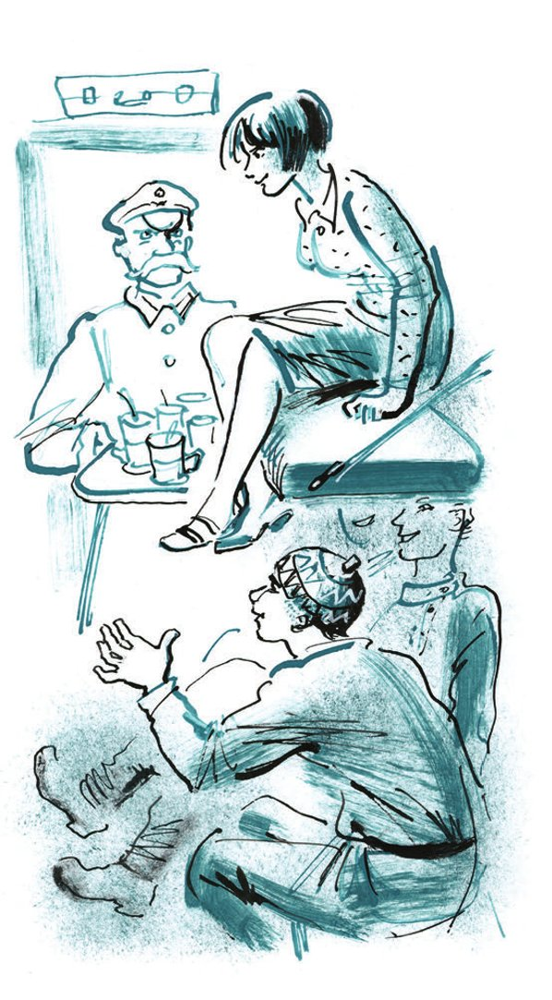
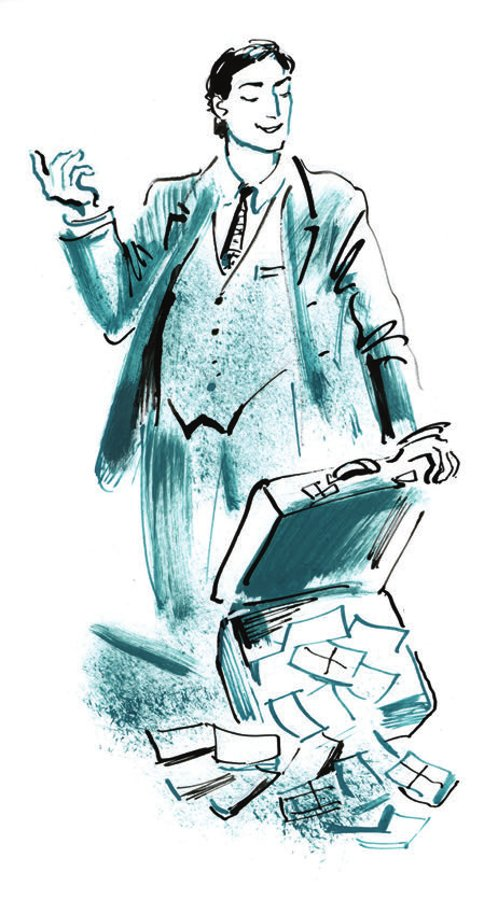
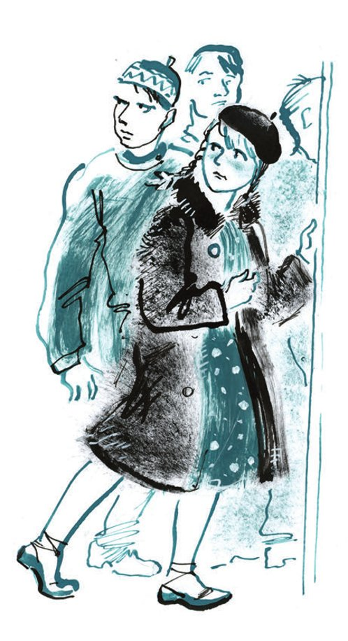

## Kapitel 34: Freundschaft mit der Jugend

Der Zug fuhr nach Tschernomorsk.

Der erste Fahrgast zog das Jackett aus, hängte es an den kupfernen <abbr title="der Schnörkel, die Schnörkel — завитушка">Schnörkel</abbr> der <abbr title="die Gepäckablage, die Gepäckablagen — багажная полка">Gepäckablage</abbr>, streifte dann die Stiefel ab, wobei er seine dicken Beinchen <abbr title="abwechselnd — поочерёдно">abwechselnd</abbr> fast bis ans Gesicht hob, und zog Pantoffeln mit <abbr title="die Lasche, die Laschen — язычок (обуви)">Laschen</abbr> an.

— Haben Sie die Geschichte von dem <abbr title="der Landvermesser, die Landvermesser — землемер">Landvermesser</abbr> aus Woronesch gehört, der sich als Verwandter des japanischen Mikado entpuppte? — fragte er und lächelte schon im Voraus.

Der zweite und der dritte Fahrgast rückten näher. Der vierte Fahrgast lag bereits auf dem oberen Liegesitz unter einer <abbr title="kratzig — колючий">kratzigen</abbr> himbeerroten Decke und schaute <abbr title="missmutig — недовольно">missmutig</abbr> in eine Illustrierte.

— Haben Sie wirklich nichts davon gehört? Eine Zeit lang hat man viel darüber geredet. Das war ein gewöhnlicher Landvermesser: eine Frau, ein Zimmer, hundertzwanzig Rubel Gehalt. Nachname Bigussow. Ein gewöhnlicher, na, ganz und gar nicht bemerkenswerter Mensch, sogar, wenn Sie es wissen wollen, unter uns gesagt, ein Flegel. Eines Tages kommt er vom Dienst nach Hause, und in seinem Zimmer sitzt ein Japaner, in so einem, unter uns gesagt, <abbr title="vortrefflich — отличный">vortrefflichen</abbr> Anzug, mit Brille und, wenn Sie es wissen wollen, in Schuhen aus <abbr title="das Schlangenleder — змеиная кожа">Schlangenleder</abbr>, der letzte Schrei. «Ihr Nachname ist Bigussow?», fragt der Japaner. «Ja», sagt Bigussow. «Und Vorname und Vatersname?» – «Soundso», antwortet er. «Richtig», sagt der Japaner, «in diesem Fall wären Sie wohl so freundlich, Ihren Kittel auszuziehen, ich muss Ihren nackten Rumpf besichtigen.» – «Bitte sehr», sagt er. Na, unter uns gesagt, wenn Sie es wissen wollen, den Rumpf hat sich der Japaner gar nicht angesehen, sondern sich gleich auf das <abbr title="das Muttermal, die Muttermale — родимое пятно">Muttermal</abbr> gestürzt. So ein Mal hatte Bigussow, an der Seite. Der Japaner sieht es sich durch ein <abbr title="das Vergrößerungsglas, die Vergrößerungsgläser — увеличительное стекло">Vergrößerungsglas</abbr> an, wird blass und sagt: «Ich gratuliere Ihnen, Bürger Bigussow, und erlauben Sie mir, Ihnen ein Paket und einen Brief zu <abbr title="überreichen — вручать">überreichen</abbr>.» Die Frau hat natürlich das Paket aufgemacht. Und da liegt, wenn Sie es wissen wollen, in <abbr title="der Hobelspan, die Hobelspäne — стружка">Hobelspänen</abbr> ein japanisches <abbr title="zweischneidig — обоюдоострый">zweischneidiges</abbr> Schwert. «Wieso denn ein Schwert für mich?», fragte der Landvermesser. «Lesen Sie mal den Brief», sagt er. «Da steht alles drin. Sie sind ein <abbr title="der Samurai, die Samurai — самурай">Samurai</abbr>.» Da ist auch Bigussow blass geworden. Woronesch ist, wenn Sie es wissen wollen, kein besonders großes Zentrum. Unter uns gesagt, wie kann man da zu Samurais stehen? Höchst ablehnend. Na, nichts zu machen. Bigussow nimmt den Brief, bricht vierzehn <abbr title="das Wachssiegel, die Wachssiegel — восковая печать">Wachssiegel</abbr> auf und liest ihn. Und was meinen Sie? Es stellte sich heraus, dass genau vor sechsunddreißig Jahren ein japanischer Halbprinz <abbr title="inkognito — инкогнито">inkognito</abbr> durch das Gouvernement Woronesch gereist war. Na, natürlich hat sich, unter uns gesagt, Seine Hoheit mit einem Woronescher Mädchen eingelassen und inkognito ein Kind mit ihr gezeugt. Und er wollte sie sogar heiraten, nur hat der Mikado es per <abbr title="chiffriert — шифрованный">chiffriertem</abbr> Telegramm verboten. Der Halbprinz musste abreisen, und das Kind blieb <abbr title="unehelich — незаконный, внебрачный">unehelich</abbr>. Das war eben Bigussow. Und nun, nach so vielen Jahren, lag der Halbprinz im Sterben, und da gab es, <abbr title="wie zum Trotz — как назло">wie zum Trotz</abbr>, keine ehelichen Kinder, niemanden, dem er sein Erbe <abbr title="vermachen — передать по наследству, завещать">vermachen</abbr> konnte, und außerdem erlosch ein berühmtes Geschlecht, was für einen Japaner das Schlimmste ist. Na, da musste man sich an Bigussow erinnern. Da ist einem Menschen das Glück <abbr title="in den Schoß fallen — привалить (о счастье)">in den Schoß gefallen</abbr>! Jetzt, sagt man, ist er schon in Japan. Der Alte ist gestorben. Und Bigussow ist jetzt Prinz, Verwandter des Mikado und hat außerdem noch, unter uns gesagt, eine Million <abbr title="der Yen, die Yen — иена">Yen</abbr> in bar bekommen. Eine Million! So einem Dummkopf!

— Wenn man mir eine Million Rubel gäbe! — sagte der zweite Fahrgast und zappelte mit den Beinen. — Ich würde denen zeigen, was man mit einer Million macht!

In der Lücke zwischen den oberen Liegen erschien der Kopf des vierten Fahrgastes. Er betrachtete aufmerksam den Mann, der genau wusste, was man mit einer Million machen kann, und verbarg sich, ohne etwas gesagt zu haben, wieder hinter seiner Illustrierten.

— Ja, — sagte der dritte Fahrgast und öffnete ein Eisenbahntütchen mit zwei <abbr title="einzeln — индивидуальный">einzeln</abbr> verpackten <abbr title="der Zwieback, die Zwiebäcke — сухарь">Zwiebäcken</abbr>, — es gibt die verschiedensten Fakten auf dem Gebiet des <abbr title="der Geldumlauf — денежное обращение">Geldumlaufs</abbr>. Einem Moskauer Fräulein ist in Warschau ein Onkel gestorben und hat ihr ein Millionenerbe hinterlassen, und sie wusste nicht einmal davon. Aber dort, im Ausland, hat man es <abbr title="wittern — пронюхать, учуять">gewittert</abbr>, und schon nach einem Monat tauchte in Moskau ein ziemlich <abbr title="ansehnlich — приличный, видный">ansehnlicher</abbr> Ausländer auf. Dieses <abbr title="das Früchtchen, die Früchtchen — голубчик (ирон.)">Früchtchen</abbr> beschloss, das Mädchen zu heiraten, bevor es von dem Erbe erfuhr. Sie hatte aber in Moskau einen Verlobten, auch einen ziemlich hübschen jungen Mann, vom <abbr title="das Eichamt, die Eichämter — Палата мер и весов">Eichamt</abbr>. Sie liebte ihn sehr und wollte natürlich keinen anderen heiraten. Und der andere, der Ausländer, wurde schier verrückt, schickte ihr Sträuße, Konfekt und <abbr title="der Fil-de-Perse-Strumpf, die Fil-de-Perse-Strümpfe — фильдеперсовые чулки">Fil-de-Perse-Strümpfe</abbr>. Es stellte sich heraus, dass das ausländische Früchtchen nicht auf eigene Rechnung gekommen war, sondern im Auftrag einer Aktiengesellschaft, die eigens zur <abbr title="die Ausbeutung — эксплуатация">Ausbeutung</abbr> des Onkelerbes gegründet worden war. Sie hatten sogar ein Grundkapital von achtzehntausend Złoty. Dieser ihr Bevollmächtigter sollte das Mädchen um jeden Preis heiraten und ins Ausland bringen! Eine sehr romantische Geschichte! Stellen Sie sich die Lage des Bevollmächtigten vor! So eine <abbr title="die Verantwortung — ответственность">Verantwortung</abbr>! Er hat ja einen Vorschuss genommen und kann ihn wegen dieses sowjetischen Verlobten nicht <abbr title="rechtfertigen — оправдать">rechtfertigen</abbr>. Und dort, in Warschau, ein <abbr title="der Albtraum, die Albträume — кошмар">Albtraum</abbr>! Die <abbr title="der Aktionär, die Aktionäre — акционер">Aktionäre</abbr> warten und regen sich auf, die <abbr title="die Aktie, die Aktien — акция">Aktien</abbr> fallen. Kurzum, alles endete mit einem Zusammenbruch. Das Mädchen heiratete ihren eigenen, sowjetischen. So hat sie nie etwas erfahren.

— So eine dumme Gans! — sagte der zweite Fahrgast. — Wenn man mir diese Million gäbe!

Und in seiner Aufregung riss er sogar dem Nachbarn ein Zwiebäckchen aus der Hand und aß es nervös auf.

Der Bewohner der oberen Liege hustete <abbr title="nörgeln — придираться, ворчать">nörgelnd</abbr>. Offenbar hinderten ihn die Gespräche am Einschlafen.

Unten begann man leiser zu sprechen. Jetzt saßen die Fahrgäste dicht beieinander, Kopf an Kopf, und flüsterten atemlos:

— Neulich hat die Internationale Gesellschaft vom Roten Kreuz in den Zeitungen bekannt gegeben, dass man die Erben des amerikanischen Soldaten Harry Kowaltschuk sucht, der 1918 im Krieg gefallen ist. Das Erbe – eine Million! Das heißt, es war weniger als eine Million, aber die Zinsen sind <abbr title="auflaufen (lief auf, ist aufgelaufen) — нарастать">aufgelaufen</abbr> ... Und nun, in einem abgelegenen Dörfchen in Wolhynien ...

Auf der oberen Liege wälzte sich die himbeerrote Decke. Bender ging es elend. Er hatte die Waggons satt, die oberen und unteren Liegen, die ganze rüttelnde Welt des Reisens. Er hätte leichten Herzens eine halbe Million gegeben, um einzuschlafen, aber das Flüstern unten hörte nicht auf:

— ... Verstehen Sie, in eine Wohnungsgenossenschaft kommt ein altes Mütterchen und sagt: Ich, sagt sie, habe in meinem Keller ein <abbr title="das Töpfchen, die Töpfchen — горшочек">Töpfchen</abbr> gefunden, ich weiß nicht, was in dem Töpfchen ist, seien Sie so gut und sehen Sie selbst nach. Der Vorstand der Genossenschaft schaut in den Topf, und da sind goldene indische Rupien drin, eine Million Rupien ...

— So eine dumme Gans! Hat sich die Richtigen ausgesucht, um es zu erzählen!.. Wenn man mir diese Million gäbe, ich würde ...

— Unter uns gesagt, wenn Sie es wissen wollen: Geld ist alles.

— Und in einer <abbr title="die Höhle, die Höhlen — пещера">Höhle</abbr> bei Moschaisk ...

Von oben war ein Stöhnen zu hören, das <abbr title="volltönend — звучный">volltönende</abbr>, <abbr title="vollgewichtig — полновесный">vollgewichtige</abbr> Stöhnen eines zugrunde gehenden Individuums.

Die Erzähler waren einen Augenblick lang verlegen, aber der <abbr title="der Zauber — очарование">Zauber</abbr> unerwarteter Reichtümer, die aus den Taschen japanischer Prinzen, Warschauer Verwandter oder amerikanischer Soldaten flossen, war so groß, dass sie einander wieder an den Knien packten und murmelten:

— Und als man dann die <abbr title="die Reliquie, die Reliquien — мощи">Reliquien</abbr> öffnete, hat man da, unter uns gesagt, für eine Million gefunden ...

Am Morgen, noch ganz im Schlaf versunken, hörte Ostap das Geräusch eines <abbr title="das Rollo, die Rollos — штора">Rollos</abbr>, das aufgeknöpft wurde, und eine Stimme:

— Eine Million! Verstehen Sie, eine ganze Million ...

Das war zu viel. Der große Kombinator schaute zornig nach unten. Aber die gestrigen Fahrgäste waren nicht mehr da. Sie waren im Morgengrauen in Charkow ausgestiegen und hatten zerwühlte Betten, ein <abbr title="fettig — засаленный">fettiges</abbr> Blatt Rechenpapier, Frikadellen- und Brotkrümel sowie ein Stückchen Schnur zurückgelassen. Ein neuer Fahrgast, der am Fenster stand, sah Ostap gleichgültig an und fuhr fort, an seine beiden <abbr title="der Reisegefährte, die Reisegefährten — спутник, попутчик">Reisegefährten</abbr> gewandt:

— Eine Million Tonnen <abbr title="das Roheisen — чугун">Roheisen</abbr>. Bis zum Jahresende. Die Kommission hat befunden, dass der Verband das schaffen kann. Und das Komischste: Charkow hat es bestätigt!

Ostap fand an dieser Erklärung nichts Komisches. Die neuen Fahrgäste aber fingen alle auf einmal an zu lachen. Dabei knarrten an allen dreien die <abbr title="der Gummimantel, die Gummimäntel — резиновое пальто">Gummimäntel</abbr>, die sie noch nicht ausgezogen hatten.

— Und was ist mit Bubeschko, Iwan Nikolajewitsch? — fragte der jüngste der Fahrgäste eifrig. — Der wühlt wohl schon mit der Nase die Erde auf?

— Der wühlt nicht mehr. Er ist in eine <abbr title="blamabel — дурацкий, позорный">blamable</abbr> Lage geraten. Aber was da los war! Zuerst wollte er sich prügeln ... Sie kennen ja Iwan Nikolajewitsch, sein Charakter ... 825 000 Tonnen und keine einzige Tonne mehr. Da fing die ernste Sache an. <abbr title="die Unterschätzung — преуменьшение">Unterschätzung</abbr> der Möglichkeiten ... Fakt! <abbr title="die Ausrichtung — равнение, ориентация">Ausrichtung</abbr> auf die <abbr title="der Engpass, die Engpässe — узкое место">Engpässe</abbr> – Fakt? Der Mann hätte sofort seinen Fehler vollständig <abbr title="eingestehen (gestand ein, hat eingestanden) — признать, сознаться">eingestehen</abbr> müssen. Aber nein! <abbr title="der Ehrgeiz — амбиция, честолюбие">Ehrgeiz</abbr>! Was denkt er denn, wer er ist, der edle Adel? Gestehen, und fertig. Aber er hat angefangen, es <abbr title="stückweise — по частям">stückweise</abbr> zu tun. Er wollte seine Autorität retten. Und da ging das Theater los, die reinste Dostojewskiade: «Einerseits erkenne ich an, andererseits aber betone ich.» Was gibt es denn da zu betonen, was für ein <abbr title="rückgratlos — бесхребетный">rückgratloses</abbr> <abbr title="das Herumlavieren — виляние, лавирование">Herumlavieren</abbr>! Unser Bubeschko musste einen zweiten Brief schreiben.

Die Fahrgäste lachten wieder.

— Aber auch dort hat er über seinen <abbr title="der Opportunismus — оппортунизм">Opportunismus</abbr> kein Wort gesagt. Und dann ging das Schreiben los. Jeden Tag ein Brief. Man will für ihn eine eigene Rubrik einführen: «Berichtigungen und <abbr title="die Distanzierung, die Distanzierungen — отмежевание">Distanzierungen</abbr>». Und dabei weiß er selbst, dass er sich <abbr title="sich verrennen (verrannte, hat verrannt) — зашиться, запутаться">verrannt</abbr> hat, er will sich <abbr title="sich herauswinden (wand heraus, hat herausgewunden) — выкарабкаться">herauswinden</abbr>, aber er hat selbst so viel <abbr title="auftürmen — нагромождать">aufgetürmt</abbr>, dass er es nicht kann. Und das letzte Mal ist er so weit gegangen, dass er sogar geschrieben hat: «So und so ... ich erkenne meinen Fehler an, den vorliegenden Brief halte ich jedoch für unzureichend.»

Ostap war längst zum Waschen gegangen, und die neuen Fahrgäste lachten immer noch <abbr title="nachlachen — досмеиваться">nach</abbr>. Als er zurückkam, war das Abteil gefegt, die Liegen waren heruntergeklappt, und der Schaffner entfernte sich, einen <abbr title="der Armvoll — охапка">Armvoll</abbr> Laken und Decken mit dem Kinn festhaltend. Die jungen Leute, die keine Angst vor Zugluft hatten, öffneten das Fenster, und im Abteil sprang und wälzte sich der Herbstwind wie eine in einen Kasten eingesperrte Meereswelle.

Ostap warf den Koffer mit der Million ins Gepäcknetz und setzte sich unten hin. Freundlich musterte er die neuen Nachbarn, die sich mit besonderem Eifer in das Leben des internationalen Waggons <abbr title="sich einleben — вживаться, обживаться">einlebten</abbr>: Sie besahen sich oft im Türspiegel, hüpften auf der Liege, um die <abbr title="die Elastizität — упругость">Elastizität</abbr> ihrer Federn und der <abbr title="die Federkante — федеркант, пружинный край">Federkante</abbr> zu prüfen, lobten die Qualität der roten, polierten <abbr title="die Verkleidung, die Verkleidungen — обшивка">Verkleidung</abbr> und drückten auf Knöpfe. Von Zeit zu Zeit verschwand einer von ihnen für einige Minuten und tuschelte nach seiner Rückkehr mit den Kameraden. Schließlich erschien in der Tür ein Mädchen in einem Männermantel aus <abbr title="der Flausch — бобрик (ткань)">Flausch</abbr> und in Turnschuhen, deren Bänder sich nach altgriechischer Art um die <abbr title="der Knöchel, die Knöchel — щиколотка">Knöchel</abbr> wanden.

— Genossen! — sagte sie entschlossen. — Das ist eine Schweinerei. Wir wollen auch im Luxus reisen. An der ersten Station müssen wir tauschen.

Benders Reisegefährten murrten drohend.

— Nichts da, nichts da. Alle haben dieselben Rechte wie ihr, — fuhr das Mädchen fort. — Wir haben schon <abbr title="losen — бросать жребий">gelost</abbr>. Getroffen hat es Tarassow, Parowizki und mich. Verschwindet in die dritte Klasse.

Aus dem Lärm, der sich nun erhob, begriff Ostap, dass mit dem Zug eine große Gruppe von Studenten des <abbr title="das Polytechnikum, die Polytechnika — политехникум">Polytechnikums</abbr> vom Sommerpraktikum in einer Fabrik nach Tschernomorsk zurückkehrte. Im <abbr title="der Holzklassewagen, die Holzklassewagen — жёсткий вагон">Holzklassewagen</abbr> hatten nicht alle Platz gefunden, und drei Fahrkarten hatte man für den internationalen Wagen kaufen müssen, wobei der <abbr title="der Aufpreis, die Aufpreise — доплата, разница в цене">Aufpreis</abbr> auf die ganze Gesellschaft <abbr title="umlegen — раскладывать (расходы)">umgelegt</abbr> wurde.

Am Ende blieb das Mädchen im Abteil, und die drei <abbr title="der/die Erstgeborene, die Erstgeborenen — первенец">Erstgeborenen</abbr> zogen mit <abbr title="verspätet — запоздалый">verspäteter</abbr> Würde ab. An ihre Stelle traten sofort Tarassow und Parowizki. Unverzüglich begannen sie, auf den Liegen zu hüpfen und auf Knöpfe zu drücken. Das Mädchen hüpfte geschäftig mit ihnen; keine halbe Stunde war vergangen, da <abbr title="hereinpoltern — ввалиться">polterte</abbr> das erste Trio ins Abteil herein. Die Sehnsucht nach der verlorenen Pracht hatte es zurückgetrieben. Hinter ihm zeigten sich mit verschämtem Lächeln noch zwei, und dann noch einer, mit Schnurrbart. Der Schnurrbärtige war erst am zweiten Tag an der Reihe, im Luxus zu reisen, und konnte es nicht aushalten. Sein Erscheinen rief besonders aufgeregte Schreie hervor, auf die hin <abbr title="prompt — не замедлив, тотчас">prompt</abbr> der Schaffner erschien.

— Was soll denn das, Bürger, — sagte er mit <abbr title="die Amtsstimme — казённый голос">Amtsstimme</abbr>, — da hat sich ja die ganze <abbr title="die Rasselbande — шайка-лейка, ватага">Rasselbande</abbr> versammelt. Die aus dem Holzklassewagen gehen jetzt. Sonst gehe ich zum Zugführer.

Die Rasselbande war verdattert.

— Das sind Gäste, — sagte das Mädchen, das traurig geworden war, — sie sind nur gekommen, um ein bisschen zu sitzen.

— Laut <abbr title="die Vorschrift, die Vorschriften — правила, предписание">Vorschrift</abbr> verboten, — erklärte der Schaffner, — gehen Sie.

Der Schnurrbärtige wich zum Ausgang zurück, doch da mischte sich der große Kombinator in den Konflikt ein.

— Was ist denn mit Ihnen, Väterchen, — sagte er zum Schaffner, — man muss die Fahrgäste doch nicht ohne besondere Notwendigkeit <abbr title="lynchen — линчевать">lynchen</abbr>. Wozu sich so genau an den <abbr title="der Buchstabe des Gesetzes — буква закона">Buchstaben des Gesetzes</abbr> halten? Man muss gastfreundlich sein. Wissen Sie, wie im Orient! Kommen Sie, ich erkläre Ihnen gleich alles.

Nach dem Gespräch mit Ostap im Korridor war der Schaffner so sehr vom Geist des Orients <abbr title="durchdringen (durchdrang, hat durchdrungen) — проникнуться">durchdrungen</abbr>, dass er gar nicht mehr daran dachte, die Rasselbande hinauszuwerfen, sondern ihr neun Gläser Tee in schweren Glashaltern und seinen ganzen Vorrat an einzeln verpackten Zwiebäcken brachte. Er nahm nicht einmal Geld dafür.

— Nach orientalischer Sitte, — sagte Ostap zur Gesellschaft, — gemäß den Gesetzen der Gastfreundschaft, wie ein gewisser Mitarbeiter des <abbr title="kulinarisch — кулинарный">kulinarischen</abbr> Sektors zu sagen pflegte.

Die <abbr title="die Gefälligkeit, die Gefälligkeiten — услуга, любезность">Gefälligkeit</abbr> wurde mit solcher Leichtigkeit und Schlichtheit erwiesen, dass man sie nicht ablehnen konnte. Die aufgerissenen Zwiebacktütchen knisterten, Ostap verteilte den Tee wie ein Hausherr und schloss bald Freundschaft mit allen acht Studenten und der einen Studentin.

— Mich hat schon lange das Problem eines allgemeinen, gleichen und geheimen Unterrichts beschäftigt, — plauderte er fröhlich, — erst neulich habe ich mich darüber sogar mit einem indischen <abbr title="der Hobbyphilosoph, die Hobbyphilosophen — философ-любитель">Hobbyphilosophen</abbr> unterhalten. Ein Mann von äußerster <abbr title="die Gelehrsamkeit — учёность">Gelehrsamkeit</abbr>. Deshalb wird alles, was er sagt, sofort auf <abbr title="die Grammophonplatte, die Grammophonplatten — граммофонная пластинка">Grammophonplatten</abbr> aufgenommen. Und da der Alte gern redet – diese kleine Schwäche hat er –, haben sich achthundert Waggons Platten angesammelt, und jetzt macht man schon Knöpfe daraus.

Nachdem der große Kombinator mit dieser freien <abbr title="die Improvisation, die Improvisationen — импровизация">Improvisation</abbr> begonnen hatte, nahm er einen Zwieback in die Hand.

— Von diesem Zwieback, — sagte er, — ist es nur ein Schritt bis zum <abbr title="der Schleifstein, die Schleifsteine — точильный камень">Schleifstein</abbr>. Und dieser Schritt ist schon getan.

Die Freundschaft, von Witzen dieser Art <abbr title="anheizen — подогревать">angeheizt</abbr>, entwickelte sich sehr schnell, und bald sang die ganze Rasselbande unter Ostaps Leitung schon das <abbr title="das Spottlied, die Spottlieder — частушка">Spottlied</abbr>:

Peter, der Große, ganz allein,

hat keine Verwandten, groß oder klein,

nur ein Pferd und eine Schlang' –

das ist die Familie, lebenslang.

Gegen Abend kannte Ostap alle mit Namen und war mit einigen schon per Du. Aber vieles von dem, was die jungen Leute redeten, verstand er nicht. Plötzlich kam er sich entsetzlich alt vor. Vor ihm saß die Jugend, ein wenig grob, <abbr title="geradlinig — прямолинейный">geradlinig</abbr>, irgendwie kränkend <abbr title="arglos — бесхитростный, нехитрый">arglos</abbr>. Er war mit zwanzig anders gewesen. Er gestand sich ein, dass er mit zwanzig viel vielseitiger und schlechter gewesen war. Damals hatte er nicht gelacht, sondern nur <abbr title="spötteln — посмеиваться">gespöttelt</abbr>. Diese hier aber lachten aus vollem Halse.

«Worüber freut sich diese <abbr title="pausbäckig — толстомордый, щекастый">pausbäckige</abbr> Jugend so? — dachte er mit plötzlichem <abbr title="der Verdruss — раздражение, досада">Verdruss</abbr>. — Ehrenwort, ich fange an, neidisch zu werden.»

Obwohl Ostap zweifellos im Mittelpunkt der Aufmerksamkeit des ganzen Abteils stand und seine Rede ohne Stocken floss, obwohl die Umgebung ihn aufs Beste behandelte, gab es hier weder die <abbr title="die Vergötterung — обожание">Vergötterung</abbr> Balaganows noch die feige Unterwürfigkeit Panikowskis noch die ergebene Liebe Koslewitschs. Bei den Studenten spürte man die <abbr title="die Überlegenheit — превосходство">Überlegenheit</abbr> des Zuschauers gegenüber dem Conférencier. Der Zuschauer hört dem Bürger im Frack zu, lacht manchmal, <abbr title="applaudieren — аплодировать">applaudiert</abbr> ihm träge, aber am Ende geht er nach Hause, und der Conférencier geht ihn nichts mehr an. Der Conférencier aber kommt nach der Vorstellung in den Künstlerklub, sitzt traurig über einer Frikadelle und klagt einem Kollegen vom Rabis, der Gewerkschaft der Kunstschaffenden – einem Operettenkomiker –, dass das Publikum ihn nicht verstehe und die Regierung ihn nicht schätze. Der Komiker trinkt Wodka und klagt ebenfalls, dass man ihn nicht verstehe. Und was gibt es da nicht zu verstehen? Die <abbr title="die Witzelei, die Witzeleien — острота">Witzeleien</abbr> sind alt, die <abbr title="der Kniff, die Kniffe — приём, трюк">Kniffe</abbr> sind alt, und umzulernen ist es zu spät. Alles, scheint es, ist klar.

Die Geschichte von Bubeschko, der die Pläne unterschätzt hatte, wurde ein zweites Mal erzählt, diesmal eigens für Ostap. Er ging mit seinen neuen Freunden in den Holzklassewagen, um die Studentin Lida Pissarewskaja zu überreden, sie zu besuchen, und führte dabei so <abbr title="schöne Reden führen — краснобайствовать">schöne Reden</abbr>, dass die schüchterne Lida kam und an dem allgemeinen <abbr title="der Trubel — гам, суматоха">Trubel</abbr> teilnahm. Das plötzliche Vertrauen wuchs so sehr, dass der große Kombinator am Abend, als er mit dem Mädchen im Männermantel auf dem Bahnsteig eines großen <abbr title="der Knotenbahnhof, die Knotenbahnhöfe — узловая станция">Knotenbahnhofs</abbr> spazieren ging, sie fast bis zum <abbr title="das Ausfahrsignal, die Ausfahrsignale — выходной семафор">Ausfahrsignal</abbr> führte und hier, für sich selbst unerwartet, ihr in ziemlich <abbr title="abgedroschen — пошлый, избитый">abgedroschenen</abbr> Ausdrücken sein Herz <abbr title="sein Herz ausschütten — излить душу">ausschüttete</abbr>.

— Verstehen Sie, — redete er auf sie ein, — der Mond schien, die Königin der Landschaft. Wir saßen auf den Stufen des Altertumsmuseums, und da fühlte ich, dass ich sie liebe. Aber ich musste noch am selben Abend abreisen, und so ging die Sache <abbr title="in die Brüche gehen — расстроиться, развалиться">in die Brüche</abbr>. Sie ist, glaube ich, gekränkt. Sogar ganz bestimmt gekränkt.

— Hat man Sie auf Dienstreise geschickt? — fragte das Mädchen.

— Hm, ja. Gewissermaßen eine Dienstreise. Das heißt, nicht ganz eine Dienstreise, aber eine dringende Angelegenheit. Jetzt leide ich. <abbr title="erhaben — величественно">Erhaben</abbr> und dumm leide ich.

— Das ist nicht schlimm, — sagte das Mädchen. — <abbr title="umlenken — переключать">Lenken</abbr> Sie den Überschuss Ihrer Energie auf die Ausführung irgendeines Arbeitsprozesses um. Sägen Sie Holz, zum Beispiel. Das ist jetzt so eine Strömung.

Ostap versprach, umzulenken, und obwohl er sich nicht vorstellen konnte, wie er Sossja durch Holzsägen ersetzen sollte, fühlte er doch eine große Erleichterung.

Sie kehrten mit geheimnisvoller Miene in den Waggon zurück und gingen danach noch mehrmals in den Korridor hinaus, um über <abbr title="unerwidert — неразделённый">unerwiderte</abbr> Liebe und über die neuen Strömungen auf diesem Gebiet zu tuscheln.

Im Abteil gab sich Ostap nach wie vor alle Mühe, der Gesellschaft zu gefallen. Und er erreichte, dass die Studenten ihn als einen der Ihren betrachteten.

Und der Grobian Parowizki schlug Ostap mit aller Kraft auf die Schulter und rief:

— Komm zu uns aufs Polytechnikum. Ehrlich! Du kriegst ein <abbr title="das Stipendium, die Stipendien — стипендия">Stipendium</abbr> von 75 Rubeln. Du wirst leben wie Gott. Wir haben eine <abbr title="die Mensa, die Mensen — столовая (студенческая)">Mensa</abbr>, jeden Tag Fleisch. Dann fahren wir zum Praktikum in den Ural.

— Ich habe schon eine geisteswissenschaftliche Hochschule absolviert, — sagte der große Kombinator hastig.

— Und was machst du jetzt? — fragte Parowizki.

— Ach, so in der Finanzbranche.

— Arbeitest du in einer Bank?

Ostap sah den Studenten plötzlich spöttisch an und sagte plötzlich:

— Nein, ich arbeite nicht. Ich bin Millionär.

Natürlich verpflichtete diese Erklärung Ostap zu nichts, und man hätte alles in einen Scherz verwandeln können, aber Parowizki lachte so angestrengt, dass der große Kombinator gekränkt war. Ihn packte der Wunsch, seine Reisegefährten zu verblüffen, noch größere Bewunderung bei ihnen zu wecken.

— Wie viele Millionen haben Sie denn? — fragte das Mädchen in den Turnschuhen und stachelte ihn zu einer lustigen Antwort an.

— Eine, — sagte Ostap, blass vor Stolz.

— Ein bisschen wenig, — erklärte der Schnurrbärtige.

— Wenig, wenig! — riefen alle.

— Mir reicht es, — sagte Bender feierlich.

Mit diesen Worten nahm er seinen Koffer, ließ die vernickelten Schlösser aufschnappen und schüttete den ganzen Inhalt auf die Liege. Die Papierziegel legten sich zu einem <abbr title="auseinanderrutschen — расползаться">auseinanderrutschenden</abbr> Häufchen. Ostap <abbr title="knicken — перегибать">knickte</abbr> einen davon, und die Banderole platzte mit dem Knall eines Kartenspiels.

— In jedem Bündel zehntausend. Ist Ihnen das zu wenig? Eine Million minus irgendeiner Kleinigkeit. Alles da. Unterschriften, <abbr title="die Guilloche, die Guillochen — паркетная сетка (на банкноте)">Guillochen</abbr> und Wasserzeichen.

Unter allgemeinem Schweigen <abbr title="zusammenscharren — сгребать">scharrte</abbr> Ostap das Geld in den Koffer zusammen und warf ihn mit einer Geste auf die Gepäckablage, die Ostap <abbr title="königlich — царственный">königlich</abbr> vorkam. Er setzte sich wieder auf die Liege, lehnte sich zurück, spreizte die Beine weit und blickte die Rasselbande an.

— Wie Sie sehen, tragen auch die Geisteswissenschaften Früchte, — sagte der Millionär und lud die Studenten ein, mit ihm fröhlich zu sein.

Die Studenten schwiegen und betrachteten die verschiedenen Knöpfe und Haken an den <abbr title="verziert — орнаментированный">verzierten</abbr> Wänden des Abteils.

— Ich lebe wie Gott, — fuhr Ostap fort, — oder wie ein <abbr title="der Halbgott, die Halbgötter — полубог">Halbgott</abbr>, was letzten Endes dasselbe ist.

Nachdem er ein wenig gewartet hatte, rührte sich der große Kombinator unruhig und rief im allerfreundschaftlichsten Ton:

— Was lasst ihr Teufel denn die Köpfe hängen?

— Na, ich geh dann mal, — sagte der Schnurrbärtige nach kurzem Nachdenken, — ich gehe zu mir rüber und sehe nach, wie es da so aussieht.

Und er sprang aus dem Abteil.

— Eine erstaunliche Sache, eine bemerkenswerte Sache, — bemerkte Ostap, — heute Morgen kannten wir uns noch nicht einmal, und jetzt fühlen wir uns, als ob wir uns seit zehn Jahren kennten. Was ist das, wirken da <abbr title="das Fluidum, die Fluida — флюиды">Fluida</abbr>?

— Wie viel schulden wir für den Tee? — fragte Parowizki. — Wie viel haben wir getrunken, Genossen? Neun Gläser oder zehn? Man muss beim Schaffner nachfragen. Ich komme gleich wieder.

Ihm folgten noch vier weitere, getrieben von dem Wunsch, Parowizki bei der Abrechnung mit dem Schaffner zu helfen.

— Vielleicht singen wir etwas? — schlug Ostap vor. — Etwas <abbr title="bombig — железный, классный (сленг)">Bombiges</abbr>. Zum Beispiel «Sergej Pop, Sergej Pop!» Wollen Sie? Ich habe einen herrlichen Wolga-Bass.

Und ohne die Antwort abzuwarten, stimmte der große Kombinator hastig an: «Den Fluss entlang, die Kasanka entlang, schwimmt ein graublauer <abbr title="der Erpel, die Erpel — селезень">Erpel</abbr>.» Als es Zeit war, in den <abbr title="der Kehrreim, die Kehrreime — припев">Kehrreim</abbr> einzufallen, schwang Ostap die Arme wie ein Kapellmeister und stampfte mit dem Fuß, aber der gewaltige Chorruf blieb aus. Nur Lida Pissarewskaja piepste aus Schüchternheit: «Sergej Pop, Sergej Pop!», brach aber sofort ab und lief hinaus.

Die Freundschaft ging vor aller Augen zugrunde. Bald war im Abteil nur noch das gute und mitfühlende Mädchen in den Turnschuhen übrig.

— Wohin sind denn alle gelaufen? — fragte Bender.

— Wirklich, — flüsterte das Mädchen, — das muss man herausfinden.

Sie stürzte flink zur Tür, aber der unglückliche Millionär packte sie an der Hand.

— Ich habe gescherzt, — murmelte er, — ich bin ein Werktätiger. Ich bin Dirigent eines Sinfonieorchesters!.. Ich bin ein Sohn des Leutnants Schmidt!.. Mein Papa ist türkischer Staatsbürger. Glauben Sie mir!..

— Lassen Sie mich los! — flüsterte das Mädchen.

Der große Kombinator blieb allein zurück.

Das Abteil <abbr title="sich schütteln — трястись">schüttelte sich</abbr> und knarrte. Die Löffelchen drehten sich in den leeren Gläsern, und die ganze Teeherde rutschte langsam an den Rand des Tischchens. In der Tür erschien der Schaffner, einen Stapel Decken und Laken mit dem Kinn festhaltend.

---

### Neue Wörter

- **der Schnörkel, die Schnörkel** — завитушка
- **die Gepäckablage, die Gepäckablagen** — багажная полка
- **abwechselnd** — поочерёдно
- **die Lasche, die Laschen** — язычок (обуви)
- **der Landvermesser, die Landvermesser** — землемер
- **kratzig** — колючий
- **missmutig** — недовольно
- **vortrefflich** — отличный
- **das Schlangenleder** — змеиная кожа
- **das Muttermal, die Muttermale** — родимое пятно
- **das Vergrößerungsglas, die Vergrößerungsgläser** — увеличительное стекло
- **überreichen** — вручать
- **der Hobelspan, die Hobelspäne** — стружка
- **zweischneidig** — обоюдоострый
- **der Samurai, die Samurai** — самурай
- **das Wachssiegel, die Wachssiegel** — восковая печать
- **inkognito** — инкогнито
- **chiffriert** — шифрованный
- **unehelich** — незаконный, внебрачный
- **wie zum Trotz** — как назло
- **vermachen** — передать по наследству, завещать
- **in den Schoß fallen** — привалить (о счастье)
- **der Yen, die Yen** — иена
- **einzeln** — индивидуальный
- **der Zwieback, die Zwiebäcke** — сухарь
- **der Geldumlauf** — денежное обращение
- **wittern** — пронюхать, учуять
- **ansehnlich** — приличный, видный
- **das Früchtchen, die Früchtchen** — голубчик (ирон.)
- **das Eichamt, die Eichämter** — Палата мер и весов
- **der Fil-de-Perse-Strumpf, die Fil-de-Perse-Strümpfe** — фильдеперсовые чулки
- **die Ausbeutung** — эксплуатация
- **die Verantwortung** — ответственность
- **rechtfertigen** — оправдать
- **der Albtraum, die Albträume** — кошмар
- **der Aktionär, die Aktionäre** — акционер
- **die Aktie, die Aktien** — акция
- **nörgeln** — придираться, ворчать
- **auflaufen (lief auf, ist aufgelaufen)** — нарастать
- **das Töpfchen, die Töpfchen** — горшочек
- **die Höhle, die Höhlen** — пещера
- **volltönend** — звучный
- **vollgewichtig** — полновесный
- **der Zauber** — очарование
- **die Reliquie, die Reliquien** — мощи
- **das Rollo, die Rollos** — штора
- **fettig** — засаленный
- **der Reisegefährte, die Reisegefährten** — спутник, попутчик
- **das Roheisen** — чугун
- **der Gummimantel, die Gummimäntel** — резиновое пальто
- **blamabel** — дурацкий, позорный
- **die Unterschätzung** — преуменьшение
- **die Ausrichtung** — равнение, ориентация
- **der Engpass, die Engpässe** — узкое место
- **eingestehen (gestand ein, hat eingestanden)** — признать, сознаться
- **der Ehrgeiz** — амбиция, честолюбие
- **stückweise** — по частям
- **rückgratlos** — бесхребетный
- **das Herumlavieren** — виляние, лавирование
- **der Opportunismus** — оппортунизм
- **die Distanzierung, die Distanzierungen** — отмежевание
- **sich verrennen (verrannte, hat verrannt)** — зашиться, запутаться
- **sich herauswinden (wand heraus, hat herausgewunden)** — выкарабкаться
- **auftürmen** — нагромождать
- **nachlachen** — досмеиваться
- **der Armvoll** — охапка
- **sich einleben** — вживаться, обживаться
- **die Elastizität** — упругость
- **die Federkante** — федеркант, пружинный край
- **die Verkleidung, die Verkleidungen** — обшивка
- **der Flausch** — бобрик (ткань)
- **der Knöchel, die Knöchel** — щиколотка
- **losen** — бросать жребий
- **das Polytechnikum, die Polytechnika** — политехникум
- **der Holzklassewagen, die Holzklassewagen** — жёсткий вагон
- **der Aufpreis, die Aufpreise** — доплата, разница в цене
- **umlegen** — раскладывать (расходы)
- **der/die Erstgeborene, die Erstgeborenen** — первенец
- **verspätet** — запоздалый
- **hereinpoltern** — ввалиться
- **prompt** — не замедлив, тотчас
- **die Amtsstimme** — казённый голос
- **die Rasselbande** — шайка-лейка, ватага
- **die Vorschrift, die Vorschriften** — правила, предписание
- **lynchen** — линчевать
- **der Buchstabe des Gesetzes** — буква закона
- **durchdringen (durchdrang, hat durchdrungen)** — проникнуться
- **kulinarisch** — кулинарный
- **die Gefälligkeit, die Gefälligkeiten** — услуга, любезность
- **der Hobbyphilosoph, die Hobbyphilosophen** — философ-любитель
- **die Gelehrsamkeit** — учёность
- **die Grammophonplatte, die Grammophonplatten** — граммофонная пластинка
- **die Improvisation, die Improvisationen** — импровизация
- **der Schleifstein, die Schleifsteine** — точильный камень
- **anheizen** — подогревать
- **das Spottlied, die Spottlieder** — частушка
- **geradlinig** — прямолинейный
- **arglos** — бесхитростный, нехитрый
- **spötteln** — посмеиваться
- **pausbäckig** — толстомордый, щекастый
- **der Verdruss** — раздражение, досада
- **die Vergötterung** — обожание
- **die Überlegenheit** — превосходство
- **applaudieren** — аплодировать
- **die Witzelei, die Witzeleien** — острота
- **der Kniff, die Kniffe** — приём, трюк
- **schöne Reden führen** — краснобайствовать
- **der Trubel** — гам, суматоха
- **der Knotenbahnhof, die Knotenbahnhöfe** — узловая станция
- **das Ausfahrsignal, die Ausfahrsignale** — выходной семафор
- **abgedroschen** — пошлый, избитый
- **sein Herz ausschütten** — излить душу
- **in die Brüche gehen** — расстроиться, развалиться
- **erhaben** — величественно
- **umlenken** — переключать
- **unerwidert** — неразделённый
- **das Stipendium, die Stipendien** — стипендия
- **die Mensa, die Mensen** — столовая (студенческая)
- **auseinanderrutschen** — расползаться
- **knicken** — перегибать
- **die Guilloche, die Guillochen** — паркетная сетка (на банкноте)
- **zusammenscharren** — сгребать
- **königlich** — царственный
- **verziert** — орнаментированный
- **der Halbgott, die Halbgötter** — полубог
- **das Fluidum, die Fluida** — флюиды
- **bombig** — железный, классный (сленг)
- **der Erpel, die Erpel** — селезень
- **der Kehrreim, die Kehrreime** — припев
- **sich schütteln** — трястись

[← Zurück](kapitel-34.md) · [Inhalt](README.md) · [Weiter →](kapitel-36.md)
