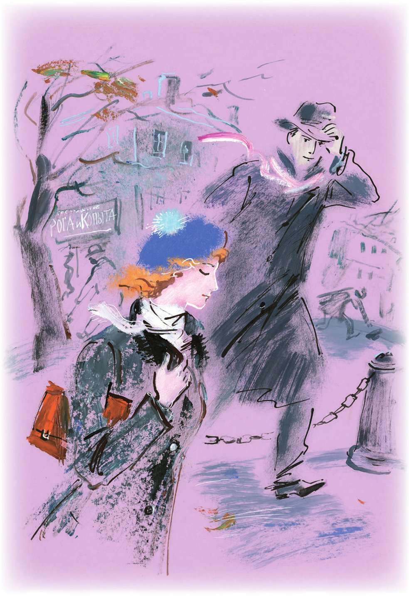

## Kapitel 35: Ihn liebten Hausfrauen, Hausangestellte, Witwen und sogar eine Zahntechnikerin

In Tschernomorsk dröhnten die Dächer, und durch die Straßen fegte die Zugluft. Durch die Kraft des Nordostwinds, der unerwartet über die Stadt hergefallen war, wurde der zarte <abbr title="der Altweibersommer — бабье лето">Altweibersommer</abbr> zu den Mülltonnen, <abbr title="die Dachrinne, die Dachrinnen — жёлоб">Dachrinnen</abbr> und <abbr title="der Mauervorsprung, die Mauervorsprünge — выступ дома">Mauervorsprüngen</abbr> getrieben. Dort starb er zwischen verkohlten <abbr title="das Ahornblatt, die Ahornblätter — кленовый лист">Ahornblättern</abbr> und zerrissenen Straßenbahnfahrscheinen. Kalte Chrysanthemen <abbr title="ertrinken (ertrank, ist ertrunken) — тонуть">ertranken</abbr> in den Schüsseln der Blumenverkäuferinnen. Die grünen <abbr title="der Fensterladen, die Fensterläden — ставня">Fensterläden</abbr> der geschlossenen Kwasbuden klapperten. Die Tauben gurrten: «Ich sterb', ich sterb'.» Die Spatzen wärmten sich, indem sie in heißem Mist pickten. Die Tschernomorsker <abbr title="stapfen — брести, топать">stapften</abbr> gegen den Wind, die Köpfe gesenkt wie Stiere. Am schlimmsten traf es die Pikeewesten. Der Wind riss ihnen die Strohhüte und Panamahüte vom Kopf und rollte sie über das Parkettpflaster hinunter zum Boulevard. Die Alten liefen ihnen nach, keuchend und <abbr title="entrüstet — негодующий">entrüstet</abbr>. Die Wirbel auf den Gehsteigen trieben die Verfolger selbst so heftig voran, dass sie manchmal ihre Kopfbedeckungen überholten und erst wieder zu sich kamen, wenn sie gegen die nassen Füße der Bronzefigur eines <abbr title="der Würdenträger, die Würdenträger — вельможа, сановник">Würdenträgers</abbr> aus der Zeit Katharinas prallten, die mitten auf dem Platz stand.

Die «Antilope» gab an ihrem Standplatz <abbr title="das Schiffsknarren — корабельный скрип">Schiffsknarren</abbr> von sich. Hatte Koslewitschs Auto früher fröhliches <abbr title="das Befremden — недоумение">Befremden</abbr> erregt, so flößte es jetzt Mitleid ein: Der linke hintere Kotflügel war mit einem Tau festgebunden, ein ordentlicher Teil der <abbr title="die Windschutzscheibe, die Windschutzscheiben — ветровое стекло">Windschutzscheibe</abbr> war durch Sperrholz ersetzt, und anstelle der beim Unfall verlorenen Gummihupe mit der «Matchiche» hing an einer Schnur ein vernickeltes <abbr title="das Präsidentenglöckchen, die Präsidentenglöckchen — председательский колокольчик">Präsidentenglöckchen</abbr>. Sogar das Lenkrad, auf dem Adam Kasimirowitschs ehrliche Hände ruhten, hatte sich ein wenig zur Seite verbogen. Auf dem Gehsteig neben der «Antilope» stand der große Kombinator. Auf die Seitenwand des Wagens gestützt, sagte er:

— Ich habe Sie betrogen, Adam. Ich kann Ihnen weder einen «Isotta Fraschini» schenken noch einen «Lincoln», noch einen «Buick», nicht einmal einen «Ford». Ich kann kein neues Auto kaufen. Der Staat betrachtet mich nicht als Käufer. Ich bin eine Privatperson. Das Einzige, was man über eine Zeitungsanzeige erwerben könnte, ist ebenso ein <abbr title="das Gerümpel — рухлядь, хлам">Gerümpel</abbr> wie unsere «Antilope».

— Wieso denn, — widersprach Koslewitsch, — mein «Lorraine-Dietrich» ist ein gutes Auto. Wenn ich jetzt noch einen gebrauchten Ölschlauch hätte, dann bräuchte ich gar keine Buicks.

— Den Schlauch habe ich Ihnen mitgebracht, — sagte Ostap, — hier ist er. Und das ist das Einzige, lieber Adam, womit ich Ihnen in Sachen Mechanisierung des Verkehrs helfen kann.

Koslewitsch freute sich sehr über den Schlauch, drehte ihn lange in den Händen und begann sofort, ihn <abbr title="anbringen (brachte an, hat angebracht) — прилаживать, устанавливать">anzubringen</abbr>. Ostap stieß an das Glöckchen, das einen Sitzungsklang von sich gab, und begann hitzig:

— Kennen Sie schon die Neuigkeit, Adam: Auf jeden Bürger drückt eine <abbr title="die Luftsäule, die Luftsäulen — столб воздуха">Luftsäule</abbr> mit einer Kraft von 214 Kilo!

— Nein, — sagte Koslewitsch, — und?

— Was heißt hier «und»! Das ist eine wissenschaftlich-medizinische Tatsache. Und mir ist das seit einiger Zeit schwer geworden. Denken Sie nur! 214 Kilo! Sie drücken <abbr title="rund um die Uhr — круглые сутки">rund um die Uhr</abbr>, besonders nachts. Ich schlafe schlecht. Was?

— Nichts, ich höre zu, — antwortete Koslewitsch sanft.

— Mir geht es sehr schlecht, Adam. Ich habe ein zu großes Herz.

Der Fahrer der «Antilope» brummte etwas, Ostap plapperte weiter:

— Gestern kam auf der Straße eine Alte zu mir und bot mir eine ewige Nadel für den Primuskocher an. Wissen Sie, Adam, ich habe sie nicht gekauft. Ich brauche keine ewige Nadel, ich will nicht ewig leben. Ich will sterben. Bei mir <abbr title="vorliegen (lag vor, hat vorgelegen) — быть налицо">liegen</abbr> alle abgeschmackten Anzeichen der Verliebtheit vor: Appetitlosigkeit, <abbr title="die Schlaflosigkeit — бессонница">Schlaflosigkeit</abbr> und der <abbr title="krankhaft — маниакальный, болезненный">krankhafte</abbr> Drang, Gedichte zu schreiben. Hören Sie, was ich gestern Nacht beim flackernden Licht der elektrischen Lampe <abbr title="zusammenreimen — накропать, сочинить">zusammengereimt</abbr> habe: «Ich weiß noch jenen Wunderaugenblick: / Du tratst vor mich, so licht und klar, / wie eine flüchtige Erscheinung, / wie reiner Schönheit Genius gar.» Gut, nicht wahr? Talentiert? Und erst bei Tagesanbruch, als die letzten Zeilen fertig waren, fiel mir ein, dass dieses Gedicht schon A. Puschkin geschrieben hat. So ein Schlag von Seiten eines Klassikers! Was?

— Nein, nein, fahren Sie fort, — sagte Koslewitsch mitfühlend.

— So lebe ich also, — fuhr Ostap mit <abbr title="zitternd — дрожащий">zitternder</abbr> Stimme fort. — Mein Körper ist im Hotel «Kairo» gemeldet, aber die Seele <abbr title="schwänzen — прогуливать, манкировать">schwänzt</abbr>, sie will nicht einmal nach Rio de Janeiro. Und dazu erdrückt mich noch die atmosphärische Säule.

— Und waren Sie schon bei ihr? — fragte der geradlinige Koslewitsch. — Bei Sossja Viktorowna?

— Ich gehe nicht hin, — sagte Ostap, — aus Gründen stolzer Schüchternheit. In mir sind die Janitscharen erwacht. Ich habe dieser <abbr title="die Schurkin, die Schurkinnen — негодяйка">Schurkin</abbr> aus Moskau für dreihundertfünfzig Rubel Telegramme geschickt und nicht einmal für einen <abbr title="der Fünfziger — полтинник">Fünfziger</abbr> Antwort bekommen. Ich, den Hausfrauen, Hausangestellte, Witwen und sogar eine Zahntechnikerin geliebt haben! Nein, Adam, ich gehe nicht hin. Auf Wiedersehen!

Der große Kombinator ging ins Hotel und zog unter dem Bett den Koffer mit der Million hervor, der neben <abbr title="ausgetreten — стоптанный">ausgetretenen</abbr> Schuhen herumlag. Eine Weile betrachtete er ihn ziemlich <abbr title="stumpfsinnig — тупо">stumpfsinnig</abbr>, dann nahm er ihn am Griff und ging hinaus auf die Straße. Der Wind packte Ostap an den Schultern und zerrte ihn zum Strandboulevard. Hier war es menschenleer, niemand saß auf den weißen Bänken, in die im Laufe des Sommers Liebesinschriften <abbr title="ritzen — вырезать, царапать">geritzt</abbr> worden waren. Zur <abbr title="die Außenreede — внешний рейд">Außenreede</abbr> lief, den Leuchtturm umrundend, ein niedriger <abbr title="der Frachter, die Frachter — грузовое судно">Frachter</abbr> mit dicken, geraden Masten aus.

— Genug, — sagte Ostap, — das goldene Kalb ist nichts für mich. Soll es nehmen, wer will. Soll er sich nach Herzenslust als Millionär <abbr title="sich austoben — разгуляться">austoben</abbr>!

Er sah sich um, und als er merkte, dass niemand in der Nähe war, warf er den Koffer auf den Kies.

— Bitte sehr, — sagte er an die schwarzen Ahornbäume gewandt und machte einen <abbr title="der Kratzfuß, die Kratzfüße — расшаркивание">Kratzfuß</abbr>.

Er ging die Allee entlang, ohne sich umzusehen. Zuerst ging er langsam, im Schritt eines Spaziergängers, dann steckte er die Hände in die Taschen, weil sie ihn plötzlich störten, und beschleunigte den Schritt, um sein Schwanken zu besiegen. Er zwang sich, um die Ecke zu biegen, und sogar ein Liedchen anzustimmen, aber schon nach einer Minute rannte er zurück. Der Koffer lag am alten Platz. Doch von der anderen Seite näherte sich ihm, gebückt und die Hände ausgestreckt, ein Bürger mittleren Alters von äußerst gewöhnlichem <abbr title="das Äußere — наружность">Äußeren</abbr>.

— Wo willst du hin?! — schrie Ostap schon von weitem. — Ich werd dir zeigen, fremde Koffer zu <abbr title="grapschen — хватать, цапать">grapschen</abbr>! Nicht eine Sekunde kann man etwas liegen lassen! Eine Unverschämtheit!

Der Bürger zuckte unzufrieden mit den Schultern und trat zurück. Und Bender schleppte sich wieder mit dem goldenen Kalb in den Händen davon.

«Was soll ich jetzt tun? — überlegte er. — Wie soll ich mit dem verfluchten <abbr title="der Batzen, die Batzen — куш, куча денег">Batzen</abbr> <abbr title="verfahren mit + Dat. (verfuhr, ist verfahren) — распорядиться, поступить с">verfahren</abbr>, der mich nur um seelische Qualen reicher macht? Ihn verbrennen, oder was?»

Bei diesem Gedanken verweilte der große Kombinator mit Vergnügen.

«In meinem Zimmer ist gerade ein <abbr title="der Kamin, die Kamine — камин">Kamin</abbr>. Ihn im Kamin verbrennen! Das ist erhaben! Eine Tat wie die der Kleopatra! Ins Feuer damit! Bündel für Bündel! Was soll ich mich mit ihnen abplagen? Nein, doch nicht, das ist dumm. Geld verbrennen ist Angeberei! Husarenstreiche! Und was kann ich damit anfangen außer der <abbr title="die Völlerei — обжорство, жраньё">Völlerei</abbr> eines Nepmans? Eine blödsinnige Lage! Der Museumsleiter will für dreihundert Rubel einen Louvre veranstalten, jedes beliebige Kollektiv von irgendwelchen <abbr title="der Flussschiffer, die Flussschiffer — водник, речник">Flussschiffern</abbr> oder eine genossenschaftliche <abbr title="die Körperschaft, die Körperschaften — корпорация">Körperschaft</abbr> der <abbr title="der Bühnenautor, die Bühnenautoren — драматург, драмписатель">Bühnenautoren</abbr> kann für eine Million einen Halbwolkenkratzer mit flachem Dach für Vorträge an der frischen Luft bauen. Und Ostap Bender, ein Nachkomme der Janitscharen, kann <abbr title="verdammt noch mal — чёрт побери">verdammt noch mal</abbr> nichts machen! Da ist die <abbr title="die Hegemonialklasse — класс-гегемон">Hegemonialklasse</abbr> über den einsamen Millionär hergefallen!»

Während er darüber nachdachte, was er mit der Million anfangen sollte, lief der große Kombinator durch die Alleen, setzte sich auf die <abbr title="die Zementbrüstung, die Zementbrüstungen — цементный парапет">Zementbrüstung</abbr> und blickte ärgerlich auf den Dampfer, der hinter dem Wellenbrecher schaukelte.

«Nein, auf das Feuer muss ich verzichten. Geld verbrennen ist feige und nicht <abbr title="anmutig — грациозный, изящный">anmutig</abbr>. Man muss sich irgendeine <abbr title="effektvoll — эффектный">effektvolle</abbr> Geste ausdenken. Vielleicht ein Balaganow-Stipendium für die Schüler des Radiotechnikums für <abbr title="das Fernstudium — заочное обучение">Fernstudium</abbr> <abbr title="stiften — учредить, основать">stiften</abbr>? Fünfzigtausend silberne Löffelchen kaufen, daraus ein <abbr title="das Reiterstandbild, die Reiterstandbilder — конная статуя">Reiterstandbild</abbr> Panikowskis gießen und es auf seinem Grab aufstellen? Die «Antilope» mit <abbr title="das Perlmutt — перламутр">Perlmutt</abbr> <abbr title="auslegen — инкрустировать, выкладывать">auslegen</abbr>? Oder vielleicht ...»

Der große Kombinator sprang von der Brüstung, <abbr title="erleuchten — озарять">erleuchtet</abbr> von einem neuen Gedanken. Ohne eine Minute zu zögern, verließ er den Boulevard und ging, <abbr title="standhaft — стойко">standhaft</abbr> dem <abbr title="der Ansturm — натиск">Ansturm</abbr> der Front- und Seitenwinde trotzend, zur Hauptpost.

Dort wurde der Koffer auf seine Bitte hin in <abbr title="das Sackleinen — рогожа, мешковина">Sackleinen</abbr> eingenäht und über Kreuz mit Schnur verschnürt. Es entstand ein <abbr title="schlicht — простецкий, простой">schlicht</abbr> aussehendes Paket, wie es die Post täglich zu Tausenden annimmt und wie die Bürger es mit <abbr title="der Speck — сало">Speck</abbr>, Konfitüre oder Äpfeln an ihre Verwandten schicken.

Ostap nahm einen Tintenstift, schwenkte ihn aufgeregt in der Luft und schrieb:

WERTSENDUNG

An den Volkskommissar der Finanzen.

Moskau.

Und das Paket, von der Hand eines <abbr title="stämmig — дюжий, крепкий">stämmigen</abbr> Postbeamten geworfen, stürzte auf einen Haufen ovaler <abbr title="der Ballen, die Ballen — тюк">Ballen</abbr>, Beutelchen und Kisten. Während Ostap die Quittung in die Tasche steckte, sah er, dass seine Million zusammen mit der übrigen Fracht schon von einem trägen Alten mit weißen Blitzen an den Kragenspiegeln auf einem Karren in den Nachbarsaal gefahren wurde.

— Die Sitzung geht weiter, — sagte der große Kombinator, — diesmal ohne die Beteiligung des Abgeordneten der verrückten <abbr title="der Agrarier, die Agrarier — аграрий">Agrarier</abbr>, O. Bender.

Lange noch stand er unter dem <abbr title="der Torbogen, die Torbögen — арка">Torbogen</abbr> der Hauptpost, mal billigte er seine Tat, mal bedauerte er sie. Der Wind kroch Ostap unter den Regenmantel. Ihm wurde kalt, und er erinnerte sich bekümmert, dass er sich keinen zweiten Pelz gekauft hatte.

Direkt vor ihm blieb für eine Sekunde ein Mädchen stehen. Mit <abbr title="zurücklegen — запрокинуть (голову)">zurückgelegtem</abbr> Kopf blickte sie auf das glänzende <abbr title="das Zifferblatt, die Zifferblätter — циферблат">Zifferblatt</abbr> der Postuhr und ging weiter. Sie trug ein raues Mäntelchen, kürzer als das Kleid, und eine blaue Baskenmütze mit einem kindlichen <abbr title="der Pompon, die Pompons — помпон">Pompon</abbr>. Mit der rechten Hand hielt sie den Mantelschoß fest, den der Wind <abbr title="wegwehen — сдувать">wegzuwehen</abbr> drohte. Das Herz des Kommandeurs geriet ins Schwanken, noch bevor er Sossja erkannte, und er schritt ihr über die nassen <abbr title="die Gehwegplatte, die Gehwegplatten — тротуарная плита">Gehwegplatten</abbr> nach, wobei er unwillkürlich einen gewissen <abbr title="der Abstand, die Abstände — дистанция, расстояние">Abstand</abbr> hielt. Manchmal <abbr title="verdecken — заслонять">verdeckten</abbr> Passanten das Mädchen, und dann trat Ostap auf die Fahrbahn, betrachtete Sossja von der Seite und überdachte die <abbr title="die These, die Thesen — тезис">Thesen</abbr> der bevorstehenden Aussprache.

An der Ecke blieb Sossja vor einem <abbr title="der Kurzwarenkiosk, die Kurzwarenkioske — галантерейный киоск">Kurzwarenkiosk</abbr> stehen und begann, braune Herrensocken zu betrachten, die an einer Schnur schaukelten. Ostap fing an, in der Nähe <abbr title="patrouillieren — патрулировать">auf und ab zu patrouillieren</abbr>.

Gleich am <abbr title="der Bordstein, die Bordsteine — обочина тротуара">Bordstein</abbr> unterhielten sich zwei Männer mit Aktentaschen hitzig. Beide trugen Übergangsmäntel, unter denen weiße Sommerhosen hervorschauten.

— Sie sind rechtzeitig aus dem «Herkules» weggegangen, Iwan Pawlowitsch, — sagte der eine und drückte die Aktentasche an die Brust, — dort herrscht jetzt ein <abbr title="der Kahlschlag — разгром">Kahlschlag</abbr>, sie säubern wie die Bestien.

— Die ganze Stadt redet davon, — seufzte der andere.

— Gestern haben sie Skumbrijewitsch gesäubert, — sagte der erste <abbr title="wollüstig — сладострастно">wollüstig</abbr>, — man kam gar nicht durch. Anfangs ging alles sehr kultiviert zu. Skumbrijewitsch hat seine Lebensgeschichte so erzählt, dass ihm alle applaudierten. Ich, sagt er, bin zwischen Hammer und <abbr title="der Amboss, die Ambosse — наковальня">Amboss</abbr> geboren. Damit wollte er betonen, dass seine Eltern Schmiede waren. Und dann fragte jemand aus dem Publikum: «Sagen Sie, erinnern Sie sich nicht, es gab da so ein Handelshaus „Skumbrijewitsch und Sohn. <abbr title="die Eisenwaren (Pl.) — скобяные товары">Eisenwaren</abbr>“? Sind Sie nicht dieser Skumbrijewitsch?» Und da nimmt dieser Dummkopf und sagt: «Ich bin nicht Skumbrijewitsch, ich bin der Sohn.» Stellen Sie sich vor, was jetzt mit ihm wird? Die erste Kategorie ist ihm sicher.

— Ja, Genosse Weintorg, so streng ist es. Und wen säubern sie heute?

— Heute ist ein großer Tag! Heute ist Berlaga dran, derselbe, der sich im Irrenhaus versteckt hat. Dann Polychajew selbst und diese Natter Serna Michailowna, seine <abbr title="morganatisch — морганатический">morganatische</abbr> Frau. Sie hat im «Herkules» niemanden atmen lassen. Ich komme heute zwei Stunden vor Beginn, sonst <abbr title="sich durchdrängeln — протолкнуться">drängelt</abbr> man sich nicht durch. Außerdem Bomse ...

Sossja ging weiter, und Ostap erfuhr nie, was mit Adolf Nikolajewitsch Bomse geschehen war. Das beunruhigte ihn jedoch nicht im Geringsten. Der Anfangssatz der Unterhaltung war schon fertig. Der Kommandeur holte das Mädchen schnell ein.

— Sossja, — sagte er, — ich bin gekommen, und diese Tatsache lässt sich nicht <abbr title="wegwischen — отмахнуться, отмести">wegwischen</abbr>.

Dieser Satz wurde mit entsetzlicher <abbr title="die Ungeniertheit — развязность">Ungeniertheit</abbr> ausgesprochen. Das Mädchen wich zurück, und der große Kombinator begriff, dass er einen falschen Ton angeschlagen hatte. Er änderte die <abbr title="die Tonlage, die Tonlagen — интонация">Tonlage</abbr>, er redete schnell und viel, klagte über die Umstände, sagte, dass die Jugend ganz anders vergangen sei, als er es sich in Kindertagen vorgestellt habe, dass das Leben sich als grob und niedrig erwiesen habe wie ein <abbr title="der Bassschlüssel, die Bassschlüssel — басовый ключ">Bassschlüssel</abbr>.

— Wissen Sie, Sossja, — sagte er schließlich, — auf jeden Menschen, sogar auf ein Parteimitglied, drückt eine atmosphärische Säule mit einem Gewicht von 214 Kilo. Haben Sie das nicht bemerkt?

Sossja antwortete nicht.

In diesem Augenblick gingen sie am Kino «Kapitalij» vorbei. Ostap blickte schnell schräg zur Seite, dorthin, wo im Sommer das von ihm gegründete Kontor untergebracht war, und stieß einen leisen Ruf aus. Über das ganze Gebäude zog sich ein breites Schild:

STAATSVEREINIGUNG HÖRNER UND HUFE

In allen Fenstern waren Schreibmaschinen und Porträts von Staatsmännern zu sehen. Am Eingang stand mit siegreichem Lächeln ein schneidiger <abbr title="der Bürobote, die Büroboten — курьер, посыльный">Bürobote</abbr>, mit Panikowski nicht zu vergleichen. Durch das offene Tor mit dem Täfelchen «<abbr title="das Basislager, die Basislager — базисный склад">Basislager</abbr>» fuhren Dreitonner, bis obenhin mit <abbr title="normgerecht — кондиционный, стандартный">normgerechten</abbr> Hörnern und Hufen beladen. Allem Anschein nach war Ostaps <abbr title="das Geschöpf, die Geschöpfe — детище, создание">Geschöpf</abbr> auf den richtigen Weg eingebogen.

— Da ist die Hegemonialklasse hergefallen, — sagte Ostap traurig, — sogar meine leichtsinnige Idee hat sie für ihre Zwecke benutzt. Und mich hat man <abbr title="abdrängen — оттереть">abgedrängt</abbr>, Sossja. Hören Sie, mich hat man abgedrängt. Ich bin unglücklich.

— Ein trauriger Verliebter, — sagte Sossja und wandte sich zum ersten Mal Ostap zu.

— Ja, — antwortete Ostap, — ich bin ein typischer Eugen Onegin, auch bekannt als der <abbr title="enterben — лишить наследства">enterbte</abbr> Ritter, von der Sowjetmacht enterbt.

— Na, was sind Sie schon für ein Ritter!

— Seien Sie nicht böse, Sossja. <abbr title="berücksichtigen — принимать во внимание">Berücksichtigen</abbr> Sie die atmosphärische Säule. Mir scheint sogar, dass sie auf mich erheblich stärker drückt als auf andere Bürger. Das kommt von der Liebe zu Ihnen. Und außerdem bin ich kein Gewerkschaftsmitglied. Davon auch.

— Und außerdem auch deshalb, weil Sie mehr <abbr title="schwindeln — врать">schwindeln</abbr> als andere Bürger.

— Das ist keine Lüge. Das ist ein physikalisches Gesetz. Oder gibt es vielleicht wirklich gar keine Säule, und sie ist nur meine <abbr title="die Einbildung, die Einbildungen — фантазия, воображение">Einbildung</abbr>?

Sossja blieb stehen und begann, einen Handschuh von <abbr title="strumpfgrau — серо-чулочного цвета">strumpfgrauer</abbr> Farbe von der Hand zu streifen.

— Ich bin dreiunddreißig Jahre alt, — sagte Ostap hastig, — das Alter von Jesus Christus. Und was habe ich bis jetzt getan? Eine Lehre habe ich nicht geschaffen, die Jünger habe ich <abbr title="verschleudern — разбазарить">verschleudert</abbr>, den toten Panikowski habe ich nicht <abbr title="auferwecken — воскресить">auferweckt</abbr>, und nur Sie ...

— Na, auf Wiedersehen, — sagte Sossja, — ich muss in die Kantine.

— Ich werde auch zu Mittag essen, — erklärte der große Kombinator mit einem Blick auf das Schild: «Lehr- und Muster-Speisekombinat der Werkschule bei der Tschernomorsker Staatlichen Akademie der Raumkünste», — ich esse eine Tages-Muster-<abbr title="die Kohlsuppe, die Kohlsuppen — щи">Kohlsuppe</abbr> bei dieser Akademie. Vielleicht wird mir dann leichter.

— Hier nur für Gewerkschaftsmitglieder, — warnte Sossja.

— Dann sitze ich eben nur so da.

Sie stiegen drei Stufen hinab. Im hinteren Teil des Lehr- und Musterkombinats saß unter dem grünen Dach einer Palme ein schwarzäugiger junger Mann und blickte mit Würde in die Speisekarte.

— Perikles! — rief Sossja schon von weitem. — Ich habe dir Socken mit doppelter Ferse gekauft. Macht euch bekannt. Das ist Femidi.

— Femidi, — sagte der junge Mann und drückte Ostap herzlich die Hand.

— Bender-Sadunaiski, — antwortete der große Kombinator grob; er hatte sofort begriffen, dass er zum Fest der Liebe zu spät gekommen war und dass Socken mit doppelter Ferse nicht einfach ein Erzeugnis irgendeiner <abbr title="das Genossenschaftsartel, die Genossenschaftsartels — кооперативная артель">Genossenschaftsartel</abbr> von <abbr title="der Scheininvalide, die Scheininvaliden — лжеинвалид">Scheininvaliden</abbr> sind, sondern ein gewisses <abbr title="das Sinnbild, die Sinnbilder — символ">Sinnbild</abbr> einer glücklichen, vom Standesamt <abbr title="legalisieren — узаконить">legalisierten</abbr> Ehe.

— Wie! Sind Sie etwa auch noch Sadunaiski? — fragte Sossja fröhlich.

— Ja, Sadunaiski. Sie sind ja auch nicht mehr nur Sinizkaja? Nach den Socken zu urteilen ...

— Ich bin Sinizkaja-Femidi.

— Schon seit siebenundzwanzig Tagen, — bemerkte der junge Mann und rieb sich die Hände.

— Mir gefällt Ihr Mann, — sagte der enterbte Ritter.

— Mir selbst gefällt er, — antwortete Sossja <abbr title="hitzköpfig — запальчиво">hitzköpfig</abbr>.

Während die jungen Eheleute Matrosen-Borschtsch aßen, die Löffel hoch hoben und einander Blicke zuwarfen, schielte Ostap missmutig auf die Kulturplakate, die an den Wänden hingen. Auf einem stand geschrieben:

Lass dich beim Essen nicht durch Gespräche ablenken.

Das stört die richtige Absonderung des <abbr title="der Magensaft, die Magensäfte — желудочный сок">Magensafts</abbr>.

Ein anderes war in Versen verfasst:

Fruchtsäfte geben uns Kohlenhydrat-Kräfte.

Mehr gab es nicht zu tun. Er hätte gehen müssen, aber eine <abbr title="die Schüchternheit — застенчивость">Schüchternheit</abbr>, die wer weiß woher gekommen war, hinderte ihn daran.

— In diesem Matrosen-Borschtsch, — sagte Ostap mit Mühe, — schwimmen die Trümmer eines <abbr title="der Schiffbruch, die Schiffbrüche — кораблекрушение">Schiffbruchs</abbr>.

Das Ehepaar Femidi lachte gutmütig.

— Und in welcher Branche arbeiten Sie eigentlich? — fragte Ostap den jungen Mann.

— Ich bin eigentlich Sekretär des Bildkunstkollektivs der Eisenbahnmaler, — antwortete Femidi.

Der große Kombinator begann sich langsam zu erheben.

— Ach, ein Vertreter des Kollektivs! Das war zu erwarten! Ich will Sie jedoch nicht durch Gespräche ablenken. Das würde Sie daran hindern, den für die Gesundheit so notwendigen Magensaft richtig abzusondern.

Er ging, ohne sich zu verabschieden, schnitt die Ecken der Tische und steuerte auf geradem Weg zum Ausgang.

— Man hat mir das Mädchen <abbr title="wegschnappen — увести, отбить">weggeschnappt</abbr>! — murmelte er auf der Straße. — Direkt aus dem Stall weggeführt. Femidi! Nemesidi! Ein Vertreter des Kollektivs, Femidi, hat einem einzelgängerischen Millionär ...

Und da erinnerte sich Bender mit <abbr title="erschütternd — потрясающий">erschütternder</abbr> Klarheit und Reinheit daran, dass er gar keine Million mehr besaß. Diesen Gedanken dachte er schon im Laufen zu Ende, während er die Passanten mit den Armen beiseiteschob wie ein Schwimmer das Wasser bei einem Wettkampf um einen neuen Weltrekord.

— Auch so ein Apostel Paulus! — flüsterte er und sprang über die Blumenbeete des Stadtgartens. — Ein <abbr title="uneigennützig — бессребреник, бескорыстный">Uneigennütziger</abbr>, H-hundesohn! Verdammter <abbr title="der Mennonit, die Mennoniten — меннонит">Mennonit</abbr>, <abbr title="der Siebenten-Tags-Adventist, die Siebenten-Tags-Adventisten — адвентист седьмого дня">Siebenten-Tags-Adventist</abbr>! Dummkopf! Wenn sie das Paket schon abgeschickt haben, hänge ich mich auf! Solche <abbr title="der Tolstojaner, die Tolstojaner — толстовец">Tolstojaner</abbr> muss man umbringen!

Nachdem er zweimal auf dem gekachelten Boden der Hauptpost ausgerutscht war, lief der große Kombinator zum Schalterfenster. Hier stand eine kleine, strenge und schweigsame Schlange. Ostap steckte in der Hitze des Gefechts den Kopf schon fast in das Fensterchen, aber der Bürger, der als Erster in der Schlange stand, hob nervös die spitzen Ellbogen und drängte den Ankömmling ein wenig zurück. Der zweite Bürger hob, wie aufgezogen, ebenfalls die Ellbogen, und der große Kombinator fand sich noch ein Stück weiter von dem <abbr title="ersehnt — заветный, желанный">ersehnten</abbr> Fensterchen entfernt. Und in völligem Schweigen hoben und spreizten sich die Ellbogen so lange, bis der <abbr title="dreist — дерзкий">Dreiste</abbr> an seinem rechtmäßigen Platz gelandet war – ganz am Ende der Schlange.

— Ich will nur ... — begann Ostap. Aber er sprach nicht weiter. Es war zwecklos. Die Schlange, grau und steinern, war <abbr title="unerschütterlich — несокрушимый">unerschütterlich</abbr> wie eine griechische <abbr title="die Phalanx, die Phalangen — фаланга">Phalanx</abbr>. Jeder kannte seinen Platz und war bereit, für seine kleinen Rechte zu sterben.

Erst nach fünfundvierzig Minuten steckte Ostap den Kopf in das Postfenster und verlangte leidenschaftlich sein Paket zurück. Der Angestellte gab Ostap gleichgültig die Quittung zurück.

— Genosse, Pakete geben wir nicht zurück.

— Wie! Schon abgeschickt? — fragte der große Kombinator mit schwankender Stimme. — Ich habe es doch erst vor einer Stunde abgegeben!

— Genosse, Pakete geben wir nicht zurück, — wiederholte der Postangestellte.

— Aber das ist doch mein Paket, — sagte Ostap sanft, — verstehen Sie, meins. Ich habe es abgeschickt, ich will es zurückhaben. Verstehen Sie, ich habe vergessen, ein Glas Konfitüre hineinzulegen. Aus <abbr title="das Paradiesäpfelchen, die Paradiesäpfelchen — райское яблочко">Paradiesäpfelchen</abbr>. Ich bitte Sie sehr. Der Onkel wird furchtbar gekränkt sein. Verstehen Sie ...

— Genosse, Pakete geben wir nicht zurück.

Ostap sah sich nach Hilfe um. Hinter ihm stand die Schlange, schweigsam und streng, die alle Vorschriften kannte, auch die, dass Pakete nicht zurückgegeben werden.

— Ein Gläschen hineinlegen, — stammelte Ostap, — Paradiesäpfelchen.

— Genosse, schicken Sie das Gläschen als eigenes Paket, — sagte der Angestellte, schon milder. — Ihrem Onkel wird nichts passieren.

— Sie kennen meinen Onkel nicht! — sagte Ostap hitzig. — Und außerdem bin ich ein armer Student, ich habe kein Geld. Ich bitte Sie als gesellschaftlich engagierten Menschen.

— Sehen Sie, Genosse, — sagte der Angestellte mit weinerlicher Stimme, — wo soll ich es denn jetzt suchen! Da liegen drei Tonnen Pakete.

Aber da begann der große Kombinator so <abbr title="rührselig — жалостливый, слезливый">rührseligen</abbr> Unsinn zu <abbr title="faseln — молоть чепуху">faseln</abbr>, dass der Postarbeiter in den Nachbarsaal ging, um das Paket des armen Studenten zu suchen. Die bisher schweigsame Schlange erhob sofort ein Geschrei. Der große Kombinator wurde auf jede erdenkliche Weise für seine Unkenntnis der Postgesetze <abbr title="beschimpfen — ругать, поносить">beschimpft</abbr>, und eine Bürgerin <abbr title="kneifen (kniff, hat gekniffen) — щипать">kniff</abbr> ihn vor Zorn sogar.

— Tun Sie das nie wieder, — sagte der Postbeamte streng und warf Bender sein Köfferchen hinaus.

— Nie wieder! — erklärte der Kommandeur. — Studentenehrenwort!

Vom Wind klapperten die Dächer, die Laternen schaukelten, Schatten bewegten sich über die Erde, und der Regen durchkreuzte die Lichtkegel der Autoscheinwerfer.

— Schluss mit den psychologischen Exzessen, — sagte Bender fröhlich, — Schluss mit den <abbr title="die Gefühlswallung, die Gefühlswallungen — переживание">Gefühlswallungen</abbr> und der <abbr title="die Selbstzerfleischung — самокопание, самоедство">Selbstzerfleischung</abbr>. Es ist Zeit, ein arbeitsames bürgerliches Leben zu beginnen. Nach Rio de Janeiro! Ich kaufe eine <abbr title="die Plantage, die Plantagen — плантация">Plantage</abbr> und lasse mir Balaganow als Affen kommen. Soll er mir die Bananen pflücken!

---

### Neue Wörter

- **der Altweibersommer** — бабье лето
- **die Dachrinne, die Dachrinnen** — жёлоб
- **der Mauervorsprung, die Mauervorsprünge** — выступ дома
- **das Ahornblatt, die Ahornblätter** — кленовый лист
- **ertrinken (ertrank, ist ertrunken)** — тонуть
- **der Fensterladen, die Fensterläden** — ставня
- **stapfen** — брести, топать
- **entrüstet** — негодующий
- **der Würdenträger, die Würdenträger** — вельможа, сановник
- **das Schiffsknarren** — корабельный скрип
- **das Befremden** — недоумение
- **die Windschutzscheibe, die Windschutzscheiben** — ветровое стекло
- **das Präsidentenglöckchen, die Präsidentenglöckchen** — председательский колокольчик
- **das Gerümpel** — рухлядь, хлам
- **anbringen (brachte an, hat angebracht)** — прилаживать, устанавливать
- **die Luftsäule, die Luftsäulen** — столб воздуха
- **rund um die Uhr** — круглые сутки
- **vorliegen (lag vor, hat vorgelegen)** — быть налицо
- **die Schlaflosigkeit** — бессонница
- **krankhaft** — маниакальный, болезненный
- **zusammenreimen** — накропать, сочинить
- **zitternd** — дрожащий
- **schwänzen** — прогуливать, манкировать
- **die Schurkin, die Schurkinnen** — негодяйка
- **der Fünfziger** — полтинник
- **ausgetreten** — стоптанный
- **stumpfsinnig** — тупо
- **ritzen** — вырезать, царапать
- **die Außenreede** — внешний рейд
- **der Frachter, die Frachter** — грузовое судно
- **sich austoben** — разгуляться
- **der Kratzfuß, die Kratzfüße** — расшаркивание
- **das Äußere** — наружность
- **grapschen** — хватать, цапать
- **der Batzen, die Batzen** — куш, куча денег
- **verfahren mit + Dat. (verfuhr, ist verfahren)** — распорядиться, поступить с
- **der Kamin, die Kamine** — камин
- **die Völlerei** — обжорство, жраньё
- **der Flussschiffer, die Flussschiffer** — водник, речник
- **die Körperschaft, die Körperschaften** — корпорация
- **der Bühnenautor, die Bühnenautoren** — драматург, драмписатель
- **verdammt noch mal** — чёрт побери
- **die Hegemonialklasse** — класс-гегемон
- **die Zementbrüstung, die Zementbrüstungen** — цементный парапет
- **anmutig** — грациозный, изящный
- **effektvoll** — эффектный
- **das Fernstudium** — заочное обучение
- **stiften** — учредить, основать
- **das Reiterstandbild, die Reiterstandbilder** — конная статуя
- **das Perlmutt** — перламутр
- **auslegen** — инкрустировать, выкладывать
- **erleuchten** — озарять
- **standhaft** — стойко
- **der Ansturm** — натиск
- **das Sackleinen** — рогожа, мешковина
- **schlicht** — простецкий, простой
- **der Speck** — сало
- **stämmig** — дюжий, крепкий
- **der Ballen, die Ballen** — тюк
- **der Agrarier, die Agrarier** — аграрий
- **der Torbogen, die Torbögen** — арка
- **zurücklegen** — запрокинуть (голову)
- **das Zifferblatt, die Zifferblätter** — циферблат
- **der Pompon, die Pompons** — помпон
- **wegwehen** — сдувать
- **die Gehwegplatte, die Gehwegplatten** — тротуарная плита
- **der Abstand, die Abstände** — дистанция, расстояние
- **verdecken** — заслонять
- **die These, die Thesen** — тезис
- **der Kurzwarenkiosk, die Kurzwarenkioske** — галантерейный киоск
- **patrouillieren** — патрулировать
- **der Bordstein, die Bordsteine** — обочина тротуара
- **der Kahlschlag** — разгром
- **wollüstig** — сладострастно
- **der Amboss, die Ambosse** — наковальня
- **die Eisenwaren (Pl.)** — скобяные товары
- **morganatisch** — морганатический
- **sich durchdrängeln** — протолкнуться
- **wegwischen** — отмахнуться, отмести
- **die Ungeniertheit** — развязность
- **die Tonlage, die Tonlagen** — интонация
- **der Bassschlüssel, die Bassschlüssel** — басовый ключ
- **der Bürobote, die Büroboten** — курьер, посыльный
- **das Basislager, die Basislager** — базисный склад
- **normgerecht** — кондиционный, стандартный
- **das Geschöpf, die Geschöpfe** — детище, создание
- **abdrängen** — оттереть
- **enterben** — лишить наследства
- **berücksichtigen** — принимать во внимание
- **schwindeln** — врать
- **die Einbildung, die Einbildungen** — фантазия, воображение
- **strumpfgrau** — серо-чулочного цвета
- **verschleudern** — разбазарить
- **auferwecken** — воскресить
- **die Kohlsuppe, die Kohlsuppen** — щи
- **das Genossenschaftsartel, die Genossenschaftsartels** — кооперативная артель
- **der Scheininvalide, die Scheininvaliden** — лжеинвалид
- **das Sinnbild, die Sinnbilder** — символ
- **legalisieren** — узаконить
- **hitzköpfig** — запальчиво
- **der Magensaft, die Magensäfte** — желудочный сок
- **die Schüchternheit** — застенчивость
- **der Schiffbruch, die Schiffbrüche** — кораблекрушение
- **wegschnappen** — увести, отбить
- **erschütternd** — потрясающий
- **uneigennützig** — бессребреник, бескорыстный
- **der Mennonit, die Mennoniten** — меннонит
- **der Siebenten-Tags-Adventist, die Siebenten-Tags-Adventisten** — адвентист седьмого дня
- **der Tolstojaner, die Tolstojaner** — толстовец
- **ersehnt** — заветный, желанный
- **dreist** — дерзкий
- **unerschütterlich** — несокрушимый
- **die Phalanx, die Phalangen** — фаланга
- **das Paradiesäpfelchen, die Paradiesäpfelchen** — райское яблочко
- **rührselig** — жалостливый, слезливый
- **faseln** — молоть чепуху
- **beschimpfen** — ругать, поносить
- **kneifen (kniff, hat gekniffen)** — щипать
- **die Gefühlswallung, die Gefühlswallungen** — переживание
- **die Selbstzerfleischung** — самокопание, самоедство
- **die Plantage, die Plantagen** — плантация

[← Zurück](kapitel-35.md) · [Inhalt](README.md) · [Weiter →](kapitel-37.md)
