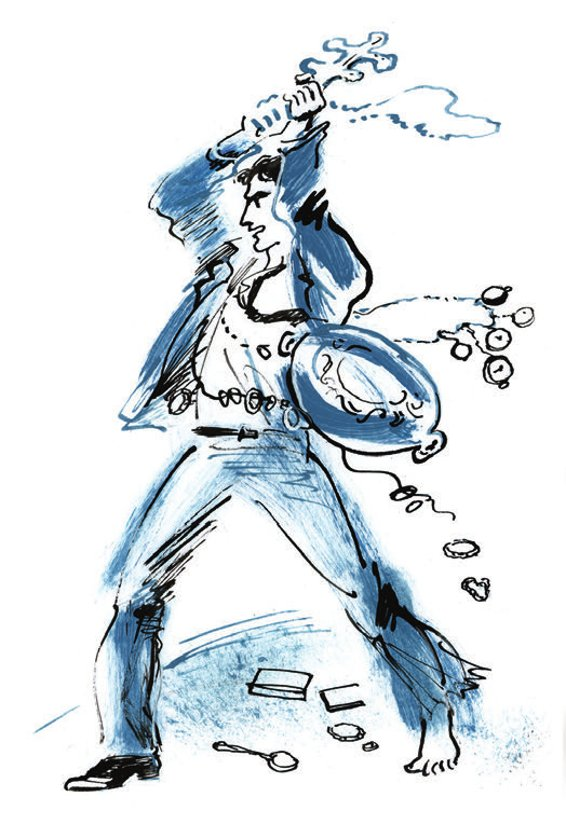
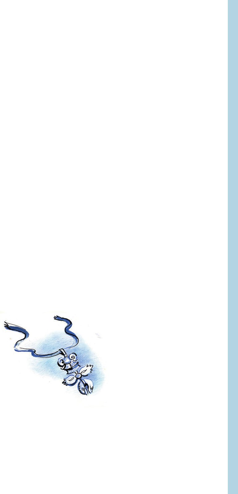

## Kapitel 36: Ritter des Ordens vom Goldenen Vlies

Ein seltsamer Mensch ging in der Nacht durch die <abbr title="die Aue, die Auen — плавни, пойма">Auen</abbr> am Dnjestr. Er war riesig und formlos dick. Ein Kittel aus <abbr title="die Zeltplane, die Zeltplanen — брезент">Zeltplane</abbr> mit hochgeschlagener <abbr title="die Kapuze, die Kapuzen — капюшон">Kapuze</abbr> saß ihm eng am Leib. An den <abbr title="die Schilfparzelle, die Schilfparzellen — камышовая делянка">Schilfparzellen</abbr> vorbei, unter breit <abbr title="gespreizt — раскоряченный">gespreizten</abbr> Obstbäumen, bewegte sich der seltsame Mensch auf Zehenspitzen, wie in einem Schlafzimmer. Manchmal blieb er stehen und seufzte. Dann hörte man im Inneren des Kittels ein Scheppern, wie es Metallgegenstände von sich geben, die aneinanderstoßen. Und jedes Mal hing danach ein feiner, äußerst zarter Klang in der Luft. Einmal blieb der seltsame Mensch an einer nassen <abbr title="die Wurzel, die Wurzeln — корень">Wurzel</abbr> hängen und fiel auf den Bauch. Da ertönte ein so lautes Geräusch, als wäre eine Ritterrüstung aufs Parkett gestürzt. Und noch lange stand der seltsame Mensch nicht vom Boden auf und spähte in die Dunkelheit.

Die Märznacht rauschte. Von den Bäumen rieselten und <abbr title="klatschen — шлёпаться">klatschten</abbr> vollgewichtige Tropfen, wie aus der Apotheke abgemessen, zu Boden.

— Verfluchte Schüssel! — flüsterte der Mensch.

Er stand auf und kam ohne Zwischenfälle bis zum Dnjestr. Der Mensch <abbr title="raffen — подбирать (полы)">raffte</abbr> die Schöße, rutschte das Ufer hinunter und lief, auf dem <abbr title="aufgeweicht — раскисший">aufgeweichten</abbr> Eis das Gleichgewicht verlierend, nach Rumänien.

Der große Kombinator hatte sich den ganzen Winter vorbereitet. Er kaufte nordamerikanische Dollars mit Porträts von Präsidenten mit weißen <abbr title="die Lockenperücke, die Lockenperücken — букли, парик">Lockenperücken</abbr>, goldene Uhren und Zigarettenetuis, Eheringe, Diamanten und andere <abbr title="die Kostbarkeit, die Kostbarkeiten — драгоценность">Kostbarkeiten</abbr>.

Jetzt trug er siebzehn <abbr title="massiv — массивный">massive</abbr> Zigarettenetuis mit <abbr title="das Monogramm, die Monogramme — монограмма">Monogrammen</abbr>, dem Adler und <abbr title="eingravieren — гравировать">eingravierten</abbr> Inschriften am Leib:

«Dem Direktor der Russisch-Karpatischen Bank und Wohltäter Jewsej Rudolfowitsch Polufabrikant zu seiner Silberhochzeit von den dankbaren Kollegen.»

«Dem Geheimen Rat M. I. Swjatotazki nach Abschluss der senatorischen <abbr title="die Revision, die Revisionen — ревизия">Revision</abbr> von den Beamten der Tschernomorsker <abbr title="die Stadthauptmannschaft — градоначальство">Stadthauptmannschaft</abbr>.»

Am schwersten aber war das Zigarettenetui mit der <abbr title="die Widmung, die Widmungen — посвящение">Widmung</abbr>: «Dem Herrn Revieraufseher des Alexejewski-Bezirks von den dankbaren Juden des Kaufmannsstandes.» Unter der Inschrift befand sich ein <abbr title="lodernd — пылающий">loderndes</abbr> Emailherz, von einem Pfeil <abbr title="durchbohren — пробивать, пронзать">durchbohrt</abbr>, was natürlich die Liebe der Juden des Kaufmannsstandes zum Herrn Revieraufseher <abbr title="versinnbildlichen — символизировать">versinnbildlichen</abbr> sollte.

In den Taschen steckten, wie Kringel auf einer Schnur <abbr title="auffädeln — нанизывать">aufgefädelt</abbr>, Bündel von Eheringen, <abbr title="der Siegelring, die Siegelringe — перстень">Siegelringen</abbr> und Armbändchen. Auf dem Rücken hingen in drei Reihen an festen Schnüren zwanzig Paar goldene Uhren. Einige davon tickten <abbr title="aufreizend — раздражающе">aufreizend</abbr>, und Bender kam es vor, als krabbelten ihm Insekten über den Rücken. Unter ihnen waren auch Geschenkexemplare, wovon die Inschrift auf dem Deckel zeugte: «Dem geliebten Sohn Serjoschenka Kastraki zum Tag der Prüfungen für das Reifezeugnis.» Über das Wort «Reife» war mit einer Stecknadel das Wort «Geschlechts-» <abbr title="einkratzen — выцарапать">eingekratzt</abbr>. Das hatten offenbar Freunde des jungen Kastraki getan, ebensolche <abbr title="der Sitzenbleiber, die Sitzenbleiber — двоечник, второгодник">Sitzenbleiber</abbr> wie er selbst. Ostap wollte diese unanständige Uhr lange nicht kaufen, erwarb sie am Ende aber doch, da er fest beschlossen hatte, die ganze Million in Wertsachen anzulegen.

Überhaupt war der Winter voller großer Mühen gewesen. Diamanten hatte der große Kombinator nur für vierhunderttausend auftreiben können; Devisen, darunter irgendwelches zweifelhaftes polnisches und Balkangeld, gelang es nur für fünfzigtausend zu beschaffen. Für die übrige Summe musste er schwere Dinge kaufen. Besonders schwer ließ es sich mit der goldenen Schüssel auf dem Bauch <abbr title="sich fortbewegen — передвигаться">fortbewegen</abbr>. Die Schüssel war groß und oval wie der Schild eines afrikanischen <abbr title="der Häuptling, die Häuptlinge — вождь">Häuptlings</abbr> und wog zwanzig Pfund. Der mächtige Nacken des Kommandeurs beugte sich unter der Last eines bischöflichen <abbr title="das Brustkreuz, die Brustkreuze — наперсный крест">Brustkreuzes</abbr> mit der Inschrift «Im Namen des Vaters und des Sohnes und des Hl. Geistes», das er von einem ehemaligen <abbr title="der Subdiakon, die Subdiakone — иподиакон">Subdiakon</abbr> der Kathedrale, dem Bürger Samooblaschenski, erworben hatte. Über dem Kreuz hing an einem prächtigen Band der Orden vom Goldenen <abbr title="das Vlies — руно">Vlies</abbr> – ein gegossenes Lämmchen.

Diesen Orden hatte Ostap einem <abbr title="wunderlich — диковинный, чудной">wunderlichen</abbr> Alten <abbr title="abhandeln — выторговать">abgehandelt</abbr>, der vielleicht sogar ein Großfürst gewesen war, vielleicht aber auch nur der <abbr title="der Kammerdiener, die Kammerdiener — камердинер">Kammerdiener</abbr> eines Großfürsten. Der Alte verlangte maßlos viel und wies darauf hin, dass nur wenige Menschen auf der Welt einen solchen Orden besäßen, und das seien meist gekrönte Häupter.

— Das Goldene Vlies, — murmelte der Alte, — wird für höchste <abbr title="die Tapferkeit — доблесть">Tapferkeit</abbr> verliehen!

— Und ich habe gerade die höchste, — antwortete Ostap. — Außerdem kaufe ich das Lämmchen nur <abbr title="insofern … als — постольку … поскольку">insofern</abbr>, als es <abbr title="das Altgold — золотой лом">Altgold</abbr> ist.

Aber der Kommandeur <abbr title="sich verstellen — кривить душой">verstellte sich</abbr>. Der Orden hatte ihm sofort gefallen, und er hatte beschlossen, ihn für immer zu behalten, als Orden vom Goldenen Kalb.

Von Angst getrieben und in Erwartung eines <abbr title="krachend — гремящий">krachenden</abbr> Gewehrschusses, lief Bender bis zur Mitte des Flusses und blieb stehen. Das Gold drückte – die Schüssel, das Kreuz, die Armbänder. Der Rücken juckte unter den daran aufgehängten Uhren. Die Schöße des Kittels waren nass geworden und wogen mehrere Pud. Stöhnend riss Ostap sich den Kittel herunter, warf ihn aufs Eis und eilte weiter. Jetzt kam der Pelz zum Vorschein, der große, beinahe ungewöhnliche Pelz, wohl das Wertvollste an Ostaps Garderobe. Er hatte ihn vier Monate lang gebaut, gebaut wie ein Haus, hatte Baupläne angefertigt, Material herangeschafft. Der Pelz war doppelt: gefüttert mit einzigartigen <abbr title="der Silberfuchs, die Silberfüchse — чернобурая лиса">Silberfüchsen</abbr> und bezogen mit echtem <abbr title="der Seebär, die Seebären — морской котик">Seebär</abbr>. Der Kragen war aus <abbr title="der Zobel, die Zobel — соболь">Zobel</abbr> genäht. Ein erstaunlicher Pelz war das! Ein Superpelz mit <abbr title="die Chinchillatasche, die Chinchillataschen — шиншилловый карман">Chinchillataschen</abbr>, die vollgestopft waren mit Medaillen für die Rettung Ertrinkender, <abbr title="das Taufkreuzchen, die Taufkreuzchen — нательный крестик">Taufkreuzchen</abbr> und goldenen <abbr title="die Zahnbrücke, die Zahnbrücken — зубной мост">Zahnbrücken</abbr>, der letzten Errungenschaft der Zahnheilkunde. Auf dem Kopf des großen Kombinators <abbr title="thronen — возвышаться, восседать">thronte</abbr> eine Mütze. Keine Mütze – eine <abbr title="das Biberfell, die Biberfelle — бобровый мех">Biberfell</abbr>-<abbr title="die Tiara, die Tiaren — тиара">Tiara</abbr>.

Diese ganze wunderbare Last sollte dem Kommandeur ein leichtes, sorgloses Leben am Ufer des warmen Ozeans <abbr title="sichern — обеспечивать">sichern</abbr>, in der <abbr title="erträumt — воображаемый, вымечтанный">erträumten</abbr> Stadt seiner Kindheit, zwischen den Balkonpalmen und Gummibäumen von Rio de Janeiro.

Um drei Uhr nachts betrat der störrische Nachkomme der Janitscharen das fremde ausländische Ufer. Auch hier war es still und dunkel, auch hier war Frühling, und von den Zweigen lösten sich Tropfen. Der große Kombinator lachte auf.

— Jetzt noch einige Formalitäten mit den <abbr title="entgegenkommend — отзывчивый, любезный">entgegenkommenden</abbr> rumänischen <abbr title="der Bojar, die Bojaren — боярин">Bojaren</abbr> – und der Weg ist frei. Ich denke, zwei, drei Medaillen für die Rettung Ertrinkender werden ihr graues <abbr title="das Grenzerleben — пограничная жизнь">Grenzerleben</abbr> <abbr title="verschönern — скрашивать">verschönern</abbr>.

Er wandte sich zur sowjetischen Seite um, streckte einen dicken Seebärarm in den schmelzenden Dunst und sprach:

— Alles muss man vorschriftsmäßig tun. Formular Nummer fünf – Abschied von der Heimat. Nun denn, adieu, großes Land. Ich bin nicht gern Klassenbester und bekomme nicht gern Noten für Aufmerksamkeit, Fleiß und Betragen. Ich bin eine Privatperson und nicht verpflichtet, mich für <abbr title="die Silogrube, die Silogruben — силосная яма">Silogruben</abbr>, -gräben und -türme zu interessieren. Mich interessiert irgendwie wenig das Problem der sozialistischen Umgestaltung des Menschen zum Engel und zum Sparkassenkunden. Im Gegenteil. Mich interessieren die brennenden Fragen eines <abbr title="schonend — бережный">schonenden</abbr> Umgangs mit der Persönlichkeit einsamer Millionäre ...

Hier wurde der Abschied vom Vaterland nach Formular Nr. 5 durch das Erscheinen einiger bewaffneter Gestalten unterbrochen, in denen Bender rumänische <abbr title="der Grenzsoldat, die Grenzsoldaten — пограничник">Grenzsoldaten</abbr> erkannte. Der große Kombinator verbeugte sich mit Würde und sprach deutlich einen eigens auswendig gelernten Satz:

— Trajaska Romania Mare!

Er blickte freundlich in die Gesichter der Grenzsoldaten, die im Halbdunkel kaum zu erkennen waren. Es schien ihm, als lächelten die Grenzsoldaten.

— Es lebe Großrumänien! — wiederholte Ostap auf Russisch. — Ich bin ein alter Professor, aus den Kellern der Moskauer Tscheka geflohen! Bei Gott, ich bin kaum entkommen! Ich grüße in Ihrer Person ...

Einer der Grenzsoldaten trat dicht an Ostap heran und nahm ihm schweigend die Pelztiara ab. Ostap streckte die Hand nach seiner Kopfbedeckung aus, aber der Grenzsoldat stieß seine Hand ebenso schweigend zurück.

— Na! — sagte der Kommandeur gutmütig. — Na, na! Hände weg! Ich werde mich über Sie beim Sfatul Țării beschweren, beim Großen Churuldan!

In diesem Augenblick begann ein anderer Grenzsoldat flink, mit dem Geschick eines erfahrenen Liebhabers, Ostaps großen, beinahe unglaublichen Superpelz aufzuknöpfen. Der Kommandeur riss sich los. Bei dieser Bewegung flog irgendwo aus einer Tasche ein großes Damenarmband und rollte über den Boden.

— Brasselett! — kreischte ein Grenzoffizier in kurzem Mantel mit einem Hundefellkragen und großen Metallknöpfen auf dem gewölbten Hintern.

— Brasselett! — schrien die anderen und stürzten sich auf Ostap.

Im Pelz verheddert, fiel der große Kommandeur hin und spürte sofort, dass man ihm die kostbare Schüssel aus der Hose zog. Als er aufstand, sah er, dass der Offizier mit <abbr title="unmenschlich — бесчеловечный">unmenschlichem</abbr> Lächeln die Schüssel in den Händen abwog. Ostap <abbr title="sich krallen an + Akk. — вцепиться">krallte sich</abbr> an sein Eigentum und riss es dem Offizier aus den Händen, worauf er sofort einen blendenden Schlag ins Gesicht bekam. Die Ereignisse entwickelten sich mit militärischer Geschwindigkeit. Der Pelz behinderte den großen Kombinator, und eine Zeit lang kämpfte er kniend mit den Feinden und schleuderte Medaillen für die Rettung Ertrinkender nach ihnen. Dann fühlte er plötzlich eine unsägliche Erleichterung, die es ihm erlaubte, dem Gegner eine Reihe <abbr title="vernichtend — сокрушительный">vernichtender</abbr> Schläge zu versetzen. Es stellte sich heraus, dass man ihm inzwischen den Hunderttausend-Rubel-Pelz heruntergerissen hatte.

— Ach, so behandelt man mich! — sang Ostap <abbr title="gellend — пронзительно">gellend</abbr> und blickte sich wild um.

Es gab einen Augenblick, in dem er, an einen Baum gelehnt, die funkelnde Schüssel auf die Köpfe der Angreifer niedersausen ließ. Es gab einen Augenblick, in dem man ihm den Orden vom Goldenen Vlies vom Hals riss und der Kommandeur wie ein Pferd mit dem Kopf schlug. Und es gab auch einen Augenblick, in dem er das bischöfliche Kreuz mit der Inschrift «Im Namen des Vaters und des Sohnes und des Heiligen Geistes» hoch erhob und <abbr title="hysterisch — истерически">hysterisch</abbr> schrie:

— Ausbeuter des werktätigen Volkes! Spinnen! Handlanger des Kapitals! Gewürm!

Dabei lief ihm rosa <abbr title="der Speichel — слюна">Speichel</abbr> aus dem Mund. Ostap kämpfte um seine Million wie ein <abbr title="der Gladiator, die Gladiatoren — гладиатор">Gladiator</abbr>. Er warf die Feinde von sich ab und erhob sich vom Boden, mit <abbr title="getrübt — помрачённый">getrübtem</abbr> Blick vor sich hin starrend.

Er kam auf dem Eis zu sich, mit <abbr title="zerschlagen — расквашенный">zerschlagener</abbr> Fratze, mit nur einem Stiefel am Fuß, ohne Pelz, ohne die mit Inschriften geschmückten Zigarettenetuis, ohne die Uhrensammlung, ohne Schüssel, ohne Devisen, ohne Kreuz und Diamanten, ohne Million. Am hohen Ufer stand der Offizier mit dem Hundefellkragen und blickte hinunter auf Ostap.

— Verfluchte Siguranța! — schrie Ostap und hob den <abbr title="nackt — босой, голый">nackten</abbr> Fuß. — Parasiten!

Der Offizier zog langsam die Pistole und zog den <abbr title="der Schlitten, die Schlitten — затвор (пистолета)">Schlitten</abbr> zurück. Der große Kombinator begriff, dass das Interview beendet war. Gebückt <abbr title="humpeln — ковылять">humpelte</abbr> er zurück, zum sowjetischen Ufer.

Weißer, papyrosrauchartiger Nebel stieg vom Fluss auf. Als Bender die Hand öffnete, sah er auf der Handfläche einen flachen Messingknopf, eine Locke von jemandes harten schwarzen Haaren und den Orden vom Goldenen Vlies, der den Kampf wie durch ein Wunder überstanden hatte. Der große Kombinator blickte stumpf auf die <abbr title="die Trophäe, die Trophäen — трофей">Trophäen</abbr> und Überreste seines Reichtums und bewegte sich weiter, in den Eislöchern ausrutschend und vor Schmerz das Gesicht verziehend.

Ein langer und starker Knall, voll wie ein Kanonenschuss, ließ die Eisfläche erbeben. <abbr title="ungestüm — напропалую, бурно">Ungestüm</abbr> blies ein warmer Wind. Bender sah unter seine Füße und erblickte auf dem Eis einen großen grünen Riss. Die Eisscholle, auf der er sich befand, schwankte und begann, sich mit einer Ecke unter das Wasser zu schieben.

— Das Eis ist gebrochen! — schrie der große Kombinator voller Entsetzen. — Das Eis ist gebrochen, meine Herren Geschworenen!

Er sprang über die auseinandertreibenden <abbr title="die Eisscholle, die Eisschollen — льдина">Eisschollen</abbr> und eilte mit aller Kraft in das Land, von dem er sich vor einer Stunde so hochmütig verabschiedet hatte. Der Nebel hob sich gewichtig und langsam und gab die kahle Flussaue frei.

Nach zehn Minuten trat ein seltsamer Mensch ohne Mütze und mit nur einem Stiefel ans sowjetische Ufer. Ohne sich an jemanden zu wenden, sagte er laut:

— Keine <abbr title="die Ovation, die Ovationen — овация">Ovationen</abbr>, bitte! Ein Graf von Monte Christo ist aus mir nicht geworden. Ich muss mich zum Hausverwalter umschulen lassen.

*1931*

---

### Neue Wörter

- **die Aue, die Auen** — плавни, пойма
- **die Zeltplane, die Zeltplanen** — брезент
- **die Kapuze, die Kapuzen** — капюшон
- **die Schilfparzelle, die Schilfparzellen** — камышовая делянка
- **gespreizt** — раскоряченный
- **die Wurzel, die Wurzeln** — корень
- **klatschen** — шлёпаться
- **raffen** — подбирать (полы)
- **aufgeweicht** — раскисший
- **die Lockenperücke, die Lockenperücken** — букли, парик
- **die Kostbarkeit, die Kostbarkeiten** — драгоценность
- **massiv** — массивный
- **das Monogramm, die Monogramme** — монограмма
- **eingravieren** — гравировать
- **die Revision, die Revisionen** — ревизия
- **die Stadthauptmannschaft** — градоначальство
- **die Widmung, die Widmungen** — посвящение
- **lodernd** — пылающий
- **durchbohren** — пробивать, пронзать
- **versinnbildlichen** — символизировать
- **auffädeln** — нанизывать
- **der Siegelring, die Siegelringe** — перстень
- **aufreizend** — раздражающе
- **einkratzen** — выцарапать
- **der Sitzenbleiber, die Sitzenbleiber** — двоечник, второгодник
- **sich fortbewegen** — передвигаться
- **der Häuptling, die Häuptlinge** — вождь
- **das Brustkreuz, die Brustkreuze** — наперсный крест
- **der Subdiakon, die Subdiakone** — иподиакон
- **das Vlies** — руно
- **wunderlich** — диковинный, чудной
- **abhandeln** — выторговать
- **der Kammerdiener, die Kammerdiener** — камердинер
- **die Tapferkeit** — доблесть
- **insofern … als** — постольку … поскольку
- **das Altgold** — золотой лом
- **sich verstellen** — кривить душой
- **krachend** — гремящий
- **der Silberfuchs, die Silberfüchse** — чернобурая лиса
- **der Seebär, die Seebären** — морской котик
- **der Zobel, die Zobel** — соболь
- **die Chinchillatasche, die Chinchillataschen** — шиншилловый карман
- **das Taufkreuzchen, die Taufkreuzchen** — нательный крестик
- **die Zahnbrücke, die Zahnbrücken** — зубной мост
- **thronen** — возвышаться, восседать
- **das Biberfell, die Biberfelle** — бобровый мех
- **die Tiara, die Tiaren** — тиара
- **sichern** — обеспечивать
- **erträumt** — воображаемый, вымечтанный
- **entgegenkommend** — отзывчивый, любезный
- **der Bojar, die Bojaren** — боярин
- **das Grenzerleben** — пограничная жизнь
- **verschönern** — скрашивать
- **die Silogrube, die Silogruben** — силосная яма
- **schonend** — бережный
- **der Grenzsoldat, die Grenzsoldaten** — пограничник
- **unmenschlich** — бесчеловечный
- **sich krallen an + Akk.** — вцепиться
- **vernichtend** — сокрушительный
- **gellend** — пронзительно
- **hysterisch** — истерически
- **der Speichel** — слюна
- **der Gladiator, die Gladiatoren** — гладиатор
- **getrübt** — помрачённый
- **zerschlagen** — расквашенный
- **nackt** — босой, голый
- **der Schlitten, die Schlitten** — затвор (пистолета)
- **humpeln** — ковылять
- **die Trophäe, die Trophäen** — трофей
- **ungestüm** — напропалую, бурно
- **die Eisscholle, die Eisschollen** — льдина
- **die Ovation, die Ovationen** — овация

[← Zurück](kapitel-36.md) · [Inhalt](README.md)
