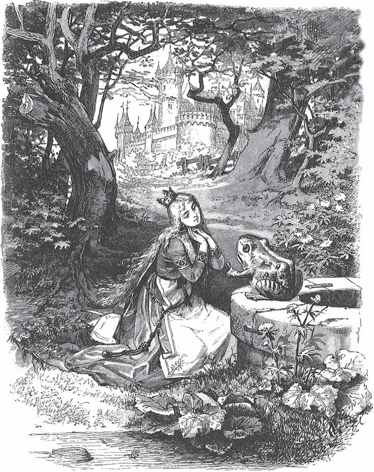

## Der Froschkönig oder der eiserne Heinrich

In den alten Zeiten, wo das Wünschen noch geholfen hat, lebte ein König. Alle seine <abbr title="die Tochter, die Töchter — дочь">Töchter</abbr> sind schön. Aber die jüngste ist so schön, dass sogar die Sonne <abbr title="staunen — удивляться">staunt</abbr>, wenn sie ihr ins Gesicht <abbr title="scheinen (schien, hat geschienen) — светить">scheint</abbr>. Und die Sonne hat doch schon so viel gesehen!

Nahe beim <abbr title="das Schloss, die Schlösser — замок, дворец">Schloss</abbr> vom König liegt ein großer, <abbr title="dunkel — тёмный">dunkler</abbr> Wald. Im Wald steht eine alte <abbr title="die Linde, die Linden — липа">Linde</abbr>, und unter der Linde ist ein <abbr title="der Brunnen, die Brunnen — колодец, родник">Brunnen</abbr>. Wenn der Tag sehr heiß ist, geht die <abbr title="die Königstochter, die Königstöchter — королевская дочь, королевна">Königstochter</abbr> in den Wald. Sie setzt sich an den <abbr title="der Rand, die Ränder — край">Rand</abbr> von dem <abbr title="kühl — прохладный">kühlen</abbr> Brunnen. Und wenn sie sich <abbr title="sich langweilen — скучать">langweilt</abbr>, nimmt sie eine goldene <abbr title="die Kugel, die Kugeln — шар, мяч">Kugel</abbr>. Sie <abbr title="werfen (warf, hat geworfen) — бросать">wirft</abbr> sie <abbr title="in die Höhe — вверх">in die Höhe</abbr> und <abbr title="fangen (fing, hat gefangen) — ловить">fängt</abbr> sie wieder. Das ist ihr liebstes <abbr title="das Spielzeug, die Spielzeuge — игрушка">Spielzeug</abbr>.

Eines Tages fällt die goldene Kugel nicht in ihre kleine Hand. Sie fällt <abbr title="daneben — мимо">daneben</abbr> auf die Erde und <abbr title="rollen — катиться">rollt</abbr> direkt ins Wasser. Die Königstochter <abbr title="nachsehen (sah nach, hat nachgesehen) — смотреть вслед">sieht</abbr> ihr nach, aber die Kugel <abbr title="verschwinden (verschwand, ist verschwunden) — исчезать">verschwindet</abbr>. Der Brunnen ist tief, so tief, dass man keinen <abbr title="der Grund — дно">Grund</abbr> sieht. Da beginnt sie zu weinen. Sie weint immer lauter und kann sich gar nicht <abbr title="sich trösten — утешиться">trösten</abbr>.

Da ruft jemand:

— Was hast du denn, Königstochter? Du weinst so laut, dass sogar ein Stein <abbr title="das Mitleid — жалость, сочувствие">Mitleid</abbr> bekommt.

Sie sieht sich um. Woher kommt die <abbr title="die Stimme, die Stimmen — голос">Stimme</abbr>? Da sieht sie einen <abbr title="der Frosch, die Frösche — лягушка">Frosch</abbr>. Er <abbr title="strecken — высовывать, вытягивать">streckt</abbr> seinen dicken, <abbr title="hässlich — уродливый, безобразный">hässlichen</abbr> Kopf aus dem Wasser.

— Ach, du bist es, alter <abbr title="der Wasserpatscher — шлёпающий по воде (шутл.)">Wasserpatscher</abbr>, — sagt sie. — Ich weine um meine goldene Kugel. Sie ist mir in den Brunnen gefallen.

— Sei still und weine nicht, — antwortet der Frosch. — Ich kann dir helfen. Aber was gibst du mir, wenn ich dein Spielzeug wieder <abbr title="heraufholen — доставать (наверх)">heraufhole</abbr>?

— Was du willst, lieber Frosch, — sagt sie. — Meine Kleider, meine <abbr title="die Perle, die Perlen — жемчужина">Perlen</abbr> und <abbr title="der Edelstein, die Edelsteine — драгоценный камень">Edelsteine</abbr>, auch noch die goldene <abbr title="die Krone, die Kronen — корона">Krone</abbr>, die ich trage.

Der Frosch antwortet:

— Deine Kleider, deine Perlen und Edelsteine und deine goldene Krone will ich nicht. Aber du sollst mich <abbr title="lieb haben — любить">lieb haben</abbr>. Ich will dein Freund und dein <abbr title="der Spielkamerad, die Spielkameraden — товарищ по играм">Spielkamerad</abbr> sein. Ich will an deinem <abbr title="das Tischlein, die Tischlein — столик">Tischlein</abbr> neben dir sitzen, von deinem goldenen <abbr title="das Tellerlein, die Tellerlein — тарелочка">Tellerlein</abbr> essen, aus deinem <abbr title="das Becherlein, die Becherlein — кубок, чашечка">Becherlein</abbr> trinken und in deinem <abbr title="das Bettlein, die Bettlein — кроватка">Bettlein</abbr> schlafen. Wenn du mir das <abbr title="versprechen (versprach, hat versprochen) — обещать">versprichst</abbr>, dann <abbr title="tauchen — нырять">tauche</abbr> ich hinunter und hole dir die goldene Kugel wieder herauf.

— Ach ja, — sagt sie, — ich verspreche dir alles, was du willst. Bring mir nur die Kugel wieder!

Aber sie denkt: «Was <abbr title="reden — болтать, говорить">redet</abbr> dieser <abbr title="dumm — глупый">dumme</abbr> Frosch da? Er sitzt im Wasser bei den anderen Fröschen und <abbr title="quaken — квакать">quakt</abbr>. Er kann doch kein Freund von einem Menschen sein!»

Der Frosch hat ihr Versprechen. Er <abbr title="untertauchen — нырять, погружаться">taucht</abbr> den Kopf unter und <abbr title="sinken (sank, ist gesunken) — опускаться, погружаться">sinkt</abbr> nach unten. Nach einer kleinen <abbr title="die Weile — некоторое время">Weile</abbr> <abbr title="rudern — грести">rudert</abbr> er wieder herauf. Er hat die Kugel im <abbr title="das Maul, die Mäuler — пасть, рот (у животного)">Maul</abbr> und wirft sie ins <abbr title="das Gras — трава">Gras</abbr>. Die Königstochter ist <abbr title="voller Freude — полный радости">voller Freude</abbr>, als sie ihr schönes Spielzeug wieder sieht. Sie <abbr title="aufheben (hob auf, hat aufgehoben) — поднимать (с земли)">hebt</abbr> es auf und läuft damit weg.

— Warte, warte! — ruft der Frosch. — Nimm mich mit! Ich kann nicht so schnell laufen wie du!

Er <abbr title="schreien (schrie, hat geschrien) — кричать">schreit</abbr> ihr sein «Quak, quak» so laut nach, wie er kann. Aber was hilft es ihm? Sie <abbr title="hören auf + Akk. — слушаться, обращать внимание">hört</abbr> nicht darauf. Sie <abbr title="eilen — спешить">eilt</abbr> nach Hause und hat den armen Frosch bald <abbr title="vergessen (vergaß, hat vergessen) — забывать">vergessen</abbr>. Er muss wieder in seinen Brunnen <abbr title="hinuntersteigen (stieg hinunter, ist hinuntergestiegen) — спускаться вниз">hinuntersteigen</abbr>.

Am nächsten Tag sitzt sie mit dem König und allen <abbr title="die Hofleute (Pl.) — придворные">Hofleuten</abbr> an der <abbr title="die Tafel, die Tafeln — (праздничный) стол">Tafel</abbr>. Sie isst von ihrem goldenen Tellerlein. Da <abbr title="kriechen (kroch, ist gekrochen) — ползти">kriecht</abbr> etwas die <abbr title="die Marmortreppe, die Marmortreppen — мраморная лестница">Marmortreppe</abbr> herauf: <abbr title="plitsch, platsch — шлёп-шлёп">plitsch, platsch</abbr>, plitsch, platsch. Oben <abbr title="klopfen — стучать">klopft</abbr> es an die Tür und ruft:

— Königstochter, jüngste, mach mir auf!

Sie läuft zur Tür und will sehen, wer <abbr title="draußen — снаружи">draußen</abbr> ist. Sie macht auf – und vor der Tür sitzt der Frosch. Schnell <abbr title="zuwerfen (warf zu, hat zugeworfen) — захлопывать">wirft</abbr> sie die Tür zu. Sie setzt sich wieder an den Tisch und hat große <abbr title="die Angst, die Ängste — страх">Angst</abbr>. Der König sieht, dass ihr Herz <abbr title="heftig — сильно, бурно">heftig</abbr> klopft. Er sagt:

— Mein Kind, warum <abbr title="sich fürchten — бояться">fürchtest du dich</abbr>? Steht vielleicht ein <abbr title="der Riese, die Riesen — великан">Riese</abbr> vor der Tür und will dich holen?

— Ach nein, — antwortet sie, — es ist kein Riese. Es ist ein <abbr title="eklig — противный, мерзкий">ekliger</abbr> Frosch.

— Was will der Frosch von dir?

— Ach, lieber Vater, gestern war ich im Wald und habe am Brunnen gespielt. Da ist meine goldene Kugel ins Wasser gefallen. Ich habe so geweint, und deshalb hat der Frosch sie wieder heraufgeholt. Er hat es <abbr title="unbedingt — обязательно, непременно">unbedingt</abbr> <abbr title="verlangen — требовать">verlangt</abbr>, und deshalb habe ich ihm versprochen: Er darf mein Freund sein. Aber ich habe nie gedacht, dass er aus seinem Wasser herauskommen kann. Jetzt ist er draußen und will zu mir herein.

Da klopft es zum zweiten Mal, und eine Stimme ruft:

> «Königstochter, jüngste,  
> mach mir auf,  
> weißt du nicht, was gestern  
> du zu mir gesagt  
> bei dem kühlen <abbr title="das Brunnenwasser — колодезная вода">Brunnenwasser</abbr>?  
> Königstochter, jüngste,  
> mach mir auf.»

Da sagt der König:

— Was du versprochen hast, das musst du auch <abbr title="ein Versprechen halten (hielt, hat gehalten) — сдержать обещание">halten</abbr>. Geh nur und mach ihm auf!

Sie geht und öffnet die Tür. Der Frosch <abbr title="hüpfen — прыгать, скакать">hüpft</abbr> herein. Er hüpft immer hinter ihr her, bis zu ihrem Stuhl. Da sitzt er und ruft:

— Heb mich herauf zu dir!

Sie <abbr title="zögern — медлить, колебаться">zögert</abbr>. Erst als der König es <abbr title="befehlen (befahl, hat befohlen) — приказывать">befiehlt</abbr>, tut sie es. Jetzt sitzt der Frosch auf dem Stuhl, aber er will auf den Tisch. Und als er auf dem Tisch sitzt, sagt er:

— Jetzt <abbr title="schieben (schob, hat geschoben) — пододвигать">schieb</abbr> mir dein goldenes Tellerlein näher. Wir wollen zusammen essen.

Sie tut es, aber man sieht: Sie tut es nicht gern. Dem Frosch schmeckt es sehr gut. Aber ihr bleibt fast jeder <abbr title="der Bissen, die Bissen — кусок, кусочек">Bissen</abbr> im <abbr title="der Hals, die Hälse — горло">Hals</abbr> <abbr title="stecken bleiben (blieb stecken, ist stecken geblieben) — застревать">stecken</abbr>. Endlich sagt er:

— Ich bin <abbr title="satt — сытый">satt</abbr> und müde. Jetzt trag mich in dein <abbr title="das Kämmerlein, die Kämmerlein — комнатка, спаленка">Kämmerlein</abbr> und mach dein <abbr title="seiden — шёлковый">seidenes</abbr> Bettlein fertig. Dann wollen wir schlafen gehen.

Die Königstochter beginnt zu weinen. Sie hat Angst <abbr title="Angst haben vor + Dat. — бояться чего-то">vor</abbr> dem kalten Frosch. Sie <abbr title="sich trauen — осмеливаться">traut sich</abbr> nicht, ihn <abbr title="anfassen — трогать, прикасаться">anzufassen</abbr>. Und jetzt soll er in ihrem schönen, <abbr title="sauber — чистый">sauberen</abbr> Bettlein schlafen! Aber der König wird <abbr title="zornig — гневный, сердитый">zornig</abbr> und sagt:

— Er hat dir geholfen, als du in <abbr title="die Not — беда, нужда">Not</abbr> warst. Jetzt darfst du ihn nicht <abbr title="verachten — презирать">verachten</abbr>.

Da <abbr title="packen — хватать">packt</abbr> sie den Frosch mit zwei Fingern. Sie trägt ihn nach oben und setzt ihn in eine <abbr title="die Ecke, die Ecken — угол">Ecke</abbr>. Aber als sie im Bett liegt, kriecht er zu ihr und sagt:

— Ich bin müde. Ich will auch so gut schlafen wie du. Heb mich herauf, sonst sage ich es deinem Vater!

Jetzt wird sie richtig <abbr title="wütend — в ярости, злой">wütend</abbr>. Sie holt ihn herauf und wirft ihn <abbr title="mit aller Kraft — изо всех сил">mit aller Kraft</abbr> gegen die <abbr title="die Wand, die Wände — стена">Wand</abbr>.

— Jetzt hast du deine Ruhe, du ekliger Frosch!

Aber als er <abbr title="herunterfallen (fiel herunter, ist heruntergefallen) — падать вниз">herunterfällt</abbr>, ist er kein Frosch mehr. Er ist ein <abbr title="der Königssohn, die Königssöhne — королевич, принц">Königssohn</abbr> mit schönen, <abbr title="freundlich — приветливый">freundlichen</abbr> Augen. Der Vater will es so, und deshalb wird er jetzt ihr lieber Freund und ihr Mann. Der Königssohn erzählt ihr alles: Eine böse <abbr title="die Hexe, die Hexen — ведьма">Hexe</abbr> hat ihn <abbr title="verzaubern — заколдовать">verzaubert</abbr>. Niemand außer ihr konnte ihn aus dem Brunnen <abbr title="erlösen — избавить, расколдовать">erlösen</abbr>. Morgen wollen sie zusammen in sein <abbr title="das Königreich, die Königreiche — королевство">Königreich</abbr> fahren.

Dann <abbr title="einschlafen (schlief ein, ist eingeschlafen) — засыпать">schlafen</abbr> sie ein. Am nächsten Morgen <abbr title="aufwecken — будить">weckt</abbr> die Sonne sie auf. Da kommt ein <abbr title="der Wagen, die Wagen — карета, повозка">Wagen</abbr> mit acht weißen Pferden. Die Pferde haben weiße <abbr title="die Straußenfeder, die Straußenfedern — страусовое перо">Straußenfedern</abbr> auf dem Kopf und gehen in goldenen <abbr title="die Kette, die Ketten — цепь">Ketten</abbr>. <abbr title="hinten — сзади">Hinten</abbr> auf dem Wagen steht der <abbr title="der Diener, die Diener — слуга">Diener</abbr> vom jungen König. Das ist der <abbr title="treu — верный">treue</abbr> Heinrich.

Der treue Heinrich war sehr <abbr title="traurig — грустный, печальный">traurig</abbr>, als man seinen Herrn in einen Frosch <abbr title="verwandeln — превращать">verwandelt</abbr> hat. Er war so traurig, dass er drei <abbr title="eisern — железный">eiserne</abbr> <abbr title="das Band, die Bänder — обруч, лента">Bänder</abbr> um sein Herz legen lassen hat. <abbr title="sonst — иначе">Sonst</abbr> <abbr title="zerspringen (zersprang, ist zersprungen) — разорваться, лопнуть">zerspringt</abbr> es vor <abbr title="der Schmerz, die Schmerzen — боль">Schmerz</abbr> und <abbr title="die Traurigkeit — печаль, грусть">Traurigkeit</abbr>, hat er gedacht.

Der Wagen soll den jungen König in sein Königreich bringen. Der treue Heinrich hebt die beiden hinein. Dann stellt er sich wieder hinten auf den Wagen. Er ist voller Freude, weil sein Herr <abbr title="erlöst — избавленный, расколдованный">erlöst</abbr> ist.

Sie fahren ein <abbr title="das Stück, die Stücke — кусок, отрезок (пути)">Stück</abbr>. Da hört der Königssohn hinter sich ein lautes <abbr title="das Krachen — треск">Krachen</abbr>, so, als ob etwas <abbr title="zerbrechen (zerbrach, ist zerbrochen) — разломаться">zerbrochen</abbr>. Er <abbr title="sich umdrehen — оборачиваться">dreht sich um</abbr> und ruft:

«Heinrich, der Wagen bricht!»

> «Nein, Herr, der Wagen nicht,  
> es ist ein Band von meinem Herzen,  
> das da lag in großen Schmerzen,  
> als Ihr in dem Brunnen saßt,  
> als Ihr ein Frosch wart.»

Noch einmal und noch einmal kracht es auf dem Weg. Jedes Mal denkt der Königssohn: «Der Wagen bricht!» Aber es sind nur die Bänder. Sie <abbr title="abspringen (sprang ab, ist abgesprungen) — отскакивать, лопаться">springen</abbr> vom Herzen vom treuen Heinrich ab, weil sein Herr erlöst und glücklich ist.

---

### Neue Wörter

- **die Tochter, die Töchter** — дочь
- **staunen** — удивляться
- **scheinen (schien, hat geschienen)** — светить
- **das Schloss, die Schlösser** — замок, дворец
- **dunkel** — тёмный
- **die Linde, die Linden** — липа
- **der Brunnen, die Brunnen** — колодец, родник
- **die Königstochter, die Königstöchter** — королевская дочь, королевна
- **der Rand, die Ränder** — край
- **kühl** — прохладный
- **sich langweilen** — скучать
- **die Kugel, die Kugeln** — шар, мяч
- **werfen (warf, hat geworfen)** — бросать
- **in die Höhe** — вверх
- **fangen (fing, hat gefangen)** — ловить
- **das Spielzeug, die Spielzeuge** — игрушка
- **daneben** — мимо
- **rollen** — катиться
- **nachsehen (sah nach, hat nachgesehen)** — смотреть вслед
- **verschwinden (verschwand, ist verschwunden)** — исчезать
- **der Grund** — дно
- **sich trösten** — утешиться
- **das Mitleid** — жалость, сочувствие
- **die Stimme, die Stimmen** — голос
- **der Frosch, die Frösche** — лягушка
- **strecken** — высовывать, вытягивать
- **hässlich** — уродливый, безобразный
- **der Wasserpatscher** — шлёпающий по воде (шутл.)
- **heraufholen** — доставать (наверх)
- **die Perle, die Perlen** — жемчужина
- **der Edelstein, die Edelsteine** — драгоценный камень
- **die Krone, die Kronen** — корона
- **lieb haben** — любить
- **der Spielkamerad, die Spielkameraden** — товарищ по играм
- **das Tischlein, die Tischlein** — столик
- **das Tellerlein, die Tellerlein** — тарелочка
- **das Becherlein, die Becherlein** — кубок, чашечка
- **das Bettlein, die Bettlein** — кроватка
- **versprechen (versprach, hat versprochen)** — обещать
- **tauchen** — нырять
- **reden** — болтать, говорить
- **dumm** — глупый
- **quaken** — квакать
- **untertauchen** — нырять, погружаться
- **sinken (sank, ist gesunken)** — опускаться, погружаться
- **die Weile** — некоторое время
- **rudern** — грести
- **das Maul, die Mäuler** — пасть, рот (у животного)
- **das Gras** — трава
- **voller Freude** — полный радости
- **aufheben (hob auf, hat aufgehoben)** — поднимать (с земли)
- **schreien (schrie, hat geschrien)** — кричать
- **hören auf + Akk.** — слушаться, обращать внимание
- **eilen** — спешить
- **vergessen (vergaß, hat vergessen)** — забывать
- **hinuntersteigen (stieg hinunter, ist hinuntergestiegen)** — спускаться вниз
- **die Hofleute (Pl.)** — придворные
- **die Tafel, die Tafeln** — (праздничный) стол
- **kriechen (kroch, ist gekrochen)** — ползти
- **die Marmortreppe, die Marmortreppen** — мраморная лестница
- **plitsch, platsch** — шлёп-шлёп
- **klopfen** — стучать
- **draußen** — снаружи
- **zuwerfen (warf zu, hat zugeworfen)** — захлопывать
- **die Angst, die Ängste** — страх
- **heftig** — сильно, бурно
- **sich fürchten** — бояться
- **der Riese, die Riesen** — великан
- **eklig** — противный, мерзкий
- **unbedingt** — обязательно, непременно
- **verlangen** — требовать
- **das Brunnenwasser** — колодезная вода
- **ein Versprechen halten (hielt, hat gehalten)** — сдержать обещание
- **hüpfen** — прыгать, скакать
- **zögern** — медлить, колебаться
- **befehlen (befahl, hat befohlen)** — приказывать
- **schieben (schob, hat geschoben)** — пододвигать
- **der Bissen, die Bissen** — кусок, кусочек
- **der Hals, die Hälse** — горло
- **stecken bleiben (blieb stecken, ist stecken geblieben)** — застревать
- **satt** — сытый
- **das Kämmerlein, die Kämmerlein** — комнатка, спаленка
- **seiden** — шёлковый
- **Angst haben vor + Dat.** — бояться чего-то
- **sich trauen** — осмеливаться
- **anfassen** — трогать, прикасаться
- **sauber** — чистый
- **zornig** — гневный, сердитый
- **die Not** — беда, нужда
- **verachten** — презирать
- **packen** — хватать
- **die Ecke, die Ecken** — угол
- **wütend** — в ярости, злой
- **mit aller Kraft** — изо всех сил
- **die Wand, die Wände** — стена
- **herunterfallen (fiel herunter, ist heruntergefallen)** — падать вниз
- **der Königssohn, die Königssöhne** — королевич, принц
- **freundlich** — приветливый
- **die Hexe, die Hexen** — ведьма
- **verzaubern** — заколдовать
- **erlösen** — избавить, расколдовать
- **das Königreich, die Königreiche** — королевство
- **einschlafen (schlief ein, ist eingeschlafen)** — засыпать
- **aufwecken** — будить
- **der Wagen, die Wagen** — карета, повозка
- **die Straußenfeder, die Straußenfedern** — страусовое перо
- **die Kette, die Ketten** — цепь
- **hinten** — сзади
- **der Diener, die Diener** — слуга
- **treu** — верный
- **traurig** — грустный, печальный
- **verwandeln** — превращать
- **eisern** — железный
- **das Band, die Bänder** — обруч, лента
- **sonst** — иначе
- **zerspringen (zersprang, ist zersprungen)** — разорваться, лопнуть
- **der Schmerz, die Schmerzen** — боль
- **die Traurigkeit** — печаль, грусть
- **erlöst** — избавленный, расколдованный
- **das Stück, die Stücke** — кусок, отрезок (пути)
- **das Krachen** — треск
- **zerbrechen (zerbrach, ist zerbrochen)** — разломаться
- **sich umdrehen** — оборачиваться
- **abspringen (sprang ab, ist abgesprungen)** — отскакивать, лопаться

[Inhalt](README.md)
