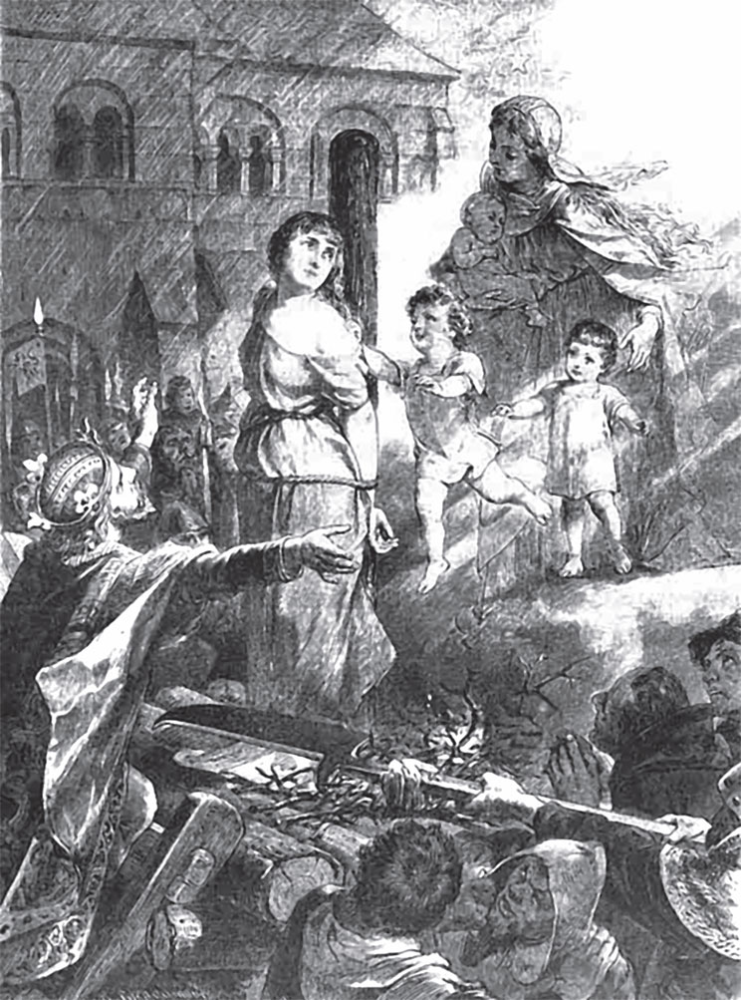

## Marienkind

Vor einem großen Wald lebt ein <abbr title="der Holzfäller, die Holzfäller — дровосек">Holzfäller</abbr> mit seiner Frau. Sie haben nur ein einziges Kind, ein Mädchen von drei Jahren. Aber sie sind so arm, dass sie nicht einmal mehr das <abbr title="täglich — ежедневный, насущный">tägliche</abbr> Brot haben. Sie wissen nicht, was sie dem Kind zu essen geben sollen.

Eines Morgens geht der Holzfäller voller <abbr title="die Sorge, die Sorgen — забота, тревога">Sorgen</abbr> in den Wald zur Arbeit. Er <abbr title="hacken — рубить">hackt</abbr> Holz. Da steht <abbr title="plötzlich — вдруг, внезапно">plötzlich</abbr> eine schöne, große Frau vor ihm. Auf dem Kopf trägt sie eine Krone aus <abbr title="leuchten — светиться, сиять">leuchtenden</abbr> Sternen. Sie sagt zu ihm:

— Ich bin die <abbr title="die Jungfrau Maria — Дева Мария">Jungfrau Maria</abbr>, die Mutter vom <abbr title="das Christkind — младенец Христос">Christkind</abbr>. Du bist arm und hast nichts. Bring mir dein Kind. Ich will es mitnehmen. Ich will seine Mutter sein und für das Kind <abbr title="sorgen für + Akk. — заботиться о">sorgen</abbr>.

Der Holzfäller <abbr title="gehorchen — слушаться, повиноваться">gehorcht</abbr>. Er holt sein Kind und gibt es der Jungfrau Maria. Sie nimmt es mit nach oben in den <abbr title="der Himmel — небо, рай">Himmel</abbr>. Dort geht es dem Mädchen gut. Es isst <abbr title="das Zuckerbrot — сладкий хлеб, пряник">Zuckerbrot</abbr> und trinkt süße Milch. Seine Kleider sind aus Gold, und die kleinen <abbr title="der Engel, die Engel — ангел">Engel</abbr> spielen mit ihm.

Als das Mädchen vierzehn Jahre alt ist, ruft die Jungfrau Maria es zu sich und sagt:

— Liebes Kind, ich mache eine große <abbr title="die Reise, die Reisen — путешествие">Reise</abbr>. Nimm du die <abbr title="der Schlüssel, die Schlüssel — ключ">Schlüssel</abbr> zu den dreizehn Türen vom <abbr title="das Himmelreich — Царство Небесное">Himmelreich</abbr> und pass gut auf sie auf. Zwölf Türen darfst du <abbr title="aufschließen (schloss auf, hat aufgeschlossen) — отпирать">aufschließen</abbr>. Du darfst dir die <abbr title="die Herrlichkeit, die Herrlichkeiten — великолепие, чудо">Herrlichkeiten</abbr> dahinter ansehen. Aber die dreizehnte Tür, zu der dieser kleine Schlüssel <abbr title="gehören zu + Dat. — относиться к, подходить к">gehört</abbr>, ist dir <abbr title="verbieten (verbot, hat verboten) — запрещать">verboten</abbr>. <abbr title="sich hüten — остерегаться">Hüte dich</abbr>! Schließ sie nicht auf, sonst wirst du <abbr title="unglücklich — несчастный">unglücklich</abbr>.

Das Mädchen verspricht, <abbr title="gehorsam — послушный">gehorsam</abbr> zu sein. Die Jungfrau Maria geht fort, und das Mädchen beginnt, sich die <abbr title="die Wohnung, die Wohnungen — обитель, жилище">Wohnungen</abbr> im Himmelreich anzusehen. Jeden Tag schließt es eine Tür auf, bis alle zwölf offen sind. In jeder Wohnung sitzt ein <abbr title="der Apostel, die Apostel — апостол">Apostel</abbr>, und um ihn ist ein großer <abbr title="der Glanz — сияние, блеск">Glanz</abbr>. Das Mädchen freut sich über die ganze <abbr title="die Pracht — роскошь, великолепие">Pracht</abbr>. Und die kleinen Engel, die immer bei ihm sind, freuen sich mit.

Jetzt ist nur noch die <abbr title="verboten — запретный">verbotene</abbr> Tür <abbr title="übrig — оставшийся">übrig</abbr>. Das Mädchen möchte so gern wissen, was dahinter <abbr title="verborgen — скрытый, спрятанный">verborgen</abbr> ist. Es sagt zu den Engeln:

— Ganz aufmachen will ich sie nicht. Ich will auch nicht hineingehen. Ich will sie nur aufschließen. Dann können wir ein bisschen durch den <abbr title="der Spalt, die Spalte — щель">Spalt</abbr> sehen.

— Ach nein, — sagen die Engel, — das ist eine <abbr title="die Sünde, die Sünden — грех">Sünde</abbr>! Die Jungfrau Maria hat es verboten. Es kann leicht dein <abbr title="das Unglück — несчастье, беда">Unglück</abbr> werden.

Da schweigt das Mädchen. Aber der <abbr title="der Wunsch, die Wünsche — желание">Wunsch</abbr> in seinem Herzen schweigt nicht. Er <abbr title="nagen — грызть">nagt</abbr> und <abbr title="picken — клевать">pickt</abbr> an seinem Herzen und lässt ihm keine Ruhe. Einmal sind alle Engel hinausgegangen. Da denkt das Mädchen: «Jetzt bin ich ganz allein. Jetzt kann ich hineinschauen. Es weiß ja niemand, wenn ich es tue.»

Es sucht den Schlüssel heraus. Und als es ihn in der Hand hält, steckt es ihn auch ins Schloss. Und als es ihn hineingesteckt hat, dreht es ihn auch um. Da <abbr title="aufspringen (sprang auf, ist aufgesprungen) — распахнуться">springt</abbr> die Tür auf. Das Mädchen sieht die <abbr title="die Dreieinigkeit — Святая Троица">Dreieinigkeit</abbr>. Sie sitzt in Feuer und Glanz. Das Mädchen bleibt eine Weile stehen und sieht alles <abbr title="voller Staunen — с изумлением">voller Staunen</abbr> an. Dann <abbr title="berühren — касаться">berührt</abbr> es den Glanz ein wenig mit dem Finger. Da wird der Finger ganz golden.

Sofort bekommt das Mädchen eine <abbr title="schrecklich — ужасный">schreckliche</abbr> Angst. Es <abbr title="zuschlagen (schlug zu, hat zugeschlagen) — захлопнуть">schlägt</abbr> die Tür zu und läuft weg. Aber die Angst geht nicht weg, was es auch tut. Das Herz klopft und klopft und will nicht ruhig werden. Auch das Gold bleibt am Finger. Das Mädchen kann <abbr title="waschen (wusch, hat gewaschen) — мыть">waschen</abbr> und <abbr title="reiben (rieb, hat gerieben) — тереть">reiben</abbr>, so viel es will – das Gold geht nicht ab.

Schon bald kommt die Jungfrau Maria von ihrer Reise zurück. Sie ruft das Mädchen zu sich und will die <abbr title="der Himmelsschlüssel, die Himmelsschlüssel — ключ от рая">Himmelsschlüssel</abbr> zurückhaben. Das Mädchen gibt ihr den <abbr title="der Schlüsselbund, die Schlüsselbunde — связка ключей">Schlüsselbund</abbr>. Da sieht die Jungfrau ihm in die Augen und sagt:

— Hast du auch nicht die dreizehnte Tür geöffnet?

— Nein, — antwortet das Mädchen.

Da legt sie ihre Hand auf sein Herz. Sie fühlt, wie es klopft und klopft. Sie merkt genau: Das Mädchen hat ihr <abbr title="das Verbot, die Verbote — запрет">Verbot</abbr> <abbr title="brechen (brach, hat gebrochen) — нарушать">gebrochen</abbr> und die Tür aufgeschlossen. Sie fragt noch einmal:

— Hast du es <abbr title="wirklich — действительно">wirklich</abbr> nicht getan?

— Nein, — sagt das Mädchen zum zweiten Mal.

Da sieht die Jungfrau den Finger. Er ist vom himmlischen Feuer golden geworden. Sie sieht genau, dass das Mädchen <abbr title="sündigen — грешить">gesündigt</abbr> hat. Sie fragt zum dritten Mal:

— Hast du es nicht getan?

— Nein, — sagt das Mädchen zum dritten Mal.

Da sagt die Jungfrau Maria:

— Du hast mir nicht gehorcht. Und du hast auch noch <abbr title="lügen (log, hat gelogen) — лгать">gelogen</abbr>. Du <abbr title="verdienen — заслуживать">verdienst</abbr> es nicht mehr, im Himmel zu sein.

Da <abbr title="fallen (fiel, ist gefallen) — падать">fällt</abbr> das Mädchen in einen tiefen Schlaf. Als es <abbr title="aufwachen — просыпаться">aufwacht</abbr>, liegt es unten auf der Erde, mitten in einer <abbr title="die Wildnis — глушь, дикая местность">Wildnis</abbr>. Es will rufen, aber es kann keinen <abbr title="der Laut, die Laute — звук">Laut</abbr> <abbr title="hervorbringen (brachte hervor, hat hervorgebracht) — издать (звук)">hervorbringen</abbr>. Es springt auf und will weglaufen. Aber wohin es sich auch <abbr title="sich wenden — поворачиваться">wendet</abbr>, immer <abbr title="zurückhalten (hielt zurück, hat zurückgehalten) — удерживать, не пускать">halten</abbr> dichte <abbr title="die Dornenhecke, die Dornenhecken — колючая живая изгородь, терновник">Dornenhecken</abbr> es zurück. Es kann nicht durch sie hindurch.

In dieser <abbr title="die Einöde, die Einöden — пустынное место, глушь">Einöde</abbr> steht ein alter, <abbr title="hohl — дуплистый, полый">hohler</abbr> Baum. Das muss jetzt seine Wohnung sein. Wenn die Nacht kommt, kriecht es hinein und schläft darin. Und wenn es <abbr title="stürmen — бушевать (о буре)">stürmt</abbr> und regnet, findet es dort <abbr title="der Schutz — защита, укрытие">Schutz</abbr>. Aber es ist ein <abbr title="jämmerlich — жалкий, горестный">jämmerliches</abbr> Leben. Wenn das Mädchen daran denkt, wie schön es im Himmel war und wie die Engel mit ihm gespielt haben, dann weint es <abbr title="bitterlich — горько">bitterlich</abbr>.

<abbr title="die Wurzel, die Wurzeln — корень">Wurzeln</abbr> und <abbr title="die Waldbeere, die Waldbeeren — лесная ягода">Waldbeeren</abbr> sind sein einziges Essen. Es sucht sie, so weit es kommen kann. Im Herbst <abbr title="sammeln — собирать">sammelt</abbr> es die heruntergefallenen <abbr title="die Nuss, die Nüsse — орех">Nüsse</abbr> und <abbr title="das Blatt, die Blätter — лист">Blätter</abbr> und trägt sie in die <abbr title="die Höhle, die Höhlen — пещера, дупло">Höhle</abbr>. Im Winter isst es die Nüsse. Und wenn Schnee und Eis kommen, kriecht es wie ein armes kleines Tier in die Blätter. So <abbr title="frieren (fror, hat gefroren) — мёрзнуть">friert</abbr> es nicht. Bald <abbr title="zerreißen (zerriss, ist zerrissen) — рваться">zerreißen</abbr> seine Kleider. Ein Stück nach dem anderen fällt vom Körper. Sobald die Sonne wieder warm scheint, geht das Mädchen hinaus und setzt sich vor den Baum. Seine langen Haare <abbr title="bedecken — покрывать">bedecken</abbr> es von allen Seiten wie ein <abbr title="der Mantel, die Mäntel — плащ, мантия">Mantel</abbr>. So sitzt es ein Jahr nach dem anderen und fühlt den <abbr title="der Jammer — горе, скорбь">Jammer</abbr> und das <abbr title="das Elend — нищета, страдание">Elend</abbr> von der Welt.

Einmal, als die Bäume wieder frisch und grün sind, <abbr title="jagen — охотиться">jagt</abbr> der König von diesem Land im Wald. Er <abbr title="verfolgen — преследовать">verfolgt</abbr> ein <abbr title="das Reh, die Rehe — косуля">Reh</abbr>. Das Reh <abbr title="fliehen (floh, ist geflohen) — убегать, спасаться бегством">flieht</abbr> in das <abbr title="das Gebüsch — кустарник, заросли">Gebüsch</abbr> rund um den Platz. Da steigt der König vom Pferd. Er reißt die <abbr title="der Zweig, die Zweige — ветка">Zweige</abbr> <abbr title="auseinanderreißen — раздвигать, разрывать">auseinander</abbr> und <abbr title="sich einen Weg schlagen — прорубать себе путь">schlägt</abbr> sich mit seinem <abbr title="das Schwert, die Schwerter — меч">Schwert</abbr> einen Weg. Endlich ist er durch. Da sieht er unter dem Baum ein <abbr title="wunderschön — прекрасный">wunderschönes</abbr> Mädchen sitzen. Es ist von seinem goldenen Haar bedeckt, vom Kopf bis zu den <abbr title="der Zeh, die Zehen — палец ноги">Zehen</abbr>. Der König bleibt stehen und sieht es voller Staunen an. Dann spricht er es an:

— Wer bist du? Warum sitzt du hier in der Einöde?

Aber es gibt keine Antwort, denn es kann seinen Mund nicht öffnen. Der König spricht weiter:

— Willst du mit mir auf mein Schloss kommen?

Da <abbr title="nicken — кивать">nickt</abbr> es nur ein wenig mit dem Kopf. Der König nimmt es auf den Arm, trägt es zu seinem Pferd und reitet mit ihm nach Hause. Auf dem <abbr title="königlich — королевский">königlichen</abbr> Schloss lässt er ihm schöne Kleider anziehen und gibt ihm alles <abbr title="im Überfluss — в изобилии">im Überfluss</abbr>. Es kann zwar nicht sprechen, aber es ist so schön und <abbr title="lieblich — милый, прелестный">lieblich</abbr>, dass der König es <abbr title="von Herzen — от всего сердца">von Herzen</abbr> lieb gewinnt. Bald danach <abbr title="heiraten — жениться">heiratet</abbr> er das Mädchen.

Nach ungefähr einem Jahr bekommt die <abbr title="die Königin, die Königinnen — королева">Königin</abbr> einen Sohn. In der Nacht liegt sie allein in ihrem Bett. Da <abbr title="erscheinen (erschien, ist erschienen) — являться, появляться">erscheint</abbr> ihr die Jungfrau Maria und sagt:

— Sag die <abbr title="die Wahrheit — правда">Wahrheit</abbr>. Wenn du <abbr title="gestehen (gestand, hat gestanden) — признаваться">gestehst</abbr>, dass du die verbotene Tür aufgeschlossen hast, dann öffne ich deinen Mund und gebe dir deine <abbr title="die Sprache — речь, дар речи">Sprache</abbr> wieder. Aber wenn du bei deiner Sünde <abbr title="bleiben bei + Dat. (blieb, ist geblieben) — упорствовать в чём-то">bleibst</abbr> und <abbr title="hartnäckig — упрямо">hartnäckig</abbr> <abbr title="leugnen — отрицать">leugnest</abbr>, dann nehme ich dein <abbr title="neugeboren — новорождённый">neugeborenes</abbr> Kind mit.

Jetzt kann die Königin antworten. Aber sie bleibt <abbr title="stur — упрямый">stur</abbr> und sagt:

— Nein, ich habe die verbotene Tür nicht aufgemacht.

Da nimmt die Jungfrau Maria ihr das neugeborene Kind aus den Armen und verschwindet damit.

Am nächsten Morgen kann man das Kind nicht finden. Da <abbr title="flüstern — шептать">flüstern</abbr> die Leute: «Die Königin ist eine <abbr title="die Menschenfresserin, die Menschenfresserinnen — людоедка">Menschenfresserin</abbr>. Sie hat ihr eigenes Kind <abbr title="umbringen (brachte um, hat umgebracht) — убить">umgebracht</abbr>.» Die Königin hört alles, aber sie kann nichts dagegen sagen. Doch der König will es nicht glauben, weil er sie so lieb hat.

Nach einem Jahr bekommt die Königin wieder einen Sohn. In der Nacht kommt auch wieder die Jungfrau Maria zu ihr und sagt:

— Wenn du gestehst, dass du die verbotene Tür geöffnet hast, dann gebe ich dir dein Kind zurück und <abbr title="lösen — развязывать, освобождать">löse</abbr> deine Zunge. Aber wenn du bei deiner Sünde bleibst und leugnest, dann nehme ich auch dieses neugeborene Kind mit.

Da sagt die Königin wieder:

— Nein, ich habe die verbotene Tür nicht geöffnet.

Und die Jungfrau nimmt ihr das Kind aus den Armen und mit sich in den Himmel.

Am Morgen ist das Kind <abbr title="schon wieder — опять, снова">schon wieder</abbr> verschwunden. Jetzt sagen die Leute ganz laut: «Die Königin hat es <abbr title="verschlingen (verschlang, hat verschlungen) — проглотить, пожрать">verschlungen</abbr>!» Die <abbr title="der Ratgeber, die Ratgeber — советник">Ratgeber</abbr> vom König verlangen, dass man ihr den <abbr title="der Prozess, die Prozesse — судебный процесс">Prozess</abbr> macht. Aber der König hat sie so lieb, dass er es nicht glauben will. Er befiehlt seinen Ratgebern, nicht mehr darüber zu sprechen. Wer es doch tut, muss sterben.

Im nächsten Jahr bekommt die Königin eine schöne kleine Tochter. Da erscheint ihr zum dritten Mal in der Nacht die Jungfrau Maria und sagt:

— Komm mit mir!

Sie nimmt die Königin an der Hand und führt sie in den Himmel. Dort zeigt sie ihr die beiden älteren Kinder. Sie lachen ihre Mutter an und spielen mit der <abbr title="die Weltkugel — земной шар">Weltkugel</abbr>. Die Königin freut sich darüber. Da sagt die Jungfrau Maria:

— Ist dein Herz noch nicht <abbr title="weich — мягкий">weich</abbr> geworden? Wenn du gestehst, dass du die verbotene Tür geöffnet hast, dann gebe ich dir deine beiden kleinen Söhne zurück.

Aber die Königin antwortet zum dritten Mal:

— Nein, ich habe die verbotene Tür nicht geöffnet.

Da lässt die Jungfrau sie wieder auf die Erde <abbr title="hinuntersinken (sank hinunter, ist hinuntergesunken) — опуститься вниз">hinuntersinken</abbr> und nimmt ihr auch das dritte Kind.

Am nächsten Morgen wissen es alle. Die Leute rufen laut: «Die Königin ist eine Menschenfresserin! Man muss sie <abbr title="verurteilen — осуждать, приговаривать">verurteilen</abbr>!» Jetzt kann der König seine Ratgeber nicht mehr zurückhalten. Es gibt ein <abbr title="das Gericht, die Gerichte — суд">Gericht</abbr> über die Königin. Sie kann nicht antworten und sich nicht <abbr title="sich verteidigen — защищаться">verteidigen</abbr>. Deshalb lautet das <abbr title="das Urteil, die Urteile — приговор">Urteil</abbr>: Sie soll auf dem <abbr title="der Scheiterhaufen, die Scheiterhaufen — костёр (для казни)">Scheiterhaufen</abbr> sterben.

Man trägt das Holz zusammen. Man <abbr title="festbinden (band fest, hat festgebunden) — привязывать">bindet</abbr> die Königin an einen <abbr title="der Pfahl, die Pfähle — столб">Pfahl</abbr> fest. Rundherum beginnt das Feuer zu brennen. Da <abbr title="schmelzen (schmolz, ist geschmolzen) — таять">schmilzt</abbr> das harte Eis von ihrem <abbr title="der Stolz — гордость, гордыня">Stolz</abbr>. Ihr Herz ist voll <abbr title="die Reue — раскаяние">Reue</abbr>, und sie denkt: «Ach, wenn ich nur vor meinem Tod noch gestehen kann, dass ich die Tür geöffnet habe!» Da bekommt sie ihre Stimme zurück, und sie ruft laut:

— Ja, Maria, ich habe es getan!

Sofort beginnt es vom Himmel zu regnen. Der Regen <abbr title="löschen — гасить, тушить">löscht</abbr> die <abbr title="die Flamme, die Flammen — пламя">Flammen</abbr>. Über der Königin <abbr title="hervorbrechen (brach hervor, ist hervorgebrochen) — прорываться, вспыхнуть">bricht</abbr> ein Licht hervor. Die Jungfrau Maria kommt herunter. Neben ihr sind die beiden kleinen Söhne, und auf dem Arm trägt sie die neugeborene Tochter. Sie sagt freundlich:

— Wer seine Sünde <abbr title="bereuen — раскаиваться">bereut</abbr> und gesteht, dem ist sie <abbr title="vergeben (vergab, hat vergeben) — прощать">vergeben</abbr>.

Sie gibt der Königin die drei Kinder, löst ihre Zunge und schenkt ihr <abbr title="das Glück — счастье">Glück</abbr> für das ganze Leben.

---

### Neue Wörter

- **der Holzfäller, die Holzfäller** — дровосек
- **täglich** — ежедневный, насущный
- **die Sorge, die Sorgen** — забота, тревога
- **hacken** — рубить
- **plötzlich** — вдруг, внезапно
- **leuchten** — светиться, сиять
- **die Jungfrau Maria** — Дева Мария
- **das Christkind** — младенец Христос
- **sorgen für + Akk.** — заботиться о
- **gehorchen** — слушаться, повиноваться
- **der Himmel** — небо, рай
- **das Zuckerbrot** — сладкий хлеб, пряник
- **der Engel, die Engel** — ангел
- **die Reise, die Reisen** — путешествие
- **der Schlüssel, die Schlüssel** — ключ
- **das Himmelreich** — Царство Небесное
- **aufschließen (schloss auf, hat aufgeschlossen)** — отпирать
- **die Herrlichkeit, die Herrlichkeiten** — великолепие, чудо
- **gehören zu + Dat.** — относиться к, подходить к
- **verbieten (verbot, hat verboten)** — запрещать
- **sich hüten** — остерегаться
- **unglücklich** — несчастный
- **gehorsam** — послушный
- **die Wohnung, die Wohnungen** — обитель, жилище
- **der Apostel, die Apostel** — апостол
- **der Glanz** — сияние, блеск
- **die Pracht** — роскошь, великолепие
- **verboten** — запретный
- **übrig** — оставшийся
- **verborgen** — скрытый, спрятанный
- **der Spalt, die Spalte** — щель
- **die Sünde, die Sünden** — грех
- **das Unglück** — несчастье, беда
- **der Wunsch, die Wünsche** — желание
- **nagen** — грызть
- **picken** — клевать
- **aufspringen (sprang auf, ist aufgesprungen)** — распахнуться
- **die Dreieinigkeit** — Святая Троица
- **voller Staunen** — с изумлением
- **berühren** — касаться
- **schrecklich** — ужасный
- **zuschlagen (schlug zu, hat zugeschlagen)** — захлопнуть
- **waschen (wusch, hat gewaschen)** — мыть
- **reiben (rieb, hat gerieben)** — тереть
- **der Himmelsschlüssel, die Himmelsschlüssel** — ключ от рая
- **der Schlüsselbund, die Schlüsselbunde** — связка ключей
- **das Verbot, die Verbote** — запрет
- **brechen (brach, hat gebrochen)** — нарушать
- **wirklich** — действительно
- **sündigen** — грешить
- **lügen (log, hat gelogen)** — лгать
- **verdienen** — заслуживать
- **fallen (fiel, ist gefallen)** — падать
- **aufwachen** — просыпаться
- **die Wildnis** — глушь, дикая местность
- **der Laut, die Laute** — звук
- **hervorbringen (brachte hervor, hat hervorgebracht)** — издать (звук)
- **sich wenden** — поворачиваться
- **zurückhalten (hielt zurück, hat zurückgehalten)** — удерживать, не пускать
- **die Dornenhecke, die Dornenhecken** — колючая живая изгородь, терновник
- **die Einöde, die Einöden** — пустынное место, глушь
- **hohl** — дуплистый, полый
- **stürmen** — бушевать (о буре)
- **der Schutz** — защита, укрытие
- **jämmerlich** — жалкий, горестный
- **bitterlich** — горько
- **die Wurzel, die Wurzeln** — корень
- **die Waldbeere, die Waldbeeren** — лесная ягода
- **sammeln** — собирать
- **die Nuss, die Nüsse** — орех
- **das Blatt, die Blätter** — лист
- **die Höhle, die Höhlen** — пещера, дупло
- **frieren (fror, hat gefroren)** — мёрзнуть
- **zerreißen (zerriss, ist zerrissen)** — рваться
- **bedecken** — покрывать
- **der Mantel, die Mäntel** — плащ, мантия
- **der Jammer** — горе, скорбь
- **das Elend** — нищета, страдание
- **jagen** — охотиться
- **verfolgen** — преследовать
- **das Reh, die Rehe** — косуля
- **fliehen (floh, ist geflohen)** — убегать, спасаться бегством
- **das Gebüsch** — кустарник, заросли
- **der Zweig, die Zweige** — ветка
- **auseinanderreißen** — раздвигать, разрывать
- **sich einen Weg schlagen** — прорубать себе путь
- **das Schwert, die Schwerter** — меч
- **wunderschön** — прекрасный
- **der Zeh, die Zehen** — палец ноги
- **nicken** — кивать
- **königlich** — королевский
- **im Überfluss** — в изобилии
- **lieblich** — милый, прелестный
- **von Herzen** — от всего сердца
- **heiraten** — жениться
- **die Königin, die Königinnen** — королева
- **erscheinen (erschien, ist erschienen)** — являться, появляться
- **die Wahrheit** — правда
- **gestehen (gestand, hat gestanden)** — признаваться
- **die Sprache** — речь, дар речи
- **bleiben bei + Dat. (blieb, ist geblieben)** — упорствовать в чём-то
- **hartnäckig** — упрямо
- **leugnen** — отрицать
- **neugeboren** — новорождённый
- **stur** — упрямый
- **flüstern** — шептать
- **die Menschenfresserin, die Menschenfresserinnen** — людоедка
- **umbringen (brachte um, hat umgebracht)** — убить
- **lösen** — развязывать, освобождать
- **schon wieder** — опять, снова
- **verschlingen (verschlang, hat verschlungen)** — проглотить, пожрать
- **der Ratgeber, die Ratgeber** — советник
- **der Prozess, die Prozesse** — судебный процесс
- **die Weltkugel** — земной шар
- **weich** — мягкий
- **hinuntersinken (sank hinunter, ist hinuntergesunken)** — опуститься вниз
- **verurteilen** — осуждать, приговаривать
- **das Gericht, die Gerichte** — суд
- **sich verteidigen** — защищаться
- **das Urteil, die Urteile** — приговор
- **der Scheiterhaufen, die Scheiterhaufen** — костёр (для казни)
- **festbinden (band fest, hat festgebunden)** — привязывать
- **der Pfahl, die Pfähle** — столб
- **schmelzen (schmolz, ist geschmolzen)** — таять
- **der Stolz** — гордость, гордыня
- **die Reue** — раскаяние
- **löschen** — гасить, тушить
- **die Flamme, die Flammen** — пламя
- **hervorbrechen (brach hervor, ist hervorgebrochen)** — прорываться, вспыхнуть
- **bereuen** — раскаиваться
- **vergeben (vergab, hat vergeben)** — прощать
- **das Glück** — счастье

[← Zurück](kapitel-02.md) · [Inhalt](README.md)
