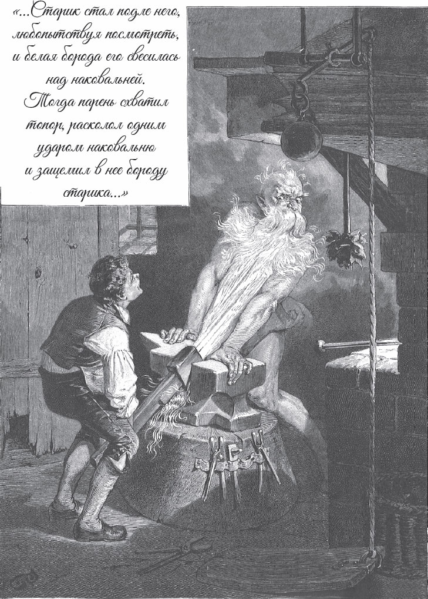
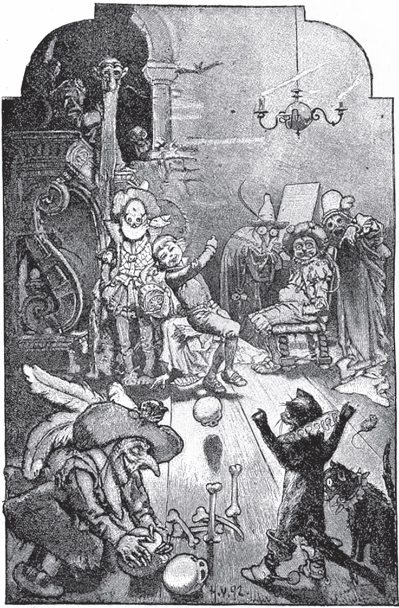

## Märchen von einem, der auszog, das Fürchten zu lernen

Ein Vater hat zwei Söhne. Der ältere ist klug und <abbr title="gescheit — смышлёный, толковый">gescheit</abbr>. Er weiß sich in jeder Situation zu helfen. Der jüngere aber ist dumm. Er kann nichts <abbr title="begreifen (begriff, hat begriffen) — понимать, постигать">begreifen</abbr> und nichts lernen. Wenn die Leute ihn sehen, sagen sie: «Mit dem hat der Vater noch viel <abbr title="der Ärger — неприятности, хлопоты">Ärger</abbr>!»

Wenn es etwas zu tun gibt, muss es immer der ältere Sohn <abbr title="erledigen — выполнять, улаживать">erledigen</abbr>. Aber manchmal schickt ihn der Vater spät am Abend oder sogar in der Nacht los, und der Weg geht über den <abbr title="der Friedhof, die Friedhöfe — кладбище">Friedhof</abbr> oder an einem anderen <abbr title="unheimlich — жуткий, зловещий">unheimlichen</abbr> Ort vorbei. Dann antwortet er: «Ach nein, Vater, da gehe ich nicht hin. Da <abbr title="es gruselt mich — мне жутко">gruselt es mich</abbr>!» Denn er fürchtet sich.

Abends am Feuer erzählt man oft Geschichten, und manchmal bekommt man dabei eine <abbr title="die Gänsehaut — гусиная кожа, мурашки">Gänsehaut</abbr>. Dann sagen die <abbr title="der Zuhörer, die Zuhörer — слушатель">Zuhörer</abbr>: «Ach, da gruselt es mich!» Der jüngere Sohn sitzt in einer Ecke und hört zu. Er kann nicht begreifen, was das heißen soll. «Immer sagen sie: Es gruselt mich! Es gruselt mich! Mich gruselt es nicht. Das ist wohl eine <abbr title="die Kunst, die Künste — искусство, умение">Kunst</abbr>, von der ich auch nichts verstehe.»

Eines Tages sagt der Vater zu ihm:

— Hör mal, du da in der Ecke! Du wirst groß und stark. Du musst auch etwas lernen. Dann kannst du dein Brot verdienen. Siehst du, wie sich dein Bruder <abbr title="sich Mühe geben — стараться">Mühe gibt</abbr>? Aber bei dir ist <abbr title="an jemandem ist Hopfen und Malz verloren — горбатого могила исправит; пропащее дело">Hopfen und Malz verloren</abbr>.

— Ach, Vater, — antwortet er, — ich will gern etwas lernen. Wenn es geht, möchte ich lernen, wie man sich <abbr title="sich gruseln — ужасаться, бояться">gruselt</abbr>. Davon verstehe ich noch gar nichts.

Der ältere Bruder lacht, als er das hört. Er denkt: «Du lieber Gott, was ist mein Bruder für ein <abbr title="der Dummkopf, die Dummköpfe — дурак, глупец">Dummkopf</abbr>! Aus dem wird <abbr title="sein Leben lang — всю жизнь">sein Leben lang</abbr> nichts. Was ein <abbr title="das Häkchen, die Häkchen — крючочек">Häkchen</abbr> werden will, muss sich früh <abbr title="sich krümmen — гнуться">krümmen</abbr>.»

Der Vater <abbr title="seufzen — вздыхать">seufzt</abbr> und antwortet:

— Das Gruseln, das lernst du schon noch. Aber dein Brot verdienst du damit nicht.

Bald danach kommt der <abbr title="der Küster, die Küster — пономарь, церковный сторож">Küster</abbr> zu Besuch. Der Vater <abbr title="klagen — жаловаться">klagt</abbr> ihm seine Not. Er erzählt, wie <abbr title="ungeschickt — неумелый">ungeschickt</abbr> sein jüngerer Sohn in allen Dingen ist. Er weiß nichts und lernt nichts.

— Stellt Euch vor: Ich habe ihn gefragt, womit er sein Brot verdienen will. Und er will das Gruseln lernen!

— Wenn es weiter nichts ist, — antwortet der Küster. — Das kann er bei mir lernen. Schickt ihn nur zu mir. Ich <abbr title="abschleifen (schliff ab, hat abgeschliffen) — отшлифовать, обтесать">schleife</abbr> ihn schon ab.

Der Vater ist zufrieden. Er denkt: «Dann lernt der Junge wenigstens ein bisschen.» Der Küster nimmt ihn also in sein Haus. Der Junge muss die <abbr title="die Glocke, die Glocken — колокол">Glocke</abbr> <abbr title="läuten — звонить (в колокол)">läuten</abbr>.

Nach ein paar Tagen weckt der Küster ihn um <abbr title="die Mitternacht — полночь">Mitternacht</abbr>. Der Junge soll aufstehen, in den <abbr title="der Kirchturm, die Kirchtürme — церковная колокольня">Kirchturm</abbr> steigen und läuten. «Jetzt lernst du schon, was Gruseln ist», denkt der Küster. Er geht <abbr title="heimlich — тайком">heimlich</abbr> voraus. Der Junge kommt oben an, dreht sich um und will das <abbr title="das Glockenseil, die Glockenseile — верёвка колокола">Glockenseil</abbr> <abbr title="greifen (griff, hat gegriffen) — хватать">greifen</abbr>. Da sieht er auf der Treppe, gegenüber vom <abbr title="das Schallloch, die Schalllöcher — звуковое окно колокольни">Schallloch</abbr>, eine weiße <abbr title="die Gestalt, die Gestalten — фигура">Gestalt</abbr> stehen.

— Wer ist da? — ruft er.

Aber die Gestalt gibt keine Antwort. Sie <abbr title="sich rühren — шевелиться">rührt sich</abbr> nicht und bewegt sich nicht.

— Antworte, — ruft der Junge, — oder verschwinde! Du hast hier in der Nacht nichts zu suchen.

Der Küster aber bleibt <abbr title="unbeweglich — неподвижный">unbeweglich</abbr> stehen. Der Junge soll glauben, dass er ein <abbr title="das Gespenst, die Gespenster — привидение">Gespenst</abbr> ist. Der Junge ruft zum zweiten Mal:

— Was willst du hier? Sprich, wenn du ein <abbr title="ehrlich — честный">ehrlicher</abbr> <abbr title="der Kerl, die Kerle — парень, малый">Kerl</abbr> bist! Sonst werfe ich dich die Treppe hinunter.

Der Küster denkt: «So schlimm <abbr title="meinen — иметь в виду">meint</abbr> er es bestimmt nicht.» Er sagt keinen Laut und steht da wie aus Stein. Da ruft der Junge ihn zum dritten Mal. Auch das hilft nichts. Da nimmt der Junge <abbr title="der Anlauf — разбег">Anlauf</abbr> und <abbr title="stoßen (stieß, hat gestoßen) — толкать">stößt</abbr> das Gespenst die Treppe hinunter. Es fällt zehn <abbr title="die Stufe, die Stufen — ступенька">Stufen</abbr> tief und bleibt in einer Ecke liegen. Dann läutet der Junge die Glocke, geht nach Hause, legt sich ohne ein Wort ins Bett und schläft weiter.

Die Frau vom Küster wartet lange auf ihren Mann. Aber er kommt nicht zurück. Endlich bekommt sie Angst. Sie weckt den Jungen und fragt:

— Weißt du nicht, wo mein Mann ist? Er ist vor dir auf den Turm gestiegen.

— Nein, — antwortet der Junge. — Aber da hat einer auf der Treppe gestanden, gegenüber vom Schallloch. Er wollte keine Antwort geben und auch nicht weggehen. Da habe ich gedacht, er ist ein <abbr title="der Gauner, die Gauner — жулик, мошенник">Gauner</abbr>, und habe ihn hinuntergestoßen. Geht nur hin, dann seht Ihr, ob er es war. Das <abbr title="es tut mir leid — мне жаль">tut mir leid</abbr>.

Die Frau läuft weg. Sie findet ihren Mann. Er liegt in einer Ecke und <abbr title="jammern — стонать, причитать">jammert</abbr>. Er hat sich ein Bein gebrochen.

Sie trägt ihn hinunter. Dann läuft sie mit lautem <abbr title="das Geschrei — крик">Geschrei</abbr> zum Vater von dem Jungen.

— Euer Junge, — ruft sie, — hat ein großes Unglück <abbr title="anrichten — натворить, причинить">angerichtet</abbr>! Er hat meinen Mann die Treppe hinuntergeworfen. Jetzt hat er ein Bein gebrochen. <abbr title="wegschaffen — убрать, увести">Schafft</abbr> den <abbr title="der Taugenichts, die Taugenichtse — бездельник, негодник">Taugenichts</abbr> aus unserem Haus weg!

Der Vater <abbr title="erschrecken (erschrak, ist erschrocken) — пугаться">erschrickt</abbr>. Er kommt sofort und <abbr title="schimpfen — ругать">schimpft</abbr> mit dem Jungen.

— Was sind das für <abbr title="gottlos — безбожный, нечестивый">gottlose</abbr> <abbr title="der Streich, die Streiche — проделка, выходка">Streiche</abbr>? Die hat dir bestimmt der <abbr title="der Teufel, die Teufel — чёрт, дьявол">Teufel</abbr> <abbr title="eingeben (gab ein, hat eingegeben) — внушить">eingegeben</abbr>!

— Vater, — antwortet er, — hört mich doch an. Ich bin ganz <abbr title="unschuldig — невиновный">unschuldig</abbr>. Er stand da in der Nacht wie einer, der etwas Böses vorhat. Ich wusste nicht, wer es war. Und ich habe ihn dreimal <abbr title="warnen — предупреждать">gewarnt</abbr>: Er soll reden oder weggehen.

— Ach, — sagt der Vater, — mit dir habe ich nur Unglück. Geh mir aus den Augen! Ich will dich nicht mehr sehen.

— Ja, Vater, sehr gern. Wartet nur, bis es Tag ist. Dann gehe ich in die Welt und lerne das Gruseln. Dann kann ich wenigstens eine Kunst, und von der kann ich leben.

— Lern, was du willst, — sagt der Vater. — Mir ist alles <abbr title="egal — всё равно">egal</abbr>. Hier hast du fünfzig <abbr title="der Taler, die Taler — талер (монета)">Taler</abbr>. Damit geh in die weite Welt. Und sag keinem Menschen, woher du kommst und wer dein Vater ist. Denn ich muss mich für dich <abbr title="sich schämen für + Akk. — стыдиться">schämen</abbr>.

— Ja, Vater, wie Ihr wollt. Wenn Ihr nicht mehr verlangt, das kann ich mir leicht <abbr title="sich merken — запоминать">merken</abbr>.

Als der Tag <abbr title="anbrechen (brach an, ist angebrochen) — наступать (о дне)">anbricht</abbr>, steckt der Junge seine fünfzig Taler in die Tasche. Er geht hinaus auf die große <abbr title="die Landstraße, die Landstraßen — большая дорога">Landstraße</abbr> und sagt immer <abbr title="vor sich hin — себе под нос">vor sich hin</abbr>:

— Ach, ich möchte so gern, dass es mich gruselt! Ach, ich möchte so gern, dass es mich gruselt!

Da kommt ein Mann. Er hört, was der Junge mit sich selbst redet. Sie gehen ein Stück zusammen, bis man den <abbr title="der Galgen, die Galgen — виселица">Galgen</abbr> sehen kann. Da sagt der Mann zu ihm:

— Siehst du, dort ist der Baum, wo sieben Männer mit der Tochter vom <abbr title="der Seiler, die Seiler — канатчик, верёвочник">Seiler</abbr> Hochzeit gefeiert haben. Jetzt lernen sie das Fliegen. Setz dich darunter und warte, bis die Nacht kommt. Dann lernst du schon das Gruseln.

— Wenn es weiter nichts ist, — antwortet der Junge, — das ist leicht. Wenn ich so schnell das Gruseln lerne, dann bekommst du meine fünfzig Taler. Komm nur morgen früh wieder zu mir.

Der Junge geht zum Galgen, setzt sich darunter und wartet bis zum Abend. Weil er friert, macht er sich ein Feuer. Aber um Mitternacht weht der Wind so kalt, dass ihm <abbr title="trotz + Dat. — несмотря на">trotz</abbr> dem Feuer nicht warm wird. Der Wind stößt die <abbr title="der Gehenkte, die Gehenkten — повешенный">Gehenkten</abbr> gegeneinander, und sie bewegen sich hin und her. Da denkt der Junge: «Ich friere hier unten am Feuer. Wie sehr müssen die da oben erst frieren und <abbr title="zappeln — дёргаться, барахтаться">zappeln</abbr>!»

Er hat Mitleid mit ihnen. Deshalb stellt er die <abbr title="die Leiter, die Leitern — лестница (приставная)">Leiter</abbr> an, steigt hinauf und <abbr title="losknoten — отвязывать">knotet</abbr> einen nach dem anderen los. Er holt alle sieben herunter. Dann <abbr title="schüren — ворошить (огонь)">schürt</abbr> er das Feuer, <abbr title="blasen (blies, hat geblasen) — дуть">bläst</abbr> hinein und setzt die Toten im Kreis herum. Sie sollen sich wärmen. Aber sie sitzen da und bewegen sich nicht. Da <abbr title="Feuer fangen (fing, hat gefangen) — загораться">fängt</abbr> das Feuer ihre Kleider. Der Junge sagt:

— <abbr title="aufpassen — быть осторожным">Passt auf</abbr>, sonst hänge ich euch wieder hinauf!

Aber die Toten hören nicht. Sie schweigen und lassen ihre <abbr title="der Lumpen, die Lumpen — лохмотья, тряпьё">Lumpen</abbr> weiter brennen. Da wird er böse und sagt:

— Wenn ihr nicht aufpassen wollt, kann ich euch nicht helfen. Ich will nicht mit euch <abbr title="verbrennen (verbrannte, ist verbrannt) — сгореть">verbrennen</abbr>.

Und er hängt sie einen nach dem anderen wieder hinauf. Dann setzt er sich an sein Feuer und schläft ein.

Am nächsten Morgen kommt der Mann zu ihm. Er will die fünfzig Taler haben und sagt:

— Na, weißt du jetzt, was Gruseln ist?

— Nein, — antwortet der Junge, — woher soll ich das wissen? Die da oben haben den Mund nicht aufgemacht. Und sie waren so dumm: Sie haben die paar alten <abbr title="der Lappen, die Lappen — тряпка">Lappen</abbr> an ihrem Körper einfach brennen lassen.

Da sieht der Mann: Die fünfzig Taler bekommt er heute nicht. Er geht weg und sagt:

— So einer ist mir noch nie <abbr title="begegnen (ist begegnet) — встречаться">begegnet</abbr>.

Auch der Junge geht seinen Weg und beginnt wieder, vor sich hin zu reden:

— Ach, ich möchte so gern, dass es mich gruselt! Ach, ich möchte so gern, dass es mich gruselt!

Das hört ein <abbr title="der Fuhrmann, die Fuhrleute — возчик, извозчик">Fuhrmann</abbr>, der hinter ihm geht. Er fragt:

— Wer bist du?

— Ich weiß nicht, — antwortet der Junge.

Der Fuhrmann fragt weiter:

— Woher kommst du?

— Ich weiß nicht.

— Wer ist dein Vater?

— Das darf ich nicht sagen.

— Was <abbr title="brummen — бормотать, ворчать">brummst</abbr> du da die ganze Zeit <abbr title="in den Bart brummen — бурчать себе под нос">in deinen Bart</abbr>?

— Ach, — antwortet der Junge, — ich möchte so gern, dass es mich gruselt. Aber niemand kann es mir <abbr title="beibringen (brachte bei, hat beigebracht) — научить">beibringen</abbr>.

— Hör auf mit deinem dummen <abbr title="das Geschwätz — болтовня">Geschwätz</abbr>, — sagt der Fuhrmann. — Komm mit mir. Ich <abbr title="besorgen — достать, раздобыть">besorge</abbr> dir einen Platz für die Nacht.

Der Junge geht mit dem Fuhrmann. Am Abend kommen sie zu einem <abbr title="das Wirtshaus, die Wirtshäuser — трактир, постоялый двор">Wirtshaus</abbr>. Dort wollen sie <abbr title="übernachten — ночевать">übernachten</abbr>. Als sie in die <abbr title="die Stube, die Stuben — комната, горница">Stube</abbr> kommen, sagt der Junge wieder ganz laut:

— Ach, ich möchte so gern, dass es mich gruselt! Ach, ich möchte so gern, dass es mich gruselt!

Der <abbr title="der Wirt, die Wirte — трактирщик, хозяин">Wirt</abbr> hört das, lacht und sagt:

— Wenn du das willst, dann hast du hier eine gute <abbr title="die Gelegenheit, die Gelegenheiten — возможность, случай">Gelegenheit</abbr>.

— Ach, sei still, — sagt die <abbr title="die Wirtin, die Wirtinnen — хозяйка трактира">Wirtin</abbr>. — Schon so mancher <abbr title="der Vorwitzige, die Vorwitzigen — чересчур любопытный, дерзкий человек">Vorwitzige</abbr> hat dabei sein Leben <abbr title="verlieren (verlor, hat verloren) — терять">verloren</abbr>. Es ist <abbr title="schade — жаль">schade</abbr> um die schönen Augen. Vielleicht sehen sie nie wieder das <abbr title="das Tageslicht — дневной свет">Tageslicht</abbr>.

Aber der Junge sagt:

— Auch wenn es sehr schwer ist, ich will es endlich lernen. Deshalb bin ich ja <abbr title="ausziehen (zog aus, ist ausgezogen) — отправиться (в путь)">ausgezogen</abbr>.

Er lässt dem Wirt keine Ruhe. Endlich erzählt der Wirt: Nicht weit von hier steht ein <abbr title="verzaubert — заколдованный">verzaubertes</abbr> Schloss. Dort kann man lernen, was Gruseln ist. Man muss nur drei Nächte darin <abbr title="wachen — бодрствовать, сторожить">wachen</abbr>. Der König hat dem, der es wagt, seine Tochter als Frau versprochen. Sie ist die schönste <abbr title="die Jungfrau, die Jungfrauen — девица">Jungfrau</abbr>, auf die die Sonne scheint. In dem Schloss gibt es auch große <abbr title="der Schatz, die Schätze — сокровище">Schätze</abbr>. Böse <abbr title="der Geist, die Geister — дух">Geister</abbr> <abbr title="bewachen — охранять, сторожить">bewachen</abbr> sie. Dann werden die Schätze frei, und sie können einen armen Menschen sehr reich machen. Schon viele sind in das Schloss hineingegangen. Aber noch keiner ist wieder herausgekommen.

Am nächsten Morgen geht der Junge zum König und sagt:

— Wenn Ihr es <abbr title="erlauben — разрешать">erlaubt</abbr>, möchte ich drei Nächte im verzauberten Schloss wachen.

Der König sieht ihn an. Der Junge gefällt ihm, und er sagt:

— Du darfst dir noch drei Dinge <abbr title="sich wünschen — пожелать">wünschen</abbr>. Aber es müssen <abbr title="leblos — неодушевлённый, неживой">leblose</abbr> Dinge sein. Die darfst du mit ins Schloss nehmen.

Da antwortet der Junge:

— Dann bitte ich um ein Feuer, eine <abbr title="die Drehbank, die Drehbänke — токарный станок">Drehbank</abbr> und eine <abbr title="die Schnitzbank, die Schnitzbänke — верстак для резьбы">Schnitzbank</abbr> mit dem <abbr title="das Messer, die Messer — нож">Messer</abbr>.

Der König lässt ihm das alles am Tag ins Schloss tragen. Als es Nacht wird, geht der Junge hinauf. In einer <abbr title="die Kammer, die Kammern — комната, каморка">Kammer</abbr> macht er sich ein helles Feuer. Er stellt die Schnitzbank mit dem Messer daneben und setzt sich auf die Drehbank.

— Ach, ich möchte so gern, dass es mich gruselt! — sagt er. — Aber hier lerne ich es auch nicht.

Gegen Mitternacht will er sein Feuer noch einmal schüren. Er bläst hinein. Da schreit es plötzlich aus einer Ecke:

— Au, miau! Wie uns friert!

— Ihr <abbr title="der Narr, die Narren — дурак, глупец">Narren</abbr>, — ruft er, — was schreit ihr? Wenn ihr friert, dann kommt, setzt euch ans Feuer und wärmt euch.

Kaum hat er das gesagt, da kommen zwei große schwarze Katzen mit einem <abbr title="gewaltig — огромный, мощный">gewaltigen</abbr> <abbr title="der Sprung, die Sprünge — прыжок">Sprung</abbr>. Sie setzen sich links und rechts neben ihn und sehen ihn mit ihren <abbr title="feurig — огненный">feurigen</abbr> Augen ganz <abbr title="wild — дико, свирепо">wild</abbr> an. Nach einer Weile haben sie sich gewärmt und sagen:

— <abbr title="der Kamerad, die Kameraden — товарищ, приятель">Kamerad</abbr>, wollen wir eine Runde Karten spielen?

— Warum nicht? — antwortet er. — Aber zeigt mir erst einmal eure Pfoten.

Da strecken sie die <abbr title="die Kralle, die Krallen — коготь">Krallen</abbr> aus.

— Oh, — sagt er, — was habt ihr für lange <abbr title="der Nagel, die Nägel — ноготь">Nägel</abbr>! Wartet, die muss ich euch erst <abbr title="abschneiden (schnitt ab, hat abgeschnitten) — отрезать, состригать">abschneiden</abbr>.

Er packt sie am <abbr title="der Kragen, die Kragen — воротник, шиворот">Kragen</abbr>, hebt sie auf die Schnitzbank und <abbr title="festschrauben — привинчивать, зажимать">schraubt</abbr> ihnen die Pfoten fest.

— Ich habe euch <abbr title="jemandem auf die Finger sehen — следить, чтоб не жульничал">auf die Finger gesehen</abbr>, — sagt er. — Jetzt habe ich keine <abbr title="die Lust — желание, охота">Lust</abbr> mehr auf Karten.

Er schlägt sie tot und wirft sie hinaus ins Wasser. Dann will er sich wieder an sein Feuer setzen. Aber da kommen aus allen Ecken schwarze Katzen und schwarze Hunde an <abbr title="glühend — раскалённый">glühenden</abbr> Ketten. Es werden immer mehr und mehr. Bald weiß der Junge nicht mehr, wohin. Sie schreien <abbr title="grässlich — ужасно, отвратительно">grässlich</abbr>, <abbr title="treten (trat, hat getreten) — топтать, наступать">treten</abbr> auf sein Feuer, <abbr title="zerren — тащить, растаскивать">zerren</abbr> es auseinander und wollen es <abbr title="ausmachen — гасить">ausmachen</abbr>.

Eine Weile sieht er ruhig zu. Aber dann wird es ihm zu <abbr title="es wird jemandem zu bunt — это уже слишком">bunt</abbr>. Er nimmt sein <abbr title="das Schnitzmesser, die Schnitzmesser — резец, нож для резьбы">Schnitzmesser</abbr> und ruft:

— Weg mit dir, du <abbr title="das Gesindel — сброд, отребье">Gesindel</abbr>!

Und er <abbr title="hauen — бить, рубить">haut</abbr> auf sie los. Ein Teil springt weg. Die anderen schlägt er tot und wirft sie hinaus in den <abbr title="der Teich, die Teiche — пруд">Teich</abbr>. Dann kommt er zurück. Er bläst aus den <abbr title="der Funke, die Funken — искра">Funken</abbr> ein neues Feuer an und wärmt sich.

So sitzt er da, und bald kann er die Augen nicht mehr offen halten. Er möchte schlafen. Da sieht er sich um und sieht in der Ecke ein großes Bett.

— Das <abbr title="jemandem gerade recht kommen — прийтись как раз кстати">kommt mir gerade recht</abbr>, — sagt er und legt sich hinein.

Er will die Augen zumachen. Da beginnt das Bett <abbr title="von selbst — само по себе">von selbst</abbr> zu fahren. Es fährt im ganzen Schloss herum.

— Recht so, — sagt er, — nur schneller!

Da rollt das Bett weiter, als ob sechs Pferde davor sind. Es fährt über <abbr title="die Schwelle, die Schwellen — порог">Schwellen</abbr> und Treppen hinauf und hinunter. Auf einmal – hopp, hopp! – <abbr title="umkippen — опрокидываться">kippt</abbr> es um, das Unterste nach oben. Jetzt liegt es wie ein Berg auf ihm. Aber er <abbr title="schleudern — швырять">schleudert</abbr> <abbr title="die Decke, die Decken — одеяло">Decken</abbr> und <abbr title="das Kissen, die Kissen — подушка">Kissen</abbr> in die Höhe, steigt heraus und sagt:

— Jetzt soll fahren, wer Lust hat.

Er legt sich an sein Feuer und schläft, bis es Tag ist.

Am Morgen kommt der König. Er sieht den Jungen auf dem Boden liegen und denkt: Die Gespenster haben ihn umgebracht, er ist tot. Da sagt er:

— Es ist doch schade um den schönen Menschen.

Das hört der Junge. Er <abbr title="sich aufrichten — приподниматься">richtet sich auf</abbr> und sagt:

— So weit ist es noch nicht!

Da <abbr title="sich wundern — удивляться">wundert sich</abbr> der König. Aber er freut sich und fragt, wie es ihm gegangen ist.

— Sehr gut, — antwortet der Junge. — Eine Nacht ist <abbr title="vorbei — прошедший, позади">vorbei</abbr>. Die zwei anderen gehen auch vorbei.

Dann geht er zum Wirt. Der macht große Augen.

— Ich habe nicht gedacht, — sagt er, — dass ich dich wieder <abbr title="lebendig — живой">lebendig</abbr> sehe. Hast du jetzt gelernt, was Gruseln ist?

— Nein, — sagt der Junge, — es ist alles <abbr title="umsonst — напрасно">umsonst</abbr>. Ach, kann es mir denn keiner sagen?

In der zweiten Nacht geht er wieder hinauf ins alte Schloss. Er setzt sich ans Feuer und beginnt wieder sein altes Lied:

— Ach, ich möchte so gern, dass es mich gruselt!

Gegen Mitternacht hört man einen <abbr title="der Lärm — шум">Lärm</abbr> und ein <abbr title="das Gepolter — грохот">Gepolter</abbr>. Erst ist es leise, dann immer lauter. Dann ist es ein bisschen still. Endlich fällt mit lautem Geschrei ein halber Mensch durch den <abbr title="der Schornstein, die Schornsteine — дымоход, труба">Schornstein</abbr> herunter, direkt vor seine Füße.

— He, du da! — ruft der Junge. — Da <abbr title="fehlen — не хватать">fehlt</abbr> noch eine Hälfte. Das ist zu wenig.

Da beginnt der Lärm von Neuem. Es <abbr title="toben — бушевать">tobt</abbr> und <abbr title="heulen — выть">heult</abbr>, und auch die andere Hälfte fällt herunter.

— Warte, — sagt er, — ich blase dir erst ein bisschen das Feuer an.

Er tut es und sieht sich wieder um. Da sind die beiden Stücke <abbr title="zusammenwachsen (wuchs zusammen, ist zusammengewachsen) — срастаться">zusammengewachsen</abbr>. Ein grässlicher Mann sitzt auf seinem Platz.

— So haben wir nicht gewettet, — sagt der Junge. — Die <abbr title="die Bank, die Bänke — скамья">Bank</abbr> gehört mir.

Der Mann will ihn <abbr title="wegdrängen — оттеснять">wegdrängen</abbr>. Aber das <abbr title="sich etwas gefallen lassen — терпеть, мириться с">lässt sich</abbr> der Junge nicht gefallen. Er schiebt ihn mit <abbr title="die Gewalt — сила">Gewalt</abbr> weg und setzt sich wieder auf seinen Platz.

Da fallen noch mehr Männer herunter, einer nach dem anderen. Sie holen neun <abbr title="das Totenbein, die Totenbeine — кость мертвеца">Totenbeine</abbr> und zwei <abbr title="der Totenkopf, die Totenköpfe — череп">Totenköpfe</abbr>. Sie stellen die Beine auf und spielen <abbr title="das Kegeln; der Kegel, die Kegel — кегли">Kegel</abbr>. Da bekommt der Junge auch Lust und fragt:

— Hört mal, darf ich <abbr title="mitspielen — играть вместе">mitspielen</abbr>?

— Ja, wenn du Geld hast.

— Geld habe ich genug, — antwortet er. — Aber eure Kugeln sind nicht richtig rund.

Er nimmt die Totenköpfe, setzt sie in die Drehbank und <abbr title="drehen — точить (на станке), вращать">dreht</abbr> sie rund.

— So, jetzt rollen sie besser, — sagt er. — <abbr title="hurra — ура">Hurra</abbr>! Jetzt wird es lustig!

Er spielt mit und verliert ein bisschen von seinem Geld. Aber als die Uhr zwölf <abbr title="schlagen (schlug, hat geschlagen) — бить (о часах)">schlägt</abbr>, ist alles vor seinen Augen verschwunden. Er legt sich hin und schläft ruhig ein.

Am nächsten Morgen kommt der König und will wissen, was passiert ist.

— Wie ist es dir diesmal gegangen? — fragt er.

— Ich habe <abbr title="kegeln — играть в кегли">gekegelt</abbr>, — antwortet der Junge, — und ein paar <abbr title="der Heller, die Heller — геллер, грош">Heller</abbr> verloren.

— Hat es dich denn nicht gegruselt?

— Ach was, — sagt er, — ich habe viel Spaß gehabt. Ich möchte nur wissen, was Gruseln ist!

In der dritten Nacht setzt er sich wieder auf seine Bank und sagt ganz <abbr title="verdrießlich — угрюмо, недовольно">verdrießlich</abbr>:

— Ach, ich möchte so gern, dass es mich gruselt!

Spät in der Nacht kommen sechs große Männer. Sie tragen einen <abbr title="der Sarg, die Särge — гроб">Sarg</abbr> herein. Da sagt der Junge:

— Ha, ha, das ist bestimmt mein <abbr title="der Vetter, die Vettern — двоюродный брат">Vetter</abbr>. Er ist erst vor ein paar Tagen gestorben.

Er <abbr title="winken — махать, манить">winkt</abbr> mit dem Finger und ruft:

— Komm, kleiner Vetter, komm!

Die Männer stellen den Sarg auf den Boden. Der Junge geht hin und nimmt den <abbr title="der Deckel, die Deckel — крышка">Deckel</abbr> ab. Darin liegt ein toter Mann. Der Junge fasst ihm ins Gesicht, aber es ist kalt wie Eis.

— Warte, — sagt er, — ich wärme dich ein bisschen.

Er geht ans Feuer, wärmt seine Hand und legt sie dem Toten aufs Gesicht. Aber der Tote bleibt kalt. Jetzt nimmt er ihn heraus, setzt sich ans Feuer und legt ihn auf seinen <abbr title="der Schoß, die Schöße — колени">Schoß</abbr>. Er reibt ihm die Arme. Das Blut soll wieder <abbr title="fließen (floss, ist geflossen) — течь">fließen</abbr>. Auch das hilft nichts. Da <abbr title="einfallen (fiel ein, ist eingefallen) — приходить на ум">fällt</abbr> ihm ein: «Wenn zwei zusammen im Bett liegen, dann wärmen sie sich.» Er bringt den Toten ins Bett, <abbr title="zudecken — укрывать">deckt</abbr> ihn zu und legt sich neben ihn.

Nach einer Weile wird auch der Tote warm und beginnt, sich zu bewegen. Da sagt der Junge:

— Siehst du, kleiner Vetter? Ich habe dich gut gewärmt!

Aber der Tote richtet sich auf und ruft:

— Jetzt will ich dich <abbr title="erwürgen — задушить">erwürgen</abbr>!

— Was? — sagt der Junge. — Ist das mein <abbr title="der Dank — благодарность">Dank</abbr>? Sofort gehst du wieder in deinen Sarg!

Er hebt ihn hoch, wirft ihn hinein und macht den Deckel zu. Da kommen die sechs Männer und tragen den Sarg wieder weg.

— Es will mich einfach nicht gruseln, — sagt der Junge. — Hier lerne ich es mein Leben lang nicht.

Da kommt ein Mann herein. Er ist größer als alle anderen und sieht <abbr title="fürchterlich — страшный, ужасный">fürchterlich</abbr> aus. Aber er ist alt und hat einen langen weißen Bart.

— Oh, du kleiner <abbr title="der Wicht, die Wichte — негодник, мелюзга">Wicht</abbr>, — ruft er, — jetzt lernst du bald, was Gruseln ist. Denn du musst sterben.

— Nicht so schnell, — antwortet der Junge. — Wenn ich sterben soll, dann muss ich auch dabei sein.

— Dich packe ich schon, — sagt das <abbr title="das Ungeheuer, die Ungeheuer — чудовище">Ungeheuer</abbr>.

— Langsam, langsam. <abbr title="sich breitmachen — важничать, задаваться">Mach dich nicht so breit</abbr>. Ich bin so stark wie du, vielleicht noch stärker.

— Das wollen wir sehen, — sagt der Alte. — Wenn du stärker bist als ich, dann lasse ich dich gehen. Komm, wir <abbr title="probieren — пробовать">probieren</abbr> es.

Er führt ihn durch dunkle <abbr title="der Gang, die Gänge — коридор, проход">Gänge</abbr> zu einem <abbr title="das Schmiedefeuer, die Schmiedefeuer — кузнечный горн">Schmiedefeuer</abbr>. Er nimmt eine <abbr title="die Axt, die Äxte — топор">Axt</abbr> und schlägt den einen <abbr title="der Amboss, die Ambosse — наковальня">Amboss</abbr> mit einem Schlag in die Erde.

— Das kann ich noch besser, — sagt der Junge und geht zum anderen Amboss.

Der Alte stellt sich daneben und will zusehen. Sein weißer Bart hängt herunter. Da nimmt der Junge die Axt und <abbr title="spalten — раскалывать">spaltet</abbr> den Amboss mit einem <abbr title="der Hieb, die Hiebe — удар">Hieb</abbr>. Dabei <abbr title="einklemmen — защемить, зажать">klemmt</abbr> er den Bart vom Alten mit ein.

— Jetzt habe ich dich, — sagt der Junge. — Jetzt bist du mit dem Sterben dran.

Dann nimmt er eine <abbr title="die Eisenstange, die Eisenstangen — железный прут, лом">Eisenstange</abbr> und schlägt auf den Alten los. Der Alte <abbr title="wimmern — скулить, хныкать">wimmert</abbr> und bittet: Er soll aufhören! Er will ihm große <abbr title="der Reichtum, die Reichtümer — богатство">Reichtümer</abbr> geben. Der Junge zieht die Axt heraus und lässt ihn los.

Der Alte führt ihn zurück ins Schloss. In einem <abbr title="der Keller, die Keller — подвал">Keller</abbr> zeigt er ihm drei <abbr title="die Kiste, die Kisten — сундук, ящик">Kisten</abbr> voll Gold.

— Davon, — sagt er, — gehört eine den Armen, eine dem König und die dritte dir.

In diesem Moment schlägt die Uhr zwölf, und der Geist verschwindet. Jetzt steht der Junge im <abbr title="im Dunkeln — в темноте">Dunkeln</abbr>.

— Ich finde schon allein heraus, — sagt er.

Er <abbr title="tasten — идти на ощупь">tastet</abbr> herum, findet den Weg in die Kammer und schläft dort an seinem Feuer ein.

Am nächsten Morgen kommt der König und sagt:

— Jetzt hast du bestimmt gelernt, was Gruseln ist?

— Nein, — antwortet der Junge, — was ist es nur? Mein toter Vetter war da. Und ein Mann mit einem Bart ist gekommen und hat mir da unten viel Geld gezeigt. Aber was Gruseln ist, hat mir keiner gesagt.

Da sagt der König:

— Du hast das Schloss erlöst. Du sollst meine Tochter heiraten.

— Das ist alles sehr schön, — antwortet der Junge, — aber ich weiß immer noch nicht, was Gruseln ist.

Man bringt das Gold herauf, und man feiert die <abbr title="die Hochzeit, die Hochzeiten — свадьба">Hochzeit</abbr>. Der junge König hat seine Frau sehr lieb, und er ist sehr <abbr title="vergnügt — весёлый, довольный">vergnügt</abbr>. Trotzdem sagt er immer:

— Ach, ich möchte so gern, dass es mich gruselt! Ach, ich möchte so gern, dass es mich gruselt!

Endlich <abbr title="ärgern — сердить, раздражать">ärgert</abbr> das seine Frau. Ihr <abbr title="das Kammermädchen, die Kammermädchen — горничная">Kammermädchen</abbr> sagt:

— Ich weiß, wie ich helfen kann. Das Gruseln lernt er schon noch.

Sie geht hinaus zum <abbr title="der Bach, die Bäche — ручей">Bach</abbr>, der durch den Garten fließt. Sie lässt sich einen ganzen <abbr title="der Eimer, die Eimer — ведро">Eimer</abbr> voll <abbr title="der Gründling, die Gründlinge — пескарь">Gründlinge</abbr> holen. In der Nacht schläft der junge König. Da muss seine Frau ihm die Decke <abbr title="wegziehen (zog weg, hat weggezogen) — стаскивать">wegziehen</abbr>. Sie <abbr title="schütten — выливать, высыпать">schüttet</abbr> den Eimer mit dem kalten Wasser und den Gründlingen über ihn. Die kleinen Fische zappeln überall um ihn herum. Da wacht er auf und ruft:

— Ach, wie gruselt es mich, wie gruselt es mich, liebe Frau! Ja, jetzt weiß ich, was Gruseln ist!

---

### Neue Wörter

- **gescheit** — смышлёный, толковый
- **begreifen (begriff, hat begriffen)** — понимать, постигать
- **der Ärger** — неприятности, хлопоты
- **erledigen** — выполнять, улаживать
- **der Friedhof, die Friedhöfe** — кладбище
- **unheimlich** — жуткий, зловещий
- **es gruselt mich** — мне жутко
- **die Gänsehaut** — гусиная кожа, мурашки
- **der Zuhörer, die Zuhörer** — слушатель
- **die Kunst, die Künste** — искусство, умение
- **sich Mühe geben** — стараться
- **an jemandem ist Hopfen und Malz verloren** — горбатого могила исправит; пропащее дело
- **sich gruseln** — ужасаться, бояться
- **der Dummkopf, die Dummköpfe** — дурак, глупец
- **sein Leben lang** — всю жизнь
- **das Häkchen, die Häkchen** — крючочек
- **sich krümmen** — гнуться
- **seufzen** — вздыхать
- **der Küster, die Küster** — пономарь, церковный сторож
- **klagen** — жаловаться
- **ungeschickt** — неумелый
- **abschleifen (schliff ab, hat abgeschliffen)** — отшлифовать, обтесать
- **die Glocke, die Glocken** — колокол
- **läuten** — звонить (в колокол)
- **die Mitternacht** — полночь
- **der Kirchturm, die Kirchtürme** — церковная колокольня
- **heimlich** — тайком
- **das Glockenseil, die Glockenseile** — верёвка колокола
- **greifen (griff, hat gegriffen)** — хватать
- **das Schallloch, die Schalllöcher** — звуковое окно колокольни
- **die Gestalt, die Gestalten** — фигура
- **sich rühren** — шевелиться
- **unbeweglich** — неподвижный
- **das Gespenst, die Gespenster** — привидение
- **ehrlich** — честный
- **der Kerl, die Kerle** — парень, малый
- **meinen** — иметь в виду
- **der Anlauf** — разбег
- **stoßen (stieß, hat gestoßen)** — толкать
- **die Stufe, die Stufen** — ступенька
- **der Gauner, die Gauner** — жулик, мошенник
- **es tut mir leid** — мне жаль
- **jammern** — стонать, причитать
- **das Geschrei** — крик
- **anrichten** — натворить, причинить
- **wegschaffen** — убрать, увести
- **der Taugenichts, die Taugenichtse** — бездельник, негодник
- **erschrecken (erschrak, ist erschrocken)** — пугаться
- **schimpfen** — ругать
- **gottlos** — безбожный, нечестивый
- **der Streich, die Streiche** — проделка, выходка
- **der Teufel, die Teufel** — чёрт, дьявол
- **eingeben (gab ein, hat eingegeben)** — внушить
- **unschuldig** — невиновный
- **warnen** — предупреждать
- **egal** — всё равно
- **der Taler, die Taler** — талер (монета)
- **sich schämen für + Akk.** — стыдиться
- **sich merken** — запоминать
- **anbrechen (brach an, ist angebrochen)** — наступать (о дне)
- **die Landstraße, die Landstraßen** — большая дорога
- **vor sich hin** — себе под нос
- **der Galgen, die Galgen** — виселица
- **der Seiler, die Seiler** — канатчик, верёвочник
- **trotz + Dat.** — несмотря на
- **der Gehenkte, die Gehenkten** — повешенный
- **zappeln** — дёргаться, барахтаться
- **die Leiter, die Leitern** — лестница (приставная)
- **losknoten** — отвязывать
- **schüren** — ворошить (огонь)
- **blasen (blies, hat geblasen)** — дуть
- **Feuer fangen (fing, hat gefangen)** — загораться
- **aufpassen** — быть осторожным
- **der Lumpen, die Lumpen** — лохмотья, тряпьё
- **verbrennen (verbrannte, ist verbrannt)** — сгореть
- **der Lappen, die Lappen** — тряпка
- **begegnen (ist begegnet)** — встречаться
- **der Fuhrmann, die Fuhrleute** — возчик, извозчик
- **brummen** — бормотать, ворчать
- **in den Bart brummen** — бурчать себе под нос
- **beibringen (brachte bei, hat beigebracht)** — научить
- **das Geschwätz** — болтовня
- **besorgen** — достать, раздобыть
- **das Wirtshaus, die Wirtshäuser** — трактир, постоялый двор
- **übernachten** — ночевать
- **die Stube, die Stuben** — комната, горница
- **der Wirt, die Wirte** — трактирщик, хозяин
- **die Gelegenheit, die Gelegenheiten** — возможность, случай
- **die Wirtin, die Wirtinnen** — хозяйка трактира
- **der Vorwitzige, die Vorwitzigen** — чересчур любопытный, дерзкий человек
- **verlieren (verlor, hat verloren)** — терять
- **schade** — жаль
- **das Tageslicht** — дневной свет
- **ausziehen (zog aus, ist ausgezogen)** — отправиться (в путь)
- **verzaubert** — заколдованный
- **wachen** — бодрствовать, сторожить
- **die Jungfrau, die Jungfrauen** — девица
- **der Schatz, die Schätze** — сокровище
- **der Geist, die Geister** — дух
- **bewachen** — охранять, сторожить
- **erlauben** — разрешать
- **sich wünschen** — пожелать
- **leblos** — неодушевлённый, неживой
- **die Drehbank, die Drehbänke** — токарный станок
- **die Schnitzbank, die Schnitzbänke** — верстак для резьбы
- **das Messer, die Messer** — нож
- **die Kammer, die Kammern** — комната, каморка
- **der Narr, die Narren** — дурак, глупец
- **gewaltig** — огромный, мощный
- **der Sprung, die Sprünge** — прыжок
- **feurig** — огненный
- **wild** — дико, свирепо
- **der Kamerad, die Kameraden** — товарищ, приятель
- **die Kralle, die Krallen** — коготь
- **der Nagel, die Nägel** — ноготь
- **abschneiden (schnitt ab, hat abgeschnitten)** — отрезать, состригать
- **der Kragen, die Kragen** — воротник, шиворот
- **festschrauben** — привинчивать, зажимать
- **jemandem auf die Finger sehen** — следить, чтоб не жульничал
- **die Lust** — желание, охота
- **glühend** — раскалённый
- **grässlich** — ужасно, отвратительно
- **treten (trat, hat getreten)** — топтать, наступать
- **zerren** — тащить, растаскивать
- **ausmachen** — гасить
- **es wird jemandem zu bunt** — это уже слишком
- **das Schnitzmesser, die Schnitzmesser** — резец, нож для резьбы
- **das Gesindel** — сброд, отребье
- **hauen** — бить, рубить
- **der Teich, die Teiche** — пруд
- **der Funke, die Funken** — искра
- **jemandem gerade recht kommen** — прийтись как раз кстати
- **von selbst** — само по себе
- **die Schwelle, die Schwellen** — порог
- **umkippen** — опрокидываться
- **schleudern** — швырять
- **die Decke, die Decken** — одеяло
- **das Kissen, die Kissen** — подушка
- **sich aufrichten** — приподниматься
- **sich wundern** — удивляться
- **vorbei** — прошедший, позади
- **lebendig** — живой
- **umsonst** — напрасно
- **der Lärm** — шум
- **das Gepolter** — грохот
- **der Schornstein, die Schornsteine** — дымоход, труба
- **fehlen** — не хватать
- **toben** — бушевать
- **heulen** — выть
- **zusammenwachsen (wuchs zusammen, ist zusammengewachsen)** — срастаться
- **die Bank, die Bänke** — скамья
- **wegdrängen** — оттеснять
- **sich etwas gefallen lassen** — терпеть, мириться с
- **die Gewalt** — сила
- **das Totenbein, die Totenbeine** — кость мертвеца
- **der Totenkopf, die Totenköpfe** — череп
- **das Kegeln; der Kegel, die Kegel** — кегли
- **mitspielen** — играть вместе
- **drehen** — точить (на станке), вращать
- **hurra** — ура
- **schlagen (schlug, hat geschlagen)** — бить (о часах)
- **kegeln** — играть в кегли
- **der Heller, die Heller** — геллер, грош
- **verdrießlich** — угрюмо, недовольно
- **der Sarg, die Särge** — гроб
- **der Vetter, die Vettern** — двоюродный брат
- **winken** — махать, манить
- **der Deckel, die Deckel** — крышка
- **der Schoß, die Schöße** — колени
- **fließen (floss, ist geflossen)** — течь
- **einfallen (fiel ein, ist eingefallen)** — приходить на ум
- **zudecken** — укрывать
- **erwürgen** — задушить
- **der Dank** — благодарность
- **fürchterlich** — страшный, ужасный
- **der Wicht, die Wichte** — негодник, мелюзга
- **das Ungeheuer, die Ungeheuer** — чудовище
- **sich breitmachen** — важничать, задаваться
- **probieren** — пробовать
- **der Gang, die Gänge** — коридор, проход
- **das Schmiedefeuer, die Schmiedefeuer** — кузнечный горн
- **die Axt, die Äxte** — топор
- **der Amboss, die Ambosse** — наковальня
- **spalten** — раскалывать
- **der Hieb, die Hiebe** — удар
- **einklemmen** — защемить, зажать
- **die Eisenstange, die Eisenstangen** — железный прут, лом
- **wimmern** — скулить, хныкать
- **der Reichtum, die Reichtümer** — богатство
- **der Keller, die Keller** — подвал
- **die Kiste, die Kisten** — сундук, ящик
- **im Dunkeln** — в темноте
- **tasten** — идти на ощупь
- **die Hochzeit, die Hochzeiten** — свадьба
- **vergnügt** — весёлый, довольный
- **ärgern** — сердить, раздражать
- **das Kammermädchen, die Kammermädchen** — горничная
- **der Bach, die Bäche** — ручей
- **der Eimer, die Eimer** — ведро
- **der Gründling, die Gründlinge** — пескарь
- **wegziehen (zog weg, hat weggezogen)** — стаскивать
- **schütten** — выливать, высыпать

[← Zurück](kapitel-03.md) · [Inhalt](README.md)
