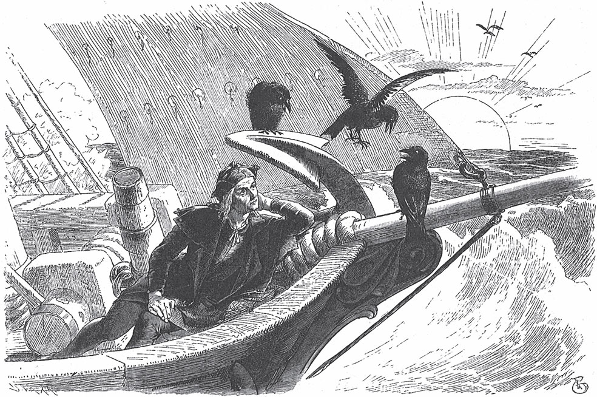

## Der treue Johannes

Es war einmal ein alter König. Er ist krank und denkt: «Das ist wohl mein <abbr title="das Totenbett, die Totenbetten — смертное ложе">Totenbett</abbr>.» Da sagt er:

— Holt mir den treuen Johannes!

Der treue Johannes ist sein liebster Diener. Er heißt so, weil er dem König sein Leben lang so treu war. Johannes kommt an das Bett, und der König sagt zu ihm:

— Mein treuester Johannes, ich fühle, dass mein Ende <abbr title="nahen — приближаться">naht</abbr>. Ich habe nur noch eine Sorge: meinen Sohn. Er ist noch jung und weiß sich nicht immer zu helfen. Du musst mir etwas versprechen. Du musst ihm alles beibringen, was er wissen muss, und du musst sein <abbr title="der Pflegevater, die Pflegeväter — приёмный отец, опекун">Pflegevater</abbr> sein. Sonst kann ich meine Augen nicht in Ruhe schließen.

Da antwortet der treue Johannes:

— Ich <abbr title="verlassen (verließ, hat verlassen) — покидать">verlasse</abbr> ihn nicht. Ich will ihm mit <abbr title="die Treue — верность">Treue</abbr> <abbr title="dienen — служить">dienen</abbr>, auch wenn es mein Leben <abbr title="kosten — стоить">kostet</abbr>.

Da sagt der alte König:

— Dann sterbe ich <abbr title="getrost — спокойно, с утешением">getrost</abbr> und in <abbr title="der Frieden — мир, покой">Frieden</abbr>.

Und er spricht weiter:

— Nach meinem Tod sollst du ihm das ganze Schloss zeigen: alle Kammern, <abbr title="der Saal, die Säle — зал">Säle</abbr> und <abbr title="das Gewölbe, die Gewölbe — свод, подвал со сводами">Gewölbe</abbr> und alle Schätze darin. Aber die letzte Kammer im langen Gang sollst du ihm nicht zeigen. Dort steht <abbr title="verstecken — прятать">versteckt</abbr> das <abbr title="das Bild, die Bilder — картина, портрет">Bild</abbr> von der Königstochter vom goldenen Dach. Wenn er das Bild sieht, <abbr title="sich verlieben in + Akk. — влюбиться в">verliebt</abbr> er sich heftig in sie. Dann fällt er <abbr title="in Ohnmacht fallen — упасть в обморок">in Ohnmacht</abbr>, und er gerät wegen ihr in große <abbr title="die Gefahr, die Gefahren — опасность">Gefahren</abbr>. Davor sollst du ihn <abbr title="schützen — защищать, оберегать">schützen</abbr>.

Der treue Johannes gibt dem alten König noch einmal die Hand darauf. Da wird der König still. Er legt seinen Kopf auf das Kissen und stirbt.

Man trägt den alten König zu <abbr title="zu Grabe tragen — хоронить">Grabe</abbr>. Danach erzählt der treue Johannes dem jungen König, was er seinem Vater auf dem <abbr title="das Sterbebett, die Sterbebetten — смертное ложе">Sterbebett</abbr> versprochen hat. Er sagt:

— Das will ich <abbr title="gewiss — непременно, наверняка">gewiss</abbr> halten. Ich will dir treu sein, wie ich ihm treu war, auch wenn es mein Leben kostet.

Die Zeit der <abbr title="die Trauer — траур, скорбь">Trauer</abbr> geht vorbei. Da sagt der treue Johannes zu ihm:

— Jetzt ist es Zeit, dass du dein <abbr title="das Erbe — наследство">Erbe</abbr> siehst. Ich will dir das Schloss von deinem Vater zeigen.

Er führt ihn überall herum, hinauf und hinunter. Er zeigt ihm alle Reichtümer und <abbr title="prächtig — великолепный, роскошный">prächtigen</abbr> Kammern. Nur die eine Kammer mit dem <abbr title="gefährlich — опасный">gefährlichen</abbr> Bild öffnet er nicht. Das Bild steht so: Wenn die Tür aufgeht, sieht man direkt darauf. Und es ist so <abbr title="herrlich — чудесный, великолепный">herrlich</abbr> gemalt, dass man denkt, es lebt. Es gibt nichts Lieblicheres und Schöneres auf der ganzen Welt.

Aber der junge König <abbr title="bemerken — замечать">bemerkt</abbr>, dass der treue Johannes immer an einer Tür vorbeigeht. Er sagt:

— Warum schließt du mir diese Tür nie auf?

— Es ist etwas darin, — antwortet Johannes, — vor dem du erschrickst.

Aber der König antwortet:

— Ich habe das ganze Schloss gesehen. Also will ich auch wissen, was darin ist.

Er geht hin und will die Tür mit Gewalt öffnen. Da hält der treue Johannes ihn zurück und sagt:

— Ich habe es deinem Vater vor seinem Tod versprochen: Du sollst nicht sehen, was in der Kammer steht. Es kann für dich und für mich ein großes Unglück werden.

— Ach nein, — antwortet der junge König. — Wenn ich nicht hineinkomme, dann ist das mein sicherer <abbr title="der Untergang — гибель">Untergang</abbr>. Ich habe Tag und Nacht keine Ruhe, bis ich es mit meinen eigenen Augen gesehen habe. Ich gehe hier nicht weg, bis du aufgeschlossen hast.

Da sieht der treue Johannes, dass er nichts mehr ändern kann. Mit schwerem Herzen und vielen <abbr title="der Seufzer, die Seufzer — вздох">Seufzern</abbr> sucht er den Schlüssel aus dem großen Bund heraus. Er öffnet die Tür und geht als Erster hinein. Er will das Bild schnell zudecken. Der König soll es nicht sehen. Aber was hilft das? Der König stellt sich auf die <abbr title="die Zehenspitze, die Zehenspitzen — цыпочки">Zehenspitzen</abbr> und sieht ihm über die <abbr title="die Schulter, die Schultern — плечо">Schulter</abbr>. Er sieht das Bild von der Jungfrau. Es ist so herrlich und <abbr title="glänzen — блестеть, сиять">glänzt</abbr> von Gold und Edelsteinen. Da fällt der König <abbr title="ohnmächtig — без сознания, в обмороке">ohnmächtig</abbr> zu Boden.

Der treue Johannes hebt ihn auf und trägt ihn in sein Bett. Voller Sorgen denkt er: «Das Unglück ist passiert. Herr Gott, was wird nur daraus?» Dann gibt er dem König Wein. Langsam <abbr title="zu sich kommen — прийти в себя">kommt</abbr> der König wieder zu sich. Das erste Wort vom König ist:

— Ach! Wer ist das auf dem schönen Bild?

— Das ist die Königstochter vom goldenen Dach, — antwortet der treue Johannes.

Da sagt der König:

— Meine Liebe zu ihr ist so groß: Auch alle Blätter an den Bäumen können sie nicht <abbr title="aussprechen (sprach aus, hat ausgesprochen) — выразить словами">aussprechen</abbr>, auch wenn jedes Blatt eine Zunge hat. Ich <abbr title="aufs Spiel setzen — ставить на карту">setze</abbr> mein Leben aufs Spiel, nur um sie zu bekommen. Du bist mein treuester Johannes. Du musst mir helfen.

Der treue Diener überlegt lange, wie er die Sache anfangen soll. Denn es ist schwer, die Königstochter auch nur zu sehen. Endlich hat er einen Plan. Er sagt zum König:

— Alles, was sie um sich hat, ist aus Gold: Tische, Stühle, <abbr title="die Schüssel, die Schüsseln — миска, блюдо">Schüsseln</abbr>, <abbr title="der Becher, die Becher — кубок, чаша">Becher</abbr>, <abbr title="der Napf, die Näpfe — плошка, миска">Näpfe</abbr> und alle <abbr title="das Hausgerät, die Hausgeräte — домашняя утварь">Hausgeräte</abbr>. In deiner <abbr title="die Schatzkammer, die Schatzkammern — сокровищница">Schatzkammer</abbr> liegen fünf <abbr title="die Tonne, die Tonnen — бочка">Tonnen</abbr> Gold. Lass eine Tonne von den <abbr title="der Goldschmied, die Goldschmiede — ювелир, золотых дел мастер">Goldschmieden</abbr> im Reich <abbr title="verarbeiten — перерабатывать, изготовлять">verarbeiten</abbr>. Sie sollen <abbr title="allerlei — всевозможный">allerlei</abbr> <abbr title="das Gefäß, die Gefäße — сосуд">Gefäße</abbr> und Geräte machen, auch Vögel, Wild und wunderbare Tiere. Das gefällt ihr bestimmt. Damit fahren wir zu ihr und <abbr title="sein Glück versuchen — попытать счастья">versuchen unser Glück</abbr>.

Der König lässt alle Goldschmiede holen. Sie müssen Tag und Nacht arbeiten, bis endlich die herrlichsten Dinge fertig sind. Man <abbr title="laden (lud, hat geladen) — грузить">lädt</abbr> alles auf ein <abbr title="das Schiff, die Schiffe — корабль">Schiff</abbr>. Der treue Johannes zieht die Kleider von einem <abbr title="der Kaufmann, die Kaufleute — купец">Kaufmann</abbr> an. Der König muss das Gleiche tun. So erkennt ihn niemand. Dann fahren sie über das Meer. Sie fahren lange, bis sie zu der Stadt kommen, wo die Königstochter vom goldenen Dach wohnt.

Der treue Johannes sagt zum König: Er soll auf dem Schiff bleiben und auf ihn warten.

— Vielleicht bringe ich die Königstochter mit, — sagt er. — Deshalb sorgt dafür, dass alles in Ordnung ist. Lasst die <abbr title="das Goldgefäß, die Goldgefäße — золотой сосуд">Goldgefäße</abbr> <abbr title="aufstellen — расставлять">aufstellen</abbr> und das ganze Schiff <abbr title="schmücken — украшать">schmücken</abbr>.

Dann sucht er sich allerlei Dinge aus Gold zusammen und packt sie in seine kleine <abbr title="die Schürze, die Schürzen — фартук">Schürze</abbr>. Er geht an Land und direkt zum königlichen Schloss.

Im <abbr title="der Schlosshof, die Schlosshöfe — двор замка">Schlosshof</abbr> steht am Brunnen ein schönes Mädchen. Es hat zwei goldene Eimer in der Hand und <abbr title="schöpfen — черпать">schöpft</abbr> Wasser. Es will das <abbr title="glitzern — сверкать, искриться">glitzernde</abbr> Wasser wegtragen und dreht sich um. Da sieht es den fremden Mann und fragt, wer er ist.

— Ich bin ein Kaufmann, — antwortet er.

Er öffnet seine Schürze und lässt sie hineinsehen.

— Oh, was für schöne goldene Sachen! — ruft sie.

Sie stellt die Eimer ab und sieht sich ein Stück nach dem anderen an. Dann sagt das Mädchen:

— Das muss die Königstochter sehen. Sie hat so viel Freude an goldenen Sachen, dass sie dir bestimmt alles <abbr title="abkaufen — покупать у кого-то">abkauft</abbr>.

Sie nimmt ihn an der Hand und führt ihn hinauf, denn sie ist die <abbr title="die Kammerzofe, die Kammerzofen — камеристка, горничная">Kammerzofe</abbr>.

Die Königstochter sieht die <abbr title="die Ware, die Waren — товар">Ware</abbr>. Sie ist ganz begeistert und sagt:

— Das ist so schön gemacht. Ich will dir alles abkaufen.

Aber der treue Johannes sagt:

— Ich bin nur der Diener von einem reichen Kaufmann. Was ich hier habe, ist nichts gegen das, was mein Herr auf seinem Schiff hat. Das ist das <abbr title="kunstvoll — искусный, изящный">Kunstvollste</abbr> und <abbr title="kostbar — драгоценный">Kostbarste</abbr>, was man je aus Gold gemacht hat.

Sie will alles heraufbringen lassen. Aber er sagt:

— Das dauert viele Tage, so groß ist die <abbr title="die Menge, die Mengen — количество, множество">Menge</abbr>. Und man braucht so viele Säle dafür, dass Euer Haus nicht genug Platz hat.

Da wird ihre <abbr title="die Neugier — любопытство">Neugier</abbr> immer größer. Endlich sagt sie:

— Führ mich zu dem Schiff. Ich will selbst hingehen und mir die Schätze von deinem Herrn ansehen.

Da führt der treue Johannes sie ganz <abbr title="fröhlich — радостный, весёлый">fröhlich</abbr> zum Schiff. Der König sieht sie, und er sieht: Sie ist noch viel schöner als auf dem Bild. Er glaubt, sein Herz zerspringt gleich.

Sie steigt auf das Schiff, und der König führt sie hinein. Der treue Johannes aber bleibt beim <abbr title="der Steuermann, die Steuerleute — рулевой, штурман">Steuermann</abbr>. Er sagt, das Schiff soll <abbr title="ablegen — отчаливать">ablegen</abbr>:

— Setzt alle <abbr title="das Segel, die Segel — парус">Segel</abbr>! Das Schiff soll fliegen wie ein Vogel in der Luft.

Drinnen zeigt der König ihr das goldene <abbr title="das Geschirr — посуда">Geschirr</abbr>, jedes Stück einzeln: die Schüsseln, Becher und Näpfe, die Vögel, das Wild und die wunderbaren Tiere. Viele Stunden <abbr title="vergehen (verging, ist vergangen) — проходить (о времени)">vergehen</abbr>, bis sie alles gesehen hat. In ihrer Freude merkt sie nicht, dass das Schiff fährt. Sie sieht sich das letzte Stück an und <abbr title="sich bedanken bei + Dat. — благодарить">bedankt sich</abbr> beim Kaufmann. Sie will nach Hause. Aber sie kommt an den Rand vom Schiff und sieht: Das Schiff ist weit vom Land, auf dem offenen Meer. Es eilt mit vollen Segeln davon.

— Ach! — ruft sie <abbr title="erschrocken — испуганный">erschrocken</abbr>. — Man hat mich betrogen! Man hat mich <abbr title="entführen — похищать">entführt</abbr>! Jetzt bin ich in der <abbr title="in jemandes Gewalt sein — быть во власти">Gewalt</abbr> von einem Kaufmann. Lieber will ich sterben!

Aber der König nimmt sie an der Hand und sagt:

— Ich bin kein Kaufmann. Ich bin ein König, und meine Familie ist so <abbr title="edel — благородный, знатный">edel</abbr> wie deine. Ich habe dich mit einer <abbr title="die List, die Listen — хитрость, уловка">List</abbr> entführt, aber nur aus großer Liebe. Als ich zum ersten Mal dein Bild gesehen habe, bin ich ohnmächtig zu Boden gefallen.

Die Königstochter vom goldenen Dach hört das und ist <abbr title="trösten — утешать">getröstet</abbr>. Ihr Herz <abbr title="sich neigen zu + Dat. — склоняться к">neigt sich</abbr> ihm zu. Gern ist sie einverstanden, seine Frau zu werden.

Sie fahren über das hohe Meer. Der treue Johannes sitzt vorn auf dem Schiff und macht Musik. Da sieht er in der Luft drei <abbr title="der Rabe, die Raben — ворон">Raben</abbr>. Sie kommen herangeflogen. Er hört auf zu spielen und <abbr title="horchen — прислушиваться">horcht</abbr>, was sie miteinander sprechen. Denn er versteht die Sprache von den Vögeln.

Der erste Rabe ruft:

— Oh, da bringt er die Königstochter vom goldenen Dach nach Hause!

— Ja, — antwortet der zweite, — aber er hat sie noch nicht.

Der dritte sagt:

— Doch, er hat sie. Sie sitzt bei ihm im Schiff.

Da beginnt der erste wieder und ruft:

— Was hilft ihm das? Wenn sie an Land kommen, springt ihm ein <abbr title="fuchsrot — рыжий (как лиса)">fuchsrotes</abbr> Pferd <abbr title="entgegenspringen (sprang entgegen, ist entgegengesprungen) — выскакивать навстречу">entgegen</abbr>. Er will <abbr title="aufsteigen (stieg auf, ist aufgestiegen) — садиться (на коня)">aufsteigen</abbr>. Und wenn er das tut, dann <abbr title="galoppieren — скакать галопом">galoppiert</abbr> es mit ihm davon, hinauf in die Luft. Dann sieht er seine Jungfrau nie wieder.

Der zweite sagt:

— Gibt es keine <abbr title="die Rettung — спасение">Rettung</abbr>?

— Oh doch. Ein anderer muss schnell aufsteigen. Er muss das <abbr title="das Gewehr, die Gewehre — ружьё">Gewehr</abbr> aus der <abbr title="die Satteltasche, die Satteltaschen — седельная кобура, сумка">Satteltasche</abbr> nehmen und das Pferd damit <abbr title="totschießen (schoss tot, hat totgeschossen) — застрелить">totschießen</abbr>. Dann ist der junge König <abbr title="retten — спасать">gerettet</abbr>. Aber wer weiß das schon? Und wer es weiß und es ihm sagt, der wird zu Stein, von den Zehen bis zum <abbr title="das Knie, die Knie — колено">Knie</abbr>.

Da sagt der zweite:

— Ich weiß noch mehr. Auch wenn jemand das Pferd tötet, <abbr title="behalten (behielt, hat behalten) — сохранять, оставлять себе">behält</abbr> der junge König seine <abbr title="die Braut, die Bräute — невеста">Braut</abbr> nicht. Wenn sie zusammen ins Schloss kommen, liegt dort in einer Schüssel ein <abbr title="das Brauthemd, die Brauthemden — свадебная рубашка">Brauthemd</abbr>. Es sieht aus wie aus Gold und Silber <abbr title="weben — ткать">gewebt</abbr>. Aber es ist nur <abbr title="der Schwefel — сера">Schwefel</abbr> und <abbr title="das Pech — смола">Pech</abbr>. Wenn er es anzieht, verbrennt es ihn bis auf <abbr title="das Mark — костный мозг">Mark</abbr> und <abbr title="der Knochen, die Knochen — кость">Knochen</abbr>.

Der dritte sagt:

— Gibt es da gar keine Rettung?

— Oh doch, — antwortet der zweite. — Einer muss mit <abbr title="der Handschuh, die Handschuhe — перчатка">Handschuhen</abbr> das Hemd packen und es ins Feuer werfen. Wenn es verbrennt, ist der junge König gerettet. Aber was hilft es? Wer es weiß und es ihm sagt, der wird halb zu Stein, vom Knie bis zum Herzen.

Da sagt der dritte:

— Ich weiß noch mehr. Auch wenn das Brauthemd verbrennt, hat der junge König seine Braut noch nicht. Nach der Hochzeit beginnt der Tanz. Wenn die junge Königin tanzt, wird sie plötzlich <abbr title="blass — бледный">blass</abbr> und fällt wie tot hin. Einer muss sie aufheben und aus ihrer rechten <abbr title="die Brust, die Brüste — грудь">Brust</abbr> drei <abbr title="der Tropfen, die Tropfen — капля">Tropfen</abbr> Blut <abbr title="saugen (sog, hat gesogen) — высасывать, сосать">saugen</abbr> und sie wieder <abbr title="ausspucken — выплёвывать">ausspucken</abbr>. Sonst stirbt sie. Aber wer es weiß und es <abbr title="verraten (verriet, hat verraten) — выдавать, раскрывать">verrät</abbr>, der wird ganz zu Stein, vom <abbr title="der Scheitel, die Scheitel — макушка">Scheitel</abbr> bis zu den Zehen.

Die Raben haben das miteinander gesprochen. Dann fliegen sie weiter. Der treue Johannes hat alles gut verstanden. Aber von dieser Zeit an ist er still und traurig. Denn wenn er seinem Herrn nicht sagt, was er gehört hat, dann wird sein Herr unglücklich. Aber wenn er es ihm sagt, dann muss er selbst sein Leben <abbr title="opfern — жертвовать">opfern</abbr>. Endlich sagt er zu sich selbst:

— Ich will meinen Herrn retten, auch wenn ich selbst dabei <abbr title="zugrunde gehen (ging zugrunde, ist zugrunde gegangen) — погибнуть">zugrunde gehe</abbr>.

Sie kommen an Land. Da passiert es, wie der Rabe gesagt hat. Ein prächtiges fuchsrotes Pferd galoppiert heran.

— Gut so! — sagt der König. — Das soll mich in mein Schloss tragen.

Er will aufsteigen. Aber der treue Johannes ist schneller. Er <abbr title="sich schwingen auf + Akk. (schwang, hat geschwungen) — вскочить на">schwingt sich</abbr> schnell auf das Pferd, zieht das Gewehr aus der Satteltasche und schießt das Pferd tot. Da rufen die anderen Diener vom König. Sie mögen den treuen Johannes nicht.

— Wie <abbr title="gemein — подло">gemein</abbr>! Er tötet das schöne Tier, das den König in sein Schloss tragen sollte!

Aber der König sagt:

— Schweigt und lasst ihn gehen. Er ist mein treuester Johannes. Wer weiß, wozu das gut ist!

Dann gehen sie ins Schloss. Dort im Saal steht eine Schüssel, und darin liegt das Brauthemd. Es sieht genau so aus, als ob es aus Gold und Silber ist. Der junge König geht hin und will es nehmen. Aber der treue Johannes schiebt ihn weg. Er packt das Hemd mit Handschuhen, trägt es schnell ins Feuer und lässt es verbrennen. Die anderen Diener beginnen wieder zu <abbr title="murren — ворчать, роптать">murren</abbr> und sagen:

— Seht nur! Jetzt verbrennt er sogar das Brauthemd vom König!

Aber der junge König sagt:

— Wer weiß, wozu das gut ist! Lasst ihn gehen. Er ist mein treuester Johannes.

Jetzt feiert man die Hochzeit. Der Tanz beginnt, und auch die Braut tanzt mit. Der treue Johannes passt gut auf und sieht ihr ins Gesicht. Auf einmal wird sie blass und fällt wie tot zu Boden. Da springt er schnell zu ihr. Er hebt sie auf und trägt sie in eine Kammer. Dort legt er sie hin, <abbr title="knien — стоять на коленях">kniet</abbr> sich neben sie und saugt die drei Blutstropfen aus ihrer rechten Brust. Er spuckt sie aus. Sofort <abbr title="atmen — дышать">atmet</abbr> sie wieder und <abbr title="sich erholen — оправиться, прийти в себя">erholt sich</abbr>.

Aber der junge König hat alles gesehen. Er weiß nicht, warum der treue Johannes das getan hat. Er wird zornig und ruft:

— Werft ihn ins <abbr title="das Gefängnis, die Gefängnisse — тюрьма">Gefängnis</abbr>!

Am nächsten Morgen verurteilt man den treuen Johannes und führt ihn zum Galgen. Er steht schon oben und soll sterben. Da sagt er:

— Jeder, der sterben soll, darf vor seinem Ende noch einmal reden. Habe ich auch dieses <abbr title="das Recht, die Rechte — право">Recht</abbr>?

— Ja, — antwortet der König, — das darfst du.

Da sagt der treue Johannes:

— Das Urteil ist <abbr title="ungerecht — несправедливый">ungerecht</abbr>. Ich war dir immer treu.

Und er erzählt, wie er auf dem Meer das <abbr title="das Gespräch, die Gespräche — разговор">Gespräch</abbr> von den Raben gehört hat. Und er erzählt, dass er das alles tun musste, weil er seinen Herrn retten wollte.

Da ruft der König:

— Oh, mein treuester Johannes! <abbr title="die Gnade — помилование, милость">Gnade</abbr>! Gnade! Holt ihn herunter!

Aber beim letzten Wort ist der treue Johannes leblos heruntergefallen. Er ist ein Stein.

Darüber sind der König und die Königin sehr traurig. Der König sagt:

— Ach, wie schlecht habe ich große Treue <abbr title="belohnen — награждать, вознаграждать">belohnt</abbr>!

Er lässt das <abbr title="steinern — каменный">steinerne</abbr> Bild aufheben und in sein <abbr title="das Schlafzimmer, die Schlafzimmer — спальня">Schlafzimmer</abbr> neben sein Bett stellen. Jedes Mal, wenn er es ansieht, weint er und sagt:

— Ach, ich möchte dich so gern wieder lebendig machen, mein treuester Johannes!

Eine Zeit geht vorbei. Da bekommt die Königin <abbr title="der Zwilling, die Zwillinge — близнец">Zwillinge</abbr>, zwei kleine Söhne. Sie werden groß und sind ihre Freude.

Einmal ist die Königin in der Kirche. Die zwei Kinder sitzen beim Vater und spielen. Er sieht wieder voller Trauer das steinerne Bild an, seufzt und ruft:

— Ach, ich möchte dich so gern wieder lebendig machen, mein treuester Johannes!

Da beginnt der Stein zu reden und sagt:

— Ja, du kannst mich wieder lebendig machen. Aber dafür musst du dein Liebstes geben.

Da ruft der König:

— Alles, was ich auf der Welt habe, will ich für dich <abbr title="hergeben (gab her, hat hergegeben) — отдавать">hergeben</abbr>!

Der Stein spricht weiter:

— Du musst mit deiner eigenen Hand deinen beiden Kindern den Kopf <abbr title="abschlagen (schlug ab, hat abgeschlagen) — отрубать">abschlagen</abbr>. Dann musst du mich mit ihrem Blut bestreichen. Dann bekomme ich mein Leben zurück.

Der König erschrickt, als er hört: Er soll seine liebsten Kinder selbst töten! Aber er denkt an die große Treue. Und er denkt daran, dass der treue Johannes für ihn gestorben ist. Er zieht sein Schwert und schlägt den Kindern mit eigener Hand den Kopf ab. Er bestreicht den Stein mit ihrem Blut. Da kommt das Leben zurück, und der treue Johannes steht wieder frisch und <abbr title="gesund — здоровый">gesund</abbr> vor ihm.

Er sagt zum König:

— Deine Treue soll ihren <abbr title="der Lohn — награда">Lohn</abbr> bekommen.

Er nimmt die Köpfe von den Kindern und setzt sie wieder auf. Er bestreicht die <abbr title="die Wunde, die Wunden — рана">Wunde</abbr> mit ihrem Blut. Sofort werden die Kinder wieder <abbr title="heil — целый, невредимый">heil</abbr>. Sie springen herum und spielen weiter, als ob nichts passiert ist.

Jetzt ist der König voller Freude. Er sieht die Königin kommen. Da versteckt er den treuen Johannes und die beiden Kinder in einem großen Schrank. Sie kommt herein, und er fragt sie:

— Hast du in der Kirche <abbr title="beten — молиться">gebetet</abbr>?

— Ja, — antwortet sie, — aber ich habe die ganze Zeit an den treuen Johannes gedacht. Er ist durch uns so unglücklich geworden.

Da sagt er:

— Liebe Frau, wir können ihm das Leben wiedergeben. Aber es kostet uns unsere beiden kleinen Söhne. Wir müssen sie opfern.

Die Königin wird blass. Ihr Herz erschrickt. Trotzdem sagt sie:

— Das <abbr title="jemandem etwas schuldig sein — быть в долгу перед кем-то">sind</abbr> wir ihm schuldig, weil er so treu war.

Da freut sich der König, dass sie genauso denkt wie er. Er geht hin und schließt den Schrank auf. Er holt die Kinder und den treuen Johannes heraus und sagt:

— Gott sei <abbr title="loben — хвалить, славить">gelobt</abbr>! Er ist erlöst, und unsere kleinen Söhne haben wir auch wieder.

Und er erzählt ihr, wie alles passiert ist. Dann leben sie zusammen glücklich bis an ihr Ende.

---

### Neue Wörter

- **das Totenbett, die Totenbetten** — смертное ложе
- **nahen** — приближаться
- **der Pflegevater, die Pflegeväter** — приёмный отец, опекун
- **verlassen (verließ, hat verlassen)** — покидать
- **die Treue** — верность
- **dienen** — служить
- **kosten** — стоить
- **getrost** — спокойно, с утешением
- **der Frieden** — мир, покой
- **der Saal, die Säle** — зал
- **das Gewölbe, die Gewölbe** — свод, подвал со сводами
- **verstecken** — прятать
- **das Bild, die Bilder** — картина, портрет
- **sich verlieben in + Akk.** — влюбиться в
- **in Ohnmacht fallen** — упасть в обморок
- **die Gefahr, die Gefahren** — опасность
- **schützen** — защищать, оберегать
- **zu Grabe tragen** — хоронить
- **das Sterbebett, die Sterbebetten** — смертное ложе
- **gewiss** — непременно, наверняка
- **die Trauer** — траур, скорбь
- **das Erbe** — наследство
- **prächtig** — великолепный, роскошный
- **gefährlich** — опасный
- **herrlich** — чудесный, великолепный
- **bemerken** — замечать
- **der Untergang** — гибель
- **der Seufzer, die Seufzer** — вздох
- **die Zehenspitze, die Zehenspitzen** — цыпочки
- **die Schulter, die Schultern** — плечо
- **glänzen** — блестеть, сиять
- **ohnmächtig** — без сознания, в обмороке
- **zu sich kommen** — прийти в себя
- **aussprechen (sprach aus, hat ausgesprochen)** — выразить словами
- **aufs Spiel setzen** — ставить на карту
- **die Schüssel, die Schüsseln** — миска, блюдо
- **der Becher, die Becher** — кубок, чаша
- **der Napf, die Näpfe** — плошка, миска
- **das Hausgerät, die Hausgeräte** — домашняя утварь
- **die Schatzkammer, die Schatzkammern** — сокровищница
- **die Tonne, die Tonnen** — бочка
- **der Goldschmied, die Goldschmiede** — ювелир, золотых дел мастер
- **verarbeiten** — перерабатывать, изготовлять
- **allerlei** — всевозможный
- **das Gefäß, die Gefäße** — сосуд
- **sein Glück versuchen** — попытать счастья
- **laden (lud, hat geladen)** — грузить
- **das Schiff, die Schiffe** — корабль
- **der Kaufmann, die Kaufleute** — купец
- **das Goldgefäß, die Goldgefäße** — золотой сосуд
- **aufstellen** — расставлять
- **schmücken** — украшать
- **die Schürze, die Schürzen** — фартук
- **der Schlosshof, die Schlosshöfe** — двор замка
- **schöpfen** — черпать
- **glitzern** — сверкать, искриться
- **abkaufen** — покупать у кого-то
- **die Kammerzofe, die Kammerzofen** — камеристка, горничная
- **die Ware, die Waren** — товар
- **kunstvoll** — искусный, изящный
- **kostbar** — драгоценный
- **die Menge, die Mengen** — количество, множество
- **die Neugier** — любопытство
- **fröhlich** — радостный, весёлый
- **der Steuermann, die Steuerleute** — рулевой, штурман
- **ablegen** — отчаливать
- **das Segel, die Segel** — парус
- **das Geschirr** — посуда
- **vergehen (verging, ist vergangen)** — проходить (о времени)
- **sich bedanken bei + Dat.** — благодарить
- **erschrocken** — испуганный
- **entführen** — похищать
- **in jemandes Gewalt sein** — быть во власти
- **edel** — благородный, знатный
- **die List, die Listen** — хитрость, уловка
- **trösten** — утешать
- **sich neigen zu + Dat.** — склоняться к
- **der Rabe, die Raben** — ворон
- **horchen** — прислушиваться
- **fuchsrot** — рыжий (как лиса)
- **entgegenspringen (sprang entgegen, ist entgegengesprungen)** — выскакивать навстречу
- **aufsteigen (stieg auf, ist aufgestiegen)** — садиться (на коня)
- **galoppieren** — скакать галопом
- **die Rettung** — спасение
- **das Gewehr, die Gewehre** — ружьё
- **die Satteltasche, die Satteltaschen** — седельная кобура, сумка
- **totschießen (schoss tot, hat totgeschossen)** — застрелить
- **retten** — спасать
- **das Knie, die Knie** — колено
- **behalten (behielt, hat behalten)** — сохранять, оставлять себе
- **die Braut, die Bräute** — невеста
- **das Brauthemd, die Brauthemden** — свадебная рубашка
- **weben** — ткать
- **der Schwefel** — сера
- **das Pech** — смола
- **das Mark** — костный мозг
- **der Knochen, die Knochen** — кость
- **der Handschuh, die Handschuhe** — перчатка
- **blass** — бледный
- **die Brust, die Brüste** — грудь
- **der Tropfen, die Tropfen** — капля
- **saugen (sog, hat gesogen)** — высасывать, сосать
- **ausspucken** — выплёвывать
- **verraten (verriet, hat verraten)** — выдавать, раскрывать
- **der Scheitel, die Scheitel** — макушка
- **opfern** — жертвовать
- **zugrunde gehen (ging zugrunde, ist zugrunde gegangen)** — погибнуть
- **sich schwingen auf + Akk. (schwang, hat geschwungen)** — вскочить на
- **gemein** — подло
- **murren** — ворчать, роптать
- **knien** — стоять на коленях
- **atmen** — дышать
- **sich erholen** — оправиться, прийти в себя
- **das Gefängnis, die Gefängnisse** — тюрьма
- **das Recht, die Rechte** — право
- **ungerecht** — несправедливый
- **das Gespräch, die Gespräche** — разговор
- **die Gnade** — помилование, милость
- **belohnen** — награждать, вознаграждать
- **steinern** — каменный
- **das Schlafzimmer, die Schlafzimmer** — спальня
- **der Zwilling, die Zwillinge** — близнец
- **hergeben (gab her, hat hergegeben)** — отдавать
- **abschlagen (schlug ab, hat abgeschlagen)** — отрубать
- **gesund** — здоровый
- **der Lohn** — награда
- **die Wunde, die Wunden** — рана
- **heil** — целый, невредимый
- **beten** — молиться
- **jemandem etwas schuldig sein** — быть в долгу перед кем-то
- **loben** — хвалить, славить

[← Zurück](kapitel-05.md) · [Inhalt](README.md)
