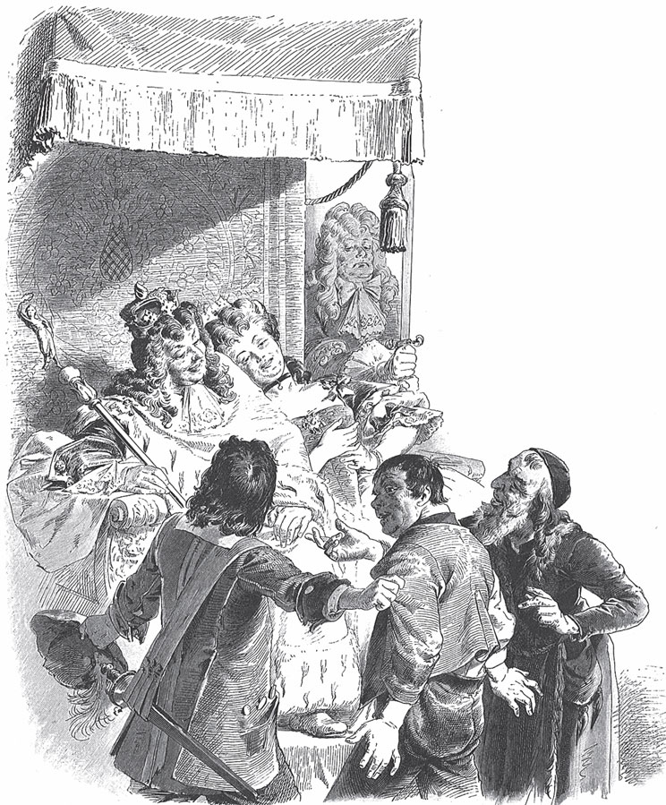

## Der gute Handel

Ein <abbr title="der Bauer, die Bauern — крестьянин">Bauer</abbr> hat seine <abbr title="die Kuh, die Kühe — корова">Kuh</abbr> auf den <abbr title="der Markt, die Märkte — рынок">Markt</abbr> <abbr title="treiben (trieb, hat getrieben) — гнать (скот)">getrieben</abbr> und für sieben Taler verkauft. Auf dem <abbr title="der Heimweg — обратный путь домой">Heimweg</abbr> muss er an einem Teich vorbei. Schon <abbr title="von Weitem — издалека">von Weitem</abbr> hört er, wie die Frösche rufen:

— Ak, ak, ak, ak!

«Ja», sagt er zu sich, «die reden auch nur <abbr title="der Unsinn — чепуха, вздор">Unsinn</abbr>. Sieben Taler habe ich bekommen, nicht acht.»

Er kommt ans Wasser und ruft ihnen zu:

— Ihr dummes <abbr title="das Vieh — скотина">Vieh</abbr>! Wisst ihr es nicht besser? Sieben Taler sind es, nicht acht!

Aber die Frösche bleiben bei ihrem «Ak, ak, ak, ak».

— Na gut, wenn ihr es nicht glauben wollt, dann <abbr title="vorzählen — пересчитывать вслух перед кем-то">zähle</abbr> ich es euch vor.

Er holt das Geld aus der Tasche und zählt die sieben Taler, jeden Taler zu vierundzwanzig <abbr title="der Groschen, die Groschen — грош">Groschen</abbr>. Aber die Frösche <abbr title="sich kümmern um + Akk. — обращать внимание на">kümmern sich</abbr> nicht um seine <abbr title="die Rechnung, die Rechnungen — расчёт, подсчёт">Rechnung</abbr>. Sie rufen wieder:

— Ak, ak, ak, ak!

— He! — ruft der Bauer ganz böse. — Wenn ihr es besser wissen wollt als ich, dann zählt doch selbst!

Und er wirft ihnen das ganze Geld ins Wasser. Er bleibt stehen und will warten, bis sie fertig sind und ihm sein Geld zurückbringen. Aber die Frösche bleiben stur. Sie schreien immer weiter «Ak, ak, ak, ak!» und werfen das Geld nicht wieder heraus.

Er wartet noch eine ganze Weile. Dann wird es Abend, und er muss nach Hause. Da schimpft er mit den Fröschen und ruft:

— Ihr Wasserpatscher! Ihr <abbr title="der Dickkopf, die Dickköpfe — упрямец, твердолобый">Dickköpfe</abbr>! Ihr <abbr title="das Glotzauge, die Glotzaugen — пучеглазый, лупоглазый">Glotzaugen</abbr>! Ihr habt ein großes Maul und könnt so schreien, dass einem die Ohren wehtun. Aber sieben Taler könnt ihr nicht zählen! Glaubt ihr, ich stehe hier, bis ihr fertig seid?

Dann geht er weg. Aber die Frösche rufen noch hinter ihm her: «Ak, ak, ak, ak!» So kommt er ganz <abbr title="verärgert — раздосадованный">verärgert</abbr> nach Hause.

Nach einiger Zeit <abbr title="einhandeln — выменять, купить">handelt</abbr> er sich wieder eine Kuh ein. Er <abbr title="schlachten — забивать (скот)">schlachtet</abbr> sie und rechnet: «Wenn ich das Fleisch gut verkaufe, bekomme ich so viel Geld, wie beide Kühe wert sind. Und das <abbr title="das Fell, die Felle — шкура">Fell</abbr> habe ich <abbr title="obendrein — вдобавок">obendrein</abbr>.»

Er kommt mit dem Fleisch zur Stadt. Vor dem <abbr title="das Tor, die Tore — ворота">Tor</abbr> ist eine ganze <abbr title="die Meute, die Meuten — свора">Meute</abbr> Hunde zusammengelaufen. Vorne steht ein großer <abbr title="der Windhund, die Windhunde — борзая">Windhund</abbr>. Er springt um das Fleisch herum, <abbr title="schnuppern — обнюхивать">schnuppert</abbr> und <abbr title="bellen — лаять">bellt</abbr>:

— Was, was, was, was!

Er will gar nicht aufhören. Da sagt der Bauer zu ihm:

— Ja, ich merke schon: Du sagst «was, was», weil du etwas von dem Fleisch willst. Aber da habe ich <abbr title="Pech haben — не повезло">Pech</abbr>, wenn ich es dir gebe.

Der Hund antwortet nur:

— Was, was.

— Und du willst es auch nicht selbst auffressen? Du <abbr title="bürgen für + Akk. — ручаться за">bürgst</abbr> für deine Kameraden da?

— Was, was, — sagt der Hund.

— Na gut, wenn du dabei bleibst, dann lasse ich es dir. Ich kenne dich. Ich weiß, bei wem du dienst. Aber eins sage ich dir: In drei Tagen will ich mein Geld haben, sonst geht es dir schlecht! Du kannst es mir nach Hause bringen.

Dann <abbr title="abladen (lud ab, hat abgeladen) — выгружать">lädt</abbr> er das Fleisch ab und geht wieder nach Hause. Die Hunde <abbr title="sich stürzen auf + Akk. — набрасываться на">stürzen sich</abbr> auf das Fleisch und bellen laut:

— Was, was!

Der Bauer hört es von Weitem und sagt zu sich:

— Horch, jetzt wollen sie alle etwas. Aber der Große muss mir dafür <abbr title="geradestehen für + Akk. (stand gerade, hat geradegestanden) — отвечать за">geradestehen</abbr>.

Drei Tage sind vorbei. Der Bauer denkt: «Heute Abend hast du dein Geld in der Tasche», und er ist ganz vergnügt. Aber niemand kommt und bezahlt.

— Man kann sich auf niemanden mehr <abbr title="sich verlassen auf + Akk. (verließ, hat verlassen) — полагаться на">verlassen</abbr>, — sagt er.

Endlich <abbr title="die Geduld verlieren — потерять терпение">verliert</abbr> er die <abbr title="die Geduld — терпение">Geduld</abbr>. Er geht in die Stadt zum <abbr title="der Fleischer, die Fleischer — мясник">Fleischer</abbr> und <abbr title="fordern — требовать">fordert</abbr> sein Geld. Der Fleischer glaubt, das ist ein <abbr title="der Witz, die Witze — шутка">Witz</abbr>. Aber der Bauer sagt:

— <abbr title="Spaß beiseite — шутки в сторону">Spaß beiseite</abbr>, ich will mein Geld! Hat Euch der große Hund nicht vor drei Tagen die ganze geschlachtete Kuh nach Hause gebracht?

Da wird der Fleischer zornig. Er <abbr title="greifen nach + Dat. (griff, hat gegriffen) — хвататься за">greift</abbr> nach einem <abbr title="der Besenstiel, die Besenstiele — черенок метлы">Besenstiel</abbr> und <abbr title="hinausjagen — выгонять">jagt</abbr> ihn hinaus.

— Warte nur, — sagt der Bauer, — es gibt noch <abbr title="die Gerechtigkeit — справедливость">Gerechtigkeit</abbr> auf der Welt!

Er geht ins königliche Schloss und bittet um eine <abbr title="die Audienz, die Audienzen — аудиенция">Audienz</abbr>. Man führt ihn zum König. Der König sitzt mit seiner Tochter da und fragt, welches <abbr title="das Unrecht — несправедливость, обида">Unrecht</abbr> man ihm getan hat.

— Ach, — sagt der Bauer, — die Frösche und die Hunde haben mir mein <abbr title="das Eigentum — собственность">Eigentum</abbr> genommen. Und der <abbr title="der Metzger, die Metzger — мясник">Metzger</abbr> hat mich dafür mit dem <abbr title="der Stock, die Stöcke — палка">Stock</abbr> bezahlt.

Und er erzählt <abbr title="ausführlich — подробно">ausführlich</abbr>, wie alles passiert ist. Da beginnt die Königstochter laut zu lachen. Der König sagt zu ihm:

— Recht kann ich dir hier nicht geben. Aber dafür sollst du meine Tochter zur Frau bekommen. Ihr Leben lang hat sie noch nie gelacht, nur jetzt über dich. Und ich habe sie dem versprochen, der sie zum Lachen bringt. Du kannst Gott für dein Glück danken.

— Oh, — antwortet der Bauer, — ich will sie gar nicht. Ich habe zu Hause nur eine einzige Frau, und die ist mir schon zu viel. Wenn ich nach Hause komme, dann ist mir, als ob in jeder Ecke eine steht.

Da wird der König zornig und sagt:

— Du bist ein <abbr title="der Grobian, die Grobiane — грубиян">Grobian</abbr>!

— Ach, Herr König, — antwortet der Bauer, — was könnt Ihr von einem <abbr title="der Ochse, die Ochsen — бык, вол">Ochsen</abbr> anderes <abbr title="erwarten — ожидать">erwarten</abbr> als <abbr title="das Rindfleisch — говядина">Rindfleisch</abbr>?

— Warte, — antwortet der König, — du sollst einen anderen Lohn bekommen. Jetzt verschwinde. Aber in drei Tagen komm wieder. Dann bekommst du fünfhundert, genau <abbr title="abzählen — отсчитывать">abgezählt</abbr>.

Der Bauer kommt vor die Tür. Da sagt der <abbr title="der Wachposten, die Wachposten — часовой">Wachposten</abbr>:

— Du hast die Königstochter zum Lachen gebracht. Da hast du bestimmt etwas Schönes bekommen.

— Ja, das <abbr title="das glaube ich — ещё бы, я думаю">glaube ich</abbr>, — antwortet der Bauer. — Fünfhundert <abbr title="auszahlen — выплачивать">zahlt</abbr> man mir aus.

— Hör mal, — sagt der <abbr title="der Soldat, die Soldaten — солдат">Soldat</abbr>, — gib mir etwas davon. Was willst du mit dem ganzen Geld machen?

— Weil du es bist, — sagt der Bauer, — sollst du zweihundert haben. <abbr title="sich melden — являться, докладывать о себе">Melde dich</abbr> in drei Tagen beim König und lass sie dir <abbr title="aufzählen — отсчитывать">aufzählen</abbr>.

Ein <abbr title="der Jude, die Juden — еврей">Jude</abbr> hat in der Nähe gestanden und das Gespräch <abbr title="mithören — подслушивать, слышать">mitgehört</abbr>. Er läuft dem Bauern nach, hält ihn am <abbr title="der Rock, die Röcke — сюртук, кафтан">Rock</abbr> fest und sagt:

— <abbr title="Gotteswunder! — чудо Божье!">Gotteswunder</abbr>, was seid Ihr für ein <abbr title="das Glückskind, die Glückskinder — счастливчик">Glückskind</abbr>! Ich will es Euch <abbr title="wechseln — менять, разменивать">wechseln</abbr>, ich will es Euch <abbr title="umsetzen — обменять">umsetzen</abbr> in <abbr title="die Scheidemünze, die Scheidemünzen — (устар.) разменная монета">Scheidemünze</abbr>. Was wollt Ihr mit den harten Talern?

— <abbr title="der Mauschel — (устар., бранн.) еврей">Mauschel</abbr>, — sagt der Bauer, — dreihundert kannst du noch haben. Gib mir das Geld gleich in <abbr title="die Münze, die Münzen — монета">Münzen</abbr>. Heute in drei Tagen bezahlt dich der König dafür.

Der Jude freut sich über den kleinen <abbr title="der Profit, die Profite — барыш, прибыль">Profit</abbr>. Er bringt die <abbr title="die Summe, die Summen — сумма">Summe</abbr> in schlechten Groschen. Drei davon sind so viel wert wie zwei gute.

Nach drei Tagen geht der Bauer zum König, wie der König es befohlen hat.

— Zieht ihm den Rock aus, — sagt der König. — Er soll seine fünfhundert haben.

— Ach, — sagt der Bauer, — sie gehören nicht mehr mir. Zweihundert habe ich dem Wachposten geschenkt, und dreihundert hat mir der Jude <abbr title="einwechseln — разменять">eingewechselt</abbr>. Eigentlich <abbr title="zustehen (stand zu, hat zugestanden) — причитаться">steht</abbr> mir gar nichts mehr zu.

In diesem Moment kommen der Soldat und der Jude herein. Sie wollen ihren Teil, den sie dem Bauern <abbr title="abnehmen (nahm ab, hat abgenommen) — забрать, выманить">abgenommen</abbr> haben. Und sie bekommen ihn: genau abgezählte <abbr title="der Schlag, die Schläge — удар">Schläge</abbr>! Der Soldat <abbr title="ertragen (ertrug, hat ertragen) — выносить, терпеть">erträgt</abbr> es <abbr title="geduldig — терпеливо">geduldig</abbr>. Er weiß schon, wie das schmeckt. Aber der Jude jammert:

— <abbr title="au weih geschrien! — ой-вэй, караул!">Au weih geschrien</abbr>! Sind das die harten Taler?

Der König muss über den Bauern lachen. Sein ganzer <abbr title="der Zorn — гнев">Zorn</abbr> ist verschwunden. Er sagt:

— Du hast deinen Lohn schon verloren, und du hast ihn noch nicht einmal bekommen. Deshalb will ich dir einen <abbr title="der Ersatz — возмещение, замена">Ersatz</abbr> geben. Geh in meine Schatzkammer und hol dir Geld, so viel du willst.

Das <abbr title="sich etwas nicht zweimal sagen lassen — не заставлять себя упрашивать">lässt</abbr> sich der Bauer nicht zweimal sagen. Er füllt seine weiten Taschen, so voll es geht. Dann geht er ins Wirtshaus und zählt sein Geld. Der Jude ist ihm heimlich <abbr title="nachschleichen (schlich nach, ist nachgeschlichen) — красться следом">nachgeschlichen</abbr>. Er hört, wie der Bauer allein vor sich hin brummt:

— Jetzt hat mich dieser <abbr title="der Spitzbube, die Spitzbuben — плут, мошенник">Spitzbube</abbr> von einem König doch <abbr title="jemanden hinters Licht führen — обвести вокруг пальца">hinters Licht geführt</abbr>! Warum hat er mir das Geld nicht selbst gegeben? Dann weiß ich, was ich habe. Aber jetzt? Wie soll ich wissen, ob es richtig ist, was ich da einfach <abbr title="auf gut Glück — наудачу, наугад">auf gut Glück</abbr> <abbr title="einstecken — положить в карман">eingesteckt</abbr> habe?

«Gott <abbr title="Gott bewahre! — Боже упаси!">bewahre</abbr>», sagt der Jude zu sich. «Der spricht <abbr title="despektierlich — (устар.) непочтительно">despektierlich</abbr> von unserem Herrn! Ich laufe hin und <abbr title="anzeigen — донести на">zeige</abbr> ihn an. Dann <abbr title="kriegen — получать (разг.)">kriege</abbr> ich eine <abbr title="die Belohnung, die Belohnungen — награда, вознаграждение">Belohnung</abbr>, und er wird obendrein noch <abbr title="bestrafen — наказывать">bestraft</abbr>.»

Der König hört, was der Bauer gesagt hat. Er wird zornig und schickt den Juden los: Er soll den <abbr title="der Sünder, die Sünder — грешник">Sünder</abbr> holen. Der Jude läuft zum Bauern:

— Ihr sollt sofort zum Herrn König kommen, <abbr title="wie man geht und steht — как есть, немедля">wie Ihr geht und steht</abbr>!

— Ich weiß besser, was sich <abbr title="sich gehören — подобать, быть прилично">gehört</abbr>, — antwortet der Bauer. — Zuerst lasse ich mir einen neuen Rock machen. Glaubst du, ein Mann mit so viel Geld in der Tasche geht in seinem alten <abbr title="der Lumpenrock, die Lumpenröcke — рваный кафтан">Lumpenrock</abbr> zum König?

Der Jude sieht: Ohne einen anderen Rock bekommt er den Bauern nicht weg. Und er hat Angst. Vielleicht ist der Zorn vom König bald <abbr title="verrauchen — улетучиться, остыть">verraucht</abbr>. Dann bekommt er keine Belohnung, und der Bauer bekommt keine Strafe. Deshalb sagt er:

— Ich <abbr title="leihen (lieh, hat geliehen) — одалживать">leihe</abbr> Euch für die kurze Zeit einen schönen Rock, nur aus Freundschaft. Was tut der Mensch nicht alles aus Liebe!

Damit ist der Bauer einverstanden. Er zieht den Rock vom Juden an und geht mit ihm zum König. Der König <abbr title="vorhalten (hielt vor, hat vorgehalten) — упрекать, ставить в вину">hält</abbr> dem Bauern die bösen Worte vor, die der Jude ihm erzählt hat.

— Ach, — sagt der Bauer, — was ein Jude sagt, ist immer gelogen. Aus seinem Mund kommt kein wahres Wort. Der Kerl da <abbr title="behaupten — утверждать">behauptet</abbr> sogar, dass ich seinen Rock anhabe!

— Was soll das? — schreit der Jude. — Ist der Rock etwa nicht meiner? Habe ich ihn Euch nicht aus reiner Freundschaft <abbr title="borgen — одалживать">geborgt</abbr>? Ihr solltet doch vor den Herrn König treten können!

Als der König das hört, sagt er:

— Einen hat der Jude bestimmt betrogen, mich oder den Bauern.

Und er lässt dem Juden noch etwas in harten Talern <abbr title="nachzahlen — доплачивать">nachzahlen</abbr>. Der Bauer aber geht im guten Rock und mit dem guten Geld in der Tasche nach Hause und sagt:

— Diesmal habe ich es <abbr title="es richtig machen — сделать правильно, угадать">richtig gemacht</abbr>.

---

### Neue Wörter

- **der Bauer, die Bauern** — крестьянин
- **die Kuh, die Kühe** — корова
- **der Markt, die Märkte** — рынок
- **treiben (trieb, hat getrieben)** — гнать (скот)
- **der Heimweg** — обратный путь домой
- **von Weitem** — издалека
- **der Unsinn** — чепуха, вздор
- **das Vieh** — скотина
- **vorzählen** — пересчитывать вслух перед кем-то
- **der Groschen, die Groschen** — грош
- **sich kümmern um + Akk.** — обращать внимание на
- **die Rechnung, die Rechnungen** — расчёт, подсчёт
- **der Dickkopf, die Dickköpfe** — упрямец, твердолобый
- **das Glotzauge, die Glotzaugen** — пучеглазый, лупоглазый
- **verärgert** — раздосадованный
- **einhandeln** — выменять, купить
- **schlachten** — забивать (скот)
- **das Fell, die Felle** — шкура
- **obendrein** — вдобавок
- **das Tor, die Tore** — ворота
- **die Meute, die Meuten** — свора
- **der Windhund, die Windhunde** — борзая
- **schnuppern** — обнюхивать
- **bellen** — лаять
- **Pech haben** — не повезло
- **bürgen für + Akk.** — ручаться за
- **abladen (lud ab, hat abgeladen)** — выгружать
- **sich stürzen auf + Akk.** — набрасываться на
- **geradestehen für + Akk. (stand gerade, hat geradegestanden)** — отвечать за
- **sich verlassen auf + Akk. (verließ, hat verlassen)** — полагаться на
- **die Geduld verlieren** — потерять терпение
- **die Geduld** — терпение
- **der Fleischer, die Fleischer** — мясник
- **fordern** — требовать
- **der Witz, die Witze** — шутка
- **Spaß beiseite** — шутки в сторону
- **greifen nach + Dat. (griff, hat gegriffen)** — хвататься за
- **der Besenstiel, die Besenstiele** — черенок метлы
- **hinausjagen** — выгонять
- **die Gerechtigkeit** — справедливость
- **die Audienz, die Audienzen** — аудиенция
- **das Unrecht** — несправедливость, обида
- **das Eigentum** — собственность
- **der Metzger, die Metzger** — мясник
- **der Stock, die Stöcke** — палка
- **ausführlich** — подробно
- **der Grobian, die Grobiane** — грубиян
- **der Ochse, die Ochsen** — бык, вол
- **erwarten** — ожидать
- **das Rindfleisch** — говядина
- **abzählen** — отсчитывать
- **der Wachposten, die Wachposten** — часовой
- **das glaube ich** — ещё бы, я думаю
- **auszahlen** — выплачивать
- **der Soldat, die Soldaten** — солдат
- **sich melden** — являться, докладывать о себе
- **aufzählen** — отсчитывать
- **der Jude, die Juden** — еврей
- **mithören** — подслушивать, слышать
- **der Rock, die Röcke** — сюртук, кафтан
- **Gotteswunder!** — чудо Божье!
- **das Glückskind, die Glückskinder** — счастливчик
- **wechseln** — менять, разменивать
- **umsetzen** — обменять
- **die Scheidemünze, die Scheidemünzen** — (устар.) разменная монета
- **der Mauschel** — (устар., бранн.) еврей
- **die Münze, die Münzen** — монета
- **der Profit, die Profite** — барыш, прибыль
- **die Summe, die Summen** — сумма
- **einwechseln** — разменять
- **zustehen (stand zu, hat zugestanden)** — причитаться
- **abnehmen (nahm ab, hat abgenommen)** — забрать, выманить
- **der Schlag, die Schläge** — удар
- **ertragen (ertrug, hat ertragen)** — выносить, терпеть
- **geduldig** — терпеливо
- **au weih geschrien!** — ой-вэй, караул!
- **der Zorn** — гнев
- **der Ersatz** — возмещение, замена
- **sich etwas nicht zweimal sagen lassen** — не заставлять себя упрашивать
- **nachschleichen (schlich nach, ist nachgeschlichen)** — красться следом
- **der Spitzbube, die Spitzbuben** — плут, мошенник
- **jemanden hinters Licht führen** — обвести вокруг пальца
- **auf gut Glück** — наудачу, наугад
- **einstecken** — положить в карман
- **Gott bewahre!** — Боже упаси!
- **despektierlich** — (устар.) непочтительно
- **anzeigen** — донести на
- **kriegen** — получать (разг.)
- **die Belohnung, die Belohnungen** — награда, вознаграждение
- **bestrafen** — наказывать
- **der Sünder, die Sünder** — грешник
- **wie man geht und steht** — как есть, немедля
- **sich gehören** — подобать, быть прилично
- **der Lumpenrock, die Lumpenröcke** — рваный кафтан
- **verrauchen** — улетучиться, остыть
- **leihen (lieh, hat geliehen)** — одалживать
- **vorhalten (hielt vor, hat vorgehalten)** — упрекать, ставить в вину
- **behaupten** — утверждать
- **borgen** — одалживать
- **nachzahlen** — доплачивать
- **es richtig machen** — сделать правильно, угадать

[← Zurück](kapitel-06.md) · [Inhalt](README.md)
