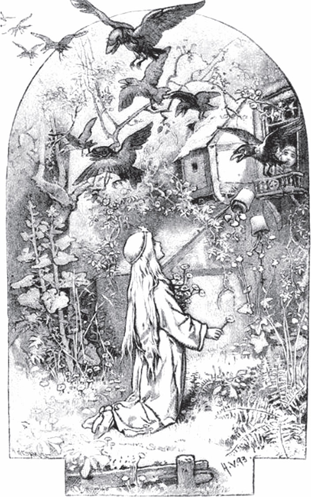

## Die zwölf Brüder

Es war einmal ein König und eine Königin. Sie leben <abbr title="in Frieden leben — жить в мире">in Frieden</abbr> miteinander und haben zwölf Kinder. Aber das sind alles <abbr title="der Bub, die Buben — мальчик, парень">Buben</abbr>. Eines Tages sagt der König zu seiner Frau:

— Wenn unser dreizehntes Kind ein Mädchen ist, dann sollen die zwölf Buben sterben. Dann wird ihr Reichtum groß, und das Königreich bekommt sie allein.

Er lässt auch zwölf Särge machen. Sie sind schon mit <abbr title="der Hobelspan, die Hobelspäne — стружка">Hobelspänen</abbr> gefüllt, und in jedem liegt ein kleines <abbr title="das Totenkissen, die Totenkissen — подушка для покойника">Totenkissen</abbr>. Der König lässt die Särge in ein <abbr title="verschlossen — запертый">verschlossenes</abbr> Zimmer bringen. Dann gibt er der Königin den Schlüssel. Sie darf niemandem etwas davon sagen. Das befiehlt er ihr.

Die Mutter sitzt jetzt den ganzen Tag da und <abbr title="trauern — горевать, скорбеть">trauert</abbr>. Ihr jüngster Sohn ist immer bei ihr. Sie nennt ihn Benjamin, wie in der <abbr title="die Bibel, die Bibeln — Библия">Bibel</abbr>. Er fragt sie:

— Liebe Mutter, warum bist du so traurig?

— Liebstes Kind, — antwortet sie, — ich darf es dir nicht sagen.

Aber er lässt ihr keine <abbr title="die Ruhe — покой">Ruhe</abbr>. Endlich geht sie und schließt das Zimmer auf. Sie zeigt ihm die zwölf Särge mit den Hobelspänen. Dann sagt sie:

— Mein liebster Benjamin, diese Särge hat dein Vater für dich und deine elf Brüder machen lassen. Denn wenn ich ein Mädchen <abbr title="zur Welt bringen — родить, произвести на свет">zur Welt bringe</abbr>, dann will er euch alle <abbr title="töten — убивать">töten</abbr>. Und dann <abbr title="begraben (begrub, hat begraben) — хоронить">begräbt</abbr> man euch in diesen Särgen.

Dabei weint sie. Da tröstet sie der Sohn:

— Weine nicht, liebe Mutter. Wir helfen uns schon. Wir gehen einfach fort.

Sie aber sagt:

— Geh mit deinen elf Brüdern hinaus in den Wald. Einer von euch soll immer auf dem höchsten Baum sitzen und <abbr title="Wache halten (hielt, hat gehalten) — нести караул, стоять на страже">Wache halten</abbr>. Er soll immer zum <abbr title="der Turm, die Türme — башня">Turm</abbr> hier im Schloss sehen. Bekomme ich ein Söhnchen, dann stecke ich eine weiße <abbr title="die Fahne, die Fahnen — флаг, знамя">Fahne</abbr> auf. Dann dürft ihr wiederkommen. Bekomme ich ein Töchterchen, dann stecke ich eine rote Fahne auf. Dann flieht, so schnell ihr könnt, und der liebe Gott <abbr title="behüten — хранить, оберегать">behüte</abbr> euch. Jede Nacht will ich aufstehen und für euch beten: im Winter, dass ihr an einem Feuer warm werdet, und im Sommer, dass ihr nicht in der <abbr title="die Hitze — жара, зной">Hitze</abbr> <abbr title="leiden (litt, hat gelitten) — страдать">leidet</abbr>.

Sie <abbr title="segnen — благословлять">segnet</abbr> ihre Söhne. Dann gehen die Brüder hinaus in den Wald. Einer nach dem anderen hält Wache. Er sitzt auf der höchsten Eiche und sieht zum Turm. Elf Tage vergehen. Dann ist Benjamin <abbr title="an der Reihe sein — быть чьей-то очереди">an der Reihe</abbr>. Da sieht er: Man steckt eine Fahne auf. Aber es ist nicht die weiße Fahne. Es ist die rote <abbr title="die Blutfahne, die Blutfahnen — кровавый флаг">Blutfahne</abbr>. Sie <abbr title="verkünden — возвещать, объявлять">verkündet</abbr>: Alle Brüder sollen sterben. Die Brüder hören das und werden zornig. Sie sagen:

— Sollen wir wegen einem Mädchen sterben? Wir <abbr title="schwören (schwor, hat geschworen) — клясться">schwören</abbr>: Wir <abbr title="sich rächen — мстить">rächen uns</abbr>! Wo wir ein Mädchen finden, soll sein rotes Blut fließen.

Dann gehen sie tiefer in den Wald hinein. Mitten im Wald, wo er am dunkelsten ist, finden sie ein kleines <abbr title="verwunschen — заколдованный">verwunschenes</abbr> Häuschen. Es steht leer. Da sagen sie:

— Hier wollen wir wohnen. Du, Benjamin, bist der jüngste und der <abbr title="schwach — слабый">schwächste</abbr>. Du bleibst zu Hause und machst den Haushalt. Wir anderen gehen hinaus und holen Essen.

Die Brüder ziehen in den Wald und schießen Hasen, wilde Rehe, Vögel und <abbr title="das Täubchen, die Täubchen — голубок">Täubchen</abbr> und alles, was man essen kann. Das bringen sie zu Benjamin. Er muss es für sie <abbr title="zubereiten — готовить (еду)">zubereiten</abbr>. So werden sie satt. In dem Häuschen leben sie zehn Jahre zusammen, und die Zeit wird ihnen nicht lang.

Das Töchterchen von der Königin ist jetzt groß. Sie hat ein gutes Herz und ein schönes Gesicht. Und auf der <abbr title="die Stirn, die Stirnen — лоб">Stirn</abbr> hat sie einen goldenen Stern. Einmal ist im Schloss große <abbr title="die Wäsche — стирка; бельё">Wäsche</abbr>. Da sieht das Mädchen in der Wäsche zwölf <abbr title="das Männerhemd, die Männerhemden — мужская рубашка">Männerhemden</abbr>. Sie fragt ihre Mutter:

— Wem gehören diese zwölf Hemden? Für den Vater sind sie doch viel zu klein.

Da antwortet die Mutter mit schwerem Herzen:

— Liebes Kind, die gehören deinen zwölf Brüdern.

— Wo sind meine zwölf Brüder? — fragt das Mädchen. — Ich habe noch nie von ihnen gehört.

— Das weiß nur Gott, wo sie sind, — antwortet die Mutter. — Sie <abbr title="herumirren — блуждать, скитаться">irren</abbr> in der Welt herum.

Sie nimmt das Mädchen mit, schließt ihm das Zimmer auf und zeigt ihm die zwölf Särge mit den Hobelspänen und den Totenkissen.

— Diese Särge, — sagt sie, — waren für deine Brüder <abbr title="bestimmt sein für + Akk. — предназначаться для">bestimmt</abbr>. Aber sie sind heimlich fortgegangen. Da warst du noch nicht geboren.

Und sie erzählt ihm alles, was <abbr title="geschehen (geschah, ist geschehen) — случаться, происходить">geschehen</abbr> ist. Da sagt das Mädchen:

— Liebe Mutter, weine nicht. Ich gehe und suche meine Brüder.

Sie nimmt die zwölf Hemden und geht fort, direkt in den großen Wald hinein. Sie geht den ganzen Tag. Am Abend kommt sie zu dem verwunschenen Häuschen. Sie geht hinein und findet dort einen jungen <abbr title="der Bursche, die Burschen — парень, юноша">Burschen</abbr>. Er fragt:

— Woher kommst du, und wohin willst du?

Er staunt, denn sie ist so schön, sie trägt königliche Kleider und hat einen Stern auf der Stirn. Sie antwortet:

— Ich bin eine Königstochter. Ich suche meine zwölf Brüder. Ich will gehen, so weit der Himmel blau ist, bis ich sie finde.

Sie zeigt ihm auch die zwölf Hemden von ihren Brüdern. Da sieht Benjamin, dass sie seine Schwester ist. Er sagt:

— Ich bin Benjamin, dein jüngster Bruder.

Sie fängt an zu weinen vor Freude, und Benjamin auch. Sie küssen und umarmen sich vor großer Liebe. Dann sagt er:

— Liebe Schwester, es gibt noch ein Problem. Wir haben <abbr title="verabreden — договариваться">verabredet</abbr>: Jedes Mädchen, das wir treffen, soll sterben. Denn wegen einem Mädchen mussten wir unser Königreich verlassen.

Da sagt sie:

— Ich sterbe gern, wenn ich damit meine zwölf Brüder erlösen kann.

— Nein, — antwortet er, — du sollst nicht sterben. Setz dich unter diesen <abbr title="der Bottich, die Bottiche — чан, кадка">Bottich</abbr>, bis die elf Brüder kommen. Ich werde schon <abbr title="sich einig werden mit + Dat. — договориться с кем-то">mit ihnen einig</abbr>.

Sie tut es. In der Nacht kommen die anderen von der <abbr title="die Jagd, die Jagden — охота">Jagd</abbr>, und das Essen ist fertig. Sie sitzen am Tisch und essen. Da fragen sie:

— Was gibt es Neues?

— Wisst ihr nichts? — fragt Benjamin.

— Nein, — antworten sie.

— Ihr wart im Wald, und ich bin zu Hause geblieben, — sagt er. — Und trotzdem weiß ich mehr als ihr.

— Dann erzähl es uns! — rufen sie.

— Versprecht ihr mir auch, dass ihr das erste Mädchen, das wir treffen, nicht tötet?

— Ja, — rufen alle, — wir <abbr title="verschonen — щадить, пощадить">verschonen</abbr> es! Erzähl nur!

Da sagt er:

— Unsere Schwester ist da.

Er hebt den Bottich hoch, und die Königstochter kommt heraus. Sie trägt ihre königlichen Kleider und hat den goldenen Stern auf der Stirn. Sie ist so schön, so <abbr title="zart — нежный">zart</abbr> und fein! Da freuen sich alle. Sie <abbr title="um den Hals fallen (fiel, ist gefallen) — бросаться на шею">fallen</abbr> ihr um den Hals, küssen sie und haben sie von Herzen lieb.

Jetzt bleibt sie mit Benjamin zu Hause und hilft ihm bei der Arbeit. Die elf ziehen in den Wald und fangen Wild, Rehe, Vögel und Täubchen. So haben sie zu essen. Die Schwester und Benjamin sorgen für das Essen und kochen alles. Sie sucht das Holz zum Kochen und die <abbr title="das Kraut, die Kräuter — трава, зелень">Kräuter</abbr> für das Gemüse. Sie stellt die <abbr title="der Topf, die Töpfe — горшок, кастрюля">Töpfe</abbr> ans Feuer. So ist das Essen immer fertig, wenn die elf nach Hause kommen. Sie hält auch sonst Ordnung im Häuschen. Sie macht die <abbr title="das Bettchen, die Bettchen — кроватка">Bettchen</abbr> schön weiß und sauber. Die Brüder sind immer zufrieden und leben in großer <abbr title="die Einigkeit — согласие, единство">Einigkeit</abbr> mit ihr.

Einmal haben die beiden zu Hause ein besonders gutes Essen gekocht. Alle sitzen zusammen, essen und trinken und sind voller Freude. Neben dem verwunschenen Häuschen gibt es aber ein kleines <abbr title="das Gärtchen, die Gärtchen — садик">Gärtchen</abbr>. Darin stehen zwölf <abbr title="die Lilie, die Lilien — лилия">Lilien</abbr>. Man nennt diese Blumen auch «Studenten». Die Schwester will ihren Brüdern eine Freude machen. Sie <abbr title="abbrechen (brach ab, hat abgebrochen) — отламывать, срывать">bricht</abbr> die zwölf Blumen ab. Jeder Bruder soll beim Essen eine bekommen. Aber in diesem <abbr title="der Augenblick, die Augenblicke — мгновение">Augenblick</abbr> <abbr title="sich verwandeln in + Akk. — превращаться в">verwandeln sich</abbr> die zwölf Brüder in zwölf Raben. Sie fliegen über den Wald davon. Auch das Haus mit dem Garten ist verschwunden.

Jetzt ist das arme Mädchen allein in dem wilden Wald. Sie sieht sich um. Da steht eine alte Frau neben ihr und sagt:

— Mein Kind, was hast du getan? Warum hast du die zwölf weißen Blumen nicht stehen lassen? Das waren deine Brüder. Jetzt sind sie für immer Raben.

Das Mädchen weint und fragt:

— Gibt es denn kein <abbr title="das Mittel, die Mittel — средство">Mittel</abbr>, sie zu erlösen?

— Nein, — sagt die Alte. — Auf der ganzen Welt gibt es nur eins. Aber das ist so schwer, dass du sie damit nicht befreien wirst. Du musst sieben Jahre <abbr title="stumm — немой">stumm</abbr> sein. Du darfst nicht sprechen und nicht lachen. Sprichst du ein <abbr title="einzig — единственный">einziges</abbr> Wort, und es fehlt nur eine Stunde an den sieben Jahren, dann ist alles umsonst. Dann tötet dieses eine Wort deine Brüder.

Da sagt das Mädchen in seinem Herzen: «Ich weiß gewiss, dass ich meine Brüder erlöse.» Sie geht und sucht einen hohen Baum. Sie setzt sich hinauf und <abbr title="spinnen (spann, hat gesponnen) — прясть">spinnt</abbr>. Sie spricht nicht, und sie lacht nicht.

Eines Tages jagt ein König in diesem Wald. Er hat einen großen Windhund. Der Hund läuft zu dem Baum, auf dem das Mädchen sitzt. Er springt herum, <abbr title="jaulen — выть, скулить">jault</abbr> und bellt nach oben. Da kommt der König und sieht die schöne Königstochter mit dem goldenen Stern auf der Stirn. Er ist so <abbr title="entzückt — восхищённый, очарованный">entzückt</abbr> von ihrer <abbr title="die Schönheit — красота">Schönheit</abbr>, dass er zu ihr hinaufruft: Will sie seine <abbr title="die Gemahlin, die Gemahlinnen — супруга">Gemahlin</abbr> werden? Sie gibt keine Antwort, aber sie nickt ein wenig mit dem Kopf. Da <abbr title="steigen (stieg, ist gestiegen) — подниматься, залезать">steigt</abbr> er selbst auf den Baum, trägt sie herunter und setzt sie auf sein Pferd. So bringt er sie nach Hause. Man feiert die Hochzeit mit großer Pracht und Freude. Aber die Braut spricht nicht und lacht nicht.

Ein paar Jahre leben sie glücklich miteinander. Dann fängt die Mutter von dem König an, die junge Königin zu <abbr title="verleumden — клеветать на">verleumden</abbr>. Sie ist eine böse Frau. Sie sagt zum König:

— Du hast dir ein gemeines <abbr title="das Bettelmädchen, die Bettelmädchen — нищенка">Bettelmädchen</abbr> mitgebracht. Wer weiß, was für gottlose Streiche sie heimlich macht! Gut, sie ist stumm und kann nicht sprechen. Aber sie kann doch einmal lachen! Wer nicht lacht, der hat ein schlechtes <abbr title="das Gewissen — совесть">Gewissen</abbr>.

Der König will es zuerst nicht glauben. Aber die Alte redet so lange und <abbr title="beschuldigen — обвинять">beschuldigt</abbr> die junge Frau so vieler böser Dinge, dass der König ihr endlich glaubt. Er <abbr title="verurteilen zu + Dat. — приговаривать к">verurteilt</abbr> seine Frau zum Tod.

Im Hof <abbr title="anzünden — зажигать, разжигать">zündet</abbr> man ein großes Feuer an. Darin soll sie verbrennen. Der König steht oben am Fenster und sieht mit Tränen in den Augen zu, denn er liebt sie immer noch. Jetzt ist sie schon an den Pfahl gebunden. Das Feuer leckt schon mit roten Zungen an ihren Kleidern. Genau in diesem Augenblick sind die sieben Jahre vorbei. Da hört man in der Luft ein <abbr title="das Rauschen — шум, шелест">Rauschen</abbr> von Flügeln. Zwölf Raben kommen geflogen und <abbr title="sich senken — опускаться">senken sich</abbr> herunter. Sie berühren die Erde – und da sind es ihre zwölf Brüder. Sie hat sie erlöst! Die Brüder reißen das Feuer auseinander, löschen die Flammen und machen ihre liebe Schwester frei. Sie küssen und umarmen sie.

Jetzt darf sie endlich den Mund aufmachen und reden. Sie erzählt dem König, warum sie stumm war und nie gelacht hat. Der König hört, dass sie unschuldig ist, und freut sich sehr. Und sie leben alle zusammen in Einigkeit bis an ihren Tod. Die böse <abbr title="die Stiefmutter, die Stiefmütter — мачеха; здесь: свекровь">Stiefmutter</abbr> aber kommt <abbr title="vor Gericht kommen — предстать перед судом">vor Gericht</abbr>. Man steckt sie in ein <abbr title="das Fass, die Fässer — бочка">Fass</abbr> voll <abbr title="kochend — кипящий">kochendem</abbr> Öl und <abbr title="giftig — ядовитый">giftigen</abbr> <abbr title="die Schlange, die Schlangen — змея">Schlangen</abbr>. Dort stirbt sie einen bösen Tod.

---

### Neue Wörter

- **in Frieden leben** — жить в мире
- **der Bub, die Buben** — мальчик, парень
- **der Hobelspan, die Hobelspäne** — стружка
- **das Totenkissen, die Totenkissen** — подушка для покойника
- **verschlossen** — запертый
- **trauern** — горевать, скорбеть
- **die Bibel, die Bibeln** — Библия
- **die Ruhe** — покой
- **zur Welt bringen** — родить, произвести на свет
- **töten** — убивать
- **begraben (begrub, hat begraben)** — хоронить
- **Wache halten (hielt, hat gehalten)** — нести караул, стоять на страже
- **der Turm, die Türme** — башня
- **die Fahne, die Fahnen** — флаг, знамя
- **behüten** — хранить, оберегать
- **die Hitze** — жара, зной
- **leiden (litt, hat gelitten)** — страдать
- **segnen** — благословлять
- **an der Reihe sein** — быть чьей-то очереди
- **die Blutfahne, die Blutfahnen** — кровавый флаг
- **verkünden** — возвещать, объявлять
- **schwören (schwor, hat geschworen)** — клясться
- **sich rächen** — мстить
- **verwunschen** — заколдованный
- **schwach** — слабый
- **das Täubchen, die Täubchen** — голубок
- **zubereiten** — готовить (еду)
- **die Stirn, die Stirnen** — лоб
- **die Wäsche** — стирка; бельё
- **das Männerhemd, die Männerhemden** — мужская рубашка
- **herumirren** — блуждать, скитаться
- **bestimmt sein für + Akk.** — предназначаться для
- **geschehen (geschah, ist geschehen)** — случаться, происходить
- **der Bursche, die Burschen** — парень, юноша
- **verabreden** — договариваться
- **der Bottich, die Bottiche** — чан, кадка
- **sich einig werden mit + Dat.** — договориться с кем-то
- **die Jagd, die Jagden** — охота
- **verschonen** — щадить, пощадить
- **zart** — нежный
- **um den Hals fallen (fiel, ist gefallen)** — бросаться на шею
- **das Kraut, die Kräuter** — трава, зелень
- **der Topf, die Töpfe** — горшок, кастрюля
- **das Bettchen, die Bettchen** — кроватка
- **die Einigkeit** — согласие, единство
- **das Gärtchen, die Gärtchen** — садик
- **die Lilie, die Lilien** — лилия
- **abbrechen (brach ab, hat abgebrochen)** — отламывать, срывать
- **der Augenblick, die Augenblicke** — мгновение
- **sich verwandeln in + Akk.** — превращаться в
- **das Mittel, die Mittel** — средство
- **stumm** — немой
- **einzig** — единственный
- **spinnen (spann, hat gesponnen)** — прясть
- **jaulen** — выть, скулить
- **entzückt** — восхищённый, очарованный
- **die Schönheit** — красота
- **die Gemahlin, die Gemahlinnen** — супруга
- **steigen (stieg, ist gestiegen)** — подниматься, залезать
- **verleumden** — клеветать на
- **das Bettelmädchen, die Bettelmädchen** — нищенка
- **das Gewissen** — совесть
- **beschuldigen** — обвинять
- **verurteilen zu + Dat.** — приговаривать к
- **anzünden** — зажигать, разжигать
- **das Rauschen** — шум, шелест
- **sich senken** — опускаться
- **die Stiefmutter, die Stiefmütter** — мачеха; здесь: свекровь
- **vor Gericht kommen** — предстать перед судом
- **das Fass, die Fässer** — бочка
- **kochend** — кипящий
- **giftig** — ядовитый
- **die Schlange, die Schlangen** — змея

[← Zurück](kapitel-08.md) · [Inhalt](README.md)
