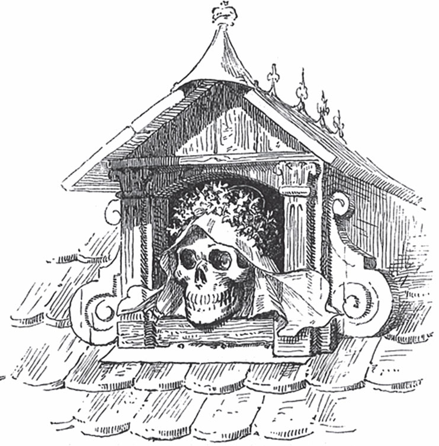

## Das Lumpengesindel

Das <abbr title="das Hähnchen, die Hähnchen — петушок">Hähnchen</abbr> sagt zum <abbr title="das Hühnchen, die Hühnchen — курочка">Hühnchen</abbr>:

— Jetzt ist die Zeit, wo die Nüsse <abbr title="reif — спелый">reif</abbr> werden. Komm, wir gehen zusammen auf den Berg und essen uns einmal richtig <abbr title="sich satt essen — наесться досыта">satt</abbr>. Sonst holt das <abbr title="das Eichhörnchen, die Eichhörnchen — белка">Eichhörnchen</abbr> sie alle wegholt.

— Ja, — antwortet das Hühnchen, — komm, wir machen uns zusammen einen schönen Tag.

Sie gehen zusammen auf den Berg. Es ist ein heller Tag, und sie bleiben bis zum Abend. Ich weiß nicht, ob sie zu viel gegessen haben oder ob sie zu <abbr title="übermütig — озорной, расшалившийся">übermütig</abbr> geworden sind. Jedenfalls wollen sie nicht zu Fuß nach Hause gehen. Das Hähnchen muss einen kleinen Wagen aus <abbr title="die Nussschale, die Nussschalen — ореховая скорлупа">Nussschalen</abbr> bauen. Als der Wagen fertig ist, setzt sich das Hühnchen hinein und sagt zum Hähnchen:

— Du kannst dich jetzt <abbr title="sich vorspannen — запрягаться">vorspannen</abbr>.

— Na, du bist gut! — sagt das Hähnchen. — Lieber gehe ich zu Fuß nach Hause, als dass ich mich vorspannen lasse. Nein, so haben wir nicht gewettet! <abbr title="der Kutscher, die Kutscher — кучер">Kutscher</abbr> will ich gern sein und auf dem <abbr title="der Kutschbock, die Kutschböcke — козлы">Kutschbock</abbr> sitzen. Aber selbst ziehen, das tue ich nicht.

Sie <abbr title="streiten (stritt, hat gestritten) — ссориться, спорить">streiten</abbr> noch, da kommt eine <abbr title="die Ente, die Enten — утка">Ente</abbr> und <abbr title="schnattern — крякать, гоготать">schnattert</abbr>:

— Ihr <abbr title="der Dieb, die Diebe — вор">Diebe</abbr>! Wer hat euch erlaubt, auf meinen <abbr title="der Nussberg — ореховая гора">Nussberg</abbr> zu gehen? Wartet, das <abbr title="jemandem schlecht bekommen — выйти боком кому-то">bekommt euch schlecht</abbr>!

Mit <abbr title="aufsperren — разинуть, широко раскрыть">aufgesperrtem</abbr> <abbr title="der Schnabel, die Schnäbel — клюв">Schnabel</abbr> geht sie auf das Hähnchen los. Aber das Hähnchen ist auch nicht faul. Es <abbr title="kämpfen — драться, бороться">kämpft</abbr> <abbr title="tüchtig — изрядно, как следует">tüchtig</abbr> mit der Ente. Endlich hackt es mit seinen <abbr title="der Sporn, die Sporen — шпора">Sporen</abbr> so stark auf sie ein, dass sie um Gnade bittet. Zur <abbr title="die Strafe, die Strafen — наказание">Strafe</abbr> lässt sie sich gern vor den Wagen spannen. Das Hähnchen setzt sich jetzt auf den Kutschbock und ist Kutscher. Und dann geht es los, so schnell es geht:

— Ente, lauf, so schnell du kannst!

Sie fahren ein Stück. Da treffen sie zwei <abbr title="der Fußgänger, die Fußgänger — пешеход">Fußgänger</abbr>: eine <abbr title="die Stecknadel, die Stecknadeln — булавка">Stecknadel</abbr> und eine <abbr title="die Nähnadel, die Nähnadeln — швейная иголка">Nähnadel</abbr>. Die beiden rufen:

— Halt! Halt!

Sie sagen, es wird gleich <abbr title="stockdunkel — кромешная тьма, темно хоть глаз выколи">stockdunkel</abbr>. Dann können sie keinen Schritt weitergehen. Außerdem ist die Straße so <abbr title="schmutzig — грязный">schmutzig</abbr>. Ob sie nicht ein bisschen mitfahren dürfen? Sie waren in der <abbr title="die Herberge, die Herbergen — постоялый двор">Herberge</abbr> von den Schneidern vor dem <abbr title="das Stadttor, die Stadttore — городские ворота">Stadttor</abbr>. Dort haben sie beim Bier die Zeit vergessen. Die beiden sind <abbr title="mager — тощий, худой">mager</abbr> und brauchen nicht viel Platz. Deshalb lässt das Hähnchen sie einsteigen. Aber sie müssen versprechen, dass sie ihm und seinem Hühnchen nicht auf die Füße treten.

Spät am Abend kommen sie zu einem Wirtshaus. In der Nacht wollen sie nicht weiterfahren. Die Ente kann auch nicht mehr gut laufen. Sie fällt von einer Seite auf die andere. Deshalb <abbr title="einkehren — заезжать, останавливаться (в трактире)">kehren</abbr> sie ein. Der Wirt will sie zuerst nicht <abbr title="aufnehmen (nahm auf, hat aufgenommen) — принимать, впускать">aufnehmen</abbr>. Er sagt, sein Haus ist schon voll. Er denkt wohl auch: «Das sind keine <abbr title="vornehm — знатный, благородный">vornehmen</abbr> Leute.» Aber die Gäste reden ihm <abbr title="schmeicheln — льстить, улещивать">schmeichelnd</abbr> zu: Er soll das Ei bekommen, das das Hühnchen unterwegs gelegt hat. Und er darf auch die Ente behalten, denn sie legt jeden Tag ein Ei. Da sagt der Wirt endlich: Gut, sie dürfen über Nacht bleiben. Jetzt bestellen sie wieder viel Essen und leben <abbr title="in Saus und Braus leben — жить на широкую ногу, кутить">in Saus und Braus</abbr>.

Früh am Morgen <abbr title="dämmern — светать">dämmert</abbr> es. Alle schlafen noch. Da weckt das Hähnchen das Hühnchen. Es holt das Ei, <abbr title="aufpicken — расклёвывать">pickt</abbr> es auf, und die beiden essen es zusammen. Die <abbr title="die Schale, die Schalen — скорлупа">Schalen</abbr> aber werfen sie auf den <abbr title="der Herd, die Herde — очаг, печь">Herd</abbr>. Dann gehen sie zu der Nähnadel. Die schläft noch. Sie packen sie am Kopf und stecken sie in das <abbr title="das Sesselkissen, die Sesselkissen — подушка кресла">Sesselkissen</abbr> von dem Wirt. Die Stecknadel stecken sie in sein <abbr title="das Handtuch, die Handtücher — полотенце">Handtuch</abbr>. Dann fliegen sie <abbr title="mir nichts, dir nichts — ни с того ни с сего, как ни в чём не бывало">mir nichts, dir nichts</abbr> über die <abbr title="die Heide, die Heiden — пустошь, вересковая равнина">Heide</abbr> davon. Die Ente schläft gern unter freiem Himmel und ist deshalb im Hof geblieben. Sie hört, wie die beiden <abbr title="davonschwirren — упорхнуть, улететь с шумом">davonschwirren</abbr>. Da wird sie munter. Sie findet einen Bach und <abbr title="schwimmen (schwamm, ist geschwommen) — плыть">schwimmt</abbr> darauf davon. Das geht schneller als vor dem Wagen.

Erst ein paar Stunden später steht der Wirt auf. Er wäscht sich und will sich am Handtuch <abbr title="sich abtrocknen — вытираться">abtrocknen</abbr>. Da <abbr title="kratzen — царапать">kratzt</abbr> ihm die Stecknadel über das Gesicht. Jetzt hat er einen roten <abbr title="der Strich, die Striche — черта, полоса">Strich</abbr> von einem Ohr zum anderen. Dann geht er in die Küche und will sich eine <abbr title="die Pfeife, die Pfeifen — трубка">Pfeife</abbr> anzünden. Aber als er an den Herd kommt, springen ihm die <abbr title="die Eierschale, die Eierschalen — яичная скорлупа">Eierschalen</abbr> in die Augen.

— Heute Morgen will mir alles an den Kopf! — sagt er.

Verdrießlich setzt er sich auf seinen <abbr title="der Großvaterstuhl, die Großvaterstühle — дедовское кресло">Großvaterstuhl</abbr>. Aber schnell springt er wieder hoch und schreit:

— <abbr title="autsch! — ай! ой!">Autsch</abbr>!

Denn die Nähnadel hat ihn <abbr title="stechen (stach, hat gestochen) — колоть, уколоть">gestochen</abbr>, noch schlimmer und nicht in den Kopf. Jetzt ist er ganz böse. Er hat einen <abbr title="der Verdacht — подозрение">Verdacht</abbr>: Das waren die Gäste, die gestern so spät gekommen sind! Er geht und sucht sie. Aber sie sind weg. Da schwört er: Nie mehr nimmt er solches <abbr title="das Lumpengesindel — сброд, шваль, оборванцы">Lumpengesindel</abbr> in sein Haus. Solche Leute essen viel, bezahlen nichts und machen zum Dank noch obendrein <abbr title="der Schabernack — злая шутка, проказа">Schabernack</abbr>.

---

### Neue Wörter

- **das Hähnchen, die Hähnchen** — петушок
- **das Hühnchen, die Hühnchen** — курочка
- **reif** — спелый
- **sich satt essen** — наесться досыта
- **das Eichhörnchen, die Eichhörnchen** — белка
- **übermütig** — озорной, расшалившийся
- **die Nussschale, die Nussschalen** — ореховая скорлупа
- **sich vorspannen** — запрягаться
- **der Kutscher, die Kutscher** — кучер
- **der Kutschbock, die Kutschböcke** — козлы
- **streiten (stritt, hat gestritten)** — ссориться, спорить
- **die Ente, die Enten** — утка
- **schnattern** — крякать, гоготать
- **der Dieb, die Diebe** — вор
- **der Nussberg** — ореховая гора
- **jemandem schlecht bekommen** — выйти боком кому-то
- **aufsperren** — разинуть, широко раскрыть
- **der Schnabel, die Schnäbel** — клюв
- **kämpfen** — драться, бороться
- **tüchtig** — изрядно, как следует
- **der Sporn, die Sporen** — шпора
- **die Strafe, die Strafen** — наказание
- **der Fußgänger, die Fußgänger** — пешеход
- **die Stecknadel, die Stecknadeln** — булавка
- **die Nähnadel, die Nähnadeln** — швейная иголка
- **stockdunkel** — кромешная тьма, темно хоть глаз выколи
- **schmutzig** — грязный
- **die Herberge, die Herbergen** — постоялый двор
- **das Stadttor, die Stadttore** — городские ворота
- **mager** — тощий, худой
- **einkehren** — заезжать, останавливаться (в трактире)
- **aufnehmen (nahm auf, hat aufgenommen)** — принимать, впускать
- **vornehm** — знатный, благородный
- **schmeicheln** — льстить, улещивать
- **in Saus und Braus leben** — жить на широкую ногу, кутить
- **dämmern** — светать
- **aufpicken** — расклёвывать
- **die Schale, die Schalen** — скорлупа
- **der Herd, die Herde** — очаг, печь
- **das Sesselkissen, die Sesselkissen** — подушка кресла
- **das Handtuch, die Handtücher** — полотенце
- **mir nichts, dir nichts** — ни с того ни с сего, как ни в чём не бывало
- **die Heide, die Heiden** — пустошь, вересковая равнина
- **davonschwirren** — упорхнуть, улететь с шумом
- **schwimmen (schwamm, ist geschwommen)** — плыть
- **sich abtrocknen** — вытираться
- **kratzen** — царапать
- **der Strich, die Striche** — черта, полоса
- **die Pfeife, die Pfeifen** — трубка
- **die Eierschale, die Eierschalen** — яичная скорлупа
- **der Großvaterstuhl, die Großvaterstühle** — дедовское кресло
- **autsch!** — ай! ой!
- **stechen (stach, hat gestochen)** — колоть, уколоть
- **der Verdacht** — подозрение
- **das Lumpengesindel** — сброд, шваль, оборванцы
- **der Schabernack** — злая шутка, проказа

[← Zurück](kapitel-09.md) · [Inhalt](README.md)
