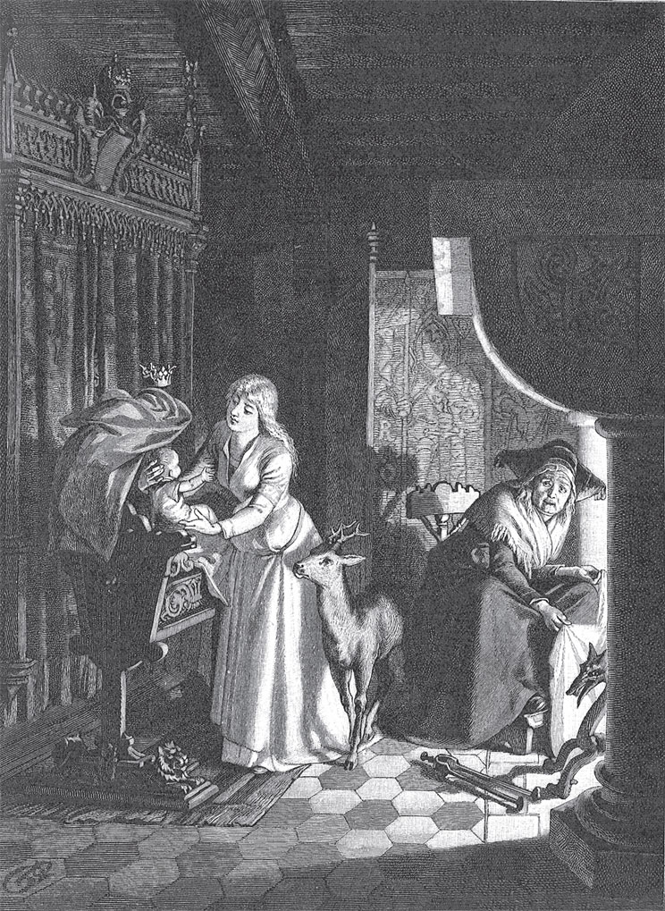

## Brüderchen und Schwesterchen

Das <abbr title="das Brüderchen, die Brüderchen — братец">Brüderchen</abbr> nimmt sein <abbr title="das Schwesterchen, die Schwesterchen — сестрица">Schwesterchen</abbr> an die Hand und sagt:

— Seit die Mutter tot ist, haben wir keine gute Stunde mehr. Die Stiefmutter schlägt uns jeden Tag. Und wenn wir zu ihr kommen, <abbr title="wegstoßen (stieß weg, hat weggestoßen) — отталкивать, отпихивать">stößt</abbr> sie uns mit den Füßen weg. Wir essen nur die harten <abbr title="die Brotkruste, die Brotkrusten — хлебная корка">Brotkrusten</abbr>, die <abbr title="übrig bleiben — оставаться (лишним)">übrig bleiben</abbr>. Dem kleinen Hund unter dem Tisch geht es besser. Dem wirft sie doch manchmal einen guten Bissen zu. <abbr title="Gott erbarme sich! — Боже, смилуйся!">Gott erbarme sich</abbr>! Ach, wenn unsere Mutter das sieht! Komm, wir gehen zusammen in die weite Welt.

Sie gehen den ganzen Tag über Wiesen, Felder und Steine. Und wenn es regnet, sagt das Schwesterchen:

— Gott und unsere Herzen, die weinen zusammen!

Am Abend kommen sie in einen großen Wald. Sie sind so müde von Kummer, Hunger und dem langen Weg, dass sie sich in einen hohlen Baum setzen und einschlafen.

Am nächsten Morgen wachen sie auf. Die Sonne steht schon hoch am Himmel und scheint heiß in den Baum hinein. Da sagt das Brüderchen:

— Schwesterchen, ich habe Durst. Wenn ich nur eine kleine <abbr title="die Quelle, die Quellen — родник, источник">Quelle</abbr> finde, dann gehe ich hin und trinke. Ich glaube, ich höre eine rauschen.

Das Brüderchen steht auf und nimmt das Schwesterchen an die Hand. Sie wollen die Quelle suchen. Aber die böse Stiefmutter ist eine Hexe. Sie hat gesehen, wie die beiden Kinder fortgegangen sind. Sie ist ihnen heimlich nachgeschlichen, so wie Hexen eben schleichen. Und sie hat alle Brunnen im Wald <abbr title="verwünschen — заколдовать, проклясть">verwünscht</abbr>.

Jetzt finden die Kinder eine kleine Quelle. Das Wasser springt glitzernd über die Steine. Das Brüderchen will daraus trinken. Aber das Schwesterchen hört, wie die Quelle im Rauschen spricht:

— Wer aus mir trinkt, wird ein <abbr title="der Tiger, die Tiger — тигр">Tiger</abbr>. Wer aus mir trinkt, wird ein Tiger.

Da ruft das Schwesterchen:

— Ich bitte dich, Brüderchen, trink nicht! Sonst wirst du ein wildes Tier und zerreißt mich.

Das Brüderchen trinkt nicht. Dabei hat es so großen Durst. Es sagt:

— Ich warte bis zur nächsten Quelle.

Sie kommen zur zweiten Quelle. Da hört das Schwesterchen, wie auch diese spricht:

— Wer aus mir trinkt, wird ein Wolf. Wer aus mir trinkt, wird ein Wolf.

Da ruft das Schwesterchen:

— Brüderchen, ich bitte dich, trink nicht! Sonst wirst du ein Wolf und frisst mich.

Das Brüderchen trinkt nicht und sagt:

— Ich warte, bis wir zur nächsten Quelle kommen. Aber dann muss ich trinken, du kannst sagen, was du willst. Mein Durst ist einfach zu groß.

Sie kommen zur dritten Quelle. Da hört das Schwesterchen, wie sie im Rauschen spricht:

— Wer aus mir trinkt, wird ein Reh. Wer aus mir trinkt, wird ein Reh.

Das Schwesterchen sagt:

— Ach, Brüderchen, ich bitte dich, trink nicht! Sonst wirst du ein Reh und läufst mir fort.

Aber das Brüderchen hat sich schon an der Quelle <abbr title="sich hinknien — встать на колени">hingekniet</abbr>. Es <abbr title="sich beugen — наклоняться">beugt sich</abbr> hinunter und trinkt von dem Wasser. Die ersten Tropfen kommen auf seine <abbr title="die Lippe, die Lippen — губа">Lippen</abbr> – und schon liegt es da als kleines <abbr title="das Rehkälbchen, die Rehkälbchen — оленёнок, детёныш косули">Rehkälbchen</abbr>.

Jetzt weint das Schwesterchen über das arme verzauberte Brüderchen. Das <abbr title="das Rehchen, die Rehchen — косулька, оленёнок">Rehchen</abbr> weint auch und sitzt traurig neben ihr. Endlich sagt das Mädchen:

— Sei still, liebes Rehchen, ich verlasse dich nie, niemals.

Sie bindet ihr goldenes <abbr title="das Strumpfband, die Strumpfbänder — подвязка">Strumpfband</abbr> ab und legt es dem Rehchen um den Hals. Dann <abbr title="rupfen — рвать, выдёргивать">rupft</abbr> sie <abbr title="die Binse, die Binsen — камыш, ситник">Binsen</abbr> und <abbr title="flechten (flocht, hat geflochten) — плести">flicht</abbr> daraus ein weiches <abbr title="das Seil, die Seile — верёвка">Seil</abbr>. Daran bindet sie das Tierchen und führt es weiter, immer tiefer in den Wald hinein. Sie gehen lange, lange. Endlich kommen sie zu einem kleinen Haus. Das Mädchen sieht hinein. Das Haus ist leer. Sie denkt: «Hier können wir bleiben und wohnen.»

Sie sucht <abbr title="das Laub — листва">Laub</abbr> und <abbr title="das Moos — мох">Moos</abbr> und macht dem Rehchen ein weiches <abbr title="das Lager, die Lager — ложе, постель">Lager</abbr>. Jeden Morgen geht sie hinaus und sammelt Wurzeln, <abbr title="die Beere, die Beeren — ягода">Beeren</abbr> und Nüsse für sich. Für das Rehchen bringt sie zartes Gras mit. Das Rehchen frisst es ihr aus der Hand, ist vergnügt und spielt vor ihr herum. Am Abend ist das Schwesterchen müde. Sie spricht ihr <abbr title="das Gebet, die Gebete — молитва">Gebet</abbr> und legt ihren Kopf auf den Rücken von dem Rehkälbchen. Das ist ihr Kissen, und darauf schläft sie <abbr title="sanft — мягко, тихо">sanft</abbr> ein. Es ist ein herrliches Leben. Nur eins fehlt: Das Brüderchen hat seine menschliche Gestalt nicht mehr.

Eine Zeit lang sind sie so allein in der Wildnis. Doch eines Tages hält der König von dem Land eine große Jagd in dem Wald. Durch die Bäume schallen die <abbr title="das Jagdhorn, die Jagdhörner — охотничий рог">Jagdhörner</abbr>, das Bellen von den Hunden und das lustige Geschrei von den <abbr title="der Jäger, die Jäger — охотник">Jägern</abbr>. Das Rehlein hört es und möchte so gern dabei sein.

— Ach, — sagt es zum Schwesterchen, — lass mich hinaus zur Jagd! Ich kann es nicht länger <abbr title="aushalten (hielt aus, hat ausgehalten) — выдерживать, терпеть">aushalten</abbr>.

Es bittet so lange, bis sie <abbr title="einwilligen — соглашаться">einwilligt</abbr>.

— Aber, — sagt sie, — komm am Abend wieder! Vor den wilden Jägern schließe ich mein <abbr title="das Türlein, die Türlein — дверца">Türlein</abbr> zu. Ich will dich ja erkennen. Deshalb klopfst du und sagst: «Mein Schwesterlein, lass mich herein!» Wenn du das nicht sagst, dann mache ich mein Türlein nicht auf.

Jetzt springt das Rehchen hinaus. Es fühlt sich so wohl und ist so fröhlich in der freien Luft! Der König und seine Jäger sehen das schöne Tier und verfolgen es. Aber sie können es nicht <abbr title="einholen — догнать">einholen</abbr>. Immer wenn sie glauben: «Jetzt haben wir es!», springt es über das Gebüsch und ist verschwunden. Als es dunkel wird, läuft es zu dem Häuschen, klopft und sagt:

— Mein Schwesterlein, lass mich herein!

Da geht die kleine Tür auf. Das Rehchen springt hinein und <abbr title="sich ausruhen — отдыхать">ruht sich</abbr> die ganze Nacht auf seinem weichen Lager aus.

Am nächsten Morgen fängt die Jagd <abbr title="von Neuem — заново, снова">von Neuem</abbr> an. Das Rehlein hört wieder das <abbr title="das Horn, die Hörner — рог">Horn</abbr> und das «Ho, ho!» von den Jägern. Da hat es keine Ruhe mehr und sagt:

— Schwesterchen, mach mir auf, ich muss hinaus!

Das Schwesterchen öffnet ihm die Tür und sagt:

— Aber am Abend musst du wieder da sein und dein <abbr title="das Sprüchlein, die Sprüchlein — присказка, словечко">Sprüchlein</abbr> sagen.

Der König und seine Jäger sehen das Rehlein mit dem goldenen <abbr title="das Halsband, die Halsbänder — ошейник">Halsband</abbr> wieder. Alle jagen hinter ihm her. Aber es ist zu schnell und zu <abbr title="flink — проворный, ловкий">flink</abbr> für sie. So geht es den ganzen Tag. Doch am Abend haben die Jäger es endlich <abbr title="umzingeln — окружать">umzingelt</abbr>. Einer <abbr title="verwunden — ранить">verwundet</abbr> es ein bisschen am Fuß. Jetzt muss es <abbr title="hinken — хромать">hinken</abbr> und kann nur langsam laufen. Da schleicht ihm ein Jäger bis zu dem Häuschen nach. Er hört, wie es ruft: «Mein Schwesterlein, lass mich herein!» Und er sieht, wie man ihm die Tür aufmacht und gleich wieder zuschließt. Der Jäger merkt sich alles genau. Er geht zum König und erzählt ihm, was er gesehen und gehört hat. Da sagt der König:

— Morgen jagen wir noch einmal.

Das Schwesterchen aber erschrickt sehr, als es sieht: Ihr Rehkälbchen ist verwundet. Sie wäscht ihm das Blut ab, legt Kräuter auf die Wunde und sagt:

— Geh auf dein Lager, liebes Rehchen, dann wirst du wieder gesund.

Aber die Wunde ist so klein, dass das Rehchen am Morgen nichts mehr davon <abbr title="spüren — чувствовать, ощущать">spürt</abbr>. Und als es draußen wieder den fröhlichen Lärm von der Jagd hört, sagt es:

— Ich kann es nicht aushalten, ich muss dabei sein! So schnell kriegt mich keiner.

Das Schwesterchen weint und sagt:

— Jetzt werden sie dich töten, und ich bin hier allein im Wald, verlassen von der ganzen Welt. Ich lasse dich nicht hinaus.

— Dann sterbe ich hier vor Traurigkeit, — antwortet das Rehchen. — Wenn ich das Horn höre, dann muss ich fast aus der Haut springen!

Da kann das Schwesterchen nicht anders. Mit schwerem Herzen schließt sie ihm die Tür auf. Das Rehchen springt gesund und fröhlich in den Wald. Der König sieht es und sagt zu seinen Jägern:

— Jagt ihm nach, den ganzen Tag bis in die Nacht. Aber keiner darf ihm etwas <abbr title="jemandem etwas zuleide tun — причинить зло кому-то">zuleide tun</abbr>!

Die Sonne geht unter. Da sagt der König zu dem Jäger:

— Jetzt komm und zeig mir das Häuschen im Wald.

Er steht vor dem Türlein, klopft an und ruft:

— Liebes Schwesterlein, lass mich herein!

Da geht die Tür auf, und der König kommt herein. Vor ihm steht ein Mädchen, so schön, wie er noch keins gesehen hat. Das Mädchen erschrickt. Denn da kommt nicht ihr Rehlein herein, sondern ein Mann mit einer goldenen Krone auf dem Kopf. Aber der König sieht sie freundlich an, gibt ihr die Hand und sagt:

— Willst du mit mir auf mein Schloss kommen und meine liebe Frau sein?

— Ach ja, — antwortet das Mädchen, — aber das Rehchen muss auch mit. Das verlasse ich nicht.

— Es soll bei dir bleiben, so lange du lebst, — sagt der König. — Es soll ihm an nichts <abbr title="fehlen an + Dat. — недоставать, не хватать">fehlen</abbr>.

In diesem Moment kommt das Rehchen hereingesprungen. Das Schwesterchen bindet es wieder an das <abbr title="das Binsenseil, die Binsenseile — верёвка из камыша">Binsenseil</abbr>, nimmt das Seil selbst in die Hand und geht mit ihm aus dem Häuschen fort.

Der König setzt das schöne Mädchen auf sein Pferd und bringt es in sein Schloss. Dort feiert man die Hochzeit mit großer Pracht. Jetzt ist sie die Frau Königin, und sie leben lange Zeit glücklich zusammen. Das Rehlein bekommt die beste <abbr title="die Pflege — уход">Pflege</abbr> und springt im <abbr title="der Schlossgarten, die Schlossgärten — дворцовый сад">Schlossgarten</abbr> herum.

Die böse Stiefmutter aber – wegen ihr sind die Kinder ja in die Welt gegangen – glaubt: Das Schwesterchen haben die wilden Tiere im Wald zerrissen, und das Brüderchen haben die Jäger als Reh totgeschossen. Jetzt hört sie, dass die beiden so glücklich sind und dass es ihnen so gut geht. Da wachen <abbr title="der Neid — зависть">Neid</abbr> und <abbr title="die Missgunst — недоброжелательство, зависть">Missgunst</abbr> in ihrem Herzen auf. Sie lassen ihr keine Ruhe. Sie denkt nur noch daran: Wie kann sie die beiden doch noch ins Unglück bringen? Sie hat eine eigene Tochter. Die ist hässlich wie die Nacht und hat nur ein Auge. Diese Tochter macht ihr <abbr title="der Vorwurf, die Vorwürfe — упрёк">Vorwürfe</abbr> und sagt:

— Königin werden – dieses Glück steht doch mir zu!

— Sei nur still, — sagt die Alte und <abbr title="beruhigen — успокаивать">beruhigt</abbr> sie. — Wenn es Zeit ist, bin ich schon da.

Dann ist es so weit. Die Königin hat einen schönen kleinen Jungen zur Welt gebracht, und der König ist gerade auf der Jagd. Da nimmt die alte Hexe die Gestalt von der <abbr title="die Kammerfrau, die Kammerfrauen — камеристка, горничная">Kammerfrau</abbr> an. Sie geht in das Zimmer, wo die Königin liegt, und sagt zu der Kranken:

— Kommt, das <abbr title="das Bad, die Bäder — ванна, купание">Bad</abbr> ist fertig. Das wird Euch guttun und Euch neue <abbr title="die Kraft, die Kräfte — сила">Kräfte</abbr> geben. Schnell, sonst wird es kalt!

Ihre Tochter ist auch da. Sie tragen die schwache Königin in die <abbr title="die Badestube, die Badestuben — баня, купальня">Badestube</abbr> und legen sie in die <abbr title="die Wanne, die Wannen — ванна">Wanne</abbr>. Dann schließen sie die Tür ab und laufen davon. In der Badestube aber haben sie ein richtiges <abbr title="das Höllenfeuer — адский огонь">Höllenfeuer</abbr> gemacht. Die schöne junge Königin muss bald <abbr title="ersticken — задохнуться">ersticken</abbr>.

Danach nimmt die Alte ihre Tochter. Sie setzt ihr eine <abbr title="die Haube, die Hauben — чепец">Haube</abbr> auf und legt sie an Stelle von der Königin ins Bett. Sie gibt ihr auch die Gestalt und das <abbr title="das Aussehen — внешность, вид">Aussehen</abbr> von der Königin. Nur das <abbr title="verloren — потерянный">verlorene</abbr> Auge kann sie ihr nicht wiedergeben. Der König soll es aber nicht merken. Deshalb muss die Tochter auf der Seite liegen, wo sie kein Auge hat.

Am Abend kommt der König nach Hause. Er hört, dass er einen Sohn bekommen hat, und freut sich von Herzen. Er will zum Bett von seiner lieben Frau gehen und sehen, wie es ihr geht. Da ruft die Alte schnell:

— <abbr title="um Himmels willen! — ради бога!">Um Himmels willen</abbr>, lasst die <abbr title="der Vorhang, die Vorhänge — занавеска, полог">Vorhänge</abbr> zu! Die Königin darf noch nicht ins Licht sehen. Sie braucht Ruhe.

Der König geht zurück. Er weiß nicht, dass eine falsche Königin im Bett liegt.

Um Mitternacht schlafen alle. Nur die <abbr title="die Kinderfrau, die Kinderfrauen — няня, нянька">Kinderfrau</abbr> sitzt im Kinderzimmer neben der <abbr title="die Wiege, die Wiegen — колыбель">Wiege</abbr> und ist noch wach. Da sieht sie, wie die Tür aufgeht und die richtige Königin hereinkommt. Die Königin nimmt das Kind aus der Wiege, legt es in ihren Arm und gibt ihm zu trinken. Dann <abbr title="aufschütteln — взбивать (подушку)">schüttelt</abbr> sie sein Kissen auf, legt das Kind wieder hinein und deckt es mit der kleinen <abbr title="die Bettdecke, die Bettdecken — одеяло">Bettdecke</abbr> zu. Sie vergisst auch das Rehchen nicht. Sie geht in die Ecke, wo es liegt, und <abbr title="streicheln — гладить">streichelt</abbr> ihm über den Rücken. Dann geht sie ganz schweigend wieder zur Tür hinaus. Am nächsten Morgen fragt die Kinderfrau die <abbr title="der Wächter, die Wächter — стражник, сторож">Wächter</abbr>: Ist in der Nacht jemand ins Schloss gekommen? Aber sie antworten:

— Nein, wir haben niemanden gesehen.

So kommt die Königin viele Nächte und sagt nie ein Wort. Die Kinderfrau sieht sie jedes Mal. Aber sie traut sich nicht, jemandem davon zu erzählen.

So vergeht eine Zeit. Dann fängt die Königin in der Nacht an zu sprechen und sagt:

> «Was macht mein Kind? Was macht mein Reh?  
> Nun komm ich noch zweimal und dann <abbr title="nimmermehr — больше никогда">nimmermehr</abbr>.»

Die Kinderfrau antwortet ihr nicht. Aber als die Königin wieder verschwunden ist, geht sie zum König und erzählt ihm alles.

— Ach Gott, was ist das? — sagt der König. — In der nächsten Nacht will ich selbst bei dem Kind wachen.

Am Abend geht er ins Kinderzimmer. Um Mitternacht erscheint die Königin wieder und sagt:

> «Was macht mein Kind? Was macht mein Reh?  
> Nun komm ich noch einmal und dann nimmermehr.»

Dann <abbr title="pflegen — ухаживать, заботиться">pflegt</abbr> sie das Kind wie immer. Dann verschwindet sie. Der König traut sich nicht, sie <abbr title="ansprechen (sprach an, hat angesprochen) — заговорить с кем-то">anzusprechen</abbr>. Aber er wacht auch in der folgenden Nacht. Wieder sagt sie:

> «Was macht mein Kind? Was macht mein Reh?  
> Nun komm ich noch diesmal und dann nimmermehr.»

Da kann sich der König nicht mehr <abbr title="sich zurückhalten (hielt zurück, hat zurückgehalten) — сдерживаться">zurückhalten</abbr>. Er springt zu ihr und sagt:

— Du kannst niemand anders sein als meine liebe Frau!

Da antwortet sie:

— Ja, ich bin deine liebe Frau.

Und in diesem Augenblick bekommt sie durch Gottes Gnade das Leben wieder. Sie ist frisch, rot und gesund. Dann erzählt sie dem König von dem <abbr title="das Verbrechen, die Verbrechen — преступление, злодеяние">Verbrechen</abbr>, das die böse Hexe und ihre Tochter an ihr <abbr title="begehen (beging, hat begangen) — совершать (преступление)">begangen</abbr> haben. Der König lässt beide <abbr title="vor Gericht bringen — привести на суд">vor Gericht</abbr> bringen, und sie bekommen ihr Urteil. Die Tochter führt man in den Wald. Dort zerreißen sie die wilden Tiere. Die Hexe aber wirft man ins Feuer, und sie muss jämmerlich verbrennen. Und als sie zu <abbr title="die Asche — пепел, зола">Asche</abbr> verbrannt ist, verwandelt sich das Rehkälbchen und bekommt seine menschliche Gestalt wieder. Schwesterchen und Brüderchen aber leben glücklich zusammen bis an ihr Ende.

---

### Neue Wörter

- **das Brüderchen, die Brüderchen** — братец
- **das Schwesterchen, die Schwesterchen** — сестрица
- **wegstoßen (stieß weg, hat weggestoßen)** — отталкивать, отпихивать
- **die Brotkruste, die Brotkrusten** — хлебная корка
- **übrig bleiben** — оставаться (лишним)
- **Gott erbarme sich!** — Боже, смилуйся!
- **die Quelle, die Quellen** — родник, источник
- **verwünschen** — заколдовать, проклясть
- **der Tiger, die Tiger** — тигр
- **sich hinknien** — встать на колени
- **sich beugen** — наклоняться
- **die Lippe, die Lippen** — губа
- **das Rehkälbchen, die Rehkälbchen** — оленёнок, детёныш косули
- **das Rehchen, die Rehchen** — косулька, оленёнок
- **das Strumpfband, die Strumpfbänder** — подвязка
- **rupfen** — рвать, выдёргивать
- **die Binse, die Binsen** — камыш, ситник
- **flechten (flocht, hat geflochten)** — плести
- **das Seil, die Seile** — верёвка
- **das Laub** — листва
- **das Moos** — мох
- **das Lager, die Lager** — ложе, постель
- **die Beere, die Beeren** — ягода
- **das Gebet, die Gebete** — молитва
- **sanft** — мягко, тихо
- **das Jagdhorn, die Jagdhörner** — охотничий рог
- **der Jäger, die Jäger** — охотник
- **aushalten (hielt aus, hat ausgehalten)** — выдерживать, терпеть
- **einwilligen** — соглашаться
- **das Türlein, die Türlein** — дверца
- **einholen** — догнать
- **sich ausruhen** — отдыхать
- **von Neuem** — заново, снова
- **das Horn, die Hörner** — рог
- **das Sprüchlein, die Sprüchlein** — присказка, словечко
- **das Halsband, die Halsbänder** — ошейник
- **flink** — проворный, ловкий
- **umzingeln** — окружать
- **verwunden** — ранить
- **hinken** — хромать
- **spüren** — чувствовать, ощущать
- **jemandem etwas zuleide tun** — причинить зло кому-то
- **fehlen an + Dat.** — недоставать, не хватать
- **das Binsenseil, die Binsenseile** — верёвка из камыша
- **die Pflege** — уход
- **der Schlossgarten, die Schlossgärten** — дворцовый сад
- **der Neid** — зависть
- **die Missgunst** — недоброжелательство, зависть
- **der Vorwurf, die Vorwürfe** — упрёк
- **beruhigen** — успокаивать
- **die Kammerfrau, die Kammerfrauen** — камеристка, горничная
- **das Bad, die Bäder** — ванна, купание
- **die Kraft, die Kräfte** — сила
- **die Badestube, die Badestuben** — баня, купальня
- **die Wanne, die Wannen** — ванна
- **das Höllenfeuer** — адский огонь
- **ersticken** — задохнуться
- **die Haube, die Hauben** — чепец
- **das Aussehen** — внешность, вид
- **verloren** — потерянный
- **um Himmels willen!** — ради бога!
- **der Vorhang, die Vorhänge** — занавеска, полог
- **die Kinderfrau, die Kinderfrauen** — няня, нянька
- **die Wiege, die Wiegen** — колыбель
- **aufschütteln** — взбивать (подушку)
- **die Bettdecke, die Bettdecken** — одеяло
- **streicheln** — гладить
- **der Wächter, die Wächter** — стражник, сторож
- **nimmermehr** — больше никогда
- **pflegen** — ухаживать, заботиться
- **ansprechen (sprach an, hat angesprochen)** — заговорить с кем-то
- **sich zurückhalten (hielt zurück, hat zurückgehalten)** — сдерживаться
- **das Verbrechen, die Verbrechen** — преступление, злодеяние
- **begehen (beging, hat begangen)** — совершать (преступление)
- **vor Gericht bringen** — привести на суд
- **die Asche** — пепел, зола

[← Zurück](kapitel-10.md) · [Inhalt](README.md)
