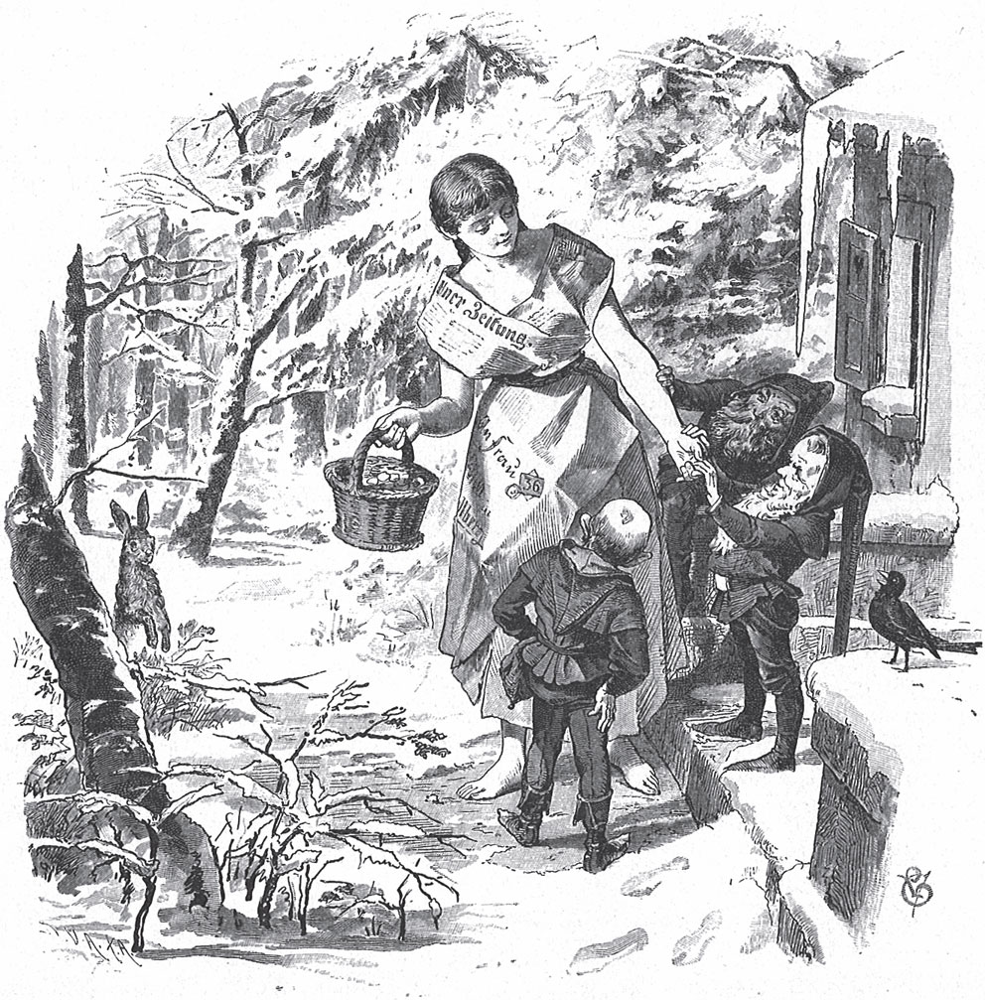

## Die drei Männlein im Walde

Es war einmal ein Mann. Seine Frau ist gestorben. Und es war eine Frau. Ihr Mann ist gestorben. Der Mann hat eine Tochter, und die Frau hat auch eine Tochter. Die Mädchen kennen sich. Sie gehen zusammen spazieren und kommen danach zu der Frau ins Haus. Da sagt die Frau zu der Tochter von dem Mann:

— Hör mal, sag deinem Vater, ich will ihn heiraten. Dann darfst du dich jeden Morgen in Milch waschen und Wein trinken. Meine Tochter aber soll sich in Wasser waschen und Wasser trinken.

Das Mädchen geht nach Hause und erzählt seinem Vater, was die Frau gesagt hat. Der Mann sagt:

— Was soll ich tun? Heiraten ist eine Freude, aber es ist auch eine <abbr title="die Qual, die Qualen — мука, мучение">Qual</abbr>.

Er kann sich nicht <abbr title="sich entscheiden (entschied, hat entschieden) — решаться, принимать решение">entscheiden</abbr>. Endlich zieht er seinen <abbr title="der Stiefel, die Stiefel — сапог">Stiefel</abbr> aus und sagt:

— Nimm diesen Stiefel. Er hat ein Loch in der <abbr title="die Sohle, die Sohlen — подошва">Sohle</abbr>. Geh damit auf den <abbr title="der Dachboden, die Dachböden — чердак">Dachboden</abbr>, häng ihn an den großen Nagel und <abbr title="gießen (goss, hat gegossen) — лить, наливать">gieß</abbr> dann Wasser hinein. Wenn das Wasser im Stiefel bleibt, nehme ich wieder eine Frau. Wenn es aber <abbr title="durchlaufen (lief durch, ist durchgelaufen) — протекать">durchläuft</abbr>, dann nicht.

Das Mädchen tut, was der Vater gesagt hat. Aber das Wasser zieht das Loch zusammen, und der Stiefel wird voll bis oben. Das Mädchen erzählt dem Vater, wie es <abbr title="ausgehen (ging aus, ist ausgegangen) — окончиться, кончиться (чем-то)">ausgegangen</abbr> ist. Da steigt er selbst hinauf. Er sieht: Es stimmt. Da geht er zu der <abbr title="die Witwe, die Witwen — вдова">Witwe</abbr> und macht ihr einen <abbr title="der Heiratsantrag, die Heiratsanträge — предложение руки и сердца">Heiratsantrag</abbr>. Und man feiert Hochzeit.

Am nächsten Morgen stehen die beiden Mädchen auf. Da steht vor der Tochter von dem Mann Milch zum Waschen und Wein zum Trinken. Vor der Tochter von der Frau aber steht Wasser zum Waschen und Wasser zum Trinken. Am zweiten Morgen steht Wasser zum Waschen und Wasser zum Trinken vor der Tochter von dem Mann und genauso vor der Tochter von der Frau. Und am dritten Morgen steht Wasser zum Waschen und Wasser zum Trinken vor der Tochter von dem Mann, und Milch zum Waschen und Wein zum Trinken vor der Tochter von der Frau. Und dabei bleibt es.

Die Frau <abbr title="hassen — ненавидеть">hasst</abbr> ihre <abbr title="die Stieftochter, die Stieftöchter — падчерица">Stieftochter</abbr> <abbr title="jemanden hassen wie die Pest — ненавидеть лютой ненавистью">wie die Pest</abbr>. Jeden Tag überlegt sie, wie sie es ihr noch schlimmer machen kann. Sie ist auch <abbr title="neidisch — завистливый">neidisch</abbr>. Denn ihre Stieftochter ist schön und lieblich, ihre eigene Tochter aber ist hässlich und <abbr title="widerlich — противный, отвратительный">widerlich</abbr>.

Einmal im Winter ist alles steinhart gefroren. Berg und <abbr title="das Tal, die Täler — долина">Tal</abbr> liegen voll Schnee. Da macht die Frau ein Kleid aus Papier. Sie ruft das Mädchen und sagt:

— Da, zieh das Kleid an. Geh hinaus in den Wald und hol mir ein <abbr title="das Körbchen, die Körbchen — корзинка">Körbchen</abbr> voll <abbr title="die Erdbeere, die Erdbeeren — земляника, клубника">Erdbeeren</abbr>. Ich habe <abbr title="Lust haben auf + Akk. — хотеть чего-то">Lust</abbr> darauf.

— Du lieber Gott, — sagt das Mädchen, — im Winter wachsen doch keine Erdbeeren! Die Erde ist gefroren, und der Schnee hat alles zugedeckt. Und warum soll ich in dem <abbr title="das Papierkleid, die Papierkleider — бумажное платье">Papierkleid</abbr> gehen? Draußen ist es so kalt, dass einem der <abbr title="der Atem — дыхание">Atem</abbr> <abbr title="gefrieren (gefror, ist gefroren) — замерзать">gefriert</abbr>. Da <abbr title="wehen — дуть, веять">weht</abbr> doch der Wind hindurch, und die Dornen reißen es mir vom Leib.

— Willst du mir noch <abbr title="widersprechen (widersprach, hat widersprochen) — возражать, перечить">widersprechen</abbr>? — sagt die Stiefmutter. — Mach, dass du <abbr title="fortkommen — убираться">fortkommst</abbr>! Und komm mir nicht wieder unter die Augen, bis du das Körbchen voll Erdbeeren hast.

Dann gibt sie ihr noch ein Stückchen hartes Brot und sagt:

— Davon kannst du den ganzen Tag essen.

Und sie denkt: «Draußen wird sie <abbr title="erfrieren (erfror, ist erfroren) — замёрзнуть насмерть">erfrieren</abbr> und <abbr title="verhungern — умереть с голоду">verhungern</abbr>. Dann sehe ich sie nie wieder.»

Das Mädchen ist gehorsam. Sie zieht das Papierkleid an und geht mit dem Körbchen hinaus. Überall ist nur Schnee, so weit man sieht. Kein grünes <abbr title="das Hälmchen, die Hälmchen — травинка, былинка">Hälmchen</abbr> ist zu sehen. Sie kommt in den Wald. Da sieht sie ein kleines Häuschen. Aus dem Fenster <abbr title="gucken — выглядывать, смотреть">gucken</abbr> drei kleine <abbr title="das Männlein, die Männlein — человечек">Männlein</abbr>. Sie <abbr title="grüßen — здороваться">grüßt</abbr> sie freundlich und klopft <abbr title="bescheiden — скромно">bescheiden</abbr> an die Tür. Die Männlein rufen: «Herein!» Sie geht ins Zimmer und setzt sich auf die Bank am Ofen. Sie will sich wärmen und ihr Frühstück essen. Die Männlein sagen:

— Gib uns auch etwas davon.

— Gern, — sagt sie. Sie <abbr title="teilen — делить">teilt</abbr> ihr Stückchen Brot in zwei Teile und gibt ihnen die <abbr title="die Hälfte, die Hälften — половина">Hälfte</abbr>.

Die Männlein fragen:

— Was willst du im Winter in deinem dünnen Kleidchen hier im Wald?

— Ach, — antwortet sie, — ich soll ein Körbchen voll Erdbeeren suchen. Und ich darf erst nach Hause kommen, wenn ich es mitbringe.

Als sie ihr Brot gegessen hat, geben die Männlein ihr einen <abbr title="der Besen, die Besen — метла, веник">Besen</abbr> und sagen:

— <abbr title="kehren — мести, подметать">Kehr</abbr> damit an der <abbr title="die Hintertür, die Hintertüren — задняя дверь, чёрный ход">Hintertür</abbr> den Schnee weg.

Als sie draußen ist, sagen die drei Männlein zueinander:

— Was sollen wir ihr schenken? Sie ist so <abbr title="artig — послушный, благонравный">artig</abbr> und gut und hat ihr Brot mit uns geteilt.

Da sagt der erste:

— Ich schenke ihr, dass sie jeden Tag schöner wird.

Der zweite sagt:

— Ich schenke ihr, dass ihr bei jedem Wort ein <abbr title="das Goldstück, die Goldstücke — золотая монета">Goldstück</abbr> aus dem Mund fällt.

Der dritte sagt:

— Ich schenke ihr, dass ein König kommt und sie zu seiner Gemahlin nimmt.

Das Mädchen aber tut, was die Männlein gesagt haben. Sie kehrt mit dem Besen den Schnee hinter dem kleinen Haus weg. Und was glaubt ihr, was sie findet? Lauter reife Erdbeeren! Sie kommen ganz dunkelrot aus dem Schnee hervor. Vor Freude <abbr title="raffen — хватать, сгребать">rafft</abbr> sie ihr Körbchen voll. Sie dankt den kleinen Männern, gibt jedem die Hand und läuft nach Hause. Sie will der Stiefmutter bringen, was sie verlangt hat. Sie kommt herein und sagt: «Guten Abend.» Da fällt ihr gleich ein Goldstück aus dem Mund. Dann erzählt sie, was ihr im Wald passiert ist. Aber bei jedem Wort fallen ihr Goldstücke aus dem Mund. Bald ist das ganze Zimmer voll davon.

— Na, seht euch diesen <abbr title="der Übermut — заносчивость, озорство">Übermut</abbr> an! — ruft die <abbr title="die Stiefschwester, die Stiefschwestern — сводная сестра">Stiefschwester</abbr>. — Wie sie das Geld so <abbr title="hinwerfen (warf hin, hat hingeworfen) — бросать, швырять">hinwirft</abbr>!

Aber heimlich ist sie neidisch. Sie will auch hinaus in den Wald und Erdbeeren suchen. Die Mutter sagt:

— Nein, mein liebes Töchterchen, es ist zu kalt. Du kannst mir erfrieren.

Aber die Tochter lässt ihr keine Ruhe. Da <abbr title="nachgeben (gab nach, hat nachgegeben) — уступать">gibt</abbr> die Mutter endlich nach. Sie <abbr title="nähen — шить">näht</abbr> ihr einen prächtigen <abbr title="der Pelzmantel, die Pelzmäntel — шуба">Pelzmantel</abbr>, und die Tochter muss ihn anziehen. Sie gibt ihr <abbr title="das Butterbrot, die Butterbrote — бутерброд, хлеб с маслом">Butterbrot</abbr> und <abbr title="der Kuchen, die Kuchen — пирог">Kuchen</abbr> mit auf den Weg.

Das Mädchen geht in den Wald und direkt auf das kleine Häuschen zu. Die drei kleinen Männlein gucken wieder heraus. Aber sie grüßt sie nicht. Sie sieht sich nicht nach ihnen um. Sie <abbr title="stolpern — спотыкаться; ввалиться">stolpert</abbr> einfach ins Zimmer hinein, setzt sich an den Ofen und fängt an, ihr Butterbrot und ihren Kuchen zu essen.

— Gib uns etwas davon, — rufen die Kleinen.

Aber sie antwortet:

— Es <abbr title="reichen — хватать">reicht</abbr> ja nicht einmal für mich selbst. Wie kann ich da noch anderen etwas <abbr title="abgeben (gab ab, hat abgegeben) — отдавать, делиться">abgeben</abbr>?

Als sie mit dem Essen fertig ist, sagen die Männlein:

— Da hast du einen Besen. Kehr uns draußen vor der Hintertür sauber.

— Ach was, kehrt doch selbst! — antwortet sie. — Ich bin nicht eure <abbr title="die Magd, die Mägde — служанка, батрачка">Magd</abbr>.

Sie sieht, dass die Männlein ihr nichts schenken wollen. Da geht sie zur Tür hinaus. Die kleinen Männer sagen zueinander:

— Was sollen wir ihr schenken? Sie ist so <abbr title="unartig — невоспитанный, непослушный">unartig</abbr> und hat ein böses, neidisches Herz. Sie <abbr title="gönnen — желать добра; не жалеть для кого-то">gönnt</abbr> niemandem etwas.

Der erste sagt:

— Ich schenke ihr, dass sie jeden Tag hässlicher wird.

Der zweite sagt:

— Ich schenke ihr, dass ihr bei jedem Wort eine <abbr title="die Kröte, die Kröten — жаба">Kröte</abbr> aus dem Mund springt.

Der dritte sagt:

— Ich schenke ihr, dass sie einen unglücklichen Tod stirbt.

Das Mädchen sucht draußen nach Erdbeeren. Aber sie findet keine und geht verdrießlich nach Hause. Sie macht den Mund auf und will ihrer Mutter erzählen, was ihr im Wald passiert ist. Da springt ihr bei jedem Wort eine Kröte aus dem Mund. Alle <abbr title="sich ekeln vor + Dat. — испытывать отвращение к">ekeln sich</abbr> vor ihr.

Jetzt <abbr title="sich ärgern — злиться">ärgert sich</abbr> die Stiefmutter noch viel mehr. Sie denkt nur noch daran, wie sie der Tochter von dem Mann Kummer machen kann. Und die Schönheit von dem Mädchen wird doch jeden Tag größer! Endlich nimmt die Stiefmutter einen <abbr title="der Kessel, die Kessel — котёл">Kessel</abbr>, stellt ihn ans Feuer und kocht darin <abbr title="das Garn, die Garne — пряжа, нитки">Garn</abbr>. Als das Garn gekocht ist, hängt sie es dem armen Mädchen über die Schulter. Dazu gibt sie ihr eine Axt. Damit soll das Mädchen auf den gefrorenen <abbr title="der Fluss, die Flüsse — река">Fluss</abbr> gehen, ein <abbr title="das Eisloch, die Eislöcher — прорубь">Eisloch</abbr> hacken und das Garn <abbr title="spülen — полоскать">spülen</abbr>.

Das Mädchen ist gehorsam. Sie geht hin und hackt ein Loch in das Eis. Sie ist mitten bei der Arbeit, da kommt ein prächtiger Wagen gefahren. Darin sitzt der König. Der Wagen hält an, und der König fragt:

— Mein Kind, wer bist du, und was machst du da?

— Ich bin ein armes Mädchen und spüle Garn.

Da hat der König Mitleid mit ihr. Und er sieht, wie schön sie ist. Da sagt er:

— Willst du mit mir fahren?

— Ach ja, von Herzen gern, — antwortet sie. Denn sie ist froh, dass sie von der Mutter und der Schwester wegkommt.

Also steigt sie in den Wagen und fährt mit dem König fort. Sie kommen auf sein Schloss, und man feiert die Hochzeit mit großer Pracht. So haben es die kleinen Männlein dem Mädchen geschenkt.

Nach einem Jahr bekommt die junge Königin einen Sohn. Die Stiefmutter hört von dem großen Glück. Da kommt sie mit ihrer Tochter ins Schloss und tut so, als will sie einen <abbr title="der Besuch, die Besuche — визит, посещение">Besuch</abbr> machen. Einmal ist der König hinausgegangen, und sonst ist niemand da. Da packt die böse Frau die Königin am Kopf, und ihre Tochter packt sie an den Füßen. Sie heben sie aus dem Bett und werfen sie zum Fenster hinaus in den <abbr title="der Strom, die Ströme — река, поток">Strom</abbr>, der am Schloss vorbeifließt. Dann legt sich die hässliche Tochter ins Bett, und die Alte deckt sie bis über den Kopf zu.

Der König kommt zurück und will mit seiner Frau sprechen. Da ruft die Alte:

— Still, still, jetzt geht das nicht! Sie liegt in starkem <abbr title="der Schweiß — пот">Schweiß</abbr>. Ihr müsst sie heute ruhen lassen.

Der König denkt nichts Böses dabei. Er kommt erst am nächsten Morgen wieder. Er spricht mit seiner Frau, und sie gibt ihm Antwort. Aber bei jedem Wort springt eine Kröte heraus. Früher ist immer ein Goldstück herausgefallen! Er fragt, was das ist. Aber die Alte sagt, das kommt von dem starken Schweiß. Das geht bald wieder weg.

In der Nacht aber sieht der <abbr title="der Küchenjunge, die Küchenjungen — поварёнок">Küchenjunge</abbr>, wie eine Ente durch die <abbr title="die Gosse, die Gossen — сточная канава, водосток">Gosse</abbr> geschwommen kommt. Die Ente sagt:

> «König, was machst du?  
> Schläfst du oder wachst du?»

Er gibt keine Antwort. Da sagt sie:

«Was machen meine Gäste?»

Da antwortet der Küchenjunge:

«Sie schlafen <abbr title="feste (veraltet) — крепко">feste</abbr>.»

Sie fragt weiter:

«Was macht mein <abbr title="das Kindelein — дитятко, младенец">Kindelein</abbr>?»

Er antwortet:

«Es schläft in der Wiege fein.»

Da geht sie in der Gestalt von der Königin hinauf. Sie gibt dem Kind zu trinken, schüttelt sein Bettchen auf und deckt es zu. Dann schwimmt sie als Ente wieder durch die Gosse davon. So kommt sie zwei Nächte. In der dritten Nacht sagt sie zu dem Küchenjungen:

— Geh und sag dem König: Er soll sein Schwert nehmen und es auf der Schwelle dreimal über mir <abbr title="schwingen (schwang, hat geschwungen) — взмахивать, размахивать">schwingen</abbr>.

Da läuft der Küchenjunge und sagt es dem König. Der König kommt mit seinem Schwert und schwingt es dreimal über dem Geist. Und beim dritten Mal steht seine Gemahlin vor ihm, frisch, lebendig und gesund, so wie sie vorher war.

Jetzt ist der König voller Freude. Aber er versteckt die Königin in einer Kammer bis zum Sonntag. Denn am Sonntag ist die Taufe von dem Kind. Nach der Taufe sagt der König:

— Was verdient ein Mensch, der einen anderen aus dem Bett trägt und ins Wasser wirft?

— Nichts Besseres, — antwortet die Alte, — als dass man den Bösewicht in ein Fass steckt, das innen voller Nägel ist. Und dann rollt man es den Berg hinunter ins Wasser.

Da sagt der König:

— Du hast dein eigenes Urteil gesprochen.

Er lässt so ein Fass holen und die Alte mit ihrer Tochter hineinstecken. Man <abbr title="zuhämmern — заколачивать">hämmert</abbr> den Deckel zu, und das Fass <abbr title="kullern — катиться">kullert</abbr> den Berg hinunter, bis es in den Fluss rollt.

---

### Neue Wörter

- **die Qual, die Qualen** — мука, мучение
- **sich entscheiden (entschied, hat entschieden)** — решаться, принимать решение
- **der Stiefel, die Stiefel** — сапог
- **die Sohle, die Sohlen** — подошва
- **der Dachboden, die Dachböden** — чердак
- **gießen (goss, hat gegossen)** — лить, наливать
- **durchlaufen (lief durch, ist durchgelaufen)** — протекать
- **ausgehen (ging aus, ist ausgegangen)** — окончиться, кончиться (чем-то)
- **die Witwe, die Witwen** — вдова
- **der Heiratsantrag, die Heiratsanträge** — предложение руки и сердца
- **hassen** — ненавидеть
- **die Stieftochter, die Stieftöchter** — падчерица
- **jemanden hassen wie die Pest** — ненавидеть лютой ненавистью
- **neidisch** — завистливый
- **widerlich** — противный, отвратительный
- **das Tal, die Täler** — долина
- **das Körbchen, die Körbchen** — корзинка
- **die Erdbeere, die Erdbeeren** — земляника, клубника
- **Lust haben auf + Akk.** — хотеть чего-то
- **das Papierkleid, die Papierkleider** — бумажное платье
- **der Atem** — дыхание
- **gefrieren (gefror, ist gefroren)** — замерзать
- **wehen** — дуть, веять
- **widersprechen (widersprach, hat widersprochen)** — возражать, перечить
- **fortkommen** — убираться
- **erfrieren (erfror, ist erfroren)** — замёрзнуть насмерть
- **verhungern** — умереть с голоду
- **das Hälmchen, die Hälmchen** — травинка, былинка
- **gucken** — выглядывать, смотреть
- **das Männlein, die Männlein** — человечек
- **grüßen** — здороваться
- **bescheiden** — скромно
- **teilen** — делить
- **die Hälfte, die Hälften** — половина
- **der Besen, die Besen** — метла, веник
- **kehren** — мести, подметать
- **die Hintertür, die Hintertüren** — задняя дверь, чёрный ход
- **artig** — послушный, благонравный
- **das Goldstück, die Goldstücke** — золотая монета
- **raffen** — хватать, сгребать
- **der Übermut** — заносчивость, озорство
- **die Stiefschwester, die Stiefschwestern** — сводная сестра
- **hinwerfen (warf hin, hat hingeworfen)** — бросать, швырять
- **nachgeben (gab nach, hat nachgegeben)** — уступать
- **nähen** — шить
- **der Pelzmantel, die Pelzmäntel** — шуба
- **das Butterbrot, die Butterbrote** — бутерброд, хлеб с маслом
- **der Kuchen, die Kuchen** — пирог
- **stolpern** — спотыкаться; ввалиться
- **reichen** — хватать
- **abgeben (gab ab, hat abgegeben)** — отдавать, делиться
- **die Magd, die Mägde** — служанка, батрачка
- **unartig** — невоспитанный, непослушный
- **gönnen** — желать добра; не жалеть для кого-то
- **die Kröte, die Kröten** — жаба
- **sich ekeln vor + Dat.** — испытывать отвращение к
- **sich ärgern** — злиться
- **der Kessel, die Kessel** — котёл
- **das Garn, die Garne** — пряжа, нитки
- **der Fluss, die Flüsse** — река
- **das Eisloch, die Eislöcher** — прорубь
- **spülen** — полоскать
- **der Besuch, die Besuche** — визит, посещение
- **der Strom, die Ströme** — река, поток
- **der Schweiß** — пот
- **der Küchenjunge, die Küchenjungen** — поварёнок
- **die Gosse, die Gossen** — сточная канава, водосток
- **feste (veraltet)** — крепко
- **das Kindelein** — дитятко, младенец
- **schwingen (schwang, hat geschwungen)** — взмахивать, размахивать
- **zuhämmern** — заколачивать
- **kullern** — катиться

[← Zurück](kapitel-12.md) · [Inhalt](README.md)
