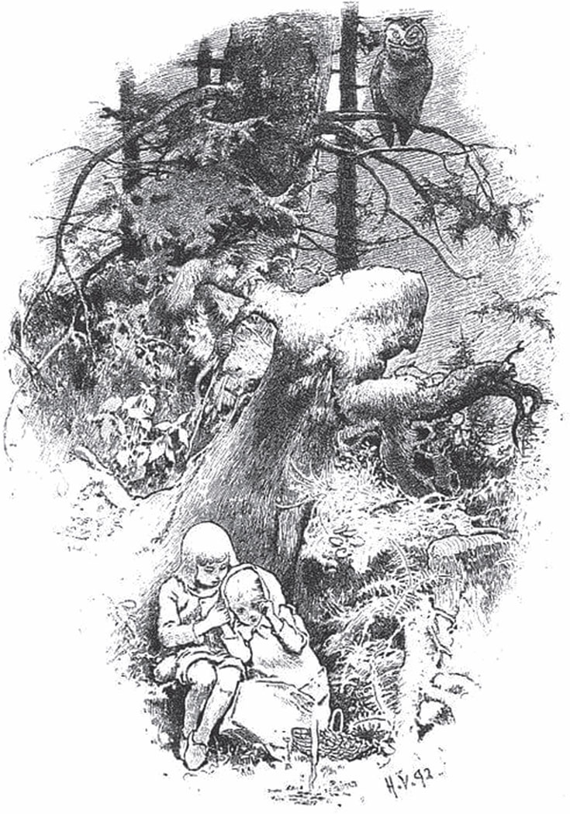
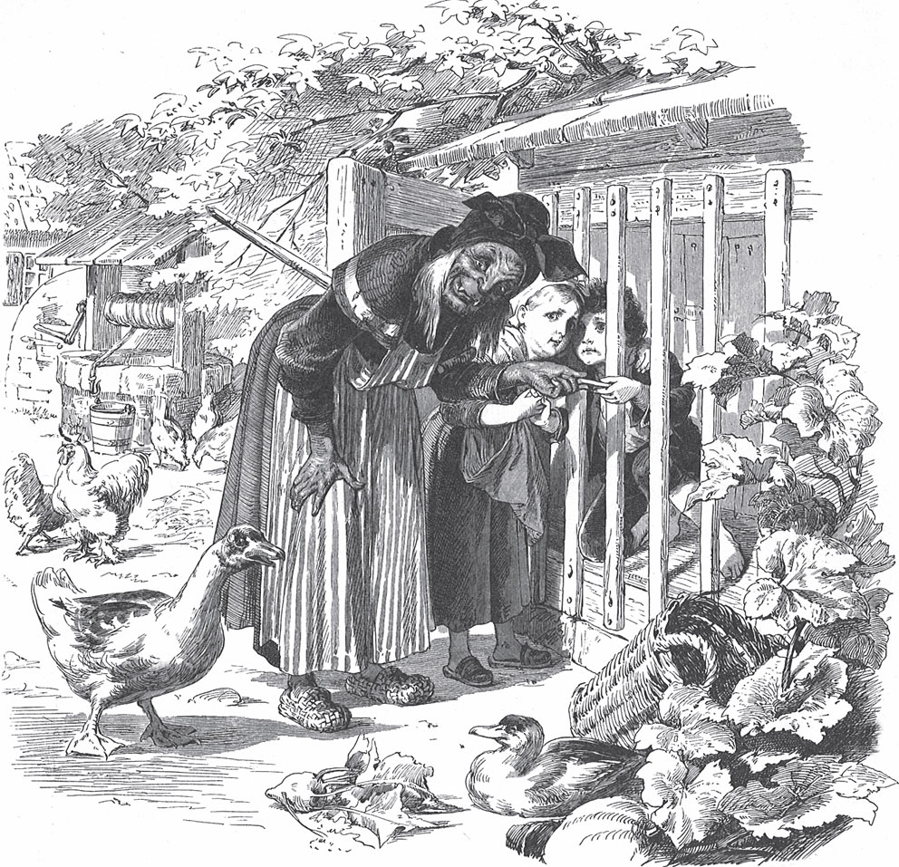

## Hänsel und Gretel

Vor einem großen Wald wohnt ein armer Holzfäller mit seiner Frau und seinen zwei Kindern. Der Junge heißt Hänsel und das Mädchen Gretel. Der Mann hat nur wenig zu essen. Und einmal kommt eine große <abbr title="die Teuerung, die Teuerungen — дороговизна, голодные времена">Teuerung</abbr> ins Land. Da kann er nicht einmal mehr das tägliche Brot kaufen. Am Abend liegt er im Bett und macht sich Sorgen. Er <abbr title="sich wälzen — ворочаться">wälzt sich</abbr> hin und her. Dann seufzt er und sagt zu seiner Frau:

— Was soll aus uns werden? Wie sollen wir unsere armen Kinder <abbr title="ernähren — кормить, прокормить">ernähren</abbr>? Wir haben ja selbst nichts mehr.

— Weißt du was, Mann, — antwortet die Frau, — morgen ganz früh führen wir die Kinder hinaus in den Wald, wo er am dichtesten ist. Dort machen wir ihnen ein Feuer und geben jedem noch ein Stückchen Brot. Dann gehen wir an unsere Arbeit und lassen sie allein. Sie finden den Weg nach Hause nicht wieder, und wir sind sie <abbr title="jemanden los sein — избавиться от кого-то">los</abbr>.

— Nein, Frau, — sagt der Mann, — das tue ich nicht. Wie soll ich das <abbr title="etwas übers Herz bringen — решиться на что-то, найти в себе силы">übers Herz bringen</abbr>? Meine Kinder allein im Wald! Bald kommen die wilden Tiere und zerreißen sie.

— Oh, du Narr! — sagt sie. — Dann müssen wir alle vier verhungern. Dann kannst du schon die <abbr title="das Brett, die Bretter — доска">Bretter</abbr> für die Särge <abbr title="hobeln — строгать">hobeln</abbr>.

Sie lässt ihm keine Ruhe, bis er einwilligt.

— Aber die armen Kinder <abbr title="jemandem leidtun — быть жаль кого-то">tun mir leid</abbr>, — sagt der Mann.

Die zwei Kinder können vor Hunger auch nicht einschlafen. Sie haben gehört, was die Stiefmutter zum Vater gesagt hat. Gretel weint <abbr title="bitter — горький">bittere</abbr> Tränen und sagt zu Hänsel:

— Jetzt ist es aus mit uns.

— Still, Gretel, — sagt Hänsel, — sei nicht traurig. Ich helfe uns schon.

Die Eltern schlafen ein. Da steht Hänsel auf, zieht sein <abbr title="das Jäckchen, die Jäckchen — курточка">Jäckchen</abbr> an, macht die untere Hälfte von der Tür auf und <abbr title="sich schleichen (schlich, ist geschlichen) — прокрасться">schleicht sich</abbr> hinaus. Der Mond scheint ganz hell. Die weißen <abbr title="der Kieselstein, die Kieselsteine — галька, камешек">Kieselsteine</abbr> vor dem Haus glänzen wie lauter <abbr title="die Silbermünze, die Silbermünzen — серебряная монета">Silbermünzen</abbr>. Hänsel <abbr title="sich bücken — нагибаться">bückt sich</abbr> und steckt so viele in seine <abbr title="die Jackentasche, die Jackentaschen — карман куртки">Jackentasche</abbr>, wie nur hineinpassen. Dann geht er wieder zurück und sagt zu Gretel:

— Sei getrost, liebes Schwesterchen, und schlaf nur ruhig ein. Gott verlässt uns nicht.

Und er legt sich wieder in sein Bett.

Es wird gerade Tag, die Sonne ist noch nicht aufgegangen. Da kommt schon die Frau und weckt die beiden Kinder:

— Steht auf, ihr <abbr title="der Faulenzer, die Faulenzer — лентяй, бездельник">Faulenzer</abbr>! Wir gehen in den Wald und holen Holz.

Dann gibt sie jedem ein Stückchen Brot und sagt:

— Da habt ihr etwas für den Mittag. Aber esst es nicht vorher auf, mehr bekommt ihr nicht.

Gretel nimmt das Brot unter ihre Schürze, denn Hänsel hat ja die Steine in der Tasche. Dann gehen sie alle zusammen los in den Wald. Nach einem <abbr title="das Weilchen — некоторое время, чуть-чуть">Weilchen</abbr> bleibt Hänsel stehen und guckt zum Haus zurück. Und das macht er wieder und immer wieder. Der Vater sagt:

— Hänsel, was guckst du da und bleibst zurück? Pass auf und vergiss deine Beine nicht!

— Ach, Vater, — sagt Hänsel, — ich sehe nach meinem weißen <abbr title="das Kätzchen, die Kätzchen — котёнок">Kätzchen</abbr>. Es sitzt oben auf dem Dach und will mir <abbr title="ade — прощай">Ade</abbr> sagen.

Die Frau sagt:

— Narr, das ist nicht dein Kätzchen. Das ist die <abbr title="die Morgensonne — утреннее солнце">Morgensonne</abbr>, die auf den Schornstein scheint.

Aber Hänsel hat gar nicht nach dem Kätzchen gesehen. Er hat jedes Mal einen von den <abbr title="blank — блестящий, гладкий">blanken</abbr> Kieselsteinen aus seiner Tasche auf den Weg geworfen.

Sie kommen mitten in den Wald. Da sagt der Vater:

— Jetzt sammelt Holz, Kinder. Ich mache ein Feuer, dann friert ihr nicht.

Hänsel und Gretel tragen <abbr title="das Reisig — хворост">Reisig</abbr> zusammen, so hoch wie ein kleiner Berg. Der Vater zündet das Reisig an. Als die Flamme richtig hoch brennt, sagt die Frau:

— Jetzt legt euch ans Feuer, Kinder, und ruht euch aus. Wir gehen in den Wald und hacken Holz. Wenn wir fertig sind, kommen wir wieder und holen euch ab.

Hänsel und Gretel sitzen am Feuer. Mittags isst jedes sein Stückchen Brot. Sie hören die Schläge von einer Axt. Deshalb glauben sie: Der Vater ist in der Nähe. Aber das ist nicht die Axt. Es ist ein Ast. Der Vater hat ihn an einen <abbr title="dürr — сухой, засохший">dürren</abbr> Baum gebunden, und der Wind schlägt ihn hin und her. Sie sitzen lange da. Dann fallen ihnen vor <abbr title="die Müdigkeit — усталость">Müdigkeit</abbr> die Augen zu, und sie schlafen fest ein. Als sie endlich aufwachen, ist es schon <abbr title="finster — тёмный, мрачный">finstere</abbr> Nacht. Gretel fängt an zu weinen und sagt:

— Wie sollen wir jetzt aus dem Wald herauskommen?

Aber Hänsel tröstet sie:

— Wart nur ein Weilchen, bis der Mond aufgeht. Dann finden wir den Weg schon.

Der volle Mond geht auf. Da nimmt Hänsel sein Schwesterchen an die Hand und geht den Kieselsteinen nach. Sie <abbr title="schimmern — мерцать, поблёскивать">schimmern</abbr> wie neue Silbermünzen und zeigen ihnen den Weg. Die Kinder gehen die ganze Nacht. Am Morgen kommen sie wieder zum Haus von ihrem Vater. Sie klopfen an die Tür. Die Frau macht auf und sieht Hänsel und Gretel. Da sagt sie:

— Ihr bösen Kinder, warum habt ihr so lange im Wald geschlafen? Wir haben schon geglaubt, ihr wollt gar nicht mehr wiederkommen.

Der Vater aber freut sich. Denn es hat ihm sehr wehgetan, dass er sie so allein im Wald gelassen hat.

Nicht lange danach ist wieder überall Not. Und die Kinder hören, wie die Mutter nachts im Bett zum Vater sagt:

— Alles ist wieder aufgegessen. Wir haben noch einen halben <abbr title="der Laib, die Laibe — каравай, буханка">Laib</abbr> Brot, dann ist <abbr title="der Schluss — конец">Schluss</abbr>. Die Kinder müssen fort! Wir führen sie tiefer in den Wald hinein. Dann finden sie den Weg nicht mehr heraus. Sonst gibt es keine Rettung für uns.

Das <abbr title="schwer auf dem Herzen liegen — тяжело лежать на сердце">liegt</abbr> dem Mann schwer auf dem Herzen. Er denkt: «Ich soll lieber den letzten Bissen mit meinen Kindern teilen.» Aber die Frau hört nicht auf ihn. Sie schimpft mit ihm und macht ihm Vorwürfe. <abbr title="Wer A sagt, muss auch B sagen — назвался груздем – полезай в кузов">Wer A sagt, muss auch B sagen</abbr>. Er hat das erste Mal nachgegeben, also muss er auch das zweite Mal nachgeben.

Die Kinder sind aber noch wach und hören das Gespräch. Als die Eltern schlafen, steht Hänsel wieder auf. Er will hinaus und Kieselsteine <abbr title="auflesen (las auf, hat aufgelesen) — подбирать, собирать">auflesen</abbr> wie beim letzten Mal. Aber die Frau hat die Tür <abbr title="abschließen (schloss ab, hat abgeschlossen) — запирать на ключ">abgeschlossen</abbr>, und Hänsel kann nicht hinaus. Trotzdem tröstet er sein Schwesterchen und sagt:

— Weine nicht, Gretel, und schlaf nur ruhig. Der liebe Gott hilft uns schon.

Am frühen Morgen kommt die Frau und holt die Kinder aus dem Bett. Sie bekommen ihr Stückchen Brot, aber es ist noch kleiner als beim letzten Mal. Auf dem Weg in den Wald <abbr title="zerbröckeln — крошить">zerbröckelt</abbr> Hänsel das Brot in der Tasche. Oft bleibt er stehen und wirft ein <abbr title="das Bröckchen, die Bröckchen — крошка, кусочек">Bröckchen</abbr> auf die Erde.

— Hänsel, was bleibst du stehen und guckst dich um? — sagt der Vater. — Geh weiter!

— Ich sehe nach meinem Täubchen. Es sitzt auf dem Dach und will mir Ade sagen, — antwortet Hänsel.

— Narr, — sagt die Frau, — das ist nicht dein Täubchen. Das ist die Morgensonne, die oben auf den Schornstein scheint.

Hänsel aber wirft <abbr title="nach und nach — постепенно, понемногу">nach und nach</abbr> alle Bröckchen auf den Weg.

Die Frau führt die Kinder noch tiefer in den Wald. Dort waren sie in ihrem ganzen Leben noch nicht. Wieder macht man ein großes Feuer, und die Mutter sagt:

— Bleibt nur hier sitzen, Kinder. Wenn ihr müde seid, könnt ihr ein bisschen schlafen. Wir gehen in den Wald und hacken Holz. Am Abend, wenn wir fertig sind, kommen wir und holen euch ab.

Mittags teilt Gretel ihr Brot mit Hänsel, denn er hat sein Stück auf den Weg gestreut. Dann schlafen sie ein. Der Abend vergeht, aber niemand kommt zu den armen Kindern. Sie wachen erst in der finsteren Nacht auf. Hänsel tröstet sein Schwesterchen und sagt:

— Wart nur, Gretel, bis der Mond aufgeht. Dann sehen wir die Brotbröckchen, die ich gestreut habe. Die zeigen uns den Weg nach Hause.

Der Mond kommt, und sie gehen los. Aber sie finden kein Bröckchen mehr. Denn die vielen tausend Vögel im Wald und auf dem Feld haben sie <abbr title="wegpicken — склевать">weggepickt</abbr>. Hänsel sagt zu Gretel:

— Wir finden den Weg schon.

Aber sie finden ihn nicht. Sie gehen die ganze Nacht und noch einen Tag von morgens bis abends. Aber sie kommen nicht aus dem Wald heraus. Sie sind so hungrig, denn sie haben nur ein paar Beeren gegessen, die am Boden wachsen. Und sie sind so müde, dass die Beine sie nicht mehr tragen. Da legen sie sich unter einen Baum und schlafen ein.

Jetzt ist es schon der dritte Morgen ohne das Haus von ihrem Vater. Sie gehen wieder los. Aber sie kommen immer tiefer in den Wald. Wenn nicht bald Hilfe kommt, dann müssen sie sterben. Am Mittag sehen sie einen schönen, <abbr title="schneeweiß — белоснежный">schneeweißen</abbr> Vogel auf einem Ast. Er singt so schön, dass sie stehen bleiben und ihm zuhören. Als er fertig ist, <abbr title="ausbreiten — расправлять">breitet</abbr> er seine <abbr title="der Flügel, die Flügel — крыло">Flügel</abbr> aus und fliegt vor ihnen her. Sie gehen ihm nach. So kommen sie zu einem Häuschen, und der Vogel setzt sich auf das Dach. Die Kinder kommen ganz nah heran. Da sehen sie: Das Häuschen ist aus Brot gebaut, und das Dach ist aus Kuchen. Die Fenster aber sind aus hellem <abbr title="der Zucker — сахар">Zucker</abbr>.

— Da machen wir uns <abbr title="sich an etwas machen — приняться за что-то">dran</abbr>, — sagt Hänsel, — und halten eine <abbr title="gesegnet — благословенный; здесь: славный, сытный">gesegnete</abbr> <abbr title="die Mahlzeit, die Mahlzeiten — трапеза, еда">Mahlzeit</abbr>. Ich esse ein Stück vom Dach. Gretel, du kannst vom Fenster essen, das schmeckt süß.

Hänsel greift nach oben und bricht sich ein bisschen vom Dach ab. Er will probieren, wie es schmeckt. Gretel stellt sich an die <abbr title="die Fensterscheibe, die Fensterscheiben — оконное стекло">Fensterscheiben</abbr> und <abbr title="knuspern — хрустеть, грызть">knuspert</abbr> daran. Da ruft eine feine Stimme aus dem Haus:

> «<abbr title="Knusper, knusper, Knäuschen — хрум-хрум, хрусть (присказка)">Knusper, knusper, Knäuschen</abbr>,  
> wer knuspert an meinem Häuschen?»

Die Kinder antworten:

> «Der Wind, der Wind,  
> das <abbr title="himmlisch — небесный">himmlische</abbr> Kind.»

Und sie essen weiter und lassen sich nicht <abbr title="stören — мешать">stören</abbr>. Hänsel schmeckt das Dach sehr gut. Er reißt sich ein großes Stück davon herunter. Gretel stößt eine ganze runde Fensterscheibe heraus, setzt sich hin und lässt sie sich schmecken.

Da geht plötzlich die Tür auf. Eine <abbr title="steinalt — древний, очень старый">steinalte</abbr> Frau kommt herausgeschlichen. Sie <abbr title="sich stützen auf + Akk. — опираться на">stützt sich</abbr> auf eine <abbr title="die Krücke, die Krücken — костыль, клюка">Krücke</abbr>. Hänsel und Gretel erschrecken so sehr, dass sie alles fallen lassen, was sie in den Händen halten. Die Alte aber <abbr title="wackeln — качать, трясти">wackelt</abbr> mit dem Kopf und sagt:

— Ei, ihr lieben Kinder, wer hat euch hierhergebracht? Kommt nur herein und bleibt bei mir. Es geschieht euch nichts Böses.

Sie nimmt beide an der Hand und führt sie in ihr Häuschen. Dort bekommen sie gutes Essen: Milch und <abbr title="der Pfannkuchen, die Pfannkuchen — блин, оладья">Pfannkuchen</abbr> mit Zucker, Äpfel und Nüsse. Danach macht die Alte zwei schöne Bettchen weiß und sauber. Hänsel und Gretel legen sich hinein und glauben, sie sind im Himmel.

Aber die Alte ist nur zum Schein so freundlich. In Wirklichkeit ist sie eine böse Hexe. Sie <abbr title="auflauern + Dat. — подстерегать">lauert</abbr> den Kindern auf. Das Brothäuschen hat sie nur gebaut, weil sie Kinder <abbr title="anlocken — приманивать">anlocken</abbr> will. Wenn ein Kind in ihre Gewalt kommt, dann tötet sie es, kocht es und isst es. Das ist für sie ein <abbr title="der Festtag, die Festtage — праздник">Festtag</abbr>. Die Hexen haben rote Augen und können nicht weit sehen. Aber sie haben eine feine Nase, wie die Tiere, und <abbr title="riechen (roch, hat gerochen) — чуять, нюхать">riechen</abbr> es, wenn Menschen kommen. Als Hänsel und Gretel in ihre Nähe gekommen sind, hat sie <abbr title="boshaft — злобно">boshaft</abbr> gelacht und spöttisch gesagt: «Die habe ich! Die sollen mir nicht mehr <abbr title="entwischen — ускользнуть, улизнуть">entwischen</abbr>!»

Früh am Morgen, die Kinder schlafen noch, steht sie schon auf. Sie sieht die beiden so lieb schlafen, mit ihren vollen roten <abbr title="die Backe, die Backen — щека">Backen</abbr>. Da <abbr title="murmeln — бормотать">murmelt</abbr> sie vor sich hin:

— Das wird ein guter Bissen!

Sie packt Hänsel mit ihrer dürren Hand und trägt ihn in einen kleinen <abbr title="der Stall, die Ställe — хлев, сарайчик">Stall</abbr>. Sie sperrt ihn hinter einer <abbr title="die Gittertür, die Gittertüren — решётчатая дверь">Gittertür</abbr> ein. Er kann schreien, so viel er will – es hilft ihm nichts. Dann geht sie zu Gretel, <abbr title="rütteln — трясти">rüttelt</abbr> sie wach und ruft:

— Steh auf, <abbr title="die Faulenzerin, die Faulenzerinnen — лентяйка">Faulenzerin</abbr>! Trag Wasser und koch deinem Bruder etwas Gutes. Er sitzt draußen im Stall und soll fett werden. Wenn er fett ist, dann esse ich ihn.

Gretel fängt an, bitterlich zu weinen. Aber alles ist vergeblich. Sie muss tun, was die böse Hexe verlangt.

Jetzt kocht man für den armen Hänsel das beste Essen. Gretel aber bekommt nur <abbr title="die Krebsschale, die Krebsschalen — панцирь рака">Krebsschalen</abbr>. Jeden Morgen schleicht die Alte zu dem kleinen Stall und ruft:

— Hänsel, <abbr title="herausstrecken — высовывать, протягивать">streck</abbr> deinen Finger heraus! Ich will fühlen, ob du bald fett bist.

Aber Hänsel streckt ihr ein kleines <abbr title="das Knöchelchen, die Knöchelchen — косточка">Knöchelchen</abbr> heraus. Die Alte hat <abbr title="trüb — мутный, подслеповатый">trübe</abbr> Augen und kann es nicht sehen. Sie glaubt, das ist Hänsels Finger, und wundert sich, dass er gar nicht fett wird. Vier Wochen vergehen, und Hänsel bleibt immer mager. Da wird sie ungeduldig und will nicht länger warten.

— <abbr title="heda! — эй, ты!">Heda</abbr>, Gretel, — ruft sie dem Mädchen zu, — sei flink und trag Wasser! Hänsel kann fett oder mager sein – morgen will ich ihn schlachten und kochen.

Ach, wie jammert das arme Schwesterchen, als es das Wasser tragen muss! Wie fließen ihm die Tränen über die Backen!

— Lieber Gott, hilf uns doch! — ruft sie. — Die wilden Tiere im Wald sollten uns lieber fressen! Dann sterben wir wenigstens zusammen.

— Spar dir dein <abbr title="das Geplärre — нытьё, рёв">Geplärre</abbr>, — sagt die Alte. — Es hilft dir alles nichts.

Früh am Morgen muss Gretel hinaus, den Kessel mit Wasser aufhängen und Feuer machen.

— Zuerst backen wir, — sagt die Alte. — Ich habe den <abbr title="der Backofen, die Backöfen — печь для хлеба">Backofen</abbr> schon <abbr title="heizen — топить, нагревать">geheizt</abbr> und den Teig <abbr title="kneten — месить">geknetet</abbr>.

Sie stößt die arme Gretel hinaus zu dem Backofen. Die Flammen schlagen schon heraus.

— Kriech hinein, — sagt die Hexe, — und sieh nach, ob er heiß genug ist. Dann können wir das Brot hineinschieben.

Wenn Gretel drin ist, will die Hexe den Ofen zumachen. Gretel soll darin <abbr title="braten (briet, hat gebraten) — жарить(ся)">braten</abbr>, und dann will die Hexe sie auch aufessen. Aber Gretel merkt, was sie <abbr title="vorhaben (hatte vor, hat vorgehabt) — замышлять, намереваться">vorhat</abbr>, und sagt:

— Ich weiß nicht, wie ich das machen soll. Wie komme ich da hinein?

— Dumme <abbr title="die Gans, die Gänse — гусыня; дурёха">Gans</abbr>, — sagt die Alte. — Die <abbr title="die Öffnung, die Öffnungen — отверстие">Öffnung</abbr> ist groß genug. Siehst du, ich passe selbst hinein!

Sie <abbr title="krabbeln — ползти, карабкаться">krabbelt</abbr> heran und steckt den Kopf in den Backofen. Da gibt Gretel ihr einen <abbr title="der Stoß, die Stöße — толчок">Stoß</abbr>, und die Hexe fliegt weit hinein. Gretel macht die eiserne Tür zu und schiebt den <abbr title="der Riegel, die Riegel — засов, задвижка">Riegel</abbr> vor. Hu! Da fängt die Hexe an zu heulen, ganz <abbr title="grauslich — жутко">grauslich</abbr>! Aber Gretel läuft fort, und die gottlose Hexe muss <abbr title="elendig — жалко, мучительно">elendig</abbr> verbrennen.

Gretel läuft <abbr title="schnurstracks — прямиком, без оглядки">schnurstracks</abbr> zu Hänsel. Sie öffnet seinen kleinen Stall und ruft:

— Hänsel, wir sind erlöst! Die alte Hexe ist tot!

Da springt Hänsel heraus wie ein Vogel aus dem <abbr title="der Käfig, die Käfige — клетка">Käfig</abbr>, wenn man ihm die Tür aufmacht. Wie freuen sie sich! Sie fallen sich um den Hals, springen herum und küssen sich. Jetzt müssen sie keine Angst mehr haben. Deshalb gehen sie in das Haus von der Hexe hinein. Dort stehen in allen Ecken Kästen mit Perlen und Edelsteinen.

— Die sind noch besser als Kieselsteine, — sagt Hänsel und steckt in seine Taschen, so viel hineinpasst.

Und Gretel sagt:

— Ich will auch etwas mit nach Hause bringen.

Und sie füllt sich ihre kleine Schürze voll.

— Aber jetzt gehen wir fort, — sagt Hänsel. — Wir wollen aus dem <abbr title="der Hexenwald — ведьмин лес">Hexenwald</abbr> heraus.

Sie gehen ein paar Stunden. Da kommen sie an ein großes Wasser.

— Wir können nicht hinüber, — sagt Hänsel. — Ich sehe keinen <abbr title="der Steg, die Stege — мостки">Steg</abbr> und keine <abbr title="die Brücke, die Brücken — мост">Brücke</abbr>.

— Hier fährt auch kein <abbr title="das Schiffchen, die Schiffchen — лодочка, кораблик">Schiffchen</abbr>, — antwortet Gretel. — Aber da schwimmt eine weiße Ente. Wenn ich sie bitte, hilft sie uns hinüber.

Da ruft sie:

> «<abbr title="das Entchen, die Entchen — уточка">Entchen</abbr>, Entchen,  
> da steht Gretel und Hänsel.  
> Kein Steg und keine Brücke,  
> nimm uns auf deinen weißen Rücken.»

Das Entchen kommt auch herangeschwommen. Hänsel setzt sich darauf und bittet sein Schwesterchen, sich zu ihm zu setzen.

— Nein, — antwortet Gretel, — das ist für das Entchen zu schwer. Es soll uns <abbr title="nacheinander — по очереди, друг за другом">nacheinander</abbr> hinüberbringen.

Das tut das gute Tierchen. Glücklich kommen sie auf der anderen Seite an. Sie gehen ein Weilchen weiter. Da kommt ihnen der Wald immer bekannter und immer bekannter vor. Und endlich sehen sie von Weitem das Haus von ihrem Vater. Da fangen sie an zu laufen. Sie <abbr title="stürzen — врываться, бросаться">stürzen</abbr> ins Zimmer und fallen ihrem Vater um den Hals. Der Mann hatte keine frohe Stunde mehr, denn er hat die Kinder im Wald gelassen. Die Frau aber ist gestorben. Gretel <abbr title="ausschütten — высыпать">schüttet</abbr> ihre Schürze aus, und die Perlen und Edelsteine springen durch das Zimmer. Hänsel wirft eine <abbr title="die Handvoll — пригоршня, горсть">Handvoll</abbr> nach der anderen aus seiner Tasche dazu. Da haben alle Sorgen ein Ende, und sie leben in lauter Freude zusammen.

Mein Märchen ist aus, dort läuft eine Maus. Wer sie fängt, darf sich eine große, große <abbr title="die Pelzkappe, die Pelzkappen — меховая шапка">Pelzkappe</abbr> daraus machen.

---

### Neue Wörter

- **die Teuerung, die Teuerungen** — дороговизна, голодные времена
- **sich wälzen** — ворочаться
- **ernähren** — кормить, прокормить
- **jemanden los sein** — избавиться от кого-то
- **etwas übers Herz bringen** — решиться на что-то, найти в себе силы
- **das Brett, die Bretter** — доска
- **hobeln** — строгать
- **jemandem leidtun** — быть жаль кого-то
- **bitter** — горький
- **das Jäckchen, die Jäckchen** — курточка
- **sich schleichen (schlich, ist geschlichen)** — прокрасться
- **der Kieselstein, die Kieselsteine** — галька, камешек
- **die Silbermünze, die Silbermünzen** — серебряная монета
- **sich bücken** — нагибаться
- **die Jackentasche, die Jackentaschen** — карман куртки
- **der Faulenzer, die Faulenzer** — лентяй, бездельник
- **das Weilchen** — некоторое время, чуть-чуть
- **das Kätzchen, die Kätzchen** — котёнок
- **ade** — прощай
- **die Morgensonne** — утреннее солнце
- **blank** — блестящий, гладкий
- **das Reisig** — хворост
- **dürr** — сухой, засохший
- **die Müdigkeit** — усталость
- **finster** — тёмный, мрачный
- **schimmern** — мерцать, поблёскивать
- **der Laib, die Laibe** — каравай, буханка
- **der Schluss** — конец
- **schwer auf dem Herzen liegen** — тяжело лежать на сердце
- **Wer A sagt, muss auch B sagen** — назвался груздем – полезай в кузов
- **auflesen (las auf, hat aufgelesen)** — подбирать, собирать
- **abschließen (schloss ab, hat abgeschlossen)** — запирать на ключ
- **zerbröckeln** — крошить
- **das Bröckchen, die Bröckchen** — крошка, кусочек
- **nach und nach** — постепенно, понемногу
- **wegpicken** — склевать
- **schneeweiß** — белоснежный
- **ausbreiten** — расправлять
- **der Flügel, die Flügel** — крыло
- **der Zucker** — сахар
- **sich an etwas machen** — приняться за что-то
- **gesegnet** — благословенный; здесь: славный, сытный
- **die Mahlzeit, die Mahlzeiten** — трапеза, еда
- **die Fensterscheibe, die Fensterscheiben** — оконное стекло
- **knuspern** — хрустеть, грызть
- **Knusper, knusper, Knäuschen** — хрум-хрум, хрусть (присказка)
- **himmlisch** — небесный
- **stören** — мешать
- **steinalt** — древний, очень старый
- **sich stützen auf + Akk.** — опираться на
- **die Krücke, die Krücken** — костыль, клюка
- **wackeln** — качать, трясти
- **der Pfannkuchen, die Pfannkuchen** — блин, оладья
- **auflauern + Dat.** — подстерегать
- **anlocken** — приманивать
- **der Festtag, die Festtage** — праздник
- **riechen (roch, hat gerochen)** — чуять, нюхать
- **boshaft** — злобно
- **entwischen** — ускользнуть, улизнуть
- **die Backe, die Backen** — щека
- **murmeln** — бормотать
- **der Stall, die Ställe** — хлев, сарайчик
- **die Gittertür, die Gittertüren** — решётчатая дверь
- **rütteln** — трясти
- **die Faulenzerin, die Faulenzerinnen** — лентяйка
- **die Krebsschale, die Krebsschalen** — панцирь рака
- **herausstrecken** — высовывать, протягивать
- **das Knöchelchen, die Knöchelchen** — косточка
- **trüb** — мутный, подслеповатый
- **heda!** — эй, ты!
- **das Geplärre** — нытьё, рёв
- **der Backofen, die Backöfen** — печь для хлеба
- **heizen** — топить, нагревать
- **kneten** — месить
- **braten (briet, hat gebraten)** — жарить(ся)
- **vorhaben (hatte vor, hat vorgehabt)** — замышлять, намереваться
- **die Gans, die Gänse** — гусыня; дурёха
- **die Öffnung, die Öffnungen** — отверстие
- **krabbeln** — ползти, карабкаться
- **der Stoß, die Stöße** — толчок
- **der Riegel, die Riegel** — засов, задвижка
- **grauslich** — жутко
- **elendig** — жалко, мучительно
- **schnurstracks** — прямиком, без оглядки
- **der Käfig, die Käfige** — клетка
- **der Hexenwald** — ведьмин лес
- **der Steg, die Stege** — мостки
- **die Brücke, die Brücken** — мост
- **das Schiffchen, die Schiffchen** — лодочка, кораблик
- **das Entchen, die Entchen** — уточка
- **nacheinander** — по очереди, друг за другом
- **stürzen** — врываться, бросаться
- **ausschütten** — высыпать
- **die Handvoll** — пригоршня, горсть
- **die Pelzkappe, die Pelzkappen** — меховая шапка

[← Zurück](kapitel-14.md) · [Inhalt](README.md)
