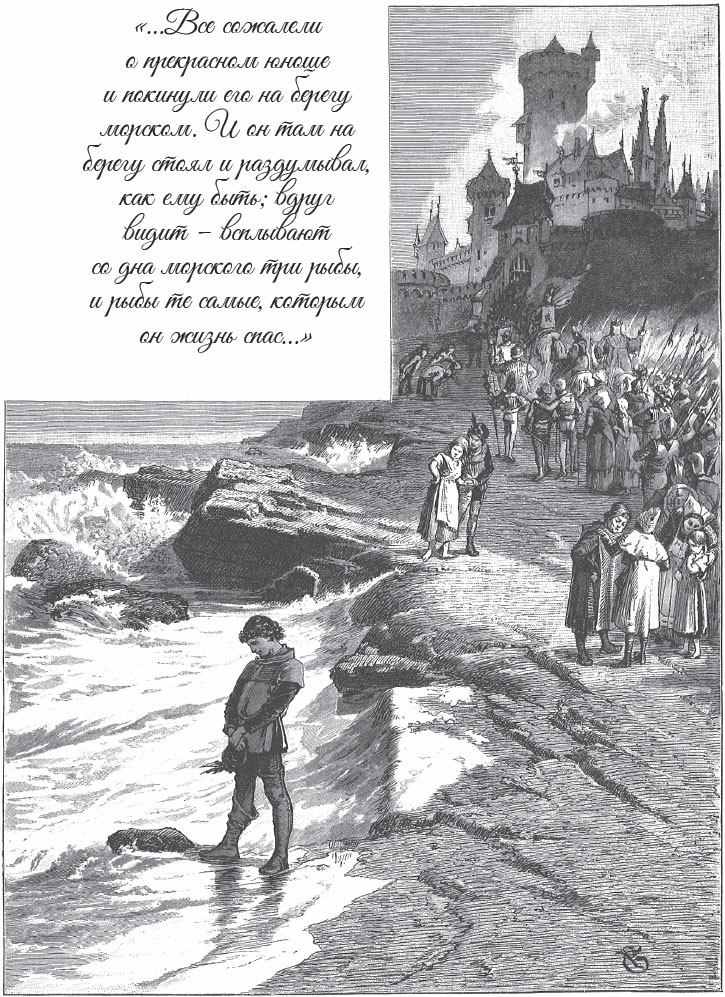

## Die weiße Schlange

Es ist schon lange her. Da lebt ein König, und im ganzen Land ist er für seine <abbr title="die Weisheit — мудрость">Weisheit</abbr> <abbr title="berühmt — знаменитый">berühmt</abbr>. Er weiß einfach alles. Es ist, als ob die Luft ihm <abbr title="die Nachricht, die Nachrichten — весть, известие">Nachrichten</abbr> von den geheimsten Dingen bringt.

Aber der König hat eine seltsame <abbr title="die Gewohnheit, die Gewohnheiten — привычка, обычай">Gewohnheit</abbr>. Jeden Mittag, nach dem Essen, <abbr title="abräumen — убирать со стола">räumt</abbr> man den Tisch ab, und alle gehen hinaus. Dann muss ein <abbr title="vertraut — доверенный, близкий">vertrauter</abbr> Diener noch eine Schüssel bringen. Die Schüssel hat einen Deckel. Der Diener weiß selbst nicht, was darin liegt, und kein anderer Mensch weiß es. Denn der König <abbr title="aufdecken — открывать, снимать крышку">deckt</abbr> sie erst auf und isst davon, wenn er ganz allein ist.

So geht es schon eine lange Zeit. Eines Tages trägt der Diener die Schüssel wieder weg. Da wird seine Neugier so groß, dass er nicht <abbr title="widerstehen (widerstand, hat widerstanden) — устоять, противиться">widerstehen</abbr> kann. Er bringt die Schüssel in seine Kammer und schließt die Tür <abbr title="sorgfältig — тщательно">sorgfältig</abbr> ab. Dann hebt er den Deckel. Und was sieht er? In der Schüssel liegt eine weiße Schlange! Er will sie unbedingt probieren. Er schneidet ein Stückchen ab und steckt es in den Mund.

Kaum berührt es seine Zunge, da hört er vor dem Fenster ein seltsames <abbr title="das Geflüster — шёпот, перешёптывание">Geflüster</abbr> von feinen Stimmen. Er geht hin und horcht. Da merkt er: Das sind die <abbr title="der Spatz, die Spatzen — воробей">Spatzen</abbr>! Sie sprechen miteinander und erzählen sich allerlei, was sie auf dem Feld und im Wald gesehen haben. Die Schlange hat ihm eine besondere <abbr title="die Fähigkeit, die Fähigkeiten — способность">Fähigkeit</abbr> gegeben: Jetzt versteht er die Sprache von den Tieren.

Gerade an diesem Tag verschwindet der schönste Ring von der Königin. Der vertraute Diener darf überall hingehen. Deshalb fällt der Verdacht auf ihn: Er hat den Ring gestohlen! Der König lässt ihn kommen und schimpft heftig. Er <abbr title="drohen — угрожать">droht</abbr> ihm: Wenn er bis morgen den <abbr title="der Täter, die Täter — преступник, виновник">Täter</abbr> nicht nennen kann, dann gilt er selbst als Dieb und muss sterben. Der Diener sagt immer wieder, dass er unschuldig ist. Aber es hilft nichts. Der König schickt ihn ohne eine bessere Antwort weg.

Voller <abbr title="die Unruhe — беспокойство, тревога">Unruhe</abbr> und Angst geht der Diener hinunter in den <abbr title="der Hof, die Höfe — двор">Hof</abbr>. Er überlegt, wie er sich aus seiner Not helfen kann. Da sitzen die Enten an einem Bach. Sie ruhen sich <abbr title="friedlich — мирно">friedlich</abbr> nebeneinander aus. Sie <abbr title="sich putzen — чиститься, прихорашиваться">putzen</abbr> sich mit ihren Schnäbeln glatt und <abbr title="plaudern — болтать, беседовать">plaudern</abbr> <abbr title="gemütlich — уютно, по-приятельски">gemütlich</abbr>. Der Diener bleibt stehen und hört ihnen zu. Sie erzählen sich, wo sie heute Morgen überall <abbr title="herumwackeln — ковылять туда-сюда">herumgewackelt</abbr> sind und was für gutes Futter sie gefunden haben. Da sagt eine Ente <abbr title="missmutig — угрюмо, недовольно">missmutig</abbr>:

— Mir liegt etwas schwer im Magen. Unter dem Fenster von der Königin lag ein Ring. Den habe ich in der Eile mit <abbr title="verschlucken — проглотить">verschluckt</abbr>.

Sofort packt der Diener die Ente am Hals. Er trägt sie in die Küche und sagt zum Koch:

— Schlachte doch diese hier. Sie ist schön fett.

— Ja, — sagt der Koch und <abbr title="wiegen (wog, hat gewogen) — взвешивать">wiegt</abbr> sie in der Hand. — Die hat sich wirklich Mühe gegeben, dick zu werden. Sie wartet sicher schon lange darauf, dass man sie brät.

Er schneidet ihr den Hals ab. Dann nimmt er sie aus, und im Magen findet er den Ring von der Königin. Jetzt kann der Diener dem König leicht beweisen, dass er unschuldig ist. Der König will sein Unrecht wiedergutmachen. Der Diener darf sich eine Gnade wünschen. Der König verspricht ihm sogar den höchsten <abbr title="der Posten, die Posten — должность, пост">Posten</abbr> am Hof.

Aber der Diener will nichts davon. Er bittet nur um ein Pferd und um Geld für die Reise. Denn er möchte die Welt sehen und eine Weile <abbr title="herumziehen (zog herum, ist herumgezogen) — странствовать, бродить">herumziehen</abbr>. Er bekommt, was er will, und macht sich auf den Weg.

Eines Tages kommt er an einem Teich vorbei. Da sieht er drei Fische. Sie haben sich im <abbr title="das Schilf — камыш">Schilf</abbr> <abbr title="sich verfangen (verfing, hat verfangen) — запутаться">verfangen</abbr> und <abbr title="nach Luft schnappen — хватать ртом воздух">schnappen</abbr> nach Wasser. Man sagt, Fische sind stumm. Aber er hört trotzdem, wie sie klagen: Sie müssen so elend sterben! Er hat ein gutes Herz, deshalb steigt er vom Pferd. Er setzt die drei Gefangenen wieder ins Wasser. Die Fische zappeln vor Freude. Sie strecken die Köpfe heraus und rufen:

— Wir <abbr title="an etwas denken — помнить о чём-то">denken</abbr> daran und werden es dir <abbr title="vergelten (vergalt, hat vergolten) — отплатить, воздать">vergelten</abbr>, dass du uns gerettet hast!

Er reitet weiter. Nach einer Weile meint er, er hört eine Stimme im <abbr title="der Sand — песок">Sand</abbr> unter seinen Füßen. Er horcht. Da hört er einen <abbr title="der Ameisenkönig, die Ameisenkönige — муравьиный король">Ameisenkönig</abbr>, der klagt:

— Ach, diese Menschen mit ihren ungeschickten Tieren! Sie sollen von uns wegbleiben! Dieses dumme Pferd <abbr title="tottreten (trat tot, hat totgetreten) — затоптать насмерть">tritt</abbr> mit seinen schweren <abbr title="der Huf, die Hufe — копыто">Hufen</abbr> meine Leute ohne Mitleid tot!

Da reitet er auf einen <abbr title="der Seitenweg, die Seitenwege — боковая дорожка">Seitenweg</abbr>. Der Ameisenkönig ruft ihm nach:

— Wir denken daran und werden es dir vergelten!

Der Weg führt ihn in einen Wald. Da sieht er einen <abbr title="der Rabenvater, die Rabenväter — отец-ворон">Rabenvater</abbr> und eine <abbr title="die Rabenmutter, die Rabenmütter — мать-ворона">Rabenmutter</abbr>. Sie stehen an ihrem Nest und werfen ihre Jungen hinaus.

— Weg mit euch, ihr <abbr title="der Galgenvogel, die Galgenvögel — висельник, негодник">Galgenvögel</abbr>! — rufen sie. — Wir können euch nicht mehr satt machen. Ihr seid groß genug und könnt euch selbst ernähren.

Die armen Jungen liegen auf der Erde. Sie <abbr title="flattern — хлопать крыльями, трепыхаться">flattern</abbr>, schlagen mit ihren Flügeln und schreien:

— Wir <abbr title="hilflos — беспомощный">hilflosen</abbr> Kinder! Wir sollen uns selbst ernähren und können noch nicht fliegen! Jetzt müssen wir hier verhungern!

Da steigt der gute junge Mann ab. Er tötet sein Pferd mit dem <abbr title="der Degen, die Degen — шпага">Degen</abbr> und lässt es den jungen Raben als Futter. Die Raben kommen <abbr title="herbeihüpfen — подскакивать, прискакать">herbeigehüpft</abbr>, fressen sich satt und rufen:

— Wir denken daran und werden es dir vergelten!

Jetzt muss er zu Fuß gehen. Er geht lange Wege, und endlich kommt er in eine große Stadt. In den Straßen ist großer Lärm und viel <abbr title="das Gedränge — давка, толчея">Gedränge</abbr>. Ein Mann kommt auf einem Pferd und verkündet:

— Die Königstochter sucht einen Mann! Aber wer sie heiraten will, muss eine schwere <abbr title="die Aufgabe, die Aufgaben — задача, задание">Aufgabe</abbr> lösen. Wenn er das nicht schafft, <abbr title="das Leben kosten — стоить жизни">kostet</abbr> es ihn das Leben.

Viele haben es schon versucht, aber vergeblich. Sie haben ihr Leben verloren. Dann sieht der junge Mann die Königstochter. Ihre Schönheit <abbr title="blenden — ослеплять">blendet</abbr> ihn so, dass er alle Gefahr vergisst. Er tritt vor den König und meldet sich als Freier.

Sofort bringt man ihn ans Meer. Vor seinen Augen wirft man einen goldenen Ring ins Wasser. Dann befiehlt ihm der König, diesen Ring vom <abbr title="der Meeresgrund — морское дно">Meeresgrund</abbr> zu holen. Und er sagt noch:

— Wenn du ohne den Ring nach oben kommst, dann stößt man dich wieder hinunter. Immer wieder, bis du in den Wellen <abbr title="umkommen (kam um, ist umgekommen) — погибать">umkommst</abbr>.

Alle haben Mitleid mit dem schönen jungen Mann. Dann lassen sie ihn allein am Meer. Er steht am <abbr title="das Ufer, die Ufer — берег">Ufer</abbr> und überlegt, was er tun soll. Da sieht er plötzlich drei Fische schwimmen. Es sind genau die Fische, denen er das Leben gerettet hat! Der mittlere hat eine <abbr title="die Muschel, die Muscheln — ракушка">Muschel</abbr> im Mund. Er legt sie an den <abbr title="der Strand, die Strände — пляж, берег">Strand</abbr>, direkt vor die Füße von dem jungen Mann. Der junge Mann hebt die Muschel auf und öffnet sie. Darin liegt der goldene Ring!

Voller Freude bringt er ihn zum König. Jetzt erwartet er den <abbr title="versprochen — обещанный">versprochenen</abbr> Lohn. Aber die Königstochter ist stolz. Sie hört: Er ist nicht von <abbr title="der Adel — знать, дворянство">Adel</abbr>, er ist nicht so vornehm wie sie. Da will sie ihn nicht. Er soll zuerst eine zweite Aufgabe lösen. Sie geht selbst hinunter in den Garten und streut zehn <abbr title="der Sack, die Säcke — мешок">Säcke</abbr> <abbr title="die Hirse — просо, пшено">Hirse</abbr> ins Gras.

— Morgen früh, noch vor Sonnenaufgang, muss er alles <abbr title="aufsammeln — собирать (с земли)">aufgesammelt</abbr> haben, — sagt sie. — Und es darf kein <abbr title="das Körnchen, die Körnchen — зёрнышко">Körnchen</abbr> fehlen.

Der junge Mann setzt sich in den Garten. Er denkt nach, wie er die Aufgabe lösen kann. Aber ihm fällt nichts ein. Ganz traurig sitzt er da. Er wartet darauf, dass man ihn am Morgen zum Tod führt. Aber dann fallen die ersten <abbr title="der Sonnenstrahl, die Sonnenstrahlen — солнечный луч">Sonnenstrahlen</abbr> in den Garten. Und da stehen die zehn Säcke nebeneinander, alle schön voll, und kein Körnchen fehlt! Der Ameisenkönig ist in der Nacht mit seinen tausend und tausend <abbr title="die Ameise, die Ameisen — муравей">Ameisen</abbr> gekommen. Die <abbr title="dankbar — благодарный">dankbaren</abbr> Tiere haben die Hirse sehr fleißig aufgesammelt und in die Säcke gefüllt.

Die Königstochter kommt selbst in den Garten. Sie sieht <abbr title="erstaunt — удивлённо">erstaunt</abbr>: Der junge Mann hat die Aufgabe gelöst. Aber ihr stolzes Herz will immer noch nicht nachgeben. Sie sagt:

— Er hat zwar beide Aufgaben gelöst. Aber er wird erst mein Mann, wenn er mir einen <abbr title="der Apfel, die Äpfel — яблоко">Apfel</abbr> vom <abbr title="der Baum des Lebens — древо жизни">Baum des Lebens</abbr> bringt.

Der junge Mann weiß nicht, wo der Baum des Lebens steht. Er macht sich auf den Weg und will immer weitergehen, solange seine Beine ihn tragen. Aber er hat keine <abbr title="die Hoffnung, die Hoffnungen — надежда">Hoffnung</abbr>, dass er ihn findet. Er wandert schon durch drei Königreiche. Eines Abends kommt er in einen Wald. Er setzt sich unter einen Baum und will schlafen. Da hört er ein <abbr title="das Geräusch, die Geräusche — шум, шорох">Geräusch</abbr> in den Ästen, und ein goldener Apfel fällt in seine Hand. Gleichzeitig fliegen drei Raben zu ihm herunter. Sie setzen sich auf seine Knie und sagen:

— Wir sind die drei jungen Raben. Du hast uns vor dem <abbr title="der Hungertod — голодная смерть">Hungertod</abbr> gerettet. Jetzt sind wir groß. Wir haben gehört, dass du den goldenen Apfel suchst. Da sind wir über das Meer geflogen, bis ans Ende der Welt. Dort steht der Baum des Lebens. Und wir haben dir den Apfel geholt.

Voller Freude macht sich der junge Mann auf den Heimweg. Er bringt der schönen Königstochter den goldenen Apfel. Jetzt hat sie keine <abbr title="die Ausrede, die Ausreden — отговорка">Ausrede</abbr> mehr. Sie teilen den Apfel des Lebens und essen ihn zusammen. Da <abbr title="füllen — наполнять">füllt</abbr> sich ihr Herz mit Liebe zu ihm. Und sie leben <abbr title="ungestört — безмятежно, без помех">ungestört</abbr> und glücklich, bis sie sehr alt sind.

---

### Neue Wörter

- **die Weisheit** — мудрость
- **berühmt** — знаменитый
- **die Nachricht, die Nachrichten** — весть, известие
- **die Gewohnheit, die Gewohnheiten** — привычка, обычай
- **abräumen** — убирать со стола
- **vertraut** — доверенный, близкий
- **aufdecken** — открывать, снимать крышку
- **widerstehen (widerstand, hat widerstanden)** — устоять, противиться
- **sorgfältig** — тщательно
- **das Geflüster** — шёпот, перешёптывание
- **der Spatz, die Spatzen** — воробей
- **die Fähigkeit, die Fähigkeiten** — способность
- **drohen** — угрожать
- **der Täter, die Täter** — преступник, виновник
- **die Unruhe** — беспокойство, тревога
- **der Hof, die Höfe** — двор
- **friedlich** — мирно
- **sich putzen** — чиститься, прихорашиваться
- **plaudern** — болтать, беседовать
- **gemütlich** — уютно, по-приятельски
- **herumwackeln** — ковылять туда-сюда
- **missmutig** — угрюмо, недовольно
- **verschlucken** — проглотить
- **wiegen (wog, hat gewogen)** — взвешивать
- **der Posten, die Posten** — должность, пост
- **herumziehen (zog herum, ist herumgezogen)** — странствовать, бродить
- **das Schilf** — камыш
- **sich verfangen (verfing, hat verfangen)** — запутаться
- **nach Luft schnappen** — хватать ртом воздух
- **an etwas denken** — помнить о чём-то
- **vergelten (vergalt, hat vergolten)** — отплатить, воздать
- **der Sand** — песок
- **der Ameisenkönig, die Ameisenkönige** — муравьиный король
- **tottreten (trat tot, hat totgetreten)** — затоптать насмерть
- **der Huf, die Hufe** — копыто
- **der Seitenweg, die Seitenwege** — боковая дорожка
- **der Rabenvater, die Rabenväter** — отец-ворон
- **die Rabenmutter, die Rabenmütter** — мать-ворона
- **der Galgenvogel, die Galgenvögel** — висельник, негодник
- **flattern** — хлопать крыльями, трепыхаться
- **hilflos** — беспомощный
- **der Degen, die Degen** — шпага
- **herbeihüpfen** — подскакивать, прискакать
- **das Gedränge** — давка, толчея
- **die Aufgabe, die Aufgaben** — задача, задание
- **das Leben kosten** — стоить жизни
- **blenden** — ослеплять
- **der Meeresgrund** — морское дно
- **umkommen (kam um, ist umgekommen)** — погибать
- **das Ufer, die Ufer** — берег
- **die Muschel, die Muscheln** — ракушка
- **der Strand, die Strände** — пляж, берег
- **versprochen** — обещанный
- **der Adel** — знать, дворянство
- **der Sack, die Säcke** — мешок
- **die Hirse** — просо, пшено
- **aufsammeln** — собирать (с земли)
- **das Körnchen, die Körnchen** — зёрнышко
- **der Sonnenstrahl, die Sonnenstrahlen** — солнечный луч
- **die Ameise, die Ameisen** — муравей
- **dankbar** — благодарный
- **erstaunt** — удивлённо
- **der Apfel, die Äpfel** — яблоко
- **der Baum des Lebens** — древо жизни
- **die Hoffnung, die Hoffnungen** — надежда
- **das Geräusch, die Geräusche** — шум, шорох
- **der Hungertod** — голодная смерть
- **die Ausrede, die Ausreden** — отговорка
- **füllen** — наполнять
- **ungestört** — безмятежно, без помех

[← Zurück](kapitel-16.md) · [Inhalt](README.md)
