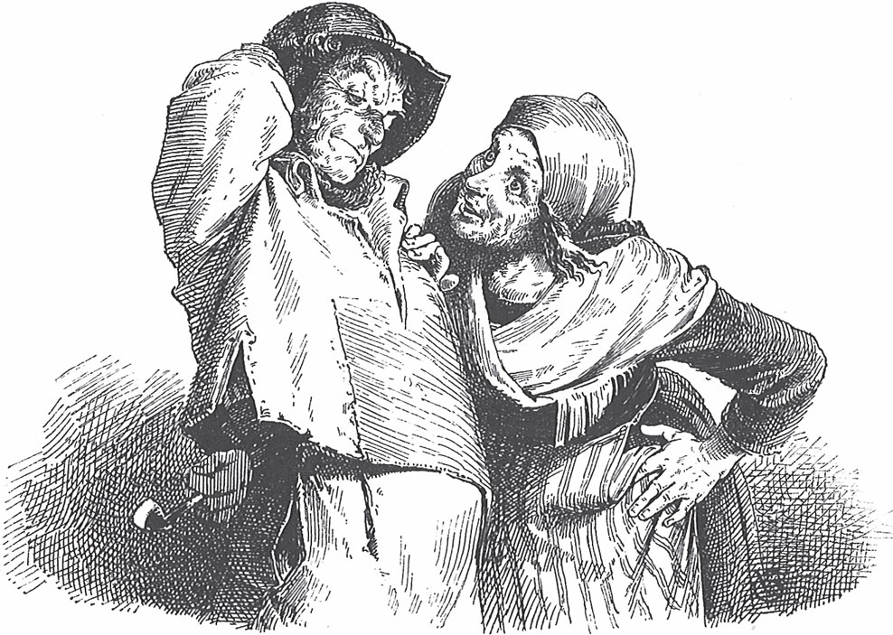

## Vom Fischer und seiner Frau

Es war einmal ein <abbr title="der Fischer, die Fischer — рыбак">Fischer</abbr> und seine Frau. Sie wohnen zusammen in einem <abbr title="der Pisspott, die Pisspötte — ночной горшок (грубо)">Pisspott</abbr>, ganz nah am Meer. So nennen sie ihre elende kleine Hütte, denn sie ist wirklich nicht besser als ein <abbr title="der Nachttopf, die Nachttöpfe — ночной горшок">Nachttopf</abbr>. Jeden Tag geht der Fischer hin und <abbr title="angeln — удить рыбу">angelt</abbr>. Und er angelt und angelt.

Einmal sitzt er wieder an seiner <abbr title="die Angel, die Angeln — удочка">Angel</abbr> und sieht immer in das <abbr title="klar — прозрачный, чистый">klare</abbr> Wasser hinein. Und er sitzt und sitzt.

Da geht die Angel auf den Grund, tief hinunter. Er zieht sie herauf, und da holt er einen großen <abbr title="der Butt, die Butte — камбала">Butt</abbr> heraus. Der Butt sagt zu ihm:

— Hör mal, Fischer, ich bitte dich, lass mich leben. Ich bin kein richtiger Butt. Ich bin ein verwunschener <abbr title="der Prinz, die Prinzen — принц">Prinz</abbr>. Was hast du davon, wenn du mich tötest? Ich schmecke dir doch nicht richtig. Setz mich wieder ins Wasser und lass mich schwimmen.

— Na, — sagt der Mann, — du musst nicht so viele Worte machen. Einen Butt, der sprechen kann, lasse ich doch sowieso schwimmen.

Damit setzt er ihn wieder in das klare Wasser. Der Butt <abbr title="abtauchen — нырнуть, уйти под воду">taucht</abbr> zum Grund ab. Hinter sich lässt er einen langen <abbr title="der Streifen, die Streifen — полоса">Streifen</abbr> Blut. Dann steht der Fischer auf und geht zu seiner Frau in den Pisspott.

— Mann, — sagt die Frau, — hast du heute nichts gefangen?

— Nein, — sagt der Mann. — Ich habe einen Butt gefangen. Er hat gesagt, er ist ein verwunschener Prinz. Da habe ich ihn wieder schwimmen lassen.

— Hast du dir denn nichts gewünscht? — fragt die Frau.

— Nein, — sagt der Mann. — Was soll ich mir denn wünschen?

— Ach, — sagt die Frau, — es ist doch schrecklich, immer hier im Pisspott zu wohnen. Es <abbr title="stinken (stank, hat gestunken) — вонять">stinkt</abbr> und ist so eklig. Warum hast du uns nicht eine kleine Hütte gewünscht? Geh noch einmal hin und ruf ihn. Sag ihm, wir wollen eine kleine Hütte haben. Er macht das bestimmt.

— Ach, — sagt der Mann, — warum soll ich da noch einmal hingehen?

— Na, — sagt die Frau, — du hast ihn doch gefangen und wieder schwimmen lassen. Er macht das bestimmt. Geh sofort hin.

Der Mann will nicht richtig. Aber er will seiner Frau auch nicht widersprechen. Also geht er zum Meer.

Als er ankommt, ist das Meer ganz grün und gelb und gar nicht mehr so klar. Er stellt sich hin und sagt:

> Manntje, Manntje, Timpe Te,  
> Buttje, Buttje in der See,  
> myne Fru de Ilsebill  
> will nich so as ik wol will.

Das heißt auf Hochdeutsch:

> Männlein, Männlein, Timpe Te,  
> Buttje, Buttje in der See,  
> meine Frau, die Ilsebill,  
> will nicht so, wie ich wohl will.

Da kommt der Butt <abbr title="angeschwommen kommen — приплыть">angeschwommen</abbr> und sagt:

— Na, was will sie denn?

— Ach, — sagt der Mann, — ich habe dich doch gefangen. Jetzt sagt meine Frau, ich soll mir etwas wünschen. Sie will nicht mehr im Pisspott wohnen. Sie möchte gern eine Hütte.

— Geh nur hin, — sagt der Butt. — Sie hat sie schon.

Da geht der Mann nach Hause. Seine Frau sitzt nicht mehr im Pisspott. Dort steht jetzt eine kleine Hütte, und seine Frau sitzt vor der Tür auf einer Bank. Sie nimmt ihn an der Hand und sagt:

— Komm nur herein. Sieh mal, jetzt ist es doch viel besser.

Sie gehen hinein. In der Hütte gibt es einen kleinen <abbr title="der Flur, die Flure — прихожая, сени">Flur</abbr>, eine kleine, herrliche Stube und eine Kammer mit ihrem Bett. Es gibt eine Küche und eine <abbr title="die Speisekammer, die Speisekammern — кладовая">Speisekammer</abbr>. Alles ist mit den besten <abbr title="das Gerät, die Geräte — утварь, инструмент">Geräten</abbr> <abbr title="einrichten — обставлять">eingerichtet</abbr>, mit <abbr title="das Zinngeschirr — оловянная посуда">Zinngeschirr</abbr> und <abbr title="das Messing — латунь">Messing</abbr>, wie es sich gehört. Hinten ist auch ein kleiner Hof mit <abbr title="das Huhn, die Hühner — курица">Hühnern</abbr> und Enten, und ein kleiner Garten mit <abbr title="das Gemüse — овощи">Gemüse</abbr> und <abbr title="das Obst — фрукты">Obst</abbr>.

— Sieh mal, — sagt die Frau, — ist das nicht <abbr title="nett — милый, славный">nett</abbr>?

— Ja, — sagt der Mann, — so soll es bleiben. Jetzt wollen wir richtig zufrieden leben.

— Das wollen wir uns noch <abbr title="sich etwas überlegen — подумать, обдумать">überlegen</abbr>, — sagt die Frau.

Dann essen sie etwas und gehen ins Bett.

So geht es etwa acht oder vierzehn Tage. Da sagt die Frau:

— Hör mal, Mann, die Hütte ist doch viel zu <abbr title="eng — тесный">eng</abbr>. Und der Hof und der Garten sind so klein. Warum hat uns der Butt nicht gleich ein größeres Haus geschenkt? Ich möchte gern in einem großen Schloss aus Stein wohnen. Geh zum Butt, er soll uns ein Schloss schenken.

— Ach, Frau, — sagt der Mann, — die Hütte ist doch gut genug. Was sollen wir in einem Schloss?

— Ach was, — sagt die Frau. — Geh du nur hin. Der Butt kann das immer.

— Nein, Frau, — sagt der Mann. — Der Butt hat uns gerade erst die Hütte gegeben. Ich will jetzt nicht schon wieder kommen. Das ärgert den Butt vielleicht.

— Geh doch, — sagt die Frau. — Er kann das sehr gut und macht es gern. Geh du nur hin.

Dem Mann ist das Herz so schwer, und er will nicht. Er sagt zu sich selbst: «Das ist nicht recht.» Aber er geht doch hin.

Als er zum Meer kommt, ist das Wasser ganz <abbr title="violett — фиолетовый">violett</abbr> und dunkelblau und grau und <abbr title="dick — густой, мутный">dick</abbr>. Es ist gar nicht mehr so grün und gelb, aber es ist noch <abbr title="still — тихий, спокойный">still</abbr>. Er stellt sich hin und sagt:

> Manntje, Manntje, Timpe Te,  
> Buttje, Buttje in der See,  
> myne Fru de Ilsebill  
> will nich so as ik wol will.

Das heißt auf Hochdeutsch:

> Männlein, Männlein, Timpe Te,  
> Buttje, Buttje in der See,  
> meine Frau, die Ilsebill,  
> will nicht so, wie ich wohl will.

— Na, was will sie denn? — fragt der Butt.

— Ach, — sagt der Mann halb <abbr title="betrübt — опечаленный">betrübt</abbr>, — sie will in einem großen Schloss aus Stein wohnen.

— Geh nur hin, sie steht schon vor der Tür, — sagt der Butt.

Da geht der Mann los und denkt, er geht nach Hause. Aber als er ankommt, steht dort ein großer <abbr title="der Palast, die Paläste — дворец">Palast</abbr> aus Stein. Seine Frau steht gerade auf der Treppe und will hineingehen. Sie nimmt ihn an der Hand und sagt:

— Komm nur herein.

Er geht mit ihr hinein. Im Schloss ist eine große <abbr title="die Halle, die Hallen — зал, холл">Halle</abbr> mit einem Boden aus <abbr title="der Marmor — мрамор">Marmor</abbr>. Viele Diener <abbr title="aufreißen (riss auf, hat aufgerissen) — распахивать">reißen</abbr> die großen Türen auf. Die Wände glänzen und haben schöne <abbr title="die Tapete, die Tapeten — обои">Tapeten</abbr>. In den Zimmern stehen lauter goldene Stühle und Tische. Von der Decke hängen <abbr title="der Kronleuchter, die Kronleuchter — люстра">Kronleuchter</abbr> aus <abbr title="das Kristall — хрусталь">Kristall</abbr>. In allen Stuben und Kammern liegen <abbr title="der Teppich, die Teppiche — ковёр">Teppiche</abbr>. Auf den Tischen stehen so viel Essen und der allerbeste Wein, dass die Tische fast <abbr title="zusammenbrechen (brach zusammen, ist zusammengebrochen) — рушиться, ломаться">zusammenbrechen</abbr>. Hinter dem Haus ist auch ein großer Hof mit einem <abbr title="der Pferdestall, die Pferdeställe — конюшня">Pferdestall</abbr> und einem <abbr title="der Kuhstall, die Kuhställe — коровник">Kuhstall</abbr> und mit den allerbesten <abbr title="die Kutsche, die Kutschen — карета">Kutschen</abbr>. Es gibt auch einen großen, herrlichen Garten mit den schönsten Blumen und feinen <abbr title="der Obstbaum, die Obstbäume — фруктовое дерево">Obstbäumen</abbr>. Und es gibt einen <abbr title="der Park, die Parks — парк">Park</abbr>, bestimmt eine halbe <abbr title="die Meile, die Meilen — миля">Meile</abbr> lang. Darin leben <abbr title="der Hirsch, die Hirsche — олень">Hirsche</abbr>, Rehe und <abbr title="der Hase, die Hasen — заяц">Hasen</abbr> und alles, was man sich nur wünschen kann.

— Na, — sagt die Frau, — ist das nicht schön?

— Ach ja, — sagt der Mann. — So soll es auch bleiben. Jetzt wohnen wir in dem schönen Schloss und wollen zufrieden sein.

— Das wollen wir uns noch überlegen, — sagt die Frau, — und wollen erst einmal darüber <abbr title="darüber schlafen — переспать с этой мыслью, подумать до утра">schlafen</abbr>.

Damit gehen sie ins Bett.

Am nächsten Morgen wacht die Frau zuerst auf. Es wird gerade Tag. Von ihrem Bett aus sieht sie das herrliche Land vor sich liegen. Der Mann <abbr title="sich recken — потягиваться">reckt sich</abbr> noch. Da stößt sie ihn mit dem <abbr title="der Ellbogen, die Ellbogen — локоть">Ellbogen</abbr> in die Seite und sagt:

— Mann, steh auf und sieh mal aus dem Fenster. Sieh mal, können wir nicht König über dieses ganze Land werden? Geh zum Butt. Wir wollen König sein.

— Ach, Frau, — sagt der Mann, — was sollen wir König sein? Ich will nicht König sein.

— Na, — sagt die Frau, — wenn du nicht König sein willst, dann will ich König sein. Geh zum Butt. Ich will König sein.

— Ach, Frau, — sagt der Mann, — warum willst du König sein? Das mag ich ihm nicht sagen.

— Warum nicht? — sagt die Frau. — Geh <abbr title="sofort — сразу, немедленно">sofort</abbr> hin. Ich muss König sein.

Da geht der Mann los. Er ist ganz traurig, weil seine Frau König werden will. «Das ist nicht recht, und das ist nicht recht», denkt der Mann. Er will nicht hingehen, aber er geht doch hin.

Als er zum Meer kommt, ist das Meer ganz schwarzgrau. Das Wasser <abbr title="brodeln — бурлить, клокотать">brodelt</abbr> von unten herauf und stinkt ganz faul. Er stellt sich hin und sagt:

> Manntje, Manntje, Timpe Te,  
> Buttje, Buttje in der See,  
> myne Fru de Ilsebill  
> will nich so as ik wol will.

Das heißt auf Hochdeutsch:

> Männlein, Männlein, Timpe Te,  
> Buttje, Buttje in der See,  
> meine Frau, die Ilsebill,  
> will nicht so, wie ich wohl will.

— Na, was will sie denn? — fragt der Butt.

— Ach, — sagt der Mann, — sie will König werden.

— Geh nur hin, sie ist es schon, — sagt der Butt.

Da geht der Mann nach Hause. Als er zum Palast kommt, ist das Schloss viel größer geworden. Es hat einen großen Turm mit herrlichem <abbr title="der Schmuck — украшение">Schmuck</abbr>. Vor der Tür steht ein Wachposten, und es gibt sehr viele Soldaten und <abbr title="die Pauke, die Pauken — литавра, большой барабан">Pauken</abbr> und <abbr title="die Trompete, die Trompeten — труба">Trompeten</abbr>. Im Haus ist alles aus reinem Marmor und Gold. Es gibt Decken aus <abbr title="der Samt — бархат">Samt</abbr> und große goldene <abbr title="die Quaste, die Quasten — кисть (украшение)">Quasten</abbr>. Dann gehen die Türen vom Saal auf. Dort ist der ganze <abbr title="der Hofstaat — придворные, двор">Hofstaat</abbr>. Seine Frau sitzt auf einem hohen <abbr title="der Thron, die Throne — трон">Thron</abbr> aus Gold und <abbr title="der Diamant, die Diamanten — алмаз, бриллиант">Diamanten</abbr>. Sie trägt eine große goldene Krone. In der Hand hat sie das <abbr title="das Zepter, die Zepter — скипетр">Zepter</abbr> aus reinem Gold und Edelsteinen. Links und rechts von ihr stehen sechs Jungfrauen in einer Reihe, und jede ist einen Kopf kleiner als die andere. Er stellt sich hin und sagt:

— Ach, Frau, bist du jetzt König?

— Ja, — sagt die Frau, — jetzt bin ich König.

Er steht da und sieht sie an. Nach einer Weile sagt er:

— Ach, Frau, wie schön ist das, dass du König bist! Jetzt wollen wir uns auch nichts mehr wünschen.

— Nein, Mann, — sagt die Frau und wird ganz <abbr title="unruhig — беспокойный">unruhig</abbr>. — Mir wird die Zeit schon lang. Ich halte das nicht mehr aus. Geh zum Butt. König bin ich, jetzt muss ich auch <abbr title="der Kaiser, die Kaiser — император">Kaiser</abbr> werden.

— Ach, Frau, — sagt der Mann, — warum willst du Kaiser werden?

— Mann, — sagt sie, — geh zum Butt. Ich will Kaiser sein.

— Ach, Frau, — sagt der Mann, — Kaiser kann er nicht machen. Ich mag das dem Butt nicht sagen. Es gibt nur einen Kaiser im Reich. Kaiser kann der Butt doch nicht machen, das kann und kann er nicht.

— Was? — sagt die Frau. — Ich bin König, und du bist nur mein Mann. Gehst du jetzt gleich hin? Geh sofort! Wenn er König machen kann, dann kann er auch Kaiser machen. Ich will und will Kaiser sein. Geh sofort!

Da muss er hingehen. Aber auf dem Weg wird ihm ganz <abbr title="bange — страшно, боязно">bange</abbr>. Er denkt bei sich: «Das geht und geht nicht gut. Kaiser ist zu <abbr title="unverschämt — наглый, бессовестный">unverschämt</abbr>. Am Ende wird der Butt <abbr title="müde — усталый">müde</abbr> davon.»

Dann kommt er zum Meer. Das Meer ist noch ganz schwarz und dick. Es fängt schon von unten an zu <abbr title="gären — бродить, пениться">gären</abbr> und wirft <abbr title="die Blase, die Blasen — пузырь">Blasen</abbr>. Ein <abbr title="der Wirbelwind, die Wirbelwinde — вихрь">Wirbelwind</abbr> geht darüber, und das Wasser <abbr title="sich drehen — крутиться, вертеться">dreht sich</abbr>. Dem Mann <abbr title="es graut jemandem — кому-то жутко, страшно">graut</abbr> es. Er stellt sich hin und sagt:

> Manntje, Manntje, Timpe Te,  
> Buttje, Buttje in der See,  
> myne Fru de Ilsebill  
> will nich so as ik wol will.

Das heißt auf Hochdeutsch:

> Männlein, Männlein, Timpe Te,  
> Buttje, Buttje in der See,  
> meine Frau, die Ilsebill,  
> will nicht so, wie ich wohl will.

— Na, was will sie denn? — fragt der Butt.

— Ach, Butt, — sagt er, — meine Frau will Kaiser werden.

— Geh nur hin, — sagt der Butt. — Sie ist es schon.

Da geht der Mann nach Hause. Als er ankommt, ist das ganze Schloss aus <abbr title="poliert — полированный">poliertem</abbr> Marmor, mit <abbr title="die Figur, die Figuren — статуя, фигура">Figuren</abbr> aus <abbr title="der Alabaster — алебастр">Alabaster</abbr> und goldenem Schmuck. Vor der Tür <abbr title="marschieren — маршировать">marschieren</abbr> die Soldaten. Sie blasen Trompeten und schlagen Pauken und <abbr title="die Trommel, die Trommeln — барабан">Trommeln</abbr>. Aber im Haus laufen <abbr title="der Baron, die Barone — барон">Barone</abbr>, <abbr title="der Graf, die Grafen — граф">Grafen</abbr> und <abbr title="der Herzog, die Herzöge — герцог">Herzöge</abbr> herum wie Diener. Sie öffnen ihm die Türen, und die Türen sind aus reinem Gold. Er kommt herein. Da sitzt seine Frau auf einem Thron aus einem einzigen Stück Gold, und der Thron ist bestimmt zwei Meilen hoch. Sie trägt eine große goldene Krone, drei Ellen hoch und voller <abbr title="der Brillant, die Brillanten — бриллиант">Brillanten</abbr> und <abbr title="der Karfunkel, die Karfunkel — карбункул (красный самоцвет)">Karfunkel</abbr>. In der einen Hand hat sie das Zepter und in der anderen den <abbr title="der Reichsapfel, die Reichsäpfel — держава (символ власти)">Reichsapfel</abbr>. Links und rechts von ihr stehen die <abbr title="der Leibwächter, die Leibwächter — телохранитель">Leibwächter</abbr> in zwei Reihen, immer einer kleiner als der andere. Der größte ist ein Riese, zwei Meilen hoch. Der allerkleinste ist ein <abbr title="der Zwerg, die Zwerge — карлик, гном">Zwerg</abbr>, nur so groß wie mein kleiner Finger. Und vor ihr stehen viele <abbr title="der Fürst, die Fürsten — князь">Fürsten</abbr> und Herzöge.

Der Mann stellt sich zwischen sie und sagt:

— Frau, bist du jetzt Kaiser?

— Ja, — sagt sie, — ich bin Kaiser.

Er stellt sich hin und sieht sie genau an. Nach einer Weile sagt er:

— Ach, Frau, wie schön ist das, dass du Kaiser bist!

— Mann, — sagt sie, — was stehst du da herum? Ich bin jetzt Kaiser. Aber jetzt will ich auch <abbr title="der Papst, die Päpste — Папа Римский">Papst</abbr> werden. Geh zum Butt.

— Ach, Frau, — sagt der Mann, — was willst du denn nicht? Papst kannst du nicht werden. Es gibt nur einen Papst in der ganzen <abbr title="die Christenheit — христианский мир">Christenheit</abbr>. Das kann er doch nicht machen.

— Mann, — sagt sie, — ich will Papst werden. Geh sofort hin. Ich muss heute noch Papst werden.

— Nein, Frau, — sagt der Mann, — das mag ich ihm nicht sagen. Das geht nicht gut. Das ist zu <abbr title="grob — грубый, чересчур">grob</abbr>. Zum Papst kann der Butt dich nicht machen.

— Mann, was für ein Unsinn! — sagt die Frau. — Wenn er Kaiser machen kann, dann kann er auch Papst machen. Geh sofort hin. Ich bin Kaiser, und du bist nur mein Mann. Gehst du jetzt endlich?

Da bekommt er Angst und geht hin. Aber ihm ist ganz <abbr title="flau — дурно, слабо">flau</abbr>. Er zittert und <abbr title="beben — трястись, дрожать">bebt</abbr>, und die Knie und die <abbr title="die Wade, die Waden — икра (ноги)">Waden</abbr> <abbr title="schlottern — трястись (о коленях)">schlottern</abbr> ihm. Ein starker Wind <abbr title="fegen — мести, проноситься">fegt</abbr> über das Land, und die Wolken fliegen. Es wird dunkel, denn es ist schon gegen Abend. Die Blätter wehen von den Bäumen. Das Wasser <abbr title="brausen — бушевать, шуметь">braust</abbr>, als ob es kocht, und <abbr title="klatschen — хлестать, шлёпать">klatscht</abbr> an das Ufer. Von fern sieht er die Schiffe. Sie <abbr title="schießen (schoss, hat geschossen) — стрелять (здесь: сигналы бедствия)">schießen</abbr> in ihrer Not und tanzen und springen auf den Wellen. In der Mitte ist der Himmel noch ein bisschen blau. Aber an den Seiten zieht es ganz rot herauf wie ein schweres <abbr title="das Gewitter, die Gewitter — гроза">Gewitter</abbr>. Ganz <abbr title="verzagt — упавший духом, робкий">verzagt</abbr> stellt er sich in seiner Angst hin und sagt:

> Manntje, Manntje, Timpe Te,  
> Buttje, Buttje in der See,  
> myne Fru de Ilsebill  
> will nich so as ik wol will.

Das heißt auf Hochdeutsch:

> Männlein, Männlein, Timpe Te,  
> Buttje, Buttje in der See,  
> meine Frau, die Ilsebill,  
> will nicht so, wie ich wohl will.

— Na, was will sie denn? — fragt der Butt.

— Ach, — sagt der Mann, — sie will Papst werden.

— Geh nur hin, sie ist es schon, — sagt der Butt.

Da geht er nach Hause. Als er ankommt, steht da eine große <abbr title="die Kirche, die Kirchen — церковь">Kirche</abbr>, rundherum lauter Paläste. Er <abbr title="sich drängen — протискиваться">drängt sich</abbr> durch die Menschenmenge. Drinnen leuchten tausend und tausend Kerzen. Seine Frau ist ganz in Gold <abbr title="gekleidet — одетый">gekleidet</abbr>. Sie sitzt auf einem noch viel höheren Thron und trägt drei große goldene Kronen. Um sie herum sind viele <abbr title="der Geistliche, die Geistlichen — священнослужитель">Geistliche</abbr>. Links und rechts von ihr stehen zwei Reihen Kerzen. Die größte ist so dick und groß wie der allergrößte Turm, die kleinste ist nur ein kleines <abbr title="das Küchenlicht, die Küchenlichter — кухонная свечка">Küchenlicht</abbr>. Und alle Kaiser und Könige knien vor ihr und küssen ihr den <abbr title="der Pantoffel, die Pantoffeln — туфля, домашняя туфля">Pantoffel</abbr>.

— Frau, — sagt der Mann und sieht sie genau an, — bist du jetzt Papst?

— Ja, — sagt sie, — ich bin Papst.

Er stellt sich hin und sieht sie an. Es ist, als ob er in die helle Sonne sieht. Nach einer Weile sagt er:

— Ach, Frau, wie schön ist das, dass du Papst bist!

Aber sie sitzt ganz <abbr title="steif — неподвижный, окоченелый">steif</abbr> da wie ein Baum. Sie rührt sich nicht. Da sagt er:

— Frau, jetzt sei zufrieden. Jetzt bist du Papst. Mehr kannst du doch nicht werden.

— Das will ich mir noch überlegen, — sagt die Frau.

Damit gehen sie beide ins Bett. Aber sie ist nicht zufrieden. Die Gier lässt sie nicht schlafen. Sie denkt immer: Was kann ich noch werden?

Der Mann schläft sehr gut und fest, denn er ist am Tag viel gelaufen. Aber die Frau kann gar nicht einschlafen. Die ganze Nacht <abbr title="sich hin und her werfen — ворочаться">wirft</abbr> sie sich von einer Seite auf die andere. Sie denkt immer nur: Was kann ich noch werden? Aber ihr fällt nichts mehr ein.

Dann will die Sonne aufgehen. Die Frau sieht das <abbr title="das Morgenrot — утренняя заря">Morgenrot</abbr>. Sie <abbr title="sich aufsetzen — садиться (в постели)">setzt sich</abbr> im Bett auf und sieht hinaus. Durch das Fenster sieht sie die Sonne heraufkommen. «Ha», denkt sie, «kann ich nicht auch die Sonne und den Mond aufgehen lassen?»

— Mann, — sagt sie und stößt ihn mit dem Ellbogen in die <abbr title="die Rippe, die Rippen — ребро">Rippen</abbr>, — wach auf. Geh zum Butt. Ich will werden wie der liebe Gott.

Der Mann schläft noch fast. Aber er erschrickt so, dass er aus dem Bett fällt. Er denkt, er hat sich <abbr title="sich verhören — ослышаться">verhört</abbr>. Er reibt sich die Augen und sagt:

— Ach, Frau, was hast du gesagt?

— Mann, — sagt sie, — ich kann die Sonne und den Mond nicht aufgehen lassen. Ich muss nur zusehen, wie die Sonne und der Mond aufgehen. Das halte ich nicht aus! Ich habe keine ruhige Stunde mehr, weil ich sie nicht selbst aufgehen lassen kann.

Dabei sieht sie ihn so schrecklich an, dass ihm ein <abbr title="der Schauer, die Schauer — дрожь, озноб">Schauer</abbr> über den Rücken läuft.

— Geh sofort hin. Ich will werden wie der liebe Gott.

— Ach, Frau, — sagt der Mann und fällt vor ihr auf die Knie, — das kann der Butt nicht. Kaiser und Papst kann er machen. Ich bitte dich, <abbr title="zur Vernunft kommen — образумиться">komm zur Vernunft</abbr> und bleib Papst.

Da wird sie wütend. Die Haare fliegen ihr wild um den Kopf. Sie reißt sich das <abbr title="das Mieder, die Mieder — корсаж, лиф">Mieder</abbr> auf, gibt ihm einen <abbr title="der Tritt, die Tritte — пинок">Tritt</abbr> und schreit:

— Ich halte das nicht aus! Ich halte das nicht länger aus! Gehst du jetzt endlich hin?

Da zieht er sich schnell die Hose an und läuft weg wie <abbr title="verrückt — сумасшедший">verrückt</abbr>.

Draußen aber tobt der <abbr title="der Sturm, die Stürme — буря, шторм">Sturm</abbr>. Er braust so stark, dass der Mann kaum auf den Füßen stehen kann. Die Häuser und die Bäume fallen um. Die Berge beben, und große <abbr title="der Felsbrocken, die Felsbrocken — обломок скалы">Felsbrocken</abbr> rollen ins Meer. Der Himmel ist <abbr title="pechschwarz — чёрный как смоль">pechschwarz</abbr>. Es <abbr title="donnern — греметь (о громе)">donnert</abbr> und <abbr title="blitzen — сверкать (о молнии)">blitzt</abbr>. Das Meer kommt in schwarzen Wellen, so hoch wie Kirchtürme und wie Berge. Und oben haben alle Wellen eine weiße Krone aus <abbr title="der Schaum — пена">Schaum</abbr>. Da schreit er, und er kann sein eigenes Wort nicht hören:

> Manntje, Manntje, Timpe Te,  
> Buttje, Buttje in der See,  
> myne Fru de Ilsebill  
> will nich so as ik wol will.

Das heißt auf Hochdeutsch:

> Männlein, Männlein, Timpe Te,  
> Buttje, Buttje in der See,  
> meine Frau, die Ilsebill,  
> will nicht so, wie ich wohl will.

— Na, was will sie denn? — fragt der Butt.

— Ach, — sagt er, — sie will werden wie der liebe Gott.

— Geh nur hin. Sie sitzt schon wieder im Pisspott.

Und da sitzen sie noch bis heute.

---

### Neue Wörter

- **der Fischer, die Fischer** — рыбак
- **der Pisspott, die Pisspötte** — ночной горшок (грубо)
- **der Nachttopf, die Nachttöpfe** — ночной горшок
- **angeln** — удить рыбу
- **die Angel, die Angeln** — удочка
- **klar** — прозрачный, чистый
- **der Butt, die Butte** — камбала
- **der Prinz, die Prinzen** — принц
- **abtauchen** — нырнуть, уйти под воду
- **der Streifen, die Streifen** — полоса
- **stinken (stank, hat gestunken)** — вонять
- **angeschwommen kommen** — приплыть
- **der Flur, die Flure** — прихожая, сени
- **die Speisekammer, die Speisekammern** — кладовая
- **das Gerät, die Geräte** — утварь, инструмент
- **einrichten** — обставлять
- **das Zinngeschirr** — оловянная посуда
- **das Messing** — латунь
- **das Huhn, die Hühner** — курица
- **das Gemüse** — овощи
- **das Obst** — фрукты
- **nett** — милый, славный
- **sich etwas überlegen** — подумать, обдумать
- **eng** — тесный
- **violett** — фиолетовый
- **dick** — густой, мутный
- **still** — тихий, спокойный
- **betrübt** — опечаленный
- **der Palast, die Paläste** — дворец
- **die Halle, die Hallen** — зал, холл
- **der Marmor** — мрамор
- **aufreißen (riss auf, hat aufgerissen)** — распахивать
- **die Tapete, die Tapeten** — обои
- **der Kronleuchter, die Kronleuchter** — люстра
- **das Kristall** — хрусталь
- **der Teppich, die Teppiche** — ковёр
- **zusammenbrechen (brach zusammen, ist zusammengebrochen)** — рушиться, ломаться
- **der Pferdestall, die Pferdeställe** — конюшня
- **der Kuhstall, die Kuhställe** — коровник
- **die Kutsche, die Kutschen** — карета
- **der Obstbaum, die Obstbäume** — фруктовое дерево
- **der Park, die Parks** — парк
- **die Meile, die Meilen** — миля
- **der Hirsch, die Hirsche** — олень
- **der Hase, die Hasen** — заяц
- **darüber schlafen** — переспать с этой мыслью, подумать до утра
- **sich recken** — потягиваться
- **der Ellbogen, die Ellbogen** — локоть
- **sofort** — сразу, немедленно
- **brodeln** — бурлить, клокотать
- **der Schmuck** — украшение
- **die Pauke, die Pauken** — литавра, большой барабан
- **die Trompete, die Trompeten** — труба
- **der Samt** — бархат
- **die Quaste, die Quasten** — кисть (украшение)
- **der Hofstaat** — придворные, двор
- **der Thron, die Throne** — трон
- **der Diamant, die Diamanten** — алмаз, бриллиант
- **das Zepter, die Zepter** — скипетр
- **unruhig** — беспокойный
- **der Kaiser, die Kaiser** — император
- **bange** — страшно, боязно
- **unverschämt** — наглый, бессовестный
- **müde** — усталый
- **gären** — бродить, пениться
- **die Blase, die Blasen** — пузырь
- **der Wirbelwind, die Wirbelwinde** — вихрь
- **sich drehen** — крутиться, вертеться
- **es graut jemandem** — кому-то жутко, страшно
- **poliert** — полированный
- **die Figur, die Figuren** — статуя, фигура
- **der Alabaster** — алебастр
- **marschieren** — маршировать
- **die Trommel, die Trommeln** — барабан
- **der Baron, die Barone** — барон
- **der Graf, die Grafen** — граф
- **der Herzog, die Herzöge** — герцог
- **der Brillant, die Brillanten** — бриллиант
- **der Karfunkel, die Karfunkel** — карбункул (красный самоцвет)
- **der Reichsapfel, die Reichsäpfel** — держава (символ власти)
- **der Leibwächter, die Leibwächter** — телохранитель
- **der Zwerg, die Zwerge** — карлик, гном
- **der Fürst, die Fürsten** — князь
- **der Papst, die Päpste** — Папа Римский
- **die Christenheit** — христианский мир
- **grob** — грубый, чересчур
- **flau** — дурно, слабо
- **beben** — трястись, дрожать
- **die Wade, die Waden** — икра (ноги)
- **schlottern** — трястись (о коленях)
- **fegen** — мести, проноситься
- **brausen** — бушевать, шуметь
- **klatschen** — хлестать, шлёпать
- **schießen (schoss, hat geschossen)** — стрелять (здесь: сигналы бедствия)
- **das Gewitter, die Gewitter** — гроза
- **verzagt** — упавший духом, робкий
- **die Kirche, die Kirchen** — церковь
- **sich drängen** — протискиваться
- **gekleidet** — одетый
- **der Geistliche, die Geistlichen** — священнослужитель
- **das Küchenlicht, die Küchenlichter** — кухонная свечка
- **der Pantoffel, die Pantoffeln** — туфля, домашняя туфля
- **steif** — неподвижный, окоченелый
- **sich hin und her werfen** — ворочаться
- **das Morgenrot** — утренняя заря
- **sich aufsetzen** — садиться (в постели)
- **die Rippe, die Rippen** — ребро
- **sich verhören** — ослышаться
- **der Schauer, die Schauer** — дрожь, озноб
- **zur Vernunft kommen** — образумиться
- **das Mieder, die Mieder** — корсаж, лиф
- **der Tritt, die Tritte** — пинок
- **verrückt** — сумасшедший
- **der Sturm, die Stürme** — буря, шторм
- **der Felsbrocken, die Felsbrocken** — обломок скалы
- **pechschwarz** — чёрный как смоль
- **donnern** — греметь (о громе)
- **blitzen** — сверкать (о молнии)
- **der Schaum** — пена

[← Zurück](kapitel-18.md) · [Inhalt](README.md)
