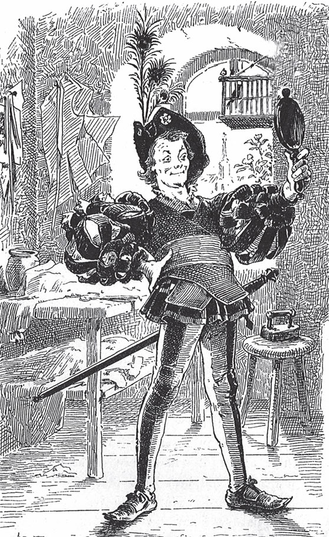
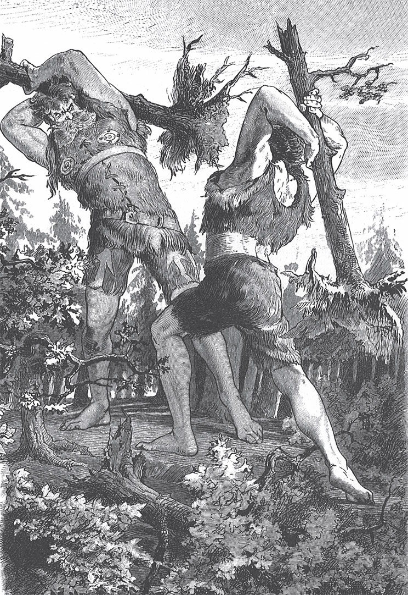

## Das tapfere Schneiderlein

An einem Sommermorgen sitzt ein <abbr title="das Schneiderlein — портняжка">Schneiderlein</abbr> auf seinem Tisch am Fenster. Er hat gute <abbr title="die Laune, die Launen — настроение">Laune</abbr> und näht, so schnell er kann. Da kommt eine <abbr title="die Bäuerin, die Bäuerinnen — крестьянка">Bäuerin</abbr> die Straße herunter und ruft:

— Gutes <abbr title="das Mus — повидло, пюре">Mus</abbr> zu verkaufen! Gutes Mus zu verkaufen!

Das klingt dem Schneiderlein lieblich in den Ohren. Er steckt seinen zarten Kopf aus dem Fenster und ruft:

— Hier herauf, liebe Frau! Hier werden Sie Ihre Ware los!

Die Frau steigt mit ihrem schweren <abbr title="der Korb, die Körbe — корзина">Korb</abbr> die drei Treppen zum Schneider hinauf. Dort muss sie alle Töpfe vor ihm <abbr title="auspacken — распаковывать">auspacken</abbr>. Er <abbr title="betrachten — рассматривать">betrachtet</abbr> sie alle, hebt sie hoch, hält die Nase daran und sagt endlich:

— Das Mus scheint mir gut. <abbr title="abwiegen (wog ab, hat abgewogen) — отвешивать">Wiegen</abbr> Sie mir doch vier <abbr title="das Lot, die Lote — лот (старая мера веса, ок. 15 г)">Lot</abbr> ab, liebe Frau. Auch wenn es ein <abbr title="das Viertelpfund — четверть фунта">Viertelpfund</abbr> wird, das ist mir egal.

Die Frau hat gehofft, dass sie viel verkauft. Sie gibt ihm, was er will. Aber sie geht ganz <abbr title="ärgerlich — раздражённый, сердитый">ärgerlich</abbr> und <abbr title="brummig — ворчливый">brummig</abbr> weg.

— So, dieses Mus soll Gott mir segnen, — ruft das Schneiderlein, — und es soll mir Kraft und <abbr title="die Stärke — сила, мощь">Stärke</abbr> geben!

Er holt das Brot aus dem Schrank, schneidet sich ein Stück über den ganzen Laib ab und streicht das Mus darauf.

— Das wird nicht bitter schmecken, — sagt er. — Aber zuerst mache ich das <abbr title="das Wams, die Wämser — камзол, куртка">Wams</abbr> fertig. Dann <abbr title="anbeißen (biss an, hat angebissen) — откусывать">beiße</abbr> ich an.

Er legt das Brot neben sich und näht weiter. Vor Freude macht er immer größere <abbr title="der Stich, die Stiche — стежок">Stiche</abbr>. Inzwischen steigt der <abbr title="der Geruch, die Gerüche — запах">Geruch</abbr> von dem süßen Mus hinauf an die Wand. Dort sitzen sehr viele <abbr title="die Fliege, die Fliegen — муха">Fliegen</abbr>. Der Geruch lockt sie an, und in ganzen <abbr title="die Schar, die Scharen — стая, толпа">Scharen</abbr> setzen sie sich auf das Brot.

— He, wer hat euch denn eingeladen? — sagt das Schneiderlein und <abbr title="wegjagen — прогонять">jagt</abbr> die <abbr title="ungebeten — непрошеный">ungebetenen</abbr> Gäste weg.

Aber die Fliegen verstehen kein Deutsch. Sie lassen sich nicht <abbr title="wegschicken — отсылать, прогонять">wegschicken</abbr>. Sie kommen wieder, und es werden immer mehr. Da <abbr title="jemandem läuft eine Laus über die Leber — кто-то злится, муха укусила">läuft</abbr> dem Schneiderlein endlich, wie man sagt, eine Laus über die Leber. Er greift nach einem <abbr title="der Tuchlappen, die Tuchlappen — лоскут ткани">Tuchlappen</abbr> und ruft:

— Wartet, euch zeige ich es!

Und er schlägt ohne Gnade zu. Dann hebt er den Lappen hoch und zählt. Nicht weniger als sieben Fliegen liegen tot vor ihm und strecken die Beine.

— Was für ein Kerl bist du! — sagt er und <abbr title="bewundern — восхищаться">bewundert</abbr> selbst seine <abbr title="die Tapferkeit — храбрость">Tapferkeit</abbr>. — Das soll die ganze Stadt <abbr title="erfahren (erfuhr, hat erfahren) — узнавать">erfahren</abbr>!

Schnell schneidet sich das Schneiderlein einen <abbr title="der Gürtel, die Gürtel — пояс">Gürtel</abbr> zu. Er näht ihn und <abbr title="sticken — вышивать">stickt</abbr> mit großen <abbr title="der Buchstabe, die Buchstaben — буква">Buchstaben</abbr> darauf: «Siebene auf einen Streich!»

— Ach was, Stadt! — sagt er. — Die ganze Welt soll es erfahren!

Und sein Herz wackelt vor Freude wie ein <abbr title="das Lämmerschwänzchen — хвостик ягнёнка">Lämmerschwänzchen</abbr>.

Der Schneider bindet sich den Gürtel um den Bauch. Er will in die Welt hinaus, denn er meint, seine <abbr title="die Werkstatt, die Werkstätten — мастерская">Werkstatt</abbr> ist zu klein für seine Tapferkeit. Zuerst sucht er im Haus, ob er etwas mitnehmen kann. Aber er findet nur einen alten <abbr title="der Käse — сыр">Käse</abbr>. Den steckt er ein. Vor dem Stadttor sieht er einen Vogel. Der Vogel hat sich im Gebüsch verfangen. Auch der Vogel muss zum Käse in die Tasche.

Jetzt geht er <abbr title="tapfer — храбро, смело">tapfer</abbr> los. Er ist leicht und flink, deshalb wird er nicht müde. Der Weg führt ihn auf einen Berg. Oben auf dem höchsten <abbr title="der Gipfel, die Gipfel — вершина">Gipfel</abbr> sitzt ein gewaltiger Riese und sieht sich ganz gemütlich um. Das Schneiderlein geht <abbr title="mutig — смело">mutig</abbr> zu ihm hin und spricht ihn an:

— Guten Tag, Kamerad. Na, du sitzt hier und siehst dir die weite Welt an? Ich bin gerade auf dem Weg dorthin und will mein Glück versuchen. Hast du Lust mitzukommen?

Der Riese sieht den Schneider <abbr title="verächtlich — презрительно">verächtlich</abbr> an und sagt:

— Du <abbr title="der Lump, die Lumpen — оборванец, негодяй">Lump</abbr>! Du elender Kerl!

— Ach, so ist das? — antwortet das Schneiderlein. Er <abbr title="aufknöpfen — расстёгивать">knöpft</abbr> seinen Rock auf und zeigt dem Riesen den Gürtel. — Hier kannst du lesen, was ich für ein Mann bin.

Der Riese liest: «Siebene auf einen Streich!» Er denkt, das sind Menschen, die der Schneider <abbr title="erschlagen (erschlug, hat erschlagen) — убить (ударом)">erschlagen</abbr> hat. Da bekommt er ein bisschen <abbr title="der Respekt — уважение">Respekt</abbr> vor dem kleinen Kerl. Aber zuerst will er ihn <abbr title="prüfen — испытывать, проверять">prüfen</abbr>. Er nimmt einen Stein in die Hand und <abbr title="zusammendrücken — сжимать">drückt</abbr> ihn so fest zusammen, dass Wasser herauströpfelt.

— Mach mir das nach, — sagt der Riese, — wenn du stark bist.

— Ist das alles? — sagt das Schneiderlein. — Das ist für unsereinen ein <abbr title="das Kinderspiel — детская забава, пустяк">Kinderspiel</abbr>.

Er greift in die Tasche, holt den weichen Käse heraus und drückt ihn, bis der <abbr title="der Saft, die Säfte — сок">Saft</abbr> herausläuft.

— Na, — sagt er, — das war doch ein bisschen besser, oder?

Der Riese weiß nicht, was er sagen soll. Er kann es von dem kleinen Männlein nicht glauben. Da hebt der Riese einen Stein auf und wirft ihn so hoch, dass man ihn kaum noch sehen kann.

— Na, du Zwerg, mach mir das nach.

— Gut geworfen, — sagt der Schneider. — Aber der Stein ist doch wieder auf die Erde gefallen. Ich werfe dir einen, der kommt gar nicht wieder.

Er greift in die Tasche, nimmt den Vogel und wirft ihn in die Luft. Der Vogel freut sich über seine <abbr title="die Freiheit — свобода">Freiheit</abbr>. Er steigt auf, fliegt weg und kommt nicht wieder.

— Na, wie gefällt dir das, Kamerad? — fragt der Schneider.

— Werfen kannst du, — sagt der Riese. — Aber jetzt wollen wir sehen, ob du auch etwas Richtiges tragen kannst.

Er führt das Schneiderlein zu einer mächtigen Eiche. Der Baum ist <abbr title="fällen — рубить, валить (дерево)">gefällt</abbr> und liegt auf dem Boden.

— Wenn du stark genug bist, — sagt der Riese, — dann hilf mir, diesen Baum aus dem Wald zu tragen.

— Gern, — antwortet der kleine Mann. — Nimm du nur den Stamm auf deine Schulter. Ich trage die Äste mit den Zweigen. Das ist doch das Schwerste.

Der Riese nimmt den Stamm auf die Schulter. Der Schneider aber setzt sich auf einen Ast. Der Riese kann sich nicht umdrehen. So muss er den ganzen Baum tragen und das Schneiderlein noch obendrein. Hinten auf dem Ast ist das Schneiderlein ganz lustig und fröhlich. Er <abbr title="pfeifen (pfiff, hat gepfiffen) — свистеть, насвистывать">pfeift</abbr> das Lied «Es ritten drei Schneider zum Tore hinaus», als ob Bäume tragen ein Kinderspiel ist. Der Riese schleppt die schwere Last ein Stück weit. Dann kann er nicht mehr und ruft:

— Hör mal, ich muss den Baum fallen lassen.

Der Schneider springt schnell herunter und packt den Baum mit beiden Armen, als ob er ihn die ganze Zeit getragen hat. Er sagt zum Riesen:

— Du bist so ein großer Kerl und kannst nicht einmal den Baum tragen!

Sie gehen zusammen weiter. Dann kommen sie an einem <abbr title="der Kirschbaum, die Kirschbäume — вишня (дерево)">Kirschbaum</abbr> vorbei. Der Riese packt die Krone vom Baum, wo die reifsten <abbr title="die Kirsche, die Kirschen — вишня, черешня">Kirschen</abbr> hängen. Er biegt sie herunter, gibt sie dem Schneider in die Hand und sagt, er soll essen. Aber das Schneiderlein ist viel zu schwach. Er kann den Baum nicht halten. Der Riese lässt los, und der Baum <abbr title="hochschnellen — взлетать, подбрасывать">schnellt</abbr> nach oben. Der Schneider fliegt mit in die Luft. Er fällt wieder herunter, aber er hat sich nicht wehgetan. Der Riese sagt:

— Was ist das? Hast du nicht die Kraft, diesen dünnen Zweig zu halten?

— Kraft habe ich genug, — antwortet das Schneiderlein. — Glaubst du, das ist ein Problem für einen, der siebene auf einen Streich getroffen hat? Ich bin über den Baum gesprungen, weil die Jäger da unten ins Gebüsch schießen. Spring auch, wenn du kannst!

Der Riese versucht es. Aber er kommt nicht über den Baum, sondern bleibt in den Ästen hängen. So <abbr title="gewinnen (gewann, hat gewonnen) — выигрывать, побеждать">gewinnt</abbr> das Schneiderlein auch diesmal.

Der Riese sagt:

— Wenn du so ein tapferer Kerl bist, dann komm mit in unsere Höhle und übernachte bei uns.

Das Schneiderlein ist bereit und geht mit ihm. In der Höhle sitzen noch andere Riesen am Feuer. Jeder hat ein <abbr title="gebraten — жареный">gebratenes</abbr> <abbr title="das Schaf, die Schafe — овца">Schaf</abbr> in der Hand und isst davon. Das Schneiderlein sieht sich um und denkt: «Hier ist doch viel mehr Platz als in meiner Werkstatt.» Der Riese zeigt ihm ein Bett und sagt, er soll sich hineinlegen und ausschlafen. Aber das Bett ist dem Schneiderlein zu groß. Er legt sich nicht hinein, sondern kriecht in eine Ecke.

Um Mitternacht glaubt der Riese, dass das Schneiderlein tief schläft. Da steht er auf, nimmt eine große Eisenstange und schlägt das Bett mit einem Schlag kaputt. Er denkt, jetzt hat er diesem <abbr title="der Grashüpfer, die Grashüpfer — кузнечик">Grashüpfer</abbr> <abbr title="jemandem den Garaus machen — прикончить кого-то">den Garaus gemacht</abbr>. Ganz früh am Morgen gehen die Riesen in den Wald. Sie haben das Schneiderlein ganz vergessen. Da kommt es plötzlich lustig und frech daher marschiert. Die Riesen erschrecken. Sie haben Angst, dass er sie alle totschlägt, und laufen schnell davon.

Das Schneiderlein zieht weiter, immer seiner <abbr title="spitz — острый">spitzen</abbr> Nase nach. Er wandert lange. Dann kommt er in den Hof von einem königlichen Palast. Er ist müde, deshalb legt er sich ins Gras und schläft ein. Während er da liegt, kommen Leute. Sie betrachten ihn von allen Seiten und lesen auf dem Gürtel: «Siebene auf einen Streich!»

— Ach, — sagen sie, — was will denn der große <abbr title="der Kriegsheld, die Kriegshelden — военный герой">Kriegsheld</abbr> hier, mitten im Frieden? Das muss ein mächtiger Herr sein.

Sie gehen und melden es dem König. Sie meinen: Wenn ein Krieg <abbr title="ausbrechen (brach aus, ist ausgebrochen) — разразиться, начаться">ausbricht</abbr>, dann ist dieser Mann sehr wichtig und <abbr title="nützlich — полезный">nützlich</abbr>. Man darf ihn um keinen Preis weglassen. Der Rat gefällt dem König. Er schickt einen von seinen <abbr title="der Hofmann, die Hofleute — придворный">Hofleuten</abbr> zum Schneiderlein. Der soll ihm einen Platz im <abbr title="das Heer, die Heere — войско, армия">Heer</abbr> anbieten, wenn er aufwacht. Der Bote bleibt bei dem Schläfer stehen. Er wartet, bis der sich streckt und die Augen öffnet. Dann macht er ihm sein <abbr title="das Angebot, die Angebote — предложение">Angebot</abbr>.

— Genau deshalb bin ich hierhergekommen, — antwortet das Schneiderlein. — Ich bin bereit, dem König zu dienen.

So empfängt man ihn mit großen <abbr title="die Ehre, die Ehren — честь, почести">Ehren</abbr> und gibt ihm eine eigene Wohnung.

Aber die Soldaten <abbr title="mögen (mochte, hat gemocht) — любить, нравиться">mögen</abbr> das Schneiderlein nicht. Sie möchten, dass er tausend Meilen weit weg ist.

— Was soll das werden? — sagen sie untereinander. — Wenn wir <abbr title="der Streit — ссора">Streit</abbr> mit ihm bekommen und er schlägt zu, dann fallen bei jedem Streich sieben von uns. Da hat unsereiner keine Chance.

Also <abbr title="einen Entschluss fassen — принять решение">fassen</abbr> sie einen Entschluss. Sie gehen alle zusammen zum König und bitten um ihren <abbr title="der Abschied — отставка, увольнение">Abschied</abbr>.

— Wir sind nicht dafür gemacht, — sagen sie, — neben einem Mann zu leben, der siebene auf einen Streich schlägt.

Der König ist traurig. Wegen diesem einen Mann soll er alle seine treuen Diener verlieren! Er ärgert sich, dass er ihn überhaupt gesehen hat. Er will ihn gern wieder loswerden. Aber er traut sich nicht, ihn wegzuschicken. Denn er fürchtet, das Schneiderlein schlägt ihn und sein ganzes Volk tot und setzt sich selbst auf den königlichen Thron. Er denkt lange hin und her. Endlich hat er eine Idee. Er schickt einen Boten zum Schneiderlein und lässt ihm sagen: Weil er ein so großer Kriegsheld ist, will der König ihm ein Angebot machen. In einem Wald im Land wohnen zwei Riesen. Sie <abbr title="rauben — грабить">rauben</abbr>, <abbr title="morden — убивать">morden</abbr>, <abbr title="niederbrennen (brannte nieder, hat niedergebrannt) — сжигать дотла">brennen</abbr> Häuser nieder und richten großen <abbr title="der Schaden, die Schäden — вред, ущерб">Schaden</abbr> an. Wer zu ihnen geht, <abbr title="riskieren — рисковать">riskiert</abbr> sein Leben. Wenn er diese beiden Riesen besiegt und tötet, dann gibt der König ihm seine einzige Tochter zur Frau und das halbe Königreich als Mitgift. Und hundert <abbr title="der Reiter, die Reiter — всадник">Reiter</abbr> sollen mitkommen und ihm helfen.

«Das ist etwas für einen Mann wie mich», denkt das Schneiderlein. «Eine schöne Königstochter und ein halbes Königreich bekommt man nicht alle Tage angeboten.»

— Oh ja, — antwortet er. — Die Riesen will ich schon <abbr title="bändigen — укрощать, усмирять">bändigen</abbr>. Und die hundert Reiter brauche ich dafür nicht. Wer siebene auf einen Streich trifft, braucht vor zweien keine Angst zu haben.

Das Schneiderlein zieht los, und die hundert Reiter folgen ihm. Am <abbr title="der Waldrand, die Waldränder — опушка леса">Waldrand</abbr> sagt er zu seinen <abbr title="der Begleiter, die Begleiter — спутник, провожатый">Begleitern</abbr>:

— Bleibt nur hier stehen. Ich werde allein mit den Riesen fertig.

Dann springt er in den Wald hinein und sieht sich rechts und links um. Nach einer Weile sieht er beide Riesen. Sie liegen unter einem Baum und schlafen. Dabei schnarchen sie so laut, dass die Äste sich auf und ab biegen. Das Schneiderlein ist nicht faul. Er füllt beide Taschen mit Steinen und klettert damit auf den Baum. In der Mitte <abbr title="rutschen — скользить, ползти">rutscht</abbr> er auf einem Ast weiter, bis er genau über den Schläfern sitzt. Dann lässt er einen Stein nach dem anderen auf die Brust von dem einen Riesen fallen. Der Riese spürt lange nichts. Aber endlich wacht er auf. Er <abbr title="anstoßen (stieß an, hat angestoßen) — толкать">stößt</abbr> seinen Gesellen an und sagt:

— Warum schlägst du mich?

— Du <abbr title="träumen — видеть сон">träumst</abbr>, — sagt der andere. — Ich schlage dich nicht.

Sie legen sich wieder schlafen. Da wirft der Schneider einen Stein auf den zweiten Riesen.

— Was soll das? — ruft der zweite. — Warum wirfst du mich?

— Ich werfe dich nicht, — antwortet der erste und brummt.

Sie <abbr title="sich streiten (stritt, hat gestritten) — ссориться, спорить">streiten sich</abbr> eine Weile. Aber sie sind müde, deshalb hören sie auf, und die Augen fallen ihnen wieder zu. Das Schneiderlein fängt sein Spiel wieder an. Er sucht den dicksten Stein aus und wirft ihn mit aller Gewalt dem ersten Riesen auf die Brust.

— Das ist zu viel! — schreit der Riese. Er springt auf wie verrückt und stößt seinen Gesellen so stark gegen den Baum, dass der Baum zittert.

Der andere <abbr title="mit gleicher Münze zurückzahlen — отплатить той же монетой">zahlt</abbr> es ihm mit gleicher Münze zurück. Sie werden so wütend, dass sie Bäume <abbr title="ausreißen (riss aus, hat ausgerissen) — вырывать">ausreißen</abbr> und aufeinander <abbr title="losschlagen (schlug los, hat losgeschlagen) — набрасываться с кулаками">losschlagen</abbr>. Am Ende fallen beide gleichzeitig tot auf die Erde. Jetzt springt das Schneiderlein herunter.

— Was für ein Glück, — sagt er, — dass sie nicht den Baum ausgerissen haben, auf dem ich saß! Denn dann muss ich wie ein Eichhörnchen auf einen anderen springen. Aber unsereiner ist ja flink!

Er zieht sein Schwert und gibt jedem Riesen ein paar <abbr title="kräftig — сильный, крепкий">kräftige</abbr> Hiebe in die Brust. Dann geht er hinaus zu den Reitern und sagt:

— Die Arbeit ist getan. Ich habe beiden den Garaus gemacht. Aber es war hart! In ihrer Not haben sie Bäume ausgerissen und sich <abbr title="sich wehren — защищаться, сопротивляться">gewehrt</abbr>. Aber das hilft alles nichts, wenn einer kommt wie ich, der siebene auf einen Streich schlägt.

— Seid Ihr denn nicht <abbr title="verwundet — раненый">verwundet</abbr>? — fragen die Reiter.

— <abbr title="keine Sorge — не беспокойтесь">Keine Sorge</abbr>, — antwortet der Schneider. — Sie haben mir <abbr title="jemandem kein Haar krümmen — и волоса не тронуть">kein Haar gekrümmt</abbr>.

Die Reiter wollen ihm nicht glauben und reiten in den Wald hinein. Da finden sie die Riesen in ihrem Blut. Und rundherum liegen die ausgerissenen Bäume.

Das Schneiderlein will vom König die versprochene Belohnung. Aber der König bereut sein Versprechen. Er denkt wieder nach: Wie kann er den Helden <abbr title="loswerden (wurde los, ist losgeworden) — избавиться">loswerden</abbr>?

— Du bekommst meine Tochter und das halbe Reich, — sagt er zu ihm. — Aber zuerst musst du noch eine <abbr title="die Heldentat, die Heldentaten — подвиг">Heldentat</abbr> <abbr title="vollbringen (vollbrachte, hat vollbracht) — совершить">vollbringen</abbr>. Im Wald läuft ein <abbr title="das Einhorn, die Einhörner — единорог">Einhorn</abbr> herum. Es richtet großen Schaden an. Das musst du zuerst <abbr title="einfangen (fing ein, hat eingefangen) — поймать, изловить">einfangen</abbr>.

— Vor einem Einhorn habe ich noch weniger Angst als vor zwei Riesen. Siebene auf einen Streich, das ist meine Sache.

Er nimmt einen Strick und eine Axt mit und geht hinaus in den Wald. Wieder sagt er den Leuten, die mit ihm gekommen sind, sie sollen draußen warten. Er muss nicht lange suchen. Bald kommt das Einhorn und springt direkt auf den Schneider los. Es will ihn ohne viel <abbr title="der Umstand, die Umstände — церемония, хлопоты">Umstände</abbr> <abbr title="aufspießen — проткнуть, насадить на рог">aufspießen</abbr>.

— <abbr title="langsam — медленно, потише">Langsam</abbr>, langsam, — sagt er. — So schnell geht das nicht.

Er bleibt stehen und wartet, bis das Tier ganz nah ist. Dann springt er flink hinter einen Baum. Das Einhorn rennt mit aller Kraft gegen den Baum. Es <abbr title="bohren — сверлить, вонзать">bohrt</abbr> sein Horn so fest in den Stamm, dass es nicht genug Kraft hat, es wieder herauszuziehen. So ist es gefangen.

— Jetzt habe ich das <abbr title="das Vöglein, die Vöglein — птичка">Vöglein</abbr>, — sagt der Schneider.

Er kommt hinter dem Baum hervor und legt dem Einhorn zuerst den Strick um den Hals. Dann haut er mit der Axt das Horn aus dem Baum. Als alles in Ordnung ist, führt er das Tier ab und bringt es dem König.

Aber der König will ihm den versprochenen Lohn immer noch nicht geben. Er stellt eine dritte <abbr title="die Forderung, die Forderungen — требование">Forderung</abbr>. Vor der Hochzeit soll der Schneider ihm noch ein <abbr title="das Wildschwein, die Wildschweine — кабан">Wildschwein</abbr> fangen. Das Wildschwein richtet im Wald großen Schaden an. Die Jäger sollen ihm helfen.

— Gern, — sagt der Schneider. — Das ist ein Kinderspiel.

Die Jäger nimmt er nicht mit in den Wald, und sie sind sehr zufrieden damit. Denn das Wildschwein hat sie schon oft so empfangen, dass sie keine Lust mehr haben, es zu jagen. Das Schwein sieht den Schneider. Mit Schaum vor dem Mund und mit <abbr title="die Zähne fletschen — скалить зубы">gefletschten</abbr> Zähnen läuft es auf ihn zu. Es will ihn umwerfen. Aber der flinke Held springt in eine <abbr title="die Kapelle, die Kapellen — часовня">Kapelle</abbr> in der Nähe. Oben springt er mit einem <abbr title="der Satz, die Sätze — прыжок, скачок">Satz</abbr> gleich wieder aus dem Fenster hinaus. Das Schwein ist hinter ihm her gelaufen. Er aber hüpft außen herum und schlägt hinter ihm die Tür zu. Da ist das wütende Tier gefangen. Es ist viel zu schwer und zu <abbr title="plump — неуклюжий, грузный">plump</abbr>. Es kann nicht aus dem Fenster springen.

Das Schneiderlein ruft die Jäger. Sie müssen den Gefangenen mit eigenen Augen sehen. Der Held aber geht zum König. Jetzt muss der König sein Versprechen halten, ob er will oder nicht. Er gibt ihm seine Tochter und das halbe Königreich. Er weiß nicht, dass kein Kriegsheld vor ihm steht, sondern nur ein Schneiderlein. Und das ist gut so, denn sonst <abbr title="jemandem tut es weh — кому-то больно, обидно">tut es</abbr> ihm noch mehr weh! Die Hochzeit feiert man also mit großer Pracht und kleiner Freude. Und so macht man aus einem Schneider einen König.

Nach einiger Zeit hört die junge Königin in der Nacht, wie ihr Mann im <abbr title="der Traum, die Träume — сон">Traum</abbr> spricht:

— Junge, mach mir das Wams und <abbr title="flicken — чинить, латать">flick</abbr> mir die Hose, sonst schlage ich dir die Elle über die Ohren!

Da merkt sie, in welcher <abbr title="die Gasse, die Gassen — переулок">Gasse</abbr> der junge Herr geboren ist. Am nächsten Morgen klagt sie ihrem Vater ihr <abbr title="das Leid — горе, страдание">Leid</abbr>. Sie bittet ihn: Er soll ihr helfen, diesen Mann loszuwerden, denn der ist nichts anderes als ein Schneider. Der König tröstet sie und sagt:

— Lass in der nächsten Nacht deine <abbr title="die Schlafkammer, die Schlafkammern — спальня">Schlafkammer</abbr> offen. Meine Diener stehen draußen. Wenn er eingeschlafen ist, gehen sie hinein. Sie <abbr title="fesseln — связывать">fesseln</abbr> ihn und tragen ihn auf ein Schiff. Das bringt ihn weit weg in die Welt.

Damit ist die Frau zufrieden. Aber der <abbr title="der Waffenträger, die Waffenträger — оруженосец">Waffenträger</abbr> vom König hat alles mit angehört. Er mag den jungen Herrn und erzählt ihm den ganzen <abbr title="der Plan, die Pläne — план, замысел">Plan</abbr>.

— Dem will ich einen <abbr title="einer Sache einen Riegel vorschieben — положить конец чему-то, помешать">Riegel vorschieben</abbr>, — sagt das Schneiderlein.

Am Abend legt er sich zur <abbr title="gewohnt — привычный, обычный">gewohnten</abbr> Zeit mit seiner Frau ins Bett. Sie glaubt, er ist eingeschlafen. Da steht sie auf, öffnet die Tür und legt sich wieder hin. Das Schneiderlein <abbr title="so tun, als ob — делать вид, что">tut</abbr> aber nur so, als ob es schläft. Jetzt ruft er mit lauter, heller Stimme:

— Junge, mach mir das Wams und flick mir die Hose, sonst schlage ich dir die Elle über die Ohren! Ich habe siebene auf einen Streich getroffen, zwei Riesen getötet, ein Einhorn weggeführt und ein Wildschwein gefangen. Und vor denen da draußen vor der Kammer soll ich Angst haben?

Die Diener hören den Schneider so sprechen. Da bekommen sie eine große <abbr title="die Furcht — страх">Furcht</abbr>. Sie laufen weg, als ob das <abbr title="das wilde Heer — дикая охота (призрачное войско)">wilde Heer</abbr> hinter ihnen her ist. Und keiner <abbr title="sich wagen an + Akk. — осмелиться подступиться к">wagt sich</abbr> mehr an ihn heran. So ist und bleibt das Schneiderlein sein Leben lang ein König.

---

### Neue Wörter

- **das Schneiderlein** — портняжка
- **die Laune, die Launen** — настроение
- **die Bäuerin, die Bäuerinnen** — крестьянка
- **das Mus** — повидло, пюре
- **der Korb, die Körbe** — корзина
- **auspacken** — распаковывать
- **betrachten** — рассматривать
- **abwiegen (wog ab, hat abgewogen)** — отвешивать
- **das Lot, die Lote** — лот (старая мера веса, ок. 15 г)
- **das Viertelpfund** — четверть фунта
- **ärgerlich** — раздражённый, сердитый
- **brummig** — ворчливый
- **die Stärke** — сила, мощь
- **das Wams, die Wämser** — камзол, куртка
- **anbeißen (biss an, hat angebissen)** — откусывать
- **der Stich, die Stiche** — стежок
- **der Geruch, die Gerüche** — запах
- **die Fliege, die Fliegen** — муха
- **die Schar, die Scharen** — стая, толпа
- **wegjagen** — прогонять
- **ungebeten** — непрошеный
- **wegschicken** — отсылать, прогонять
- **jemandem läuft eine Laus über die Leber** — кто-то злится, муха укусила
- **der Tuchlappen, die Tuchlappen** — лоскут ткани
- **bewundern** — восхищаться
- **die Tapferkeit** — храбрость
- **erfahren (erfuhr, hat erfahren)** — узнавать
- **der Gürtel, die Gürtel** — пояс
- **sticken** — вышивать
- **der Buchstabe, die Buchstaben** — буква
- **das Lämmerschwänzchen** — хвостик ягнёнка
- **die Werkstatt, die Werkstätten** — мастерская
- **der Käse** — сыр
- **tapfer** — храбро, смело
- **der Gipfel, die Gipfel** — вершина
- **mutig** — смело
- **verächtlich** — презрительно
- **der Lump, die Lumpen** — оборванец, негодяй
- **aufknöpfen** — расстёгивать
- **erschlagen (erschlug, hat erschlagen)** — убить (ударом)
- **der Respekt** — уважение
- **prüfen** — испытывать, проверять
- **zusammendrücken** — сжимать
- **das Kinderspiel** — детская забава, пустяк
- **der Saft, die Säfte** — сок
- **die Freiheit** — свобода
- **fällen** — рубить, валить (дерево)
- **pfeifen (pfiff, hat gepfiffen)** — свистеть, насвистывать
- **der Kirschbaum, die Kirschbäume** — вишня (дерево)
- **die Kirsche, die Kirschen** — вишня, черешня
- **hochschnellen** — взлетать, подбрасывать
- **gewinnen (gewann, hat gewonnen)** — выигрывать, побеждать
- **gebraten** — жареный
- **das Schaf, die Schafe** — овца
- **der Grashüpfer, die Grashüpfer** — кузнечик
- **jemandem den Garaus machen** — прикончить кого-то
- **spitz** — острый
- **der Kriegsheld, die Kriegshelden** — военный герой
- **ausbrechen (brach aus, ist ausgebrochen)** — разразиться, начаться
- **nützlich** — полезный
- **der Hofmann, die Hofleute** — придворный
- **das Heer, die Heere** — войско, армия
- **das Angebot, die Angebote** — предложение
- **die Ehre, die Ehren** — честь, почести
- **mögen (mochte, hat gemocht)** — любить, нравиться
- **der Streit** — ссора
- **einen Entschluss fassen** — принять решение
- **der Abschied** — отставка, увольнение
- **rauben** — грабить
- **morden** — убивать
- **niederbrennen (brannte nieder, hat niedergebrannt)** — сжигать дотла
- **der Schaden, die Schäden** — вред, ущерб
- **riskieren** — рисковать
- **der Reiter, die Reiter** — всадник
- **bändigen** — укрощать, усмирять
- **der Waldrand, die Waldränder** — опушка леса
- **der Begleiter, die Begleiter** — спутник, провожатый
- **rutschen** — скользить, ползти
- **anstoßen (stieß an, hat angestoßen)** — толкать
- **träumen** — видеть сон
- **sich streiten (stritt, hat gestritten)** — ссориться, спорить
- **mit gleicher Münze zurückzahlen** — отплатить той же монетой
- **ausreißen (riss aus, hat ausgerissen)** — вырывать
- **losschlagen (schlug los, hat losgeschlagen)** — набрасываться с кулаками
- **kräftig** — сильный, крепкий
- **sich wehren** — защищаться, сопротивляться
- **verwundet** — раненый
- **keine Sorge** — не беспокойтесь
- **jemandem kein Haar krümmen** — и волоса не тронуть
- **loswerden (wurde los, ist losgeworden)** — избавиться
- **die Heldentat, die Heldentaten** — подвиг
- **vollbringen (vollbrachte, hat vollbracht)** — совершить
- **das Einhorn, die Einhörner** — единорог
- **einfangen (fing ein, hat eingefangen)** — поймать, изловить
- **der Umstand, die Umstände** — церемония, хлопоты
- **aufspießen** — проткнуть, насадить на рог
- **langsam** — медленно, потише
- **bohren** — сверлить, вонзать
- **das Vöglein, die Vöglein** — птичка
- **die Forderung, die Forderungen** — требование
- **das Wildschwein, die Wildschweine** — кабан
- **die Zähne fletschen** — скалить зубы
- **die Kapelle, die Kapellen** — часовня
- **der Satz, die Sätze** — прыжок, скачок
- **plump** — неуклюжий, грузный
- **jemandem tut es weh** — кому-то больно, обидно
- **der Traum, die Träume** — сон
- **flicken** — чинить, латать
- **die Gasse, die Gassen** — переулок
- **das Leid** — горе, страдание
- **die Schlafkammer, die Schlafkammern** — спальня
- **fesseln** — связывать
- **der Waffenträger, die Waffenträger** — оруженосец
- **der Plan, die Pläne** — план, замысел
- **einer Sache einen Riegel vorschieben** — положить конец чему-то, помешать
- **gewohnt** — привычный, обычный
- **so tun, als ob** — делать вид, что
- **die Furcht** — страх
- **das wilde Heer** — дикая охота (призрачное войско)
- **sich wagen an + Akk.** — осмелиться подступиться к

[← Zurück](kapitel-19.md) · [Inhalt](README.md)
