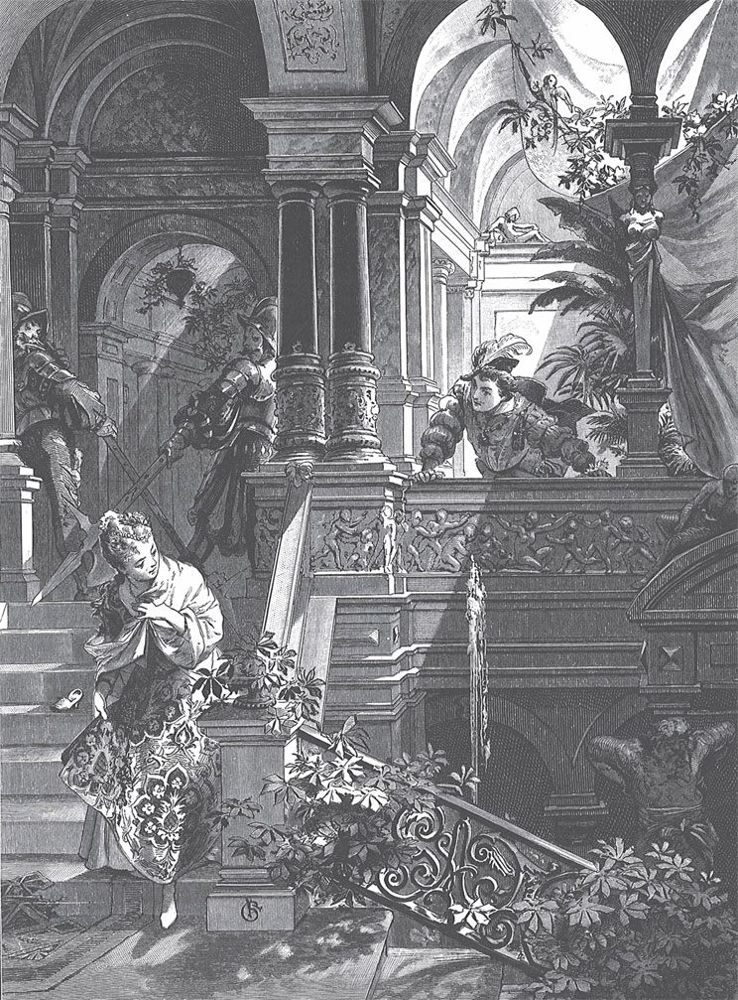

## Aschenputtel

Ein reicher Mann hat eine Frau, und die Frau wird krank. Sie fühlt, dass ihr Ende kommt. Da ruft sie ihre einzige kleine Tochter zu sich ans Bett und sagt:

— Liebes Kind, bleib <abbr title="fromm — благочестивый, набожный">fromm</abbr> und gut. Dann wird der liebe Gott dir immer helfen. Und ich will vom Himmel auf dich <abbr title="herabblicken — смотреть сверху вниз">herabblicken</abbr> und immer bei dir sein.

Dann schließt sie die Augen und stirbt. Das Mädchen geht jeden Tag hinaus zum Grab von der Mutter und weint. Und es bleibt fromm und gut. Im Winter legt der Schnee ein weißes <abbr title="das Tuch, die Tücher — платок, покрывало">Tuch</abbr> auf das Grab. Im <abbr title="der Frühling — весна">Frühling</abbr> zieht die Sonne das Tuch wieder herunter. Da nimmt sich der Mann eine andere Frau.

Die Frau bringt zwei Töchter mit ins Haus. Sie haben schöne, weiße Gesichter, aber ihre Herzen sind hässlich und schwarz. Jetzt beginnt eine schlimme Zeit für das arme <abbr title="das Stiefkind, die Stiefkinder — падчерица, пасынок">Stiefkind</abbr>.

— Soll diese dumme Gans bei uns in der Stube sitzen? — sagen sie. — Wer Brot essen will, muss es verdienen. Hinaus mit der <abbr title="die Küchenmagd, die Küchenmägde — кухонная служанка">Küchenmagd</abbr>!

Sie nehmen ihr die schönen Kleider weg. Sie ziehen ihr einen alten grauen <abbr title="der Kittel, die Kittel — рабочий халат, балахон">Kittel</abbr> an und geben ihr <abbr title="der Holzschuh, die Holzschuhe — деревянный башмак">Holzschuhe</abbr>.

— Seht mal die stolze <abbr title="die Prinzessin, die Prinzessinnen — принцесса">Prinzessin</abbr>! Wie schön sie <abbr title="herausgeputzt — разряженный">herausgeputzt</abbr> ist! — rufen sie und lachen. Dann bringen sie sie in die Küche.

Dort muss das Mädchen von morgens bis abends schwer arbeiten. Sie muss früh vor Sonnenaufgang aufstehen, Wasser tragen, Feuer machen, kochen und waschen. Obendrein tun ihr die Schwestern alles <abbr title="das Böse — зло">Böse</abbr> an, das sie sich nur ausdenken können. Sie <abbr title="verspotten — насмехаться, высмеивать">verspotten</abbr> sie. Sie schütten ihr die <abbr title="die Erbse, die Erbsen — горох, горошина">Erbsen</abbr> und <abbr title="die Linse, die Linsen — чечевица">Linsen</abbr> in die Asche. Dann muss sie sitzen und sie wieder <abbr title="auslesen (las aus, hat ausgelesen) — выбирать, перебирать">auslesen</abbr>. Am Abend ist sie müde von der Arbeit. Aber sie darf in kein Bett gehen. Sie muss sich neben den Herd in die Asche legen. Und weil sie deshalb immer <abbr title="staubig — пыльный">staubig</abbr> und schmutzig aussieht, nennen sie sie Aschenputtel.

Einmal will der Vater auf die <abbr title="die Messe, die Messen — ярмарка">Messe</abbr> fahren. Er fragt die beiden Stieftöchter, was er ihnen mitbringen soll.

— Schöne Kleider, — sagt die eine.

— Perlen und Edelsteine, — sagt die zweite.

— Und du, Aschenputtel, — sagt er, — was willst du haben?

— Vater, auf deinem Heimweg stößt dir sicher ein Zweig an den Hut. Den ersten Zweig brich für mich ab.

Er kauft für die beiden Stiefschwestern schöne Kleider, Perlen und Edelsteine. Auf dem Rückweg reitet er durch einen grünen <abbr title="der Busch, die Büsche — куст">Busch</abbr>. Da streift ihn ein <abbr title="der Haselzweig, die Haselzweige — ветка орешника">Haselzweig</abbr> und stößt ihm den Hut vom Kopf. Er bricht den Zweig ab und nimmt ihn mit. Zu Hause gibt er den Stieftöchtern, was sie sich gewünscht haben. Und Aschenputtel gibt er den Zweig von dem <abbr title="der Haselbusch, die Haselbüsche — куст орешника">Haselbusch</abbr>. Aschenputtel dankt ihm. Sie geht zum Grab von ihrer Mutter und <abbr title="pflanzen — сажать">pflanzt</abbr> den Zweig darauf. Sie weint so sehr, dass ihre Tränen auf den Zweig fallen und ihn gießen. Der Zweig wächst und wird ein schöner Baum. Aschenputtel geht jeden Tag dreimal zu dem Baum. Sie weint und betet. Und jedes Mal kommt ein weißes Vöglein auf den Baum. Wenn Aschenputtel einen Wunsch ausspricht, dann wirft ihr das Vöglein herunter, was sie sich gewünscht hat.

Einmal macht der König ein Fest. Es soll drei Tage dauern. Alle schönen Jungfrauen im Land sind eingeladen. Denn der Sohn vom König soll sich eine Braut <abbr title="aussuchen — выбирать">aussuchen</abbr>. Die zwei Stiefschwestern hören, dass auch sie kommen sollen. Da haben sie gute Laune. Sie rufen Aschenputtel und sagen:

— <abbr title="kämmen — причёсывать, расчёсывать">Kämm</abbr> uns die Haare, <abbr title="bürsten — чистить щёткой">bürste</abbr> uns die Schuhe und mach uns die <abbr title="die Schnalle, die Schnallen — пряжка">Schnallen</abbr> fest! Wir gehen zur Hochzeit ins Schloss vom König.

Aschenputtel gehorcht. Aber sie weint, denn sie möchte auch gern zum Tanz gehen. Sie bittet die Stiefmutter, ob sie mitgehen darf.

— Du, Aschenputtel? — sagt die Stiefmutter. — Du bist voll <abbr title="der Staub — пыль">Staub</abbr> und Schmutz und willst zur Hochzeit? Du hast keine Kleider und keine Schuhe und willst tanzen?

Aber Aschenputtel bittet immer weiter. Endlich sagt die Stiefmutter:

— Ich habe dir eine Schüssel Linsen in die Asche geschüttet. Wenn du die Linsen in zwei Stunden wieder ausgelesen hast, dann darfst du mitgehen.

Das Mädchen geht durch die Hintertür in den Garten und ruft:

— Ihr <abbr title="zahm — ручной, приручённый">zahmen</abbr> Täubchen, ihr <abbr title="das Turteltäubchen, die Turteltäubchen — горлица">Turteltäubchen</abbr>, all ihr Vöglein unter dem Himmel, kommt und helft mir lesen:

> die guten ins Töpfchen,  
> die schlechten ins <abbr title="das Kröpfchen, die Kröpfchen — зоб (у птицы)">Kröpfchen</abbr>.

Da kommen zwei weiße Täubchen zum Küchenfenster herein. Danach kommen die Turteltäubchen. Und endlich <abbr title="schwirren — порхать, жужжать">schwirren</abbr> und <abbr title="schwärmen — роиться, слетаться">schwärmen</abbr> alle Vöglein unter dem Himmel herein. Sie setzen sich rund um die Asche. Die Täubchen nicken mit den Köpfchen und fangen an: pick, pick, pick, pick. Da fangen auch die anderen an: pick, pick, pick, pick. Und sie lesen alle guten <abbr title="das Korn, die Körner — зерно">Körner</abbr> in die Schüssel. Kaum ist eine Stunde vorbei, da sind sie schon fertig und fliegen alle wieder hinaus.

Das Mädchen bringt die Schüssel zur Stiefmutter. Sie freut sich und glaubt, jetzt darf sie mit zur Hochzeit gehen. Aber die Stiefmutter sagt:

— Nein, Aschenputtel. Du hast keine Kleider und kannst nicht tanzen. Alle werden dich nur <abbr title="auslachen — высмеивать">auslachen</abbr>.

Aschenputtel weint. Da sagt die Stiefmutter:

— Wenn du mir in einer Stunde zwei Schüsseln voll Linsen aus der Asche lesen kannst, dann darfst du mitgehen.

Und sie denkt: «Das schafft sie <abbr title="niemals — никогда">niemals</abbr>.» Sie schüttet die zwei Schüsseln Linsen in die Asche. Das Mädchen geht durch die Hintertür in den Garten und ruft:

— Ihr zahmen Täubchen, ihr Turteltäubchen, all ihr Vöglein unter dem Himmel, kommt und helft mir lesen:

> die guten ins Töpfchen,  
> die schlechten ins Kröpfchen.

Da kommen zwei weiße Täubchen zum Küchenfenster herein. Danach kommen die Turteltäubchen. Und endlich schwirren und schwärmen alle Vöglein unter dem Himmel herein. Sie setzen sich rund um die Asche. Die Täubchen nicken mit ihren Köpfchen und fangen an: pick, pick, pick, pick. Da fangen auch die anderen an: pick, pick, pick, pick. Und sie lesen alle guten Körner in die Schüsseln. Nach einer halben Stunde sind sie schon fertig und fliegen alle wieder hinaus.

Das Mädchen trägt die Schüsseln zur Stiefmutter. Sie freut sich und glaubt, jetzt darf sie mit zur Hochzeit gehen. Aber die Stiefmutter sagt:

— Es hilft dir alles nichts. Du kommst nicht mit, denn du hast keine Kleider und kannst nicht tanzen. Wir müssen uns für dich schämen.

Sie <abbr title="jemandem den Rücken zudrehen — повернуться спиной">dreht</abbr> ihr den Rücken zu und eilt mit ihren zwei stolzen Töchtern fort.

Jetzt ist niemand mehr zu Hause. Da geht Aschenputtel zum Grab von ihrer Mutter unter den <abbr title="der Haselbaum, die Haselbäume — орешник">Haselbaum</abbr> und ruft:

> Bäumchen, <abbr title="sich rütteln — трястись, встряхиваться">rüttel dich</abbr> und <abbr title="sich schütteln — отряхиваться, трястись">schüttel dich</abbr>,  
> wirf Gold und Silber über mich.

Da wirft ihr der Vogel ein Kleid aus Gold und Silber herunter. Und dazu Pantoffeln, mit Seide und Silber <abbr title="bestickt — расшитый">bestickt</abbr>. Ganz schnell zieht sie das Kleid an und geht zur Hochzeit. Ihre Schwestern und die Stiefmutter erkennen sie nicht. Sie meinen, das ist eine fremde Königstochter, so schön sieht sie in dem goldenen Kleid aus. An Aschenputtel denken sie gar nicht. Sie denken, die sitzt zu Hause im Schmutz und sucht die Linsen aus der Asche.

Der Königssohn kommt ihr <abbr title="entgegenkommen (kam entgegen, ist entgegengekommen) — идти навстречу">entgegen</abbr>. Er nimmt sie an der Hand und tanzt mit ihr. Er will mit keiner anderen tanzen. Er lässt ihre Hand nicht los. Und wenn ein anderer kommt und sie zum Tanz <abbr title="auffordern — приглашать (на танец)">auffordern</abbr> will, dann sagt er:

— Das ist meine <abbr title="die Tänzerin, die Tänzerinnen — партнёрша по танцу, танцовщица">Tänzerin</abbr>.

Sie tanzt bis zum Abend. Dann will sie nach Hause gehen. Aber der Königssohn sagt:

— Ich gehe mit und <abbr title="begleiten — провожать">begleite</abbr> dich.

Denn er will sehen, zu welcher Familie das schöne Mädchen gehört. Aber sie entwischt ihm und springt in das <abbr title="das Taubenhaus, die Taubenhäuser — голубятня">Taubenhaus</abbr>. Der Königssohn wartet, bis der Vater kommt. Er sagt ihm: Das fremde Mädchen ist in das Taubenhaus gesprungen. Der Alte denkt: «Ist das vielleicht Aschenputtel?» Man muss ihm eine Axt und eine <abbr title="die Hacke, die Hacken — кирка, мотыга">Hacke</abbr> bringen. Damit schlägt er das Taubenhaus kaputt. Aber es ist niemand darin.

Dann gehen sie ins Haus. Da liegt Aschenputtel in ihren schmutzigen Kleidern in der Asche. Eine trübe <abbr title="die Öllampe, die Öllampen — масляная лампа">Öllampe</abbr> brennt im <abbr title="der Kamin, die Kamine — камин, очаг">Kamin</abbr>. Denn Aschenputtel ist schnell hinten aus dem Taubenhaus gesprungen und zum Haselbäumchen gelaufen. Dort hat sie die schönen Kleider ausgezogen und auf das Grab gelegt. Der Vogel hat sie wieder weggenommen. Und dann hat sie sich in ihrem grauen Kittel in die Küche zur Asche gesetzt.

Am nächsten Tag beginnt das Fest von neuem. Die Eltern und die Stiefschwestern sind wieder fort. Da geht Aschenputtel zum Haselbaum und sagt:

> Bäumchen, rüttel dich und schüttel dich,  
> wirf Gold und Silber über mich.

Da wirft der Vogel ein Kleid herunter, das noch viel prächtiger ist als am Tag davor. Mit diesem Kleid kommt sie zur Hochzeit. Alle staunen über ihre Schönheit. Der Königssohn hat schon auf sie gewartet. Er nimmt sie gleich an der Hand und tanzt nur mit ihr allein. Wenn die anderen kommen und sie zum Tanz auffordern, sagt er:

— Das ist meine Tänzerin.

Am Abend will sie fort. Der Königssohn geht ihr nach. Er will sehen, in welches Haus sie geht. Aber sie läuft ihm weg, in den Garten hinter dem Haus. Dort steht ein schöner, großer Baum, an dem die herrlichsten <abbr title="die Birne, die Birnen — груша">Birnen</abbr> hängen. Sie klettert so flink wie ein Eichhörnchen zwischen die Äste. Der Königssohn weiß nicht, wo sie hin ist. Er wartet, bis der Vater kommt, und sagt zu ihm:

— Das fremde Mädchen ist mir entwischt. Ich glaube, sie ist auf den <abbr title="der Birnbaum, die Birnbäume — грушевое дерево">Birnbaum</abbr> gesprungen.

Der Vater denkt: «Ist das vielleicht Aschenputtel?» Er lässt sich die Axt holen und <abbr title="umhauen (haute um, hat umgehauen) — срубать">haut</abbr> den Baum um. Aber es ist niemand darauf. Dann gehen sie in die Küche. Da liegt Aschenputtel in der Asche wie immer. Denn sie ist auf der anderen Seite vom Baum heruntergesprungen. Sie hat dem Vogel auf dem Haselbäumchen die schönen Kleider zurückgebracht und ihren grauen Kittel angezogen.

Am dritten Tag sind die Eltern und die Schwestern wieder fort. Da geht Aschenputtel wieder zum Grab von ihrer Mutter und sagt zu dem Bäumchen:

> Bäumchen, rüttel dich und schüttel dich,  
> wirf Gold und Silber über mich.

Jetzt wirft ihr der Vogel ein Kleid herunter, so prächtig und so <abbr title="glänzend — блестящий, сверкающий">glänzend</abbr>, wie sie noch keins gehabt hat. Und die Pantoffeln sind ganz aus Gold. Sie kommt in dem Kleid zur Hochzeit. Da wissen alle vor Staunen nicht, was sie sagen sollen. Der Königssohn tanzt ganz allein mit ihr. Und wenn einer sie auffordert, sagt er:

— Das ist meine Tänzerin.

Am Abend will Aschenputtel fort. Der Königssohn will sie begleiten. Aber sie läuft so schnell weg, dass er ihr nicht folgen kann. Doch diesmal hat der Königssohn eine List <abbr title="gebrauchen — применять, использовать">gebraucht</abbr>. Er hat die ganze Treppe mit Pech bestreichen lassen. Das Mädchen springt die Treppe hinunter, und da bleibt ihr linker Pantoffel <abbr title="kleben bleiben — прилипнуть">kleben</abbr>. Der Königssohn hebt ihn auf. Der Pantoffel ist klein und <abbr title="zierlich — изящный">zierlich</abbr> und ganz aus Gold.

Am nächsten Morgen geht er damit zu dem Mann und sagt:

— Ich heirate nur das Mädchen, das diesen goldenen Schuh tragen kann. Er muss ihr genau <abbr title="passen — подходить, быть впору">passen</abbr>.

Da freuen sich die beiden Schwestern, denn sie haben schöne Füße. Die Ältere geht mit dem Schuh in die Kammer und will ihn <abbr title="anprobieren — примерять">anprobieren</abbr>. Die Mutter steht dabei. Aber sie kommt mit der großen <abbr title="die Zehe, die Zehen — палец ноги">Zehe</abbr> nicht hinein. Der Schuh ist ihr zu klein. Da gibt ihr die Mutter ein Messer und sagt:

— <abbr title="abhauen (haute ab, hat abgehauen) — отрубать">Hau</abbr> die Zehe ab. Wenn du Königin bist, musst du nicht mehr zu Fuß gehen.

Das Mädchen haut die Zehe ab. Sie <abbr title="zwängen — втискивать">zwängt</abbr> den Fuß in den Schuh, <abbr title="die Zähne zusammenbeißen — стиснуть зубы">beißt</abbr> die Zähne zusammen gegen den Schmerz und geht hinaus zum Königssohn. Er nimmt sie als seine Braut aufs Pferd und reitet mit ihr fort. Aber sie müssen am Grab vorbei. Da sitzen die zwei Täubchen auf dem Haselbäumchen und rufen:

> Ruckediguh, ruckediguh,  
> Blut ist im Schuh:  
> Der Schuh ist zu klein,  
> die rechte Braut sitzt noch <abbr title="daheim — дома">daheim</abbr>.

Da sieht er auf ihren Fuß. Er sieht, wie das Blut <abbr title="herausquellen (quoll heraus, ist herausgequollen) — сочиться, вытекать">herausquillt</abbr>. Er <abbr title="wenden — поворачивать">wendet</abbr> sein Pferd und bringt die falsche Braut wieder nach Hause. Er sagt: Das ist nicht die richtige. Die andere Schwester soll den Schuh anziehen.

Die geht in die Kammer und kommt mit den Zehen gut in den Schuh. Aber ihre <abbr title="die Ferse, die Fersen — пятка">Ferse</abbr> ist zu groß. Da gibt ihr die Mutter ein Messer und sagt:

— Hau ein Stück von der Ferse ab. Wenn du Königin bist, musst du nicht mehr zu Fuß gehen.

Das Mädchen haut ein Stück von der Ferse ab. Sie zwängt den Fuß in den Schuh, beißt die Zähne zusammen gegen den Schmerz und geht hinaus zum Königssohn. Er nimmt sie als seine Braut aufs Pferd und reitet mit ihr fort. Sie kommen am Haselbäumchen vorbei. Da sitzen die zwei Täubchen darauf und rufen:

> Ruckediguh, ruckediguh,  
> Blut ist im Schuh:  
> Der Schuh ist zu klein,  
> die rechte Braut sitzt noch daheim.

Er sieht hinunter auf ihren Fuß. Da sieht er, wie das Blut aus dem Schuh quillt. Die weißen <abbr title="der Strumpf, die Strümpfe — чулок">Strümpfe</abbr> sind schon ganz rot. Da wendet er sein Pferd und bringt die falsche Braut wieder nach Hause.

— Das ist auch nicht die richtige, — sagt er. — Habt ihr keine andere Tochter?

— Nein, — sagt der Mann. — Nur von meiner <abbr title="verstorben — покойный, умерший">verstorbenen</abbr> Frau gibt es noch ein kleines, <abbr title="verkümmert — чахлый, захиревший">verkümmertes</abbr> Aschenputtel. Das kann <abbr title="unmöglich — никак не, невозможно">unmöglich</abbr> die Braut sein.

Der Königssohn sagt, er soll sie heraufschicken. Aber die Stiefmutter antwortet:

— Ach nein, die ist viel zu schmutzig. Die darf sich nicht sehen lassen.

Aber er will sie unbedingt sehen. Also muss man Aschenputtel rufen. Zuerst wäscht sie sich die Hände und das Gesicht sauber. Dann geht sie hin und <abbr title="sich verneigen — кланяться">verneigt sich</abbr> vor dem Königssohn. Er gibt ihr den goldenen Schuh. Sie setzt sich auf einen <abbr title="der Hocker, die Hocker — табурет">Hocker</abbr>, zieht den Fuß aus dem schweren Holzschuh und steckt ihn in den Pantoffel. Der Pantoffel passt <abbr title="wie angegossen — как влитой">wie angegossen</abbr>. Sie steht auf, und der Königssohn sieht ihr ins Gesicht. Da erkennt er das schöne Mädchen, das mit ihm getanzt hat, und ruft:

— Das ist die richtige Braut!

Die Stiefmutter und die beiden Schwestern erschrecken und werden blass vor Ärger. Er aber nimmt Aschenputtel aufs Pferd und reitet mit ihr fort. Sie kommen am Haselbäumchen vorbei. Da rufen die zwei weißen Täubchen:

> Ruckediguh, ruckediguh,  
> kein Blut im Schuh:  
> Der Schuh ist nicht zu klein,  
> die rechte Braut, die führt er heim.

Und als sie das gerufen haben, fliegen sie beide herunter. Sie setzen sich Aschenputtel auf die Schultern, eine rechts, die andere links, und bleiben dort sitzen.

Dann soll die Hochzeit mit dem Königssohn sein. Da kommen die falschen Schwestern. Sie wollen sich bei ihm <abbr title="sich einschmeicheln — подлизываться, втираться в доверие">einschmeicheln</abbr> und etwas von seinem Glück abbekommen. Das <abbr title="das Brautpaar, die Brautpaare — жених и невеста">Brautpaar</abbr> geht zur Kirche. Die Ältere geht rechts, die Jüngere links. Da <abbr title="auspicken — выклевать">picken</abbr> die Tauben jeder Schwester ein Auge aus. Später gehen sie aus der Kirche heraus. Jetzt geht die Ältere links und die Jüngere rechts. Da picken die Tauben jeder Schwester das andere Auge aus. So sind sie für ihre Bosheit und <abbr title="die Falschheit — фальшь, лживость">Falschheit</abbr> bestraft: Sie bleiben ihr ganzes Leben lang blind.

---

### Neue Wörter

- **fromm** — благочестивый, набожный
- **herabblicken** — смотреть сверху вниз
- **das Tuch, die Tücher** — платок, покрывало
- **der Frühling** — весна
- **das Stiefkind, die Stiefkinder** — падчерица, пасынок
- **die Küchenmagd, die Küchenmägde** — кухонная служанка
- **der Kittel, die Kittel** — рабочий халат, балахон
- **der Holzschuh, die Holzschuhe** — деревянный башмак
- **die Prinzessin, die Prinzessinnen** — принцесса
- **herausgeputzt** — разряженный
- **das Böse** — зло
- **verspotten** — насмехаться, высмеивать
- **die Erbse, die Erbsen** — горох, горошина
- **die Linse, die Linsen** — чечевица
- **auslesen (las aus, hat ausgelesen)** — выбирать, перебирать
- **staubig** — пыльный
- **die Messe, die Messen** — ярмарка
- **der Busch, die Büsche** — куст
- **der Haselzweig, die Haselzweige** — ветка орешника
- **der Haselbusch, die Haselbüsche** — куст орешника
- **pflanzen** — сажать
- **aussuchen** — выбирать
- **kämmen** — причёсывать, расчёсывать
- **bürsten** — чистить щёткой
- **die Schnalle, die Schnallen** — пряжка
- **der Staub** — пыль
- **zahm** — ручной, приручённый
- **das Turteltäubchen, die Turteltäubchen** — горлица
- **das Kröpfchen, die Kröpfchen** — зоб (у птицы)
- **schwirren** — порхать, жужжать
- **schwärmen** — роиться, слетаться
- **das Korn, die Körner** — зерно
- **auslachen** — высмеивать
- **niemals** — никогда
- **jemandem den Rücken zudrehen** — повернуться спиной
- **der Haselbaum, die Haselbäume** — орешник
- **sich rütteln** — трястись, встряхиваться
- **sich schütteln** — отряхиваться, трястись
- **bestickt** — расшитый
- **entgegenkommen (kam entgegen, ist entgegengekommen)** — идти навстречу
- **auffordern** — приглашать (на танец)
- **die Tänzerin, die Tänzerinnen** — партнёрша по танцу, танцовщица
- **begleiten** — провожать
- **das Taubenhaus, die Taubenhäuser** — голубятня
- **die Hacke, die Hacken** — кирка, мотыга
- **die Öllampe, die Öllampen** — масляная лампа
- **der Kamin, die Kamine** — камин, очаг
- **die Birne, die Birnen** — груша
- **der Birnbaum, die Birnbäume** — грушевое дерево
- **umhauen (haute um, hat umgehauen)** — срубать
- **glänzend** — блестящий, сверкающий
- **gebrauchen** — применять, использовать
- **kleben bleiben** — прилипнуть
- **zierlich** — изящный
- **passen** — подходить, быть впору
- **anprobieren** — примерять
- **die Zehe, die Zehen** — палец ноги
- **abhauen (haute ab, hat abgehauen)** — отрубать
- **zwängen** — втискивать
- **die Zähne zusammenbeißen** — стиснуть зубы
- **daheim** — дома
- **herausquellen (quoll heraus, ist herausgequollen)** — сочиться, вытекать
- **wenden** — поворачивать
- **die Ferse, die Fersen** — пятка
- **der Strumpf, die Strümpfe** — чулок
- **verstorben** — покойный, умерший
- **verkümmert** — чахлый, захиревший
- **unmöglich** — никак не, невозможно
- **sich verneigen** — кланяться
- **der Hocker, die Hocker** — табурет
- **wie angegossen** — как влитой
- **sich einschmeicheln** — подлизываться, втираться в доверие
- **das Brautpaar, die Brautpaare** — жених и невеста
- **auspicken** — выклевать
- **die Falschheit** — фальшь, лживость

[← Zurück](kapitel-20.md) · [Inhalt](README.md)
