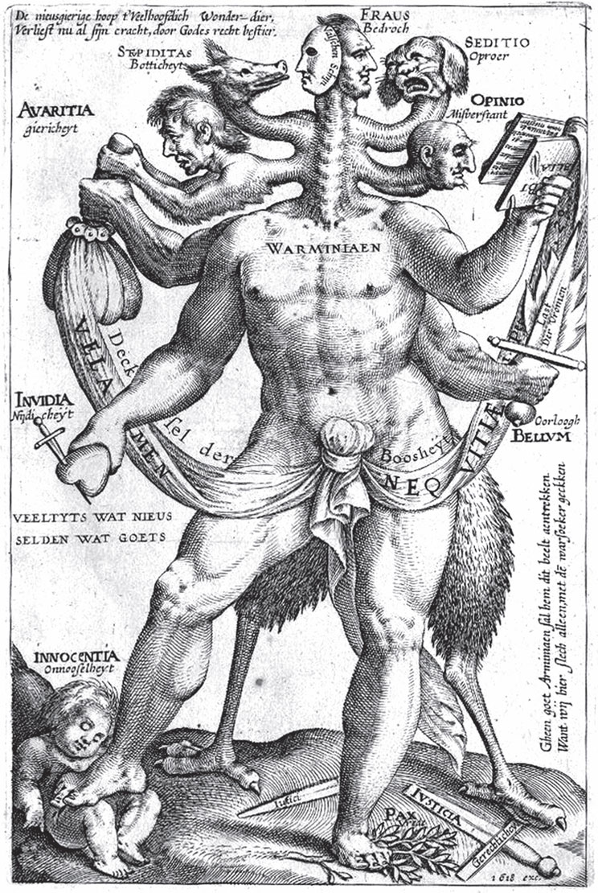

## Von dem Mäuschen, Vögelchen und der Bratwurst

Es waren einmal ein Mäuschen, ein Vögelchen und eine <abbr title="die Bratwurst, die Bratwürste — жареная колбаска">Bratwurst</abbr>. Sie haben sich <abbr title="sich zusammentun (tat sich zusammen, hat sich zusammengetan) — объединиться">zusammengetan</abbr> und führen zusammen einen Haushalt. Schon lange leben sie gut und gemütlich in Frieden, und sie sind ziemlich <abbr title="wohlhabend — зажиточный">wohlhabend</abbr> geworden. Das Vögelchen hat diese Arbeit: Es muss jeden Tag in den Wald fliegen und <abbr title="das Holz — дрова, дерево">Holz</abbr> holen. Die Maus soll Wasser tragen, Feuer machen und den Tisch <abbr title="den Tisch decken — накрывать на стол">decken</abbr>. Und die Bratwurst soll kochen.

Aber wem es zu gut geht, der will immer etwas Neues! Eines Tages <abbr title="treffen (traf, hat getroffen) — встречать">trifft</abbr> das Vögelchen unterwegs einen anderen Vogel. Es erzählt ihm von seinem schönen Leben und lobt es sehr. Aber der andere Vogel schimpft es einen armen <abbr title="der Tropf, die Tröpfe — бедолага, простофиля">Tropf</abbr>. Er sagt: «Du hast die schwere Arbeit, und die beiden zu Hause haben ein <abbr title="bequem — удобный, лёгкий">bequemes</abbr> Leben!»

Und das stimmt. Wenn die Maus Feuer gemacht und Wasser getragen hat, geht sie in ihr <abbr title="das Kämmerchen, die Kämmerchen — комнатка, каморка">Kämmerchen</abbr> und ruht sich aus. Erst wenn man sie ruft, deckt sie den Tisch. Das Würstchen bleibt beim Topf. Es passt auf, dass das Essen gut kocht. Und kurz vor dem Essen <abbr title="sich schlängeln — извиваться, проскальзывать">schlängelt sich</abbr> die Wurst ein- oder zweimal durch den Brei oder das Gemüse. Schon ist alles <abbr title="fetten — сдабривать жиром">gefettet</abbr>, <abbr title="salzen — солить">gesalzen</abbr> und fertig! Dann kommt das Vögelchen nach Hause und legt seine Last ab. Sie setzen sich an den Tisch. Nach dem Essen schlafen sie sich richtig satt bis zum nächsten Morgen. Das ist ein herrliches Leben!

Aber jetzt hat der fremde Vogel das Vögelchen <abbr title="aufhetzen — подстрекать, науськивать">aufgehetzt</abbr>. Am nächsten Tag will es nicht mehr in den Wald fliegen. Es sagt:

— Ich bin lange genug euer <abbr title="der Knecht, die Knechte — батрак, слуга">Knecht</abbr> gewesen. Ich war sozusagen euer Narr! Wir wollen einmal <abbr title="tauschen — меняться">tauschen</abbr> und es auf eine andere Art versuchen.

Die Maus und die Bratwurst bitten es sehr, alles so zu lassen. Aber der Vogel ist der <abbr title="der Meister, die Meister — хозяин, главный">Meister</abbr>. Sie müssen es wagen. Also <abbr title="losen — тянуть жребий">losen</abbr> sie. Das <abbr title="das Los, die Lose — жребий">Los</abbr> fällt auf die Bratwurst: Sie muss Holz tragen. Die Maus wird Koch, und der Vogel soll Wasser holen.

Und was passiert? Das Bratwürstchen geht in den Wald. Das Vögelchen macht Feuer. Die Maus stellt den Topf auf. Dann warten die beiden, bis das Bratwürstchen nach Hause kommt und Holz für den nächsten Tag bringt. Aber das Würstchen bleibt so lange weg, dass die beiden etwas Schlimmes <abbr title="ahnen — предчувствовать">ahnen</abbr>. Das Vögelchen fliegt ihm ein Stück <abbr title="entgegenfliegen (flog entgegen, ist entgegengeflogen) — лететь навстречу">entgegen</abbr>. Nicht weit weg findet es einen Hund am Weg. Der Hund hat das arme Bratwürstchen als freie <abbr title="die Beute — добыча">Beute</abbr> gefunden, gepackt und getötet. Das Vögelchen <abbr title="sich beschweren — жаловаться">beschwert sich</abbr> sehr beim Hund. Das ist doch ein klarer <abbr title="der Raub — грабёж, разбой">Raub</abbr>! Aber es hilft kein Wort. Denn der Hund sagt: Er hat bei der Bratwurst <abbr title="gefälscht — поддельный">gefälschte</abbr> <abbr title="das Papier, die Papiere — документ, бумага">Papiere</abbr> gefunden. Deshalb hat die Bratwurst ihr Leben verloren.

Traurig nimmt das Vögelchen das Holz, fliegt nach Hause und erzählt, was es gesehen und gehört hat. Die beiden sind sehr betrübt. Aber sie <abbr title="beschließen (beschloss, hat beschlossen) — решать">beschließen</abbr>, das Beste daraus zu machen und zusammenzubleiben. Also deckt das Vögelchen den Tisch, und die Maus kocht das Essen. Sie will das Essen fertig machen. Wie früher das Würstchen will sie durch das Gemüse im Topf <abbr title="schlüpfen — проскальзывать">schlüpfen</abbr>. So soll es schön fett werden. Aber sie kommt nicht einmal bis in die Mitte. Sie bleibt stecken. Sie verliert Haut und Haar und dazu ihr Leben.

Das Vögelchen kommt und will das Essen <abbr title="auftragen (trug auf, hat aufgetragen) — подавать на стол">auftragen</abbr>. Aber da ist kein Koch mehr. Erschrocken wirft das Vögelchen das Holz hin und her. Es ruft und sucht, aber es kann seinen Koch nicht mehr finden. Weil es nicht aufpasst, kommt das Feuer an das Holz. Es gibt einen <abbr title="der Brand, die Brände — пожар">Brand</abbr>. Das Vögelchen eilt zum Brunnen und will Wasser holen. Da fällt ihm der Eimer in den Brunnen, und das Vögelchen fällt mit hinunter. Es kann sich nicht mehr retten und ertrinkt.

---

### Neue Wörter

- **die Bratwurst, die Bratwürste** — жареная колбаска
- **sich zusammentun (tat sich zusammen, hat sich zusammengetan)** — объединиться
- **wohlhabend** — зажиточный
- **das Holz** — дрова, дерево
- **den Tisch decken** — накрывать на стол
- **treffen (traf, hat getroffen)** — встречать
- **der Tropf, die Tröpfe** — бедолага, простофиля
- **bequem** — удобный, лёгкий
- **das Kämmerchen, die Kämmerchen** — комнатка, каморка
- **sich schlängeln** — извиваться, проскальзывать
- **fetten** — сдабривать жиром
- **salzen** — солить
- **aufhetzen** — подстрекать, науськивать
- **der Knecht, die Knechte** — батрак, слуга
- **tauschen** — меняться
- **der Meister, die Meister** — хозяин, главный
- **losen** — тянуть жребий
- **das Los, die Lose** — жребий
- **ahnen** — предчувствовать
- **entgegenfliegen (flog entgegen, ist entgegengeflogen)** — лететь навстречу
- **die Beute** — добыча
- **sich beschweren** — жаловаться
- **der Raub** — грабёж, разбой
- **gefälscht** — поддельный
- **das Papier, die Papiere** — документ, бумага
- **beschließen (beschloss, hat beschlossen)** — решать
- **schlüpfen** — проскальзывать
- **auftragen (trug auf, hat aufgetragen)** — подавать на стол
- **der Brand, die Brände** — пожар

[← Zurück](kapitel-22.md) · [Inhalt](README.md)
