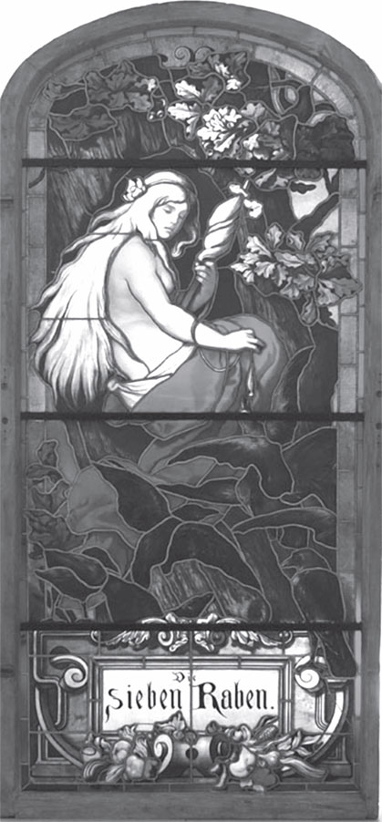

## Die sieben Raben

Ein Mann hat sieben Söhne, aber noch keine Tochter. Er wünscht sich so sehr ein Mädchen! Endlich <abbr title="ein Kind erwarten — ждать ребёнка">erwartet</abbr> seine Frau wieder ein Kind. Und als das Kind <abbr title="zur Welt kommen — родиться, появиться на свет">zur Welt kommt</abbr>, ist es wirklich ein Mädchen. Die Freude ist groß. Aber das Kind ist schwach und sehr klein. Die Eltern haben Angst, dass es bald stirbt. Deshalb wollen sie es sofort <abbr title="taufen — крестить">taufen</abbr> — schnell, noch zu Hause.

Der Vater schickt einen von den Jungen <abbr title="eilig — поспешно, срочно">eilig</abbr> zur Quelle. Er soll <abbr title="das Taufwasser — вода для крещения">Taufwasser</abbr> holen. Die anderen sechs laufen mit. Jeder will als Erster Wasser schöpfen. Da fällt ihnen der <abbr title="der Krug, die Krüge — кувшин">Krug</abbr> in den Brunnen. Jetzt stehen sie da und wissen nicht, was sie tun sollen. Keiner traut sich nach Hause.

Die Jungen kommen und kommen nicht zurück. Der Vater wird ungeduldig und sagt:

— Bestimmt haben sie wieder alles vergessen und spielen irgendwo, diese gottlosen Jungen!

Er hat Angst, dass das Mädchen ohne Taufe stirbt. Er ist sehr wütend und ruft:

— Ich will, dass die Jungen alle zu Raben werden!

Kaum hat er das gesagt, da hört er über seinem Kopf ein Rauschen in der Luft. Er sieht nach oben. Sieben <abbr title="kohlschwarz — чёрный как уголь">kohlschwarze</abbr> Raben fliegen davon.

Die Eltern können den <abbr title="der Fluch, die Flüche — проклятие">Fluch</abbr> nicht mehr <abbr title="zurücknehmen (nahm zurück, hat zurückgenommen) — брать назад">zurücknehmen</abbr>. Sie sind sehr traurig, denn sie haben ihre sieben Söhne verloren. Aber ihre liebe kleine Tochter tröstet sie ein bisschen. Das Mädchen wird bald stark und gesund, und jeden Tag wird es schöner.

Lange Zeit weiß das Mädchen nicht einmal, dass es Brüder hatte. Denn die Eltern sprechen nie davon. Aber eines Tages hört es <abbr title="zufällig — случайно">zufällig</abbr>, wie die Leute über es sprechen. Sie sagen: «Das Mädchen ist schön, aber eigentlich ist es <abbr title="schuld sein an + Dat. — быть виноватым в">schuld</abbr> an dem Unglück von seinen sieben Brüdern.»

Da wird das Mädchen sehr traurig. Es geht zu Vater und Mutter und fragt:

— Hatte ich Brüder? Und wo sind sie?

Jetzt können die Eltern das <abbr title="das Geheimnis, die Geheimnisse — тайна, секрет">Geheimnis</abbr> nicht länger <abbr title="verschweigen (verschwieg, hat verschwiegen) — умалчивать, скрывать">verschweigen</abbr>. Sie erzählen alles. Aber sie sagen auch:

— Das war der Wille vom Himmel. Du kannst nichts dafür. Du bist nur geboren, du bist unschuldig.

Aber das Mädchen hat jeden Tag ein schlechtes Gewissen. Es glaubt: «Ich muss meine Brüder erlösen.» Es hat keine Ruhe mehr. Endlich geht es heimlich fort, hinaus in die weite Welt. Es will seine Brüder finden und befreien, egal, was es kostet.

Es nimmt nur vier Dinge mit: ein kleines <abbr title="das Ringlein, die Ringlein — колечко">Ringlein</abbr> von den Eltern als <abbr title="das Andenken, die Andenken — память, сувенир">Andenken</abbr>, ein Laib Brot für den Hunger, einen kleinen Krug Wasser für den Durst und ein kleines <abbr title="das Stühlchen, die Stühlchen — стульчик">Stühlchen</abbr> für die Müdigkeit.

Das Mädchen geht immer weiter, weit, weit, bis an das Ende der Welt. Da kommt es zur Sonne. Aber die Sonne ist zu heiß und fürchterlich. Sie frisst die kleinen Kinder. Schnell läuft das Mädchen weg, hin zum Mond. Aber der Mond ist viel zu kalt und auch unheimlich und böse. Er merkt das Kind und sagt:

— Ich rieche, rieche <abbr title="das Menschenfleisch — человечье мясо, человечина">Menschenfleisch</abbr>!

Da läuft das Mädchen schnell weg und kommt zu den Sternen. Die Sterne sind freundlich und gut zu ihm. Jeder Stern sitzt auf seinem eigenen kleinen Stühlchen. Aber der <abbr title="der Morgenstern — утренняя звезда">Morgenstern</abbr> steht auf. Er gibt dem Mädchen ein kleines <abbr title="das Hühnerknöchelchen, die Hühnerknöchelchen — куриная косточка">Hühnerknöchelchen</abbr> und sagt:

— Ohne dieses Knöchelchen kannst du den <abbr title="der Glasberg — стеклянная гора">Glasberg</abbr> nicht aufschließen. Und in dem Glasberg sind deine Brüder.

Das Mädchen nimmt das Knöchelchen und wickelt es gut in ein kleines Tuch. Dann geht es wieder los, so lange, bis es zum Glasberg kommt. Das Tor ist verschlossen. Das Mädchen will das Knöchelchen herausholen. Aber als es das Tuch aufmacht, ist das Tuch leer. Es hat das Geschenk von den guten Sternen verloren!

Was soll es jetzt tun? Es will seine Brüder retten, aber es hat keinen Schlüssel für den Glasberg. Da nimmt das gute Schwesterchen ein Messer. Es schneidet sich ein kleines Fingerchen ab. Es steckt den Finger in das Tor, und das Tor geht wirklich auf!

Das Mädchen geht hinein. Da kommt ihm ein kleiner Zwerg entgegen und fragt:

— Mein Kind, was suchst du?

— Ich suche meine Brüder, die sieben Raben, — antwortet das Mädchen.

Der Zwerg sagt:

— Die Herren Raben sind nicht zu Hause. Aber du kannst hier warten, bis sie kommen. Komm herein!

Dann bringt der Zwerg das Essen für die Raben herein: auf sieben kleinen <abbr title="das Tellerchen, die Tellerchen — тарелочка">Tellerchen</abbr> und in sieben kleinen <abbr title="das Becherchen, die Becherchen — чашечка, кубок">Becherchen</abbr>. Von jedem Tellerchen isst das Schwesterchen ein kleines Bröckchen. Aus jedem Becherchen trinkt es einen kleinen Schluck. Aber in das letzte Becherchen lässt es das Ringlein fallen, das es mitgebracht hat.

Plötzlich hört es in der Luft ein Rauschen und ein Flattern. Da sagt der Zwerg:

— Jetzt kommen die Herren Raben nach Hause geflogen.

Da kommen sie. Sie wollen essen und trinken und suchen ihre Tellerchen und Becherchen. Und einer nach dem anderen sagt:

— Wer hat von meinem Tellerchen gegessen? Wer hat aus meinem Becherchen getrunken? Das war ein Menschenmund!

Der siebte Rabe trinkt seinen Becher leer. Da rollt ihm das Ringlein <abbr title="entgegenrollen — катиться навстречу">entgegen</abbr>. Er sieht es an und erkennt es: Es ist ein Ring von Vater und Mutter! Er sagt:

— Ach, ich möchte so gern, dass unser Schwesterlein hier ist! Dann sind wir erlöst.

Das Mädchen steht hinter der Tür und lauscht. Als es den Wunsch hört, kommt es hervor. Und in diesem Augenblick bekommen alle Raben ihre <abbr title="menschlich — человеческий">menschliche</abbr> Gestalt zurück. Sie umarmen und küssen sich und gehen fröhlich nach Hause.

---

### Neue Wörter

- **ein Kind erwarten** — ждать ребёнка
- **zur Welt kommen** — родиться, появиться на свет
- **taufen** — крестить
- **eilig** — поспешно, срочно
- **das Taufwasser** — вода для крещения
- **der Krug, die Krüge** — кувшин
- **kohlschwarz** — чёрный как уголь
- **der Fluch, die Flüche** — проклятие
- **zurücknehmen (nahm zurück, hat zurückgenommen)** — брать назад
- **zufällig** — случайно
- **schuld sein an + Dat.** — быть виноватым в
- **das Geheimnis, die Geheimnisse** — тайна, секрет
- **verschweigen (verschwieg, hat verschwiegen)** — умалчивать, скрывать
- **das Ringlein, die Ringlein** — колечко
- **das Andenken, die Andenken** — память, сувенир
- **das Stühlchen, die Stühlchen** — стульчик
- **das Menschenfleisch** — человечье мясо, человечина
- **der Morgenstern** — утренняя звезда
- **das Hühnerknöchelchen, die Hühnerknöchelchen** — куриная косточка
- **der Glasberg** — стеклянная гора
- **das Tellerchen, die Tellerchen** — тарелочка
- **das Becherchen, die Becherchen** — чашечка, кубок
- **entgegenrollen** — катиться навстречу
- **menschlich** — человеческий

[← Zurück](kapitel-24.md) · [Inhalt](README.md)
